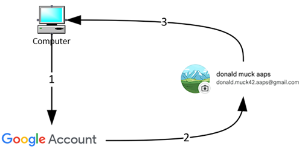

# Un compte Google dédié à AAPS (facultatif)

Certains utilisateurs d'**AAPS** préfèrent utiliser aussi leur compte e-mail principal pour **AAPS**. D'autres utilisateurs d'**AAPS** (ou leurs aidants) créent un compte e-mail dédié à **AAPS**. C'est facultatif. Nous donnons ci-dessous un exemple pour le faire.

Si vous ne voulez pas créer de compte Gmail dédié à **AAPS**, vous pouvez passer directement à la section suivante, [Compilation d'AAPS](../SettingUpAaps/BuildingAaps.md).

```{admonition} Advantages of a dedicated Google account for AAPS
:class: dropdown

- Dedicated Google Drive space means you will not risk filling up your personal Google Drive limit with **Export settings**.
- Chaque version d'**AAPS** (et des applications associées comme xDrip, BYODA, etc.) sera stockée dans un seul endroit, indépendant de votre ordinateur. Si votre PC ou votre téléphone est volé, perdu ou cassé, vous aurez toujours accès à vos données.
- Avec une configuration identique, l'aide en ligne est plus simple entre utilisateurs qui ont la même structure de dossiers.
- Selon la configuration (voir ci-dessous), vous aurez une identité séparée (un alias) pour communiquer dans la communauté. Cela peut protéger votre vie privée. 
- Les enfants avec un DT1 peuvent garder leur propre compte e-mail « de tous les jours » de mineur, tout en utilisant **AAPS** et les fonctions associées qui demandent un compte adulte.
- Gmail vous permet d'enregistrer jusqu'à 4 comptes avec le même numéro de téléphone.
```

## Comment créer un compte Google dédié à AAPS

(⌛Environ 10 minutes)



Prérequis :

* Vous avez un PC Windows (Windows 10 ou plus récent) et un téléphone Android (Android 12 ou plus récent) qui accueillera l'application **AAPS**. Les deux ont toutes les dernières mises à jour de sécurité, un accès à Internet et les droits d'administrateur, car certaines étapes demandent de télécharger et d'installer des programmes.
* Le téléphone Android est déjà configuré avec votre adresse e-mail personnelle « de tous les jours », par exemple un compte Gmail.

```{admonition} Things to consider when setting up your new account
:class: dropdown
- Pour protéger votre vie privée, vous pouvez utiliser un nom différent du vôtre, qui a un lien avec le compte (par exemple t1dsuperstar). Vous pouvez ensuite l'utiliser dans les forums publics d'**AAPS** tout en gardant votre identité privée. Comme Google demande un e-mail de récupération et un numéro de téléphone, le compte reste quand même traçable.
- Le nouveau compte **AAPS** utilisera pour la vérification le même numéro de téléphone que votre compte « _de tous les jours_ ». Il utilisera l'adresse e-mail « de tous les jours » pour la vérification ;
- Nous allons configurer un transfert d'e-mails : tout e-mail envoyé au nouveau compte dédié à AAPS sera transféré vers le compte principal (vous n'avez donc pas besoin de vérifier deux boîtes e-mail différentes) ;
- Utilisez des mots de passe différents pour votre compte Gmail _de tous les jours_ et pour le compte Gmail dédié à AAPS
- Si vous utilisez la « validation en deux étapes » de Google (authentification multifacteur) pour un compte Gmail, faites-le aussi pour l'autre compte Gmail.
- Si vous voulez utiliser les « clés d'accès » (Passkeys) de Google, enregistrez plusieurs appareils. Ainsi, vous ne vous bloquerez pas l'accès à votre compte. Faites-le seulement sur des appareils auxquels personne d'autre n'a accès (_c.-à-d._ pas sur un PC avec un compte partagé que d'autres personnes peuvent déverrouiller).
```


```{admonition} Video Walkthrough!
:class: note
Cliquez [ici](<https://drive.google.com/file/d/1dMZTIolO-kd2eB0soP7boEVtHeCDEQBF/view?usp=drive_link>) pour voir une vidéo qui montre comment créer un compte Google dédié.
```

 Voici les étapes montrées dans la vidéo :

Dans cet exemple : 
- Your existing “_Everyday_” Google account is <donald.muck42@gmail.com>; 
- Votre nouveau compte Gmail « _AAPS_ » sera : <donald.muck42.aaps@gmail.com> ; 


### Go to <https://myaccount.google.com> 

 Si vous êtes déjà connecté à Google, vous arriverez sur la page **Mon compte** de votre compte « de tous les jours ». (1) Click on the top right of the page on your profile picture (in this case, a simple ) (2) select “_add another account_”.


### Saisissez les informations de votre NOUVEAU compte dédié : 

- Saisissez le nouveau compte : 
- Créer le compte
- pour mon usage personnel. 


### Saisissez vos informations personnelles :
 - Saisissez le prénom
 - le nom
 - la date de naissance (il faut avoir l'âge adulte)

### Choisissez votre NOUVELLE adresse e-mail et votre mot de passe

Dans cet exemple, on ajoute « .AAPS » à l'adresse existante de Donald Muck…\
Choisissez un mot de passe

### Saisissez un numéro de téléphone qui peut recevoir le SMS de vérification

Gmail vous envoie alors un code unique à saisir pour la validation.

### Saisissez l'adresse e-mail de récupération

Ici, ce sera votre adresse e-mail existante « _de tous les jours_ »…

### Terminer la configuration du compte

Gmail affiche le nom du compte. Google vous demandera d'accepter les conditions d'utilisation de Gmail et de confirmer vos paramètres de personnalisation.

### Personnaliser l'affichage du nouveau profil

Vous devriez maintenant être sur la page « Mon compte » de Gmail, avec votre nouveau compte e-mail dédié à **AAPS**. Par défaut, la photo de profil est la première lettre de votre nom. Change it to something unique to avoid confusion… in this example, Donald.Muck.AAPS has replaced  with .

\


### Ouvrez le site Gmail dans les deux fenêtres pour configurer le nouveau compte

Pour ne pas devoir surveiller une boîte e-mail de plus, transférez tous les e-mails du nouveau compte dédié à **AAPS** vers votre compte de tous les jours\
Cette partie peut être un peu déroutante, car vous devrez passer d'un compte à l'autre plusieurs fois. Pour plus de facilité, ouvrez 2 fenêtres de navigateur séparées, l'une au-dessus de l'autre :

1. Placez votre navigateur actuel en haut de l'écran et changez sa taille pour qu'il prenne environ la moitié haute de l'écran…
2. Faites un clic droit sur l'icône de votre navigateur dans la barre des tâches
3. Dans le menu, choisissez « Nouvelle fenêtre »... et réglez-la pour qu'elle prenne seulement la moitié basse de l'écran.

Ouvrez <https://gmail.com> dans chaque fenêtre du navigateur. Vérifiez que votre compte personnel est en haut et que le nouveau compte dédié à **AAPS** est en bas. Vous le reconnaissez facilement à la photo de profil en haut à droite. If needed, you can always switch accounts by clicking on the profile picture and selecting the correct one.


Vos pages d'accueil Gmail devraient ressembler à ceci :\


 ### Dans le nouveau compte Gmail (fenêtre du bas), ouvrez les paramètres de Gmail…

- Cliquez sur la roue dentée à gauche de la photo de profil
- puis choisissez « **Voir tous les paramètres** »


### Configurer le transfert…

- Cliquez sur l'onglet de paramètres « Transfert et POP/IMAP »
- Cliquez sur « Ajouter une adresse de transfert »
- Ajoutez votre adresse e-mail « de tous les jours »
- Gmail enverra un code de vérification à votre adresse e-mail « de tous les jours ».
- Revenez ensuite à votre profil de tous les jours et cliquez sur le lien pour confirmer que vous acceptez le transfert (ou copiez le code de l'e-mail de validation de Gmail dans votre fenêtre Gmail « de tous les jours » et collez-le dans votre fenêtre Gmail « nouveau compte dédié à AAPS »).

Il faut passer plusieurs fois d'une fenêtre à l'autre, mais ainsi, quand vous consulterez les e-mails de votre compte « de tous les jours », vous verrez aussi les e-mails transférés depuis votre compte dédié à AAPS, comme les alertes Gmail.


### Vérifier l'adresse e-mail de transfert

- Dans le Gmail « de tous les jours » (fenêtre du haut), vous recevrez l'e-mail « Confirmation de transfert Gmail » (Gmail forwarding Confirmation).
- Ouvrez-le et « cliquez sur le lien pour confirmer la demande »

### Archiver les e-mails transférés dans le nouveau compte Gmail dédié (fenêtre du bas)

<!---->

1. Actualisez la fenêtre du bas
2. Cochez « Transférer une copie des messages entrants »
3. Et choisissez « archiver la copie Gmail » (pour garder propre votre nouvelle boîte mail dédiée)
4. Faites défiler jusqu'en bas pour enregistrer vos modifications\
   


Félicitations ! Vous avez maintenant créé un compte Google dédié à AAPS. L'étape suivante est de [compiler l'application AAPS](../SettingUpAaps/BuildingAaps.md).