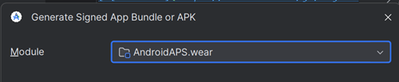

# Compiler l'application Wear AAPS

L'application **AAPS** pour une montre connectée Wear OS (l'**apk Wear**, `aaps-wear-….apk`) est un fichier d'installation séparé de l'application **AAPS** du téléphone. Vous avez besoin des deux : l'application du téléphone fait tourner la boucle, l'application de la montre affiche ses données et peut lui envoyer des commandes. L'application de la montre s'installe depuis le téléphone, voir [Configurer AAPS sur votre montre Wear OS](WearOsSmartwatch.md).

Les deux applications fonctionnent ensemble seulement si elles correspondent :

- **Même version d'AAPS** sur le téléphone et sur la montre.
- **Même keystore** utilisé pour signer les deux applications.

Le moyen le plus simple de le garantir est de compiler les deux applications **en même temps**, dans la même compilation. La compilation dans le navigateur le fait pour vous : chaque compilation produit ensemble l'apk du téléphone et l'apk Wear. Avec Android Studio ou la ligne de commande, vous compilez l'apk Wear dans une deuxième étape, juste après l'apk du téléphone.

```{note}
Vous utilisez déjà **AAPS** sur votre téléphone, mais vous n'avez pas d'apk Wear de la même compilation ? Compilez à nouveau les deux applications, avec le même keystore, et réinstallez aussi l'application du téléphone. Un apk Wear compilé des mois plus tard, ou avec une autre version d'Android Studio, a peu de chances d'être compatible avec l'application du téléphone.
```

## Versions de Wear OS prises en charge

**AAPS** fonctionne sur les montres avec **Wear OS 3.0, 3.2 ou 3.5** (Android 11, niveau d'API 30) **ou plus récent** (Wear OS 4, 5 et 6). Les montres avec Wear OS 2 ne sont pas prises en charge.

```{warning}
Les cadrans AAPS sont disponibles pour les montres connectées Wear OS avec un niveau d'API de 30 à 33 (Wear OS 3.0, 3.2, 3.5 et 4).<br>
Les versions plus récentes de Wear OS cassent peu à peu les cadrans AAPS — voir [Changements des cadrans Wear OS](#wearos-watchface-changes) et les [limites de Wear OS 5](#BuildingAapsWearOs-WearOS5).
```

(building-aaps-wear-os-method)=

## Obtenir l'apk Wear avec votre méthode de compilation

Suivez la section correspondant à la méthode que vous utilisez pour [compiler AAPS](../SettingUpAaps/BuildingAaps.md).

(building-aaps-wear-os-browser)=

### Compilation dans le navigateur (recommandée)

**Rien de plus à faire.** Chaque compilation dans le navigateur produit deux fichiers à partir du même code source et du même keystore :

- `aaps-….apk` : l'application du téléphone.
- `aaps-wear-….apk` : l'application de la montre.

L'apk Wear suit la [variante](#browserbuild-variant) que vous avez choisie pour la compilation : `fullRelease` donne l'application **AAPS Wear**, `aapsclientRelease` l'application **AAPSClient Wear**, `pumpcontrolRelease` l'application **PumpControl Wear**. Chaque application Wear communique seulement avec l'application du téléphone qui lui correspond.

Où trouver l'apk Wear :

- **AAPS Builder** : sur la page de compilation, faites défiler jusqu'à **Artifacts** et téléchargez `aaps-wear-….apk` à côté de l'application du téléphone, comme indiqué dans [Étape 6 – Installer l'application sur votre téléphone](#aaps-builder-step6). Téléchargez-le sur le téléphone qui fait tourner **AAPS** si vous installez l'application de la montre depuis le téléphone (Wear Installer 2 ou Easy Fire Tools), ou sur votre ordinateur si vous utilisez ADB.

  

- **Fork avec Google Drive** : ouvrez votre Google Drive, dossier `AAPS`, puis le dossier de la version que vous avez compilée. Il contient l'apk du téléphone et l'apk Wear, voir [Étape 4 – Compiler l'APK](#github-build-apk).

  

Gardez l'apk Wear avec l'apk du téléphone dans vos sauvegardes. Avec **AAPS Builder**, les fichiers restent sur la page de compilation pendant 14 jours seulement.

Ensuite : installez l'apk Wear sur la montre, voir [Configurer AAPS sur votre montre Wear OS](WearOsSmartwatch.md).

(building-aaps-wear-os-android-studio)=

### Android Studio

L'apk Wear se compile comme l'apk du téléphone, comme une deuxième compilation signée. Faites-le juste après l'apk du téléphone, avec la même version d'Android Studio et le même keystore.

- Suivez les instructions de [Compilation avec Android Studio](../SettingUpAaps/ComputerBuild.md).
- Quand vous arrivez à la [sélection du module](#Building-APK-wearapk) dans « Compiler l'apk signé d'AAPS », veillez à sélectionner **`AndroidAPS.wear`**.



Sélectionnez « **fullRelease** » pour générer le fichier apk Wear d'**AAPS**.


Si vous préférez, vous pouvez compiler **« pumpcontrolRelease »** à la place, depuis le menu déroulant. Cela vous permet seulement de contrôler la pompe à distance, mais sans boucle.

Ensuite : installez l'apk Wear sur la montre, voir [Configurer AAPS sur votre montre Wear OS](WearOsSmartwatch.md).

(building-aaps-wear-os-troubleshooting)=

#### Dépannage de la compilation avec Android Studio

Pendant la compilation de l'application **AAPS** complète (et en fait de toute application signée), Android Studio génère un fichier .json dans le même dossier. Cela provoque ensuite des erreurs de [modifications non validées (uncommitted changes)](#troubleshooting_androidstudio-uncommitted-changes) quand vous essayez de compiler l'application signée suivante, comme l'application Wear d'**AAPS**. Le moyen le plus rapide de résoudre ce problème est d'aller dans le dossier où l'application AAPS complète a été compilée. Votre dossier ressemble probablement à :

`C:\Users\Your Name\AndroidStudioProjects\AndroidAPS\app\aapsclient\release.`

Supprimez le fichier .json inutile, ou déplacez-le hors du dossier. Essayez ensuite de compiler à nouveau l'application Wear d'**AAPS**. Si cela ne fonctionne pas, le [guide de dépannage](../GettingHelp/TroubleshootingAndroidStudio.md) plus détaillé vous aidera à trouver le fichier qui pose problème, qui peut aussi être votre fichier keystore.

(building-aaps-wear-os-cli)=

### Ligne de commande

Suivez les [Instructions de compilation en ligne de commande](../SettingUpAaps/CLIBuild.md) et répétez les étapes de compilation et de signature pour le module `wear`, avec le même keystore :

```sh
./gradlew :wear:assembleFullRelease
```

L'apk Wear non signé est écrit dans `wear/build/outputs/apk/full/release/`. Signez-le avec `apksigner` exactement comme l'apk du téléphone, puis installez-le sur la montre, voir [Configurer AAPS sur votre montre Wear OS](WearOsSmartwatch.md).
