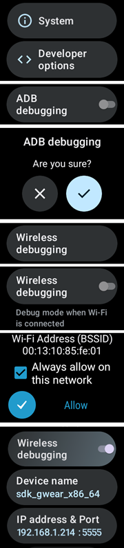

# Configurer AAPS sur votre montre Wear OS

Les instructions ci-dessous s'appliquent à l'apk **AAPS Wear** que vous devez compiler. Si vous ne l'avez pas encore compilé, consultez le guide [ici](../WearOS/BuildingAapsWearOS.md). Lors de la compilation, utilisez bien le même fichier keystore que pour l'apk **AAPS** du téléphone.

Vous pouvez aussi utiliser une partie de ces informations pour l'apk **Wear** de **AAPSClient** et de **PumpControl**. Chaque application **Wear** ne communiquera qu'avec son application de téléphone correspondante. Par exemple : l'application **AAPSClient Wear** ne peut être utilisée que pour afficher les données de **AAPSClient** et pas celles d'**AAPS**. Quand plusieurs variantes client (**AAPSClient**, **AAPSClient2**, **AAPSClient3**) sont installées côte à côte, les tuiles de chacune ont un petit en-tête dans la couleur d'accent de cette variante. Vous pouvez ainsi les distinguer en les faisant défiler.

## Versions Wear OS et compatibilité

(wearos-watchface-changes)=

### Changements des cadrans Wear OS (impact sur les cadrans AAPS)

```{admonition} Why newer Wear OS watches break AAPS watchfaces
:class: warning

En juin 2025, Google a [annoncé des changements](https://android-developers.googleblog.com/2025/06/upcoming-changes-to-wear-os-watch-faces.html) qui suppriment progressivement l'ancien moteur de cadrans (le moteur AndroidX / Wearable Support Library, ou « WSL ») au profit du nouveau format déclaratif **Watch Face Format**. Les cadrans personnalisés **AAPS** utilisent l'ancien moteur. Plus la version de Wear OS est récente, plus un cadran AAPS risque de mal fonctionner ou de ne plus fonctionner du tout.

Cela concerne uniquement les **cadrans** : les **complications**, les tuiles et les fonctions de contrôle à distance d'AAPS ne sont pas touchées. C'est aussi pourquoi **une mise à jour du firmware/système d'une montre Wear OS peut casser les cadrans AAPS**. Ensuite, il est impossible de revenir à une ancienne version de Wear OS sur la montre. Si votre cadran AAPS fonctionne actuellement, **désactivez les mises à jour automatiques de la montre**.
```

Le tableau ci-dessous résume l'effet du changement de Google sur les cadrans AAPS (ancien moteur), selon la version de Wear OS :

| Version de Wear OS      | Android de base | Niveau d'API | Impact sur les cadrans AAPS (anciens)                                                                                                                                                                |
| ----------------------- | --------------- | ------------ | ---------------------------------------------------------------------------------------------------------------------------------------------------------------------------------------------------- |
| Wear OS 6               | Android 16      | 36           | **Anciens cadrans plus disponibles** — AAPS installe à la place un [cadran au format Watch Face Format](#wearos-aaps-v4-watchface) : votre cadran personnalisé, ou le cadran à complications AAPS V4 |
| Wear OS 5               | Android 14      | 34           | **Grave** — le mode actif (interactif) échoue souvent, les complications se figent, les animations s'arrêtent                                                                                        |
| Wear OS 4               | Android 13      | 33           | **Modéré** — fonctionnement bridé, mises à jour manquées, défaillances partielles                                                                                                                    |
| Wear OS 3.0 / 3.2 / 3.5 | Android 11      | 30           | **Faible** — l'ancien moteur est toujours pris en charge                                                                                                                                             |

Si votre montre a une version où les cadrans AAPS ne sont pas fiables, vous pouvez afficher les données AAPS avec des **complications** sur un cadran compatible, ou utiliser [GlucoDataHandler](https://play.google.com/store/apps/details?id=de.michelinside.glucodatahandler) avec une complication, alimenté par le plugin [Applications compagnon externes](#external-companion-apps) d'**AAPS**. Sous **Wear OS 6 et plus récent**, AAPS installe un cadran de remplacement au nouveau format — voir ci-dessous.

(wearos-aaps-v4-watchface)=

### Wear OS 6 et plus récent — le cadran installé par AAPS

Les montres sous **Wear OS 6 ou plus récent** ne peuvent pas utiliser les cadrans AAPS classiques comme cadrans. Pour ces montres, l'application AAPS de la montre apporte deux cadrans au nouveau **Watch Face Format** de Google. Wear OS ne permet à une application d'installer qu'**un seul** cadran. Vous choisissez donc lequel des deux est sur la montre :

- **Cadran personnalisé** (par défaut) : affiche le cadran personnalisé que vous avez chargé depuis le téléphone avec **Charger le cadran** (voir [Sélectionner un cadran AAPS](#WearOS_changing-to-AAPS-watchface)). La montre dessine votre design comme une image, donc tous les cadrans personnalisés existants fonctionnent. Les emplacements de complication qu'un cadran personnalisé peut définir ne sont **pas disponibles** dans cette image, car Wear OS ne fournit les données des complications qu'à un vrai cadran. Appuyez longuement sur le cadran pour accéder à son seul réglage : l'affichage permanent (always-on) montre soit une simple horloge, soit votre propre design, assombri.
- **Cadran des complications** (le cadran **AAPS V4**) : ses **sept emplacements de complication** sont **préconfigurés avec les données AAPS** : valeur de glycémie, IA, GA, la [complication Graphique Gly](#Watchfaces-complications), débit basal / cible temporaire, et l'icône **Mode** dans l'emplacement en haut à gauche (appuyez dessus pour changer le mode de la boucle depuis la montre). Appuyez sur l'heure en haut pour ouvrir l'application d'alarme de la montre. Vous pouvez changer ce que montre chaque emplacement dans l'éditeur de cadran de la montre.

Vous faites ce choix sur le téléphone : ouvrez le plugin **Montre** et, sous **Cadran installé sur la montre**, sélectionnez l'un des deux. Cette carte n'est visible que lorsqu'une montre Wear OS 6 ou plus récente est connectée. **AAPS** vous demande de confirmer, car la montre remplace son cadran immédiatement. Quitter le **Cadran des complications** remet aussi aux valeurs par défaut les complications que vous avez modifiées dans l'éditeur de cadran ; la confirmation l'indique. Quand le **Cadran des complications** est sélectionné, les boutons du cadran personnalisé sont masqués et un aperçu du cadran est affiché à la place. Si vous chargez un cadran personnalisé alors que le **Cadran des complications** est sélectionné, **AAPS** vous rappelle de passer à **Cadran personnalisé** pour le voir sur la montre.

- Le cadran sélectionné est **installé et activé automatiquement** au premier lancement de l'application AAPS de la montre sur une telle montre, et il est **mis à jour automatiquement** avec l'application de la montre.
- Si vous avez supprimé le cadran, une entrée **Installer le cadran** apparaît en bas du **menu principal** AAPS de la montre — appuyez dessus pour le réinstaller.

Quand une montre sous Wear OS 5 ou plus ancien est connectée, la carte **Cadran installé sur la montre** n'est pas affichée du tout (son mécanisme demande Wear OS 6) ; les cadrans classiques y fonctionnent comme avant.

(wearos-complications-watchface-setup)=

### Cadran des complications — configuration recommandée

Le **Cadran des complications** a sept emplacements de complication. Appuyez longuement sur le cadran, touchez **Personnaliser** et choisissez une source de données pour chaque emplacement. Les emplacements sont numérotés comme dans l'éditeur de cadran : **1** à gauche, **2** au centre, **3** à droite, **4** le graphique, **5** en bas, **6** en haut à gauche et **7** en haut à droite.

| Configuration par défaut                                                                                    | Configuration alternative                                                                                        |
| ----------------------------------------------------------------------------------------------------------- | ---------------------------------------------------------------------------------------------------------------- |
|  |  |

| Emplacement | Position         | Par défaut                                                                                | Alternative                                                     |
| ----------- | ---------------- | ----------------------------------------------------------------------------------------- | --------------------------------------------------------------- |
| 1           | Gauche           | Icône IA                                                                                  | GA & IA                                                         |
| 2           | Centre           | Glycémie                                                                                  | Glycémie                                                        |
| 3           | Droite           | Icône GA                                                                                  | Basal & Cible                                                   |
| 4           | Graphique        | Graphique Gly                                                                             | Graphique Gly                                                   |
| 5           | Bas              | Basal & Cible                                                                             | Batterie téléphone                                              |
| 6           | En haut à gauche | Mode de fonctionnement                                                                    | Mode de fonctionnement                                          |
| 7           | En haut à droite | Batterie téléphone, ou un raccourci vers l'application **AAPS Mettre en veille l'alerte** | Raccourci vers l'application **AAPS Mettre en veille l'alerte** |

Le raccourci **AAPS Mettre en veille l'alerte** se choisit parmi les complications **Raccourci d'application** de la montre elle-même. Appuyer dessus met en veille l'alarme qui sonne sur le téléphone.

```{tip}
Activez l'**Affichage permanent** (Always-on display) sur la montre (**Paramètres** > **Affichage**). Le cadran continue alors d'afficher votre glycémie quand le poignet est baissé, au lieu d'un écran vide ou d'une simple horloge.
```

```{admonition} No complication data while the watch is locked
:class: note
Si un **Type de verrouillage** est défini dans **Paramètres** > **Sécurité et confidentialité**, la montre masque les données des complications quand elle est verrouillée, et le cadran affiche des emplacements vides jusqu'à ce que vous la déverrouilliez. Pour garder les données visibles, désactivez **Masquer les informations** dans le même menu.
```

### Wear OS 3

Installez l'apk **AAPS Wear** en utilisant [Wear Installer 2](https://youtu.be/abgN4jQqHb0?si=5L7WUeYMSd_8IdPV), Easy Fire Tools (décrit ci-dessous) ou ADB.  
Aucune limitation dans les opérations **AAPS Wear**.

(BuildingAapsWearOs-WearOS5)=

### Wear OS 4 et Wear OS 5

Exemple : Galaxy Watch 4, 5, 6, 7 et Ultra ou Pixel Watch qui n'ont **pas** encore été mises à jour vers Wear OS 6. Vérifiez la version dans **Paramètres** > **À propos de la montre** > **Logiciel**.

Installez l'apk **AAPS Wear** avec [Wear Installer 2](https://youtu.be/abgN4jQqHb0?si=5L7WUeYMSd_8IdPV) (pour Wear OS 5, suivez [cette vidéo](https://www.youtube.com/watch?v=yef_qGvcCnk)). Toutes les fonctions d'**AAPS Wear** fonctionnent, mais les cadrans **AAPS** classiques sont limités comme décrit dans le tableau ci-dessus : bridés sous Wear OS 4, souvent défaillants sous Wear OS 5.

```{admonition} Wear OS 5
:class: warning
Sous Wear OS 5, le cadran AAPS doit être sélectionné avec Wear Installer 2 juste après l'installation de l'application Wear : à la fin de l'installation, l'installateur propose le cadran **AAPS (perso)**. Si vous passez par erreur à un autre cadran, refaites l'installation. Il peut être impossible de modifier les réglages du cadran (Sombre, Watchdivider, etc.).

Si le cadran classique fonctionne pour vous, **désactivez les mises à jour automatiques de la montre** : la prochaine mise à jour du firmware risque de le casser. Si vous passez quand même à Wear OS 6, lisez la section ci-dessus : **AAPS** installe alors son propre cadran au nouveau format.
```

Si le cadran est trop peu fiable, envisagez plutôt [GlucoDataHandler](https://play.google.com/store/apps/details?id=de.michelinside.glucodatahandler) avec une complication. Il nécessite que le plugin [Applications compagnon externes](#external-companion-apps) soit activé dans **AAPS**.

### Wear OS 6 et plus récent

Exemple : Galaxy Watch 4 et plus récentes avec One UI 8 Watch, Pixel Watch après la mise à jour de 2025. La plupart des montres Galaxy et Pixel ont reçu cette mise à jour.

Installez l'apk **AAPS Wear** avec [Wear Installer 2](https://youtu.be/abgN4jQqHb0?si=5L7WUeYMSd_8IdPV). Les cadrans classiques ne sont pas disponibles ; **AAPS** installe automatiquement le cadran sélectionné sur le téléphone, voir [le cadran installé par AAPS](#wearos-aaps-v4-watchface). Aucune limitation dans les opérations **AAPS Wear**.

## Comment configurer une montre connectée Samsung Galaxy Watch 4 avec **AAPS**

Cette section suppose que vous découvrez les montres connectées. Elle vous présente les bases d'une montre courante, la **Galaxy Watch 4**, puis un guide étape par étape pour configurer **AAPS** sur la montre.

_Ce guide a été écrit pour une Galaxy Watch sous Wear OS 3._ Sous Wear OS 4 et plus récent, la montre demande un **code d'appairage** quand un téléphone ou un ordinateur se connecte par ADB. Wear Installer 2 et la procédure par terminal [ci-dessous](#BuildingAapsWearOs-WearOS5-TShoot) le prennent tous deux en charge.

Voici des guides de configuration de base pour la [Galaxy Watch 5](https://www.youtube.com/watch?v=Y5upzOIxwTU) et la [Galaxy Watch 6](https://www.youtube.com/watch?v=D6bq20KzPW0)

## Se familiariser avec la montre connectée

Après la configuration de base de votre montre selon la vidéo ci-dessus, allez sur le Play Store du téléphone et téléchargez les applications suivantes : « Galaxy Wearable », « Samsung » et soit « Easy Fire tools », soit « Wear Installer 2 ».

De nombreuses vidéos YouTube de tiers vous aideront à prendre en main votre nouvelle montre connectée, par exemple :

[https://www.youtube.com/watch?v=tSVkqWNmO2c](https://www.youtube.com/watch?v=tSVkqWNmO2c)

L'application « Galaxy Wearable » contient aussi un manuel d'utilisation. Ouvrez Galaxy Wearable sur le téléphone, recherchez la montre et essayez d'appairer la montre avec le téléphone. Selon votre version, il peut vous être demandé d'installer une autre application, « galaxy watch 4 plugin », depuis le Play Store (le téléchargement prend un certain temps). Installez-la sur le téléphone, puis essayez à nouveau d'appairer la montre et le téléphone dans l'application Wearable. Parcourez une série de menus et cochez les préférences voulues.

## Configurer un compte Samsung

L'adresse e-mail utilisée pour créer le compte Samsung doit avoir une date de naissance qui donne à l'utilisateur 13 ans ou plus. Sinon, les autorisations Samsung sont très difficiles à accepter. Si vous avez donné un compte Gmail à votre enfant de moins de 13 ans et que vous utilisez cette adresse e-mail, vous ne pouvez pas simplement la changer en compte adulte. Une solution est de modifier la date de naissance actuelle pour que l'âge actuel soit de 12 ans et 364 jours. Le lendemain, le compte sera converti en compte adulte et vous pourrez continuer la configuration du compte Samsung.

(remote-control-transferring-the-aaps-wear-app-onto-your-aaps-phone)=

## Transférer l'application Wear **AAPS** sur votre téléphone **AAPS**

Vous pouvez charger le fichier Wear.apk d'Android Studio sur votre téléphone de deux façons :

a)  avec un câble USB, copier le fichier apk wear **AAPS** sur le téléphone, puis l'installer manuellement (« side-load ») sur la montre. Transférez Wear.apk sur le téléphone par USB, dans le dossier Téléchargements ; ou

b)  copier-coller Wear.apk depuis Android Studio dans votre Google Drive.


Pour installer manuellement AAPS sur la montre, vous pouvez utiliser : 1) Wear Installer 2 2) Easy Fire tools 3) Android Debug Bridge (ADB) Nous recommandons ici Wear Installer 2, car les instructions et la procédure de la vidéo sont très claires et bien expliquées. Si Wear Installer 2 ne fonctionne pas pour vous, essayez Easy Fire Tools ou ADB, tous deux décrits ci-dessous.

### Utiliser Wear Installer 2 pour installer **AAPS** Wear du téléphone vers la montre

 

Wear Installer 2, développé par [Malcolm Bryant](https://www.youtube.com/@Freepoc), peut être téléchargé depuis Google Play sur votre téléphone. Il permet d'installer manuellement (side-load) l'application AAPS Wear sur la montre. L'application contient une [vidéo](https://youtu.be/abgN4jQqHb0?si=5L7WUeYMSd_8IdPV) pratique « how to sideload » (comment installer manuellement l'application).

```{tip}
Pour les montres Wear OS 5, suivez [cette vidéo](https://www.youtube.com/watch?v=yef_qGvcCnk).
Voir les conseils de dépannage [ci-dessous](#BuildingAapsWearOs-WearOS5-TShoot).
```

Elle donne tous les détails nécessaires (il vaut mieux ouvrir la vidéo sur un autre appareil pour la regarder pendant la configuration du téléphone).

Comme indiqué dans la vidéo, une fois terminé, désactivez le débogage ADB sur la montre pour ne pas vider la batterie de la montre.

Autre possibilité, mais pas pour Wear OS 5 :

### Utiliser Easy Fire tools pour installer **AAPS** wear sur la montre

1)   Téléchargez _[Easy Fire Tools](https://play.google.com/store/apps/details?id=de.agondev.easyfiretools&hl=en)_ depuis le Play Store sur le téléphone


2)  Activez le mode développeur sur la montre (une fois configurée et connectée au téléphone) :

Allez dans **Paramètres** > **Système** > **À propos** > **Versions** (les noms des menus varient selon la marque de la montre — sur certaines montres, c'est **À propos de la montre** > **Informations sur le logiciel** > **Version du logiciel**).


Appuyez rapidement plusieurs fois sur **Numéro de build** (ou **Version du logiciel**) jusqu'à ce qu'un message vous indique que vous êtes maintenant développeur.


Revenez à **Paramètres** > **Système** : un nouveau menu **Options de développement** est maintenant affiché.

Dans **Options de développement**, activez **Débogage ADB** et **Débogage sans fil**, puis confirmez les demandes. Le débogage sans fil affiche alors l'**adresse IP et le port** de la montre, par exemple : **192.168.1.214** : 5555. Vous n'avez besoin que de l'adresse IP (ici **192.168.1.214**), pas du numéro de port après les deux-points. Notez que l'adresse IP peut changer, par exemple chaque fois que vous passez à un nouveau téléphone pour AAPS.



ÉTAPE 3)     Saisissez l'adresse IP, _par ex._ **192.168.1.214**, dans Easy Fire tools sur le téléphone (ouvrez le menu hamburger à gauche, puis les paramètres, et saisissez l'adresse IP).


Cliquez ensuite sur l'icône de prise en haut à droite. L'icône devient verte une fois la connexion établie.


ÉTAPE 4) Suivez les instructions [ici](https://wearablestouse.com/blog/2022/01/04/install-apps-apk-samsung-galaxy-watch-4/?utm_content=cmp-true) pour installer (c'est-à-dire transférer) aaps-wear.apk sur la montre avec Easy Fire tools


(BuildingAapsWearOs-WearOS5-TShoot)=

### Utiliser le terminal
Connectez la montre et l'ordinateur au même réseau Wi-Fi.

- Pour installer ADB, téléchargez-le depuis : https://developer.android.com/tools/releases/platform-tools
- Ouvrez un terminal.
- Sous Windows, créez un nouveau dossier nommé `adb` sur votre disque `C:`. Ouvrez le fichier `platform-tools-latest-windows.zip` téléchargé plus haut. Copiez tous les fichiers de `platform-tools` dans `C:\adb` et ouvrez ce dossier dans une invite de commande (clic droit, puis Ouvrir dans le terminal). Tapez la commande ci-dessous pour ajouter le dossier d'ADB au chemin (PATH) : `setx PATH "%PATH%;C:\adb"`
- Sur Mac, au lieu d'une installation manuelle, vous pouvez utiliser homebrew : `brew install android-platform-tools`

Sur la montre :
- Allez dans Paramètres → À propos de la montre → **Informations sur le logiciel** (Software Information)
- Appuyez 7 fois sur Version du logiciel jusqu'à voir que le mode développeur est activé.
- Allez dans Paramètres → Options de développement. Activez le **débogage ADB**
- Allez dans Paramètres → Options de développement → Débogage sans fil → **Associer un nouvel appareil**

Un code d'appairage Wi-Fi, l'adresse IP et le port s'affichent :


- Dans le terminal : `adb pair ipaddress:port` Par ex. `adb pair 10.10.1.125:36299`
- Le code d'appairage vous sera demandé. Saisissez-le.
- Vous verrez une réponse :<br> `Successfully paired to 10.10.1.125:36299 [guid=adb-RXXXW20LMKJY-eh5zBj]`<br>
- Dans le terminal, tapez : <br>`adb devices`.<br> Vous devriez voir quelque chose comme :<br> `List of devices attached`<br> `10.10.1.125:36299  offline`<br> `adb-RFAW20LMKJY-eh5zBj._adb-tls-connect._tcp   device`<br>

- Allez maintenant dans le dossier de votre ordinateur où se trouve l'apk Wear et tapez<br> `adb install wear-full.apk` <br>en remplaçant wear-full.apk par le nom de votre fichier apk.
- Vous verrez :<br> `Performing Streamed Install`<br> `Success`


(wear-os-5-troubleshooting)=

### Recommandations générales de dépannage pour Wear OS 5

- N'utilisez pas le partage de connexion Wi-Fi. Cela ne fonctionnera pas.
- Vous n'avez pas besoin d'activer le débogage adb sur le téléphone (seulement sur la montre). Désactivez le débogage adb sur le téléphone.
- Connectez-vous bien à votre réseau local, où le téléphone et la montre peuvent se voir (n'utilisez pas votre réseau Wi-Fi invité).
- Vérifiez que la montre et le téléphone sont sur le même réseau et le même appareil Wi-Fi. Les répéteurs Wi-Fi ou les points d'accès, en particulier, peuvent poser des problèmes.
- Placez-vous près de votre routeur principal, puis redémarrez le téléphone et la montre.

**Appairage :**

- Montre : Débogage sans fil : notez l'adresse IP.
- Wear Installer : saisissez l'adresse IP dans l'application Wear Installer.
- Sélectionnez l'appairage d'un nouvel appareil (Pair new), notez le code d'appairage et le numéro de port affichés.
- Wear Installer : saisissez le code d'appairage + espace + numéro de port.
- Wear Installer devrait indiquer que l'appairage a réussi. Sinon, quittez Wear Installer, puis réessayez.

Une fois l'appairage fait, vous devriez pouvoir installer l'apk AAPS wear :

- Quittez/fermez, puis redémarrez Wear Installer.
- Dans Débogage sans fil, notez l'adresse IP et le numéro de port, et vérifiez/saisissez l'adresse IP et le numéro de port dans Wear Installer.
- Remarque : le numéro de port est différent de celui utilisé pour l'appairage !

## Configurer la connexion entre la montre et le téléphone depuis **AAPS**

La dernière étape consiste à configurer **AAPS** sur le téléphone pour qu'il communique avec **Wear.apk** sur la montre. Pour cela, activez le plugin Montre :

* Allez dans l'application **AAPS** sur le téléphone

* Ouvrez le **menu** (☰) en haut à gauche et allez dans **Configuration** > **Communication**

* Cochez la case **Montre**


Pour faire un bolus ou d'autres actions depuis la montre, activez aussi **Contrôle Montre** dans [Paramètres > Montre](#preferences-wear).

Pour passer à un autre cadran **AAPS**, appuyez longuement sur l'écran d'accueil de la montre : l'écran « Personnaliser » apparaît. Faites ensuite glisser vers la droite jusqu'à voir tous les cadrans **AAPS**.

Si le fichier Wear.apk **AAPS** a bien été installé sur la montre, cela ressemble à ceci :


Sur certaines montres, comme la Samsung Galaxy, l'option « Remote Connection » (Connexion à distance) des fonctions avancées de Samsung Galaxy doit être **activée** pour utiliser **Wear.apk** & **AAPS** à distance via Wi-Fi.


(wear-os-watch-phone-communication)=

### Dépannage de la communication entre la montre **AAPS** et le téléphone **AAPS**

1.  Si EasyFire tools ne se connecte pas ou si vous recevez « authorisation failed » > vérifiez que l'adresse IP a été saisie correctement.
2.  Vérifiez que la montre est connectée à Internet (et pas seulement au téléphone par Bluetooth).
3.  Vérifiez que le téléphone **AAPS** et la montre sont appairés ou liés dans l'application Samsung.
4.  Un redémarrage complet du téléphone et de la montre peut aussi aider (c'est-à-dire éteindre puis rallumer le téléphone)
5.  Si vous avez bien téléchargé Wear.apk sur votre téléphone mais que vous ne recevez aucune donnée de glycémie, _vérifiez_ que vous avez installé le bon apk Wear **AAPS** sur la montre : l'application montre d'une compilation dans le navigateur est le fichier `aaps-wear-….apk`, voir [Compiler l'application Wear](../WearOS/BuildingAapsWearOS.md). Si le fichier que vous avez installé est l'un des suivants : a) un apk Wear **AAPSClient** (alors que le téléphone utilise **AAPS**) ; b) un fichier `.aab` ; ou c) un fichier avec le mot « debug » dans son nom, vous n'avez pas sélectionné le bon apk Wear OS lors de la compilation.
6.  Vérifiez que votre routeur n'isole pas les appareils les uns des autres.

Vous trouverez d'autres conseils de dépannage [ici](https://freepoc.org/wear-installer-help-page/#:~:text=If%20you%20are%20having%20problems,your%20phone%20and%20your%20watch.)

(WearOS_changing-to-AAPS-watchface)=

## Sélectionnez un cadran AAPS sur votre montre WearOS

Il existe plusieurs cadrans de montre disponibles dans la version standard de l'APK AAPS pour Wear OS. Une fois que vous avez installé l'APK AAPS Wear sur votre montre, ils seront disponibles. Voici les étapes pour en sélectionner un :

1. Sur votre montre (en supposant qu'il s'agit de WearOS), appuyez longuement sur votre cadran actuel pour ouvrir l'écran de sélection du cadran. Faites défiler complètement vers la droite jusqu'au bouton « Ajouter un cadran » et sélectionnez-le


2. Faites défiler la liste jusqu'à « AAPS (perso) » (selon la montre, les cadrans des applications installées sont dans une section « Téléchargés » ou groupés par application) et cliquez au milieu de l'image pour l'ajouter à votre liste de cadrans actuels. Ne vous inquiétez pas de l'apparence actuelle du cadran « AAPS (perso) » : nous choisirons votre apparence préférée à l'étape suivante.


3. Ouvrez maintenant AAPS sur votre téléphone et ouvrez le plugin Montre : **Configuration** > **Communication** > **Montre** > **Ouvrir le plugin** (cochez d'abord **Montre** s'il n'est pas activé).


4. Cliquez sur le bouton « Charger le cadran » et sélectionnez le cadran que vous voulez


5. Vérifiez votre montre : le cadran « AAPS (perso) » devrait maintenant afficher l'apparence que vous avez sélectionnée. Attendre quelques secondes si nécessaire. L'écran **Montre** du téléphone affiche maintenant le nom du cadran chargé et un aperçu de celui-ci. **Infos Cadran** liste ses détails et les champs qu'il contient, et **Plus de cadrans** ouvre le [site d'échange](../ExchangeSiteCustomWatchfaces/index.md) où vous pouvez télécharger d'autres cadrans personnalisés. Vous pouvez maintenant personnaliser les complications, etc. en appuyant longuement sur le cadran, puis sur le bouton « Personnaliser » sur l'image du cadran.

```{admonition} Complications on a custom watchface
:class: note
Les cadrans personnalisés créés avec la version 3.0 ou plus récente du format de cadran personnalisé peuvent contenir jusqu'à cinq emplacements de complication, dont la position et la taille sont définies par le cadran (**Mise en page des complications**). Sur la montre, appuyez longuement sur le cadran, touchez **Personnaliser** puis **Complication 1** à **Complication 5** pour choisir la source de données affichée dans chaque emplacement. Les mêmes lignes se trouvent dans l'application AAPS de la montre sous **Paramètres** > **AAPS (perso)** ; en toucher une ouvre le même sélecteur. **Priorité du type de complication** décide si un emplacement préfère une valeur ou une jauge, du texte ou une icône, quand la source de données en propose plusieurs. Une priorité modifiée ne s'applique qu'au prochain choix de source de données pour cet emplacement.

Ces emplacements ne fonctionnent que sur les montres sous **Wear OS 5 ou plus ancien**, où le cadran personnalisé fonctionne comme un vrai cadran. Sous **Wear OS 6 et plus récent**, le cadran personnalisé est affiché comme une image sans ses emplacements de complication, et les étapes 1 et 2 ci-dessus ne sont pas nécessaires : vérifiez que **Cadran personnalisé** est sélectionné sous **Cadran installé sur la montre** dans le plugin **Montre** du téléphone (voir [le cadran installé par AAPS](#wearos-aaps-v4-watchface)).
```

## Cadran AAPS v2 - Légende


A - temps écoulé depuis le dernier calcul de la boucle

B - lecture du capteur MGC

C - nombre de minutes depuis la dernière lecture MGC

D - variation par rapport à la dernière lecture MGC (en mmol ou mg/dl)

E - variation moyenne des lectures MGC depuis 15 minutes

F - niveau de batterie du téléphone

G - débits de basal (en U/h ou en % pendant un DBT)

H - BGI (interaction de la glycémie, en anglais blood glucose interaction) -> à quel point la glycémie « devrait » monter ou baisser selon la seule activité de l'insuline.

I - glucides (glucides actifs | e-glucides à venir)

J - Insuline Active (bolus | basal)
