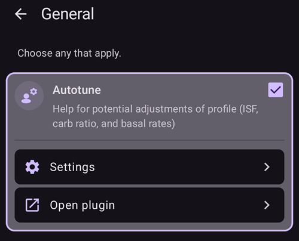
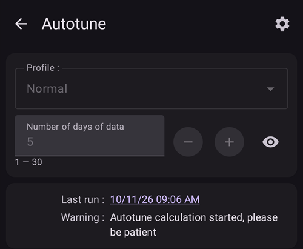

# שימוש בתוסף Autotune

Autotune plugin is an implementation of OpenAPS autotune algorithm within AAPS. התוסף מנתח את ההיסטוריה האחרונה ב-AAPS ומציע התאמות לקצבים הבזאליים, ל-ISF וליחס הפחמימות (IC).

תוסף Autotune זמין בגרסאות AAPS החל מ-[3.4](#version3400), אך הוא מוסתר כברירת מחדל.

(autotune-how-autotune-calculates-adjustments)=
## כיצד Autotune מחשב את ההתאמות

Autotune בוחן את ההיסטוריה האחרונה ב-AAPS — ערכי CGM, בולוסים, פחמימות וקצבים בזאליים זמניים — ומחשב היכן ה**פרופיל** (קצבים בזאליים, ISF, יחס פחמימות) אינו תואם בדיוק את מה שקרה בפועל לרמת הסוכר בדם (BG).

עבור כל נקודת נתונים של 5 דקות, הוא משווה את **השינוי בפועל ב-BG** לשינוי שהפרופיל חזה, ומסווג את הסטייה שהתקבלה לאחת משלוש קבוצות:

* סטיות שהתרחשו ללא פחמימות פעילות וללא פעילות אינסולין (משמשות לכוונון **הקצבים הבזאליים**, שעה אחר שעה),
* סטיות שהתרחשו לאחר בולוס/תיקון ללא פחמימות (משמשות לכוונון **ISF**), או
* סטיות שהתרחשו בזמן ספיגת פחמימות (משמשות לכוונון **יחס הפחמימות**).

לאחר מכן הוא בוחן את דפוס הסטיות בכל קבוצה (באמצעות אחוזונים ולא ממוצע פשוט, כך שמעט נקודות נתונים רועשות אינן מטות את התוצאה) ומציע ערך חדש לאותה שעה או לאותו פרמטר.

כדי שהרצה בודדת לא תתקן יותר מדי, כל הרצה של Autotune מזיזה ערך רק חלק מהדרך לכיוון מה שהנתונים מציעים: עד 10% עבור ISF ויחס הפחמימות, ועד 20% עבור כל מקטע בזאלי. הסטייה הכוללת מוגבלת גם על ידי ההגדרות **Autosens מרבי** / **Autosens מינימלי** (ראו [הגדרות אחרות](#autotune-other-settings) להלן) — אותם גבולות שמגבילים את Autosens. לכן Autotune מיועד להרצה חוזרת (יום אחר יום, או בכל לילה), ואין לסמוך עליו אחרי הרצה אחת: התוצאות אמורות להתכנס בהדרגה, וקפיצה גדולה בהרצה אחת היא סימן לבדוק שוב את הנתונים (פחמימות שלא הוזנו, יום עם חיישן גרוע, _וכו׳_) ולא לסמוך עליה בעיוורון.

ניתן להריץ את Autotune בשלוש דרכים: באופן ידני, כהרצה חד-פעמית מתוך התוסף (כמתואר להלן), באופן אוטומטי בכל לילה באמצעות [כלל אוטומציה](#autotune-run-autotune-with-an-automation-rule), או — מחוץ ל-AAPS לגמרי — ככלי עצמאי של שורת הפקודה על נתונים מיוצאים. כך מתארים חלק ממדריכי הקהילה את השימוש בו בלי טלפון שמריץ את AAPS.

*לפרטים המתמטיים המלאים של אלגוריתם oref0 שבבסיס, ראו את [התיעוד של Autotune ב-OpenAPS](https://openaps.readthedocs.io/en/latest/docs/Customize-Iterate/autotune.html).*

## Show the Autotune plugin

Create an empty file named `enable_autotune` in the `extra` subfolder of your phone [AAPS directory](#preferences-maintenance-settings).

***הערה: יש לבדוק בהגדרות AAPS היכן נמצאת תיקיית AAPS, ולוודא שהקובץ הונח בתיקייה הנכונה. כמה משתמשים הניחו את הקובץ בתיקייה שגויה.***


יש להפעיל מחדש את **AAPS**. לאחר מכן יש לפתוח את **התפריט** (☰), לבחור **הגדרות תצורה**, אחר כך את הקטגוריה **כללי**, ולסמן את **כוונון אוטומטי**. בכרטיס יופיעו אז **הגדרות** ו-**פתיחת תוסף**:



## Autotune user interface

יש להקיש על **פתיחת תוסף** בכרטיס **כוונון אוטומטי** כדי לפתוח את מסך Autotune:


- בתפריט הנפתח "פרופיל" ניתן לבחור את פרופיל הקלט לכוונון (כברירת מחדל נבחר הפרופיל הפעיל הנוכחי).
  - הערה: בכל פעם שבוחרים פרופיל חדש, התוצאות הקודמות יימחקו, והשדה **מספר ימי נתונים** יחזור לערך ברירת המחדל שלו
- לאחר מכן, בשדה **מספר ימי נתונים** (בגרסאות ישנות יותר: **ימי כיוונון**) בוחרים את מספר הימים שבהם ישתמש החישוב לכוונון הפרופיל. The minimum value is 1 day and the maximum value 30 days. This number should not be too small to get correct iterative and smooth results (above 7 days for each calculation)
  - הערה: בכל פעם שמשנים את **מספר ימי נתונים**, התוצאות הקודמות יימחקו
- "הפעלה אחרונה" הוא קישור לשחזור החישוב התקף האחרון. If you didn't launch Autotune on current day, or if previous results was removed with a modification of calculation parameter above, then you can recover parameters and results of the latest successful run.
- השדה "אזהרה" מציג, לדוגמה, מידע על הפרופיל שנבחר (אם יש בו כמה ערכי IC או כמה ערכי ISF).
  - Note: Autotune calculation works with only a single IC and a single ISF value. There is currently no existing Autotune algorithm to tune a circadian IC or circadian ISF. If your input profile  has several values, you can see in warning section the average value taken into account to tune your profile.
- הלחצן "בדיקת פרופיל הקלט" פותח את מציג הפרופילים, כדי לאפשר בדיקה מהירה של הפרופיל (יחידות, IC, ISF, בזאלי ויעד)
  - Note: Autotune will only tune your IC (single value), ISF (single value) and basal (with circadian variation). היחידות והיעד לא ישתנו בפרופיל הפלט.

- הלחצן "הפעלת כוונון אוטומטי" יתחיל את חישוב Autotune עם הפרופיל שנבחר ועם מספר ימי הנתונים שנבחר
  - Note: Autotune calculation can take a long time. Once launched, you can switch to another view (home, ...) and come back later in Autotune plugin to see results

  

- Then during the run you will see intermediate results below

  - Note: During run, settings are locked, so you cannot change anymore selected input profile or the number of day. You will have to wait the end of current calculation if you want to launch another run with other parameters.

  

- When Autotune calculation is finished, you will see the result (Tuned profile) and four buttons below.

  

- חשוב להשוות תמיד בין פרופיל הקלט (העמודה "פרופיל"), פרופיל הפלט (העמודה "מכוונן") ואחוז השינוי של כל ערך (העמודה "%").

- לקצבים הבזאליים מוצג גם מספר "הימים החסרים". ימים חסרים נוצרים כאשר אין ל-Autotune מספיק נתונים המסווגים כ"בזאלי" כדי לכוונן את הקצב הבזאלי לפרק זמן זה (למשל לאחר כל ארוחה, כאשר מתרחשת ספיגת פחמימות). This number should be as low as possible especially when basal is important (for example during the night or at the end of the afternoon)

- הלחצן "השוואת פרופילים" פותח את תצוגת השוואת הפרופילים. פרופיל הקלט מוצג בכחול, ופרופיל הפלט (בשם "מכוונן") מוצג באדום.

  - Note: in the example below input profile has circadian variation for IC and ISF, but output calculated profile has a single value. If it's important for you to get a circadian output profile see [Circadian IC or ISF profile](#autotune-circadian-ic-or-isf-profile) below.

  

- אם אתם סומכים על התוצאות (אחוז השינוי בין פרופיל הקלט לפרופיל הפלט נמוך), ניתן ללחוץ על הלחצן "הפעלת פרופיל" ולאחר מכן על "אישור" כדי לאשר.

  - הלחצן "הפעלת פרופיל" ייצור אוטומטית פרופיל חדש בשם "מכוונן" ברשימת הפרופילים (**ניהול ← פרופיל**).
  - אם כבר קיים פרופיל בשם "מכוונן" ב**ניהול ← פרופיל**, הפרופיל הזה יעודכן בפרופיל Autotune המחושב לפני ההפעלה

  

- אם לדעתכם יש להתאים את הפרופיל המכוונן (למשל אם לדעתכם חלק מהשינויים גדולים מדי), ניתן ללחוץ על הלחצן "העתקה אל הפרופיל המקומי שלי".

  - ב**ניהול ← פרופיל** ייווצר פרופיל חדש עם הקידומת "מכוונן" ועם התאריך והשעה של ההרצה

  

- לאחר מכן ניתן לערוך את הפרופיל המכוונן: יש לפתוח את **ניהול** > **פרופיל**, להחליק לכרטיס בשם "מכוונן" עם התאריך והשעה של ההרצה, ולהקיש על הלחצן **עריכה** (עיפרון)

  - הערכים בפרופיל יעוגלו בממשק המשתמש לפי היכולות של המשאבה

  

- אם ברצונכם להחליף את פרופיל הקלט בתוצאת Autotune, לחצו על הלחצן "עדכון פרופיל הקלט" ואשרו את החלון הקופץ בלחיצה על "אישור".

  - הערה: אם לוחצים על "הפעלת פרופיל" אחרי "עדכון פרופיל הקלט", יופעל הפרופיל המעודכן ולא הפרופיל "מכוונן" שמוגדר כברירת מחדל.

  

- אם עדכנתם את פרופיל הקלט, הלחצן "עדכון פרופיל הקלט" יוחלף בלחצן "ביטול שינויים בפרופיל הקלט" (ראו צילום מסך להלן). כך ניתן לראות מיד אם פרופיל הקלט הנוכחי ב**ניהול ← פרופיל** כבר כולל את תוצאת ההרצה האחרונה או לא. בעזרת לחצן זה ניתן גם לשחזר את פרופיל הקלט ללא תוצאת autotune

  


## Autotune settings

(autotune-plugin-settings)=

### Autotune plugin settings

  

```{admonition} Only DEV
:class: note
התכונה **החלפת פרופיל אוטומטית** זמינה רק בגרסת Dev או במצב הנדסה (Engineering mode).
```

- **החלפת פרופיל אוטומטית** (ברירת מחדל: כבוי): ראו [הרצת Autotune באמצעות כלל אוטומציה](#autotune-run-autotune-with-an-automation-rule) להלן. אם הגדרה זו מופעלת, פרופיל הקלט יעודכן אוטומטית בפרופיל המכוונן ויופעל.
  - **Be Careful, you must trust and verify during several following days, that after an update and activation of Tuned profile without modification, it improves your loop**

- **סיווג UAM כבזאלי** (ברירת מחדל: כבוי): הגדרה זו מיועדת למשתמשים ב-AAPS שלא מזינים פחמימות כלל (Full UAM). כאשר ההגדרה כבויה, היא מונעת סיווג של UAM כבזאלי.
  - הערה: אם במהלך יום מסוים זוהתה לפחות שעה אחת של ספיגת פחמימות, כל הנתונים המסווגים כ-"UAM" יסווגו כבזאלי, ללא קשר להגדרה זו (מופעלת או כבויה).
- **מספר ימי כוונון כברירת מחדל** (ברירת מחדל: 5): בהגדרה זו ניתן לקבוע את ערך ברירת המחדל. בכל פעם שבוחרים פרופיל חדש בתוסף Autotune, הערך **מספר ימי נתונים** יוחלף בערך ברירת מחדל זה
- **שימוש ב־IC/ISF לפי השעון הביולוגי** (ברירת מחדל: כבוי): ראו [פרופיל IC או ISF המשתנה לאורך היממה](#autotune-circadian-ic-or-isf-profile) להלן.

(autotune-other-settings)=
### Other settings

- Autotune משתמש גם בהגדרות "Autosens מרבי" ו-"Autosens מינימלי" כדי להגביל את השינויים. ניתן לראות ולשנות ערכים אלה ב[**הגדרות** > **הגדרות ספיגה** > **הגדרות מתקדמות**](../SettingUpAaps/Preferences.md) (**Autosens מרבי** ו-**Autosens מינימלי**).

  


## Advanced feature

(autotune-circadian-ic-or-isf-profile)=

### Circadian IC or ISF profile

- אם בפרופיל יש שינויים משמעותיים ב-IC ו/או ב-ISF, ויש אמון מלא בשעות ובשינויים לאורך היממה, ניתן להפעיל את **שימוש ב־IC/ISF לפי השעון הביולוגי** (בגרסאות ישנות יותר: "Apply average result in circadian IC/ISF")

  - Note that Autotune calculation will always be done with a single value, and circadian variation will not be tuned by Autotune. This setting only apply average variation calculated for IC and/or ISF on your circadian values

- בצילום המסך שלהלן מוצג הפרופיל המכוונן כאשר Apply average variation כבוי (משמאל) ומופעל (מימין).

  


### Tune specific days of the week

- בהקשה על סמל **העין** שליד השדה **מספר ימי נתונים** תוצג בחירת הימים. You can specify which day of the week should be included in Autotune calculation (in screenshot below you can see an example for "working days" with Saturday and Sunday removed from autotune calculation)
  - אם מספר הימים שנכללים בחישוב Autotune נמוך מ**מספר ימי נתונים**, יוצג ליד בורר הימים כמה ימים ייכללו בחישוב (10 ימים בדוגמה שלהלן)
  - הגדרה זו נותנת תוצאות טובות רק אם מספר הימים שנותרו אינו קטן מדי (למשל, אם מכווננים פרופיל מסוים לסופי שבוע ובוחרים רק ראשון ושבת, יש להגדיר את **מספר ימי נתונים** ל-21 או 28 לפחות, כדי ש-6 או 8 ימים ייכללו בחישוב Autotune)

  

- במהלך חישוב Autotune ניתן לראות את התקדמות החישובים ("תוצאה חלקית: יום 1 / 4 כוונן" בדוגמה שלהלן, כאשר שבת וראשון אינם נכללים)

  


(autotune-run-autotune-with-an-automation-rule)=

## Run Autotune with an automation rule

```{admonition} Only DEV
:class: note
התכונה **החלפת פרופיל אוטומטית** זמינה רק בגרסת Dev או במצב הנדסה (Engineering mode).
```

First step is to define correct trigger for an automation rule with Autotune:

Note: for more information on how to set an automation rule, see [here](../DailyLifeWithAaps/Automations.md).

- עליכם לבחור בטריגר "זמן חוזרני": הריצו את Autotune רק פעם ביום. autotune מתוכנן להרצה יומית (בכל הרצה חדשה חלון הימים זז יום אחד קדימה, והשינויים בפרופיל אמורים להפוך לקטנים מאוד במהרה).

  

- It's better at the beginning to run Autotune during the day to be able to check results. If you want to run Autotune during the night, you have to select in the trigger 4AM or later to include current day in next Autotune Calculation.

  

- לאחר מכן ניתן לבחור את הפעולה **הפעלת כוונון אוטומטי** (בקבוצה **לולאה & אינסולין**)

  

- לאחר מכן ניתן להתאים את הפרמטרים של הפעולה עבור ההרצה. בפעולה חדשה, **בחרו פרופיל לכוונון** מציג את הפרופיל הראשון ברשימת הפרופילים המקומיים, השדה **ימי כיוונון** ריק וכל הימים מסומנים. יש לבחור את הפרופיל לכוונון ולהזין את מספר **ימי כיוונון** (1 עד 30).

  

- לאחר כמה ימים, אם יש אמון מלא בתוצאות Autotune ואחוז השינוי נמוך, ניתן להפעיל ב[הגדרות Autotune](#autotune-plugin-settings) את "**החלפת פרופיל אוטומטית**", כדי לעדכן ולהפעיל אוטומטית את הפרופיל המכוונן לאחר החישוב.

הערה: אם ברצונכם לכוונן אוטומטית פרופילים לימים מסוימים בשבוע (למשל פרופיל לסופי שבוע ופרופיל אחר לימי עבודה), צרו כלל לכל פרופיל ובחרו את אותם ימים בטריגר ובפעולת Autotune. הערך "ימי כיוונון" צריך להיות גבוה מספיק כדי שהכוונון ייעשה עם לפחות 6 או 8 ימים, ואל תשכחו לבחור בטריגר שעה אחרי 4AM...

- להלן דוגמה לכלל שרץ בכל יום עבודה (שני עד שישי) בשעה 04:00 ומכוונן את הפרופיל "Normal" עם 14 **ימי כיוונון**, בימי עבודה בלבד (כך שרק 10 ימים נכללים בחישוב Autotune).

  


## Tips and trick's

Autotune works with information existing in your database, so if you just installed AAPS on a new phone, you will have to wait several days before being able to launch Autotune with enough days to get relevant results.

Autotune is just an help, it's important to regularly check if you agree with calculated profile. If you have any doubt, change Autotune settings (for example the number of days) or copy results in local profile and adjust profile before using it.

Always use Autotune several days manually to check results before applying them. התחילו להשתמש באוטומציה רק כאשר אתם סומכים לחלוטין על תוצאות Autotune, וכאשר השינוי בין הפרופיל הקודם לפרופיל המחושב נעשה זעיר (לעולם לא לפני כן)

- Autotune can work very well for some users and not for others, so **If you don't trust Autotune result, don't use it**

חשוב גם לנתח את תוצאות Autotune כדי להבין (או לנסות להבין) מדוע Autotune מציע את השינויים האלה

- you can have a whole increase or decrease of the strength of your profile (for example increase of total basal associated to decrease of ISF and IC values). it could be associated to several following days with autosens correction above 100% (more aggressivity required) or below 100% (you are more sensitive)
- לעיתים Autotune מציע איזון שונה בין הקצבים הבזאליים ל-IC/ISF (למשל בזאלי נמוך יותר ו-IC/ISF אגרסיביים יותר).

We advise to not use Autotune in the following cases:

- You don't enter all your carbs
  - אם אינכם מזינים פחמימות לתיקון היפוגליקמיה, Autotune יזהה עלייה בלתי צפויה בערך הסוכר שלכם ויגדיל את הקצבים הבזאליים 4 שעות קודם לכן. זו עלולה להיות פעולה הפוכה מזו שאתם צריכים כדי להימנע מהיפוגליקמיה, במיוחד אם מדובר באמצע הלילה. That's why it's important to enter all carbs, especially correction for hypo.
- You have a lot of periods with UAM detected during the day.
  - Do you have entered all your carbs and correctly estimated your Carbs?
  - All UAM periods (except if you enter no carbs during a day and categorized UAM as basal is disabled), all your UAM periods will be categorized as basal, this can increase a lot your basal (much more than necessary)

- Your carbs absorption is very slow: if most of your carbs absorption are calculated with min_5m_carbimpact parameter (you can see these periods with a little orange dot in the top of COB curve), the calculation of COB could be wrong and leads to wrong results.
  - When you practice sport, you are generally more sensitive and your BG doesn't rise a lot, so during or after an exercise, it's usual to see some periods with slow carbs. But if you have too often unexpected slow carb absorption, then you may need a profile adjustment (higher value of IC) or a min_5m_carbimpact a bit too high.
- You have "very bad days", for example stuck several hours in hyperglycemia with a huge amount of insulin to be able to go down within the range, or after a sensor change you have long periods of wrong BG values. If during the past weeks you only have one or 2 "bad days", you can disable manually these days in autotune calculation to exclude them from calculation, and again **check carefully if you can trust the results**
- If the percentage of modification is too important
  - You can try to increase the number of days to get smoother results
