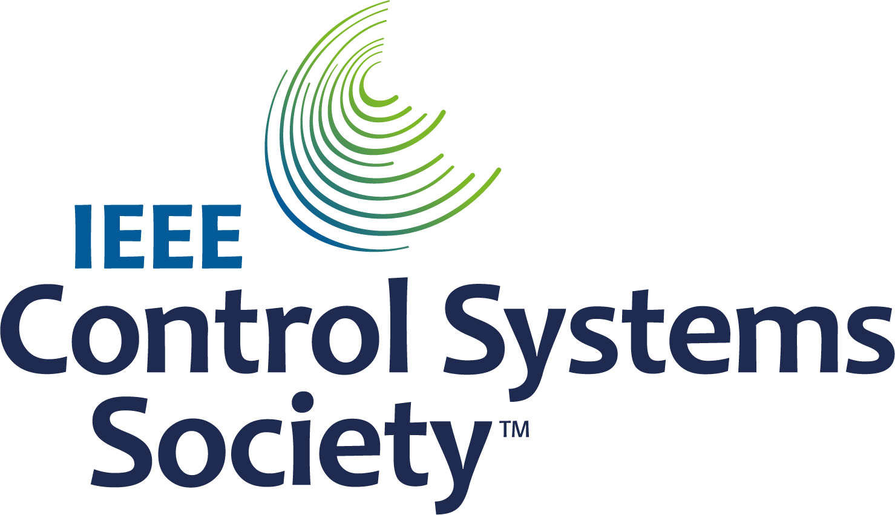

# Full Closed Loop

```{contents} In this page
:backlinks: entry
:depth: 2
```

The main attraction of Full Closed Looping **FCL** is that it has the potential to mimic an artificial pancreas and make daily management easier without having the need to bolus for meals.

Whilst **hybrid closed loop** ('HCL') is algorithm based, it still requires the user to manually deliver boluses prior to meals. As a result, the loop may go into a temporary shut-off (temporary zero basal) to prevent over delivery of insulin.

In **FCL** mealsize-related bolus are no longer required: leave it to the algorithm!  **AAPS** יכול לטפל בארוחות בלי שהמשתמש ייתן בולוס כלשהו ובלי הזנת פחמימות, במצב שנקרא "ארוחות לא מוכרזות" **('UAM')**. **UAM** allows **AAPS** to better tolerate incorrect carb inputs by being more aggressive.

## What to expect?

There are many published studies on the favourable results **FCL** can achieve. For further reading refer to the following:

1)   National Library of Medicine, PubMed [First Use of Open-Source Automated Insulin Delivery AndroidAPS in Full Closed-Loop Scenario: Pancreas4ALL Randomized Pilot Study](https://pubmed.ncbi.nlm.nih.gov/36826996/);

2)  ClinicalTrials.gov National Library of Medicine, Clinical Trial [Feasibility and Safety Study of the Automated Insulin Delivery Closed Loop System Pancreas4ALL (ASAP)](https://www.clinicaltrials.gov/study/NCT04835350?term=Feasibility%20and%20Safety%20Study%20of%20the%20Automated%20Insulin%20Delivery%20Closed%20Loop%20System%20Pancreas4ALL%20(ASAP)&rank=1)

Success for **FCL** requires the user to:

- check whether they met the **FCL** requisites;
- set up **Automations** that are tailored for  their daily management’s needs; and
- fine tune and adjust the **AAPS** settings (notably **Automations**).


## General considerations why (not to) move from HCL to FCL

**FCL** is not for everyone:

- Some **FCL** users achieve TIR (70-180) around 90% and HbA1c under 6%, however other users prefer tighter control. במיוחד, כדי לצמצם ערכים מעל 140 mg/dL בתזונה עם פחמימות מהירות, כנראה יהיה צורך בבולוס מראש.
- **AAPS** tuning can be challenging. הוא אינו מתאים למשתמשים ש-AAPS מעמיס עליהם יותר מדי.  You will need to dedicate a few weeks in order to adjust and fine tune your **FCL**. Investing such time can yield better results and **BG** control.
- Meal management may become easier, however exercise can still be challenging in **FCL**. Most of us like to limit sports snacks in an attempt to control body weight.
- Difficulties still remain to establish a **FCL** for kids (discussed below).


## Well-tuned hybrid closed loop

מומלץ קודם לבסס **HCL** מכוונן היטב, לפני ששוקלים מעבר ל-**FCL**.  Success with **FCL** requires a highly personalised individualised tuning of the user’s setting so that **AAPS** can give insulin to closely mimic YOUR successful hybrid closed loop mode.

**FCL** requires the user to set up and tune their **Automations**. However the user must have a confident understanding of their insulin management needs before embarking on **FCL**. Errors can be masked with counter-errors. This can create an unstable **FCL** system, and make it hard to later correct. You should expect to reach a comparable %TIR with your FCL as you see today in your **HCL**.

**FCL הוא מערך של אוטומציות שהמשתמש בונה בעצמו (DIY). המשתמש קובע אותו על סמך ניתוח הנתונים שלו, הן מה-HCL המוצלח שלו והן מהניסיון הראשוני עם FCL בזמן כוונון ההגדרות.**

## Fast insulin (Lyumjev, Fiasp)

**FCL** requires fast insulin.  זאת כדי שבתחילת עליית **הסוכר בדם** בעקבות ארוחה, **FCL** יוכל לשמור את **הסוכר בדם** בטווח (לפי ההגדרה המקובלת, מתחת ל-180 mg/dL (10 mmol/L)).

A modelling study (details see LINK FullLoop V2/March2023; there section 2.2) can show in quantitative terms that *faster insulins*

Source:

 


IEEE Control Systems Magazine, ResearchGate [The Artificial Pancreas and Meal Control: An Overview of Postprandial Glucose Regulation in Type 1 Diabetes](https://www.researchgate.net/publication/322866519_The_Artificial_Pancreas_and_Meal_Control_An_Overview_of_Postprandial_Glucose_Regulation_in_Type_1_Diabetes);

- יביאו לשיאי **סוכר בדם** נמוכים משמעותית מאשר אינסולינים איטיים יותר;
- tolerate a couple of minutes delayed first meal bolus while not incurring unacceptable height of peaks; and
- יצמצמו את ההשפעה של כמויות פחמימות שונות (גודל הארוחה) על שיא **הסוכר בדם**.

**FCL** is unlikely to be effective with insulin other than Lyumjev or Fiasp, unless the user is on a very moderate to low carb diet.

עם זאת, Fiasp או Lyumjev עלולים לגרום לחסימות תכופות במשאבה, גם לאחר שיפור של דברים כמו אורך המחט. It is important to have an eye on the cannula or pod time. Many users find 48 hours to be the efficacy insulin limit before resulting in cannula/pod failure.

## Prerequisites

נדרשים ערכי **סוכר בדם** וחיבור Bluetooth יציב כדי להבטיח ש-**AAPS** יוכל לפעול באופן מיטבי בלי לאבד זמן יקר. **FCL** requires a 24/7 technically stable system:

- **ביצועי ה-CGM** שלכם. ה-CGM לא אמור להפיק ערכי **סוכר בדם** קופצניים, ש-**FCL** עלול לפרש בטעות כסימן לתחילת ארוחה. Similarly, **CGM** calibrations can produce jumpy results.
- how and where any **CGM** smoothing is done, and what this might imply for your tuning. במיוחד: כיצד מוגדרת הדלתא, וכיצד AAPS מזהה אותה כסימן לתחילת ארוחה.
- יציבות Bluetooth של המשאבה ושל ה-CGM;
- avoiding (or at least early recognition of) pump occlusion;
- data flow and your phone's apps used and difference between days of sensor usage;
- keeping all **AAPS** components well charged and in spare parts close proximity; and
- actioning cannula (or pod) changes always early enough to lower the risk of occlusion;

The above will vary depending on your **AAPS** component system and your lifestyle.

## Meal-related limitations

- Setting up a **FCL** may be easier for people whose diets do not consist of food components with a rapid high effect on **BG**, and meal patterns that do not wildly vary day-to-day. This does not necessarily mean low carb.

- Fat or protein rich diets, or slow digestion/gastroparesis, make things easier rather than harder for **FCL**  because late carbs nicely cover for inevitable “tails” of late action from bolus needed around peak time.

### Glycemic index and effect on blood glucose

האתגר של מצב **UAM** גדל ככל שעולה ההשפעה על הסוכר בדם ('EBG')

- Start moderate/low, and tune your **Profile's** settings. Only then, "test" meals with high **EBG**.
- Consider a < 50% initial bolus if consuming very high **EBG**.

1) **No EBG**: e.g. fresh meat, fish, eggs, bacon, oils, cheese. 2) **Low EBG**: e.g. fresh vegetables and berries, mushrooms, nuts, milk, yoghurt, cottage cheese. 3) **Moderate EBG**: e.g. whole grain bread/noodles, potatoes, wild rice, oats, dried fruits. 4) **EBG גבוה**: למשל לחמי חיטה, בגט, טוסט, ופל, עוגיות, מחית תפוחי אדמה, אטריות, אורז. 5) **Very High EBG**: e.g. sugar, sweet drinks, fruit juices, cornflakes, candy, sweets, potato chips, salty pretzel sticks.


The most difficult meals for **FCL** are those foods exclusively very high and high **EBG** components (see red in the picture): Not only does **BG** shoot up rapidly, but also there is little fat/protein/fibre component to balance the inevitable “tail” of insulin activity that would come with attempts to control the high glucose earlier on.

Erratic consumption of snacks and sweet drinks that are loaded with fast absorbing carbs is problematic for **FCL**.


## Preparing for activity/sports

When exercising or being active, with a pump or hybrid closed loop it is recommended that the user reduces **IOB** prior to exercise.

With **FCL**, the algorithm is tuned to detect **UAM** and automatically deliver insulin to counter **BG** rises.  יש להגדיר **יעד זמני** גבוה ו**אחוז פרופיל** נמוך יותר זמן רב לפני כל פעילות (כך שיהיו בתוקף כבר סביב תחילת הארוחה).

Unusual or erratic exercise activity levels present difficulties for **FCL**. Planning ahead is required for exercise (especially if you want to reduce the need for rescue carbs/snacks during sports low). לאחר יום פעיל מומלץ להגדיר **אחוז פרופיל** נמוך יותר ללילה, אחרי שארוחת הערב התעכלה במלואה: יש להגדיר ב**אוטומציות** יעד **סוכר בדם** מוגבה (>100 mg/dL), כאשר ב**הגדרות** של **AAPS** האפשרות **הפעלת SMB עם יעד זמני גבוה** כבויה.

## Hurdles for kids

**FCL** can present extra challenges for children and these include:

- ייתכן ש-Lyumjev או Fiasp אינם זמינים או אינם נסבלים היטב.
- הקצב הבזאלי השעתי עשוי להיות נמוך מאוד, ולכן הוא בסיס חלש ל-**SMBs** גדולים.
- Diet may be rich in sweet components. With the typical low blood volume of a small body, strong tendency towards very high **BG** spikes.
- Growth hormones and going through marked changes of insulin sensitivity makes it difficult to keep the **FCL** accurately tuned.


## Enabling boosted SMBs: safety

In **HCL** safety restrictions are implemented regarding bolus sizes that can be automatically given by the loop.

**FCL** loopers no longer need to give a sizable bolus around meal start. The impact of this means that restrictions in size limits for **SMBs** must be widened to make the loop capable of delivering large enough **SMBs**.

אם משתמשים ב-**AAPS** בגרסה הרשמית (Master), מומלץ להגדיר ב**הגדרות** של **AAPS** את גודל ה-**SMB** המרבי המותר, כדי ש-**FCL** יוכל לתת אותו (maxUAMSMBBasalMinutes=120, כלומר כמות בזאלי של 2 שעות לפי השעה הזו ביום).

אם הקצב הבזאלי שלכם נמוך מאוד, מגבלות **SMB** הנגזרות ממנו עלולות להיות נמוכות מדי כדי לאפשר שליטה מספקת בעליות ב**סוכר בדם** לאחר ארוחות. פתרון אפשרי אחד הוא להימנע מתזונה שגורמת לזינוקים חזקים ב**סוכר בדם**. לאלגוריתם [Auto ISF](#Open-APS-features-auto-isf) (זמין רק בגרסת פיתוח (dev) עם מצב הנדסה) יש הגדרה **הרחבת הטווח המרבי של SMB**, שמרחיבה את המקסימום הרגיל של כמות בזאלי של 2 שעות במכפיל >1, ומאפשרת להעלות את **יחס מתן SMB** מעל ברירת המחדל של 50%.

**Follow the instructions to enable AAPS to mimic your bolussing via a couple of SMBs**.

יש לבדוק מדי פעם את מסך התוסף **APS** (**הגדרות תצורה → APS → פתיחת תוסף**) כדי לראות אם ה-**SMBs** מורשים להיות גדולים מספיק כדי לתת את האינסולין שהלולאה צריכה סביב תחילת הארוחות.

If not, your tuning efforts will sometimes come to nothing!


```{admonition} Boosting **ISF** can become dangerous
:class: danger

יש לעקוב ולנתח בקפידה את גודל ה-**SMB** זמן קצר לאחר תחילת הארוחה. Tune in steps, and do not vary more than 1 or 2 parameters at a time.

Your **AAPS'** setting must be sufficiently set up to cope with your (!) variety of meals.
```

## Meal detection/your Automations for boosting

For successful **FCL**, **ISF** is the key tuning parameter. בעת שימוש ב-**AAPS** Master + **אוטומציות**, **יש להפעיל אוטומטית שינוי פרופיל ל-> 100% עם זיהוי ארוחה** (באמצעות ערכי הדלתא של הגלוקוז), כדי לספק **ISF** אגרסיבי יותר.

**AAPS** Master מאפשר **פרופיל** זמני של עד 130% במצב **HCL**. Boosting the **ISF** is done in 3 steps:

- שלב 1 - בדקו ב**פרופיל** את ה-**ISF** החל בשעת הארוחה הזו, ובדקו אם למשל Autosens מציע שינוי המתחשב במצב הרגישות הנוכחי של הגוף לאינסולין (בשעות האחרונות).
- Step 2 - apply a factor (1/Profile%, as set in **Automation**) to boost **ISF**.
- Step 3 - check that the suggested **ISF** falls within set safety limits.

### FCL's Automation templates

Boxes to tick at the top. You have the option:

- In your **Automation** list, you can tick the check-mark (to the left of each field) OFF => This de-activates that **Automation**. For instance you can do this for all breakfast related **FCL** **Automations** to go to **HCL** for breakfast(s).

- בכל כלל **אוטומציה** ניתן לסמן את התיבה "פעולות משתמש" => אז הפעולות שהוגדרו לא יבוצעו אוטומטית כאשר התנאים מתקיימים. Rather, the **AAPS** main screen will alert you whenever your **FCL** would automatically give a **SMB**. You have the opportunity then to say ‘yes’ or ‘no’. This is extremely useful in your tuning phase.

תכונה זו יכולה להועיל במצבים מסוימים, כמו תסמונת "foot to floor" (רגל לרצפה), שבה יש עלייה פתאומית ב**סוכר בדם** בקימה בבוקר, אבל המשתמש רוצה למנוע תגובה אוטומטית מלאה של "ארוחת בוקר התחילה".

The section below provides guidance how to bundle **Automation’s** Conditions and how to tackle situations in which the **AAPS** should increase (or decrease) insulin delivery. As **ISF** cannot directly be tuned, raising **Profile Percentage** over 100% will do the same for our purposes.

### Automated big SMBs at bg rise

המפתח להצלחת **FCL**: **בתחילת עליית הסוכר בדם בעקבות ארוחה, הלולאה חייבת לתת SMBs אוטומטיים גדולים מאוד מהר ככל האפשר**, כדי "להשלים" את כמות ה-**IOB** הנדרשת (השוו לבולוס שאתם נותנים בדרך כלל לארוחה דומה ב-**HCL**!)

כדי להשיג זאת, יש לנתח את נתוני ה-**HCL** שלכם כדי לקבוע אילו ערכי **דלתא** כנראה אינם קשורים לארוחה ואילו כן.

- מכיוון שניתן להגדיר את ה**אוטומציה** בתוך חלון זמן מוגדר מראש, יש צורך לנתח רק את חלון הזמן הזה.
- If you do very different kinds of meals (e.g. a rather high carb breakfast, but low carb lunch) you can choose to do two different (sets of) **Automations** for each of the time slots.
- Exclude the nights if you see occasional jumps from a compression lows
- בדרך כלל, מספיק להשתמש רק בדלתא של 5 הדקות האחרונות.
- אך ניתן להשתמש גם באחד מערכי הדלתא הממוצעת. באמצעות השוואת ערכי הדלתא בתנאי ה**אוטומציות** שלכם, תוכלו אפילו להגדיר פעולות ברמות אגרסיביות שונות בהתאם לשאלה אם **הסוכר בדם** עולה בקצב מואץ או לא.

> ( delta – short avg delta )>n   is a term that could be used for acceleration detection , to trigger first **SMB** at earliest sign of rising **BG**. -                                                                             
> זהירות: לא ניתן להשתמש בזה עם ערכי **CGM** באיכות ירודה או מוחלקים מאוד!

**CGM** עם נתונים לא רציפים מציב את המשתמש במצב בעייתי, מכיוון שכדי לשמור על הבטיחות עליכם להגדיר בזהירות ובשמרנות איזו דלתא היא סימן ודאי לכך שארוחה התחילה. This means:

- **FCL** loses additional time, resulting in higher **BG** peaks and lower %**TIR**;
- אינכם יכולים להשתמש בדלתא מוקדמת יותר או קטנה יותר, שעלולה להפעיל גם ללא ארוחה את ה-**SMBs** שאמורים להחליף בולוס של המשתמש ב-**FCL**.

Furthermore, first rises after a meal are characterized by **low iob** present. With that in mind, an Automation(#1) for a dinner might look like this:


Automation #1

If Conditions apply, **AAPS** would give 1 or 2 **SMBs** in the next 12 minutes, using a boosted **ISF** according to the set elevated **Profile Percentage** (in the example, a 30% boost of insulinReq). As long as these Conditions apply, the **Automation**  rule extends by another 12 minutes. A low carb meal might have slower **BG** rise characteristics. היא תוכל להפיק תועלת מאוטומציה נוספת (#2), שנכנסת לפעולה בדלתא נמוכה יותר ומספקת הגברת אינסולין חלשה יותר.


The same **Automation** probably will kick in also in higher carb meals, once the steep rise as defined in Automation#1 is over.

You need to “stage” these two (+ maybe a third) **Automations** to fit with what you see in your meal (variety) => Setting appropriate jump sizes, **iob** criteria, and amplifications will be an iterative tuning process.  Also, if you include appropriate time slots in the Conditions, you can easy do different Automations for your different daily meals times (breakfast, lunch, dinner).

Note that, still in the rise phase (!), the "overflow" of **iob** must be blocked so that the late effects of the **insulin** (the "**tail**" after 3-5 hours) will not exceed the braking capacity of the loop through zero-temping (“taking away” basal, to reduce hypo risk).

With large meals there is **sometimes a second increase**. By then, usually also the iob has dropped a bit, and the more aggressive Automations take effect again. (ודאו שתנאי האינסולין הפעיל באוטומציה #2 לא הוגדר נמוך מדי, כדי שזה יוכל לקרות).

Soon after a few initial **SMBs** are given comes a **balanced phase** where moderate delivery of insulin should cover the additional carbs absorbed. (למעט בארוחות דלות פחמימות, שבהן הלולאה עשויה לראות עלייה חלשה מדי ב**סוכר בדם** ולעבור כבר עכשיו מיד לבזאלי זמני של אפס).

The **AAPS** main screen (where you see cob=0 in **UAM** full loop) might in this phase ask for more carbs required. In **UAM** mode that simply means, you could make a very rough plausibility check: Is that amount of carbs likely in your body, un-absorbed from your meal just about an hour ago (about which you gave your loop no info)?


### iob threshold

Often, **Automations** #1 and/or #2 make iob rise to heights that typically are enough for **your** meals. For personalised tuning, look in your **HCL** data at the max iob values that occur with well-managed meals (often: your meal bolus), and above which magnitude a hypo (or requirement for extra carbs) occurred at the end.

Sensible **iob thresholds** at which you should reduce aggressiveness of your loop, might not be the same for every meal. But especially in the first hour after the start of a meal, which is very crucial in the **UAM** mode. הדבר שונה אצל כל משתמש. אצל חלק מהמשתמשים נספגים רק כ-30 גרם בשעה, וייתכן שניתן להגדיר כמות **אינסולין פעיל** משמעותית שאינה תלויה בארוחה המדויקת.

For exceptional meals, or to lower it if sports follow, the **iob** threshold can rapidly be set differently in your **Automation**.

אוטומציה (#3), "iobTH reached => **SMBs** off", מוגדרת לסיום ההגברה האגרסיבית של **SMB** (או להשהייתה עד שיגיע גל נוסף של עליית סוכר הקשורה לפחמימות).


Automation #3

It tells the loop that above your set **iob threshold** it's better not to use any more **SMBs**

- הדוגמה עושה זאת באמצעות הגדרת TT=111 (מספר שרירותי למדי; בחרו מספר>100 שקל לכם לזהות ככיבוי האוטומטי של **SMB**)
- ב[הגדרות → OpenAPS SMB](#Preferences-openaps-smb-settings) של **AAPS**, באופן כללי אין לאפשר **SMB** ביעד מוגבה.                                                                                                                   
  האינסולין הנדרש יינתן אז בזהירות רבה הרבה יותר, דרך צוואר הבקבוק של **TBRs** (בזאלי זמני)

**Caution: Automation #3 only works when there is no active TT.** So, in case you worked with EatingSoonTT, it must be ended by that time, which usually should be 30-40 minutes after meal start.

One way to do this is to set up an **Automation** Condition that ends an eventually running EatingSoonTT under the Condition **iob**>65% * iobTH.
> דרכים לעבודה עם EatingSoonTT חלק ממשתמשי הלולאה מגדירים EatingSoonTT כשעה או יותר לפני תחילת הארוחה (בלחיצה על לחצן TT, או אוטומטית באמצעות הורדת יעד **הסוכר בדם** ב**פרופיל** אם זמני הארוחות קבועים למדי), רק כדי להבטיח **סוכר בדם** נמוך בתחילת הארוחה וכמות **אינסולין פעיל** מעט מוגדלת. אך בהנחה ש-**FCL** תמיד מתקדם לעבר היעד, ייתכן שהתועלת מכך אינה רבה, ואולי תעדיפו להגדיר **אוטומציה** שמגדירה EatingSoonTT בעת זיהוי תחילת ארוחה (דלתא של הגלוקוז, או האצה = delta > avg delta). A low **TT** is important in this stage because any **SMB** is calculated by your loop using (predicted glucose minus TT)/sens, so a small TT makes the resulting insulinReq bigger.

לאחר מתן ה-**SMB**s המוגברים הראשונים, ה-iobTH שהגדרתם ו**אוטומציה** #3 אמורים ליצור איזון טוב: להגביל את שיא הגלוקוז, אבל גם לא לגרום להיפוגליקמיה לאחר הארוחה.

אם תכולת הפחמימות בארוחת הבוקר שלכם שונה משמעותית מזו שבארוחת הערב הממוצעת שלכם, ייתכן שתפיקו תועלת מהגדרת **אוטומציות** החלות בשעות היום המתאימות, עם **iobTH** שונה (ואולי גם ערכי דלתא שונים והגדרת **אחוז פרופיל** שונה). Both, you with defining your meal spectrum and settings (notably, **iobTH**), and the loop managing the unfolding **BG** curve, must accept certain peak heights for reducing hypo danger towards the end of the **DIAs** from **SMBs**.

### Stagnation at high bg values

אם לאחר ארוחה "עשירה" רואים התייצבות ממושכת ב**ערך סוכר גבוה**, **אוטומציה** #4 (בהמשך), "post-meal High", עוזרת להתמודד עם תנגודת הנגרמת מחומצות שומן: לאחר ארוחות של כמה מנות, פיצה גדולה ושמנונית או ערב ראקלט, עקומת הגלוקוז עשויה ליצור שתי דבשות או, לעיתים קרובות מאוד, רמה גבוהה וממושכת.


Automation #4


Automation #5

Automation #4, “post-meal High”, is also suitable in hybrid closed loop.

In addition, a termination-Automation #5, “Stop pmH”, is needed, so that the aggressiveness of the insulin administration is reduced, as soon as the glucose value is falling. (However, often the loop will limit more insulin anyways for hypo prevention because predicted glucose runs low already).

## Hypo prevention

The core problem is that the **UAM** **FCL** (without carb inputs) can have **no idea how many g of carbs are still available** for absorption, and might use up that “tail” insulin, without you going into a hypo from it.

Using boosted **SMBs**, the **FCL** “caught up” with what we formerly did with a meal bolus. But, **at the “tail” end of insulin activity, hypo prevention can become a serious topic**.

In preparation for **FCL**, the user must take a closer look at the **time course of iob** for typical meals, and judge **when it becomes too much, and how you can catch that by tuning your Automations**. That is possible because we have several adjusting screws. It can be a challenge to get this right

באופן כללי, אין טעם להמשיך לשפר את ההגדרות עבור סוג אחד של ארוחה. Once you have a good-enough setting e.g. for one kind of lunch you frequently have, test how this works with other kinds, and how you would “compromise”.

In order to prevent hypo in post-meal hours 3 – 5, reduce the aggressiveness before too much iob comes together. Specific approaches:

- Become milder and milder with the **ISF** already during the glucose rise, as in Automation examples #1 and #2 given.
- Define the iob threshold, from which **AAPS** is made significantly more cautious (Automation #3, above). שימו לב שה-**אינסולין הפעיל** הזה יכול לעלות מעל הסף בגלל ה-**SMB** האחרון שניתן לפני שהכלל נכנס לתוקף, ולאחר מכן גם בגלל TBRs אם הלולאה רואה insulinReq. פחמימות שנספגות יוצרות תנועה נגדית לעבר אינסולין פעיל נמוך יותר.
- The iob threshold could be differentiated according to meals: By cloning the automations, you could easily differentiate for breakfast, lunch, and dinner time slots (or even for geo-locations, like company cafeteria, or at mother-in-law etc)
> ניתן ליצור הבחנות נוספות בתוך משבצות הזמן האלה באמצעות הגדרת יעדים זמניים שונים לארוחות דלות פחמימות לעומת ארוחות עם פחמימות מהירות וכדומה. כך תוכלו "לקודד" סוגי ארוחות שונים שעשויים להתרחש בשעה זו ביום, ולהפעיל אותם באמצעות **אוטומציות** שכווננו במיוחד עבורם. This is probably not necessary, unless your diet habits do vary a lot.

לפני אתגר של ארוחה מיוחדת, ניתן להעלות את סף ה**אינסולין הפעיל**, או לבצע שינוי אחר באחת מהאוטומציות תוך פחות מ-5 שניות, ישירות בטלפון עם AAPS (**ניהול → אוטומציה**).

The hypo danger some hours after the meal is essentially a question of whether your meal composition was such, that the **insulin tails from fighting the bulk of carbs** will be **consumed by “extended carbs”** (excessive/delayed carb absorption/protein/fat/fibre).

Over time you will learn patterns, tune your Automations – maybe even adjust your eating habits a bit, e.g. just enjoy the occasional late little(!) snack that may help maintain a good **balance of insulin activity and carb absorption** for the **entire** meal (digestion, absorption) time, and thus make life for your loop (and for yourself) easier.

### Order of programmed Automations

Problems can arise with overlapping definitions in **Automations**. Example: The problem is that delta >8 is also delta >5, i.e. there may be two competing **Automations** What does the loop do then? הלולאה מחליטה תמיד לפי הסדר שבו ה**אוטומציות** מופיעות ב**ניהול → אוטומציה**.  Example: The delta > +8 rule must come first (and launch the strongest boost if all conditions apply); then comes the check for delta >5 (and a milder response). If done the other way round, the delta>8 rule would never come into effect because the delta>5 already applies, case closed.
> Tip for Automations: Order changes are very easy to make. ב**ניהול → אוטומציה**, יש לגעת ולהחזיק את הידית **=** מימין לכלל ולגרור אותה למיקום אחר.

Also it is very easy and quick to adjust any conditions or actions at any time, within seconds, just on your AAPS smartphone; for instance if you head into a very special eating event. (But don’t forget to set it back to normal on/for the next day).

(full-closed-loop-troubleshooting)=

## פתרון תקלות

### How to get back into Hybrid Closed Loop

ניתן לבטל את הסימון בתיבות של ה**אוטומציות** הקשורות ל-**FCL**, ולחזור לתת בולוס לארוחות ולהזין שוב פחמימות. אם הסרתם את הכפתורים **אינסולין** או **מחשבון** מהמסך הראשי, ניתן להוסיף אותם שוב בהגדרות [סרגל ההפעלה המהירה (QuickLaunch)](#quicklaunch) (הם תמיד נשארים זמינים תחת **טיפולים** בסרגל הניווט התחתון). שימו לב שעכשיו שוב באחריותכם לתת בולוס לארוחות.

ייתכן שכדאי להשתמש ב-**FCL** רק לארוחות (משבצות זמן) שבהן ה**אוטומציות** מוגדרות במלואן ומסומנות, ולבטל את הסימון רק באוטומציות של זמני הארוחות האחרים, שבהם אתם מעדיפים **HCL** (או שעדיין לא הוגדרו להם אוטומציות, בתקופת המעבר).

לדוגמה, אפשר בהחלט, ללא צעדים נוספים לאחר שהוגדרו **אוטומציות** למשבצות הזמן של ארוחת הערב, להשתמש ב-**FCL** רק לארוחות הערב, בעוד ארוחות הבוקר והצהריים מנוהלות ב-**HCL** כרגיל.


### Are the pre-conditions for FCL still given?

- Is the basic **Profile** still correct?
- Has the **CGM** quality deteriorated
- Refer to pre-requisites (above).

### Glucose goes too high

- Meals are not recognized asap
    - Check regarding Bluetooth (in)stability
    - בדקו אם ניתן להגדיר ערכי דלתא קטנים יותר להפעלת ה-**SMB** הראשון
    - נסו אפריטיף או מרק כמה דקות לפני תחילת הארוחה
- SMBs are too weak
    - בדקו את סדר ה**אוטומציות** (למשל: דלתא גדולה לפני דלתא קטנה)
    - בדקו (בזמן אמת) במסך התוסף **APS** אם הבזאלי השעתי בפרופיל ומספר הדקות שהוגדר (עד 120) מגבילים את גודל ה-SMB המותר
    - בדקו (בזמן אמת) במסך התוסף **APS** אם יש להגדיל את אחוז הפרופיל (%profile)
- If all your settings are at the limit, you may have to live with the temporary high, or adjust your diet.
> אם אתם מוכנים לבדוק גרסת פיתוח (dev), [Auto ISF](#Open-APS-features-auto-isf) מאפשר גם גודלי SMB גדולים עוד יותר. Some users also resort to using a small pre-bolus in their “FCL”. However, this interferes with how glucose curve and hence detection of rises and triggered **SMBs** behave, and is therefore not easy to implement with convincing overall benefit.
- An important observation by pilot users was, that how your glucose and iob curves approach meal start matters a lot regarding how you peak from carbs: Going down (e.g. towards a set EatingSoonTT), building some iob, and curving already towards strong positive acceleration seems very helpful to keep peaks low.

### Glucose goes too low

- Meals are falsely recognized
    - בדקו אם ניתן להגדיר ערכי דלתא גדולים יותר להפעלת ה-**SMB** הראשון
    - סמנו "פעולות משתמש" באוטומציה הקשורה, כדי שבעתיד תוכלו להחליט באותו רגע לחסום את הפעלת האוטומציה אם היא אינה קשורה לארוחה
    - To prevent snacks from triggering **SMBs** as for a meal, set a TT>100 when snacking (as you would do in sports and for anti-hypo snacks, anyways)
- SMBs deliver overall too much insulin
    - בדקו (בזמן אמת) במסך התוסף **APS** אם יש להקטין את **הרחבת הטווח המרבי של SMB**
    - בדקו (בזמן אמת) במסך התוסף **APS** אם יש להקטין את **אחוז הפרופיל**
    - SMB delivery ratio probably can be set smaller. Note in this case, it works across the board for all **SMBs** (all time slots),
- Problems with insulin “tail” after meals
    - You may need to take a snack (seeing hypo prediction) or glucose tablets (if already in hypo zone). But note that the carbs required the loop might tell you at some point are very likely exaggerated as the loop has absolutely zero info on your carb intake (while you may be able to guess how much more, incl. from fats and proteins) is still waiting to be absorbed.
    - A valuable information would be whether the problem originates mostly in the bg rise phase already. Then setting a lower iobTH might be an easy remedy.
    - If the need for additional carbs happens frequently, note down how many grams were needed (not counting what you eventually took too much and required extra insulin again).  Then use your profile IC value to estimate how much insulin less the **SMB** should have delivered, and go with this info into your tuning (regarding the **Percentage Profile** in **Automations**, or maybe also your set iobTH). הדבר עשוי לנגוע ב-**SMBs** שניתנו כשהגלוקוז היה גבוה, או גם ב-**SMBs** שניתנו בזמן עליית **הסוכר בדם**.
    - It could well be that you simply have to accept higher **BG** peaks for not going low. או לשנות את התזונה לתזונה עם פחות פחמימות ויותר חלבון ושומן.


### More info

הקפידו לשמור על קשר עם משתמשי **FCL** אחרים.

דיון על לולאה סגורה מלאה באמצעות אוטומציות:

- English:   [Discord Channel](https://discord.gg/ChXj8BaKwA)

- German:  [German Looper Community](https://de.loopercommunity.org/t/ueber-die-kategorie-full-loop/10107)
