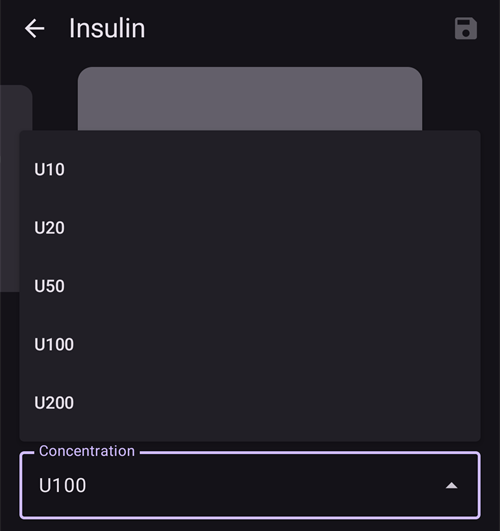
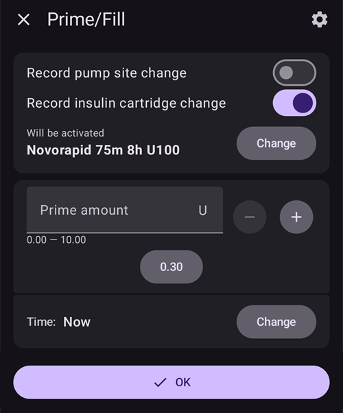

(Insulin-Concentration)=
# ריכוז האינסולין

```{warning}
כל המשאבות המסחריות מתוכננות לשימוש עם אינסולין U100 **בלבד**. שימוש בריכוז אינסולין אחר במשאבה עלול להיות מסוכן. אף שיותר ויותר משתמשים מפעילים את AAPS עם ריכוזים אחרים, תמיד צריך לנהל את ההמרה, והיא מובילה לעיתים קרובות לטעויות (גם אצל משתמשים מנוסים מאוד!).
```

## תזכורת: יסודות האינסולין

פרק זה מסביר את המושגים הבסיסיים של מדידת אינסולין ומתן אינסולין.

### יחידת האינסולין: מדד של פעולה

אינסולין נמדד ב**יחידות בינלאומיות (IU)**, שמודדות את הפעילות הביולוגית שלו (היכולת להוריד את רמת הסוכר בדם), ולא רק את המסה הפיזית שלו.

- **הגדרה:** 1 IU מתאימה לפעילות של כמות מסוימת של אינסולין, שתוקננה ל-**כ-0.04167 מ"ג**.
- **נקודה חשובה:** ל"יחידה" יש אותה השפעה ביולוגית בכל סוגי האינסולין, וכך המינון אחיד.

### ריכוזי אינסולין

אינסולין מגיע בריכוזים שונים, שמוגדרים לפי מספר היחידות למיליליטר (ml).

- **U100:** התקן העולמי, מכיל **100 IU/ml**.
- **U200-U500:** אינסולינים מרוכזים יותר (למשל U200 מכיל 200 IU/ml) לנפחי הזרקה קטנים יותר.
- **U40/U50:** ריכוזים פחות נפוצים והיסטוריים (40 IU/ml ו-50 IU/ml). **אינסולין U40 מחייב מזרקים ייעודיים ל-U40.**
- **מיהול ידני:** שיטה קלינית ליצירת אינסולין מהול מאוד (למשל U50, U10) למקרים נדירים, כמו שימוש ביילודים או רגישות קיצונית. הדבר דורש הכנה קפדנית בבית מרקחת.

```{admonition} Critical Warning
:class: danger
שימוש בריכוז עם מכשיר שאינו מתאים לו מסוכן מאוד, ועלול לגרום למינון יתר או לתת-מינון חמורים. **יש תמיד לבדוק שלוש פעמים שריכוז האינסולין מתאים למפרט של המזרק, העט או המשאבה.**
```

## מתי משתמשים בריכוז לא סטנדרטי?

משאבות אינסולין מתוכננות לאינסולין U100, אבל מצבים רפואיים מסוימים דורשים ריכוזים לא סטנדרטיים. מצבים אלה דורשים זהירות רבה מאוד וניהול קפדני.

### מקרה 1: אינסולין מהול למינונים נמוכים מאוד

- **מצב:** טיפול בסוכרת סוג 1 אצל תינוקות ופעוטות צעירים מאוד.
- **בעיה:** הצורך שלהם באינסולין נמוך כל כך, שהמנה המינימלית שהמשאבה יכולה לתת (למשל 0.05 U) עדיין עלולה להיות גדולה מדי. לכן קשה להשיג איזון גליקמי מדויק, והסיכון להיפוגליקמיה גבוה.
- **פתרון:** שימוש באינסולין מהול מאוד (למשל U10, כלומר 10 IU/ml).
- **השפעה:** כך גדל נפח הנוזל שניתן לכל יחידת אינסולין. כאשר "חבילות" האינסולין גדולות יותר בנפח אבל חלשות יותר בריכוז, אפשר לבצע כיוונונים עדינים הרבה יותר ולקבל מינון מדויק יותר עם ההגדרות הקיימות של המשאבה.

```{admonition} Critical Safety Note on Dilution
:class: danger
מיהול אינסולין הוא הליך בסיכון גבוה. אסור לעולם לנסות לבצע אותו בבית בלי הכשרה מתאימה ובלי פיקוח רפואי. המיהול חייב להתבצע על ידי איש מקצוע רפואי או מטפל מיומן, עם נוזל מיהול סטרילי שמיועד במיוחד לסוג האינסולין הזה. **לעולם אין להשתמש במי ברז, במי מלח או בכל נוזל אחר**, כי הם עלולים לנטרל את האינסולין, לשנות את פעולתו ולהכניס זיהומים מסוכנים.
```

### מקרה 2: אינסולין מרוכז לצורך גבוה באינסולין או לתנגודת חמורה לאינסולין

- **מצב:** טיפול במבוגרים או במתבגרים עם תנגודת חמורה לאינסולין, או באנשים שחווים כאב מקומי מהתוספים שבאינסולין הרגיל.
- **בעיה:**
  1. **צורך גבוה:** צורך יומי גבוה מאוד באינסולין עלול לעבור את הבולוס המרבי של המשאבה או את מגבלות המתן היומיות שלה.
  1. **כאב:** חומרי השימור באינסולין עלולים לגרום לצריבה או לגירוי בזמן העירוי.
- **פתרון:** שימוש באינסולין מרוכז יותר, כמו U200 (200 IU/ml).
- **השפעה:** כך מנת האינסולין הדרושה ניתנת בחצי נפח. יש לכוונן את ההגדרות הפנימיות של המשאבה (למשל להוריד בחצי את קצבי הבזאלי ואת הבולוסים) כדי להתחשב בריכוז הכפול, וכך לוודא שניתן מספר היחידות הנכון. כך גם קטן נפח הנוזל שעלול לגרות, שניתן מתחת לעור.

## איך מנהלים ריכוז אינסולין עם AAPS (AAPS 3 ומטה)?

שימוש באינסולין שאינו U100 בלולאת AAPS דורש הגדרה קפדנית, כדי שהחישובים של התוכנה יתאימו לאינסולין שניתן בפועל. שיטה נפוצה אחת היא "שימוש בפרופיל מותאם".

### שימוש בפרופיל מותאם

בשיטה זו "מטעים" את AAPS כך שיחשוב שהצורך של המטופל באינסולין נמוך ממה שהוא באמת, כדי לפצות על כך שהמשאבה נותנת אינסולין מרוכז יותר ממה שהיא תוכננה לו. הדוגמה שלהלן היא לאינסולין בריכוז U200 שהוכנס למשאבה שמתוכננת ל-U100.

- **הבעיה העיקרית:** משאבה שמתוכננת ל-U100 מכוילת לתת **10 µL** עבור **יחידה אחת**. אם ממלאים אותה ב-U200 (יחידה אחת של U200 מתאימה ל-**5 µL** אינסולין), כאשר בוחרים **יחידה אחת** במשאבה, היא נותנת **10 µL** אינסולין, אבל הנפח הזה מכיל עכשיו **2 יחידות של אינסולין U200**. התוצאה היא מינון יתר של 100%.
- **הפתרון "החלפת פרופיל 50%":** כדי לתקן זאת, כל פרופיל הטיפול של המטופל מוקטן בתוך AAPS כך שיהיה "חלש פי שניים".
  1. יוצרים פרופיל חדש על בסיס פרופיל ה-U100 הרגיל, בעזרת הפונקציה "החלפת פרופיל **50%**".
  1. כך נוצר פרופיל חדש שבו:
     - **קצבי הבזאלי** מוקטנים בחצי.
     - **יחס אינסולין לפחמימות (IC)** מוכפל (למשל 1:10g הופך ל-1:20g).
     - **פקטור הרגישות לאינסולין (ISF)** מוכפל (למשל "יחידה אחת מורידה את רמת הסוכר ב-50 mg/dL (2.8 mmol/L)" הופך ל"יחידה אחת מורידה אותה ב-100 mg/dL (5.6 mmol/L)").
- **התוצאה המתוקנת:** AAPS חושב עכשיו שהמטופל צריך רק חצי מהאינסולין. כאשר הוא מחשב ושולח פקודה לבולוס של **יחידה אחת**, המשאבה (שמתוכננת ל-U100 אבל מלאה ב-U200) נותנת **10 µL**, שמכילים **2 יחידות אמיתיות של אינסולין U200**. מכיוון ש-AAPS חישב את המנה לפי פרופיל "בחצי כוח", מתן של **2 יחידות אמיתיות** הוא המנה הנכונה והמכוונת. החישוב "בחצי כוח" של הלולאה מתאים למתן "בכוח כפול" של המשאבה.

```{admonition} Critical Risks and Common Errors
:class: caution

שיטה זו יוצרת סיכונים משמעותיים, כי נוצר פער קבוע בין הנתונים באפליקציה לבין המציאות הפיזית.

**הטעות העיקרית: אי-התאמה ב"בולוס חיצוני"**

הטעות הנפוצה ביותר קורית כאשר נותנים ורושמים אינסולין **מחוץ** למערכת AAPS-משאבה.

- **המצב:** AAPS, עם הפרופיל המותאם, מחשב בולוס של **5 יחידות** לארוחה. המשתמש מזריק אותו בעט U200.
- **הטעות הכפולה:**
  1. **בחירת מנה שגויה:** המשתמש חושב "AAPS חישב 5 יחידות" ובגלל עט ה-U200 מצפה לתת **5 יחידות אמיתיות של U200** בלי שום המרה. אבל מכיוון שהפרופיל מוקטן בחצי, הגוף צריך בפועל **10 יחידות אמיתיות**. זהו **תת-מינון של 50%**, שעלול לגרום להיפרגליקמיה.
  1. **חישוב שגוי של אינסולין פעיל (IOB) (הערכת יתר של IOB):** כאשר המשתמש רושם את הבולוס החיצוני הזה ב-AAPS, הוא רושם **5 יחידות**. זה לא נכון. מכיוון שהפרופיל ב-AAPS הוא ל-U200, **יחידה אחת ב-AAPS שווה ל-2 יחידות אמיתיות**. לכן את 5 היחידות האמיתיות שניתנו בעט צריך לרשום באפליקציה כ-**2.5 יחידות**. כאשר רושמים 5 יחידות, ה-IOB מוערך ביותר ב-100%. AAPS חושב עכשיו שיש בגוף 5 "יחידות מרוכזות" (ששוות ל-10 יחידות אמיתיות), בזמן שפעילות בפועל רק 5 יחידות אמיתיות. כתוצאה מכך הלולאה עלולה להפחית את האינסולין הבזאלי או להקטין בולוסים עתידיים, וכך להגדיל את הסיכון להיפרגליקמיה שנגרמה מתת-המינון הראשון.

**סיכונים נוספים:**

- **נתונים ודוחות מטעים:** כל הנתונים ב-AAPS או ב-Nightscout - כולל IOB, סך האינסולין היומי (TDD) ודוחות היסטוריים - הם ב"יחידות מרוכזות". כך המשתמש והצוות הרפואי מקבלים תמונה מעוותת. רופא שבודק דוח עלול לראות TDD של 30 יחידות ולא להבין שהמטופל קיבל בפועל 60 יחידות אמיתיות. כך עלולה להיות הערכה שגויה של הטיפול.
- **שינוי בדרך החשיבה:** אחרי שימוש ממושך, המשתמש מתחיל "לחשוב" בערכים המוקטנים של האפליקציה. הוא מתרגל לכך שה-ISF שלו הוא 100 mg/dL (5.6 mmol/L) או שהבזאלי שלו הוא 0.5 U/hr, ושוכח שאלה ערכים "מרוכזים". כך נוצרת תלות מסוכנת במערכת ואובדן קשר עם הצורך האמיתי באינסולין. זה קריטי לבטיחות כאשר המשאבה מתקלקלת או כשיש בעיות באפליקציה.

**מסקנה:** שיטה זו דורשת ערנות מוחלטת, ומחייבת את המשתמש להמיר כל הזמן בין "עולם מרוכז" באפליקציה לבין העולם הפיזי. כל מתן אינסולין חיצוני או בדיקת נתונים שובר את דרך החשיבה הזו ויוצר סיכון חמור. השיטה משנה מהיסוד את המשמעות של כל מספר במערכת.
```

## שימוש בפרמטר הריכוז (תכונה חדשה ב-AAPS 4.0)

כדי להקטין את הסיכונים של שימוש בפרופיל מותאם, תכונה חדשה מנהלת את ריכוז האינסולין ישירות בתוך AAPS. התכונה מבצעת את ההמרות באופן אוטומטי, כך שהאפליקציה הראשית עובדת תמיד ב**יחידות בינלאומיות אמיתיות (IU)**.

### איך זה עובד: המרה אוטומטית

העיקרון המרכזי הוא הפרדה ברורה בין הלוגיקה של האפליקציה לבין התקשורת עם המשאבה:

- **AAPS משתמש ביחידות בינלאומיות:** מסד הנתונים הראשי של AAPS, האלגוריתמים, הדוחות והיומנים **משתמשים תמיד ב-IU אמיתיות**. המשמעות היא שה-IOB, ה-TDD והגדרות הטיפול (בזאלי, ISF, IC) משקפים את יחידות האינסולין הביולוגיות האמיתיות.
- **מנהל ההתקן של המשאבה משתמש ביחידות מרוכזות:** כל הערכים שנשלחים למנהל ההתקן של המשאבה או מתקבלים ממנו מומרים באופן אוטומטי ל"יחידות מרוכזות" בתוך מנהל ההתקן, לפי הריכוז שנבחר.
  - **דוגמה עם U200:** כאשר המשתמש מבקש **בולוס של יחידה אחת**, מנהל ההתקן של המשאבה מקבל **0.5 CU (יחידות מרוכזות)** לפני השליחה למשאבה. המשאבה (שמוגדרת ל-U100) נותנת אז **5 µL**, שמכילים **1 IU של אינסולין U200**.

### יתרונות וסיכונים שנותרו

**יתרונות:**

- אין צורך בפרופיל מותאם, וגם לא בטעויות ההמרה בראש שבאות איתו.
- המשתמשים יכולים תמיד "לחשוב" ב-IU אמיתיות.
- לבולוס חיצוני בעט, פשוט בוחרים בעט את כמות האינסולין הרצויה (לא משנה באיזה עט ובאיזה ריכוז אינסולין משתמשים). אין צורך בהמרה, כי בעטים U100 ו-U200 בוחרים תמיד את הכמות ב-IU.
- כל הדוחות והנתונים של AAPS (TDD, IOB) הם ב-IU אמיתיות, וכך התמונה ברורה למשתמש ולצוות הרפואי.
- אין יותר סיכון לחישוב שגוי של בולוסים חיצוניים, כי הם נרשמים ב-IU אמיתיות.

**סיכונים שנותרו:**

- **מעבר בדרך החשיבה:** משתמשים שעוברים משיטת "הפרופיל המותאם" חייבים להחזיר את הפרופיל לפרופיל האמיתי הנכון (כלומר חזק פי שניים אם הם באים מ-U200), וצריכים זמן כדי לשנות את **דרך החשיבה** שלהם. אחרי שהתרגלו לערכים "מרוכזים" באפליקציה, עליהם ללמוד מחדש לסמוך על **ערכי ה-IU האמיתיים והגלויים** שמוצגים בכל מקום. בתקופת ההסתגלות הזו יש סיכון לפרשנות שגויה.
- **בולוס ידני מהמשאבה:** שימוש בפונקציית הבולוס של המשאבה עצמה (לא דרך AAPS) גורם למינון יתר של 100%, כי המשאבה נותנת אינסולין U200 לפי חישובי נפח של U100.
- **אזהרה כללית:** שימוש בריכוזים לא סטנדרטיים נשאר הליך מתקדם עם סיכונים, ואין לו המלצה רשמית.

```{admonition} Never use the pump's own interface (tube pump users) to deliver a bolus manually
:class: danger
הדביקו על המשאבה פתק קבוע **"U200 Insulin"** כתזכורת, כדי לא לשכוח זאת לעולם!
```

### התצוגה בממשק המשתמש

כדי שיהיה ברור, ממשק המשתמש מציג גם יחידות אמיתיות וגם יחידות מרוכזות, במקומות שבהם זה רלוונטי. אם האינסולין הנוכחי הוא U100, ממשק המשתמש לא משתנה.

**דוגמאות לתצוגה:**

- **חלון התקדמות הבולוס:**
  - חלון התקדמות הבולוס הוא חלק מהאפליקציה הראשית של AAPS, ולכן מוצג בו רק המידע ב-IU (בהתאם לבחירת המשתמש): **`2.50 U / 10.00 U delivered`**
- **ממשק מנהל ההתקן של המשאבה (מצב נוכחי):**
  - בסקירת המשאבה, הכמות שניתנה מוצגת בשתי היחידות; למשל, אם נבחר `U200`: **`Last Bolus: 10 U (5 CU) (10')`**

**שימו לב:** שתי היחידות (U ו-CU) מוצגות רק בסקירה הראשית של המשאבה. בהתאם למשאבה שלכם, ייתכנו מסכים אחרים שבהם מוצגות רק היחידות המרוכזות. הנתונים ההיסטוריים במנהלי ההתקן של המשאבות יישארו בדרך כלל ב"יחידות מרוכזות".

### הפעלת התכונה

בגלל סיכוני הבטיחות, פרמטר זה אינו מופעל כברירת מחדל. כדי להפעיל אותו, יש להשלים את משימה 3 ולהפעיל את **תמיכה בריכוזי אינסולין** בהגדרות הכלליות.

### יצירת אינסולין חדש בריכוז אחר

כדי ליצור אינסולין בריכוז אחר, פתחו קודם את **ניהול → הגדרות אינסולין**.

- לחצו על הסמל "+" בתחתית המסך.
- בחרו את הריכוז החדש הרצוי מהתפריט הנפתח (זמינים U10, U20, U50, U100, U200).
  - ריכוזים מהולים כמו U10, U20 או U50 מיועדים לילדים עם קצבי בזאלי נמוכים מאוד.
  - U200 מתאים יותר למבוגרים עם צורך גבוה באינסולין.

  

- כוונו את זמן השיא ואת משך פעולת האינסולין (DIA), ואם רוצים, שנו את הכינוי לאינסולין.
- השתמשו בכפתור השמירה בחלק העליון של המסך (בממשק בעברית הוא עשוי להופיע בצד שמאל).

בשלב זה האינסולין נוצר, אבל אי אפשר לבחור אותו ישירות מ**הגדרות אינסולין**.

### החלפת ריכוז מ-U100 ל-Uxxx (AAPS 4)

```{admonition} Switching concentration is only allowed during a reservoir or patch/pod change
:class: warning
מטעמי בטיחות, AAPS רושם החלפת ריכוז רק בזמן החלפת מכל או החלפת פאץ'/פוד.
```

כאשר מתחילים מאינסולין U100, כל הפרופיל, הנתונים ההיסטוריים והדוחות מתאימים לתקן היחידות הבינלאומיות, ולכן ההחלפה "קלה" מאוד:

- במשאבת פאץ'/פוד יש שלב ייעודי בזמן החלפת המשאבה, שבו בוחרים את האינסולין שהוכנס אליה.
- במשאבה עם צינורית, לחצו על הכפתור תיחול/מילוי (להחלפת אינסולין) במסך הסקירה (בתצוגה המורחבת של שורת המצב), ואז לחצו על הכפתור "שינוי".

1. בחרו את ריכוז היעד בתפריט הנפתח (למשל `U200`).
1. אחר כך בחרו את האינסולין הנכון למטה. עד שמאשרים, הכיתוב מעל שמו הוא **יופעל** (במקום **פעיל כעת**).

   

1. **חשוב:** החלפת הריכוז נרשמת ב-AAPS רק אחרי שהחלפת הפרופיל הוחלה במשאבה.
   - שלב זה חובה בכל משאבות הפאץ'/פוד.
   - במשאבות עם צינורית, יש לחכות שהחלפת הפרופיל תוחל במשאבה, או ב**ניהול → פרופיל** או ב**הגדרות אינסולין**.

זה הכול!

אם **החלפת פרופיל** זמנית (עם משך) פועלת בזמן שמחליפים את האינסולין, האינסולין החדש ניתן גם לפרופיל שחוזר כאשר ההחלפה הזמנית מסתיימת. האינסולין הישן לא חוזר.

### החלפת ריכוז למשתמשים עם אינסולין U200 ופרופיל 50% (AAPS 4)

כאשר מתחילים מ-U200 שכבר נמצא בשימוש במשאבה, אבל עם פרופיל 50%, יש לבצע שלבים נוספים לעומת ההחלפה הרגילה מאינסולין U100.

יש לזכור שהחלק הקשה ביותר כנראה לא יהיה ניהול נכון של ההחלפה ב-AAPS, אלא לאמן מחדש את המוח לחשוב ב-"IU" במקום ב-"CU". כל הערכים הרגילים של הבולוסים (ארוחת בוקר, צהריים, ערב...) יהיו גבוהים פי שניים, וכך גם ה-TDD, קצבי הבזאלי וכו'. יש להיזהר מאוד לא לטעות בשבועות הראשונים, עד שחוזרים "לחשוב" ביחידות בינלאומיות.

- קודם כול, הכינו פרופיל חדש שכל הערכים בו מתאימים ליחידות בינלאומיות:
  - בצעו החלפת פרופיל זמנית של 200% לפרופיל הרגיל הפעיל שלכם.
  - פתחו את התפריט (☰) → **טיפולים**, עברו ללשונית **החלפת פרופיל** ושכפלו את הפרופיל החדש של 200% (ראו [שכפול החלפת פרופיל](#your-aaps-profile-clone-profile-switch)).
  - חזרו לפרופיל הרגיל שלכם עד ההחלפה הבאה של המכל או הפאץ'.
  - עברו אל **ניהול → פרופיל** ותנו לפרופיל החדש הזה שם ברור (זה יהיה הפרופיל העתידי שלכם, שקשור לאינסולין U200 שמוגדר ב-AAPS 4).
- אם אתם משתמשים בתכונה רגישות דינאמית (DynISF), יש לכבות אותה לפחות לשבוע:
  - כל ההיסטוריה שנרשמה ב-AAPS או ב-Nightscout היא ביחידות השגויות (CU), חצי מהערך האמיתי ביחידות בינלאומיות. יש לחכות לפחות שבוע עם אינסולין U200 פעיל לפני שמפעילים אותה שוב.
- עכשיו אפשר להחליף את האינסולין (עם אינסולין U200 חדש שמוגדר ב**הגדרות אינסולין**) בהחלפת האינסולין או בהחלפת הפוד הבאה.
- אחרי שאינסולין ה-U200 החדש הוחל כראוי, אל תשכחו להחיל את הפרופיל הרגיל החדש שהוגדר בשלב הראשון.

## איך מנהלים בולוסים חיצוניים עם עטים שונים?

### עם אינסולין U200 ופרופיל 50% (AAPS 3)

יש לזכור שכל השנתות בעטים הן ביחידות בינלאומיות. לכן, לא משנה באיזה עט משתמשים (U100, U200), כאשר נותנים בולוס חיצוני בעט צריך לבצע המרה בשני הכיוונים:

- מ-AAPS לעט: אם המחשבון מציע בולוס, או אם יש לכם כמות מסוימת בראש, הכפילו ב-2 כשבוחרים את הכמות בעט, לעומת אותו בולוס שניתן מ-AAPS.
- מהעט ל-AAPS: אם בחרתם כמות בעט כדי לתת בולוס חיצוני, חלקו את הכמות ב-2 כדי לרשום את הכמות הנכונה ב-AAPS (כפתור אינסולין, בולוס חיצוני), וכך לקבל חישוב IOB נכון ב-CU (יחידות מרוכזות).

### עם אינסולין U200 וניהול הריכוז המובנה ב-AAPS 4

הכול פשוט הרבה יותר עם הניהול הפנימי של הריכוז ב-AAPS: פשוט בוחרים בעט את הכמות הרצויה (לא משנה באיזה עט ובאיזה אינסולין משתמשים), ורושמים אותה ב-AAPS.

- בכפתור אינסולין, אם בוחרים בולוס חיצוני, אפשר לבחור כל סוג אינסולין שמוגדר ב**הגדרות אינסולין** (בעיקר U100, U200 לעטים). כך מקבלים חישוב IOB מדויק מאוד, גם אם זמן השיא/DIA של האינסולין שבעט שונה מאוד מזמן השיא/DIA של האינסולין במשאבה.
