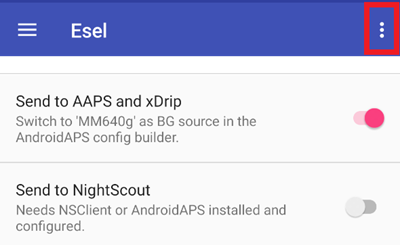

# Eversense

יש ארבע שיטות שונות לקבל את הערכים מ-Eversense:

- ESEL companion mode
- ESEL patched mode
- xDrip כאפליקציה נלווית (companion app)
- קורא התראות (מובנה ב-**AAPS**)

## ESEL

Get and install the [ESEL app](https://github.com/BernhardRo/Esel/tree/master/apk), following these [instructions](https://github.com/BernhardRo/Esel?tab=readme-ov-file#esel).

- ב-ESEL, פתחו את תפריט שלוש הנקודות (⋮) בחלק העליון של המסך ובחרו **Settings** (זמין גם מהתפריט ☰). בהגדרות:
  - Enable "Send to AAPS and xDrip"
  - **Disable** "Send to Nightscout"
  - As the BG data from Eversense can be noisy, it is recommended to enable "Smooth Data" in ESEL.



### Companion Mode

Reads the data from the Eversense app notifications (works with the standard Eversense App, available since ESEL version 3.0.1).

1. Use the official Eversense App from the Google Play Store
   - Optional, but required for backfilling: Login to your Eversense account
   - In Sync, enable Auto synchronization
2. Configuration of ESEL:
   - Disable the setting "Get data from patched Eversense App"
   - For backfilling: Enable "Fill missing data from eversensedms.com"
   - Provide as Email address and password your Eversense login data
3. בחרו "Minimed 640G" (MM640g) כמקור ערכי הסוכר ב-[**הגדרות תצורה ← מקור ערכי הסוכר**](#Config-Builder-bg-source).

### Patched Eversense App

 Requires a patched version of the Eversense App (works completely offline, including backfilling).

1. Uninstall the Eversense App (Warning: your local historical data (older than 1 week) will be lost!)

2. Install the [patched Eversense app](https://cr4ck3d3v3r53n53.club) and use it as described by the vendor

   - Start the Eversense App, login, connect to your transmitter and use it just like the normal app.

3. Configuration of ESEL:

   - Enable the setting "Get data from patched Eversense App"


אם מפעילים את ESEL בפעם הראשונה עם התקנה חדשה של Eversense, ייתכן שיעברו עד 15 דקות עד שהערכים הראשונים יופיעו ב-xDrip!

4. בחרו "Minimed 640G" (MM640g) כמקור ערכי הסוכר ב-[**הגדרות תצורה ← מקור ערכי הסוכר**](#Config-Builder-bg-source).

## xDrip

xDrip יכול לקרוא התראות מאפליקציית היצרן, כמו ש-ESEL עושה. No backfilling available.

- הורידו והתקינו את xDrip: [xDrip](https://github.com/NightscoutFoundation/xDrip)
- ב-xDrip יש לבחור “Companion App” כמקור הנתונים.
- בחרו xDrip ב-[**הגדרות תצורה ← מקור ערכי הסוכר**](#Config-Builder-bg-source).
- התאימו את הגדרות xDrip לפי ההסברים בדף [הגדרות xDrip](../CompatibleCgms/xDrip.md).
- Enable [Exponential Smoothing](../CompatibleCgms/SmoothingBloodGlucoseData.md) in AAPS.

## קורא התראות

**AAPS** יכול לקרוא את ערכי הסוכר ישירות מההתראות שאפליקציית Eversense הרשמית מציגה, בלי אפליקציה נוספת באמצע. No backfilling available.

- בחרו **קורא התראות** ב-[**הגדרות תצורה ← מקור ערכי הסוכר**](#Config-Builder-bg-source) ואשרו ל-**AAPS** גישה להתראות כשהבקשה מופיעה.
- ודאו שאפליקציית Eversense מציגה את ערך הסוכר הנוכחי בהתראה שלה.

```{warning}
BG values reading frequency is not always 5 minutes and duplicates can occur.
```