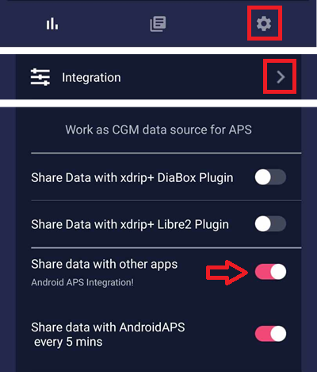

# Freestyle Libre 2 and 2+

חיישן Freestyle Libre 2 הוא כעת CGM אמיתי גם עם האפליקציה הרשמית. Still, LibreLink cannot send data to AAPS. There are several solutions to use it with AAPS.

## 1. Use a Bluetooth bridge and OOP

ניתן להשתמש במשדרי Bluetooth עם Libre 2 (EU) או 2+ (EU) ועם אפליקציית אלגוריתם הפועלת בתהליך נפרד. You can receive blood sugar readings every 5 minutes like with the [Libre 1](./Libre1.md).

יש לוודא שהגשר והאפליקציה שבהם רוצים להשתמש תואמים לחיישן ול־xDrip.

The Libre2 OOP (find it [here](#Libre2_OOP2)) is creating the same BG readings as with the original reader. AAPS with Libre 2 do a 10 to 25 minutes smoothing to avoid certain jumps. See below [Value smoothing & raw values](#libre2-value-smoothing-raw-values). OOP generates readings every 5 minutes with the average of the last 5 minutes. Therefore the BG readings are not that smooth but match the original reader device and faster follow the "real" BG readings. כדי להפעיל לולאה עם OOP, הפעילו ב־xDrip את כל הגדרות ההחלקה.

There are some good reasons to use a Bluetooth transmitter:

-   ניתן לבחור בין כמה שיטות כיול של OOP2 (1): לקבל את ערכי הקורא עם "no calibration", לכייל את החיישן כמו Libre 1 עם "calibrate based on raw", או לכייל את הערכים הדומים לקורא עם "calibrate based on glucose".  
  יש להשאיר את OOP1 כבוי (2).

    → Hamburger Menu → Settings → Less common settings → Other misc. options


-   The Libre 2 sensor can be used 14.5 days as the Libre 1
-   8 hours backfilling is fully supported

הערה: ניתן להשתמש במשדר במקביל לאפליקציית LibreLink בלי להפריע לו.

### Start sensor

- → Hamburger Menu (1) → Start sensor (2) → Start sensor (3) → Answer "Not Today" (4).


פעולה זו לא מפעילה בפועל אף חיישן Libre2 ולא מתקשרת איתו בשום צורה. פעולה זו רק מודיעה ל־xDrip שחיישן חדש שולח ערכי סוכר. אם אפשר, הזינו שני ערכים שנמדדו בדם לכיול הראשוני. כעת ערכי הסוכר אמורים להופיע ב־xDrip כל 5 דקות. ערכים שדולגו, למשל כי הטלפון היה רחוק מדי, לא יושלמו בדיעבד (backfill).

לאחר החלפת חיישן, xDrip מזהה את החיישן החדש באופן אוטומטי ומוחק את כל נתוני הכיול. אחרי ההפעלה ניתן לבדוק את רמת הסוכר בדם ולבצע כיול ראשוני חדש.

### Configure AAPS (for looping only)

-   ב־**AAPS**, פתחו את **התפריט** (☰) בחלק העליון של המסך, עברו אל **הגדרות תצורה** > **מקור ערכי הסוכר** ובחרו **xDrip+**


-   אם AAPS לא מקבל ערכי סוכר כשהטלפון במצב טיסה, השתמשו ב־'Identify receiver' כפי שמוסבר בדף [הגדרות xDrip](#xdrip-identify-receiver).

## 2. שימוש בחיבור ישיר של xDrip

```{admonition} Libre 2 EU only
:class: warning
xDrip לא תומך בחיבור ישיר ל־Libre 2 US ו־AUS.
Only Libre 2 and 2+ **EU** models.
```

- להגדרת xDrip, פעלו לפי [ההוראות האלה](./Libre2MinimalL00per.md), כי התיעוד המקורי מקשר לגרסה ישנה של OOP2.
- פעלו לפי הוראות ההגדרה בדף [הגדרות xDrip](../CompatibleCgms/xDrip.md).

-   בחרו xDrip+ ב־[הגדרות תצורה > מקור ערכי הסוכר](#Config-Builder-bg-source).

(libre2-value-smoothing-raw-values)=

### Value smoothing & raw values

מבחינה טכנית, ערך הסוכר הנוכחי נשלח ל־xDrip כל דקה. A weighted average filter calculates a smoothed value over the last 25 minutes by default. You can change the period in the NFC Scan features menu.

→ Hamburger menu → Settings → NFC Scan features → Smooth libre 3 data when using xxx method


This is mandatory for looping. The curves look smooth and the loop results are great. הערכים הגולמיים שעליהם מבוססות ההתראות קופצים מעט יותר, אבל הם תואמים לערכים שגם הקורא מציג. בנוסף, ניתן להציג את הערכים הגולמיים בגרף של xDrip, כדי להגיב בזמן לשינויים מהירים. הפעילו את Less Common Settings \> Advanced Settings for Libre2 \> "show Raw values" ואת "show Sensors Infos". לאחר מכן הערכים הגולמיים מוצגים גם כנקודות לבנות קטנות, ומידע נוסף על החיישן זמין בתפריט המערכת.

The raw values are very helpful when the blood sugar is moving fast. גם אם הנקודות קופצות יותר, קל הרבה יותר לזהות את המגמה מאשר בקו המוחלק, וכך לקבל החלטות טיפול נכונות.

→ Hamburger menu → Settings → Less common settings → Advanced settings for Libre 2


#### כיול

ניתן לכייל את Libre2 **עם היסט (offset) של -40 mg/dL עד +20 mg/dL \[-2.2 mmol/L עד +1.1 mmol/L\]** (intercept). The slope isn't changeable. יש לבדוק בדקירת אצבע לאחר הכנסת חיישן חדש. חשוב לזכור שהוא עלול להיות לא מדויק ב־12 השעות הראשונות לאחר ההכנסה. מכיוון שיכולים להיות הבדלים גדולים לעומת המדידות בדם, יש לבדוק כל 24 שעות ולכייל במידת הצורך. אם החיישן לא מדויק בכלל אחרי כמה ימים, יש להחליף אותו.

## 3. Use Diabox

- Install [Diabox](https://www.bubblesmartreader.com/_files/ugd/6afd37_f183eabd4fbd44fcac4b1926a79b094f.pdf). In Settings, Integration, enable Share data with other apps.



- בחרו xDrip+ ב־[הגדרות תצורה > מקור ערכי הסוכר](#Config-Builder-bg-source).

## 4. Use Juggluco

See [here](./Juggluco.md).
