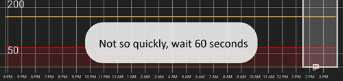
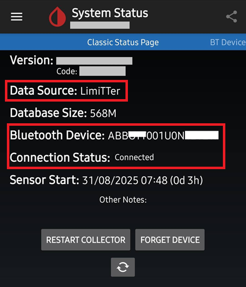

# כיצד להגדיר FSL 2 ו־OOP2 לשימוש בחיבור Bluetooth מובנה ב־xDrip

הועבר מ־[MinimalL00per](https://www.minimallooper.com/post/how-to-setup-freestyle-libre-2-and-oop2-to-use-a-native-Bluetooth-connection-in-xdrip) ל־markdown ו**נבדק ועודכן**: 25 באוגוסט 2025, psonnera

בתחתית מסמך זה יש רשימה של הגדרות מונחים. If you are unfamiliar with any terms or abbreviations feel free to *[jump below](#minimallooper-definitions)* for clarification.

 

## Configuration

### Hardware

- *FSL2 and 2+* **NOTE: US, CAN, NZ, AUS versions are NOT supported**

**(OPTIONAL) Reader** (not compatible with FSL2+)

- Reader 1 (with updated firmware)

- Reader 2

*NOTE: If you plan to use the Reader in this solution, you MUST START the sensor with the READER FIRST. If you do not do this you will not be able to use the reader to gather readings from the activated sensor. אחרי שהחיישן סיים להתחמם, ניתן לקבל קריאות מאפליקציית LL או מ־xDrip.*

### Software

**OOP** - Out of Process Algorithm, אפליקציית Android APK חיצונית המסייעת באחזור נתוני חיישן גולמיים לקבלת ערכי סוכר בדם. xDrip שולח ל־OOP את הנתונים הגולמיים שנאספו מ־FSL2 דרך BT, ו־OOP מחזיר ל־xDrip ערכי סוכר בדם.

- **OOP2**

  - **Works with European FSL2/2+ sensors only**

  - Closed source (not available on GitHub)

  - המטרה היא לפענח את הערכים הגולמיים המוצפנים של החיישן ולהחזיר אותם ל־xDrip. לאחר מכן ניתן להשתמש ב־xDrip עם נתונים גולמיים, שדורשים כיול, או לקבל ערכי סוכר הדומים לאלה של קורא 1.

[***xDrip***](https://jamorham.github.io/)

- [*Nightly*](https://github.com/NightscoutFoundation/xDrip/releases) latest source code built each night. Not thoroughly tested

- [*Stable*](https://xdrip-plus-updates.appspot.com/stable/xdrip-plus-latest.apk) latest stable tested release.

- **הערה: חיישנים חדשים דורשים אפליקציית OOP2 מעודכנת. לכן מומלץ להשתמש לפחות בגרסה היציבה (Stable) האחרונה של xDrip, שמתאימה ל־OOP2 האחרון.**

 

## Process

- *תחילה הורידו והתקינו את האפליקציות שלהלן*
- *הסרת אפליקציות שעלולות להתנגש*
- *כיצד להפעיל חיישן FSL2 במצב Bluetooth מובנה בעזרת LL ו־xDrip
  - [*שלב 1: התקנה והגדרה של האפליקציות*](#minimallooper-step1)
  - [*שלב 2: הגדרות xDrip*](#minimallooper-step2)
  - [*Step 3: Physically insert the sensor*](#minimallooper-step3)
  - [*שלב 4: פתחו את אפליקציית LL והפעילו את החיישן בסריקת NFC הראשונה*](#minimallooper-step4)
  - [*שלב 5: פתחו את xDrip וסרקו את חיישן FSL2 ב־NFC*](#minimallooper-step5)
  - [*שלב 6: הפעילו את החיישן החדש ב־xDrip*](#minimallooper-step6)
  - [*Step 7: Wait 60 seconds and NFC Scan the sensor again*](#minimallooper-step7)
  - [*Step 8: Data Collection between 3 and 15 Minutes*](#minimallooper-step8)
  - [*Step 9: Verify Sensor is connected and delivering data*](#minimallooper-step9)

- *[Notes](#minimallooper-notes)*
- *[Advantages](#minimallooper-advantages)*
- *[Disadvantages](#minimallooper-disadvantages)*
- <u>*\[פתרון תקלות\](#minimallooper-troubleshooting)*</u>

## Before You Start

It is strongly recommended to follow this process with a **new sensor**. אף שדווח כי ניתן ליצור חיבור עם חיישן שכבר פועל (***ראו [להלן](#minimallooper-started-sensor)***), סביר מאוד שאפליקציית LL או הקורא ייצרו מפתח שיתוף פרטי חדש לתקשורת במהלך החיבור. המשמעות היא שאחרי הצימוד xDrip לא מכיר את המפתח החדש ולא יוכל לתקשר עם החיישן. Attempt a connection with a running sensor at your own risk, preferably towards the end of the sensor's life.

### תחילה הורידו והתקינו את האפליקציות שלהלן

(Libre2_OOP2)=

- **OOP2** - Versions of the oop2 can be found at:

  (*Note: you need to be logged in Google to access the link.*)

*[oop2.apk](https://drive.google.com/file/d/1106h2s12b3Ev9gKCTU2G75q8h9ChHjcz/view?usp=sharing)* - OOP2_21_09_25 (05d1989) **2025.09.21** (latest version)

- **xDrip** - **<u>הגרסה העדכנית ביותר</u>** (גרסה מינימלית 2025.09.26) נמצאת בכתובת:

[*xDrip.apk*](https://github.com/NightscoutFoundation/xDrip/releases)

(minimallooper-started-sensor)=

### What if my sensor is already started? האם עדיין אפשר לקבל קריאות ב־xDrip? YES!

Many people have asked if this method can be used with an already active sensor and I can say with a resounding **YES**, you can start an actively running sensor.

1.  **קודם כול**, ודאו שביצעתם ב־xDrip את שינויי התצורה וההגדרות, ושהתקנתם והגדרתם את OOP2 כפי שמוצג בהמשך.

2.  **THEN**, proceed to *Step 5* and **MAKE SURE** you have force closed LL before you start. Then follow the process to completion.

*NOTE: You will not be able to use your activated FSL2 sensor with the FSLReader IF IT was not started with the FSLReader first. אם החיישן כן הופעל קודם עם FSLReader, תוכלו **לסרוק** את החיישן ולקבל קריאות גם מהחיישן וגם מאפליקציות כמו LL ו־xDrip.*

## כיצד להפעיל חיישן FSL2 במצב Bluetooth מובנה בעזרת LL ו־xDrip

*NOTE: If there are settings in the screenshots that are not called out with a BOX specifically and are UNCHECKED (IE, disabled) then PLEASE KEEP THEM DISABLED. The screenshots are reflective of a working configuration for ALL settings shown. אם ברצונכם לנסות להפעיל/לכבות תכונות אחרות לאחר שהחיישן פועל, תוכלו לעשות זאת באחריותכם.*

(minimallooper-step1)=

### שלב 1: התקנה והגדרה של האפליקציות

**התקינו והגדירו את OOP2** ובדקו שהוא פועל פשוט על ידי פתיחת האפליקציה.


**הגדרות**

- *Use service* **מופעל**

- *Use foreground service* **מופעל**

- *Timer Duration* **5 דקות**

  - אם התוצאות לא מגיעות מהר מספיק, שנו ל־**שנייה אחת** (צילום המסך שלהלן מציג הגדרה זו).

**Version 2: 93e5cac-2020.12.08 (latest version)**


**התקינו את xDrip** בגרסה המינימלית: הגרסה האחרונה. תיעוד נוסף על התקנת xDrip והגדרתו נמצא [*כאן*](../CompatibleCgms/xDrip.md).

(minimallooper-step2)=

### שלב 2: הגדרות xDrip

**Hardware Data Source**: Libre Bluetooth


**NFC Scan features**: *settings not mentioned are assumed to be turned off.*

- *Use NFC feature*: **מופעל**
- *Sensor Age or Expiry*: **מופעל**
- *Scan when not in xDrip*: **מופעל**
- *Use Any-tag optimized reading method*: **כבוי**, אבל אם יש קושי לסרוק, נסו **מופעל**


- *Starting Bluetooth connection with FSL2 sensor*: **Always connect to libre2 sensors**


- *Smooth libre 3 data when using xxx method*: leave default. Increase the value for noisy sensors, decrease when stable.


**Less Common Settings -\> Bluetooth Settings** (*these are important and can vary with your phone/setup*)

- *Turn Bluetooth on*: **מופעל**
- *Trust Auto-Connect*: **מופעל**
- *Use Background Scans*: **מופעל**
- *Always discover services*: **מופעל**

ניתן להגדיר את xDrip בעזרת קוד ה־QR שלהלן. יש לסרוק אותו (או לטעון את התמונה) ב־xDrip -> Auto Configure.

```{admonition} QR Code
:class: dropdown


```


Once scanned the QR code above, if you have a Samsung phone (but this is also useful for many Chinese brands), scan the other QR code below to change the settings for a more reliable connection:

- *Trust Auto-Connect*: **כבוי**
- *Use Background Scans*: **כבוי**

```{admonition} QR Code
:class: dropdown


```


**Advanced settings for FSL2** (*optional but helpful*)

- *show Raw values in Graph*: **מופעל**

- *show Sensor info in Status*: **מופעל**


**Extra Logging Settings** (*needed to debug if not working correctly*)

- *Extra tags for logging*: enter this value

`BgReading:d,jamorham librereceiver:v,LibreOOPAlgorithm:v,jamorham nsemulator:v,DexCollectionService:v`


(minimallooper-OOPsettings)=

**Less Common Settings -\> Other misc options**

> **Settings for OOP2 Configuration**

- *Out of process Libre algorithm*: **כבוי**

(*ודאו שהאפשרות הזו **כבויה** עבור OOP2, אחרת לא תתקבלנה קריאות!*)


(minimallooper-step3)=

### Step 3: Physically insert the sensor

(minimallooper-step4)=

### שלב 4: פתחו את אפליקציית LL והפעילו את החיישן בסריקת NFC הראשונה

פתחו את אפליקציית LL, סרקו את החיישן שזה עתה הוחדר, ואז סגרו והשביתו את אפליקציית LL או הסירו אותה. **עדיין יש להמתין את מלוא 60 הדקות לחימום החיישן, לפני שממשיכים ומפעילים את החיישן ב־xDrip**. Do not rely on the readings before as the sensor is still internally calibrating and the values vary wildly.

#### שלב 4a (אופציונלי, שימוש ב־FSLReader):

**Start the FSL2 (not 2+) sensor by scanning it with the FSLReader with very first NFC Scan**

אם רוצים להשתמש ב־**FSLReader** וגם באפליקציית LL או ב־xDrip כדי לקרוא ערכים מחיישן FSL2, **יש לסרוק את חיישן FSL2 החדש קודם עם FSL Reader.** אחרי שהחימום של החיישן מסתיים, ניתן להשתמש באפליקציית LL או ב־xDrip לסריקת קריאות.

*הערה: אפליקציית LL נדרשת רק לסריקת ה־NFC הראשונה לאחר החדרת החיישן. היא משמשת לשליחת אות אתחול החימום. לאחר מכן חובה להשבית את האפליקציה (app settings-\>force close) או להסיר אותה. ניתן להשתמש באפליקציה המתוקנת Patched 2.3 או בגרסאות הרשמיות, אין לכך חשיבות. העיקר הוא למנוע מאפליקציית LL לפעול בזמן ש־xDrip מנסה להתחיל את תהליך הצימוד ב־BT עם החיישן, כי אפליקציית LL משבשת את התקשורת ומפריע לחיבור מחדש ב־Bluetooth.*

*דווח כי כיבוי **הרשאת המיקום** בלבד בהגדרות מערכת Android של אפליקציית LL מספיק כדי למנוע ממנה להפריע לחיבור. This has been reported by a few users to be successful. שוב, **אני ממליץ להשבית את האפליקציה או להסיר אותה**, אך תוכלו לנסות זאת אם ברצונכם להתנסות.*

(minimallooper-step5)=

### שלב 5: פתחו את xDrip וסרקו את חיישן FSL2 ב־NFC

(*Reminder! Ensure LL is disabled (location turned off) or uninstalled AND you have waited the entire 60 minutes for the sensor to warmup and internally calibrate.*)

**סרקו ב־NFC** את חיישן FSL2 עם xDrip. This sends a signal to the sensor to turn on Bluetooth pairing in order to start the bonding process. בתחתית מסך הסקירה של xDrip תופיע לזמן קצר הודעה קטנה עם הטקסט **Scanning**, ואחריה, אם סריקת ה־NFC של חיישן FSL 2 הצליחה, ההודעה **Scanned OK!**.


(minimallooper-step6)=

### שלב 6: הפעילו את החיישן החדש ב־xDrip

ב**מסך הסקירה של xDrip** לחצו על **תפריט ההמבורגר** בפינה העליונה של המסך. Then choose **Start Sensor**.

On the **Start New Sensor** screen press **Start Sensor**. A prompt will ask **Did you insert it today?** Respond by pressing **NOT TODAY**.


*הערה: אם לחצתם בטעות על "YES, TODAY", יש לבצע "stop sensor" מהתפריט הראשי של xDrip, ואחר כך "start sensor" על ידי ביצוע שלב 5 שוב.*

(minimallooper-step7)=

### Step 7: Wait 60 seconds and NFC Scan the sensor again

נדרשת סריקת NFC שנייה כדי **להוסיף** את החיישן כמכשיר ה־Bluetooth שממנו xDrip יקבל את הקריאות. Once complete you will see a notification stating **NEW SENSOR STARTED**.


A 60 second waiting period is enforced because the sensor can’t be scanned during this process more than once per minute. If the sensor is scanned too early the warning **Not so quickly, wait 60 seconds** is displayed in the xDrip Overview screen.



פתחו את יומני האירועים (event logs) של xDrip ובדקו שהחיישן צומד ל־xDrip כראוי.


(minimallooper-step8)=

### Step 8: Data Collection between 3 and 15 Minutes

Between 3 and 15 minutes enough data is collected to display the first values. *If you are still not receiving readings at this time, sometimes it helps to reboot the phone.*

אם יש לכם טלפון Samsung (או טלפון של אחד ממותגים סיניים רבים) ויש בעיות בקבלת נתונים, סרקו את קוד ה־QR שלהלן ב־xDrip -> Auto Configure.

```{admonition} QR Code
:class: dropdown


```

הסריקה תשנה את הגדרות ה־Bluetooth של xDrip כך:

- *Trust Auto-Connect*: **כבוי**
- *Use Background Scans*: **כבוי**

(minimallooper-step9)=

### Step 9: Verify Sensor is connected and delivering data

לחצו על תפריט ההמבורגר בחלק העליון של מסך הסקירה של xDrip ובחרו **System Status**. On the System Status screen the active **Bluetooth Device:** field displays the FSL2 Bluetooth naming convention of **ABB___XXXXXXXXXXX**, where the XXX’s represent the sensor serial number. השדה **Connection Status** מציג **Connected**, והשדה **Sensor Start:** מציג את זמן הפעלת החיישן.



במסך **BT Device** (החליקו שמאלה), ניתן לאמת פרטי חיבור נוספים של החיישן וגם להשתמש במסך זה לפתרון תקלות חיבור. להלן רשימת שדות ומטרותיהם כדי לסייע בפתרון תקלות חיבור.

*NOTE: **<u>DO NOT TOUCH</u> AND CHANGE Bluetooth Pairing from <u>Disabled</u>** in this window. Doing so will attempt a direct pair, it will fail (Not bonded) and you will have to start the process from Step 5 all over again.*


- **Phone Service State:** The last time the phone made a BT connection to the sensor (it should be less than 5 minutes ago)
- **Bluetooth Device:** Displays current status of the connection (either **Connected** or **Disconnected**)
- **Device Mac Address**: This is the hardware ID of the sensor
- **Bluetooth Pairing**: אמור להיות **<u>Disabled, tap to enable</u>**. Be careful to NOT tap this. If you tap it by mistake, tap it again until it returns to disabled.
- **Slowest wake up**: You can ignore this. xDrip לא מחכה כל הזמן לקריאות: הוא מתחיל לצפות להן אחרי זמן מסוים (בדרך כלל 5 דקות). אם לא מגיעים נתונים באותו זמן, תופיע ההודעה "Woke up early", כלומר xDrip ציפה שהנתונים יהיו מוכנים, אבל אין נתונים. Slowest wake up is the highest delay encountered before receiving data normally.
- **Next Wake up**: Should say 5 minutes


(minimallooper-notes)=

### Notes

- **שימוש בסריקות NFC של LL אחרי שהצימוד ב־xDrip הושלם**: ניתן לבצע סריקות NFC, אבל קודם יש להשלים את תהליך הצימוד עם xDrip. בדקו תמיד ב־xDrip אם הקריאה של 5 הדקות קרובה (למשל, הקריאה האחרונה הייתה לפני 4 דקות). אם היא קרובה ל־5 דקות, המתינו לקריאת BT החדשה ורק אחר כך בצעו את סריקת ה־NFC. סריקה בזמן הלא נכון תשבש את תהליך ה־BT ב־xDrip, ולא יתקבלו קריאות BT. ייתכן שיעבור זמן עד שהצימוד ייווצר מחדש והשידור יחזור, ולפעמים LL עלול "לגנוב" את חיבור ה־BT של החיישן. עם זאת, בין קריאות BT אלה לא נתקלתי בבעיות בביצוע סריקת NFC ולאחריה השבתה מיידית של האפליקציה. I am not sure if LL needs to be disabled each time but I disable it to be on the safe side.

- **מה קורה כאן?** כאשר נוצר חיבור Bluetooth, נוצר מפתח משותף פרטי שנדרש כדי לאפשר תקשורת בין החיישן לאפליקציה/למכשיר הפונה אליו. יש סבירות גבוהה שאפליקציית LL או הקורא יוצרים מפתח משותף פרטי חדש לתקשורת במהלך החיבור. המשמעות היא שאחרי הצימוד xDrip לא מכיר את המפתח החדש ולא יוכל לתקשר עם החיישן.

  - כמה משתמשים דיווחו שאפשר להפעיל מחדש את אפליקציית LL, אחרי שהחיישן הופעל בהצלחה ו־xDrip מקבל קריאות. בהרשאות Android של אפליקציית LL, עליכם פשוט לכבות את ההגדרה **Allow Location**. לאחר מכן אמור להיות אפשר להשתמש באפליקציית LL וב־xDrip בו־זמנית. אני ממליץ שלא לבחור אפליקציית ברירת מחדל לסריקת NFC, אלא לבחור בכל סריקת NFC באיזו אפליקציה ברצונכם לקרוא את החיישן. בנוסף, אל תשכחו לסגור בכפייה את אפליקציית LL בהחלפת החיישן הבאה, לאחר סריקת ה־NFC הראשונית לחימום החיישן החדש. אחרי שהחיישן הוגדר ו־xDrip מקבל ממנו קריאות, ניתן להפעיל שוב את אפליקציית LL.

&nbsp;

- **הפעלה מחדש של הטלפון**: לאחר ההפעלה מחדש, ולאחר השבתת האפליקציה או סגירתה בכפייה, זכרו לבדוק שאפליקציית LL אינה פועלת. I suggest testing a reboot to see if LL starts again automatically. ניתן לבדוק בהגדרות אפליקציית LL תחת הגדרות האפליקציות של Android בטלפון שלכם. אם היא עדיין מופעלת, השביתו שוב את אפליקציית LL. ייתכן שהסרת אפליקציית LL היא הדרך היחידה למנוע זאת. This is to prevent LL from accidentally stealing the BT bond. Also, after rebooting it will take the same 3-15 minutes to get BT readings from the sensor so be patient and plan for this if you are rebooting close to times you require a BG reading in order to bolus, meals, etc.

&nbsp;

- **הגדרות אופטימיזציית סוללה**: ודאו שאתם מחריגים את האפליקציות האלה מהגדרות אופטימיזציית הסוללה בטלפון שלכם

  - xDrip

  - OOP 2

  - LL

  - AAPS

&nbsp;

- **שימוש במצב טיסה:** יש מצבים שבהם מפעילים מצב טיסה (בזמן טיסה ;-), או בשינה בלילה, כשלא רוצים שאותות Wi-Fi או סלולר יפעלו בטלפון קרוב לראש). הפעלת מצב טיסה עלולה לגרום לבעיות בתקשורת ה־Bluetooth. When switching on flightmode on the phone followed by activating Bluetooth, blood glucose readings will be lost. The only workaround is to restart the collector in xdrip+ -\> System Status -\> Classic Status Page. After restarting the collector the blood glucose readings appeared again.

 

(minimallooper-advantages)=

### Advantages

- **אין עוד צורך באפליקציית LL מתוקנת** אין עוד צורך בגרסה מתוקנת של אפליקציית LL כדי לאחזר ערכים מחיישן FSL2. אף שניתן להשתמש באפליקציית LL המתוקנת, הגרסאות הרשמיות של אפליקציית LL יכולות לבצע את סריקת האתחול הראשונה ב־NFC באותו אופן כמו האפליקציה המתוקנת. There is no difference as far as NFC initialization scanning to start the sensor is concerned.

&nbsp;

- **3rd party NFC scanning device no longer required** 3rd party NFC scanning devices such as (Miaomiao, Bubble or Blucon) are no longer needed *(but can still be used)* to collect readings as the sensor alone can deliver them now via Bluetooth. Less hardware means less things to go wrong, less devices to charge and a more minimalistic setup.

&nbsp;

- **עדיין תוכלו לסרוק קריאות ב־NFC עם קורא FSL2 (גרסה 1 עם קושחה מעודכנת או גרסה 2), אם חיישן FSL2 הופעל קודם עם FSL Reader.** ניתן להמשיך להשתמש בקורא FSL2 העצמאי לסריקת קריאות מהחיישן הפעיל, גם אחרי שהחיישן צומד ל־xDrip דרך Bluetooth.

  - **חובה** להפעיל את החיישן בסריקת ה־NFC הראשונה, שמתחילה את חימום החיישן, **קודם עם FSL Reader**. מנקודה זו, גם אפליקציות אחרות יוכלו לקבל קריאות NFC מהחיישן שכעת מופעל.
- It is my understanding that the FSL2 sensor (as long as it has not established or is not trying to establish a connection) will always advertise its presence (and availability) over BLE exactly every 2 minutes (visible on any Bluetooth device that has the ability to scan for Bluetooth devices). Whichever device is first to respond to this advertisement wins the race and is the *only* device allowed to connect and read the sensor as a private shared key is created during the NFC scan connection process which is used to decrypt FSL 2 communication. The sensor is then unavailable to other devices that do not have this private share key and might also be trying to connect. It seems that the FSL 2 reader always wins this race whatever the “opponent”.

&nbsp;

- **Minimal hardware device setup** My goal has always been to keep the medical devices attached to my body at a minimum. The FSL2 in combination with the Omnipod system accomplished this goal. This point is even more crucial when I travel (both short and long distances) because the number of items and set changes for those items becomes fewer, which means I have more room for other items in my luggage. אני מקווה שבעתיד תהיה משאבת פאץ' שרק המכל שלה מתחלף, ושהשבב ומערכת המנוע יהיו יחידה שאפשר לשמור ולהשתמש בה שוב. This would cut down on waste and decrease packaging for site changes which again leads to more room in my suitcase for other things.

&nbsp;

- **אין עוד פערים של שעה בהחלפת חיישנים** מכיוון שניתן להפעיל חיישן נוסף באפליקציית LL באמצעות סריקת NFC ראשונית, החיישן הנוכחי יכול להמשיך לפעול ולספק קריאות באמצעות Bluetooth באותו זמן. After 20 minutes you can get readings from the new sensor but it is best to wait 1 hour for the sensor to properly internally calibrate. This means you can stop the current sensor and start up the new one (after it has been set and warmed up with the LL NFC scan an hour earlier) and within 3 to 15 minutes you will have your initial calibrations and readings.

&nbsp;

(minimallooper-disadvantages)=

### Disadvantages

- **הפעלה מחדש של הטלפון:** מכיוון שתהליך Bluetooth צריך להתחיל שוב כשהטלפון מופעל מחדש, עליכם לוודא תחילה שהשבתתם ידנית את אפליקציית LL (אם לא הסרתם אותה), ולהמתין בסבלנות לקבלת הקריאות הראשונות (3 עד 15 דקות). This means timing phone reboots so they do not occur during critical times like correction boluses or meal and snack times.

&nbsp;

- **לא ניתן להפעיל את LL ואת xDrip במקביל לקבלת קריאות Bluetooth**. LL will always try to "steal" the Bluetooth connection to the sensor and bond. If that happens, you are stuck with LL for the rest of the life of the sensor. לכן הפעלת האפליקציות בו־זמנית אינה עובדת תמיד. כפי שאני מציין בהמשך, ניתן להפעיל את אפליקציית LL ולבצע סריקת NFC כדי לקבל קריאה ב־LL (אם צריך להשוות, או לקבל היסטוריה לעצמכם או לדוחות לאנדוקרינולוג). אבל יש להשבית אותה מיד אחרי קבלת הקריאה, ולא לנסות זאת בדקה שלפני הזמן שבו xDrip מקבל את קריאת ה־Bluetooth שלו. I am not sure how using the FSL2 reader works while doing this but I will test that at a later point.
- כמה משתמשים דיווחו שאפשר להפעיל מחדש את אפליקציית LL, אחרי שהחיישן הופעל בהצלחה ו־xDrip מקבל קריאות. בהרשאות Android של אפליקציית LL, עליכם פשוט לכבות את ההגדרה **Allow Location**. לאחר מכן אמור להיות אפשר להשתמש באפליקציית LL וב־xDrip בו־זמנית. אני ממליץ שלא לבחור אפליקציית ברירת מחדל לסריקת NFC, אלא לבחור בכל סריקת NFC באיזו אפליקציה ברצונכם לקרוא את החיישן. בנוסף, אל תשכחו לסגור בכפייה את אפליקציית LL בהחלפת החיישן הבאה, לאחר סריקת ה־NFC הראשונית לחימום החיישן החדש. אחרי שהחיישן הוגדר ו־xDrip מקבל ממנו קריאות, ניתן להפעיל שוב את אפליקציית LL.

&nbsp;

- **3rd Party NFC Scanning Devices can still be used**. כן, ציינתי זאת כחיסרון, אבל רציתי גם להדגיש: אם משהו משתבש בחיישן ו־LL משתלט עליו, תמיד אפשר לחזור להצמדת מכשיר סריקת NFC לחיישן כדי לקבל קריאות ב־xDrip. You can also use this device instead of a direct Bluetooth connection if you are more comfortable with a setup consisting of a 3rd party NFC scanning device (Miaomiao, Bubble, Blucon). Sometimes certain phones do not operate well with the native Bluetooth sensor bonding and data retrieval. You can use these devices as a backup or as normal usage, either way you still have this as an option.
- אם מתכננים להשתמש ב־**FSL Reader** כמכשיר סריקת NFC לקבלת קריאות, חובה להפעיל את חיישן FSL2 ב**סריקת ה־NFC הראשונה**, שמחממת את החיישן, **קודם עם הקורא**.

&nbsp;

- **נתוני LV לא יועלו אוטומטית** מכיוון שלאפליקציית LL אין חיבור Bluetooth קבוע (כי LL לא אמור לפעול במקביל ל־xDrip אחרי שהחיישן שולח קריאות Bluetooth באופן פעיל), ולכן הוא לא מקבל קריאות מהחיישן באופן אוטומטי. This means that blood glucose data is not automatically being uploaded to LV and by extension other phones with LL. I mark this as a disadvantage as I know many parents rely on this functionality as well as those that are forced to use the LV reporting for their healthcare provider. עדיין ניתן לפתוח את אפליקציית LL ולסרוק מדי 8 שעות כדי לקבל ב־LL את נתוני החיישן שהושלמו בדיעבד (3 פעמים בכל יום, לפחות מדי 8 שעות, אך סביר שיידרשו סריקות נוספות כדי לאסוף את כל נתוני 24 השעות). עם זאת, שוב, זהו תהליך ידני.

&nbsp;

(minimallooper-definitions)=

### הגדרות מונחים

- **BT** - Bluetooth

- **BLE** - Bluetooth Low Energy

- **FSL** - FreeStyle Libre
  - **Libre 1 (FSL1)** - NFC only. First version of the sensor

  - **Libre 2 (FSL2)** - Bluetooth ו־NFC. Second version of the sensor.

  - **Libre 3 (FSL3)** - Bluetooth and NFC. Third smaller version of the sensor. Not supported by OOP2 (see Juggluco).

- **LL** - LibreLink, **אפליקציה** המשמשת להפעלת החיישן בסריקת NFC ראשונית

- **LV** - LibreView, cloud service for sharing data with your endo team (consider using Tidepool or Nightscout)

- **MM** - MiaoMiao, השם והיצרן של מכשיר סריקת NFC של צד שלישי, שמעביר קריאות ל־xDrip דרך Bluetooth.

- **NFC** - Near Field Communication, a physical operation in which you bring the NFC sensor on your phone close to your sensor to start a reading. This is often referred to as “scanning the sensor”, a “sensor scan” or “NFC scan”. This process in no way uses Bluetooth.

- **OOP1** - Out of Process Algorithm גרסה 1, אפליקציית צד שלישי שמקבלת ערכים גולמיים (שהחיישן מעביר ל־xDrip ב־Bluetooth או בסריקת NFC) ומעבדת אותם באלגוריתם (דומה מאוד לאלגוריתם החומרה בשבב החיישן). היא מחזירה ל־xDrip ערך סוכר מכויל (על ידי אלגוריתם OOP1, לא על ידי הכיולים המובנים של xDrip). xDrip מציג את הערך, או מעבד אותו הלאה בכיול של xDrip (כיול מדקירת אצבע) במידת הצורך.

- **OOP2** - Out of Process Algorithm גרסה 2, אפליקציית צד שלישי שמקבלת נתונים מוצפנים מחיישן FSL 2 (באמצעות Bluetooth או סריקת NFC), ואז מפענחת את הנתונים המוצפנים. לאחר הפענוח, הנתונים נשלחים ל־xDrip.

 

(minimallooper-troubleshooting)=

### פתרון תקלות

#### Failure to scan the sensor with NFC

- Make sure your phone NFC reader is enabled in Android settings.
- The NFC reader must be compatible with **ISO 15693** tags. Some Cubot phones are very difficult to use.
- בדקו בתיעוד של הטלפון איפה נמצאת אנטנת ה־NFC. קרבו את הטלפון לחיישן והשאירו אותו שם 10 שניות: קריאת NFC ב־xDrip לוקחת יותר זמן מאשר באפליקציית היצרן או בקורא.
- נסו לסגור את xDrip לפני סריקת החיישן.
- ודאו שאין אפליקציה אחרת שמנסה לקרוא את החיישן (בזמן הסריקה ייתכן שתופיע בחירה בין כמה אפליקציות: בחרו xDrip ואל תזיזו את הטלפון).
- נסו את כל השילובים של הגדרות ה־NFC ב־xDrip *Use faster multi-block reading method* ו־*Use Any-tag optimized reading method*. בדרך כלל סריקות NFC אמינות יותר כששתי האפשרויות **כבויות**.

#### Stuck on collecting initial readings

*Note: FSL 2 is not recognized as a trusted data source when calibrated manually.*

Set [OOP2 calibration](#minimallooper-OOPsettings) strategy to "No calibration" until you have everything working.

Then you can decide to calibrate or not.


#### Sensor is reported as FSL1


ודאו שמותקנות הגרסאות העדכניות ביותר של xDrip ושל OOP2.

#### Connection to the sensor fails

- Verify OOP1 is disabled (see [here](#minimallooper-OOPsettings))


- ודאו שאפליקציות החיסכון בסוללה וההגדרות בטלפון אינן מעבירות את OOP2 למצב שינה
- Verify Google Play protect is disabled as it will kill OOP2
- Did you change Bluetooth Pairing in System Status? Touch it back to bring it back to **<u>Disabled</u>**


#### Missed readings

ודאו ש־OOP2 מציג ערכים שאינם 0 או -1. ערכים כאלה עשויים להעיד שהחיישן מתקלקל (דוגמה בהמשך ב־mmol/L).


Sensor age has not advanced might also be a sign your sensor has issues. המשמעות היא ש־xDrip קיבל ערך, אבל דחה אותו כי הוא לא היה תקין (שגיאת חיישן).


#### Restart from scratch sensor pairing

1. תפריט xDrip -> Stop sensor (פעולה זו לא עוצרת את FSL2, היא רק משנה את המצב ב־xDrip ל"לא הופעל")
2. תפריט xDrip -> System status -> Forget device
3. סרקו את החיישן ב־NFC של xDrip. Wait at least one minute
4. תפריט xDrip -> Start sensor. Wait at least one minute
5. סרקו את החיישן ב־NFC של xDrip כמה פעמים, ותמיד המתינו לפחות דקה אחת בין שתי סריקות.
