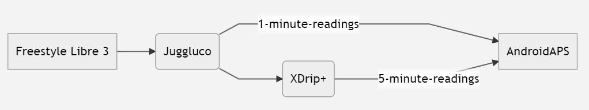

# **Freestyle Libre 3** and 3+

Freestyle Libre 3 (FSL3) requires a unique setup to receive BG values in to AAPS. There are two possible ways of getting Freestyle Libre 3 (FSL3) values to AAPS.

השיטות שלהלן להשגת מטרה זו משתמשות באפליקציה הנפרדת Juggluco. שיטה זו משתמשת ב־Juggluco כדי לקבל מהחיישן נתונים גולמיים במרווחים של דקה אחת. הנתונים מועברים ל־xDrip או ל־AAPS. ניתן להפעיל חיישנים חדשים באמצעות אפליקציית Libre 3 או ישירות ב־Juggluco. המדריך שלהלן מתאר את תהליך הפעלת החיישן באמצעות אפליקציית Juggluco. אם החיישן הופעל כשהייתם מחוברים לחשבון Libreview, ניתן גם לעבור בין Juggluco לאפליקציית Libre 3 כמקלט.

Juggluco יכול גם להעביר נתונים ל־LibreView לשיתוף עם הצוות המטפל, כאשר החיישן מופעל באמצעות אפליקציית Libre 3.

ב־xDrip ניתן לכייל את החיישן בטווח של -40 mg/dL עד +20 mg/dL (-2.2 mmol/L עד +1.1 mmol/L), כדי לפצות על הבדלים בין מדידה ידנית במד סוכר לבין קריאות החיישן.

## Method 1: use 1-minute readings directly
**AAPS** מותאם לקריאות מדי 5 דקות. Therefore processing 1-minute values has occasional limitations.

See [here](#juggluco-to-aaps).

## Method 2: convert 1-minute readings into 5-minute values via xDrip
שיטה זו משתמשת ב־Juggluco כדי לקבל מהחיישן נתונים גולמיים במרווחים של דקה אחת. הנתונים מועברים ל־xDrip, שמחליק אותם לנתונים במרווחים של 5 דקות ומעביר אותם ל־AAPS.

### Step 1: Setup Juggluco
הורידו והתקינו את אפליקציית Juggluco מ[כאן](https://www.juggluco.nl/Juggluco/download.html). Follow the instructions [here](https://www.juggluco.nl/Juggluco/libre3/)

יש לוודא שערכי הסוכר נשלחים ל־xDrip: בהגדרות של Juggluco ניתן להגדיר ש־Juggluco ישלח את ערכי הסוכר שלו לאפליקציות אחרות. Juggluco יכול לשלוח שלושה סוגים של שידורים כאלה: **Patched Libre broadcast** שימש במקור את אפליקציית Librelink המתוקנת, וניתן להשתמש בו כדי לשלוח ערכי סוכר ל־xDrip.

### Step 2: Setup xDrip

ערכי הסוכר מתקבלים באפליקציית xDrip בטלפון החכם.

- אם xDrip עדיין לא מוגדר, הורידו את [xDrip](https://github.com/NightscoutFoundation/xDrip) ופעלו לפי ההוראות בדף [הגדרות xDrip](../CompatibleCgms/xDrip.md).
- ב־xDrip בחרו "Libre2 (patched app)" כמקור הנתונים.
- If necessary, enter "BgReading:d,xdrip libre_receiver:v" under Less Common Settings → Extra Logging Settings → Extra tags for logging. כך יירשמו הודעות שגיאה נוספות לצורך פתרון תקלות.

- מבחינה טכנית, ערך הסוכר הנוכחי נשלח ל־xDrip כל דקה. A weighted average filter calculates a smoothed value over the last 25 minutes by default. You can change the period in the NFC Scan features menu.

  → Hamburger menu → Settings → NFC Scan features → Smooth libre 3 data when using xxx method

  

### Step 3: Start sensor within xDrip

ב־xDrip הפעילו את החיישן עם "Start Sensor" ו־"not today". It is not necessary to hold the mobile phone onto the sensor. In fact "Start Sensor" will not physically start any Libre 3 sensor or interact with them in any case. זה רק כדי להודיע ל־xDrip שחיישן חדש שולח ערכי סוכר. אם אפשר, הזינו שני ערכים שנמדדו בבדיקת דם לכיול הראשוני. כעת ערכי הסוכר אמורים להופיע ב־xDrip כל 5 דקות. Skipped values, e.g. because you were too far away from your phone, will not be backfilled.

Wait at least 15-20 minutes if there is still no data.

לאחר החלפת חיישן, xDrip יזהה אוטומטית את החיישן החדש וימחק את כל נתוני הכיול. ניתן לבדוק את רמת הסוכר בדם לאחר ההפעלה ולבצע כיול ראשוני חדש.

### שלב 4: הגדרת AAPS

- See [here](#juggluco-to-xdrip) and come back.

- אם **AAPS** לא מקבל ערכי סוכר כשהטלפון במצב טיסה, השתמשו ב־"Identify receiver"
- כבו את ההחלקה (xDrip כבר מבצע אותה)

## Subsequent sensor changes

1. Open Juggluco and note the serial number of the existing sensor

2. Now simply scan your new sensor with your phone’s NFC reader. Juggluco will display a notice if the process had been started successfully.
3. When you are ready to deactivate the old sensor, then open the Juggluco menu by clicking anywhere in the empty space in the upper left hand corner of the screen.
4. Select the expired sensor and tap "Terminate"

הערה: כאשר שני חיישנים פעילים, Juggluco ישלח ל־xDrip את הערך העדכני ביותר מאחד משני החיישנים. אם החיישנים לא מכוילים כך שימדדו ערכי סוכר דומים, ייתכן שיגיעו ל־xDrip ערכי סוכר שקופצים למעלה ולמטה. If you terminate the wrong sensor, you can reactivate it by simply scanning the sensor.

## העברת החיישן בין אפליקציית Libre 3 ל־Juggluco

אם החיישן הופעל כשהייתם מחוברים לחשבון Libreview, ניתן גם לעבור בין Juggluco לאפליקציית Libre 3 כמקלט. This requires the following steps:

1. התקינו את אפליקציית Libre 3 מ־Google Playstore
2. הגדירו את אפליקציית Libre 3 עם חשבון Libreview שבאמצעותו הופעל החיישן.
3. עצרו בכפייה את אפליקציית Juggluco בהגדרות Android.
4. In the Libre 3 menu, click "Start Sensor", select "Yes", "Next" and scan your sensor.
5. לאחר כמה דקות, ערכי הסוכר אמורים להופיע באפליקציית Libre 3.

כדי לעבור מאפליקציית Libre 3 ל־Juggluco, עליכם לעצור בכפייה את אפליקציית Libre 3 דרך הגדרות Android ולבצע את שלבים 1 & 2.

(libre3-experiences-and-troubleshooting)=
## התנסויות ופתרון תקלות

### פתרון תקלות בחיבור Libre3 -> Juggluco

- ודאו שאתם משתמשים בגרסה עדכנית של אפליקציית Juggluco
- Check your settings according to this guide
- לעיתים ייתכן שתצטרכו לעצור בכפייה את אפליקציית Libre 3 ואת Juggluco ולהפעיל מחדש.
- Disable Bluetooth and enable it again
- Wait some time or try to close Juggluco
- Older versions of Juggluco (below 2.9.6) do not send subsequent data from the Libre3 sensor to connected devices (e.g. Juggluco on WearOS). ייתכן שתצטרכו ללחוץ על "Resend data" באפליקציית Libre3 המתוקנת (תפריט Juggluco).

### Further help

Original instructions: [jkaltes website](https://www.juggluco.nl/Juggluco/libre3/)

מאגר GitHub נוסף: [קישור ל־GitHub](https://github.com/maheini/FreeStyle-Libre-3-patch)
