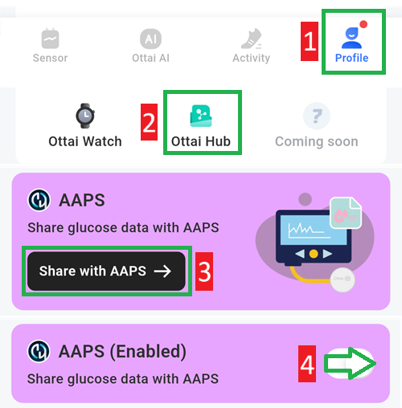

# Ottai M8

## Using M8 with Ottai app

-   Download and Install the apk from <https://play.google.com/store/apps/details?id=com.ottai.seas>. For the Chinese version of Ottai use <https://ottai.com.cn/70ICjxAI4i>

-   Start sensor

- בחרו **Syai/Ottai** ב[**הגדרות תצורה ← מקור ערכי הסוכר**](#Config-Builder-bg-source).

הפעילו שידור באפליקציית Ottai:

1. Select Profile
2. Ottai hub
3. Tap Share with AAPS, accept the third party data transfer agreement
4. Enable Share glucose data with AAPS

