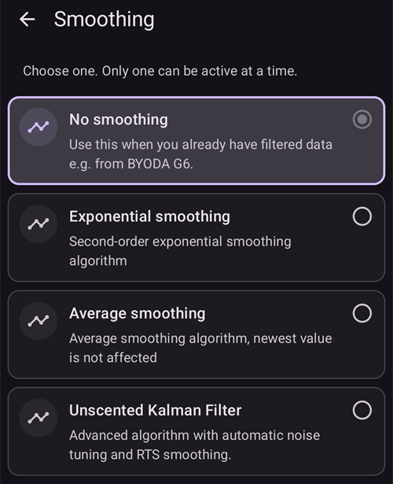

# החלקת נתוני הגלוקוז בדם

If **BG** data is jumpy/noisy, **AAPS** may dose insulin incorrectly resulting in highs or lows. אם מופיעות שגיאות או שנתוני ה־CGM קופצים, חשוב להשבית את הלולאה עד שהבעיה נפתרת. בהתאם ל־CGM שלכם, בעיות כאלה יכולות לנבוע מהגדרות ה־CGM ב־**AAPS** (כפי שמוסבר בהמשך), או מבעיה במקום החדרת החיישן (ואז ייתכן שיש להחליף את חיישן ה־CGM).

## Smoothing data within AAPS

**AAPS** מאפשר להחליק את הנתונים בתוך **AAPS** ולא בתוך אפליקציית ה־CGM. פתחו את ה**תפריט** (☰), בחרו [**הגדרות תצורה**](../SettingUpAaps/ConfigBuilder.md) ואז **החלקה**. יש ארבע אפשרויות, ורק אחת מהן יכולה להיות פעילה בכל פעם: **ללא החלקה**, **החלקה מעריכית**, **החלקת ממוצע** ו־**מסנן קלמן Unscented (UKF)**.

### Exponential smoothing

In general, this is the recommended option to start with, as it is most aggressive in resolving noise and rewrites the most recent value. However, see the table below for other specific recommendations.

### Average smoothing

This option works similar to back smoothing that was previously implemented on certain CGM platforms. It is more reactive to recent changes in BG value and therefore more prone to responding incorrectly to noisy CGM data.

### No Smoothing

יש להשתמש באפשרות זו רק אם אפליקציית האיסוף שלכם כבר מחליקה כראוי את נתוני ה־CGM לפני שהם נשלחים ל־**AAPS**.

### מסנן קלמן Unscented (UKF)

אפשרות זו משתמשת במודל סטטיסטי כדי להעריך באופן רציף את ערך הסוכר האמיתי שלכם ואת קצב השינוי שלו מתוך הקריאות הנכנסות (שעשויות להיות רועשות). היא מתאימה את עצמה אוטומטית לרמת הרעש הנוכחית של החיישן. היא גם מזהה ודוחה קריאות חריגות פתאומיות. זו חלופה מתקדמת יותר להחלקה מעריכית ולהחלקת ממוצע. היא שימושית אם רוצים שההחלקה תתאים את עצמה לרמת הרעש המשתנה של החיישן, במקום להשתמש בשיטה קבועה.

(smoothing-xdrip-dexcom-g6)=

## Suggestions to use smoothing

ניתן גם לשנות את שיטת ההחלקה באופן אוטומטי, למשל לפי גיל החיישן, בעזרת [פעולת האוטומציה](#automations-automation-action) **שינוי החלקה**.

|               | Exponential |  Average  | No Smoothing |
| ------------- |:-----------:|:---------:|:------------:|
| G5/G6/ONE     |  If noisy   |           | Recommended  |
| G7/ONE+/Stelo |  If noisy   | If stable |              |

Libre sensors are noisy and can require smoothing. בשימוש בחיבור ישיר של xDrip, או במקור הנתונים של אפליקציה מתוקנת (קבלת נתונים מאפליקציה אחרת, כולל Juggluco), [ההחלקה כבר מתבצעת בתוך האפליקציה](#libre2-value-smoothing-raw-values).

| Sensor / Data source | Juggluco | xDrip בחיבור ישיר | xDrip עם גשר | xDrip עם אפליקציה מתוקנת |
| -------------------- |:--------:|:-----------------:|:------------:|:------------------------:|
| Libre 1/14 days/Pro  |   N.A.   |       N.A.        |   Average    |           N.A.           |
| Libre 2/2+ (EU)      | Average  |       None        |   Average    |           None           |
| Libre 2/2+/3/3+      | Average  |       N.A.        |     N.A.     |           None           |
