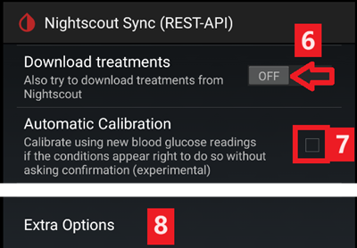
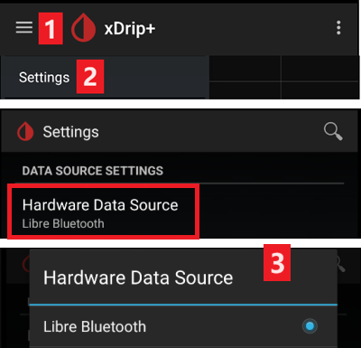
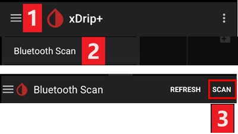

# הגדרות xDrip

אם xDrip עדיין לא מותקן, יש להוריד ולהתקין את הגרסה האחרונה שלו מ[דף הגרסאות של xDrip](https://github.com/NightscoutFoundation/xDrip/releases).

יש לכבות את אופטימיזציית הסוללה ולאפשר פעילות ברקע עבור אפליקציית xDrip.

## הגדרות בסיסיות לכל מערכות ה־CGM וה־FGM

### Disable Nightscout upload

You shouldn't let any other app upload data (blood glucose and treatments) to Nightscout.

← תפריט ההמבורגר (1) ← Settings (2) ← Cloud Upload (3) ← Nightscout Sync (REST-API) (4) ← העבירו את `Enabled` למצב **OFF** (5)

#### Disable automatic calibration and treatments

ודאו ש־`Automatic Calibration` (7) כבוי. אם תיבת הסימון `Automatic Calibration` מסומנת, הפעילו פעם אחת את `Download treatments` (6), ואז בטלו את הסימון של `Automatic Calibration` וכבו שוב את `Download treatments`.

הקישו על `Extra Options`(8)

    {admonition} אזהרת בטיחות
    :class: warning
    חובה לכבות את "Upload treatments" ב־xDrip. אחרת טיפולים עלולים להופיע פעמיים ב־AAPS, וכך יתקבלו ערכי COB ו־IOB שגויים.

כבו את `Upload treatments`(9) וודאו ש**לא** תשתמשו ב־`Back-fill data` (11).

יש לכבות גם את האפשרות `Alert on failures` (10). אחרת תקבלו התראה כל 5 דקות כשיש בעיות ב־Wi-Fi או ברשת הסלולרית, או כשהשרת אינו זמין.

### **Inter-app Settings** (Broadcast)

אם אתם משתמשים ב־AAPS, יש להפעיל שידור ב־xDrip בהגדרות Inter-App settings, כדי שהנתונים יעברו ל־AAPS.

← תפריט ההמבורגר (1) ← Settings (2) ← Inter-app settings (3) ← Broadcast locally **ON** (4)

כדי שהערכים ב־AAPS יהיו זהים לערכים ב־xDrip, יש להפעיל את `Send the displayed glucose value` (5).

הפעילו את Compatible Broadcast (6).

אם הפעלתם גם את `Accept treatments` ב־xDrip וגם את `אפשר שידור ל-xDrip+` בתוסף xDrip ב־AAPS, אז xDrip יקבל מ־AAPS מידע על אינסולין, פחמימות וקצב בזאלי.

אם תפעילו את `Accept Calibrations`, xDrip ישתמש בכיולים מ־AAPS. יש להיזהר בשימוש בתכונה זו עם חיישני Dexcom: קראו קודם [את זה](https://navid200.github.io/xDrip/docs/Calibrate-G6.html).

זכרו לכבות את Import Sounds, כדי ש־xDrip לא ישמיע צלצול בכל פעם ש־AAPS שולח שינוי בזאלי או שינוי פרופיל.

(xdrip-identify-receiver)=

#### זיהוי מקלט

- אם יש בעיות בשידור המקומי (AAPS לא מקבל ערכי סוכר מ־xDrip), עברו אל ← תפריט ההמבורגר (1) Settings (2) ← Inter-app settings (3) ← Identify receiver (7) והזינו `info.nightscout.androidaps` עבור גרסת AAPS (אם אתם משתמשים בגרסת PumpControl, הזינו במקום זאת `info.nightscout.aapspumpcontrol`!!).
- שימו לב: תיקון אוטומטי נוטה לפעמים לשנות את האות הראשונה לאות גדולה. יש **להשתמש רק באותיות קטנות** בעת הקלדת `info.nightscout.androidaps` (או `info.nightscout.aapspumpcontrol` עבור PumpControl). אות I גדולה תמנע מהאפליקציה לקבל ערכי סוכר מ־xDrip.
    
    

## שימוש ב־AAPS לכיול ב־xDrip

- אם רוצים לכייל דרך AAPS, יש לעבור ב־xDrip אל Settings ← Interapp Compatibility ← Accept Calibrations ולבחור ON. 
- כדאי לעבור גם על האפשרויות ב־Settings ← Less Common Settings ← Advanced Calibration Settings.

## Dexcom sensors

כל מה שקשור לחיישן ולמשדר של Dexcom עצמם (הפעלה, עצירה, החלפה, כיול, פתרון תקלות) מתועד ומעודכן ב[תיעוד Dexcom של xDrip](https://navid200.github.io/xDrip/docs/Dexcom_page.html). פעלו לפי ההוראות האלה עבור החיישן. ההגדרות שמחברות את xDrip ל־**AAPS** (מתוארות למעלה בדף זה) הן החלק היחיד שקשור במיוחד ל־AAPS.

### Dexcom G6 and ONE

- הגדירו את xDrip לפי [ההגדרות המומלצות](https://navid200.github.io/xDrip/docs/G6-Recommended-Settings.html).
- The Dexcom G6 and ONE transmitters can simultaneously be connected to the Dexcom receiver (or alternatively the t:slim pump) and one app on your phone.
- כאשר משתמשים ב-xDrip כמקלט, יש להסיר קודם את אפליקציית Dexcom. **לא ניתן לחבר את xDrip ואת אפליקציית Dexcom למשדר באותו זמן!**
- אם אתם צריכים את Clarity ורוצים ליהנות מהתכונות של xDrip, השתמשו ב־[Build Your Own Dexcom App](#DexcomG6-if-using-g6-with-build-your-own-dexcom-app) עם שידור מקומי ל־xDrip, או השתמשו ב־xDrip כאפליקציה נלווית (companion app) שמקבלת התראות מאפליקציית Dexcom הרשמית (ייתכנו עיכובים בקריאות הסוכר).

#### הפעלה מחדש של חיישן

- עם המשדרים הנוכחיים xDrip תמיד משתמש ב[אלגוריתם המובנה](https://navid200.github.io/xDrip/docs/Native-Algorithm.html) של המשדר; אין סיבה לכבות אותו.
- [הפעלות מחדש מונעות](https://navid200.github.io/xDrip/docs/Preemptive-Restart.html) (Preemptive restarts) עובדות רק במשדרים ישנים (קושחה 1.6.5.25 או ישנה יותר). שם הן נדרשות כדי שהחיישן לא ייעצר אחרי 10 ימים. משדרים חדשים (Firefly) מתעלמים מהן.
- הפעלה מחדש של חיישן במשדר Firefly מחייבת [הסרה של המשדר](https://navid200.github.io/xDrip/docs/Remove-transmitter.html), ואחרי ההפעלה מחדש הקריאות עלולות להיות שגויות מאוד. זה מסוכן בשימוש בלולאה: קראו את כל הדף [הפעלה מחדש של חיישן](https://navid200.github.io/xDrip/docs/Restart-G6-sensor.html) ו[כיילו בזהירות](https://navid200.github.io/xDrip/docs/Calibrate-after-G6Restart.html).

(xdrip-connect-g6-transmitter-for-the-first-time)=

#### הפעלה, עצירה והחלפה של חיישנים

פעלו לפי ההוראות:

- [הפעלת משדר G6 או ONE](https://navid200.github.io/xDrip/docs/Starting-G6.html)
- [עצירה והפעלה של חיישן G6 או ONE](https://navid200.github.io/xDrip/docs/Dexcom/StartG6Sensor.html)
- [הסרת המשדר מחיישן](https://navid200.github.io/xDrip/docs/Remove-transmitter.html)
- ניתן להאריך את [חיי המשדר](https://navid200.github.io/xDrip/docs/Transmitter-lifetime.html) ([איפוס קשיח](https://navid200.github.io/xDrip/docs/Hard-Reset.html)) רק במשדרים שהסוללה שלהם הוחלפה או ששונו, לא במשדרי Firefly.

(xdrip-replace-transmitter)=

#### החלפת משדר

- כבו את המקלט המקורי של Dexcom (אם אתם משתמשים בו), ואל תפעילו אותו שוב לפני ש־xDrip מציג קריאות.
- שכחו את המכשיר ב־xDrip (System Status ← Forget Device) וגם בהגדרות ה־Bluetooth של הטלפון (המכשיר מופיע בשם DexcomXX, כאשר XX הן שתי הספרות האחרונות של המספר הסידורי של המשדר).
- הרחיקו את המשדר הישן מטווח ה־Bluetooth, כדי שהוא לא יתחבר שוב.
- לאחר מכן פעלו לפי [הפעלת משדר G6 או ONE](https://navid200.github.io/xDrip/docs/Starting-G6.html).

### Dexcom G7, ONE+ ו-Stelo

- פעלו לפי [ההוראות עבור G7, ONE+ ו־Stelo](https://navid200.github.io/xDrip/docs/Dexcom/G7.html) (נדרשת גרסה עדכנית של xDrip — ראו את הדף המקושר).
- ראו גם את [הדף על Dexcom G7, ONE+ ו־Stelo](../CompatibleCgms/DexcomG7.md) לגבי האפשרויות הזמינות עם **AAPS**.

(xdrip-troubleshooting-dexcom-g5-g6-and-xdrip)=

### פתרון תקלות ב־Dexcom וב־xDrip

- [פתרון תקלות חיבור ב־G6/ONE](https://navid200.github.io/xDrip/docs/Connectivity-troubleshoot.html)
- [פתרון תקלות ב־G7/ONE+/Stelo](https://navid200.github.io/xDrip/docs/Dexcom/G7_Troubleshooting.html)
- [בעיה בהפעלת חיישן חדש](https://navid200.github.io/xDrip/docs/Dexcom/SensorFailedStart.html)
- הרשימה המלאה: ראו **Troubleshooting** ב[דף Dexcom של xDrip](https://navid200.github.io/xDrip/docs/Dexcom_page.html).

## Libre 1

- הגדרת גשר NFC ל־Bluetooth ב־xDrip
    
    ← תפריט ההמבורגר (1) ← Settings (2) ← Less common settings (3) ← Bluetooth Settings (4)

- In Bluetooth Settings set the checkboxes exactly as in the screenshots below (5)
    
    - Disable watchdogs as they will reset the phone Bluetooth and interrupt your pump connection.
    
    

- You can try to enable the following settings (7)
    
    - השתמש בסריקה
    - Trust Auto-Connect
    - Use Background Scans

- If you easily lose connection to the bridge or have difficulties recovering connection, **DISABLE THEM** (8).
    
    

- Leave all other options disabled unless you know why you want to enable them.
    
    

### רמת הסוללה של הקורא החכם של Libre

- Battery level of bridges such as MiaoMiao and Bubble can be displayed in AAPS (not Blucon).
- Details can be found on [screenshots page](#screens-sensor-level-battery).

### חיבור משדר Libre והפעלת חיישן

- אם החיישן שלכם דורש זאת (Libre 2 EU ו־Libre 1 US), התקינו את הגרסה העדכנית ביותר של out of process algorithm (אלגוריתם שרץ בתהליך נפרד).

- החיישן חייב להיות כבר מופעל באמצעות אפליקציית היצרן או הקורא (xDrip לא יכול להפעיל או לעצור חיישני Libre).

- Set the data source to Libre Bluetooth.
    
    ← תפריט ההמבורגר (1) ← Settings (2) ← בחרו Libre Bluetooth ב־Hardware Data source (3)
    
    

- Scan Bluetooth and connect the bridge.
    
    ← תפריט ההמבורגר (1) ← Scan Bluetooth (2) ← Scan (3)
    
    - אם xDrip לא מוצא את הגשר, ודאו שהגשר לא מחובר לאפליקציית היצרן. חברו אותו לטעינה ואפסו אותו.
    
    

- הפעילו את החיישן ב־xDrip.
    
        {admonition} Safety warning
        :class: warning
        Do not use sensor data before the one hour warm-up is over: the values can be extremely high and cause wrong decisions in AAPS.
    
    ← תפריט ההמבורגר (1) ← Start sensor (2) ← Start sensor (3) ← הגדירו את הזמן המדויק שבו הפעלתם את החיישן עם הקורא או עם אפליקציית היצרן. אם לא הפעלתם אותו היום, ענו "Not Today" (4).

(xdrip-libre2-patched-app)=

## אפליקציית Libre 2 מתוקנת (patched app)

- Set the data source to Libre patched app.
    
    ← תפריט ההמבורגר (1) ← Settings (2) ← בחרו Libre (patched App) ב־Hardware Data source (3)
    
    

- ניתן להוסיף `BgReading:d,xdrip libre_receiver:v` תחת Less Common Settings ← Extra Logging Settings ← Extra tags for logging. כך יירשמו הודעות שגיאה נוספות לצורך פתרון תקלות.

