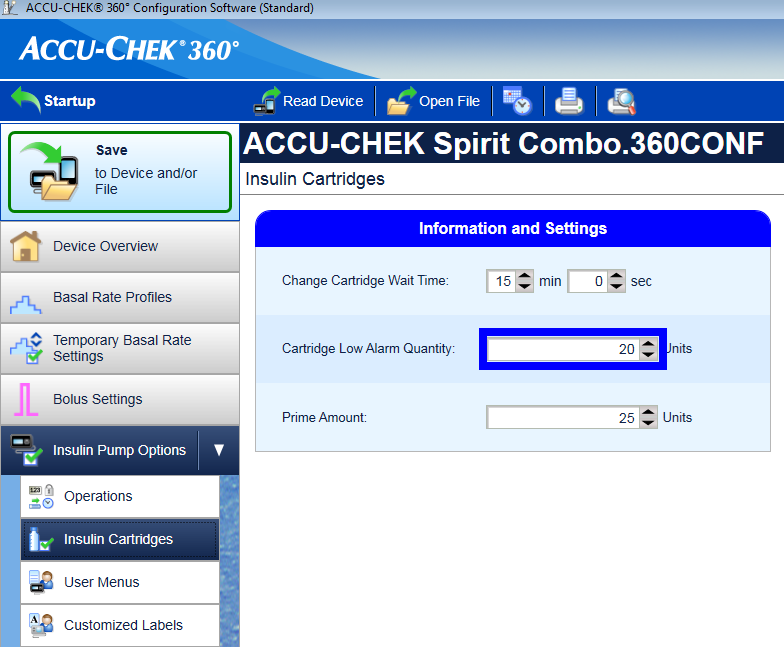
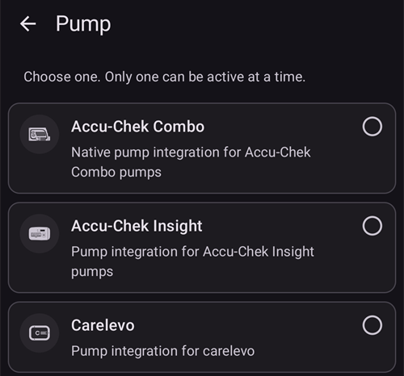
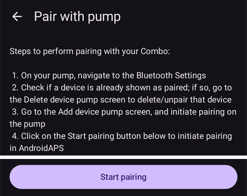
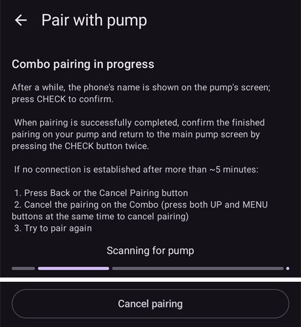

# Accu-Chek Combo

**תוכנה זו היא חלק מפתרון "עשו זאת בעצמכם". היא אינה מוצר מדף, ולכן היא דורשת קריאה מעמיקה, לימוד והבנה של המערכת, כולל אופן השימוש בה. התוכנה לא תנהל את הסוכרת במקומכם, אבל היא מאפשרת לשפר את איזון הסוכר ואת איכות החיים, אם מוכנים להשקיע את הזמן הנדרש. אל תמהרו יותר מידי. אפשרו לעצמכם זמן ללמוד. האחריות על השימוש במערכת היא עליכם בלבד.**

```{admonition} Accu-Chek Combo is being phased out
:class: note

Roche יוצאת משוק משאבות האינסולין, כדי להתמקד בתחום הסוכרת בחיישן Accu-Chek SmartGuide CGM. החברה הודיעה על סיום המכירות של המשאבות Accu-Chek Combo ו-Accu-Chek Insight. גם מיקרו-משאבת Accu-Chek Solo, שעוד נותרה לה, יוצאת בהדרגה מהשוק (המשלוחים האחרונים בגרמניה בסוף 2025). השינוי מתבצע לפי אזורים, החל מגרמניה, וצפוי שיגיע גם לשווקים אחרים באירופה. אם אתם תלויים במשאבה זו, כדאי לתכנן מראש מעבר למשאבה נתמכת.
```

```{contents} Table of contents
:depth: 1
:local: true
```

## Pump capabilities with AAPS

* מתקשרת עם **AAPS** דרך ה-Bluetooth המובנה של הטלפון, ללא מכשיר תקשורת נוסף.
* טיפול אוטומטי במעבר לשעון קיץ/חורף ובשינויי אזור הזמן.

## Hardware and software requirements

* A Roche Accu-Chek Combo (any firmware, they all work).
* מכשיר Smartpix או Realtyme עם תוכנת 360 Configuration לקביעת הגדרות המשאבה. (חברת Roche שולחת מכשיר Smartpix ותוכנה ללקוחותיה לפי דרישה.)
* טלפון תואם עם Android 12 ומעלה. See [release notes](#maintenance-android-version-aaps-version) for details.
* אפליקציית **AAPS** מותקנת בטלפון.

Some phones may work better than others, depending on their quality of Bluetooth support and whether or not they have additional, very aggressive power saving logic. רשימת טלפונים נמצאת במסמך [טלפונים](#Phones-list-of-tested-phones). יש לשים לב - זו אינה רשימת טלפונים תואמים מלאה והיא כוללת התרשמות וחוו"ד שהועלו ע"י משתמשים. לאחר צבירת נסיון, חשוב להעלות את המסקנות והתובנות לגבי המכשיר שלך לטובת המשתמשים הבאים (הפרוייקט הזה ושכמותו נבנה ונסמך על רצון ונכונות המשתמשים "להעביר את זה הלאה").

(combov2-before-you-begin)=
## Before you begin

**SAFETY FIRST** - do not attempt this process in an environment where you cannot recover from an error. Keep your Smartpix / Realtyme device handy, along with the 360 Configuration Software. Plan on spending about an hour for setting everything up and checking that everything is working properly.

Be aware of the following limitations:

* בולוס ממושך ובולוס רב שלבי אינם נתמכים כרגע (ניתן להשתמש במקום זאת ב[פחמימות ממושכות](../DailyLifeWithAaps/ExtendedCarbs.md)).
* Only one basal profile (the first one) is supported.
* הקצב הבזאלי הנמוך ביותר ב**פרופיל** הוא 0.05 U/h. **AAPS** לא מקבל **פרופיל** עם מינון נמוך יותר. ה-Combo מעגלת קצבים בזאליים לצעדים שלה (0.01 U/h מתחת ל-1 U/h, 0.05 U/h עד 10 U/h, 0.1 U/h מעל זה). **AAPS** משתמש במינונים שהמשאבה נותנת באמת.
* קצבים בזאליים זמניים מוגבלים ל-500% מהקצב הבזאלי הנוכחי. **AAPS** מתחשב במגבלה זו.
* The loop is disabled if the currently active profile on the pump isn't profile no. 1. המצב הזה נמשך עד שפרופיל מס' 1 הופך לפרופיל הפעיל. אחרי זה, בפעם הבאה ש-AAPS מתחבר (מעצמו לאחר זמן מה, או כי לחצתם על **רענן** במסך המשאבה Accu-Chek Combo), הוא יזהה שפרופיל מס' 1 הוא הפרופיל הנוכחי, ויפעיל שוב את הלולאה.
* אם הלולאה מבקשת לבטל בזאלי זמני פעיל, ה-Combo תגדיר במקום זאת בזאלי זמני של 90% או 110% למשך 15 דקות. This is because actually cancelling a TBR causes an alert on the pump which causes a lot of vibrations, and these vibrations cannot be disabled.
* יציבות חיבור הבלוטות' משתנה בין טלפונים שונים, וגורמת להתראות "המשאבה אינה זמינה", כאשר אובד החיבור למשאבה. אם השגיאה הזו מופיעה, יש לוודא ש-Bluetooth מופעל, ללחוץ על **רענן** במסך המשאבה (**ניהול** > **משאבה**) כדי לבדוק אם זו הייתה בעיה זמנית, ואם עדיין אין חיבור, להפעיל מחדש את הטלפון. בדרך כלל זה פותר את הבעיה.
* יש עוד בעיה, שבה הפעלה מחדש לא עוזרת, וצריך ללחוץ על לחצן במשאבה (מה שמאפס את מערכת ה-Bluetooth של המשאבה) לפני שהמשאבה תקבל שוב חיבורים מהטלפון.
* יש להימנע מהגדרת בזאלי זמני על המשאבה מכיוון שהלולאה שולטת בבזאלי הזמני. זיהוי בזאלי זמני חדש על המשאבה עשוי להימשך עד 20 דקות, והשפעתו תחושב רק מרגע הזיהוי. לכן במקרה הגרוע ביותר עשויות להיות 20 דקות של TBR שאינן משתקפות ב-IOB.

כרגע מנהל ההתקן תומך בשפות הבאות ב-Combo. (אין לכך קשר לשפה ב־AAPS: זו השפה שמוצגת במסך ה-LCD של ה-Combo עצמה.)

* אנגלית
* ספרדית
* French
* Italian
* רוסית
* Turkish
* Polish
* צ׳כית
* Hungarian
* Slovak
* Romanian
* Croatian
* הולנדית
* יוונית
* Finnish
* Norwegian
* Portuguese
* Swedish
* Danish
* גרמנית
* Slovenian
* ליטאית

**Important**: If your pump is set to a language that is not part of this list, please contact the developers, and set the pump's language to one in this list. Otherwise, the driver won't work properly.

## Phone setup

חשוב מאוד לוודא שאופטימיזציית הסוללה כבויה. AAPS כבר מזהה אוטומטית כשהוא כפוף לאופטימיזציה זו, ומבקש בממשק שלו לכבות אותה. אך בטלפונים מודרניים עם Android, ה-Bluetooth _עצמו_ הוא אפליקציה (אפליקציית מערכת). ובדרך כלל, "אפליקציית Bluetooth" זו פועלת _כשאופטימיזציית הסוללה מופעלת כברירת מחדל_. כתוצאה מכך, ה-Bluetooth עלול לא להגיב כשהטלפון מנסה לחסוך בחשמל, כי הטלפון סוגר את אפליקציית ה-Bluetooth. לכן יש לכבות את אופטימיזציית הסוללה גם בהגדרות של אפליקציית המערכת Bluetooth. לצערנו, הדרך למצוא את אפליקציית המערכת Bluetooth שונה מטלפון לטלפון. ב־Android המקורי, עברו ל־Settings -> Apps -> See all N apps (N = מספר האפליקציות בטלפון). לאחר מכן, פתחו את התפריט בפינה העליונה של המסך ולחצו על "Show system", "Show system apps" או "All apps". כעת, ברשימת האפליקציות המורחבת, חפשו אפליקציה בשם "Bluetooth". Select it, and on its "App info" UI, tap on "Battery". שם, השביתו את אופטימיזציית הסוללה (לעיתים נקרא "battery usage").

## Combo setup

* Configure the pump using the Accu-Chek 360 Configuration Software. אם התוכנה לא ברשותכם, צרו קשר עם המוקד של Accu-Chek. בדרך כלל הם שולחים למשתמשים רשומים תקליטור עם "360° Pump Configuration Software" והתקן חיבור USB-אינפרא אדום מסוג SmartPix (גם התקן Realtyme עובד, אם יש לכם אותו).

  - **Required settings** (marked green in screenshots):

     * הגדירו/השאירו את תצורת התפריט כ-"Standard". כך יוצגו במשאבה רק התפריטים/הפעולות הנתמכים, ויוסתרו אלה שאינם נתמכים (בולוס ממושך/בולוס רב שלבי, כמה פרופילים בזאליים). פעולות אלה מגבילות את פעולת הלולאה כשמשתמשים בהן, כי אז לא ניתן להריץ את הלולאה בצורה בטוחה.
     * Verify the _Quick Info Text_ is set to "QUICK INFO" (without the quotes, found under _Insulin Pump Options_).
     * Set TBR _Maximum Adjustment_ to 500%
     * Disable _Signal End of Temporary Basal Rate_
     * Set TBR _Duration increment_ to 15 min
     * הפעילו בלוטות'

  - **Recommended settings** (marked blue in screenshots)

     * הגדירו את אזעקת מכל נמוך כרצונכם
     * הגדירו בולוס מקסימלי המתאים לטיפולכם כדי להגן מפני תקלות בתוכנה
     * בדומה, הגדירו את משך הבזאלי הזמני המרבי ליתר ביטחון. יש לאפשר לפחות 3 שעות, כי האפשרות לנתק את המשאבה למשך 3 שעות מגדירה 0% למשך 3 שעות.
     * Enable key lock on the pump to prevent bolusing from the pump, esp. when the pump was used before and quick bolusing was a habit.
     * הגדירו את הזמן הקצוב לתצוגה ואת הזמן הקצוב לתפריט למינימום של 5.5 ו-5 בהתאמה. זה מאפשר ל-AAPS להתאושש מהר יותר ממצבי שגיאה, ומפחית את כמות הרעידות שיכולות להתרחש במהלך שגיאות כאלה

  

  

  

  

## Activating the driver and pairing it with the Combo

* יש לפתוח את **התפריט** (☰) בפינה העליונה של המסך, לעבור אל [**הגדרות תצורה** > **משאבה**](../SettingUpAaps/ConfigBuilder.md) ולבחור ב-**Accu-Chek Combo**.

  

  אחרי הבחירה, בכרטיס **Accu-Chek Combo** מוצגים שני לחצנים, **הגדרות** ו-**פתיחת תוסף**:

  

  **הגדרות** פותח את ההגדרות של מנהל ההתקן Accu-Chek Combo (ראו [הגדרות](#combov2-preferences) בהמשך):

  

  **פתיחת תוסף** (או **ניהול** > **משאבה**) פותח את מסך המשאבה Accu-Chek Combo. לפני צימוד משאבה, המסך מציג **לא מצומד למשאבה**:

  

* במסך המשאבה, יש ללחוץ על **צימוד**. המסך **צימוד משאבה** נפתח. יש לבצע את הצעדים שמוצגים במסך, ואז ללחוץ על **התחל צימוד**. כש-Android מבקש הרשאה להפוך את הטלפון לגלוי למכשירי Bluetooth אחרים, יש ללחוץ על **Allow**. בסוף, ה-Combo מציגה במסך שלה קוד PIN בן 10 ספרות לצימוד, ו-**AAPS** מבקש אותו. יש להזין את הקוד בשדה **קוד בן 10 ספרות**.

  

  

  

  התמונות הבאות הן מגרסה ישנה יותר של **AAPS**. הצעדים והטקסטים זהים, אבל המסכים נראים קצת אחרת.

  

  

  

* אם הקוד הוזן לא נכון, **AAPS** מציג **הקוד לא עבד. וודאו שלא טעיתם בהעתקתו. אם זה קורה שוב ושוב, בטלו ונסו לצמד שוב.**

  

* כשמוצג **הצימוד עם Combo הושלם**, יש ללחוץ על **אישור**. חוזרים למסך המשאבה, שמציג עכשיו את מצב המשאבה (ראו [התוכן של מסך המשאבה Accu-Chek Combo](#combov2-tab-contents) בהמשך). הלחצן **צימוד** מוחלף בלחצן **ביטול צימוד**.

* To verify your setup (with the pump **disconnected** from any cannula to be safe!) use AAPS to set a TBR of 500% for 15 min and issue a bolus. המשאבה צריכה כעת להפעיל בזאלי זמני ולהציג רישום של הבולוס בהיסטוריית המשאבה. AAPS צריך גם להציג את הבזאלי הזמני הנוכחי ואת הבולוס שניתן.

* On the Combo, it is recommended to enable the key lock to prevent bolusing from the pump, esp. when the pump was used before and using the "quick bolus" feature was a habit.

## Notes about pairing

The Accu-Chek Combo was developed before Bluetooth 4.0 was released, and just one year after the very first Android version was released. This is why its way of pairing with other devices is not 100% compatible with how it is done in Android today. כדי להתגבר על כך לחלוטין, AAPS היה זקוק להרשאות ברמת המערכת, שזמינות רק לאפליקציות מערכת. These are installed by the phone makers into the phone - users cannot install system apps.

לכן הצימוד לעולם לא יעבוד ב-100% בלי בעיות. In particular, during pairing, Android's Bluetooth PIN dialog can briefly show up and automatically go away. But sometimes, it stays on screen, and asks for a 4-digit PIN. (This is not to be confused with the 10-digit Combo pairing PIN.) Do not enter anything, just press cancel. If pairing does not continue, follow the instructions on screen to retry the pairing attempt.

(combov2-tab-contents)=
## התוכן של מסך המשאבה Accu-Chek Combo

כדי לפתוח את מסך המשאבה, יש לעבור אל **ניהול** > **משאבה**. אחרי צימוד המשאבה, המסך מציג את המידע הבא (הפריטים מסודרים מלמעלה למטה):


1. **מצב מנהל התקן**: מנהל ההתקן יכול להיות באחד מהמצבים הבאים:
   - **מנותק**: אין חיבור Bluetooth. מנהל ההתקן נמצא במצב זה רוב הזמן, ומתחבר למשאבה רק כשצריך - כך נחסך חשמל
   - **מתחבר**
   - **בודק משאבה**: המשאבה מחוברת, אבל מנהל ההתקן מבצע כרגע בדיקות בטיחות כדי לוודא שהכול תקין ומעודכן
   - **מוכן**: מנהל ההתקן מוכן לקבל פקודות מ-AAPS
   - **מושהה**: המשאבה מושהית (מוצג כ-"stopped" ב-Combo)
   - תיאור הפקודה שמתבצעת, למשל **הגדרת פרופיל בזאלי** או **מעדכן את סטטוס המשאבה**
   - **שגיאה**: אירעה שגיאה. החיבור נותק, וכל פקודה שהייתה בביצוע הופסקה
2. **התחברות אחרונה**: לפני כמה דקות מנהל ההתקן התחבר בהצלחה ל-Combo. אם עברו יותר מ-30 דקות, הפריט הזה מוצג בצבע אדום
3. **סוללה**: רמת הסוללה. ה-Combo מציגה רק **מלא**, **נמוך** או **ריק**, ולא נותנת ערך מדויק יותר (כמו אחוזים), ולכן מוצגות כאן רק שלוש הרמות האלה
4. **מכל**: כמה IU יש כרגע במכל של ה-Combo
5. **בולוס אחרון**: לפני כמה דקות ניתן הבולוס האחרון. אם עדיין לא ניתן בולוס מאז ש-AAPS הופעל, הפריט לא מוצג
6. **בזאלי זמני**: פרטים על הבזאלי הזמני הפעיל כרגע. אם אין בזאלי זמני פעיל, הפריט לא מוצג
7. **בזאלי בסיסי**: הקצב הבזאלי הבסיסי הפעיל כרגע ("בסיסי" = הקצב הבזאלי בלי השפעה של בזאלי זמני פעיל)
8. **מספר סידורי**: המספר הסידורי של ה-Combo, כפי שהמשאבה מדווחת (זהה למספר הסידורי שמופיע בגב ה-Combo)
9. **כתובת בלוטות'**: כתובת ה-Bluetooth של ה-Combo, באורך 6 בתים, בפורמט `XX:XX:XX:XX:XX:XX`

כשמנהל ההתקן עושה משהו (למשל, מגדיר פרופיל בזאלי), תיבה מתחת לרשימה מתארת את הפעולה הנוכחית, עם פס התקדמות דק.

The Combo can be operated through Bluetooth in the _remote-terminal_ mode or in the _command_ mode. The remote-terminal mode corresponds to the "remote control mode" on the Combo's meter, which mimics the pump's LCD and four buttons. Some commands have to be performed in this mode by the driver, since they have no counterpart in the command mode. That latter mode is much faster, but, as said, limited in scope. כשמצב remote-terminal פעיל, מסך ה-remote-terminal הנוכחי מוצג בשדה שנמצא מעל ציור ה-Combo. When the driver switches to the command mode however, that field is left blank.

(אין לכם השפעה על כך; מנהל ההתקן מחליט לבד באיזה מצב להשתמש. זו רק הערה, כדי שתדעו למה לפעמים רואים בשדה הזה מסכים של ה-Combo.)

בתחתית המסך יש את הלחצנים הבאים:

- **רענן**: מפעיל עדכון מיידי של מצב המשאבה. הוא משמש גם כדי להודיע ל-AAPS ששגיאה שהתגלתה קודם תוקנה, ושאפשר לבדוק שוב שהכול תקין (פרטים בהמשך, ב[סעיף על התראות](#combov2-alerts)). ניתן ללחוץ עליו רק כשמנהל ההתקן מנותק, מושהה או במצב שגיאה.
- **ביטול צימוד**: מבטל את הצימוד של ה-Combo מ-**AAPS** ומ-Android, אחרי שמאשרים את **בטוחים שברצונכם לנתק את חיבור המשאבה?**. כשאין משאבה מצומדת, הלחצן הזה מוחלף בלחצן **צימוד**.

(combov2-preferences)=
## הגדרות

ההגדרות האלה זמינות למנהל ההתקן של ה-Combo (**הגדרות תצורה** > **משאבה** > **Accu-Chek Combo** > **הגדרות**, או סמל ההגדרות (גלגל שיניים) במסך המשאבה). הפריטים מסודרים מלמעלה למטה:

1. **משך הגילוי (בשניות)**: בזמן הצימוד, מנהל ההתקן הופך את הטלפון לגלוי למשאבה. This controls how long that discoverability lasts. By default, the maximum (300 seconds = 5 minutes) is selected. Android does not allow for discoverability to last indefinitely, so a duration has to be chosen.
2. **זיהוי אוטומטי ורישום החלפת מכל אינסולין**: אם האפשרות מופעלת, מנהל ההתקן רושם את "החלפת המכל" שבדרך כלל רושמים בעצמכם דרך **ניהול** > **תיחול/מילוי**. This is explained [in further detail below](#combov2-autodetections).
3. **זיהוי אוטומטי ורישום החלפת סוללה**: אם האפשרות מופעלת, מנהל ההתקן רושם את "החלפת הסוללה" שבדרך כלל רושמים בעצמכם דרך **ניהול** > **החלפת סוללת משאבה**. This is explained [in further detail below](#combov2-autodetections).
4. **אפשר רישום Combo מפורט**: מגדיל מאוד את כמות הרישום ביומן שמנהל ההתקן מבצע. **CAUTION**: Do not enable this unless asked to by a developer. אחרת, הדבר עלול להוסיף הרבה רעש ליומנים של **AAPS** ולהפחית את התועלת שלהם.

הצימוד וביטול הצימוד נעשים במסך המשאבה, לא בהגדרות (ראו למעלה).

(combov2-autodetections)=
## Autodetecting and automatically entering battery and reservoir changes

The driver is capable of detecting battery and reservoir changes by keeping track of the battery and reservoir levels. If the battery level was reported by the Combo as low the last time the pump status was updated, and now, during the new pump status update, the battery level shows up as normal, then the driver concludes that the user must have replaced the battery. The same logic is used for the reservoir level: If it now is higher than before, this is interpreted as a reservoir change.

This only works if the battery and reservoir are replaced when these levels are reported as low _and_ the battery and reservoir are sufficiently filled.

ניתן לכבות את הזיהויים האוטומטיים האלה ב[הגדרות](#combov2-preferences) של מנהל ההתקן.

(combov2-alerts)=
## Alerts (warnings and errors) and how they are handled

The Combo shows alerts as remote-terminal screens. אזהרות מוצגות עם קוד "Wx" (x הוא ספרה), יחד עם תיאור קצר. One example is "W7", "TBR OVER". Errors are similar, but show up with an "Ex" code instead.

Certain warnings are automatically dismissed by the driver. These are:

- W1 "reservoir low" : מנהל ההתקן הופך אותה לאזהרת "מכל נמוך" שמוצגת במסך הראשי של AAPS
- W2 "battery low" : מנהל ההתקן הופך אותה לאזהרת "סוללה חלשה" שמוצגת במסך הראשי של AAPS
- W3, W6, W7, W8 : these are all purely informational for the user, so it is safe for the driver to auto-dismiss them

Other warnings are _not_ automatically dismissed. Also, errors are _never_ automatically dismissed. Both of these are handled the same way: They cause the driver to produce an alert dialog on top of the AAPS UI, and also cause it to abort any ongoing command execution. לאחר מכן מנהל ההתקן עובר למצב "שגיאה" (ראו [התוכן של מסך המשאבה Accu-Chek Combo למעלה](#combov2-tab-contents)). This state does not allow for any command execution. The user has to handle the error on the pump; for example, an occlusion error may require replacing the cannula. אחרי שטיפלו בשגיאה, ניתן לחזור לפעולה רגילה בלחיצה על **רענן** במסך המשאבה Accu-Chek Combo. The driver then connects to the Combo and updates its status, checking for whether an error is still shown on screen etc. Also, the driver auto-refreshes the pump status after a while, so manually pressing that button is not mandatory.

Bolusing is a special case. It is done in the Combo's command mode, which does not report mid-bolus that an alert appeared. As a consequence, the driver cannot automatically dismiss warnings _during_ a bolus. This means that unfortunately, the pump will be beeping until the bolus is finished. The most common mid-bolus alert typically is W1 "reservoir low". **אין** לסגור ידנית אזהרות Combo במשאבה עצמה במהלך בולוס. You risk interrupting the bolus. The driver will take care of the warning once the bolus is over.

Alerts that happen while the driver is not connected to the Combo will not be noticed by the driver. The Combo has no way of automatically pushing that alert to the phone; it is always the phone that has to initiate the connection. As a consequence, the alert will persist until the driver connects to the pump. ניתן ללחוץ על **רענן** במסך המשאבה כדי ליצור חיבור ולתת למנהל ההתקן לטפל בהתראה מיד (במקום לחכות ש-AAPS עצמו יחליט ליצור חיבור).

**IMPORTANT**: If an error occurs, or a warning shows up that isn't one of those that are automatically dismissed, the driver enters the error state. במצב זה, הלולאה **תיחסם** עד שמצב המשאבה יתרענן! החסימה מוסרת אחרי שמצב המשאבה מתעדכן (בלחיצה על **רענן** או בעדכון האוטומטי של מנהל ההתקן) וכבר לא מוצגת שגיאה.

## Things to be careful about when using the Combo

* Keep in mind that this is not a product, esp. in the beginning the user needs to monitor and understand the system, its limitations and how it can fail. It is strongly advised NOT to use this system when the person using it is not able to fully understand the system.
* Due to the way the Combo's remote control functionality works, several operations (especially setting a basal profile) are slow compared to other pumps. This is an unfortunate limitation of the Combo that cannot be overcome.
* אין להגדיר או לבטל בזאלי זמני על גוף המשאבה. The loop assumes control of TBRs and cannot work reliably otherwise, since it's not possible to determine the start time of a TBR that was set by the user on the pump.
* אל תלחצו על לחצנים במשאבה בזמן ש-AAPS מתקשר איתה (סמל ה-Bluetooth מוצג במשאבה בזמן שהיא מחוברת ל-AAPS). Doing that will interrupt the Bluetooth connection. Only do that if there are problems with establishing a connection (see [the "Before you begin" section above](#combov2-before-you-begin)).
* Don't press any buttons while the pump is bolusing. In particular, don't try to dismiss alerts by pressing buttons. See [the section about alerts](#combov2-alerts) for a more detailed explanation why.

## Checklist for when no connection can be established with the Combo

The driver does its best to connect to the Combo, and uses a couple of tricks to maximize reliability. Still, sometimes, connections aren't established. Here are some steps to take for trying to remedy this situation.

1. Press a button on the Combo. Sometimes, the Combo's Bluetooth stack becomes non-responsive, and does not accept connections anymore. By pressing a button on the Combo and making the LCD show something, the Bluetooth stack is reset. Most of the time, this is the only step that's needed to fix the connection issues.
2. Restart the phone. This may be needed if there is an issue with the phone's Bluetooth stack itself.
3. If the Combo's battery cap is old, consider replacing it. Old battery caps can cause issues with the Combo's power supply, which affect Bluetooth.
4. If connection attempts still keep failing, consider unpairing and then re-pairing the pump.

(combov2-tips-for-basic-usage)=
## טיפים לשימוש בסיסי

### איך להבטיח פעולה חלקה

* תמיד **לשאת את הטלפון החכם איתכם**, ובלילה להשאיר אותו ליד המיטה. בזמן השינה המשאבה עלולה להיות מאחורי הגוף או מתחתיו, לכן מיקום גבוה יותר (על מדף או לוח) עובד הכי טוב.
* תמיד לוודא שסוללת המשאבה מלאה ככל האפשר. טיפים לגבי הסוללה נמצאים בסעיף על הסוללה.
* ככל האפשר, להפעיל את המשאבה רק דרך אפליקציית AAPS. כדי להקל על כך, יש להפעיל את נעילת המקשים במשאבה תחת **PUMP SETTINGS / KEY LOCK / ON**. צריך להשתמש במקשי המשאבה רק כשמחליפים את הסוללה או את המחסנית.


### המשאבה אינה זמינה. מה לעשות?

#### הפעלת התראה כשהמשאבה אינה זמינה
* ב-**AAPS**, יש ללחוץ על סמל **הגדרות** (גלגל שיניים) בפינה העליונה של המסך הראשי, לעבור אל **התראות מקומיות**, להפעיל את **התראה כאשר המשאבה אינה זמינה** ולהגדיר את **סף למשאבה לא זמינה** ל-**31** דקות.
* כך יש מספיק זמן לצאת מהחדר כשהטלפון נשאר על השולחן בלי להפעיל את ההתראה, אבל תקבלו הודעה אם המשאבה לא זמינה יותר זמן ממשך של בזאלי זמני.

#### החזרת הזמינות של המשאבה

* כש-AAPS מדווח על התראת **המשאבה אינה זמינה**, קודם יש לבטל את נעילת המקשים **וללחוץ על מקש כלשהו במשאבה** (למשל הלחצן "down"). ברגע שתצוגת המשאבה נכבתה, יש ללחוץ על **רענן** במסך המשאבה Accu-Chek Combo (**ניהול** > **משאבה**). ברוב המקרים התקשורת חוזרת לעבוד.
* אם זה לא עוזר, יש להפעיל מחדש את הטלפון החכם. אחרי ההפעלה מחדש, AAPS יופעל שוב ויווצר חיבור חדש עם המשאבה.

* הבדיקות עם טלפונים חכמים שונים הראו שחלק מהטלפונים גורמים לשגיאת "המשאבה אינה זמינה" לעיתים קרובות יותר מאחרים. ראו [טלפונים](#Phones-list-of-tested-phones) לרשימת טלפונים חכמים שנבדקו בהצלחה.

#### הסיבות לשגיאות תקשורת תכופות וההשלכות שלהן
* בטלפונים עם **מעט זיכרון** (או עם הגדרות **חיסכון אגרסיבי בחשמל**), AAPS נסגר לעיתים קרובות. אפשר לזהות זאת לפי כך שלחצני הטיפולים (סרגל ההפעלה המהירה, QuickLaunch) במסך הראשי לא מוצגים כשפותחים את AAPS, כי המערכת עדיין מאותחלת. הדבר עלול לגרום ל"התראות משאבה אינה זמינה" בזמן ההפעלה. בשדה **התחברות אחרונה** במסך המשאבה (**ניהול** > **משאבה**), ניתן לבדוק מתי AAPS תקשר עם המשאבה בפעם האחרונה.


* השגיאה הזו עלולה לרוקן את סוללת המשאבה מהר יותר, כי הפרופיל הבזאלי נקרא מהמשאבה כשהאפליקציה מופעלת מחדש.
* היא גם מגדילה את הסיכוי לשגיאה שבה המשאבה דוחה את כל החיבורים הנכנסים עד שלוחצים על לחצן במשאבה.

### ביטול בזאלי זמני נכשל
* לפעמים AAPS לא מצליח לסגור אוטומטית התראת **TBR CANCELED**. אז יש ללחוץ על **רענן** במסך המשאבה Accu-Chek Combo, או לאשר את ההתראה במשאבה.

### שיקולים לגבי סוללת המשאבה

#### החלפת הסוללה
* אחרי התראת **low battery** (סוללה חלשה), יש להחליף את הסוללה מהר ככל האפשר, כדי שתמיד תהיה מספיק אנרגיה לתקשורת Bluetooth אמינה עם הטלפון החכם, גם כשהטלפון רחוק יותר מהמשאבה.
* גם אחרי התראת **low battery**, ייתכן שהסוללה תחזיק עוד זמן רב. עם זאת, מומלץ תמיד לשאת סוללה חדשה אחרי שהופיעה התראת "low battery".
* לפני החלפת הסוללה, יש ללחוץ על הסמל **לולאה** במסך הראשי ולבחור **השהיית הלולאה** למשך שעה אחת.
* יש לחכות שהטלפון יתקשר עם המשאבה ושסמל ה-Bluetooth במשאבה ייעלם.


* יש לבטל את נעילת המקשים במשאבה, להעביר את המשאבה למצב עצירה (stop), לאשר בזאלי זמני שאולי בוטל, ולהחליף את הסוללה מהר.
* אין צורך לכוון מחדש את השעון של המשאבה אחרי החלפת הסוללה: AAPS מעדכן אוטומטית את התאריך והשעה של המשאבה.
* לאחר מכן יש להחזיר את המשאבה למצב פעולה (run) ולבחור **חידוש** בלחיצה על הסמל **לולאה מושהית** במסך הראשי.
* AAPS יגדיר מחדש בזאלי זמני נדרש כשיגיע ערך הסוכר הבא.

(Accu-Chek-Combo-Tips-for-Basic-usage-battery-type-and-causes-of-short-battery-life)=
#### סוג הסוללה והסיבות לחיי סוללה קצרים
* תקשורת Bluetooth אינטנסיבית צורכת הרבה אנרגיה, לכן יש להשתמש רק ב**סוללות איכותיות**, כמו Energizer Ultimate Lithium, סוללות "power one" מערכת השירות ה"גדולה" של Accu-Chek, או, אם בוחרים בסוללה נטענת, סוללות Eneloop.

 

אלה טווחי זמן החיים הרגילים של סוגי הסוללות השונים:
* **Energizer Ultimate Lithium**: 4 עד 7 שבועות
* **Power One Alkaline** (Varta) מערכת השירות: 2 עד 4 שבועות
* סוללות **Eneloop rechargeable** (נטענות, BK-3MCCE): 1 עד 3 שבועות

אם חיי הסוללה קצרים בהרבה מהטווחים שלמעלה, יש לבדוק את הסיבות האפשריות הבאות:
* יש כמה גרסאות של מכסה הסוללה המוברג של משאבת Combo שגורמות לקצר חלקי בסוללות ומרוקנות אותן מהר. את המכסים שאין בהם בעיה זו ניתן לזהות לפי מגעי המתכת הזהובים.
* אם שעון המשאבה לא "שורד" החלפת סוללה קצרה, כנראה שהקבל ששומר על פעולת השעון בזמן הפסקת חשמל קצרה מקולקל. במקרה זה, החלפת המשאבה על ידי Roche עשויה לעזור, ובתקופת האחריות אין עם זה בעיה.
* גם החומרה והתוכנה של הטלפון החכם (מערכת ההפעלה Android ומערכת ה-Bluetooth) משפיעות על חיי הסוללה של המשאבה, אף שהגורמים המדויקים עדיין לא ידועים במלואם. אם יש לכם אפשרות, נסו טלפון חכם אחר והשוו את חיי הסוללה.

### בולוס ממושך, בולוס רב שלבי
האלגוריתם של OpenAPS לא תומך בבולוס ממושך או בבולוס רב שלבי במקביל. אבל אפשר להשיג טיפול דומה בדרכים החלופיות הבאות:
* להשתמש ב**פחמימות ממושכות** כשמזינים פחמימות או כשמשתמשים באשף הבולוס: יש להזין את הפחמימות של כל הארוחה ואת משך הזמן שבו צפוי שהפחמימות יגיעו לדם כגלוקוז. המערכת תחשב אז כמויות קטנות של פחמימות, שמחולקות באופן שווה על כל משך הזמן. בגלל זה האלגוריתם ייתן מינוני אינסולין מתאימים, ועדיין יבדוק כל הזמן את העלייה או הירידה הכללית ברמת הסוכר. לגישה של בולוס רב שלבי, ניתן גם לשלב בולוס מיידי קטן יותר עם פחמימות ממושכות.
* לפני האכילה, יש להגדיר יעד זמני **אכילה בקרוב** של 80 mg/dL (4.4 mmol/L) לכמה שעות (בלחיצה על היעד במסך הראשי, או דרך **ניהול** > **יעד זמני**). משך הזמן צריך להתאים לזמן שהייתם בוחרים לבולוס ממושך. כך היעד יישאר נמוך מהרגיל, ולכן יינתן יותר אינסולין.
* לאחר מכן יש להשתמש ב**אשף בולוס** כדי להזין את כל הפחמימות של הארוחה, אבל לא להחיל ישירות את הערכים שהוא מציע. אם רוצים לתת בולוס בדומה לבולוס רב שלבי, יש להוריד את מינון האינסולין. בהתאם לארוחה, האלגוריתם צריך עכשיו לתת עוד SMB או בזאלי זמני גבוה יותר כדי לנטרל את העלייה ברמת הסוכר. כאן יש לנסות בזהירות רבה את מגבלות הבטיחות של הקצב הבזאלי (Max U/h, Maximum basal IOB), ואם צריך, לשנות אותן באופן זמני.

* אין להשתמש בבולוס ממושך או בבולוס רב שלבי ישירות במשאבה. מנהל ההתקן לא תומך בהם (ראו [לפני שמתחילים](#combov2-before-you-begin)). אם בכל זאת ניתן בולוס רב שלבי במשאבה, **AAPS** רושם אותו מהיסטוריית המשאבה כבולוס רגיל ועוד בולוס ממושך, כך שהוא נכלל ב-IOB. בולוס ממושך לא עובד בלולאה סגורה (פרטים ב[דף הזה](#extended-bolus-and-why-they-wont-work-in-closed-loop-environment)).

### התראות בזמן מתן בולוס
* אחרי כל בולוס, מנהל ההתקן קורא את היסטוריית הבולוסים של המשאבה. זה מנגנון בטיחות לחישוב נכון של האינסולין הפעיל (IOB), גם כשבולוס ניתן ישירות מהמשאבה.
* לפני בולוס, אם בהיסטוריית המשאבה יש בולוס ש-**AAPS** לא ידע עליו (למשל, בולוס שניתן ישירות במשאבה), הבולוס המבוקש **לא ניתן**, כי הוא חושב בלי האינסולין הזה. **AAPS** מציג **בהיסטוריית המשאבה יש בולוס ש-AAPS לא ידע עליו. הבולוס המבוקש לא ניתן...** יש לבדוק את היסטוריית הבולוסים במשאבה ואת ה-IOB. אם עדיין נדרש בולוס, יש לחשב אותו מחדש. זה תקף גם כשהבולוס הלא ידוע נמצא בחיבור חדש.
* אם הבולוס ניתן, אבל בהיסטוריית המשאבה היו גם בולוסים אחרים ש-**AAPS** לא ידע עליהם, הם נרשמים עכשיו, ו-**AAPS** מבקש לבדוק את ה-IOB לפני הבולוס הבא.
* אם החיבור למשאבה אובד **במהלך** בולוס, **AAPS** לא רושם 0 U: הוא מציג כמה המשאבה נתנה עד אז, ומזהיר שייתכן שהמשאבה עדיין תיתן את השאר. **אין לתת בולוס נוסף.** **AAPS** קורא את הכמות האמיתית מהיסטוריית המשאבה בחיבור הבא.
* אם החיבור אובד בזמן ש-**AAPS** שולח את הבולוס, לא ידוע אם המשאבה קיבלה אותו. יש לבדוק את היסטוריית הבולוסים במשאבה לפני הבולוס הבא.
* אם **AAPS** לא יכול לאשר שבולוס ניתן, הוא מציג **מתן הבולוס נכשל. נראה כי לא ניתן בולוס. כדי להיות בטוחים, יש לבדוק את המשאבה כדי למנוע בולוס כפול ואז להזריק שוב בולוס.** בולוסים אף פעם לא ניתנים מחדש באופן אוטומטי.

## Where to get help

הפיתוח של מנהל ההתקן של ה-Combo נעשה על ידי הקהילה, **בהתנדבות**. לפני שמבקשים עזרה, יש:

1. **לקרוא** את החלק הרלוונטי בתיעוד הזה כדי לוודא איך התכונה אמורה לעבוד.
2. **לשאול** בערוץ *#AAPS* ב-[Discord](https://discord.gg/4fQUWHZ4Mw), או באחד [מערוצי הקהילה](../GettingHelp/WhereCanIGetHelp.md) האחרים.
3. **לדווח על באג**: לחפש ב[דיווחים הקיימים](https://github.com/nightscout/AndroidAPS/issues); אם הבעיה לא מופיעה, לפתוח [דיווח חדש](https://github.com/nightscout/AndroidAPS/issues) ולצרף את [קובצי היומן](../GettingHelp/AccessingLogFiles.md).

בבקשת עזרה, יש לציין את יצרן ודגם הטלפון, גרסת Android, גרסת **AAPS** ותיאור פשוט של הבעיה (מה השתנה, מתי זה עבד בפעם האחרונה).
