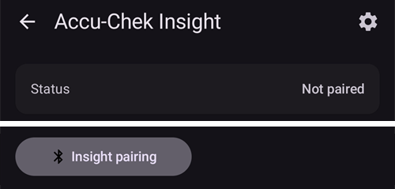
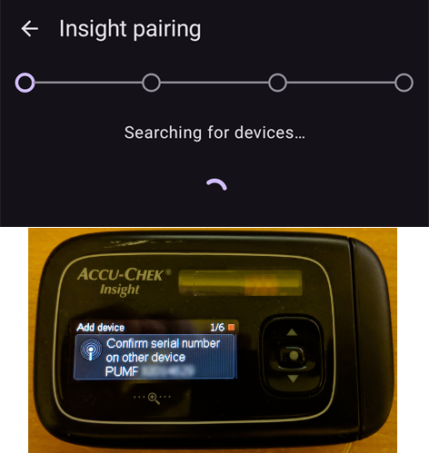

# Accu-Chek Insight

**תוכנה זו היא חלק מפתרון לבלב מלאכותי בשיטת עשו זאת בעצמכם ואינה מוצר, אך היא דורשת מכם לקרוא, ללמוד ולהבין את המערכת, כולל אופן השימוש בה. It is not something that does all your diabetes management for you but allows you to improve your diabetes and your quality of life, if you're willing to put in the time required. Don't rush into it, but allow yourself time to learn. You alone are responsible for what you do with it.**

```{admonition} משאבת Accu-Chek Insight יוצאת משימוש :class: note

Roche יוצאת משוק משאבות האינסולין, כדי למקד את תחום הסוכרת שלה בחיישן Accu-Chek SmartGuide CGM. החברה הודיעה על סיום המכירות של המשאבות Accu-Chek Combo ו-Accu-Chek Insight. גם מיקרו-משאבת Accu-Chek Solo, שעוד נותרה לה, יוצאת בהדרגה מהשוק (המשלוחים האחרונים בגרמניה בסוף 2025). השינוי מתבצע לפי אזורים, החל מגרמניה, וצפוי שיגיע גם לשווקים אחרים באירופה. התמיכה ב-Insight כבר מופיעה כמסתיימת (ראו [משאבות שכבר לא נמכרות](./Future-possible-Pump-Drivers.md)). אם אתם תלויים במשאבה זו, כדאי לתכנן מראש מעבר למשאבה נתמכת.

    <br />```{note}
    לפני שהיה ל-**AAPS** מנהל התקן מובנה ל-Insight, השליטה ב-Insight נעשתה דרך האפליקציה הנפרדת [SightRemote](https://github.com/TebbeUbben/SightRemote). אין עוד צורך ב-SightRemote והיא כבר לא מתוחזקת: אם היא עדיין מותקנת אצלכם מאותה תקופה, יש להסיר אותה ולהשתמש בגרסה עדכנית של **AAPS**.
    

```{contents} תוכן העניינים :depth: 1 :local: true

    <br />## יכולות המשאבה עם AAPS
    
    * מתקשרת עם **AAPS** דרך ה-Bluetooth המובנה של הטלפון, בלי התקן תקשורת נוסף.
    * טיפול אוטומטי בשעון קיץ ובאזורי זמן.
    
    ## דרישות חומרה ותוכנה
    
    * משאבת Roche Accu-Chek Insight (כל קושחה, כולן עובדות)
    
    הערה: AAPS כותב נתונים תמיד ב**פרופיל הקצב הבזאלי הראשון במשאבה**.
    
    * טלפון Android עם Android 12 ומעלה (ראו [טלפונים](../Getting-Started/Phones.md))
    * אפליקציית AAPS מותקנת בטלפון
    
    ## הגדרה
    
    * יש לחבר את משאבת Insight רק למכשיר אחד בכל פעם. אם השתמשתם בעבר בשלט הרחוק של Insight (המד), יש להסיר את המד מרשימת המכשירים המצומדים של המשאבה: **Menu** > **Settings** > **Communication** > **Remove device**.
    
       
    
    * ב-[הגדרות תצורה > משאבה](#Config-Builder-pump), יש לבחור את הכרטיס **Accu-Chek Insight**. רק משאבה אחת יכולה להיות פעילה בכל פעם.
    
       
    
       לאחר הבחירה, בכרטיס **Accu-Chek Insight** מופיעים שני לחצנים, **הגדרות** ו-**פתיחת תוסף**:
    
       
    
       **הגדרות** פותח את ההגדרות של מנהל ההתקן Accu-Chek Insight (ראו [הגדרות ב-AAPS](#Accu-Chek-Insight-Pump-settings-in-aaps)).
    
       **פתיחת תוסף** (או **ניהול ← משאבה**) פותח את מסך המשאבה של Accu-Chek Insight. לפני צימוד משאבה, המסך נראה כך:
    
       
    
    (accu-chek-insight-pairing)=
    ### צימוד
    
    * במסך המשאבה, יש ללחוץ על **צימוד Insight**. אשף הצימוד נפתח ומחפש מכשירי Bluetooth קרובים (החלק העליון של התמונה למטה).
    * במשאבת Insight, יש לעבור אל **Menu** > **Settings** > **Communication** > **Add Device**. המשאבה מציגה את המסך הבא (החלק התחתון של התמונה למטה) עם המספר הסידורי של המשאבה.
    
       
    
    * בחזרה בטלפון, יש ללחוץ על המספר הסידורי של המשאבה ברשימת מכשירי ה-Bluetooth. אם Android מבקש לאשר את הצימוד, יש ללחוץ על **Pair** (צימוד).
    
       
    
    * המשאבה והטלפון מציגים שניהם קוד. יש לבדוק שהקודים זהים בשני המכשירים. יש לאשר במשאבה, וללחוץ על **כן** בטלפון. (יש ללחוץ על **לא** אם הקודים לא זהים.)
    
       
    
    * הטלפון מציג **הצימוד הושלם**. יש ללחוץ על **יציאה** כדי לחזור למסך המשאבה.
    
       
    
    * כדי לבדוק שהכול תקין, יש להסתכל במסך המשאבה (**ניהול ← משאבה**). לאחר שהמשאבה מצומדת, המסך מציג מידע על המשאבה, כמו **מספר סידורי**, **תאריך ייצור**, **גרסת תוכנה** ו**כתובת בלוטות'**.
    
       
    
       ```{admonition} צילום מסך ישן
       :class: note
       מלבד החלק העליון של התמונה הראשונה, צילומי המסך של הצימוד למעלה הם מגרסה קודמת של **AAPS**, וייתכן שהם ייראו אחרת ב-**AAPS** 4.
       ```
    
    * כדי להסיר את הצימוד, יש ללחוץ על **ביטול צימוד** במסך המשאבה ולאשר את **לאפס את נתוני הצימוד?**. הלחצן **צימוד Insight** מופיע אז שוב.
    
    הערה: אין חיבור קבוע בין המשאבה לטלפון. **AAPS** מתחבר רק כשצריך (למשל כדי להגדיר בזאלי זמני, לתת בולוס או לקרוא את היסטוריית המשאבה). אחרת הסוללות של הטלפון ושל המשאבה היו מתרוקנות מהר מדי.
    
    (Accu-Chek-Insight-Pump-settings-in-aaps)=
    ## הגדרות ב-AAPS
    
    יש לפתוח את ההגדרות בלחיצה על **הגדרות** בכרטיס **Accu-Chek Insight** ב-**הגדרות תצורה** > **משאבה**, או בלחיצה על סמל גלגל השיניים בחלק העליון של מסך המשאבה.
    
    
    
    בהגדרות Insight ב-**AAPS** ניתן להפעיל את האפשרויות הבאות:
    
    * **רישום החלפת מכל**: רושם אוטומטית החלפה של מחסנית האינסולין כאשר מחליפים את המחסנית במשאבה.
    
    * **רישום החלפת צינורית**: מוסיף הערה למסד הנתונים של **AAPS** כאשר מפעילים במשאבה את התוכנית "tube filling".
    
    * **רישום החלפת אתר עירוי**: מוסיף הערה למסד הנתונים של **AAPS** כאשר מפעילים במשאבה את התוכנית "cannula filling". **הערה: החלפת אתר עירוי מאפסת גם את Autosens.**
    
    * **רישום החלפת סוללה**: רושם החלפת סוללה כאשר מכניסים סוללה חדשה למשאבה.
    
    * **רישום שינויים במצב הפעלה**: מוסיף הערה למסד הנתונים של **AAPS** בכל פעם שמפעילים, עוצרים או משהים את המשאבה.
    
    * **רישום התראות**: מוסיף הערה למסד הנתונים של **AAPS** בכל פעם שהמשאבה מפעילה התראה (חוץ מתזכורות, ומביטול של בולוס ושל TBR, שאינם נרשמים).
    
    * **הפעלת הדמיית בזאלי זמני**: משאבת Insight יכולה להגדיר קצבים בזאליים זמניים (TBR) רק עד 250%. כדי לעקוף מגבלה זו, הדמיית TBR מורה למשאבה לתת בולוס ממושך עבור האינסולין הנוסף, אם מתבקש TBR של יותר מ-250%.
    
      **הערה: יש להשתמש רק בבולוס ממושך אחד בכל פעם. כמה בולוסים ממושכים בו-זמנית עלולים לגרום לשגיאות.**
    
    * **ביטול רטט בעת הזרקת בולוס ידנית**: מונע ממשאבת Insight לרטוט כאשר היא נותנת בולוס ידני (או בולוס ממושך). זמין רק בקושחת Insight 3.x.
    
    * **ביטול רטט בעת הזרקת בולוס אוטומטית**: מונע ממשאבת Insight לרטוט כאשר היא נותנת בולוס אוטומטי (SMB או בזאלי זמני עם הדמיית TBR). זמין רק בקושחת Insight 3.x.
    
    * **משך זמן התאוששות מינימלי [s]** ו-**משך זמן התאוששות מקסימלי [s]**: כמה זמן **AAPS** מחכה לפני ניסיון נוסף, אחרי ניסיון חיבור שנכשל. You can choose from 0 to 20 seconds. אם יש בעיות חיבור, כדאי לבחור זמן המתנה ארוך יותר.
        <br><br>דוגמה: מינימום משך התאוששות = 5 ומקסימום משך התאוששות = 20
        <br><br>אין חיבור -> המתנה <b>5</b> שניות.
          <br>  ניסיון חוזר -> אין חיבור -> המתנה <b>6</b> שניות.
          <br>  ניסיון חוזר -> אין חיבור -> המתנה <b>7</b> שניות.
          <br>  ניסיון חוזר -> אין חיבור -> המתנה <b>8</b> שניות.
          <br>...
          <br>ניסיון חוזר -> אין חיבור -> המתנה <b>20</b> שניות.
          <br>ניסיון חוזר -> אין חיבור -> המתנה <b>20</b> שניות.
          <br>...
    
    * **עיכוב הניתוק [s]**: כמה זמן (בשניות) **AAPS** מחכה לפני הניתוק מהמשאבה, אחרי שפעולה הסתיימה. ניתן לבחור בין 0 ל-15 שניות. ערך ברירת המחדל הוא 5 שניות.
    
    בתקופות שבהן המשאבה הייתה עצורה, **AAPS** רושם בזאלי זמני של 0%.
    
    ### מסך המשאבה
    
    מסך המשאבה של Accu-Chek Insight (**ניהול ← משאבה**) מציג את המצב הנוכחי של המשאבה, למשל **סטטוס**, **התחברות אחרונה**, **מצב פעולה**, **סוללה**, **כמות במכל**, המינונים היומיים הכוללים של היום (**מינון בולוס יומי מצטבר**, **מינון בזאלי יומי מצטבר**), הקצבים הבזאליים והבולוס האחרון. לאחר שהמשאבה מצומדת, יש בה את הלחצנים הבאים:
    
    * **רענן**: מרענן את מצב המשאבה.
    * **אפשר התראה על סיום בזאלי זמני (הגדרת משאבה)** / **השבת התראה על סיום בזאלי זמני (הגדרת משאבה)**: משאבת Insight רגילה משמיעה התראה כשבזאלי זמני (TBR) מסתיים. לחצן זה מפעיל או מכבה את ההתראה הזו, בלי צורך בתוכנת הגדרה.
    * **ביטול צימוד**: מסיר את הצימוד עם המשאבה (ראו [צימוד](#accu-chek-insight-pairing)).
    
    
    
    ```{admonition} צילום מסך ישן
    :class: note
    צילום המסך למעלה הוא מגרסה קודמת של **AAPS**. ב-**AAPS** 4 מסך המשאבה נראה אחרת, ויש בו גם לחצן **ביטול צימוד**.
    

## Settings in the pump

Configure alarms in the pump as follows:

* Menu > Settings > Device settings > Mode settings > Quiet > Signal > Sound
* Menu > Settings > Device settings > Mode settings > Quiet > Volume > 0 (remove all bars)
* Menu > Modes > Signal mode > Quiet

כך יושתקו כל ההתראות מהמשאבה, ו-AAPS יוכל להחליט אם התראה רלוונטית עבורכם. אם AAPS אינו מאשר התראה, עוצמתה תגבר (תחילה צפצוף, ולאחר מכן רטט).

(Accu-Chek-Insight-Pump-vibration)=

### Vibration

בהתאם לגרסת הקושחה של המשאבה, ה-Insight תרטוט בקצרה בכל פעם שניתן בולוס (למשל, כאשר AAPS נותן SMB או כאשר הדמיית TBR נותנת בולוס ממושך).

* Firmware 1.x: No vibration by design.
* Firmware 2.x: Vibration cannot be disabled.
* קושחה 3.x: AAPS נותן בולוס בשקט.

Firmware version can be found in the menu.

## Battery replacement

חיי הסוללה של Insight בעת שימוש בלולאה נעים בין 10 ל-14 ימים, ולכל היותר 20 ימים. The user reporting this is using Energizer lithium batteries.

The Insight pump has a small internal battery to keep essential functions like the clock running while you are changing the removable battery. If changing the battery takes too long, this internal battery may run out of power, the clock will reset, and you will be asked to enter a new time and date after inserting a new battery. If this happens, all entries in AAPS prior to the battery change will no longer be included in calculations as the correct time cannot be identified properly.

(Accu-Chek-Insight-Pump-insight-specific-errors)=

## Insight specific errors

### בולוס ממושך

יש להשתמש רק בבולוס ממושך אחד בכל פעם, כי כמה בולוסים ממושכים בו-זמנית עלולים לגרום לשגיאות.

### Time out

לפעמים משאבת Insight לא עונה בזמן ש-**AAPS** מקים את החיבור. **AAPS** מציג אז את ההודעה "מגבלת זמן במהלך לחיצת יד - אתחול בלוטות'".


אם זה קורה, יש לכבות את ה-Bluetooth במשאבה וגם בטלפון לכ-10 שניות, ואז להפעיל אותו שוב.

## Crossing time zones with Insight pump

For information on traveling across time zones see section [Timezone traveling with pumps](#timezone-traveling-insight).

## Where to get help

הפיתוח של מנהל ההתקן של Insight נעשה על ידי הקהילה על בסיס **התנדבותי**. לפני שמבקשים עזרה, יש:

1. **לקרוא** את החלק הרלוונטי בתיעוד הזה, כדי לוודא איך התכונה אמורה לעבוד.
2. **לשאול** בערוץ *#AAPS* ב-[Discord](https://discord.gg/4fQUWHZ4Mw), או באחד מ[ערוצי הקהילה](../GettingHelp/WhereCanIGetHelp.md) האחרים.
3. **לדווח על באג**: לחפש ב[issues הקיימים](https://github.com/nightscout/AndroidAPS/issues); אם הבעיה לא מופיעה שם, לפתוח [issue חדש](https://github.com/nightscout/AndroidAPS/issues) ולצרף את [קובצי היומן](../GettingHelp/AccessingLogFiles.md).

כשמבקשים עזרה, יש לציין את היצרן והדגם של הטלפון, את גרסת Android, את גרסת **AAPS** ותיאור פשוט של הבעיה באנגלית (מה השתנה, ומתי זה עבד בפעם האחרונה).