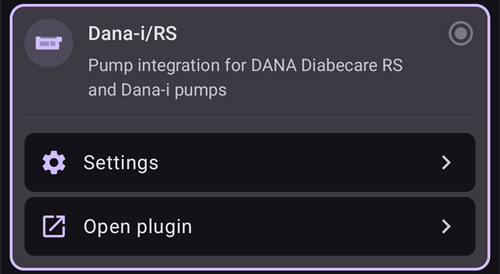

# DanaRS, Dana-i ו-Dana-i2

*הוראות אלה נועדו להגדרת האפליקציה והמשאבה אם יש לכם DanaRS משנת 2017 ואילך, Dana-i או Dana-i2. Visit [DanaR Insulin Pump](./DanaR-Insulin-Pump.md) if you have the original DanaR instead.*

**ניתן להשתמש ב-Dana-i2 החל מגרסה 4.0 של AAPS.** היא משתמשת באותו מנהל התקן **Dana-i / RS** כמו Dana-i.

* במשאבת DanaRS/i/i2 האפליקציה משתמשת ב-"BASAL A". נתונים קיימים נמחקים ונכתבים מחדש.

    {contents} תוכן העניינים
    :depth: 1
    :local: true

## Pump capabilities with AAPS

* מתקשרת עם **AAPS** דרך ה-Bluetooth המובנה של הטלפון, בלי התקן תקשורת נוסף.
* יש לטפל ידנית בשינויים של שעון הקיץ ושל אזור הזמן (ראו [נסיעות בין אזורי זמן](#timezone-traveling-danarv2-danars)).

(DanaRS-Insulin-Pump-pairing-pump)=

## Pairing pump

* יש לפתוח את **התפריט** (☰) בחלק העליון של המסך הראשי של **AAPS** ולבחור **הגדרות תצורה**.
* יש ללחוץ על **משאבה** ולבחור **Dana-i / RS**.
    
    
    
    לאחר הבחירה, בכרטיס **Dana-i / RS** מופיעים שני לחצנים, **הגדרות** ו-**פתיחת תוסף**:
    
    
    
    **הגדרות** פותח את ההגדרות של מנהל ההתקן Dana-i/RS:
    
    
    
    **פתיחת תוסף** (או **ניהול** > **משאבה**) פותח את מסך המשאבה של Dana-i/RS. לפני צימוד משאבה, המסך נראה כך:
    
    

* במסך המשאבה, יש ללחוץ על **צימוד**. **AAPS** סורק ומחפש משאבות קרובות.

* יש ללחוץ על השורה של המשאבה שלכם ברשימה.
    
    

* **יש לאשר את הצימוד במשאבה!** זה עובד כמו צימודי Bluetooth אחרים שאולי מוכרים לכם (למשל, טלפון חכם ומערכת השמע ברכב).
    
    

* Follow the pairing process based on the type and firmware of your pump:
    
    * ב-DanaRS v1, **AAPS** מבקש את **סיסמת משאבה (v1 בלבד)**. יש להזין את סיסמת המשאבה (ראו [סיסמת ברירת מחדל](#DanaRS-Insulin-Pump-default-password)).
    * ב-DanaRS v3, **AAPS** מבקש ללחוץ על OK במשאבה ולהקליד את 2 רצפי המספרים והאותיות שמוצגים במשאבה. כדי שמסך המשאבה יישאר דולק עד הסוף, יש ללחוץ על לחצן המינוס. לאחר מכן יש ללחוץ על **בוצע**.
    * ב-Dana-i וב-Dana-i2 מופיע חלון הצימוד הרגיל של Android. יש להזין את המספר בן 6 הספרות שמוצג במשאבה.

* כשמופיע **ההתאמה בוצעה בהצלחה!**, יש ללחוץ על **בוצע**.
    
    
    
    חוזרים למסך המשאבה, שמציג כעת את מצב המשאבה.
    
    

* ב-**הגדרות**, יש לבחור **מהירות הזרקת הבולוס** כדי לשנות את מהירות הבולוס שמוגדרת כברירת מחדל (12 s/U, 30 s/U או 60 s/U).

* יש להגדיר במשאבה את צעד הבזאלי ל-0.01 U/h באמצעות תפריט הרופאים (ראו את מדריך המשתמש של המשאבה).
* יש להגדיר במשאבה את צעד הבולוס ל-0.05 U באמצעות תפריט הרופאים (ראו את מדריך המשתמש של המשאבה). **AAPS** קורא את צעדי הבזאלי והבולוס מהמשאבה ומשתמש בהם בכל בולוס, כך שהבולוס תמיד מתאים לצעד שמוגדר במשאבה. מסך המשאבה מציג אותם בשורה **צעד בזאלי/בולוס**.
* הפעלת בולוסים ממושכים במשאבה

### אפשרויות שמוצגות רק בחלק מהדגמים

* **נעילה אוטומטית**: ב-Dana-i2, במסך **אפשרויות משתמש** (במסך המשאבה, **ניהול** > **משאבה**) יש מתג **נעילה אוטומטית** להגדרת הנעילה האוטומטית של המשאבה. לאחר השינוי יש ללחוץ על **שמירת הגדרות במשאבה**.
* **מצב Easy**: בדגמי משאבה שיש להם מצב תפריט קל (easy), מסך המשאבה מציג שורה **מצב Easy** עם **מופעל** או **כבוי**.
* אם Dana-i2 מסרבת לתת בולוס, **AAPS** מציג את הסיבה, למשל *המשאבה לא תוחלה*, *אין מספיק אינסולין במכל* או *מצב Easy sleep מופעל במשאבה*.

(DanaRS-Insulin-Pump-default-password)=

### Default password

* For DanaRS with firmware v1 and v2 the default password is 1234.
* For DanaRS with firmware v3 or Dana-i the default password is derived from the manufacturing date and calculates as MMDD where MM is the month and DD is the day, the pump was produced (i.e. '0124' representing month 01 and day 24).
    
    * From MAIN MENU select REVIEW then open SHIPPING INFORMATION from the sub menu
    * מספר 3 הוא תאריך הייצור. 
    * For v3/i this password is used only for locking menu on pump. It's not used for communication and it's not necessary to enter it in AAPS.

(DanaRS-Insulin-Pump-change-password-on-pump)=

## Change password on pump

* Press OK button on pump
* In main menu select "OPTION" (move right by pressing arrow button several times)
    
    

* In options menu select "USER OPTION"
    
    

* Use arrow button to scroll down to "11. password"
    
    

* Press OK to enter old password.

* Enter **old password** (Default password see [above](#DanaRS-Insulin-Pump-default-password)) and press OK
    
    

* If wrong password is entered here there will be no message indicating failure!

* Set **new password** (Change numbers with + & - buttons / Move right with arrow button).
    
    

* Confirm with OK button.

* Press OK to save setting.
    
    

* Move down to "14. EXIT" and press OK to exit.
    
    

(DanaRS-Insulin-Pump-dana-rs-specific-errors)=

## Dana RS specific errors

### Error during insulin delivery

In case the connection between AAPS and Dana RS is lost during bolus insulin delivery (i.e. you walk away from phone while Dana RS is pumping insulin) you will see the following message and hear an alarm sound.

* In most cases this is just a communication issue and the correct amount of insulin is delivered.
* יש לבדוק בהיסטוריית המשאבה שניתן הבולוס הנכון. ניתן לעשות זאת במשאבה עצמה, או ב-**AAPS** במסך המשאבה (**ניהול** > **משאבה**) > **היסטוריית המשאבה** > **בולוסים**.
* אם רוצים, ניתן למחוק את רשומת השגיאה ב[טיפולים](#screens-bolus-carbs).
* הכמות האמיתית נקראת ונרשמת בחיבור הבא. כדי לכפות זאת, יש ללחוץ על **רענן** במסך המשאבה, או פשוט לחכות לחיבור הבא.

## Special note when switching phone

When switching to a new phone the following steps are necessary:

* [Export settings](../Maintenance/ExportImportSettings.md) on your old phone
* Transfer settings from old to new phone

### DanaRS v1

* **Manually pair** Dana RS with the new phone
* אם מסמנים את **גם החלף את הגדרות המשאבה** בזמן הייבוא, גם הגדרות החיבור למשאבה מיובאות, ו-AAPS בטלפון החדש כבר "מכיר" את המשאבה ולכן אינו מתחיל סריקת Bluetooth. Therefore new phone and pump must be paired manually.
* Install AAPS on the new phone.
* [Import settings](../Maintenance/ExportImportSettings.md) on your new phone

### DanaRS v3, Dana-i, Dana-i2

* Start pairing procedure as described [above](#DanaRS-Insulin-Pump-pairing-pump).
* לפעמים צריך קודם למחוק את נתוני הצימוד ב-**AAPS**. במסך המשאבה (**ניהול** > **משאבה**), יש ללחוץ על **ביטול צימוד** ולאשר את **לאפס את נתוני הצימוד?**. לאחר מכן יש ללחוץ שוב על **צימוד**.

## נסיעות בין אזורי זמן עם משאבות DanaRS, Dana-i ו-Dana-i2

For information on traveling across time zones see section [Timezone traveling with pumps](#timezone-traveling-danarv2-danars).

## Where to get help

הפיתוח של מנהל ההתקן של DanaRS/Dana-i/Dana-i2 נעשה על ידי הקהילה על בסיס **התנדבותי**. לפני שמבקשים עזרה, יש:

1. **לקרוא** את החלק הרלוונטי בתיעוד הזה, כדי לוודא איך התכונה אמורה לעבוד.
2. **לשאול** בערוץ *#AAPS* ב-[Discord](https://discord.gg/4fQUWHZ4Mw), או באחד מ[ערוצי הקהילה](../GettingHelp/WhereCanIGetHelp.md) האחרים.
3. **לדווח על באג**: לחפש ב[issues הקיימים](https://github.com/nightscout/AndroidAPS/issues); אם הבעיה לא מופיעה שם, לפתוח [issue חדש](https://github.com/nightscout/AndroidAPS/issues) ולצרף את [קובצי היומן](../GettingHelp/AccessingLogFiles.md).

כשמבקשים עזרה, יש לציין את היצרן והדגם של הטלפון, את גרסת Android, את גרסת **AAPS** ותיאור פשוט של הבעיה באנגלית (מה השתנה, ומתי זה עבד בפעם האחרונה).