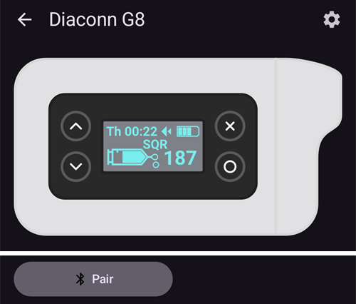
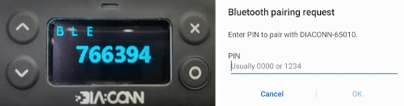

# Diaconn G8

```{contents} Table of contents
:depth: 1
:local: true
```

## Pump capabilities with AAPS

* מתקשרת עם **AAPS** דרך ה-Bluetooth המובנה של הטלפון, ללא מכשיר תקשורת נוסף.
* את המעבר לשעון קיץ/חורף ואת שינויי אזור הזמן יש לבצע ידנית.

## Insulin Pump Bluetooth Pairing

- יש להקיש על **התפריט** (☰) בפינה העליונה של המסך.


- יש להקיש על **הגדרות תצורה** > **משאבה** ולבחור **Diaconn G8**.


לאחר הבחירה, בכרטיס **Diaconn G8** מופיעים שני לחצנים, **הגדרות** ו**פתיחת תוסף**:


**הגדרות** פותח את ההגדרות של מנהל ההתקן Diaconn G8 (ראו [הגדרת אפשרויות משאבת האינסולין Diaconn G8](#diaconn-g8-insulin-pump-option-setting) בהמשך).

**פתיחת תוסף** (או **ניהול** > **משאבה**) פותח את מסך המשאבה Diaconn G8. לפני צימוד משאבה, המסך נראה כך:




```{admonition} Older screenshot
:class: note
צילום המסך למעלה הוא מגרסה קודמת של **AAPS**. ב-**AAPS** 4 הצימוד מתחיל מהלחצן **צימוד** במסך המשאבה; אין הגדרה **משאבה נבחרת**.
```

- במסך המשאבה, יש להקיש על **צימוד**. המסך **צימוד משאבת Diaconn** נפתח, ו-**AAPS** מחפש משאבות בקרבת מקום.
- יש להקיש על מספר הדגם של משאבת האינסולין כשהוא מופיע ברשימה (לדוגמה **DIACONN-65010**).


- There are two options to check your model number:

1. The last 5 digits of the SN number on the back of the pump.
2. Click on O button > Information > BLE > Last 5 digits.


- לאחר בחירת המשאבה, נפתח חלון שמבקש קוד PIN. יש להזין את מספר ה-PIN שמוצג על המשאבה כדי להשלים את החיבור.

 

- כשמופיע **הצימוד בוצע בהצלחה!**, יש להקיש על **אישור** כדי לחזור למסך המשאבה.

## Pump status check and log synchronization

- לאחר שהמשאבה מחוברת, יש לפתוח את מסך המשאבה (**ניהול** > **משאבה**). המסך מציג את מצב המשאבה (סוללה, מכל, התחברות אחרונה, בולוס אחרון, קצב בזאלי ועוד).
- יש להקיש על **רענן** כדי להתחבר למשאבה, לעדכן את המצב ולסנכרן את היומנים.
- יש להקיש על **היסטוריית המשאבה** כדי לראות את ההיסטוריה שנקראה מהמשאבה.


```{admonition} Older screenshot
:class: note
צילום המסך למעלה הוא מגרסה קודמת של **AAPS**. ב-**AAPS** 4 מצב המשאבה מוצג במסך המשאבה (**ניהול** > **משאבה**) ומסונכרן בעזרת הלחצן **רענן**.
```

(diaconn-g8-bluetooth-troubleshooting)=

## פתרון תקלות Bluetooth

**What to do in the case of an unstable Bluetooth connection with the pump.**

### שיטה 1) להפעיל מחדש את AAPS ואז לבדוק שוב את המשאבה

- יש להקיש על **התפריט** (☰) בפינה העליונה של המסך.
- יש להקיש על **יציאה** בתחתית התפריט.


- יש להפעיל שוב את **AAPS** ולבדוק את החיבור למשאבה.

### שיטה 2) אם השיטה הראשונה לא עוזרת, לנתק את ה-Bluetooth ולחבר אותו מחדש.

- Press and hold the Bluetooth button at the top for about 3 seconds.


- Click on the Setting button on the paired Diaconn G8 Insulin pump.


- Unpair.


- ב-**AAPS**, יש לפתוח את מסך המשאבה (**ניהול** > **משאבה**), להקיש על **ביטול צימוד** ולאשר **לאפס את נתוני הצימוד?**.
- Repeat the Bluetooth pairing process for the pump (see above).

## Further Information

(diaconn-g8-insulin-pump-option-setting)=

### Diaconn G8 Insulin pump option setting

- **הגדרות תצורה** > **משאבה** > **Diaconn G8** > **הגדרות**
- או, במסך המשאבה (**ניהול** > **משאבה**), להקיש על סמל ההגדרות (גלגל שיניים) בפינה העליונה של המסך.


- **מהירות הזרקת הבולוס** קובעת באיזו מהירות המשאבה נותנת בולוס.
- אם האפשרות **רישום החלפת מכל** מופעלת, הפרטים הרלוונטיים מועלים אוטומטית לפורטל הטיפולים כשמתרחש אירוע "החלפת אינסולין".
- אם האפשרות **רישום החלפת מחט** מופעלת, הפרטים הרלוונטיים מועלים אוטומטית לפורטל הטיפולים כשמתרחש אירוע "החלפת אתר עירוי" (Site Change).
- אם האפשרות **רישום החלפת צינורית** מופעלת, הפרטים הרלוונטיים נוספים אוטומטית כהערה כשמתרחש אירוע "החלפת צינורית".
- אם האפשרות **רישום החלפת סוללה** מופעלת, הפרטים הרלוונטיים מועלים אוטומטית לפורטל הטיפולים כשמתרחש אירוע "החלפת סוללה". אפשר גם לרשום החלפת סוללה ידנית דרך **ניהול** > **החלפת סוללת משאבה**. (Note: To change the battery, please stop all in-progress injection functions before proceeding.)
- **סנכרון Diaconn Cloud** שולח את יומני המשאבה אל Diaconn Cloud.


```{admonition} Older screenshot
:class: note
צילום המסך למעלה הוא מגרסה קודמת של **AAPS**. ב-**AAPS** 4 החלפת סוללה נרשמת דרך **ניהול** > **החלפת סוללת משאבה**; אין לשונית **פעולות**.
```

### תכונת בולוס ממושך

- שימוש בבולוס ממושך משבית את הלולאה הסגורה.
- ראו [דף זה](#extended-bolus-and-why-they-wont-work-in-closed-loop-environment) לפרטים על הסיבה שבולוס ממושך אינו פועל בלולאה סגורה.

## Where to get help

הפיתוח של מנהל ההתקן Diaconn G8 נעשה על ידי הקהילה על בסיס **התנדבותי**. לפני שמבקשים עזרה, יש:

1. **לקרוא** את החלק הרלוונטי בתיעוד הזה כדי לוודא איך התכונה אמורה לעבוד.
2. **לשאול** בערוץ *#AAPS* ב-[Discord](https://discord.gg/4fQUWHZ4Mw), או באחד [מערוצי הקהילה](../GettingHelp/WhereCanIGetHelp.md) האחרים.
3. **לדווח על באג**: לחפש ב[דיווחים הקיימים](https://github.com/nightscout/AndroidAPS/issues); אם הבעיה לא מופיעה, לפתוח [דיווח חדש](https://github.com/nightscout/AndroidAPS/issues) ולצרף את [קובצי היומן](../GettingHelp/AccessingLogFiles.md).

בבקשת עזרה, יש לציין את יצרן ודגם הטלפון, גרסת Android, גרסת **AAPS** ותיאור פשוט של הבעיה (מה השתנה, מתי זה עבד בפעם האחרונה).
