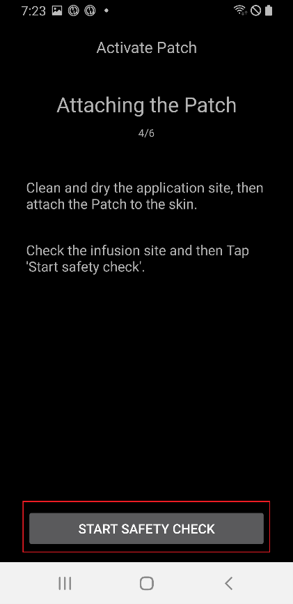
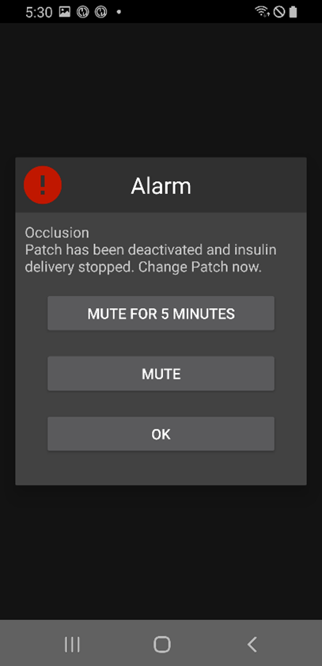

# EOPatch2

הפאץ' צריך אינסולין מהיר פעולה U-100, למשל NovoRapid או Humalog. יש להשתמש באינסולין המהיר שהרופא רשם לכם.

המנה הקטנה ביותר שהפאץ' יכול לתת היא 0.05 U. יש להגדיר כל קצב בזאלי ב**פרופיל** ל-0.05 U/hr לפחות, בצעדים של 0.05 U/hr. אחרת **AAPS** מעגל כל קצב ל-0.05 U/hr הקרוב ביותר (אף פעם לא כלפי מטה עד 0) ומשתמש בקצבים שהפאץ' נותן בפועל, ולכן סך האינסולין ליום שונה מעט מה**פרופיל**. באותו אופן, בולוס חייב להיות 0.05 U לפחות.

```{contents} Table of contents
:depth: 1
:local: true
```

## Pump capabilities with AAPS

* מתקשרת עם **AAPS** דרך ה-Bluetooth המובנה של הטלפון, ללא מכשיר תקשורת נוסף.
* את המעבר לשעון קיץ/חורף ואת שינויי אזור הזמן יש לבצע ידנית.

## הגדרת משאבה

1. יש לפתוח את **התפריט** (☰) בפינה העליונה של המסך הראשי של **AAPS** ולבחור **הגדרות תצורה**.
1. בחלק **משאבה**, לבחור **EOPatch2**.
1. ללחוץ על מקש החזרה כדי לחזור למסך הראשי.

 

לאחר הבחירה, בכרטיס **EOPatch2** מופיעים שני לחצנים, **הגדרות** ו**פתיחת תוסף**:


## הגדרות

אפשר לפתוח את הגדרות EOPatch2 באחת משתי דרכים:

* ללחוץ על **הגדרות** בכרטיס **EOPatch2** ב**הגדרות תצורה**, או
* לפתוח את מסך המשאבה (**ניהול** ← **משאבה**) וללחוץ על סמל גלגל השיניים בפינה העליונה של המסך.

יש שלוש הגדרות:


### Low reservoir Alerts

אזהרה מופיעה כשכמות האינסולין שנשארה בפאץ' יורדת לכמות זו או פחות. אפשר להגדיר מ-10 עד 50 U, בצעדים של 5 U. ברירת המחדל היא 10 U.

### Patch expiration Reminder

תזכורת כמה זמן נשאר עד שתוקף הפאץ' הנוכחי יפוג. אפשר להגדיר משעה אחת עד 24 שעות, בצעדים של שעה אחת. ברירת המחדל היא 4 שעות.

### תזכורות צפצוף של הפאץ'

כשהאפשרות מופעלת, הפאץ' מצפצף כשבולוס, בולוס ממושך או בזאלי זמני מתחילים וכשהם מסתיימים. אין לה השפעה על הבזאלי הרגיל. ברירת המחדל: כבוי.

## הפעלת פאץ' חדש

### פתיחת אשף ההפעלה

יש לפתוח את מסך המשאבה דרך **ניהול** ← **משאבה** (או ללחוץ על **פתיחת תוסף** בכרטיס **EOPatch2** ב**הגדרות תצורה**). כשאין פאץ' פעיל, המסך מציג **לא הופעל** ולחצן **הפעלת פאץ'** בתחתית.

יש ללחוץ על **הפעלת פאץ'** כדי להתחיל את האשף.


האשף מדריך אתכם בכל שלב. שורת הנקודות בחלק העליון מראה כמה התקדמתם.

```{note}
אם מעולם לא הפעלתם **פרופיל** ב-**AAPS**, האשף מציג קודם את הדף **נדרש פרופיל**. יש לבחור את הפרופיל לשימוש וללחוץ על **הפעלת פרופיל**.
```

### מילוי אינסולין

יש להכניס את מחט המזרק לפתח מילוי האינסולין בפאץ'. ללחוץ לאט על הבוכנה כדי למלא את הפאץ'. כשיש בפאץ' יותר מ-80 U, הוא מצפצף פעם אחת ומתחיל לפעול (boot).

כשנשמע הצפצוף, יש ללחוץ על **התחלת צימוד**.


```{warning}
- אין לסובב את מנוף החדרת המחט עד שהאשף מורה לעשות זאת. סיבוב מוקדם מדי עלול לגרום לבעיות חמורות במהלך המילוי או בדיקת הבטיחות.
- הפאץ' מכיל 80 עד 200 U. אם מכניסים פחות מ-80 U, הפאץ' לא יפעל.
- יש להוציא את האינסולין מהמקרר 15 עד 30 דקות לפני המילוי, כדי שיגיע לטמפרטורת החדר. טמפרטורת האינסולין חייבת להיות 10°C לפחות.
```

### צימוד הפאץ'

**AAPS** מנסה כעת לבצע צימוד עם הפאץ' באופן אוטומטי. במהלך הצימוד מופיעות שתי בקשות צימוד Bluetooth של Android. יש ללחוץ על **אישור** בראשונה. יש ללחוץ שוב על **אישור** בשנייה, שמציגה מפתח גישה (passkey).

```{warning}
- במהלך הצימוד יש להחזיק את הפאץ' והטלפון במרחק של עד 30 ס"מ זה מזה.
- אחרי שהפאץ' מתחיל לפעול, הוא מצפצף כל 3 דקות עד שהצימוד מסתיים.
- יש לסיים את הפעלת הפאץ' תוך 60 דקות מרגע שהתחיל לפעול. אם זה לא אפשרי, יש להשליך את הפאץ'.
```

  

```{admonition} Older screenshot
:class: note
שני צילומי המסך של צימוד ה-Bluetooth הם מגרסה קודמת של **AAPS**: מסך **AAPS** שמאחורי בקשת הצימוד של Android נראה אחרת ב-**AAPS** 4.
```

### בחירת אינסולין

יש לבחור את האינסולין שבו מילאתם את הפאץ' וללחוץ על **הבא**. **AAPS** מבצע החלפת פרופיל עם אינסולין זה לאחר ההפעלה.

### הכנה לחיבור הפאץ'

יש להסיר את סרט ההדבקה מהפאץ' ואז ללחוץ על **הבא**.

אם מחט בולטת, או אם הפאץ' רטוב, מלוכלך או שסרט ההדבקה שלו מקופל, יש ללחוץ במקום זאת על **השלכה** ולהשתמש בפאץ' חדש.


### מיקום האתר

שלב זה מופיע רק אם **ניהול סבב אתרי משאבה** מופעל בהגדרות סבב האתרים. יש להקיש על המקום בתרשים הגוף שבו תדביקו את הפאץ' וללחוץ על **הבא**, או ללחוץ על **דילוג**.

### הדבקת הפאץ'

האינסולין צריך להיכנס למקום עם רקמת שומן מתחת לעור, אבל עם מעט עצבים וכלי דם. הבטן, הזרוע או הירך הם מקומות טובים. יש לנקות ולייבש את המקום, ואז להדביק את הפאץ' לעור.

יש לבדוק את אתר העירוי, ואז ללחוץ על **התחלת בדיקת בטיחות**.

```{warning}
- יש ללחוץ באופן שווה על שולי סרט ההדבקה, כדי שכל הפאץ' יידבק היטב לעור.
- אם הפאץ' לא נדבק לגמרי, אוויר יכול להיכנס בין הפאץ' לעור. זה מחליש את ההדבקה ואת העמידות של הפאץ' למים.
```


### בדיקת בטיחות

בדיקת הבטיחות נמשכת כ-30 שניות. בסיום, הפאץ' מצפצף פעם אחת. אם היא נכשלת, יש ללחוץ על **ניסיון חוזר**.

```{warning}
לשימוש בטוח, אין לסובב את מנוף החדרת המחט עד שבדיקת הבטיחות הסתיימה.
```

 

```{admonition} Older screenshot
:class: note
צילומי המסך מ-**הכנה לחיבור הפאץ'** עד **בדיקת בטיחות** הם מגרסה קודמת של **AAPS**, וייתכן שייראו אחרת ב-**AAPS** 4.
```

### Inserting the needle

יש להחזיק את הפאץ' היטב. יש לסובב את מנוף החדרת המחט כלפי מעלה ביותר מ-100° כדי להחדיר את המחט. הפאץ' מצפצף פעם אחת כשהמחט מוחדרת כראוי. אחר כך יש להמשיך לסובב את המנוף עד הסוף כדי להסיר אותו. יש ללחוץ על **הבא**.

```{caution}
אם עוברים לשלב הבא בלי לשמוע את הצפצוף, מופיעה **שגיאה בהחדרת המחט**. יש לוודא שנשמע הצפצוף וללחוץ על **ניסיון חוזר**. אם השגיאה נשארת, יש ללחוץ על **השלכה** כדי להשבית את הפאץ'.
```

### הפעלת הפאץ' הושלמה

הדף האחרון מאשר שהפאץ' פעיל ושהוא יזכיר לכם כשיתקרב מועד התפוגה שלו. יש ללחוץ על **סיום** כדי לחזור למסך המשאבה.

## השלכת הפאץ'

יש להחליף את הפאץ' כשנשאר בו מעט אינסולין, כשתוקפו פג או אם הוא תקול. אנו ממליצים להשתמש בכל פאץ' לא יותר מ-84 שעות מרגע שהתחיל לפעול.

1. יש לפתוח את מסך המשאבה (**ניהול** ← **משאבה**). כשפאץ' פעיל, יש ללחוץ על **השלכת הפאץ'**.
1. הדף **השלכת הפאץ'** מציג את הזמן שנותר ואת כמות האינסולין שנשארה בפאץ'. יש ללחוץ על **השלכת הפאץ'**.
1. חלון מבקש אישור. יש ללחוץ שוב על **השלכת הפאץ'**.
1. אחרי שהפאץ' הושבת, האשף מציג **השלכת הפאץ' הושלמה בהצלחה.** יש להסיר את הפאץ' מהגוף וללחוץ על **אישור**.

לאחר מכן האשף ממשיך ישירות להפעלת פאץ' חדש (ראו לעיל). כדי לעצור כאן, יש ללחוץ על חץ החזרה.

כשאין פאץ' פעיל, **AAPS** מציג את המשאבה כמושהית ורושם בזאלי זמני של 0 U/hr, כך שאינסולין בזאלי לא נספר ב-IOB עד שמופעל הפאץ' הבא.

   

```{admonition} Older screenshot
:class: note
צילומי המסך למעלה הם מגרסה קודמת של **AAPS**. ב-**AAPS** 4 פותחים את מסך המשאבה דרך **ניהול** ← **משאבה**, והלחצן בו נקרא **השלכת הפאץ'**.
```

```{admonition} If the patch does not respond
:class: warning
אם **AAPS** לא מצליח להתחבר לפאץ', ייתכן שיוצג דף על כיבוי ידני של ההתראה של הפאץ': יש להסיר את הפאץ' מהגוף, לקלף את סרט ההדבקה, ולהשתמש במהדק נייר כדי ללחוץ בחוזקה לתוך החור שליד פתח מילוי האינסולין.

בדף **השלכת הפאץ'** יש גם לחצן **איפוס כפוי**. הוא רק מוחק את הפאץ' מ-**AAPS**, בלי לשלוח שום פקודה לפאץ'. הפאץ' ממשיך לתת אינסולין עד שהסוללה שלו נגמרת או עד שמכבים אותו ידנית. יש להשתמש בו רק אם השלכה רגילה נכשלת, ולהסיר את הפאץ' מהגוף.
```

## השהיה וחידוש של מתן אינסולין

השהיית מתן האינסולין מבטלת גם בולוס ממושך ובזאלי זמני פעילים. בחידוש, הם **לא** מתחילים מחדש. כל עוד מתן האינסולין מושהה, הפאץ' מצפצף כל 15 דקות.

### Suspending insulin delivery

1. יש לפתוח את מסך המשאבה (**ניהול** ← **משאבה**) וללחוץ על **השהיית המשאבה**.
1. חלון מסביר מה יושהה. יש ללחוץ על **אישור**.
1. בחלון **זמן השעיית הבאזלי**, יש לבחור לכמה זמן להשהות: 30 דקות, שעה, שעה וחצי או שעתיים. יש ללחוץ על **אישור**.

מתן האינסולין מושהה לזמן שבחרתם.

  

```{admonition} Older screenshot
:class: note
צילומי המסך למעלה הם מגרסה קודמת של **AAPS**. ב-**AAPS** 4 פותחים את מסך המשאבה דרך **ניהול** ← **משאבה**, והלחצן בו נקרא **השהיית המשאבה**.
```

### Resuming insulin delivery

1. יש לפתוח את מסך המשאבה (**ניהול** ← **משאבה**) וללחוץ על **חידוש פעולת המשאבה**.
1. בחלון **חידוש הזרקת האינסולין**, יש ללחוץ על **אישור**.

 

```{admonition} Older screenshot
:class: note
צילומי המסך למעלה הם מגרסה קודמת של **AAPS**. ב-**AAPS** 4 פותחים את מסך המשאבה דרך **ניהול** ← **משאבה**, והלחצן בו נקרא **חידוש פעולת המשאבה**.
```

```{warning}
כשזמן ההשהיה מסתיים, **AAPS** מציג את האזהרה **השהיית האינסולין הסתיימה**. מתן האינסולין **לא** מתחדש עד שמאשרים אותו. אם לא מאשרים, רמת הסוכר עלולה לעלות ולגרום להיפרגליקמיה.
```

(eopatch2-alarms-and-warnings)=

## התראות ואזהרות

### Alarms

התראות (Alarms) מיועדות למצבים דחופים בעדיפות עליונה, ודורשות פעולה מיידית. **AAPS** משמיע התראה שממשיכה עד שמאשרים אותה, ומציג את ההודעה כהתראה ב**מסך הסקירה**. התראה פירושה שיש בעיה בפאץ' שבשימוש. במקרים רבים יש להשליך את הפאץ' ולהחליף אותו בפאץ' חדש.

כשלוחצים על **אישור** בהתראה, **AAPS** מטפל בהתראה. ברוב ההתראות, פעולה זו משביתה את הפאץ'. בהתראה **טמפרטורה לא מתאימה**, הלחצן הוא **ניסיון חוזר**.

 

```{admonition} Older screenshot
:class: note
צילומי המסך של ההתראות הם מגרסה קודמת של **AAPS**, וייתכן שייראו אחרת ב-**AAPS** 4.
```

ההתראות השונות מוסברות בהמשך.

| Alarm                          | Explanation                                                                                                                   |
| ------------------------------ | ----------------------------------------------------------------------------------------------------------------------------- |
| המכל ריק                       | נגמר האינסולין בפאץ'.                                                                                                         |
| תוקף הפאץ' פג                  | זמן השימוש של הפאץ' הסתיים, והוא לא יכול לתת עוד אינסולין.                                                                    |
| Occlusion                      | נראה שמסלול האינסולין של הפאץ' חסום.                                                                                          |
| הבדיקה העצמית בעת ההפעלה נכשלה | הפאץ' מצא שגיאה לא צפויה בבדיקה העצמית אחרי שהתחיל לפעול.                                                                     |
| Inappropriate temperature      | הפאץ' נמצא מחוץ לטמפרטורת הפעולה הרגילה שלו בזמן ההפעלה או השימוש. יש להעביר את הפאץ' למקום עם טמפרטורה מתאימה (4.4 עד 37°C). |
| Needle insertion Error         | המחט לא הוחדרה כראוי במהלך ההפעלה. יש לוודא ששפת החדרת המחט של הפאץ' ומנוף החדרת המחט נמצאים בקו ישר.                         |
| שגיאה בסוללת הפאץ'             | הסוללה הפנימית של הפאץ' עומדת להיגמר, והפאץ' ייכבה.                                                                           |
| שגיאה בהפעלת הפאץ'             | הפאץ' לא הופעל במלואו תוך 60 דקות מרגע שהתחיל לפעול.                                                                          |
| שגיאה בפאץ'                    | הפאץ' מצא שגיאה לא צפויה במהלך ההפעלה או השימוש.                                                                              |

### Warnings

אזהרות מיועדות למצבים בעדיפות בינונית או נמוכה. אזהרה מופיעה כהתראה ב**מסך הסקירה**.


```{admonition} Older screenshot
:class: note
צילום מסך זה הוא מגרסה קודמת של **AAPS**: ב-**AAPS** 4 האזהרה מופיעה במסך הראשי, שנראה אחרת.
```

האזהרות השונות מוסברות בהמשך.

| Warning                    | Explanation                                                                                    |
| -------------------------- | ---------------------------------------------------------------------------------------------- |
| השהיית האינסולין הסתיימה   | זמן ההשהיה שבחרתם הסתיים. יש ללחוץ על **חידוש פעולת המשאבה** בהתראה כדי לחדש את מתן האינסולין. |
| מעט אינסולין במכל          | כמות האינסולין שנשארה בפאץ' נמוכה מהכמות שהוגדרה ב**התראות על כמות אינסולין נמוכה**.           |
| משך הפעולה של הפאץ' הסתיים | תקופת השימוש של הפאץ' הסתיימה.                                                                 |
| תוקף הפאץ' יפוג בקרוב      | יש להשליך את הפאץ' תוך שעה.                                                                    |
| הפעלת הפאץ' לא הושלמה      | הפעלת הפאץ' הופסקה ליותר מ-3 דקות אחרי הצימוד. יש לפתוח את מסך המשאבה ולסיים את הפעלת הפאץ'.   |
| סוללת הפאץ' חלשה           | הסוללה של הפאץ' חלשה.                                                                          |

## Where to get help

הפיתוח של מנהל ההתקן EOPatch2 נעשה על ידי הקהילה על בסיס **התנדבותי**. לפני שמבקשים עזרה, יש:

1. **לקרוא** את החלק הרלוונטי בתיעוד הזה כדי לוודא איך התכונה אמורה לעבוד.
2. **לשאול** בערוץ *#AAPS* ב-[Discord](https://discord.gg/4fQUWHZ4Mw), או באחד [מערוצי הקהילה](../GettingHelp/WhereCanIGetHelp.md) האחרים.
3. **לדווח על באג**: לחפש ב[דיווחים הקיימים](https://github.com/nightscout/AndroidAPS/issues); אם הבעיה לא מופיעה, לפתוח [דיווח חדש](https://github.com/nightscout/AndroidAPS/issues) ולצרף את [קובצי היומן](../GettingHelp/AccessingLogFiles.md).

בבקשת עזרה, יש לציין את יצרן ודגם הטלפון, גרסת Android, גרסת **AAPS** ותיאור פשוט של הבעיה (מה השתנה, מתי זה עבד בפעם האחרונה).
