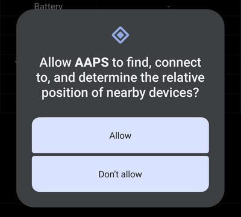
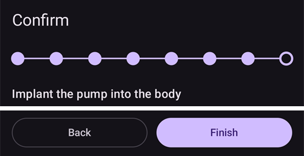

# Equil

These instructions are for configuring the Equil insulin pump.

```{contents} Table of contents
:depth: 1
:local: true
```

## Pump capabilities with AAPS

* משאבת פאץ' ללא צינורית שמתקשרת עם **AAPS** דרך ה-Bluetooth המובנה של הטלפון, ללא מכשיר תקשורת נוסף.
* **AAPS** מתייחס ל-Equil כמשאבת פאץ' עם מכל של 200 U: המסך הראשי מציג את נורות המצב של משאבת פאץ', והאפשרויות **תיחול/מילוי** ו**החלפת סוללת משאבה** לא מוצעות. מילוי, תיחול והחלפת סוללה נעשים באשפי המשאבה.
* כשהמשאבה מושהית או עצורה, **AAPS** רושם בזאלי זמני של 0 U/h, כך שאינסולין בזאלי לא נספר ב-IOB.
* את המעבר לשעון קיץ/חורף ואת שינויי אזור הזמן יש לבצע ידנית.

## Hardware and software requirements
* **Compatible Equil hardware**

  כרגע נתמכות Equil 5.3 ו-5.4.

* **AAPS** שנבנה והותקן לפי ההוראות ב[בניית ה-APK](../SettingUpAaps/BuildingAaps.md)

## תצורה

### Select Equil pump

יש לפתוח את **התפריט** (☰) בפינה העליונה של המסך, לבחור **[הגדרות תצורה](#Config-Builder-pump)**, ותחת **משאבה** לבחור **Equil**.

לאחר הבחירה, בכרטיס **Equil** מופיעים שני לחצנים, **הגדרות** ו**פתיחת תוסף**:


**פתיחת תוסף** (או **ניהול** ← **משאבה**) פותח את מסך המשאבה Equil. לפני צימוד משאבה, המסך נראה כך:


### הגדרות

אפשר לפתוח את הגדרות Equil עם **הגדרות** בכרטיס **Equil**, או עם סמל גלגל השיניים בפינה העליונה של מסך המשאבה.


* **התראת סוללה חלשה**: מזהירה כשסוללת המשאבה חלשה.
* **התראת כמות אינסולין נמוכה**: מזהירה כשכמות האינסולין במכל נמוכה.
* **אופן ההתראה**: איך המשאבה מתריעה: **השתק**, **רטט בלבד**, **צליל בלבד** או **צליל ורטט**.
* **מהירות הזרקת הבולוס**: באיזו מהירות ניתן בולוס: **1.5 יח'/דקה (רגיל)**, **3 יח'/דקה**, **6 יח'/דקה** או **12 יח'/דקה**. בולוס מהיר יותר עלול לגרום ליותר התראות חסימה.


```{admonition} Max basal and max bolus on the patch
:class: note
הפאץ' עצמו דוחה כל קצב בזאלי שגבוה מערך מרבי ש-**AAPS** מתכנת בו. **AAPS** לוקח את הגבוה מבין [ההגדרה](../SettingUpAaps/Preferences.md) **בזאלי מרבי** שלכם והקצב הבזאלי השעתי הגבוה ביותר ב**פרופיל**, כך שהפאץ' תמיד מקבל את הפרופיל ואת הבזאלים הזמניים שהלולאה מבקשת. **AAPS** שולח לפאץ' גם את הבולוס המרבי המותר שלכם.

כשמשנים את **בזאלי מרבי** או **בולוס מרבי**, **AAPS** שולח את הערכים החדשים לפאץ' באופן אוטומטי. הם נשלחים גם בכל החלפת פרופיל. אין צורך להגדיר דבר בפאץ' עצמו.
```

### צימוד המשאבה

במסך המשאבה, יש ללחוץ על **צימוד**. אשף מדריך אתכם בכל שלב. שורת הנקודות בחלק העליון מראה כמה התקדמתם.

אם Android שואל אם **AAPS** רשאי למצוא מכשירים קרובים ולהתחבר אליהם, יש ללחוץ על **Allow** (אישור). **AAPS** צריך הרשאה זו כדי למצוא את המשאבה.



אלה השלבים של האשף. יש ללחוץ על **הבא** כדי להמשיך, או על **ביטול** כדי לצאת מהאשף.

1. **נדרש פרופיל**: מוצג רק אם מעולם לא הפעלתם **פרופיל** ב-**AAPS**. יש לבחור את הפרופיל לשימוש וללחוץ על **הפעלת פרופיל**.
1. **הרכבת המשאבה**: להרכיב יחד את המשאבה, את המכל המלא ואת הסוללה הטעונה.

   

1. **מציאת משאבה**: **AAPS** מחפש משאבות Equil בקרבת מקום. יש לבחור את המשאבה שלכם מהרשימה.

   
1. **צימוד משאבה**: אפשר להזין סיסמת צימוד ב**הגדרת סיסמת צימוד**. היא חייבת להיות באורך 4 תווים, מתוך `ABCDEF0123456789`. יש ללחוץ על **צימוד**.

   

1. **בחירת אינסולין**: מוצג רק אם הוגדר יותר מאינסולין אחד. יש לבחור את האינסולין שבמכל.
1. **תיחול / מילוי**: המשאבה **לא** צריכה להיות על בסיס ההדבקה. יש ללחוץ על **תיחול/מילוי** ולתחל את המכל עד שמופיעה טיפת אינסולין בקצה המחט. יש ללחוץ על **הבא**.

   
1. **סבב אתרי עירוי**: מוצג רק אם **ניהול סבב אתרי משאבה** מופעל בהגדרות סבב האתרים. יש להקיש על המקום שבו תחברו את המשאבה, או ללחוץ על **דילוג**.
1. **חיבור המשאבה**: לחבר את המשאבה לבסיס ההדבקה שלה.

   
1. **תיחול צינורית**: כשהמשאבה על בסיס ההדבקה, יש ללחוץ על **ניקוז אוויר** כדי להוציא אוויר מהצינורית. יש ללחוץ על **הבא**.

   

1. **אישור**: להדביק את המשאבה לגוף וללחוץ על **סיום**.

   

```{warning}
אם הגדרתם סיסמת צימוד משלכם (מומלץ לבטיחותכם), יש לשמור אותה במקום בטוח. הסיסמה נשמרת במשאבה. המשאבה מבקשת אותה בכל צימוד חדש, עד שמבטלים את הצימוד כראוי ב-**AAPS**. עד אז, אי אפשר גם להשתמש במשאבה עם השלט המקורי (PDA).
```

### מסך המשאבה אחרי הצימוד

אחרי שהמשאבה מצומדת, מסך המשאבה מציג את הלחצנים האלה:

* **רענן**: קורא עכשיו את המצב ואת ההיסטוריה של המשאבה.
* **השהיה** / **חידוש מתן אינסולין**: עצירה או חידוש של מתן האינסולין.
* **החלפת מכל**: מדריך אתכם בניתוק המשאבה, בהרכבת מכל חדש (ואם צריך, סוללה חדשה), בתיחול ובחיבור מחדש. השלב הראשון שואל *האם תרכיבו גם סט אינפוזיה חדש (בסיס ופרפרית)?*
  * **כן סט אינפוזיה חדש**: בוחרים את האתר, הצינורית מתוחלת, ו-**AAPS** רושם החלפת אינסולין והחלפת צינורית.
  * **לא, רק מכל או סוללה**: הצינורית לא מתוחלת, ו-**AAPS** רושם רק החלפת אינסולין.

  אחרי החלפת מכל, רמת הסוללה מוצגת כ-**-** עד ש-**AAPS** קורא אותה שוב מהמשאבה.

  

* **היסטוריה**: מציג את האירועים שהמשאבה רשמה.
* **ביטול צימוד המשאבה**: מדריך אתכם בניתוק המשאבה ובביטול הצימוד שלה מ-**AAPS**. פעולה זו עוצרת את מתן האינסולין, מחזירה את בוכנת המשאבה לתחתית ומוחקת את הצימוד.

### Alarms

* התראת האינסולין הנמוך נשמעת פעם אחת בכל רמה (10 U, 5 U ו-2 U) וכשהמכל ריק. התראת הסוללה החלשה נשמעת פעם אחת ב-10% ופעם אחת ב-5%. כל רמה מתריעה פעם אחת בלבד, עד החלפת המכל הבאה.
* התראות ועצירות של המשאבה נרשמות גם כהודעות בטיפולים, בזמן שבו המשאבה רשמה אותן, כך שאפשר לראות אחר כך מתי ולמה המשאבה נעצרה.
* אם המכל מתרוקן במהלך בולוס, **AAPS** רושם רק את האינסולין שניתן עד אז ומציג לכם את שתי הכמויות.

## Where to get help

הפיתוח של מנהל ההתקן Equil נעשה על ידי הקהילה על בסיס **התנדבותי**. לפני שמבקשים עזרה, יש:

1. **לקרוא** את החלק הרלוונטי בתיעוד הזה כדי לוודא איך התכונה אמורה לעבוד.
2. **לשאול** בערוץ *#AAPS* ב-[Discord](https://discord.gg/4fQUWHZ4Mw), או באחד [מערוצי הקהילה](../GettingHelp/WhereCanIGetHelp.md) האחרים.
3. **לדווח על באג**: לחפש ב[דיווחים הקיימים](https://github.com/nightscout/AndroidAPS/issues); אם הבעיה לא מופיעה, לפתוח [דיווח חדש](https://github.com/nightscout/AndroidAPS/issues) ולצרף את [קובצי היומן](../GettingHelp/AccessingLogFiles.md).

בבקשת עזרה, יש לציין את יצרן ודגם הטלפון, גרסת Android, גרסת **AAPS** ותיאור פשוט של הבעיה (מה השתנה, מתי זה עבד בפעם האחרונה).
