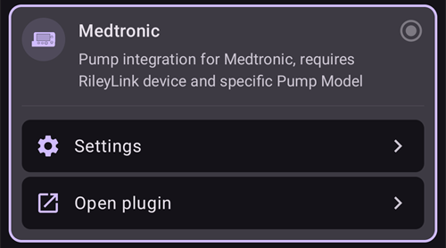
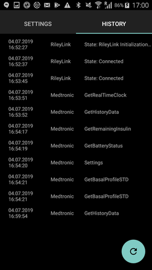

# Medtronic Pumps

The driver does not work with any newer models, including all models ending in G (530G, 600-series [630G, 640G, 670G], 700-series [770G, 780G], etc.).

The following model and firmware combinations are compatible:

- 512/712 (any firmware version)
- 515/715 (any firmware version)
- 522/722 (any firmware version)
- 523/723 (firmware 2.4A or lower)
- 554/754 EU release (firmware 2.6A or lower)
- 554/754 Canada release (firmware 2.7A or lower)

You can find out how to check the firmware on the pumps at [OpenAPS docs](https://openaps.readthedocs.io/en/latest/docs/Gear%20Up/pump.html#how-to-check-pump-firmware-check-for-absence-of-pc-connect) or [LoopDocs](https://loopkit.github.io/loopdocs/build/step3/#medtronic-pump-firmware).

    {contents} תוכן העניינים
    :depth: 1
    :local: true

## Pump capabilities with AAPS

* נדרש התקן תואם RileyLink כדי לתקשר עם **AAPS**.
* טיפול אוטומטי במעבר לשעון קיץ/חורף ובשינויי אזור הזמן.

## Hardware and software requirements

- **Phone:** The Medtronic driver should work with any android phone that supports Bluetooth connections. **IMPORTANT: Phone manufacturers Bluetooth implementations can vary so how each phone model behaves can vary. For example, some phones will handle enabling/disabling Bluetooth differently. הדבר עשוי להשפיע על חוויית השימוש כאשר AAPS צריך להתחבר מחדש להתקן מסוג RileyLink.**
- **RileyLink Compatible Device:** Android phones cannot communicate to Medtronic pumps without a separate device to handle communications. This device will link with your phone via Bluetooth and with your pump via a compatible radio connection. The first such device was called a Rileylink but a number of other options are now available which can offer additional functionality.
    
    - Rileylink available at [getrileylink.org](https://getrileylink.org/product/rileylink916)
    - Orangelink available at [getrileylink.org](https://getrileylink.org/product/orangelink)
    - Emalink (multiple model options) available at [github.com](https://github.com/sks01/EmaLink)
    - Gnarl (נדרשת מעט עבודה נוספת בשיטת עשו זאת בעצמכם), פרטים זמינים ב-[github.com](https://github.com/ecc1/gnarl)

A comparison chart for the various Rileylink compatible devices can be found at [getrileylink.org](https://getrileylink.org/rileylink-compatible-hardware-comparison-chart)

(MedtronicPump-configuration-of-the-pump)=

## Configuration of the pump

יש להגדיר במשאבה את ההגדרות הבאות כדי ש-AAPS יוכל לשלוח פקודות מרחוק. The steps necessary to make each change on a Medtronic 715 are shown in brackets for each setting. The exact steps may vary based on pump type and/or firmware version.

- **Enable remote mode on Pump** (On the pump press Act and go to Utilities -> Remote Options, Select On, and on next screen do Add ID and add any random id such as 111111). At least one ID must be on the Remote ID list in order for the pump to expect remote communication.
- **הגדרת בזאלי מרבי (Max Basal)** (במשאבה לחצו על Act, עברו אל Basal ובחרו Max Basal Rate). לדוגמה, אם מגדירים ערך זה לפי ארבעה מהקצב הבזאלי הרגיל המרבי, יתאפשר בזאלי זמני של 400%. The maximum value permitted by the pump is 34.9 units per hour.
- **הגדרת בולוס מרבי (Max Bolus)** (במשאבה לחצו על Act, עברו אל Bolus ובחרו Max Bolus). זהו הבולוס הגדול ביותר שהמשאבה תקבל. The maximum value permitted by the pump is 25.
- **Set profile to Standard**. (במשאבה לחצו על Act, עברו אל Basal ובחרו Patterns). המשאבה צריכה פרופיל אחד בלבד, כי AAPS מנהל את הפרופילים השונים בטלפון שלכם. No other patterns are required.
- **Set Temporary Basal Rate type** (On the pump press Act and go to Basal and then Temp Basal Type). Select Absolute (not Percent).

## Medtronic Configuration of Phone/AAPS

- **Do not pair RileyLink compatible device with the Bluetooth menu on your phone.** Pairing via the Bluetooth menu on your phone will stop AAPS from seeing your Rileylink Compatible device when you follow the instructions below.
- Disable automatic screen rotation on your phone. On certain devices automatic screen rotation causes Bluetooth sessions to restart which would cause issues for your Medtronic pump. 
- There are two ways to configure your Medtronic pump in AAPS:

1. באמצעות אשף ההתקנה כחלק מהתקנה חדשה
2. ב**הגדרות תצורה** > **משאבה**, על ידי בחירה ב-**Medtronic**
    
    
    
    לאחר הבחירה, בכרטיס **Medtronic** מופיעים שני לחצנים, **הגדרות** ו**פתיחת תוסף**:
    
    
    
    **הגדרות** פותח את ההגדרות של מנהל ההתקן של Medtronic:
    
    
    
    **פתיחת תוסף** (או **ניהול** > **משאבה**) פותח את מסך המשאבה של Medtronic. לפני צימוד משאבה, המסך נראה כך:
    
    

בעת הגדרת משאבת Medtronic באמצעות אשף ההתקנה, ייתכן שלא תוכלו להשלים את ההגדרה עקב בעיות Bluetooth (למשל, לא ניתן להתחבר בהצלחה למשאבה). אם הדבר קורה, בחרו באפשרות המשאבה הווירטואלית כדי להשלים את ההגדרה ולאפשר המשך פתרון תקלות באמצעות אפשרות 2.

בעת הגדרת AAPS לעבודה עם משאבת Medtronic, יש להגדיר את הפריטים הבאים ב**הגדרות** (ראו את תמונת ההגדרות למעלה):

- **Pump Serial Number**: Displayed on the back of your pump and starts with SN. You should only enter the 6 numbers shown without any alphabetic characters (e.g. 123456).
- **Pump Type**: The model pump you are using (e.g. 522). 
- **Pump Frequency**: There are two options based on where your pump was originally distributed. בדקו את [השאלות הנפוצות](#MedtronicPump-faq) אם אינכם בטוחים איזו אפשרות לבחור: 
    - עבור ארה"ב וקנדה, התדר בשימוש הוא 916 MHz
    - עבור שאר העולם, התדר בשימוש הוא 868 MHz
- **מקסימום בזאלי במשאבה (יח' לשעה)**: ערך זה חייב להתאים להגדרה במשאבה (ראו הגדרת המשאבה לעיל). גם את ההגדרה הזו יש לבחור בזהירות, כי היא קובעת כמה אינסולין AAPS יכול לתת באמצעות הקצב הבזאלי. בפועל, הגדרה זו קובעת את המינון המרבי של הבזאלי הזמני. לדוגמה, אם מגדירים ערך זה לפי ארבעה מהקצב הבזאלי הרגיל המרבי, יתאפשר בזאלי זמני של 400%. The maximum value permitted by the pump is 34.9 units per hour.
- **מקסימום בולוס במשאבה (יח')** (בשעה): ערך זה חייב להתאים להגדרה במשאבה (ראו הגדרת המשאבה לעיל). יש לשקול הגדרה זו בזהירות, כי היא קובעת מהו הבולוס הגדול ביותר ש-AAPS יוכל להגדיר אי פעם.
- **המתנה לפני מתן בולוס (שניות)**: מספר השניות מרגע מתן הוראת הבולוס ועד שהפקודה נשלחת בפועל למשאבה. This period of time allows the user to cancel the bolus in the event a bolus command is sent in error. It is not possible to cancel a bolus that has started via AAPS. The only way to cancel a bolus that has already started is to suspend the pump manually followed by resuming it.
- **קידוד Medtronic**: קובע איפה מתבצע הקידוד של Medtronic (בחומרה או בתוכנה). Selecting Hardware encoding (i.e. carried out by the Rileylink compatible device) is preferred as this results in less data being sent. בחירה בקידוד בתוכנה (כלומר, קידוד ש-AAPS מבצע) עשויה לעזור כאשר יש ניתוקים תכופים. This setting will be ignored if you have firmware version 0.x on Rileylink devices.
- **סוג סוללה (תצוגת חשמל)**: כדי לקבוע נכון את רמת הטעינה שנותרה בסוללה, בחרו את סוג סוללת ה-AAA שבשימוש. כאשר נבחר ערך שאינו תצוגה פשוטה, AAPS יציג את אחוז הטעינה שנותר בסוללה לפי החישוב ואת המתח בוולטים. The following options are available:
    
    - Not selected (Simple view)
    - Alkaline (Extended view)
    - Lithium (Extended view)
    - NiZn (Extended view)
    - NiMH (Extended view)
- **שימוש בסריקה**: מפעיל סריקת Bluetooth לפני ההתחברות להתקנים התואמים ל-RileyLink. This should improve the reliability of your connection to the device.

- **הצג את רמת הסוללה המדווחת על-ידי OrangeLink/EmaLink/DiaLink**: התכונה נתמכת רק בהתקני קישור חדשים יותר, כמו EmaLink או OrangeLink. הערך מוצג כ**סוללת ריילילינק** במסך המשאבה של Medtronic.
- **הגדרת קצב בזאלי ניטרלי**: כברירת מחדל, משאבות Medtronic מצפצפות בתחילת כל שעה כאשר פעיל בזאלי זמני. Enabling this option can help reduce the number of beeps heard by interrupting a temporary basal at the hour change in order to suppress the beep.

(pairing-your-rileylink-compatible-device)=

### צימוד ההתקן התואם ל-RileyLink

את הצימוד של ההתקן התואם ל-RileyLink מבצעים ממסך המשאבה של Medtronic, ולא מתפריט ה-Bluetooth של הטלפון:

- יש לפתוח את מסך המשאבה (**ניהול** > **משאבה**, או **פתיחת תוסף** בכרטיס Medtronic ב**הגדרות תצורה** > **משאבה**).
- יש ללחוץ על **צימוד RileyLink**. **AAPS** סורק את ההתקנים התואמים ל-RileyLink שנמצאים בקרבת מקום.
- יש ללחוץ על ההתקן שלכם ברשימה. כאשר מופיעה ההודעה **צימוד RileyLink הצליח**, יש ללחוץ על **אישור**.

## מסך המשאבה של Medtronic

כדי לפתוח את מסך המשאבה של Medtronic, יש לעבור אל **ניהול** > **משאבה**. מסך המשאבה מציג את מצב המשאבה הנוכחי, וגם כמה פעולות שייחודיות ל-Medtronic (ראו את תמונת מסך המשאבה למעלה).

- **מצב ריילילינק**: המצב הנוכחי של החיבור בין הטלפון להתקן התואם ל-RileyLink. כאן אמור להופיע תמיד "מחובר". Any other status may require user intervention. 
- **סוללת ריילילינק**: רמת הטעינה הנוכחית של סוללת התקן ה-EmaLink או ה-OrangeLink שלכם. מוצג רק אם האפשרות **הצג את רמת הסוללה המדווחת על-ידי OrangeLink/EmaLink/DiaLink** מופעלת בהגדרות Medtronic.
- **סטטוס המשאבה**: המצב הנוכחי של החיבור למשאבה. As the pump will not be constantly connected this will primarily show the sleep icon. יש כמה מצבים אפשריים נוספים, ובהם "מתעורר" כאשר AAPS מנסה לשלוח פקודה, או פקודות משאבה אפשריות אחרות כגון "אחזר זמן המשאבה", "הגדרת בזאלי זמני" וכו'.
- **סוללה**: מציג את מצב הסוללה לפי הערך שנבחר ב**סוג סוללה (תצוגת חשמל)** בהגדרות Medtronic.
- **התחברות אחרונה**: כמה זמן עבר מאז החיבור המוצלח האחרון למשאבה.
- **בולוס אחרון**: כמה זמן עבר מאז הבולוס האחרון שניתן בהצלחה.
- **בזאלי בסיסי**: הקצב הבזאלי הבסיסי שהמשאבה נותנת בשעה זו לפי הפרופיל הפעיל שלכם.
- **בזאלי זמני**: הבזאלי הזמני שניתן כעת. הוא יכול להיות גם 0 יחידות לשעה.
- **מכל**: כמות האינסולין במכל (מתעדכנת לפחות פעם בשעה).
- **שגיאות**: הודעת שגיאה כאשר יש בעיה (מופיעה בעיקר כאשר יש שגיאה בהגדרות).

בתחתית המסך יש את הלחצנים הבאים:

- **רענן** משמש לרענון המצב הנוכחי של המשאבה. This should only be used if the connection was lost for a sustained period as this will require a full data refresh (retrieve history, get/set time, get profile, get battery status, etc).
- **צימוד RileyLink**: מאתר את ההתקן התואם ל-RileyLink ומבצע איתו צימוד (ראו [למעלה](#pairing-your-rileylink-compatible-device)).
- **היסטוריית המשאבה**: מציג את היסטוריית המשאבה (ראו [בהמשך](#MedtronicPump-pump-history)).
- **סטטיסטיקות ריילילינק**: מציג את מצב RL (ראו [בהמשך](#MedtronicPump-rl-status-rileylink-status)).
- **התעוררות וכוונון** ו**איפוס RileyLink**: ראו [פעולות](#medtronic-actions) בהמשך.
- **ביטול חסימת בולוס**: מוצג רק לזמן קצר אחרי בולוס, בזמן ש-**AAPS** ממתין שהמשאבה תסיים לתת אותו. לחיצה עליו מסיימת את ההמתנה.

(MedtronicPump-pump-history)=

## Pump History

Pump history is retrieved every 5 minutes and stored locally. Only the previous 24 hours worth of history is stored. כך אפשר לראות בנוחות את התנהגות המשאבה, אם יש בכך צורך. נשמרים רק פריטים שרלוונטיים ל-AAPS, ולא נשמרות פעולות הגדרה שאין להן חשיבות.

כדי לפתוח אותו, יש ללחוץ על **היסטוריית המשאבה** במסך המשאבה. כברירת מחדל נבחר **הכול**. יש ללחוץ על אחד מלחצני הסינון בחלק העליון (למשל **בולוסים**, **בזאלים** או **התראות**) כדי להציג רק סוג אחד של רשומות.

(MedtronicPump-rl-status-rileylink-status)=

## מצב RL (מצב ריילילינק)

 

בתיבת הדו-שיח של מצב RL יש שתי לשוניות:

- **הגדרות**: מציגה הגדרות של ההתקן התואם ל-RileyLink: הכתובת שהוגדרה, ההתקן המחובר, מצב החיבור, שגיאת החיבור וגרסאות הקושחה של RileyLink. סוג המכשיר הוא תמיד Medtronic Pump, בשדה הדגם מופיע הדגם שלכם, המספר הסידורי הוא המספר הסידורי שהוגדר, תדר המשאבה מציג את התדר שבו אתם משתמשים, והתדר בשימוש האחרון הוא התדר האחרון שהיה בשימוש.
- **היסטוריה**: מציגה את היסטוריית התקשורת. פריטים עם RileyLink מציגים שינויי מצב של RileyLink, ופריטים עם Medtronic מציגים את הפקודות שנשלחו למשאבה.

(medtronic-actions)=

## פעולות

כאשר משתמשים במנהל ההתקן של Medtronic, יש שתי פעולות נוספות במסך המשאבה (**ניהול** > **משאבה**):

- **התעוררות וכוונון** - אם AAPS לא התחבר למשאבה במשך זמן ממושך (הוא אמור להתחבר כל 5 דקות), ניתן לכפות כוונון. This will try to contact your pump, by searching all of the possible radio frequencies used by your pump. In the event a successful connection is made the successful frequency will be set as the default. בזמן שהכוונון פועל, מצב RileyLink במסך המשאבה מציג זאת. אם הכוונון נכשל (למשל כי המשאבה הייתה מחוץ לטווח), **AAPS** מנסה שוב בעצמו בערך כל 10 דקות.
- **איפוס RileyLink** - אם איפסתם את ההתקן התואם ל-RileyLink, ייתכן שיהיה צורך להשתמש בפעולה זו כדי להגדיר את ההתקן מחדש (הגדרת התדר, הגדרת סוג התדר, הגדרת הקידוד).

## Important notes

### Special attention in NS configuration needed

AAPS משתמש במספר הסידורי לצורך סנכרון, והמספר הסידורי נחשף ל-NS. Because knowledge of serial number of old Medtronic pump can be used to control the pump remotely take special care to hardening NS site preventing leakage of SN of your pump. See https://nightscout.github.io/nightscout/security/

### OpenAPS users

משתמשי OpenAPS צריכים לשים לב ש-AAPS עם Medtronic פועל בגישה שונה לחלוטין מזו של OpenAPS. Using AAPS the primary method of interacting with the pump is via your phone. בשימוש רגיל, סביר להניח שתפריט המשאבה יידרש רק בעת החלפת מכל. This is very different when using OpenAPS where at least some of a bolus is usually delivered via the quick bolus buttons. In the event the pump is used to manually deliver a bolus there can be issues if AAPS attempts to deliver one at the same time. There are checks to try and prevent issues in such cases but this should still be avoided where possible.

### Logging

אם יש צורך לפתור בעיות בפעולת משאבת Medtronic, בחרו בסמל התפריט בפינה העליונה של המסך, ובחרו תחזוקה ואז הגדרות יומן. לפתרון תקלות של Medtronic, יש לסמן את Pump, PumpComm, PumpBTComm.

### Medtronic CGM

Medtronic CGM is currently NOT supported.

### Manual use of pump

You should avoid manually bolusing or setting TBRs on your pump. All such commands should be sent via AAPS. In the event manual commands are used there must be a delay of at least 3 minutes between them in order to reduce the risk of any issues.

### Timezone changes and DST (Daylight Saving Time) or Traveling with Medtronic Pump and AAPS

AAPS יזהה אוטומטית שינויי אזור זמן ויעדכן את השעה במשאבה כאשר הטלפון יעבור לשעה החדשה.

נסיעה מזרחה פירושה שמוסיפים שעות לשעה הנוכחית (לדוגמה, מ-GMT+0 ל-GMT+2). זה לא גורם לבעיות, כי אין חפיפה (כלומר, אותה שעה לא יכולה להופיע פעמיים). לעומת זאת, נסיעה מערבה עלולה לגרום לבעיות, כי בפועל חוזרים אחורה בזמן. הדבר עלול לגרום לנתוני IOB שגויים.

המפתחים מכירים את הבעיות שמופיעות בנסיעה מערבה, והעבודה על פתרון אפשרי נמשכת. See https://github.com/andyrozman/RileyLinkAAPS/issues/145 for more detail. For now, please be aware that this issue may occur and carefully monitor when changing time zones.

### האם GNARL הוא התקן שתואם ל-RileyLink באופן מלא?

The GNARL code fully supports all of the functions used by the Medtronic driver in AAPS which means it is fully compatible. It is important to note that this will require additional work as you will have to source compatible hardware and then load the GNARL code on to the device.

**הערת המחבר:** שימו לב שתוכנת GNARL עדיין ניסיונית ונבדקה מעט בלבד, ואין לראות בה תוכנה בטוחה לשימוש כמו RileyLink.

(MedtronicPump-faq)=

## FAQ

(MedtronicPump-what-to-do-if-i-loose-connection-to-rileylink-and-or-pump)=

### מה לעשות אם החיבור ל-RileyLink ו/או למשאבה אבד?

There are a number of options to try and resolve connectivity issues.

- יש ללחוץ על **התעוררות וכוונון** במסך המשאבה (**ניהול** > **משאבה**), כפי שמתואר למעלה.
- Disable Bluetooth on your phone, wait 10 seconds and then enable it again. This will force the Rileylink device to reconnect to the phone.
- Reset the Rileylink device. לאחר מכן יש ללחוץ על **איפוס RileyLink** במסך המשאבה (**ניהול** > **משאבה**).
- Other users have found the following steps to be effective in restoring connectivity when other methods have not: 
    1. Restart the phone
    2. *While* the phone is restarting restart the Rileylink device
    3. Open AAPS and allow the connection to restore

### How to determine what Frequency my pump uses

On the back of the pump you will find a line detailing your model number along with a special 3 letter code. The first two letters determine the frequency type and the last one determines color. Here are possible values for Frequency:

- NA - צפון אמריקה (בבחירת התדר יש לבחור באפשרות ארה"ב וקנדה (916 MHz))
- CA - קנדה (בבחירת התדר יש לבחור באפשרות ארה"ב וקנדה (916 MHz))
- WW - כל העולם (בבחירת התדר יש לבחור "ברחבי העולם (868 MHz)")

(MedtronicPump-pump-unreachable)=

### כיצד לתקן את השגיאה "המשאבה אינה זמינה" (pump unreachable)

חלק ממשאבות Medtronic מדווחות על השגיאה "המשאבה אינה זמינה" אחרי עדכון של **AAPS**. כדי לתקן זאת, יש לשנות את סוג הקידוד:

1. יש לעבור אל **הגדרות תצורה** > **משאבה** וללחוץ על **הגדרות** בכרטיס **Medtronic**.
2. יש להגדיר את **קידוד Medtronic** ל**קידוד חומרה 4b6b**.

## Where to get help

הפיתוח של מנהל ההתקן של Medtronic נעשה על ידי הקהילה, על בסיס **התנדבותי**. לפני שמבקשים עזרה, יש:

1. **לקרוא** את החלק הרלוונטי בתיעוד הזה, כדי לוודא איך התכונה אמורה לעבוד.
2. **לשאול** בערוץ *#AAPS* ב-[Discord](https://discord.gg/4fQUWHZ4Mw), או באחד מ[ערוצי הקהילה](../GettingHelp/WhereCanIGetHelp.md) האחרים.
3. **לדווח על באג**: לחפש ב[issues הקיימים](https://github.com/nightscout/AndroidAPS/issues); אם הבעיה לא מופיעה שם, לפתוח [issue חדש](https://github.com/nightscout/AndroidAPS/issues) ולצרף את [קובצי היומן](../GettingHelp/AccessingLogFiles.md).

כשמבקשים עזרה, יש לציין את היצרן והדגם של הטלפון, את גרסת Android, את גרסת **AAPS** ותיאור פשוט של הבעיה באנגלית (מה השתנה, ומתי זה עבד בפעם האחרונה).