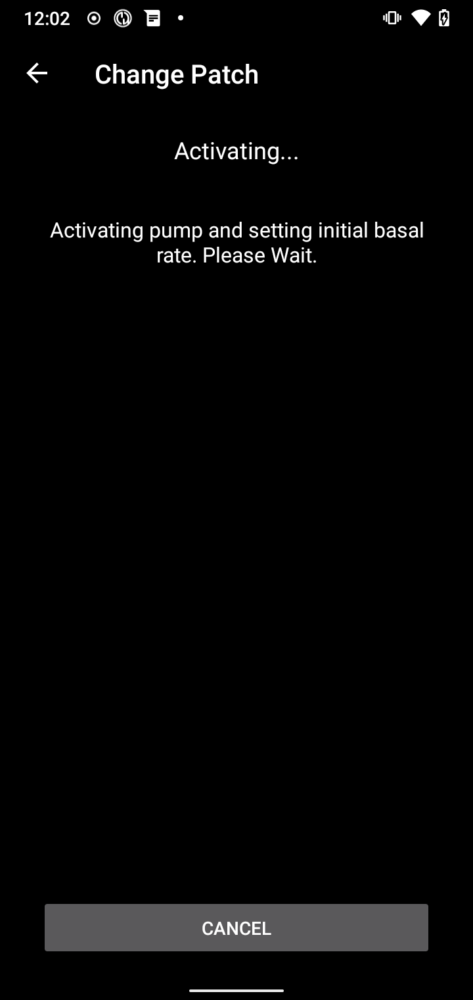

(medtrum-nano-300u)=
# Medtrum Nano 200U / 300U

These instructions are for configuring the Medtrum insulin pump.

```{contents} Table of contents
:depth: 1
:local: true
```

## Pump capabilities with AAPS
* All loop functionality supported (SMB, TBR etc)
* Automatic DST and timezone handling
* בולוס ממושך אינו נתמך במנהל ההתקן של AAPS

## Hardware and software requirements
* **בסיסי משאבה של Medtrum ופאצ'ים (מכלים) תואמים**
    - Currently supported:
        - Medtrum TouchCare Nano 200U עם בסיסי משאבה מדגמים **MD0201** ו־**MD8201**.
        - Medtrum TouchCare 300U עם בסיס משאבה מדגם **MD8301**.
        - If you have an unsupported model and are willing to donate hardware or assist with testing, please contact us via discord [here](https://discordapp.com/channels/629952586895851530/1076120802476441641).
* **AAPS בנוי ומותקן** לפי ההוראות ב־[בניית ה־APK](../SettingUpAaps/BuildingAaps.md).
* **טלפון Android תואם** עם חיבור בלוטות' (BLE)
    - See AAPS [Release Notes](../Maintenance/ReleaseNotes.md)

## Before you begin

**בטיחות קודמת לכל** אין לבצע תהליך זה בסביבה שבה לא ניתן להתאושש משגיאה (חובה שיהיו פאצ'ים נוספים, אינסולין ומכשירים לשליטה במשאבה).

**ה־PDM ואפליקציית Medtrum לא יעבדו עם פאץ' שהופעל באמצעות AAPS.** ייתכן שבעבר השתמשתם ב־PDM או באפליקציית Medtrum כדי לשלוח פקודות למשאבה. מטעמי אבטחה, ניתן להשתמש בפאץ' שהופעל רק עם המכשיר או האפליקציה שבאמצעותם הוא הופעל.

*This does NOT mean that you should throw away your PDM. It is recommended to keep it somewhere safe as a backup in case of emergencies, for instance if your phone gets lost or AAPS is not working correctly.*

**Your pump will not stop delivering insulin when it is not connected to AAPS** Default basal rates are programmed on the pump as defined in the current active profile. As long as AAPS is operational, it will send temporary basal rate commands that run for a maximum of 120 minutes. אם מסיבה כלשהי המשאבה אינה מקבלת פקודות חדשות (למשל, כי התקשורת אבדה עקב המרחק בין המשאבה לטלפון), היא תחזור לקצב הבזאלי המוגדר בה כברירת מחדל לאחר סיום הבזאלי הזמני.

**פרופיל AAPS אינו תומך במשבצות זמן של 30 דקות לקצב הבזאלי** אם AAPS חדש עבורכם ואתם מגדירים את פרופיל הקצב הבזאלי בפעם הראשונה, שימו לב: קצבים בזאליים שמתחילים בחצי שעה אינם נתמכים, ויש להתאים את פרופיל הקצב הבזאלי כך שכל מינון יתחיל בשעה עגולה. לדוגמה, אם יש קצב בזאלי של 1.1 יחידות שמתחיל בשעה 09:30, נמשך שעתיים ומסתיים בשעה 11:30, זה לא יעבוד. יהיה עליכם לשנות את טווח הזמן של קצב בזאלי זה, 1.1 יחידות, ל־9:00-11:00 או ל־10:00-12:00. אף שחומרת משאבת Medtrum עצמה תומכת במקטעים של 30 דקות בפרופיל הקצב הבזאלי, האלגוריתמים של AAPS אינם יכולים כרגע להתחשב בהם.

**קצבים בזאליים בפרופיל של 0U/h אינם נתמכים ב־AAPS** אף שמשאבת Medtrum תומכת בקצב בזאלי אפס, AAPS משתמש בכפולות של הקצב הבזאלי שבפרופיל לקביעת הטיפול האוטומטי, ולכן אינו יכול לפעול עם קצב בזאלי אפס. הקצב הבזאלי המינימלי בפרופיל הוא 0.05 U/h.

ניתן להשיג קצב בזאלי זמני אפס באמצעות הפונקציה "ניתוק המשאבה" או באמצעות שילוב של השבתת לולאה/בזאלי זמני או השהיית הלולאה/בזאלי זמני.

## תצורה

```{caution}
כאשר מפעילים פאץ' עם **AAPS**, **חובה** לכבות כל מכשיר אחר שיכול לתקשר עם בסיס המשאבה של Medtrum, למשל PDM פעיל או אפליקציית Medtrum.
```

### Step 1: Select Medtrum pump

#### Option 1: New installations

אם מתקינים את **AAPS** בפעם הראשונה, **אשף ההתקנה** מנחה אתכם לאורך ההגדרה. יש לבחור **Medtrum** כשמגיעים לשלב **משאבה**.

אם אינכם בטוחים, אפשר גם לבחור **משאבה וירטואלית** ולבחור **Medtrum** מאוחר יותר, לאחר הגדרת **AAPS** (ראו אפשרות 2).


#### אפשרות 2: מסך הגדרות התצורה

בהתקנה קיימת ניתן לבחור את המשאבה **Medtrum** ב־[הגדרות תצורה > משאבה](#Config-Builder-pump):

יש לפתוח את **התפריט** (☰) בפינה העליונה של המסך, ללחוץ על **הגדרות תצורה** > **משאבה** ולבחור את הכרטיס **Medtrum**. רק משאבה אחת יכולה להיות פעילה בכל פעם.


לאחר הבחירה, בכרטיס **Medtrum** מופיעים שני לחצנים: **הגדרות** ו־**פתיחת תוסף**:


**פתיחת תוסף** (או **ניהול ← משאבה**) פותח את מסך המשאבה של Medtrum. המסך משמש להחלפת פאצ'ים ולצפייה במצב המשאבה. לפני הפעלת פאץ' המסך נראה כך:


(medtrum-step-2)=
### Step 2: Change Medtrum settings

יש ללחוץ על **הגדרות** בכרטיס **Medtrum** ב־**הגדרות תצורה** > **משאבה**. אפשר גם ללחוץ על סמל גלגל השיניים בפינה העליונה של מסך המשאבה של Medtrum. כך נפתחות **הגדרות משאבת Medtrum**:


```{note}
אין יותר הגדרה של **מספר סידורי**. **AAPS** מוצא את בסיס המשאבה בסריקת Bluetooth בפעם הראשונה שמפעילים פאץ' (ראו [שלב 3](#medtrum-activate-patch)), וזוכר את המספר הסידורי שלו. כדי להשתמש בבסיס משאבה אחר, ראו [ביטול צימוד](#medtrum-unpair).
```

#### הגדרות התראה

***ברירת מחדל: צפצוף.***

הגדרה זו משנה את האופן שבו המשאבה מתריעה כאשר יש אזהרה או שגיאה.

- **צפצוף**: הפאץ' מצפצף בהתראות ובאזהרות.
- **שקט**: הפאץ' אינו מתריע בהתראות ובאזהרות.

הערה: במצב שקט **AAPS** עדיין משמיע את ההתראה, בהתאם להגדרות עוצמת הקול של הטלפון. אם לא מגיבים להתראה, הפאץ' יצפצף בסופו של דבר.

#### Notification on pump warning

***Default: Enabled.***

הגדרה זו משנה את האופן שבו **AAPS** מציג הודעות על אזהרות משאבה שאינן קריטיות. כאשר ההגדרה מופעלת, מוצגת הודעה בטלפון כאשר מתרחשת אזהרת משאבה, כולל:
- Low battery
- מכל נמוך (20 יחידות)
- הפאץ' יפוג בקרוב

מומלץ להשאיר הגדרה זו מופעלת כאשר התראות המשאבה מוגדרות ל**שקט**. בכל מקרה, אזהרות אלה מוצגות גם במסך המשאבה של Medtrum תחת [התראות פעילות](#medtrum-active-alarms).

(medtrum-patch-expiration)=
#### תפוגת הפאץ'

***Default: Enabled.***

הגדרה זו משנה את התנהגות הפאץ'. כאשר ההגדרה מופעלת, תוקף הפאץ' פג לאחר 3 ימים, והוא נותן אזהרה קולית אם הצליל מופעל. לאחר 3 ימים ו־8 שעות הפאץ' מפסיק לפעול.

אם הגדרה זו מושבתת, הפאץ' אינו מזהיר לפני שהוא מפסיק לפעול. עם קושחה עדכנית של בסיס המשאבה, פאץ' פועל 5 ימים לכל היותר.

#### אזהרת תפוגת משאבה [שעות]

***Default: 72 hours.***

הגדרה זו משנה את מועד אזהרת התפוגה. כאשר [תפוגת הפאץ'](#medtrum-patch-expiration) מופעלת, **AAPS** מציג הודעה מספר זה של שעות לאחר ההפעלה.

#### אינסולין מקסימלי לשעה [יחידות]

***Default: 25U.***

This setting changes the maximum amount of insulin that can be delivered in one hour. אם חורגים ממגבלה זו, הפאץ' מושהה ומפעיל התראה. ניתן לאפס את ההתראה בעזרת הלחצן **איפוס התראות** במסך המשאבה, ראו [איפוס התראות](#nano-reset-alarms).

Set this to a sensible value for your insulin requirements.

#### מקסימום אינסולין יומי [יחידות]

***Default: 80U.***

This setting changes the maximum amount of insulin that can be delivered in one day. אם חורגים ממגבלה זו, הפאץ' מושהה ומפעיל התראה. ניתן לאפס את ההתראה בעזרת הלחצן **איפוס התראות** במסך המשאבה, ראו [איפוס התראות](#nano-reset-alarms).

Set this to a sensible value for your insulin requirements.

#### סריקה בשגיאת חיבור

***Default: Off.***

Located under **Advanced Settings**.

יש להפעיל הגדרה זו רק אם יש בעיות חיבור. כאשר ההגדרה מופעלת, מנהל ההתקן סורק שוב לאיתור המשאבה לפני שהוא מנסה להתחבר אליה מחדש. יש לוודא שהרשאת המיקום של **AAPS** מוגדרת ל־"Allow all the time" (לאפשר כל הזמן).

### שלב 2b: הגדרות ההתראה של AAPS

הגדרות אלה אינן חלק ממנהל ההתקן של Medtrum. פותחים אותן דרך סמל **הגדרות** (גלגל השיניים) בפינה העליונה של המסך הראשי. למידע נוסף ראו [הגדרות](../SettingUpAaps/Preferences.md).

#### מנגנון ניטור בלוטות׳

יש לפתוח את **הגדרות** > **משאבה**:


**מנגנון ניטור בלוטות׳** מכבה את ה־Bluetooth של הטלפון לשנייה אחת אם **AAPS** אינו מצליח להתחבר למשאבה. זה עשוי לעזור בחלק מהטלפונים שבהם ה־Bluetooth נתקע.

יש להפעיל הגדרה זו אם יש לעתים קרובות בעיות חיבור עם המשאבה.

#### התראות מקומיות

יש לפתוח את **הגדרות** > **התראות מקומיות**:


##### התראה כאשר המשאבה אינה זמינה

***Default: Enabled.***

הגדרה זו מופעלת באופן קבוע כאשר מנהל ההתקן של Medtrum פעיל. היא מתריעה כאשר המשאבה אינה זמינה. מצב זה יכול לקרות כאשר המשאבה מחוץ לטווח, או כאשר היא אינה מגיבה בגלל פאץ' או בסיס משאבה תקולים, למשל כאשר מים חודרים בין בסיס המשאבה לפאץ'.

For safety reasons this setting cannot be disabled.

##### סף למשאבה לא זמינה

***Default: 30 min.***

הגדרה זו קובעת כמה זמן **AAPS** ממתין לפני שהוא מתריע שהמשאבה אינה זמינה.

ניתן לשנות הגדרה זו בשימוש במשאבת Medtrum, אך מטעמי בטיחות מומלץ להשאיר אותה על 30 דקות.

(medtrum-activate-patch)=
### שלב 3: הפעלת פאץ'

**Before you continue:**
- יש להכין את בסיס המשאבה של Medtrum ופאץ' מכל חדש.
- יש לכבות מכשירים אחרים שיכולים לתקשר עם משאבת Medtrum (PDM ואפליקציית Medtrum).
- רצוי לוודא ש־**AAPS** מוגדר ושיש [פרופיל מופעל](../DailyLifeWithAaps/ProfileSwitch-ProfilePercentage.md). אם אין פרופיל פעיל, ההפעלה מתחילה בשלב **נדרש פרופיל**, שבו בוחרים את הפרופיל להפעלה.

#### התחלת ההפעלה

יש לפתוח את [מסך המשאבה של Medtrum](#nano-overview) (**ניהול ← משאבה**) וללחוץ על **החלפת פאץ'**. אם הגדרתם [הגנה על הגדרות](#Preferences-protection), יש להזין קודם את הסיסמה או את קוד ה־PIN.

אם כבר יש פאץ' פעיל, תתבקשו להשבית אותו קודם, ראו [השבתת הפאץ'](#nano-deactivate-patch).

ההפעלה היא אשף שלב אחר שלב. יש לפעול לפי ההנחיות כדי למלא ולהפעיל פאץ' חדש. בכל שלב אפשר ללחוץ על **ביטול** כדי לעצור.

```{important}
יש להדביק את הפאץ' לגוף ולהחדיר את הצינורית רק כשהאשף מורה על כך (לאחר שהתיחול הושלם).
```

השלבים הראשונים שיוצגו תלויים בהגדרות שלכם:

1. **נדרש פרופיל**: רק אם אין פרופיל פעיל. יש לבחור את הפרופיל שיופעל, ואז להמשיך.
2. **מציאת משאבה**: רק בפעם הראשונה, או לאחר שימוש ב־[ביטול צימוד](#medtrum-unpair). יש לחבר את בסיס המשאבה לפאץ' חדש כדי להפעיל אותו. **AAPS** סורק לאיתור בסיסי משאבה של Medtrum בקרבת מקום (השמות שלהם מתחילים ב־`MT`). יש ללחוץ על הבסיס שלכם ברשימה. **AAPS** שומר את המספר הסידורי שלו, ועובר ישר למילוי הפאץ'.

   

3. **הפעלת פאץ'**: רק כאשר **AAPS** כבר מכיר את בסיס המשאבה. במסך כתוב "אין פאץ' פעיל. לחצו על **הבא** כדי להתחיל בתהליך ההפעלה." יש לוודא שבסיס המשאבה **לא** מחובר עדיין לפאץ', ואז ללחוץ על **הבא**.


#### חיבור ומילוי הפאץ'


יש לחבר את בסיס המשאבה לפאץ', להוציא את האוויר שנותר ולמלא את הפאץ' באינסולין. נדרשות לפחות 70 יחידות להפעלה. המסך מציג את מפלס המכל. עדיין אין להדביק את הפאץ' לגוף.

כאשר הפאץ' מזוהה ומלא, מופיע הלחצן **הבא**. יש ללחוץ עליו.

#### בחירת אינסולין

שלב זה מופיע רק אם הוגדר יותר מאינסולין אחד ב־**AAPS**. יש לבחור את האינסולין שבו ממלאים את הפאץ'. **AAPS** מבצע החלפת פרופיל עם אינסולין זה לאחר ההפעלה.

#### תיחול הפאץ'


**אין** להסיר את נעילת הבטיחות. יש ללחוץ חצי לחיצה על לחצן המחט בפאץ', ואז ללחוץ על **הבא** כדי להתחיל בתיחול.


יש להמתין להשלמת התיחול.


כאשר התיחול הושלם, יש ללחוץ על **הבא** כדי להמשיך.

#### סבב אתרי עירוי

שלב זה מופיע רק אם מנהלים את אתרי המשאבה באמצעות [סבב אתרי עירוי](#Aapsscreens-site-rotation) (ההגדרה **ניהול סבב אתרי משאבה**). יש לבחור היכן מניחים את הפאץ' על הגוף, או לדלג על שלב זה.

#### הדבקת הפאץ'


יש לנקות את העור ולהסיר את המדבקות. יש להסיר את נעילת הבטיחות, להדביק את הפאץ' לגוף וללחוץ על לחצן המחט כדי להחדיר את הצינורית.

יש ללחוץ על **הבא** כדי להפעיל את הפאץ'.

#### הפעלת הפאץ'



**AAPS** מפעיל את המשאבה ומגדיר את הקצב הבזאלי ההתחלתי. יש להמתין. כאשר ההפעלה הושלמה, מופיע המסך הבא:


```{admonition} Older screenshot
:class: note
מלבד **מציאת משאבה**, צילומי המסך של ההפעלה שלמעלה הם מגרסה קודמת של **AAPS** וייתכן שייראו אחרת ב־**AAPS** 4.
```

הוא מציג כמה יחידות נותרו בפאץ'. יש ללחוץ על **אישור** כדי לחזור למסך המשאבה.

```{tip}
לאחר הפעלה חדשה, יש [לייצא את ההגדרות](../Maintenance/ExportImportSettings.md). כך ניתן לשחזר מאוחר יותר את סשן הפאץ' הזה, למשל בטלפון חדש.
```

(nano-deactivate-patch)=

### השבתת הפאץ'

כדי להשבית את הפאץ' הפעיל, יש לפתוח את [מסך המשאבה של Medtrum](#nano-overview) (**ניהול ← משאבה**) וללחוץ על **החלפת פאץ'**.


תתבקשו לאשר שברצונכם להשבית את הפאץ' הנוכחי. **לא ניתן לבטל פעולה זו.** יש ללחוץ על **הבא** כדי להשבית, או על **ביטול** כדי לחזור למסך המשאבה.


אם **AAPS** אינו יכול להשבית את הפאץ' (למשל כי בסיס המשאבה כבר הוסר מהפאץ'), יש ללחוץ על **השלכה** כדי לשכוח את סשן הפאץ' הנוכחי. לאחר מכן ניתן להפעיל פאץ' חדש.


כאשר ההשבתה הושלמה, יש להחזיר את המחט לאחור ולהסיר את הפאץ' מהגוף. יש להסיר את בסיס המשאבה ולהשליך את הפאץ' המשומש. יש ללחוץ על **אישור** כדי לחזור למסך המשאבה, או על **הבא** כדי להתחיל בהפעלת פאץ' חדש.

(nano-resume-interrupted-activation)=

### Resume interrupted activation

אם הפעלת פאץ' נקטעת, למשל כי הסוללה של הטלפון נגמרה, ניתן להמשיך אותה. יש לפתוח את [מסך המשאבה של Medtrum](#nano-overview) (**ניהול ← משאבה**) וללחוץ על **החלפת פאץ'**.


יש ללחוץ על **הבא** כדי להמשיך בהפעלה. יש ללחוץ על **השלכה** כדי לאפס את מצב ההפעלה, כך שניתן יהיה להפעיל פאץ' חדש.


```{admonition} Older screenshot
:class: note
צילומי המסך בסעיפים **השבתת הפאץ'** ו־**חידוש הפעלה שנקטעה** הם מגרסה קודמת של **AAPS** וייתכן שייראו אחרת ב־**AAPS** 4.
```

מנהל ההתקן קורא את מצב ההפעלה מהמשאבה. אם זה מצליח, האשף ממשיך מהשלב שבו נעצר.

(nano-overview)=

## מסך המשאבה

מסך המשאבה של Medtrum (**ניהול ← משאבה**) מציג את המצב הנוכחי של הפאץ' של Medtrum. יש בו גם לחצנים להחלפת הפאץ', לאיפוס התראות ולרענון המצב. פס בחלק העליון מציג מצבים חשובים, למשל **הפאץ' לא הופעל** או **המשאבה מושהית**.


המסך יכול להציג את השורות הבאות. חלק מהשורות מופיעות רק כאשר יש להן ערך.

- **התחברות אחרונה**: לפני כמה זמן **AAPS** התחבר למשאבה בפעם האחרונה.
- **בולוס אחרון**: הבולוס האחרון שניתן.
- **סוללה**: מתח הסוללה הנוכחי של הפאץ'.
- **מכל**: מפלס המכל הנוכחי.
- **מספר סידורי**: המספר הסידורי של בסיס המשאבה.
- **מצב המשאבה**: המצב הנוכחי של המשאבה. למשל **פעיל** (הפאץ' הופעל ופועל כרגיל) או **נעצר** (הפאץ' לא הופעל).
- **בזאלי בסיסי**: הקצב הבזאלי מהפרופיל שפועל כעת.
- **בזאלי זמני**: הקצב הבזאלי הזמני, אם יש כזה שפועל.
- **בולוס פעיל**: הבולוס שניתן ברגע זה.
- **התראות פעילות**: ראו [בהמשך](#medtrum-active-alarms).
- **סוג המשאבה**: הדגם של בסיס המשאבה.
- **גרסת קושחה**: גרסת הקושחה של בסיס המשאבה.
- **מספר הפאץ'**: המספר הרץ של הפאץ' שהופעל. הוא עולה באחד בכל פעם שמפעילים פאץ' חדש.
- **הפעלה**: התאריך והשעה שבהם הפאץ' הופעל, וכמה זמן עבר מאז.
- **תפוגת הפאץ'**: התאריך והשעה שבהם תוקף הפאץ' פג. מוצג **לא מופעל** אם [תפוגת הפאץ'](#medtrum-patch-expiration) כבויה.

(medtrum-active-alarms)=
### התראות פעילות

שורה זו מציגה את כל ההתראות שפעילות ברגע זה, למשל מכל נמוך או פאץ' שתוקפו עומד לפוג.

### רענן

לחצן זה מרענן את מצב הפאץ'. הוא זמין רק כאשר יש פאץ' פעיל ו־**AAPS** אינו מחובר למשאבה באותו רגע.

### החלפת פאץ'

לחצן זה מפעיל את האשף להחלפת הפאץ'. למידע נוסף ראו [הפעלת פאץ'](#medtrum-activate-patch).

(medtrum-unpair)=
### ביטול צימוד

לחצן זה מופיע רק כאשר **AAPS** מכיר בסיס משאבה. הוא מוחק את המספר הסידורי השמור של בסיס המשאבה ומנתק את החיבור. בפעם הבאה שמפעילים פאץ', **AAPS** סורק שוב לאיתור בסיס משאבה (השלב **מציאת משאבה**). יש להשתמש בזה כאשר עוברים לבסיס משאבה אחר. יש לעשות זאת רק כאשר אין פאץ' פעיל.

(nano-reset-alarms)=

### Reset alarms

הלחצן **איפוס התראות** מופיע במסך המשאבה רק כאשר הפאץ' השהה את עצמו, למשל לאחר התראה על חריגה מהאינסולין היומי המרבי. יש ללחוץ עליו כדי לאפס את ההתראות ולחדש את מתן האינסולין.


```{admonition} Older screenshot
:class: note
צילום המסך למעלה הוא מגרסה קודמת של **AAPS**. ב־**AAPS** 4 מסך המשאבה נראה אחרת, אבל הלחצן **איפוס התראות** פועל באותו אופן.
```

## Switching phone, export/import settings

כאשר עוברים לטלפון חדש, יש לבצע את הפעולות הבאות:
* [ייצוא הגדרות](../Maintenance/ExportImportSettings.md) בטלפון הישן.
* יש להעביר את קובץ ההגדרות מהטלפון הישן לטלפון החדש ולייבא אותו ל־**AAPS**. יש לסמן את **גם החלף את הגדרות המשאבה** במסך הייבוא, אחרת סשן הפאץ' לא יועבר לטלפון החדש.

קובץ ההגדרות המיובא חייב להיות מסשן הפאץ' שבו אתם משתמשים כעת, אחרת הפאץ' לא יתחבר (ראו [משאבות ללא צינורית](#ExportImportSettings-tubeless-pumps)).

לאחר ייבוא הגדרות, מנהל ההתקן מסנכרן את ההיסטוריה עם המשאבה. זה יכול לקחת זמן, בהתאם לגיל קובץ ההגדרות. ההתקדמות ("מסנכרן רשומות, ... נותרו לסיום") מוצגת במסך הראשי:


(medtrum-nano-troubleshooting)=

## פתרון תקלות

### Connection issues

אם יש פסקי זמן בחיבור או בעיות חיבור אחרות:
- בהגדרות האפליקציה של Android עבור **AAPS**, יש להגדיר את הרשאת המיקום ל־"Allow all the time" (לאפשר כל הזמן).
- כדאי לנסות להפעיל את **סריקה בשגיאת חיבור** (הגדרות Medtrum > **הגדרות מתקדמות**) ואת **מנגנון ניטור בלוטות׳** (**הגדרות** > **משאבה**), ראו [שלב 2](#medtrum-step-2).

### Bluetooth issues
לבעיות מוכרות בחיבורי Bluetooth, לניתוקים של משאבות/פודים או לבעיות בהפעלה ובחיבור, ראו [פתרון תקלות Bluetooth](../GettingHelp/BluetoothTroubleshooting.md)

### Activation interrupted

אם ההפעלה נקטעת, למשל בגלל סוללת טלפון ריקה או קריסה של הטלפון, ניתן להמשיך אותה. יש ללחוץ על **החלפת פאץ'** במסך המשאבה ולפעול לפי השלבים ב־[חידוש הפעלה שנקטעה](#nano-resume-interrupted-activation).

### מניעת תקלות בפאץ'

הפאץ' עלול להציג מגוון שגיאות. To prevent frequent errors:
- יש לוודא שבסיס המשאבה יושב כראוי בפאץ' ושאין רווחים נראים לעין.
- בעת מילוי הפאץ', אין להפעיל כוח רב מדי על הבוכנה. אין לנסות למלא את הפאץ' מעבר לכמות המרבית של הדגם שלכם.

## Where to get help

All of the development work for the Medtrum driver is done by the community on a **volunteer** basis; we ask that you to remember that fact and use the following guidelines before requesting assistance:

-  **רמה 0:** קראו את הסעיף הרלוונטי בתיעוד זה כדי להבין כיצד אמור לפעול הדבר שבו אתם מתקשים.
-  **Level 1:** If you are still encountering problems that you are not able to resolve by using this document, then please go to the *#Medtrum* channel on **Discord** by using [this invite link](https://discord.gg/4fQUWHZ4Mw).
-  **רמה 2:** חפשו בדיווחים הקיימים כדי לבדוק אם הבעיה שלכם כבר דווחה ב-[Issues](https://github.com/nightscout/AAPS/issues). אם קיים דיווח, אשרו שגם אצלכם קיימת הבעיה, הגיבו או הוסיפו מידע על הבעיה שלכם. If not, please create a [new issue](https://github.com/nightscout/AndroidAPS/issues) and attach [your log files](../GettingHelp/AccessingLogFiles.md).
-  **היו סבלניים - רוב חברי הקהילה שלנו מורכבים ממתנדבים בעלי אופי טוב, ופתרון בעיות דורש לעתים קרובות זמן וסבלנות מצד המשתמשים והמפתחים כאחד.**