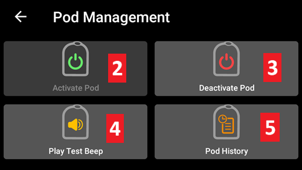
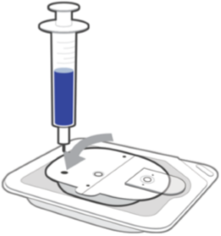
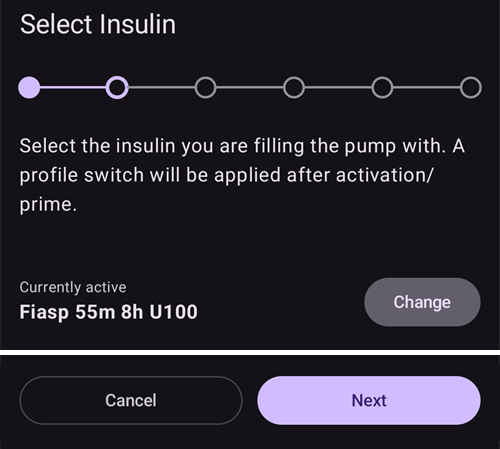
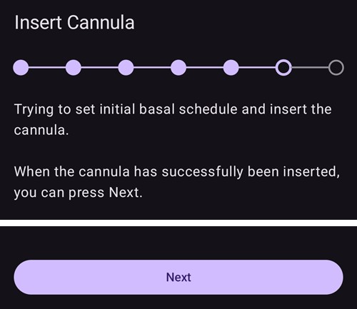
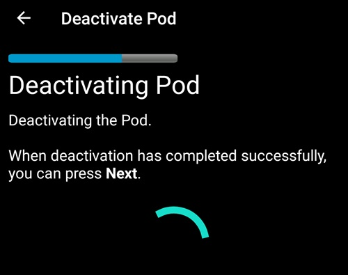
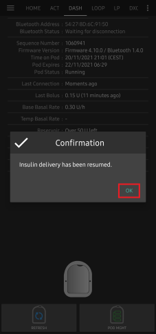
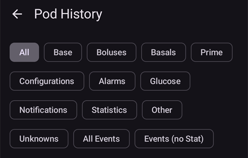
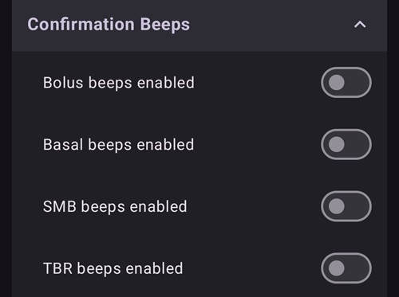

# Omnipod DASH

הוראות אלה מיועדות להגדרת משאבה מדור **Omnipod DASH** **(לא Omnipod Eros)**. מנהל ההתקן של DASH הוא דרך מבוססת ומוכחת להפעיל לולאה עם Omnipod.

```{contents} Table of contents
:depth: 1
:local: true
```

## מפרט Omnipod DASH

המאפיינים העיקריים של **Omnipod DASH** ('DASH'):

- פודי DASH מזוהים לפי **מכסה מחט כחול** (לפוד EROS הישן יש מכסה מחט שקוף). The pods are otherwise identical in terms of physical dimensions.
- DASH אינה דורשת מכשיר קישור/גשר BLE (אין צורך ב־RileyLink, OrangeLink או EmaLink).
- The DASH's Bluetooth connection is used only when sending a command (e.g a Bolus), and disconnects right after issuing the command.
- **AAPS** will wait for pod's accessibility to send commands.
- On pod activation, **AAPS** will find and connect to a new DASH pod.
- Expected range from phone: 5-10 meters (YMMV).

(omnipod-dash-constraints)=

## Omnipod DASH known AAPS constraints/issues
- ההמלצה הכללית היא להפעיל את **AAPS** ב-Android 14 או 16. חברי הקהילה דיווחו על [בעיות](https://github.com/nightscout/AndroidAPS/issues/3471) רבות ב-Android 15. עם זאת, אם אתם משתמשים ב-Android 15, כנראה שתצטרכו להפעיל את **צימוד בלוטות'** (בסעיף **הגדרות מתקדמות** של [הגדרות Dash](#omnipod-dash-advanced-settings)) כדי להפעיל פודים ולהשתמש בהם בהצלחה. למידע נוסף על הגדרות הצימוד ראו [פתרון תקלות כללי](../GettingHelp/GeneralTroubleshooting.md).
- המעבר לשעון קיץ/חורף ושינויי אזור הזמן אינם מוחלים אוטומטית. לאחר שינוי שעון יש לעדכן את הפוד ידנית: ללחוץ על **רענן** במסך המשאבה DASH, ואז ללחוץ על **הגדרת שעה** (מוצג כאשר אזורי הזמן בפוד ובטלפון שונים) או לבצע **החלפת פרופיל** (ראו [שינוי אזור זמן עבור Omnipod Dash](#timezone-traveling-with-pumps)).
- Dash תומכת בקצב בזאלי במדרגות של 0.05 U/h בלבד. אם תנסו להגדיר קצב בזאלי במדרגות של 0.01 ב**פרופיל AAPS** שלכם, AAPS לא יציג אזהרה, אף שהפוד יעגל את המינון כלפי מעלה למדרגות של 0.05. אם תפתחו את **היסטוריית הפוד** במסך המשאבה DASH, יוצג שם שהוגדר קצב בזאלי של 0.05. משמעות הדבר היא גם שהקצב הבזאלי הנמוך ביותר ש־DASH מאפשרת ב־**AAPS** הוא 0.05U/h.
- קובץ ההגדרות מכיל את הפוד הפעיל. ייצאו את ההגדרות לאחר כל הפעלת פוד, וקראו את [ייצוא וייבוא הגדרות](#omnipod-dash-export-import) לפני ייבוא הגדרות.
- בעת הגדרת פרופיל בזאלי חדש, DASH תשהה את מתן האינסולין לפני הגדרת ה**פרופיל** הבזאלי החדש. If there is a communication interruption or error, the basal profile won't automatically re-start. See section [Resuming Insulin Delivery](#omnipod-dash-resuming-insulin-delivery) for details.
- If alerts are configured, and the pod is about to expire, the pod will keep beeping until alerts are silenced, see [Silencing Pod Alerts](#omnipod-dash-silencing-pod-alerts) for details.
- There are a number of known issues with Bluetooth which can cause pod activation problems. לבעיות המוכרות ולפתרונותיהן, ראו [פתרון תקלות Bluetooth](../GettingHelp/BluetoothTroubleshooting.md).

(hardware-software-requirements)=

(omnipod-dash-hardware-software-requirements)=
## Hardware and software requirements

- Omnipod DASH is identified by the blue needle cap.


- **טלפון Android תואם** עם Bluetooth Low Energy (BLE) (למידע נוסף ראו [טלפונים](../Getting-Started/Phones.md)). בנוסף, המידע הבא יסייע לכם לשקול היבטים חשובים נוספים של הפעלה ושימוש מוצלחים ב־DASH בטלפון תואם:
    -  The **AAPS** Omnipod Dash driver connects with the DASH Pod using Bluetooth.  
      **AAPS** will automatically establish a new Bluetooth connection to the Pod every time it needs to send a command (e.g a Bolus), after sending the command the Bluetooth connection is immediately disconnected.
       - **הערות:**
         - The Bluetooth connection can be interrupted/disturbed by other Bluetooth devices linked to the phone that is running **AAPS**, like earbuds etc... Devices like this can cause connection errors or pod activation issues on some models of phones. כדאי לעיין ברשימת [תצורות החומרה שנבדקו](https://docs.google.com/spreadsheets/u/1/d/e/2PACX-1vScCNaIguEZVTVFAgpv1kXHdsHl3fs6xT6RB2Z1CeVJ561AvvqGwxMhlmSHk4J056gMCAQE02sAWJvT/pubhtml?gid=683363241&single=true) כדי למצוא תצורות שידוע שהן עובדות, כאשר בוחרים טלפון לשימוש עם Omnipod DASH.
         - יש כמה בעיות מוכרות ב־Bluetooth שעלולות לגרום לבעיות בהפעלת פוד (ראו [פתרון תקלות](#omnipod-dash-troubleshooting) להנחיות לגבי בעיות Bluetooth אחרות), ובפרט בסעיף [בעיות הקשורות ל־Bluetooth](#omnipod-dash-bluetooth-related-issues).
    - הטלפון חייב לפעול עם **Android 12 ומעלה**, ועליו **AAPS** שנבנה והותקן לפי ההוראות ב[**בניית ה-APK**](../SettingUpAaps/BuildingAaps.md). יש להשתמש תמיד בגרסה האחרונה שפורסמה.
- A supported [**Continuous Glucose Monitor (CGM)**](../Getting-Started/CompatiblesCgms.md)

The instructions below explain how to activate a new pod session using **AAPS**. מומלץ להמתין עד שתוקף הפוד הנוכחי יהיה קרוב לסיום, מכיוון שתצטרכו להפעיל פוד חדש באמצעות **AAPS**. Once a pod is de-activated it cannot be reused/re-activated, the de-activation is final.

## Before you begin

Ensure you have read and understand this whole guide, have read and understand the **Before You Begin** section, as well as  **[Omnipod and AAPS Constraints and Issues](#omnipod-dash-constraints)** to avoid running into a known problem.

### **SAFETY FIRST** - You **SHOULD NOT** try to connect **AAPS** to a pod for the first time without having access to all of the following:
1. Extra pods (3 or more spare)
2. Spare Insulin and MDI equipment
3. A working Omnipod PDM (In case **AAPS** fails)
4. Supported Phones are a must! (See [Hardware/Software Requirements](#hardware-software-requirements))
5. Correct version of AAPS built and installed

### Your Omnipod Dash PDM will become redundant after the AAPS Dash driver activates your pod.
- לפני השימוש ב־**AAPS**, אתם או המטפלים שלכם נדרשתם לנהל את הפוד באמצעות Omnipod PDM (או, באזורים מסוימים, אפליקציה בטלפון) כדי לשלוח פקודות ל־DASH (למשל בולוס).
- DASH יכולה לאפשר חיבור של מכשיר Bluetooth אחד בלבד (למשל PDM או טלפון) לניהול ולשליחת פקודות.
- The device that successfully activates the pod is the only device allowed to communicate with that Pod from that point forward. This means that once you activate a DASH with your Android phone using **AAPS**, **you will no longer be able to use your PDM with that pod!** For the time that Pod is active the **AAPS** Dash driver running on your Android phone is now the new PDM for your pod.
- **DO NOT Throw away your PDM!** It is recommended to keep it around as a backup and for emergencies, for instance when your phone gets lost or **AAPS** is not working correctly.

### Your pod **WILL NOT** stop delivering insulin when it is not connected to AAPS.
מינוני ברירת המחדל הבזאליים מתוכנתים בפוד בעת הפעלתו, כפי שהם מוגדרים ב[**פרופיל**](../SettingUpAaps/YourAapsProfile.md) הפעיל הנוכחי.  
כל עוד **AAPS** פועל, הוא ישלח פקודות התאמה של הקצב הבזאלי שיימשכו לכל היותר 120 דקות.  
כאשר מסיבה כלשהי הפוד אינו מקבל פקודות חדשות (למשל, כי התקשורת אבדה עקב המרחק בין הפוד ➜ לטלפון), הפוד יחזור אוטומטית למינוני ברירת המחדל הבזאליים המוגדרים ב[**פרופיל**](../SettingUpAaps/YourAapsProfile.md) שלכם.

### פרופילי AAPS אינם תומכים במקטעי זמן של 30 דקות לקצב הבזאלי
אם אתם משתמשים חדשים ב־**AAPS** ומגדירים לראשונה את [**פרופיל**](../SettingUpAaps/YourAapsProfile.md) הקצב הבזאלי, שימו לב שאין תמיכה בקצבים בזאליים שמתחילים בחצי שעה. למשל, אם ב־Omnipod PDM שלכם מוגדר קצב בזאלי של 1.1 יחידות שמתחיל ב־09:30 ונמשך 2 שעות עד 11:30, לא ניתן לשחזר בדיוק את ה**פרופיל** הבזאלי הזה ב־**AAPS**.  
יהיה עליכם לשנות את טווח הזמן של קצב בזאלי זה, 1.1 יחידות, ל־9:00-11:00 או ל־10:00-12:00. אף שחומרת DASH עצמה תומכת במקטעים של 30 דקות ב**פרופיל** הקצב הבזאלי, **AAPS** אינו תומך בתכונה זו.

### קצבים בזאליים בפרופיל של 0U/h אינם נתמכים ב־AAPS
אף ש־DASH תומכת בקצב בזאלי אפס, **AAPS** משתמש בכפולות של הקצב הבזאלי ב**פרופיל** שלכם לקביעת הטיפול האוטומטי; הוא אינו יכול לפעול עם קצב בזאלי אפס.  
במקום זאת, ניתן להשיג קצב בזאלי זמני אפס באמצעות הפונקציה "ניתוק המשאבה", או בשילוב של השבתת לולאה/בזאלי זמני או השהיית הלולאה/בזאלי זמני.  
**הערה:** הקצב הבזאלי הנמוך ביותר ש־DASH מאפשרת ב־**AAPS** הוא 0.05U/h.

## Selecting Dash in AAPS

יש **שתי** דרכים לבחור את מנהל ההתקן של Omnipod DASH ב-**AAPS**:

### Option 1: New installations

כאשר מתקינים את **AAPS** בפעם הראשונה, **אשף ההתקנה** מוביל אתכם דרך התכונות העיקריות ודרישות ההתקנה של **AAPS**. כשמגיעים לשלב **משאבה**, יש לבחור **Omnipod Dash**.


אם עדיין אינכם בטוחים, ניתן לבחור בינתיים **משאבה וירטואלית** ולבחור **Omnipod Dash** מאוחר יותר, לאחר הגדרת **AAPS** (ראו אפשרות 2).

(omnipod-dash-option-2-config-builder)=
### אפשרות 2: מסך הגדרות התצורה

בהתקנה קיימת ניתן לבחור את המשאבה **Omnipod Dash** במסך **הגדרות תצורה**:

1. יש לפתוח את **התפריט** (☰) בפינה העליונה של המסך הראשי ולבחור **הגדרות תצורה**.
2. יש להקיש על **משאבה** ולבחור את כפתור הבחירה של **Omnipod Dash** (*"חיבור משאבת Omnipod Dash (הדגם החדש, התומך בבלוטות' ובעל מכסה מחט כחול)"*).

3. לאחר הבחירה, בכרטיס **Omnipod Dash** מוצגים שני לחצנים:
   - **הגדרות** פותח את [הגדרות Dash](#omnipod-dash-settings).
   - **פתיחת תוסף** פותח את [מסך המשאבה DASH](#omnipod-dash-tab).

   

### Verification of Omnipod Driver Selection

כדי לבדוק ש-**Omnipod Dash** נבחרה, יש לפתוח את **ניהול** (סרגל הניווט התחתון של המסך הראשי) ולהקיש על **משאבה**. נפתח מסך המשאבה DASH, כפי שמוצג בסעיף הבא.

(omnipod-dash-tab)=

## מסך המשאבה DASH

במסך המשאבה DASH מנהלים את הפודים: מפעילים ומשביתים אותם, מרעננים את סטטוס הפוד, משתיקים התראות וצופים בהיסטוריית הפוד. ניתן לפתוח אותו דרך **ניהול** > **משאבה**, או דרך **פתיחת תוסף** בכרטיס **Omnipod Dash** ב**הגדרות תצורה** > **משאבה**.

כך נראה המסך ללא פוד פעיל:


וכך נראה המסך עם פוד פעיל:


הסמל **הגדרות** (גלגל שיניים) בפינה העליונה של המסך פותח את [הגדרות Dash](#omnipod-dash-settings).

***הערה:** אם שדה במסך המשאבה מציג (לא וודאי), יש ללחוץ על **רענן** כדי לעדכן את סטטוס הפוד.*

### Fields

- **כתובת בלוטות':** כתובת ה-Bluetooth של הפוד.

- **איכות החיבור:** עד כמה החיבור של **AAPS** לפוד אמין. מוצג כ-*חיבורים מוצלחים / כל ניסיונות החיבור :: אחוז הצלחה*, למשל `412/420 :: 98.10 %`. אחרי יותר מ-50 חיבורים מוצלחים, הערך הופך לצהוב מתחת ל-90 % ולאדום מתחת ל-70 %. ערך נמוך מצביע על בעיית Bluetooth (ראו [בעיות הקשורות ל־Bluetooth](#omnipod-dash-bluetooth-related-issues)).

- **סטטוס הזרקה:** סטטוס ההזרקה הגולמי שהפוד מדווח. שדה זה מוצג רק בגרסאות עם מצב הנדסה.

- **מזהה ייחודי:** המזהה הייחודי ש-**AAPS** נתן לפוד בזמן ההפעלה.

- **מספר LOT:** מספר אצוות הייצור של הפוד.

- **מספר רצף:** המספר הסידורי של הפוד.

- **גרסת קושחה:** גרסת הקושחה וגרסת ה-Bluetooth של הפוד.

- **השעה בפוד:** השעה הנוכחית בפוד, עם אזור הזמן שלו. הטקסט הופך לאדום כאשר אזור הזמן של הפוד שונה מאזור הזמן של הטלפון, ולצהוב כאשר השעה בפוד שונה ביותר מ-10 דקות.

- **תפוגת הפוד:** התאריך והשעה שבהם יפוג תוקף הפוד (72 שעות לאחר ההפעלה). הטקסט הופך לצהוב ב-4 השעות האחרונות לפני מועד זה. הוא אף פעם לא הופך לאדום, כי הפוד ממשיך לתת אינסולין גם אחרי מועד זה.

- **מועד הסיום הסופי של הפוד:** סוף תקופת החסד של הפוד (8 שעות אחרי **תפוגת הפוד**, כלומר חיי פוד של 80 שעות לכל היותר). הטקסט הופך לצהוב כשתקופת החסד מתחילה (ב**תפוגת הפוד**) ולאדום ב-4 השעות האחרונות לפני הסיום הסופי. במהלך תקופת החסד מוצג גם הזמן שנותר, למשל *(17m remaining)*. בסיום הסופי הפוד מפסיק לתת אינסולין, ויש להחליף אותו.

- **סטטוס הפוד:** מצב הפוד: **אין פוד פעיל**, **התקנה בביצוע**, **פועל**, **מושהה** או, לאחר תקלה בפוד, **ALARM**.

- **חיבור אחרון:** לפני כמה זמן **AAPS** תקשר עם הפוד בפעם האחרונה.

  - *לפני כמה רגעים* - לפני פחות מ-10 שניות.

  - *לפני פחות מדקה* - לפני 10 עד 60 שניות.

  - *לפני XX דקות* - לפני יותר מדקה אחת (ואחרי שעה: *לפני X שעות ו-XX דקות*).

- **בולוס אחרון:** כמות הבולוס האחרון שנשלח לפוד, ולפני כמה זמן הוא ניתן. בולוס שלא אושר מסומן (לא וודאי).

- **ערך בזאלי בסיסי:** הקצב הבזאלי שמוגדר לשעה הנוכחית ב**פרופיל** הבזאלי שלכם.

- **קצב בזאלי זמני:** הקצב הבזאלי הזמני (TBR) שפועל כעת, עם שעת ההתחלה ומשך הזמן שלו. שדה זה מוצג רק כאשר פועל TBR.

- **מכל:** מציג *נותרו יותר מ-50 U* כאשר נותרו במכל יותר מ-50 יחידות. מתחת ל-50 יחידות מוצגת הכמות המדויקת. הערך הופך לאדום מתחת ל-20 יחידות.

- **סה"כ שהוזרק:** כמות האינסולין הכוללת שניתנה מהמכל. כולל את האינסולין ששימש לתיחול.

- **התראות פוד פעילות:** התראות שפעילות כעת בפוד, למשל *תוקף הפוד יפוג בקרוב* או *מכל נמוך*.

- **שגיאות:** תקלת הפוד, אם הפוד נכשל. מוצגת באדום כ-*תקלת פוד:* ואחריה קוד התקלה ושמה, למשל *תקלת פוד: 020 ALARM_OCCLUDED*. לשגיאות קודמות ולמידע מפורט יותר יש לעיין ב[היסטוריית הפוד](#omnipod-dash-view-pod-history) ובקובצי היומן. ראו [תקלות בפוד](#omnipod-dash-pod-failures).

- **התראת PDM:** מוצגת רק לאחר תקלה בפוד. היא מציגה את התקלה כפי שה-Omnipod PDM היה מציג אותה: כותרת (למשל *זוהתה חסימה*, *מכל ריק* או *תוקף הפוד פג*), מה קרה (למשל *מתן האינסולין הופסק. החליפו פוד עכשיו.*) ו*קוד ייחוס:*.

### Buttons

הלחצנים בתחתית מסך המשאבה משתנים לפי מצב הפוד. מוצגים רק הלחצנים שרלוונטיים באותו רגע.

- **רענן:** מבקש מהפוד את הסטטוס הנוכחי שלו.
  - *משתמשים בו כדי לעדכן את סטטוס הפוד ולנקות שדות שמציגים (לא וודאי).*
  - *למידע נוסף ראו את הסעיף [פתרון תקלות](#omnipod-dash-troubleshooting) בהמשך.*

- **השתקת התראות:** מפסיק את צפצופי ההתראה של הפוד (למשל תפוגת הפוד או מכל נמוך). מוצג רק כאשר יש לפוד התראה פעילה. ראו [השתקת התראות הפוד](#omnipod-dash-silencing-pod-alerts).

- **חידוש הזרקה:** מחדש את מתן האינסולין בפוד מושהה. מוצג רק כאשר מתן האינסולין מושהה. ראו [חידוש מתן אינסולין](#omnipod-dash-resuming-insulin-delivery).

- **הגדרת שעה:** מעדכן את הפוד לאזור הזמן של הטלפון, על ידי שליחה חוזרת של **פרופיל** הבזאלי שלכם. מוצג רק כאשר אזור הזמן של הפוד שונה מאזור הזמן של הטלפון.

- [**הפעלת פוד**](#omnipod-dash-activate-pod): מתחל ומפעיל פוד חדש. מוצג כאשר אין פוד פעיל.

- [**השבתת פוד**](#omnipod-dash-deactivate-pod): משבית את הפוד הפעיל. מוצג ברגע שפוד מצומד ל-**AAPS**, גם כאשר הפעלה נעצרה באמצע (למשל כי הפוד נכשל בזמן ההפעלה). **AAPS** מבקש אישור לפני שהוא משבית את הפוד.

- **השמעת צפצוף ניסיון:** הפוד משמיע צפצוף ניסיון אחד.

- [**היסטוריית הפוד**](#omnipod-dash-view-pod-history): מציג את היסטוריית הפעולות של הפוד הפעיל.

- **השלכת הפוד:** מסיר מ-**AAPS** פוד שהפעלתו לא הושלמה. מוצג רק כאשר הפעלת פוד נעצרה באמצע. **AAPS** מבקש אישור. לאחר ההשלכה, **AAPS** כבר לא יכול לתקשר עם הפוד הזה: יש להסיר אותו מהגוף.



```{admonition} Older screenshot
:class: note
צילום המסך למעלה הוא מגרסה קודמת של **AAPS**, שבה היה תפריט נפרד בשם **ניהול פוד**. ב-**AAPS** 4 כל הפעולות האלה, כולל **הפעלת פוד**, **השבתת פוד**, **השמעת צפצוף ניסיון** ו-**היסטוריית הפוד**, הן לחצנים עם תוויות טקסט ישירות במסך המשאבה.
```

(omnipod-dash-activate-pod)=

## Activate Pod

1. יש לפתוח את מסך המשאבה DASH (**ניהול** > **משאבה**) וללחוץ על **הפעלת פוד**. אשף ההפעלה נפתח.

   

   ```{admonition} Older screenshot
   :class: note
   צילום המסך למעלה הוא מגרסה קודמת של **AAPS**. ב-**AAPS** 4 **הפעלת פוד** הוא לחצן ישירות במסך המשאבה DASH, ולא בתפריט **ניהול פוד**.
   ```

   אם מעולם לא הפעלתם **פרופיל** ב-**AAPS**, האשף מציג קודם את השלב **נדרש פרופיל**: יש לבחור את הפרופיל שיוחל בזמן ההפעלה ולהמשיך.

2. מוצג השלב **מילוי פוד**. יש למלא פוד חדש באינסולין שיספיק ל-3 ימים, **לפחות 80 יחידות**. הקשיבו לשני צפצופים מהפוד: הם מציינים שהכמות המינימלית של 80 יחידות מולאה. יש לרוקן את מזרק המילוי לגמרי, גם לאחר שמיעת שני הצפצופים. אין להסיר עדיין את מכסה המחט של הפוד.

   ***הערה:** כאשר מחשבים את כמות האינסולין הדרושה ל-3 ימים, יש לזכור שתיחול הפוד משתמש בכ-3-10 יחידות.*

   

   

   יש לוודא שהפוד החדש והטלפון שבו פועל **AAPS** קרובים זה לזה, וללחוץ על **הבא**.

3. אם אתם משתמשים ביותר מסוג אינסולין אחד ב-**AAPS**, מוצג השלב **בחירת אינסולין**. הוא מציג את האינסולין ש**פעיל כעת**. אם מילאתם את הפוד באינסולין אחר, יש ללחוץ על **שינוי** ולבחור אותו. **AAPS** מבצע **החלפת פרופיל** עם אינסולין זה כשההפעלה מסתיימת. יש ללחוץ על **הבא**.

   

4. בשלב **אתחול פוד**, **AAPS** מצמד את הפוד החדש ומתחל אותו. נשמעת נקישה ואחריה סדרת תקתוקים בזמן שהפוד מתחל את עצמו. כשהתהליך מסתיים בהצלחה, מופיע הלחצן **הבא**. יש ללחוץ על **הבא**.

       

   ***הערה**: אם מופיעה הודעת שגיאה כמו _הסריקה נכשלה_ או _'Could not find an available pod for activation'_ (לא נמצא פוד זמין להפעלה; זה יכול לקרות), אין סיבה להיבהל. יש ללחוץ על **ניסיון חוזר**. ברוב המקרים ההפעלה ממשיכה אז בהצלחה.*

   

   אם הפוד נכשל (למשל כי זמן ההפעלה שלו חרג), מוצג **השבתת פוד** במקום **ניסיון חוזר**. יש להשתמש בו ולהתחיל מחדש עם פוד חדש.

   אם לוחצים על **ביטול** לפני שההפעלה הסתיימה, **AAPS** מבקש לאשר שאתם רוצים לצאת. יש ללחוץ על **אישור** כדי לצאת מהאשף, או על **ביטול** כדי להישאר.

   

5. אם אתם מנהלים סבב אתרי משאבה ב-**AAPS** (**ניהול סבב אתרי משאבה** בהגדרות [סבב אתרי עירוי](#Aapsscreens-site-rotation)), מוצג השלב **מיקום האתר**. יש לבחור בתרשים הגוף היכן תמקמו את הפוד וללחוץ על **הבא**, או ללחוץ על **דילוג**.

   

6. לאחר מכן יש להכין את אתר העירוי לפוד החדש. יש לשטוף ידיים כדי למנוע סיכון לזיהום. יש לנקות את אתר העירוי במים וסבון או במגבון אלכוהול, ולתת לעור להתייבש באוויר לגמרי לפני שממשיכים. אם הדבק מגרה את העור, אפשר לשקול שימוש במגבון מגן או בתרסיס מגן.

   בשלב **הדביקו את הפוד**, יש להסיר את מכסה המחט הכחול מפלסטיק של הפוד. אם הצינורית או כל דבר אחר בולט מהפוד, או שהוא נראה חריג, **עצרו**: יש ללחוץ על **ביטול** ולהתחיל מחדש עם פוד חדש. אם הכול נראה **תקין**, יש להסיר את נייר הגב הלבן מהדבק ולהדביק את הפוד במקום שנבחר בגוף.

   בסיום, יש ללחוץ על **הבא**.

   

7. מופיע חלון אישור: *בלחיצה על אישור הצינורית תוכנס.* **יש ללחוץ על אישור רק אם אתם מוכנים להכנסת הצינורית!**

   

8. בשלב **הכנסת צינורית**, **AAPS** מגדיר את הלו"ז הבזאלי שלכם והפוד מכניס את הצינורית. זה יכול לקחת זמן מה (לכל היותר 1-2 דקות). **Be patient!**

   ***הערה:** מומלץ לצבוט את העור ליד נקודת הכנסת הצינורית לפני שהצינורית מוכנסת. זה עוזר למחט להיכנס בקלות ומקטין את הסיכוי לחסימות.*

       

9. כשהצינורית הוכנסה בהצלחה, מופיע הלחצן **הבא**. יש ללחוץ על **הבא**.

   

10. מוצג השלב **הפוד הופעל**. יש לבדוק שהצינורית הוכנסה כראוי, ולהחליף את הפוד אם נראה לכם שלא.

    יש ללחוץ על **סיום**.

    מזל טוב! כעת התחלתם להשתמש בפוד חדש.

    

11. חזרתם למסך המשאבה DASH. כעת הוא מציג את המידע של הפוד הפעיל, כולל הקצב הבזאלי הנוכחי, מפלס המכל, האינסולין שניתן, שגיאות הפוד והתראות. **הפעלת פוד** מוחלף ב-**השבתת פוד**: לא ניתן להפעיל פוד נוסף בלי להשבית קודם את הפוד הפעיל.

    ***הערה:** לפרטים נוספים על המידע המוצג, ראו [מסך המשאבה DASH](#omnipod-dash-tab).*

    

    ***הערה:** מומלץ לייצא את ההגדרות לאחר הפעלת הפוד. ייצאו את ההגדרות לאחר כל החלפת פוד ופעם בחודש. העתיקו את קובץ ההגדרות שיוצא לאחסון בענן (למשל Google Drive) או למקום אחר מחוץ לטלפון, למקרה שהטלפון יאבד (ראו [**ייצוא הגדרות**](../Maintenance/ExportImportSettings.md)).*

אם הפעלה קודמת נעצרה לאחר תיחול הפוד, לחיצה על **הפעלת פוד** ממשיכה מהשלב **הדביקו את הפוד**.

(omnipod-dash-deactivate-pod)=

## Deactivate Pod

בתנאים רגילים פוד מחזיק שלושה ימים (72 שעות), ועוד תקופת חסד של 8 שעות לאחר אזהרת תפוגת הפוד: 80 שעות בסך הכול.

כדי להשבית פוד (בין אם תוקפו פג ובין אם הוא נכשל):

1. יש לפתוח את מסך המשאבה DASH (**ניהול** > **משאבה**) וללחוץ על **השבתת פוד**.

   

2. בשלב **השבתת פוד**, יש ללחוץ על **הבא**. חלון שואל *לא ניתן להשתמש שוב בפוד שהושבת. להשבית את הפוד הזה עכשיו?* יש ללחוץ על **אישור** כדי להתחיל בהשבתת הפוד, או על **ביטול** כדי להשאיר אותו פעיל. ההשבתה עוצרת את כל מתן האינסולין ולא ניתן לבטל אותה.

   

3. השלב **בתהליך השבתת הפוד** מוצג בזמן ש-**AAPS** משבית את הפוד. הפוד מצפצף כדי לאשר שההשבתה הצליחה.

   

   ```{admonition} Older screenshot
   :class: note
   צילום המסך למעלה הוא מגרסה קודמת של **AAPS**. ב-**AAPS** 4 האשף מציג את ההתקדמות כשורת נקודות בחלק העליון, במקום פס התקדמות.
   ```

   כשההשבתה מסתיימת בהצלחה, מופיע הלחצן **הבא**. יש ללחוץ על **הבא**.

   

   אם ההשבתה נכשלת, מוצגות הודעת שגיאה והלחצן **השלכת הפוד**. לפני שמשתמשים בו, יש לקרוא את [השלכת פוד](#omnipod-dash-discard-pod) בהמשך. אפשר גם ללחוץ על **ביטול** ולנסות שוב **השבתת פוד** מאוחר יותר.

4. מוצג השלב **הפוד הושבת**. יש להסיר את הפוד מהגוף וללחוץ על **סיום**.

   

5. חזרתם למסך המשאבה DASH. יש לבדוק שהשדה **סטטוס הפוד** מציג **אין פוד פעיל** ושהלחצן **הפעלת פוד** מוצג שוב.

   

(omnipod-dash-discard-pod)=

### השלכת פוד

יש להשליך פוד רק כאשר כל התקשורת איתו ממשיכה להיכשל. אם **AAPS** עדיין יכול לתקשר עם הפוד, יש להשתמש ב**השבתת פוד** במקום.

- **AAPS** מבקש אישור לפני שהוא משליך את הפוד.
- לאחר מכן **AAPS** כבר לא יכול לתקשר עם הפוד הזה.
- **מתן האינסולין לא הושהה**, כי הפוד לא הושבת כראוי. **יש להסיר את הפוד מהגוף!**
- השלב **הפוד הושלך** מאשר שמצב הפוד נמחק. יש ללחוץ על **סיום**. כעת ניתן להפעיל פוד חדש.

(omnipod-dash-resuming-insulin-delivery)=

## Resuming Insulin Delivery

**הערה**: בזמן **החלפת פרופיל**, כמו בשימוש ב-PDM, **AAPS** חייב להשהות את מתן האינסולין בפוד לפני הגדרת ה**פרופיל** הבזאלי החדש. אם התקשורת נכשלת בין פקודת ההשהיה לפקודת החידוש, מתן האינסולין עלול להישאר מושהה. לפרטים נוספים יש לקרוא את [**מתן האינסולין מושהה**](#omnipod-dash-delivery-suspended) בסעיף פתרון התקלות.

כאשר מתן האינסולין מושהה, יש להורות לפוד לחדש את מתן האינסולין. כשהפקודה מעובדת בהצלחה, הפוד נותן שוב אינסולין לפי הקצב הבזאלי לשעה הנוכחית ב**פרופיל** הבזאלי הפעיל שלכם. הפוד מקבל שוב פקודות לבולוס, **TBR** ו-**SMB**.

1. יש לפתוח את מסך המשאבה DASH ולבדוק שהשדה **סטטוס הפוד** מציג **מושהה**. יש ללחוץ על **חידוש הזרקה** כדי להורות לפוד לחדש את מתן האינסולין הרגיל.

   

2. כשהפקודה הצליחה, השדה **סטטוס הפוד** מציג **פועל** והלחצן **חידוש הזרקה** נעלם.

   

   

   ```{admonition} Older screenshot
   :class: note
   צילומי המסך למעלה הם מגרסה קודמת של **AAPS**, שהציגה חלון אישור. ב-**AAPS** 4 בודקים את התוצאה במסך המשאבה DASH: השדה **סטטוס הפוד** מציג **פועל** והלחצן **חידוש הזרקה** נעלם.
   ```

   אם הפקודה נכשלת, **AAPS** מציג חלון אזהרה שמתחיל ב-*חידוש ההזרקה נכשל*. יש ללחוץ על **רענן** ולנסות שוב.

   

(omnipod-dash-silencing-pod-alerts)=

## Silencing Pod Alerts

סעיף זה מסביר כיצד לעצור את צפצופי הפוד כאשר הפוד מתקרב לסוף חייו. מתי מתחילים הצפצופים האלה תלוי בהגדרות **התראות** (ראו [הגדרות Dash](#omnipod-dash-settings)):

- **תזכורת שעות לפני תפוגת תוקף (72 שעות):** כמה שעות לפני תפוגת התוקף ב-72 שעות הפוד מתחיל לצפצף.
- **התראה שעות לפני כיבוי הפוד (80 שעות):** כמה שעות לפני הכיבוי ב-80 שעות הפוד מצפצף שוב.

חיי הפוד המרביים הם 80 שעות (3 ימים ו-8 שעות). עם זאת, יצרן הפוד ממליץ לא לעבור את 72 השעות (3 ימים).

***הערה**: הלחצן **השתקת התראות** מוצג במסך המשאבה DASH רק כאשר יש לפוד התראה פעילה, למשל תפוגת הפוד או מכל נמוך. אם הלחצן **השתקת התראות** לא מוצג אבל אתם שומעים את הפוד מצפצף, יש ללחוץ על **רענן**.*

1. כשמגיע זמן התזכורת, הפוד מצפצף כדי להודיע שתוקפו יפוג בקרוב ושיש להחליף אותו. במסך המשאבה DASH, השדה **תפוגת הפוד (1)** מציג את השעה המדויקת שבה יפוג תוקף הפוד (72 שעות לאחר ההפעלה). הטקסט הופך לצהוב 4 שעות לפני מועד זה. אחרי מועד זה, **מועד הסיום הסופי של הפוד** הופך לצהוב ומציג את הזמן שנותר עד שהפוד יפסיק לתת אינסולין. השדה **התראות פוד פעילות (2)** מציג **תוקף הפוד יפוג בקרוב**, והלחצן **השתקת התראות (3)** מוצג.

   

2. יש ללחוץ על **השתקת התראות**. **AAPS** שולח לפוד את הפקודה לעצור את צפצופי התפוגה.

   

   ```{admonition} Older screenshot
   :class: note
   צילום המסך למעלה הוא מגרסה קודמת של **AAPS**, שבה המסך הזה היה הלשונית **DASH**. ב-**AAPS** 4 הלחצן **השתקת התראות** נמצא במסך המשאבה DASH (**ניהול** > **משאבה**).
   ```

3. לאחר השתקת ההתראות, ההתראה כבר לא מוצגת בשדה **התראות פוד פעילות**, הלחצן **השתקת התראות** נעלם, והפוד מפסיק את צפצופי התפוגה.

   

   ```{admonition} Older screenshot
   :class: note
   צילום המסך למעלה הוא מגרסה קודמת של **AAPS**, שהציגה חלון אישור. ב-**AAPS** 4 בודקים את התוצאה במסך המשאבה DASH: ההתראה נעלמה מהשדה **התראות פוד פעילות**.
   ```

   אם הפקודה נכשלת, **AAPS** מציג חלון אזהרה שמתחיל ב-*השתקת ההתראות נכשלה*. יש ללחוץ על **רענן** ולנסות שוב.

התראת המכל הנמוך פועלת באותה דרך. כשכמות האינסולין שנותרה בפוד יורדת ל**מספר יחידות** שהוגדר בהגדרות **התראות**, הפוד מצפצף. השדה **מכל** מציג את הכמות שנותרה, השדה **התראות פוד פעילות** מציג **מכל נמוך**, והלחצן **השתקת התראות** מוצג. יש ללחוץ על **השתקת התראות** כדי לעצור את הצפצופים, ולתכנן את החלפת הפוד הבאה.


(omnipod-dash-view-pod-history)=

## View Pod History

סעיף זה מסביר כיצד לצפות בהיסטוריה של הפוד הפעיל ולסנן אותה לפי סוג הפעולה. היסטוריית הפוד מציגה את הפקודות שנשלחו לפוד הפעיל ואת התוצאות שלהן במשך שלושת ימי חייו (72 - 80 שעות).

היא שימושית לבדיקת הבולוסים, ה-TBR ופקודות הבזאלי שנשלחו לפוד. הקטגוריות האחרות עוזרות בפתרון תקלות ומראות את סדר האירועים שהוביל לתקלה.

**הערה:** **רק הפקודה האחרונה יכולה להיות לא ודאית**. פקודות חדשות *לא נשלחות* עד **שהפקודה ה'לא ודאית' האחרונה הופכת ל'מאושרת' או ל'נשללת'**. כדי 'לתקן' פקודה לא ודאית, יש ללחוץ על **רענן** במסך המשאבה DASH.

1. יש לפתוח את מסך המשאבה DASH וללחוץ על **היסטוריית הפוד**.

   

   ```{admonition} Older screenshot
   :class: note
   צילום המסך למעלה הוא מגרסה קודמת של **AAPS**. ב-**AAPS** 4 **היסטוריית הפוד** הוא לחצן ישירות במסך המשאבה DASH, ולא בתפריט **ניהול פוד**.
   ```

2. המסך **היסטוריית הפוד** נפתח כשהמסנן **הכול** נבחר. הוא מציג כל פקודה עם השעה והתוצאה שלה, מהחדשה לישנה, מקובצות לפי ימים. ניתן להשתמש בלחצני הסינון בחלק העליון (למשל **בולוסים** או **בזאלים**) כדי להציג רק סוג אחד של פקודות. יש ללחוץ על חץ החזרה כדי לחזור למסך המשאבה DASH.

    

   ```{admonition} Older screenshot
   :class: note
   צילום המסך השני למעלה הוא מגרסה קודמת של **AAPS**, שבה בחרתם את סוג הפקודה מרשימת **סוג**. ב-**AAPS** 4 משתמשים בלחצני הסינון שמוצגים בצילום המסך הראשון.
   ```

   בבולוסים, אחרי הכמות מופיע סוג הבולוס כשזה לא בולוס רגיל, למשל *0.05 U (SMB)* או *0.05 U (תיקון בזאלי)*. תיקון בזאלי הוא בולוס קטן מאוד (פעימה אחת של הפוד, 0.05 U) שמנהל ההתקן שולח בעצמו; לא אתם ביקשתם אותו.

   ```{admonition} Why basal corrections happen
   :class: note
   הפוד נותן אינסולין בזאלי בפעימות של 0.05 U, לפי שעון פנימי. בכל פעם שהקצב הבזאלי משתנה (למשל כאשר הלולאה מגדירה **TBR** חדש), הפוד מאפס את השעון הזה, והפעימה שאליה הוא ספר הולכת לאיבוד. מכיוון שהלולאה משנה את הקצב הבזאלי לעיתים קרובות, במיוחד בלילה, הפוד עלול בסופו של דבר לתת פחות אינסולין בזאלי מהצפוי.

   **AAPS** משווה בין האינסולין הבזאלי שהפוד מדווח שניתן לבין מה שהיה צריך להינתן. כשהחוסר מגיע לחצי פעימה או יותר, מנהל ההתקן נותן פעימה נוספת אחת כתיקון בזאלי, כך שתקבלו בכל זאת את האינסולין הבזאלי שהפרופיל והלולאה ביקשו. לא נשלח תיקון כשהפוד מושהה, או כשפועל **TBR** של אפס.
   ```

(omnipod-dash-settings)=

## הגדרות Dash

יש שתי דרכים לפתוח את ההגדרות של מנהל ההתקן Dash:

- ללחוץ על הסמל **הגדרות** (גלגל שיניים) בפינה העליונה של [מסך המשאבה DASH](#omnipod-dash-tab).
- לפתוח את **התפריט** (☰) בפינה העליונה של המסך הראשי ולבחור **הגדרות תצורה** > **משאבה**. בכרטיס **Omnipod Dash**, ללחוץ על **הגדרות**.

ההגדרות מקובצות בארבעה סעיפים נפתחים: **צפצופי אימות**, **התראות**, **הודעות** ו**הגדרות מתקדמות**. יש להקיש על סעיף כדי לפתוח אותו:


רוב ההגדרות הן מתגי הפעלה/כיבוי.

### צפצופי אימות



צפצופי אימות מהפוד עבור מתן ושינויים של בולוס, בזאלי, SMB ו-TBR.

**צפצופי בולוס מופעלים:**    הפוד מצפצף כשניתן בולוס. מופעל כברירת מחדל.

**צפצופי בזאלי מופעלים:**    הפוד מצפצף כשמוגדר קצב בזאלי חדש, או כשהקצב הבזאלי הפעיל מבוטל או משתנה. כבוי כברירת מחדל.

**צפצופי SMB מופעלים:**  הפוד מצפצף כשניתן SMB. מופעל כברירת מחדל.

**צפצופי בזאלי זמני מופעלים:**  הפוד מצפצף כש-TBR מוגדר או מבוטל. כבוי כברירת מחדל.

### Alerts


```{admonition} Older screenshot
:class: note
צילום המסך למעלה הוא מגרסה קודמת של **AAPS**. ב-**AAPS** 4 הגדרות אלה נמצאות בסעיף הנפתח **התראות**.
```

התראות הפוד על תפוגת הפוד, כיבוי ומכל נמוך. כאשר משנים הגדרות אלה בזמן שיש פוד פעיל, **AAPS** שולח לפוד את הגדרות ההתראה החדשות.

***הערה:** הודעה של **AAPS** מוצגת תמיד עבור כל התראה, ברגע ש-**AAPS** תקשר עם הפוד לאחר שההתראה הופעלה. סגירת ההודעה לא עוצרת את התראת הפוד. כדי לעצור את ההתראה, יש לפתוח את מסך המשאבה DASH וללחוץ על **השתקת התראות**.*

**תזכורת לתפוגה מופעלת:**    כשהאפשרות מופעלת, הפוד מצפצף כשמגיע זמן התזכורת. מופעל כברירת מחדל.

**תזכורת שעות לפני תפוגת תוקף (72 שעות):** כמה שעות לפני תפוגת הפוד ב-72 שעות מתחילה התזכורת (1 עד 24 שעות; ברירת מחדל 4).

**התראת תפוגה מופעלת:**   כשהאפשרות מופעלת, הפוד מצפצף כשמגיע זמן ההתראה, ושוב שעה אחת לפני הכיבוי. מופעל כברירת מחדל.

**התראה שעות לפני כיבוי הפוד (80 שעות):**  כמה שעות לפני כיבוי הפוד ב-80 שעות מתחילה ההתראה (1 עד 8 שעות; ברירת מחדל 8).

**התראת מכל נמוך מופעלת:**    הפוד מתריע כשכמות האינסולין שנותרה במכל יורדת לערך שב**מספר יחידות**. מופעל כברירת מחדל.

**מספר יחידות:**    מספר היחידות שבו מופעלת התראת המכל הנמוך (5 עד 50 יחידות; ברירת מחדל 20).

### Notifications


ניתן לבחור אם **AAPS** ישמיע צליל עם ההודעות שלו כשאין ודאות אם TBR, SMB או בולוס ניתנו, וכשמתן האינסולין מושהה.

***הערה:** אלה הודעות בטלפון בלבד; הפוד עצמו לא מצפצף.*

**התראת צליל של בזאלי זמני לא ודאי מאופשרת:**  משמיע צליל עם ההודעה כש-**AAPS** אינו בטוח אם TBR הוגדר.

**מאופשרת התראת צליל עבור SMB לא ודאי:**  משמיע צליל עם ההודעה כש-**AAPS** אינו בטוח אם SMB ניתן.

**התראת צליל של בולוס לא ודאי מאופשרת:**    משמיע צליל עם ההודעה כש-**AAPS** אינו בטוח אם בולוס ניתן.

**השמע צליל כאשר התראה על השהיית מתן אינסולין מופעלת:**     משמיע צליל עם ההודעה כשמתן האינסולין מושהה.

(omnipod-dash-advanced-settings)=

### Advanced Settings


**צימוד בלוטות':**  מצמד את הפוד עם הטלפון דרך Bluetooth. יש לנסות זאת רק אם הפוד לא מצליח לשמור על חיבור יציב, למשל ב-Android 15 (ראו [מגבלות/בעיות מוכרות של Omnipod DASH ב־AAPS](#omnipod-dash-constraints)). כשהאפשרות מופעלת, הטלפון מציג בקשות צימוד שיש לאשר. אם הפוד מתחבר כשורה, יש להשאיר אותה כבויה. אין לה השפעה בגרסאות שמתחת ל-Android 15. כבוי כברירת מחדל.

## גיל האינסולין והצינורית

[שורת המצב](#screens-sensor-level-battery) במסך הראשי מציגה את הגיל של האינסולין ושל הצינורית. ב-Omnipod הם פועלים מעט אחרת מאשר במשאבות עם צינורית.

**AAPS** רושם אוטומטית החלפת צינורית והחלפת אינסולין בכל פעם שמפעילים פוד. כך הגיל של **אינסולין** ושל **צינורית** מתאפס לאחר כל החלפת פוד. אין צורך לרשום אותם בעצמכם עם **תיחול/מילוי**. הסיבה היא שהפוד מכניס את הצינורית ישירות לעור במקום שבו הוא מודבק: Omnipod לא משתמש בצינור.

הגיל של **סוללת המשאבה** לא מדווח: הסוללה ומכל האינסולין מובנים בכל פוד, והסוללה תמיד מחזיקה יותר זמן מהפוד עצמו (80 שעות לכל היותר).


```{admonition} Older screenshot
:class: note
צילום המסך למעלה הוא מגרסה קודמת של **AAPS**, שבה הגילים האלה הוצגו בסעיף **פורטל טיפולים** של הלשונית **פעולות**. ב-**AAPS** 4 הם מוצגים בשורת המצב במסך הראשי.
```

### Level

**Insulin Level**

מפלס האינסולין המוצג הוא הכמות שהפוד מדווח. עם זאת, הפוד מדווח את המפלס האמיתי במכל רק כשהוא מתחת ל-50 יחידות. עד אז מוצג *נותרו יותר מ-50 U*. הכמות המדווחת אינה מדויקת: כשהפוד מדווח 'ריק', ברוב המקרים נותרו במכל עוד כמה יחידות אינסולין.

מסך המשאבה DASH מציג את המפלס כך:

  * **נותרו יותר מ-50 U** - הפוד מדווח שיש במכל יותר מ-50 יחידות.
  * **מתחת ל-50 יחידות** - הכמות המדויקת של האינסולין שנותרה במכל, כפי שהפוד מדווח.

Additional note:
  * **SMS** - בתשובות SMS מוחזר הערך, או 50+U כשיש יותר מ-50 יחידות.
  * **Nightscout** - מעלה ל-Nightscout ערך של 50 כשיש יותר מ-50 יחידות (גרסה 14.07 וישנות יותר). גרסאות חדשות יותר מדווחות ערך של 50+ כשיש יותר מ-50 יחידות.

(omnipod-dash-troubleshooting)=

## פתרון תקלות

This section covers common known issues and solutions for Omnipod DASH use with AAPS. בתיעוד יש גם סעיף [פתרון תקלות כללי](../GettingHelp/GeneralTroubleshooting.md) שכדאי לעיין בו, מכיוון שהוא עוסק בנושאים הרלוונטיים גם לחלק מבעיות הפוד.

---

(omnipod-dash-bluetooth-related-issues)=

## Bluetooth related issues

לבעיות מוכרות בחיבורי Bluetooth, לניתוקים של משאבות/פודים או לבעיות בהפעלה ובחיבור, ראו [פתרון תקלות Bluetooth](../GettingHelp/BluetoothTroubleshooting.md)

---

(omnipod-dash-delivery-suspended)=

### Delivery suspended

  - אין יותר כפתור של הפסקת הזרקה. If you want to "suspend" the pod, you can set a zero **TBR** for x minutes.
  - בעת **החלפת פרופיל**, DASH חייבת להשהות את מתן האינסולין לפני הגדרת ה**פרופיל** הבזאלי החדש. אם התקשורת נכשלת בין שתי הפקודות, מתן האינסולין עלול להישאר מושהה. כשזה קורה:
     - לא יהיה מתן אינסולין, כולל בזאלי, SMB, בולוס ידני וכו'.
     - ייתכן שתהיה הודעה על כך שאחת הפקודות אינה מאושרת: זה תלוי במועד התרחשות הכשל.
     - **AAPS** will try to set the new basal profile every 15 minutes.
     - **AAPS** will show a notification informing that the delivery is suspended every 15 minutes, if the delivery is still suspended (resume delivery failed).
     - הלחצן [**חידוש הזרקה**](#omnipod-dash-resuming-insulin-delivery) מוצג במסך המשאבה DASH אם רוצים לחדש את מתן האינסולין ידנית.
     - If **AAPS** fails to resume delivery on its own (this happens if the pod is unreachable, sound is muted, etc), the pod will start beeping 4 times every minute for 3 minutes, then repeated every 15 minutes if delivery is still suspended for more than 20 minutes.
  - עבור פקודות שלא אושרו, יש ללחוץ על **רענן** במסך המשאבה DASH כדי לאשר או לשלול אותן.

*****NOTE:** When you hear beeps from the pod, do not assume that delivery will continue without checking the phone, delivery might stay suspended, ***so you need to check !******

---
(omnipod-dash-pod-failures)=

### Pod Failures

- Pods fail occasionally due to a variety of issues, including hardware issues with the Pod itself.
- It is best practice not to raise support / replacement cases with Insulet, since AAPS is not an approved method of using the Pods.
- A list of fault codes can be [**found here**](https://github.com/openaps/openomni/wiki/Fault-event-codes) to help determine the cause.

כשפוד נכשל, הוא מפסיק לתת אינסולין ומצפצף ללא הפסקה. **AAPS** מציג הודעה במסך הראשי עם קוד התקלה ושמה, ועם *קוד ייחוס:*, למשל *תקלת פוד: 020 ALARM_OCCLUDED*. יש ללחוץ על **סגירה** כדי לסגור את ההודעה. זה לא עוצר את צפצופי הפוד.


במסך המשאבה DASH, השדה **סטטוס הפוד** מציג **ALARM**, השדה **שגיאות** מציג את תקלת הפוד, והשדה **התראת PDM** מסביר אותה, למשל *זוהתה חסימה. מתן האינסולין הופסק. החליפו פוד עכשיו. בדקו את רמת הסוכר*.


לא ניתן להשתמש שוב בפוד שנכשל. יש לבדוק את רמת הסוכר בדם, ואז [להשבית את הפוד](#omnipod-dash-deactivate-pod) ולהפעיל פוד חדש.

---
### Preventing error 49 pod failures

This failure is related to an incorrect pod state for a command or an error during an insulin delivery command. This is when the driver and Pod disagree on the actual state. The Pod (out of a built-in safety measure) then reacts with an unrecoverable error code 49 (0x31) ending up with what is know as a “screamer”: the long irritating beep that can only be stopped by punching a hole at the appropriate location at the back of the Pod. The exact origin of a “49 pod failure” often is hard to trace. זה יכול לקרות, למשל, אחרי קריסה של האפליקציה, בזמן שימוש בגרסת פיתוח או אחרי התקנה מחדש.

---

### Pump Unreachable Alerts

כאשר לא ניתן ליצור תקשורת עם הפוד במשך זמן שהוגדר מראש, תופעל התראת “המשאבה אינה זמינה”. ניתן להגדיר התראות על משאבה לא זמינה בלחיצה על הסמל **הגדרות** (גלגל שיניים) בפינה העליונה של המסך הראשי, ואז בחירה ב-**התראות מקומיות** ➜ **סף למשאבה לא זמינה**. Recommended value is alerting after **120** minutes.

---
(omnipod-dash-export-import)=
### ייצוא וייבוא הגדרות

ייצוא הגדרות **AAPS** מאפשר לשחזר את כל ההגדרות והמשימות, למשל לאחר התקנה מחדש של **AAPS** או בטלפון חדש. **ייצאו את ההגדרות מיד לאחר כל הפעלת פוד** והעתיקו את הקובץ למקום בטוח מחוץ לטלפון (למשל Google Drive), כדי שגם הפוד הפעיל יוכל להשתחזר. ראו [יצירה ושחזור של גיבויים](#ExportImportSettings-Settings-Export).

```{admonition} Importing settings can end your active Pod
:class: warning
בטלפון שכבר מפעיל את הפוד, יש להשאיר את **גם החלף את הגדרות המשאבה** לא מסומן: הפוד הפעיל נשמר, ורק שאר ההגדרות מיובאות. יש לסמן אותו רק בטלפון חדש, עם קובץ שיוצא בזמן הפוד שאתם עונדים עכשיו. ראו [משאבות ללא צינורית](#ExportImportSettings-tubeless-pumps).
```

אם ההגדרות המיובאות מכילות פוד שכבר אינו פעיל, ראו את הסעיף הבא.

---
### Importing settings that contain Pod state from an inactive Pod

When importing settings containing data for a Pod that is no longer active, AAPS will try to connect with it, which will obviously fail. במצב זה לא ניתן להפעיל פוד חדש.

כדי להסיר את נתוני הפוד הישן:
1. במסך המשאבה DASH, יש ללחוץ על **השבתת פוד**. סביר מאוד שההשבתה תיכשל.
2. כשהיא נכשלת, יש ללחוץ על **השלכת הפוד** ולאשר (ראו [השלכת פוד](#omnipod-dash-discard-pod)).
3. לאחר שהפוד הישן הוסר, ניתן להפעיל פוד חדש.

### שגיאה גנרית: java.lang.IllegalStateException: Trying to set a Bluetooth Address to ***, but it is already set to ***.

If you receive this error when attempting to Initialize a new pod **AAPS** fails as it still has settings for an old pod stored in configuration.


This can happen if you restore from a backup, or a pod deactivation fails.

כדי לפתור זאת, יש ללחוץ על **ביטול** כדי לצאת מההפעלה. במסך המשאבה DASH, יש ללחוץ על **השלכת הפוד** אם הוא מוצג. אחרת יש ללחוץ על **השבתת פוד**, וכשההשבתה נכשלת, ללחוץ על **השלכת הפוד** (ראו [השלכת פוד](#omnipod-dash-discard-pod)).

You should now be able to Activate a new pod.

---
### Reinstalling AAPS

בעת הסרת **AAPS**, תאבדו את כל ההגדרות, המשימות ואת נתוני הפוד הנוכחי. **To restore them make sure you have a recent exported settings file available!**

כשיש פוד פעיל, יש להשתמש בקובץ ייצוא שנוצר בזמן הפוד הנוכחי (ראו [ייצוא וייבוא הגדרות](#omnipod-dash-export-import)).

1. Export your settings and store a copy in a safe place (e.g Google Drive).
2. Uninstall **AAPS** and restart your phone.
3. Install the new version of **AAPS**.
4. ייבאו את ההגדרות.
5. Verify all preferences (optionally import settings again).
6. Activate a new pod.
7. לבסוף: ייצאו קובץ הגדרות.

---
### Updating AAPS to a newer version

ברוב המקרים אין צורך להסיר את האפליקציה. You can do an “in-place” install by starting the installation for the new version. ניתן לעשות זאת גם כאשר יש פוד פעיל.

1. ייצאו את ההגדרות.
2. Install the new **AAPS** version.
3. ודאו שההתקנה הצליחה
4. RESUME the Pod or activate a new pod.
5. לבסוף: ייצאו קובץ הגדרות.

---
### Omnipod driver alerts

מנהל ההתקן של Omnipod Dash מציג מגוון התראות ייחודיות ב**מסך הראשי**. רובן למידע בלבד וניתן לסגור אותן, וחלקן דורשות מהמשתמש פעולה כדי לפתור את הסיבה להתראה.

A summary of the main alerts that you may encounter is listed below:

- *תקלת פוד: XXX NAME*, ואחריה *קוד ייחוס: ...*: הפוד נכשל והפסיק לתת אינסולין. יש להחליף את הפוד. ראו [תקלות בפוד](#omnipod-dash-pod-failures).
- *אין פוד פעיל*: לא נמצא פוד פעיל. הודעה זו חוזרת שוב ושוב עד שמפעילים פוד חדש. לאחר הפעלת פוד היא נעלמת אוטומטית.
- *הזרקת האינסולין מופסקת*: הפוד השהה את מתן האינסולין. ראו [חידוש מתן אינסולין](#omnipod-dash-resuming-insulin-delivery).
- *ייתכן שהגדרת הפרופיל הבזאלי נכשלה. Delivery might be suspended! נא לרענן ידנית את סטטוס הפוד במסך המשאבה ולחדש את מתן האינסולין במידת הצורך.* ייתכן שהגדרת ה**פרופיל** הבזאלי בפוד נכשלה. יש ללחוץ על **רענון** במסך המשאבה DASH, וללחוץ על **חידוש הזרקה** אם הוא מוצג.
- *לא ניתן לוודא אם ה-SMB (X U) הצליח. יש לרענן את סטטוס הפוד כדי לאשר או לשלול את הפקודה הזו.* **AAPS** לא הצליח לאשר שה-**SMB** ניתן. יש ללחוץ על **רענן** במסך המשאבה DASH ולבדוק את השדה **בולוס אחרון**.
- *מצב הזרקת בולוס אינו וודאי. רענן את סטטוס הפוד כדי לוודא זאת.* אותו דבר עבור בולוס רגיל: יש ללחוץ על **רענן** במסך המשאבה DASH.
- *אזור הזמן בפוד שונה מאזור הזמן בטלפון. ערכי הבזאלי אינם נכונים. החליפו פרופיל כדי לתקן* ראו את ההערה על שעון קיץ/חורף ואזורי זמן ב[מגבלות/בעיות מוכרות של Omnipod DASH ב־AAPS](#omnipod-dash-constraints).

(omnipod-dash-where-to-get-help-for-dash)=

## Where to get help

All of the development work for the DASH is done by the community on a **volunteer** basis; please keep this in mind and use the following guidelines before requesting assistance:

-  **רמה 0:** קראו את הסעיף הרלוונטי בתיעוד זה כדי להבין כיצד אמור לפעול הדבר שבו אתם מתקשים.
-  **רמה 1:** אם אתם עדיין נתקלים בבעיות שאתם לא מצליחים לפתור באמצעות מסמך זה, עברו לערוץ *#AAPS* ב-**Discord** באמצעות [קישור ההזמנה](https://discord.gg/4fQUWHZ4Mw). There are also numerous Facebook and other groups you can ask in too (see [**Getting Help**](../GettingHelp/WhereCanIGetHelp.md))
-  **רמה 2:** חפשו בדיווחים הקיימים כדי לבדוק אם הבעיה שלכם כבר דווחה ב-[Issues](https://github.com/nightscout/AndroidAPS/issues). אם קיים דיווח, אשרו שגם אצלכם קיימת הבעיה, הגיבו או הוסיפו מידע על הבעיה שלכם. If not, please create a [new issue](https://github.com/nightscout/AndroidAPS/issues) and attach [your log files](../GettingHelp/AccessingLogFiles.md).
-  **היו סבלניים - רוב חברי הקהילה שלנו מורכבים ממתנדבים בעלי אופי טוב, ופתרון בעיות דורש לעתים קרובות זמן וסבלנות מצד המשתמשים והמפתחים כאחד.**

When requesting help come prepared with the following information to help those in the community with your specific questions and problems:
- Android phone make and model
- Android OS version (e.g 15 or 16)
  - Did you recently upgrade your Android OS version?
- The version of **AAPS** you are running
- Plain english description of the problem you are facing considering some of the following things
   - Was it working before now?
   - When did it work or not work?
   - Did you make any changes to configuration or profile settings?
   - האם צימדתם מכשיר Bluetooth חדש?
   - האם שדרגתם או התקנתם אפליקציה חדשה?
   - How long was it working before it stopped working?
