# Omnipod Eros

הוראות אלה מיועדות להגדרת משאבה מדור Omnipod Eros (**לא Omnipod Dash**).

```{admonition} Omnipod Eros is being phased out
:class: note

[מערכת Omnipod](https://www.omnipod.com/current-podders/resources/omnipod-system) (ה-Omnipod המקורית, הכוללת גם את ה-Personal Diabetes Manager (PDM) וגם את הפוד) יוצאת משימוש, ומועד הסיום שונה ממדינה למדינה. לדוגמה, בקנדה היא לא תהיה זמינה עוד אחרי 30 ביוני 2026. אם אתם משתמשים במשאבת Eros, כדאי לתכנן מראש מעבר למשאבה נתמכת.
```

**תוכנה זו היא חלק מפתרון DIY של לבלב מלאכותי. היא אינה מוצר, והיא דורשת מכם לקרוא, ללמוד ולהבין את המערכת, כולל את אופן השימוש בה. האחריות על השימוש במערכת היא עליכם בלבד.**

```{contents} Table of contents
:depth: 1
:local: true
```

## Hardware and software requirements

- **Pod Communication Device**

> Component that bridges communication from your AAPS enabled phone to Eros generation pods.
> 
> > -   [OrangeLink Website](https://getrileylink.org/product/orangelink)
> > -  [RileyLink בתדר 433MHz](https://getrileylink.org/product/rileylink433)
> > - 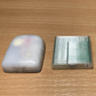  [Emalink Website](https://github.com/sks01/EmaLink) - [Contact Info](mailto:getemalink@gmail.com)
> > -   DiaLink - [Contact Info](mailto:Boshetyn@ukr.net)
> > -   [LoopLink Website](https://www.getlooplink.org/) - [Contact Info](https://jameswedding.substack.com/) - Untested

-   **Mobile Phone Device**

> Component that will operate AAPS and send control commands to the Pod communication device.
> 
> > - [טלפון Android](#Phones-list-of-tested-phones) נתמך, שבו מוגדרים **AAPS** והרכיבים הקשורים אליו.

-   **Insulin Delivery Device**

> רכיב שיפרש פקודות שהתקבלו מהתקן התקשורת עם הפוד ושמקורן בטלפון שלכם שבו פועל AAPS.
> 
> > - A new Omnipod pod (Eros generation - **NOT DASH**)

ההוראות האלה מניחות שאתם מתחילים עם פוד חדש. אם זה לא המצב, יש להמתין בסבלנות ולהתחיל את התהליך בהחלפת הפוד הבאה.

בדף זה, **RileyLink** פירושו כל אחד מהתקני התקשורת עם הפוד שמופיעים למעלה.

## Before you begin

**SAFETY FIRST** - do not attempt this process in an environment where you cannot recover from an error (extra pods, insulin, charged RileyLink, and phone devices are must-haves).

**Your Omnipod PDM will no longer work after the AAPS Omnipod driver activates your pod**. Previously you used your Omnipod PDM to send commands to your Omnipod Eros pod. An Omnipod Eros pod only allows a single device to send communication to it. The device that successfully activates the pod is the only device allowed to communicate with it from that point forward. This means that once you activate an Omnipod Eros pod with your RileyLink through the AAPS Omnipod driver, **you will no longer be able to use your PDM with your pod**. The AAPS Omnipod driver with the RileyLink is now your acting PDM. *אין פירוש הדבר שעליכם לזרוק את ה-PDM שלכם. מומלץ לשמור אותו כגיבוי ולמקרי חירום שבהם AAPS אינו פועל כראוי.*

**רק RileyLink אחד יכול לתקשר עם פוד בכל רגע נתון.** **AAPS** זוכר RileyLink מצומד אחד. אם מצמדים RileyLink אחר, הוא מחליף את הקודם.

**Your pod will not shut off when the RileyLink is out of range.** When your RileyLink is out of range or the signal is blocked from communicating with the active pod, your pod will continue to deliver basal insulin. Upon activating a pod, the basal profile defined in AAPS will be programmed into the new pod. Should you lose contact with the pod, it will revert to this basal profile. You will not be able to issue new commands until the RileyLink comes back in range and re-establishes the connection.

**פרופילי קצב בזאלי במרווחים של 30 דקות אינם נתמכים ב-AAPS.** אם אתם חדשים ב-AAPS ומגדירים את פרופיל הקצב הבזאלי בפעם הראשונה, שימו לב שקצבים בזאליים המתחילים בחצי השעה אינם נתמכים, ותצטרכו להתאים את הפרופיל כך שהמינונים יתחילו בשעה עגולה. לדוגמה, אם יש לכם קצב בזאלי של 1.1 יחידות שמתחיל ב-09:30 ונמשך 2 שעות עד 11:30, הוא לא יעבוד.  תצטרכו לעדכן את הקצב הבזאלי הזה של 1.1 יחידות לטווח השעות 9:00-11:00 או 10:00-12:00.  אף שחומרת Omnipod עצמה תומכת בפרופיל קצב בזאלי במרווחים של 30 דקות, האלגוריתמים של AAPS אינם יכולים כרגע להביא אותם בחשבון.

## Enabling the Omnipod Driver in AAPS

You can enable the Omnipod driver in AAPS in **two ways**:

### Option 1: The Setup Wizard

אחרי התקנה של גרסה חדשה של AAPS, **אשף ההתקנה** מתחיל אוטומטית. אם כבר ייצאתם את ההגדרות מהתקנה קודמת, ניתן לייבא אותן באשף. בהתקנה חדשה, יש להמשיך לפי ההוראות שלהלן.

יש לעבור על [אשף ההתקנה](../SettingUpAaps/SetupWizard.md) עד לשלב **משאבה**, ואז לבחור **Omnipod Eros** (התיאור הוא "חיבור משאבת Omnipod Eros").


אשף ההתקנה לא מצמד את ה-RileyLink. בסיום האשף, יש לפתוח את מסך המשאבה Omnipod ולצמד את ה-RileyLink כפי שמתואר ב[סעיף הגדרת RileyLink](#OmnipodEros-rileylink-setup).

**OR**

### אפשרות 2: מסך הגדרות התצורה

יש לפתוח את **התפריט** (☰) בפינה העליונה > **הגדרות תצורה** > **משאבה** ולבחור את **כפתור הבחירה** של **Omnipod Eros**.

לאחר הבחירה, בכרטיס **Omnipod Eros** מוצגים שני לחצנים, **הגדרות** ו**פתיחת תוסף**:

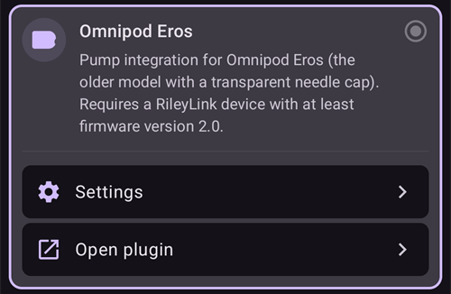

**הגדרות** פותח את ההגדרות של מנהל ההתקן של Omnipod (ראו [הגדרות Omnipod](#OmnipodEros-omnipod-settings)):


**פתיחת תוסף** פותח את מסך המשאבה Omnipod. ניתן לפתוח אותו בכל עת גם מהמסך הראשי, דרך **ניהול** > **משאבה**. בדף זה הוא נקרא **מסך המשאבה Omnipod**. לפני צימוד RileyLink והפעלת פוד, המסך נראה כך:


### Verification of Omnipod Driver Selection

כדי לבדוק שהפעלתם את מנהל ההתקן של Omnipod, יש לפתוח את **ניהול** > **משאבה** מהמסך הראשי. אמור להופיע מסך המשאבה **Omnipod Eros** שמוצג למעלה. אם עדיין לא צימדתם RileyLink, השדה **מצב ריילילינק** מציג **לא התחיל** והשדה **סטטוס הפוד** מציג **אין פוד פעיל**.

## Omnipod Configuration

כל הפעולות של הפוד ושל RileyLink הן לחצנים ב[מסך המשאבה Omnipod](#OmnipodEros-omnipod-pod-tab) (**ניהול** > **משאבה**). חלק מהלחצנים מוצגים רק במצבים מסוימים, למשל כאשר יש פוד פעיל.

>  Refresh Pod connectivity and status
> 
> 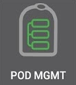 ניהול הפוד (הפעלה, השבתה, השמעת צפצוף ניסיון, סטטיסטיקת RileyLink והיסטוריית הפוד)

```{admonition} Older screenshot
:class: note
צילומי המסך למעלה הם מגרסה קודמת של **AAPS**. ב-**AAPS** 4 אין לחצן **POD MGMT** ואין תפריט ניהול הפוד: **רענן** וכל פעולות ניהול הפוד הם לחצנים במסך המשאבה Omnipod.
```

(OmnipodEros-rileylink-setup)=

### RileyLink Setup

אם כבר צימדתם את ה-RileyLink, יש להמשיך ל[סעיף הפעלת פוד](#OmnipodEros-activating-a-pod) שלהלן.

*הערה: סימן חזותי טוב לכך שה-RileyLink אינו מחובר הוא שלחצני הטיפול (סרגל ההפעלה המהירה, QuickLaunch) במסך הראשי חסרים. This will also occur for about the first 30 seconds after AAPS starts, as it is actively connecting to the RileyLink.*

1. יש לוודא שה-RileyLink טעון במלואו ומופעל.

2. יש להניח את ה-RileyLink [קרוב לטלפון](#OmnipodEros-optimal-omnipod-and-rileylink-positioning) (במרחק של כ-30 ס"מ או פחות).

3. יש לפתוח את מסך המשאבה Omnipod (**ניהול** > **משאבה**) וללחוץ על **צימוד RileyLink**.

4. המסך **צימוד RileyLink** מתחיל מיד לסרוק התקני Bluetooth. יש להקיש על ה-RileyLink שלכם ברשימת ההתקנים שנמצאו.

   

5. כאשר מוצגת ההודעה **צימוד RileyLink הצליח** עם השם והכתובת של ההתקן, יש ללחוץ על **אישור**.

6. בחזרה במסך המשאבה Omnipod, יש לבדוק שהשדה **מצב ריילילינק** משתנה ל**מחובר**. השדה **סטטוס הפוד** אמור להציג **אין פוד פעיל**. אם ה-RileyLink לא מתחבר, יש ללחוץ על **איפוס RileyLink**, או להפעיל מחדש את **AAPS**.

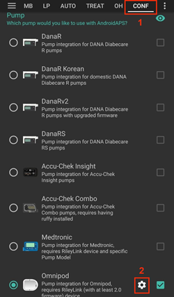 

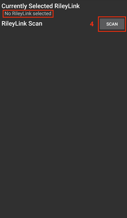 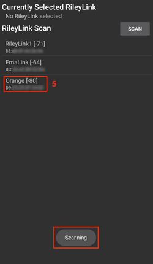


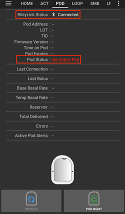

```{admonition} Older screenshot
:class: note
ששת צילומי המסך למעלה (אחרי שלב 6) הם מגרסה קודמת של **AAPS**. ב-**AAPS** 4 מצמדים את ה-RileyLink עם הלחצן **צימוד RileyLink** במסך המשאבה Omnipod, במקום **RileyLink Configuration** בהגדרות Omnipod, והסריקה מתחילה אוטומטית.
```

```{note}
כדי לעבור ל-RileyLink אחר (למשל התקן גיבוי), יש ללחוץ שוב על **צימוד RileyLink** ולבחור את ההתקן החדש. הוא מחליף את ההתקן שצומד קודם. אין צורך להסיר קודם את ההתקן הישן.
```

(OmnipodEros-activating-a-pod)=

### Activating a Pod

לפני שמפעילים פוד, יש לוודא שה-RileyLink מצומד ושהשדה **מצב ריילילינק** מציג **מחובר**. הלחצן **הפעלת פוד** נשאר מושבת עד שה-RileyLink מוכן.

*REMINDER: Pod communication occurs at limited ranges for pod activation pairing due to security safety measures. Before pairing the Pod's radio signal is weaker, however after it has been paired it will operate at full signal power. במהלך הפעולות האלה, יש לוודא שהפוד* [קרוב](#OmnipodEros-optimal-omnipod-and-rileylink-positioning) *(במרחק של כ-30 ס"מ או פחות) ל-RileyLink, אבל לא מעליו ולא צמוד אליו.*

01. יש לפתוח את מסך המשאבה Omnipod (**ניהול** > **משאבה**) וללחוץ על **הפעלת פוד**.

    אם מעולם לא הפעלתם פרופיל, יופיע קודם השלב **נדרש פרופיל**. בחרו את הפרופיל שיוחל בעת ההפעלה.

    >   
    > 
    > ```{admonition} Older screenshot
    >     :class: note
    >     צילומי המסך למעלה הם מגרסה קודמת של **AAPS**. ב-**AAPS** 4 **הפעלת פוד** הוא לחצן במסך המשאבה Omnipod, ולא בתפריט **POD MGMT**.
    > ```

02. מסך **מילוי פוד** מוצג. יש למלא פוד חדש באינסולין שיספיק ל-3 ימים ולהקשיב לשני צפצופים. הם מציינים שהוכנסה הכמות המינימלית של 80 יחידות. יש לרוקן את מזרק המילוי לגמרי, גם לאחר שמיעת שני הצפצופים. When calculating the total amount of insulin you need for 3 days, please take into account that priming the pod will use 12 to 15 units. אין להסיר עדיין את מכסה המחט של הפוד.

    > 
    > 
    > יש לוודא שהפוד החדש וה-RileyLink קרובים זה לזה (כ-30 ס"מ או פחות) וללחוץ על **הבא**.

03. **בחירת אינסולין** (מוצג רק אם הוגדר יותר מאינסולין אחד): יש לבחור את האינסולין שבו ממלאים את הפוד וללחוץ על **הבא**. לאחר ההפעלה מוחלת החלפת פרופיל עם האינסולין הזה.

04. במסך **אתחול פוד** הפוד יתחיל בתיחול (תשמעו קליק ואחריו סדרה של תקתוקים, בזמן שהפוד מתחל את עצמו). אם RileyLink נמצא מחוץ לטווח של הפוד שאתם מפעילים, תקבלו את הודעת השגיאה **אין תגובה מהפוד**. במקרה כזה, יש [לקרב את ה-RileyLink](#OmnipodEros-optimal-omnipod-and-rileylink-positioning) לפוד (כ-30 ס"מ או פחות), אבל לא מעליו ולא צמוד אליו, וללחוץ על **ניסיון חוזר**.

    >  

05. כאשר התיחול מצליח, מוצג V ירוק והלחצן **הבא** הופך לזמין. יש ללחוץ על **הבא**.

    > 

06. **מיקום האתר** (מוצג רק אם האפשרות **ניהול סבב אתרי משאבה** מופעלת ב[סבב אתרי עירוי](#Aapsscreens-site-rotation)): יש לבחור היכן על הגוף מדביקים את הפוד וללחוץ על **הבא**.

07. מוצג המסך **הדביקו את הפוד**. יש להכין את אתר העירוי של הפוד החדש. יש להסיר מהפוד את מכסה המחט מפלסטיק ואת נייר הגב הלבן מהדבק, ולהדביק את הפוד במקום שבחרתם על הגוף. אם הצינורית בולטת החוצה, יש ללחוץ על **ביטול** ולהשליך את הפוד. בסיום, יש ללחוץ על **הבא**.

    > 

08. מופיע חלון אישור: "בלחיצה על אישור הצינורית תוכנס". **יש ללחוץ על אישור רק כשאתם מוכנים להחדרת הצינורית**.

    > 

09. במסך **הכנסת צינורית** ייתכן שיעבור זמן מה עד שה-Omnipod יגיב ויחדיר את הצינורית (עד 1-2 דקות), לכן יש להמתין בסבלנות.

    > אם RileyLink נמצא מחוץ לטווח של הפוד שאתם מפעילים, תקבלו את הודעת השגיאה **אין תגובה מהפוד**. במקרה כזה, יש לקרב את ה-RileyLink לפוד (כ-30 ס"מ או פחות), אבל לא מעליו ולא צמוד אליו, וללחוץ על **ניסיון חוזר**.
    > 
    > אם RileyLink נמצא מחוץ לטווח ה-Bluetooth או שאין לו חיבור פעיל לטלפון, תקבלו את הודעת השגיאה **אין תגובה מריילילינק**. במקרה כזה, יש לקרב את ה-RileyLink לטלפון וללחוץ על **ניסיון חוזר**.
    > 
    > *הערה: לפני החדרת הצינורית, מומלץ לצבוט את העור בסביבת נקודת ההחדרה. זה מבטיח החדרה חלקה של המחט ומפחית את הסיכויים לפתח חסימות.*
    > 
    > 
    > 
    >  

10. יופיע V ירוק, ולחצן **הבא** יופעל לאחר החדרה מוצלחת של הצינורית. יש ללחוץ על **הבא**.

    > 

11. מוצג המסך **הפוד הופעל**. יש לבדוק שהצינורית הוחדרה כראוי, ולהחליף את הפוד אם נראה לכם שלא. יש ללחוץ על **סיום**. מזל טוב! הפעלתם את הפוד.

    >  
    > 
    > ```{admonition} Older screenshot
    >     :class: note
    >     צילומי המסך בשלבים 2 עד 11 הם מגרסה קודמת של **AAPS**, וייתכן שהם נראים אחרת ב-**AAPS** 4. השלבים **בחירת אינסולין** ו-**מיקום האתר** אינם מוצגים בתמונות.
    > ```

12. אתם חוזרים למסך המשאבה Omnipod. הלחצן **הפעלת פוד** מוחלף בלחצן **השבתת פוד**, כי אי אפשר להפעיל פוד נוסף בלי להשבית קודם את הפוד הפעיל.

    מסך המשאבה מציג עכשיו מידע על הפוד הפעיל, כולל הקצב הבזאלי הנוכחי, כמות האינסולין במכל, האינסולין שניתן, שגיאות והתראות של הפוד. לפרטים נוספים ראו את הסעיף [מסך המשאבה Omnipod](#OmnipodEros-omnipod-pod-tab).

     

    ```{admonition} Older screenshot
    :class: note
    צילומי המסך למעלה הם מגרסה קודמת של **AAPS**. ב-**AAPS** 4 אין תפריט ניהול הפוד: חוזרים ישירות למסך המשאבה Omnipod, שבו **השבתת פוד** מחליף את **הפעלת פוד**.
    ```

```{note}
אם ההפעלה נקטעה אחרי התיחול (למשל, האפליקציה נסגרה), יש ללחוץ שוב על **הפעלת פוד**. האשף ממשיך מהשלבים של החדרת הצינורית.
```

### Deactivating a Pod

Under normal circumstances, the life of a pod should run for three days (72 hours) and an additional 8 hours after the pod expiration warning for a total of 80 hours of pod usage.

To deactivate a pod (either from expiration or from a pod failure):

1. יש לפתוח את מסך המשאבה Omnipod (**ניהול** > **משאבה**) וללחוץ על **השבתת פוד**.

   > 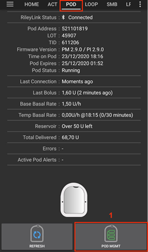 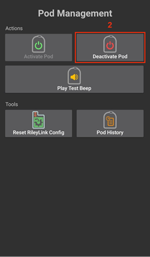 
   > 
   > ```{admonition} Older screenshot
   >    :class: note
   >    צילומי המסך למעלה הם מגרסה קודמת של **AAPS**. ב-**AAPS** 4 **השבתת פוד** הוא לחצן במסך המשאבה Omnipod, ולא בתפריט **POD MGMT**.
   > ```

2. במסך **השבתת פוד**, יש לוודא קודם שה-RileyLink קרוב לפוד, אבל לא מעליו ולא צמוד אליו. אחר כך יש ללחוץ על **הבא**. חלון שואל *לא ניתן להשתמש שוב בפוד שהושבת. להשבית את הפוד הזה עכשיו?* יש ללחוץ על **אישור** כדי להתחיל בהשבתת הפוד, או על **ביטול** כדי להשאיר אותו פעיל. ההשבתה עוצרת את כל מתן האינסולין ולא ניתן לבטל אותה.

   > 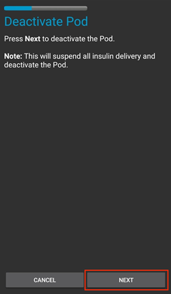

3. מופיע המסך **בתהליך השבתת הפוד**, והפוד משמיע צפצוף שמאשר שההשבתה הצליחה.

   > 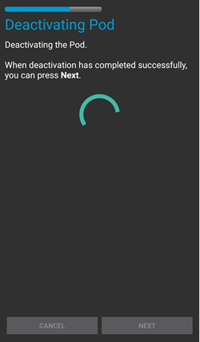
   > 
   > **אם ההשבתה נכשלת** ולא נשמע צפצוף אישור, ייתכן שתופיע ההודעה **אין תגובה מריילילינק** או **אין תגובה מהפוד**. יש ללחוץ על **ניסיון חוזר** כדי לנסות שוב להשבית את הפוד. אם ההשבתה ממשיכה להיכשל, יש ללחוץ על **השלכת הפוד** ולאשר. **AAPS** שוכח אז את הפוד. מתן האינסולין **לא** הושהה, ולכן יש להסיר את הפוד מהגוף. אם הפוד משמיע אזעקה חזקה, ייתכן שיהיה צורך להשתיק אותו ידנית (בעזרת סיכה או מהדק נייר), כי **השלכת הפוד** לא משתיק אותו.
   > 
   > >   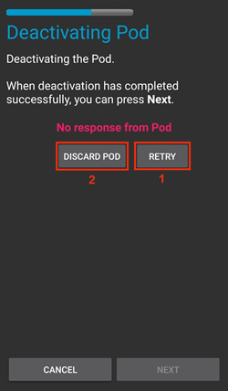

4. כאשר ההשבתה מצליחה, מופיע V ירוק. יש ללחוץ על **הבא** כדי להציג את המסך **הפוד הושבת**. כעת תוכלו להסיר את הפוד כיוון שפעילותו הושבתה.

   > 

5. יש ללחוץ על **סיום** כדי לחזור למסך המשאבה Omnipod.

   > 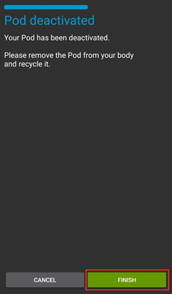 
   > 
   > ```{admonition} Older screenshot
   >    :class: note
   >    צילומי המסך בשלבים 2 עד 5 הם מגרסה קודמת של **AAPS**, וייתכן שהם נראים אחרת ב-**AAPS** 4.
   > ```

6. במסך המשאבה Omnipod, יש לבדוק שהשדה **מצב ריילילינק** מציג **מחובר** ושהשדה **סטטוס הפוד** מציג **אין פוד פעיל**.

   >    
   > 
   > ```{admonition} Older screenshot
   >    :class: note
   >    צילומי המסך למעלה הם מגרסה קודמת של **AAPS**. ב-**AAPS** 4 הלחצן **סיום** מחזיר אתכם ישירות למסך המשאבה Omnipod; אין תפריט ניהול הפוד ואין לשונית **Omnipod (POD)**.
   > ```

### השהיה וחידוש של מתן האינסולין

התהליך שלהלן מראה כיצד להשהות ולחדש את מתן האינסולין.

*הערה - אם לא מוצג לחצן **השהיה***, הוא מוסתר כברירת מחדל. Enable **Show Suspend Delivery button in Omnipod tab** in the [Omnipod settings](#OmnipodEros-omnipod-settings) under **Other**.

#### Suspending Insulin Delivery

Use this command to put the active pod into a suspended state. In this suspended state, the pod will no longer deliver any insulin. This command mimics the suspend function that the original Omnipod PDM issues to an active pod.

1. יש לפתוח את מסך המשאבה Omnipod (**ניהול** > **משאבה**) וללחוץ על **השהיה**. פקודת ההשהיה נשלחת דרך ה-RileyLink לפוד הפעיל.

2. כאשר הפוד השהה את כל מתן האינסולין, השדה **סטטוס הפוד** מציג **מושהה**, והלחצן **השהיה** מוחלף בלחצן **חידוש הזרקה**.

   >  
   > 
   > 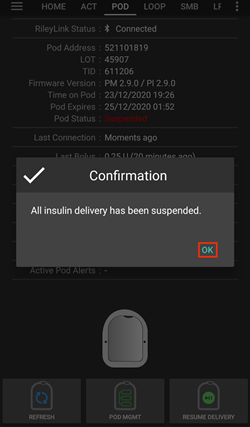
   > 
   >  
   > 
   > ```{admonition} Older screenshot
   >    :class: note
   >    צילומי המסך למעלה הם מגרסה קודמת של **AAPS**. ב-**AAPS** 4 השלבים האלה מתבצעים במסך המשאבה Omnipod במקום בלשונית **Omnipod (POD)**, והתוצאה מוצגת בשדה **סטטוס הפוד**.
   > ```

אם הפקודה נכשלת, מופיע חלון **אזהרה** עם ההודעה "השהיית ההזרקה נכשלה" והסיבה. יש לבדוק את החיבור ל-RileyLink ולנסות שוב.

#### Resuming Insulin Delivery

Use this command to instruct the active, currently suspended pod to resume insulin delivery. לאחר עיבוד הפקודה, מתן האינסולין יחודש לפי הקצב הבזאלי הנוכחי בהתאם להגדרתו בפרופיל. הפוד יקבל שוב פקודות עבור בולוס, קצב בזאלי זמני ו-SMB.

1. יש לפתוח את מסך המשאבה Omnipod ולבדוק שהשדה **סטטוס הפוד** מציג **מושהה**. יש ללחוץ על **חידוש הזרקה**.

2. כאשר הפקודה מצליחה, השדה **סטטוס הפוד** מציג שוב **פועל** והלחצן **חידוש הזרקה** נעלם (הלחצן **השהיה** מוצג שוב אם הפעלתם אותו).

   >  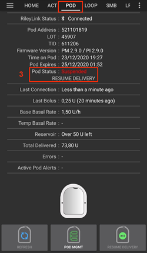
   > 
   > 
   > 
   > 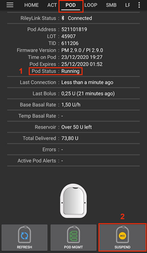 
   > 
   > ```{admonition} Older screenshot
   >    :class: note
   >    צילומי המסך למעלה הם מגרסה קודמת של **AAPS**. ב-**AAPS** 4 השלבים האלה מתבצעים במסך המשאבה Omnipod במקום בלשונית **Omnipod (POD)**, והתוצאה מוצגת בשדה **סטטוס הפוד**.
   > ```

אם הפקודה נכשלת, מופיע חלון **אזהרה** עם ההודעה "חידוש ההזרקה נכשל" והסיבה. יש לבדוק את החיבור ל-RileyLink ולנסות שוב.

### Silencing Pod Alerts

*הערה - הלחצן **השתקת התראות** מוצג במסך המשאבה Omnipod רק כאשר יש לפוד התראה פעילה (למשל התראת תפוגת הפוד או התראת מכל נמוך), ורק אם האפשרות **השתקה אוטומטית של התראות פוד** כבויה.*

התהליך שלהלן מראה כיצד להשתיק צפצופי פוד שמתחילים כאשר הפוד מגיע לזמן האזהרה לפני שתוקפו פג. זמן האזהרה הזה נקבע בהגדרה **התראה שעות לפני כיבוי הפוד (80 שעות)** שבהגדרות **התראות** של Omnipod. The maximum life of a pod is 80 hours (3 days 8 hours), however Insulet recommends not exceeding the 72 hour (3 days) limit.

*הערה - אם הפעלתם את **השתקה אוטומטית של התראות פוד** בהגדרות **התראות** של Omnipod, **AAPS** משתיק את ההתראה אוטומטית בתקשורת הבאה עם הפוד, ואין צורך לעשות זאת ידנית.*

1. כאשר מגיע זמן האזהרה, הפוד מצפצף כדי להודיע שתוקפו יפוג בקרוב ושיש להחליף אותו. במסך המשאבה Omnipod, השדה **תפוגת הפוד** מציג את השעה המדויקת שבה יפוג תוקף הפוד (72 שעות לאחר ההפעלה); 4 שעות לפני כן הוא הופך ל**צהוב**. השדה **מועד הסיום הסופי של הפוד** מציג מתי הפוד יפסיק לתת אינסולין. השדה **התראות פוד פעילות** מציג **תוקף הפוד יפוג בקרוב**, והלחצן **השתקת התראות** מופיע. **AAPS** מציג גם הודעה על תפוגת הפוד הקרובה.

   >   
   > 
   > ```{admonition} Older screenshot
   >    :class: note
   >    צילומי המסך למעלה הם מגרסה קודמת של **AAPS**. ב-**AAPS** 4 הלחצן **ACK ALERTS** נקרא **השתקת התראות** והוא נמצא במסך המשאבה Omnipod.
   > ```

2. יש ללחוץ על **השתקת התראות**. ה-RileyLink שולח לפוד את הפקודה להפסיק את צפצופי האזהרה על התפוגה.

   >  
   > 
   > ```{admonition} Older screenshot
   >    :class: note
   >    צילום המסך למעלה הוא מגרסה קודמת של **AAPS**. ב-**AAPS** 4 הלחצן נקרא **השתקת התראות**.
   > ```

3. כאשר ההתראות מושתקות, הפוד מצפצף פעמיים. השדה **התראות פוד פעילות** כבר לא מציג את האזהרה, הלחצן **השתקת התראות** נעלם והפוד מפסיק את צפצופי האזהרה על התפוגה.

   >  
   > 
   > ```{admonition} Older screenshot
   >    :class: note
   >    צילום המסך למעלה הוא מגרסה קודמת של **AAPS**. ב-**AAPS** 4 התוצאה מוצגת במסך המשאבה Omnipod: האזהרה נעלמת מהשדה **התראות פוד פעילות**.
   > ```

אם הפקודה נכשלת (למשל, ה-RileyLink מחוץ לטווח של הפוד), מופיע חלון **אזהרה** עם ההודעה "השתקת ההתראות נכשלה" והסיבה. יש לקרב את ה-RileyLink לפוד ולנסות שוב.


```{admonition} Older screenshot
:class: note
צילום המסך למעלה הוא מגרסה קודמת של **AAPS**. ב-**AAPS** 4 החלון **אזהרה** מציג את ההודעה "השתקת ההתראות נכשלה" והסיבה.
```

(OmnipodEros-view-pod-history)=

### View Pod History

פרק זה מתאר כיצד לבדוק את היסטוריית הפוד הפעיל ולסנן אותה לפי קטגוריות פעולה שונות. The pod history tool allows you to view the actions and results committed to your currently active pod during its three day (72 - 80 hours) life.

This feature is useful for verifying boluses, TBRs, basal changes that were given but you may be unsure if they completed. שאר הקטגוריות שימושיות באופן כללי לפתרון תקלות ולקביעת סדר האירועים שהתרחשו לפני כשל.

*הערה:* פקודות **לא וודאי** יופיעו בהיסטוריית הפוד, אך בשל טבען לא ניתן להבטיח את דיוקן.

1. יש לפתוח את מסך המשאבה Omnipod (**ניהול** > **משאבה**) וללחוץ על **היסטוריית הפוד**.

   >   
   > 
   > ```{admonition} Older screenshot
   >    :class: note
   >    צילומי המסך למעלה הם מגרסה קודמת של **AAPS**. ב-**AAPS** 4 **היסטוריית הפוד** הוא לחצן במסך המשאבה Omnipod, ולא בתפריט **POD MGMT**.
   > ```

2. המסך **היסטוריית הפוד** מציג את כל פעולות הפוד ואת התוצאות שלהן, מהחדשה לישנה, מקובצות לפי יום. כברירת מחדל נבחר **הכול**. יש להקיש על אחד מלחצני הסינון בחלק העליון כדי להציג רק קטגוריה אחת. יש להשתמש בחץ החזרה בפינה העליונה כדי לחזור למסך המשאבה Omnipod.

   > 

   >  
   > 
   > ```{admonition} Older screenshot
   >    :class: note
   >    צילום המסך השני הוא מגרסה קודמת של **AAPS**, וייתכן שהוא נראה אחרת ב-**AAPS** 4.
   > ```

### View RileyLink Settings and History

המסך **סטטיסטיקת ריילילינק** מציג את ההגדרות של ה-RileyLink ושל הפוד הפעיל, ואת היסטוריית התקשורת של שניהם. יש בו שתי לשוניות: **הגדרות** ו**היסטוריה**.

הלחצן **סטטיסטיקת ריילילינק** מוסתר כברירת מחדל. כדי להציג אותו במסך המשאבה Omnipod, יש להפעיל את **הצגת לחצן "סטטיסטיקת ריילילינק" בתפריט ניהול פוד** ב[הגדרות Omnipod](#OmnipodEros-omnipod-settings), בסעיף **אחר**.

#### Manually Re-establish Pod Communication Device Bluetooth Communication

אם התקן התקשורת עם הפוד היה מחוץ לטווח ה-Bluetooth של הטלפון במשך זמן מה, ייתכן שהשדה **מצב ריילילינק** במסך המשאבה Omnipod יציג **ריילילינק בלתי נגיש**. בדרך כלל **AAPS** מתחבר מחדש בעצמו כשההתקן חוזר לטווח. אם זה לא קורה:

1. יש לוודא שה-RileyLink מופעל, טעון וקרוב לטלפון.

2. במסך המשאבה Omnipod, יש ללחוץ על **איפוס RileyLink**. הודעה מאשרת **תצורת RileyLink אופסה**. ראו את [הערות על איפוס RileyLink](#OmnipodEros-reset-rileylink-config-notes) שלהלן.

3. If the **Bluetooth connection** does not re-establish, try manually turning **off** and then back **on** the Bluetooth function on your phone.

4. אם עדיין אין חיבור מחדש, יש ללחוץ על **צימוד RileyLink** ולבחור שוב את ה-RileyLink.

5. אחרי חיבור מחדש מוצלח, השדה **מצב ריילילינק** מציג **מחובר**. ניתן לבדוק גם את **מצב החיבור** בלשונית **הגדרות** של המסך **סטטיסטיקת ריילילינק**. Congratulations, you have now reconnected your configured pod communication device to AAPS!

 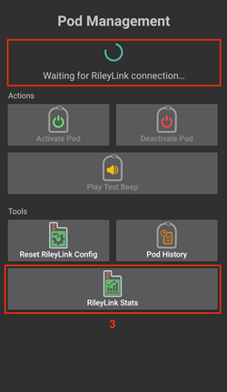

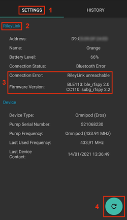

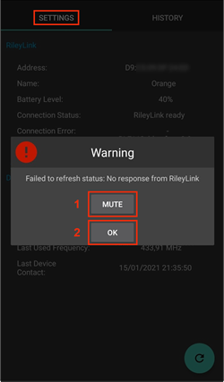

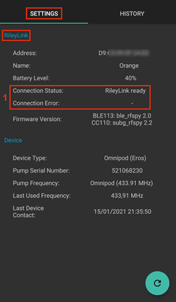

```{admonition} Older screenshot
:class: note
צילומי המסך למעלה הם מגרסה קודמת של **AAPS**. ב-**AAPS** 4 מתחברים מחדש עם **איפוס RileyLink** או **צימוד RileyLink** במסך המשאבה Omnipod, במקום לחצן הרענון במסך RileyLink Settings.
```

#### Pod Communication Device and Active Pod Settings

המסך הזה מציג מידע ומצב גם על התקן התקשורת עם הפוד שמצומד כעת וגם על פוד Omnipod Eros הפעיל. המידע מתרענן אוטומטית.

1. יש לפתוח את מסך המשאבה Omnipod (**ניהול** > **משאבה**) וללחוץ על **סטטיסטיקת ריילילינק**. הלשונית **הגדרות** מציגה את ה-**RileyLink** שמצומד כעת ואת הפוד הפעיל (**מכשיר**).

   >  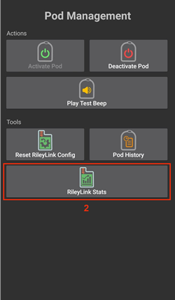 
   > 
   > ```{admonition} Older screenshot
   >    :class: note
   >    צילומי המסך למעלה הם מגרסה קודמת של **AAPS**. ב-**AAPS** 4 **סטטיסטיקת ריילילינק** הוא לחצן במסך המשאבה Omnipod, ולא בתפריט **POD MGMT**.
   > ```

   > 

##### שדות RileyLink

> - **כתובת:** כתובת ה-MAC של התקן התקשורת עם הפוד המצומד.
> - **שם:** שם ה-Bluetooth של התקן התקשורת עם הפוד המצומד.
> - **רמת הסוללה:** רמת הסוללה הנוכחית של התקן התקשורת עם הפוד המחובר. מוצג רק כאשר האפשרות **הצגת רמת הסוללה המדווחת על ידי OrangeLink/EmaLink/DiaLink** מופעלת.
> - **מצב החיבור**: המצב הנוכחי של חיבור ה-Bluetooth בין התקן התקשורת עם הפוד לבין הטלפון שבו פועל AAPS.
> - **שגיאת חיבור:** אם יש שגיאה בחיבור ה-Bluetooth של התקן התקשורת עם הפוד, הפרטים מוצגים כאן.
> - **גרסת קושחה:** גרסת הקושחה הנוכחית המותקנת בהתקן התקשורת עם הפוד המחובר כעת.

##### שדות המכשיר - עם פוד פעיל

> - **סוג מכשיר:** סוג המכשיר שמתקשר עם התקן התקשורת עם הפוד (אומניפוד (Eros)).
> - **דגם המכשיר המוגדר:** דגם המכשיר שהוגדר לתקשר עם התקן התקשורת עם הפוד.
> - **דגם המכשיר המחובר:** דגם המכשיר שמתקשר כעת עם התקן התקשורת עם הפוד.
> - **מספר סידורי של המשאבה:** המספר הסידורי של הפוד שהופעל כעת.
> - **תדר המשאבה:** תדר הרדיו שמשמש לתקשורת עם הפוד.
> - **תדר בשימוש האחרון:** תדר הרדיו האחרון הידוע שבו השתמש הפוד כדי לתקשר עם התקן התקשורת עם הפוד.
> - **קשר אחרון עם המכשיר:** התאריך והשעה של הקשר האחרון בין הפוד לבין התקן התקשורת שלו.

(omnipod-eros-rileylink-and-active-pod-history)=
#### RileyLink and Active Pod History

הלשונית הזו מציגה, מהחדש לישן, כל מצב או פעולה של ה-RileyLink או של הפוד המחובר כעת. ההיסטוריה זמינה רק עבור הפוד הפעיל הנוכחי. אחרי החלפת פוד, ההיסטוריה הזו נמחקת, ורק אירועים של הפוד החדש שהופעל נרשמים ומוצגים.

1. יש לפתוח את מסך המשאבה Omnipod (**ניהול** > **משאבה**), ללחוץ על **סטטיסטיקת ריילילינק** ואז להקיש על הלשונית **היסטוריה**.

   >  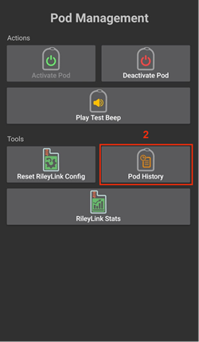 
   > 
   > ```{admonition} Older screenshot
   >    :class: note
   >    צילומי המסך למעלה הם מגרסה קודמת של **AAPS**. ב-**AAPS** 4 **סטטיסטיקת ריילילינק** הוא לחצן במסך המשאבה Omnipod, ולא בתפריט **POD MGMT**.
   > ```

   > 

##### Fields

כל רשומה מציגה:

> - **מכשיר:** המכשיר שאליו מתייחסים הפעולה או המצב.
> - **זמן:** שעת האירוע.
> - **מצב או פעולה:** מצב המכשיר או הפעולה שהוא ביצע.

(OmnipodEros-omnipod-pod-tab)=

## מסך המשאבה Omnipod

להלן הסבר על שדות המצב והלחצנים ב**מסך המשאבה Omnipod** (**ניהול** > **משאבה**, או **הגדרות תצורה** > **משאבה** > **פתיחת תוסף**).

סמל גלגל השיניים בפינה העליונה פותח את [הגדרות Omnipod](#OmnipodEros-omnipod-settings).

*הערה: אם שדה מצב כלשהו מציג (לא וודאי), יש ללחוץ על **רענן** כדי לרענן את סטטוס הפוד ולנקות אותו.*


```{admonition} Older screenshot
:class: note
צילום המסך למעלה הוא מגרסה קודמת של **AAPS**, שבה המסך הזה היה הלשונית **Omnipod (POD)**. ב-**AAPS** 4 זהו מסך המשאבה Omnipod, וחלק משמות השדות והלחצנים שונים.
```

### Fields

- **מצב ריילילינק:** מציג את מצב החיבור הנוכחי של ה-RileyLink. שגיאות מוצגות באדום.

- *לא התחיל* - עדיין לא צומד RileyLink, או שהחיבור עוד לא התחיל.
- *ריילילינק בלתי נגיש* - התקן התקשורת עם הפוד נמצא מחוץ לטווח ה-Bluetooth של הטלפון, כבוי, או שיש בו תקלה שמונעת תקשורת Bluetooth.
- *ריילילינק מוכן* - התקן התקשורת עם הפוד מופעל ומאתחל כעת את חיבור ה-Bluetooth.
- *מחובר* - התקן התקשורת עם הפוד מופעל, מחובר ומסוגל לתקשר כעת באמצעות Bluetooth.

- **מזהה ייחודי:** מציג את הכתובת של הפוד הפעיל.

- **מספר LOT:** מציג את מספר ה-LOT של הפוד הפעיל.

- **מספר רצף:** מציג את המספר הסידורי (TID) של הפוד.

- **גרסת קושחה:** מציג את גרסת הקושחה של הפוד הפעיל.

- **השעה בפוד:** מציג את השעה הנוכחית בפוד הפעיל. היא מודגשת כאשר היא שונה מהשעה בטלפון ביותר מ-5 דקות.

- **תפוגת הפוד:** מציג את התאריך והשעה שבהם יפוג תוקף הפוד הפעיל. הטקסט הופך לצהוב ב-4 השעות האחרונות לפני מועד זה. הוא אף פעם לא הופך לאדום, כי הפוד ממשיך לתת אינסולין גם אחרי מועד זה.

- **מועד הסיום הסופי של הפוד:** מציג את סוף תקופת החסד של הפוד (8 שעות אחרי **תפוגת הפוד**, כלומר חיי פוד של 80 שעות לכל היותר). הטקסט הופך לצהוב כשתקופת החסד מתחילה (ב**תפוגת הפוד**) ולאדום ב-4 השעות האחרונות לפני הסיום הסופי. במהלך תקופת החסד מוצג גם הזמן שנותר, למשל *(17m remaining)*. בסיום הסופי הפוד מפסיק לתת אינסולין, ויש להחליף אותו.

- **סטטוס הפוד:** מציג את מצב הפוד הפעיל (למשל **אין פוד פעיל**, **פועל** או **מושהה**).

- **חיבור אחרון:** מציג מתי הייתה התקשורת האחרונה עם הפוד הפעיל. הטקסט הופך לאדום כאשר עוברים את [הסף למשאבה לא זמינה](#OmnipodEros-troubleshooting).

- *לפני כמה רגעים* - לפני פחות מ-20 שניות.
- *לפני פחות מדקה* - יותר מעשרים שניות אך פחות מ-60 שניות.
- *לפני דקה אחת* - יותר מ-60 שניות אך פחות מ-120 שניות (2 דקות)
- *לפני XX דקות* - לפני יותר משתי דקות ככתוב בערך XX

- **בולוס אחרון:** מציג את כמות הבולוס האחרון שנשלח לפוד הפעיל, ובסוגריים לפני כמה זמן הוא ניתן.

- **ערך בזאלי בסיסי:** מציג את הקצב הבזאלי שמוגדר לשעה הנוכחית בפרופיל הבזאלי.

- **קצב בזאלי זמני:** מוצג רק בזמן שפועל בזאלי זמני. מוצג בתבנית הבאה:

- Units / hour @ time TBR was issued (minutes run / total minutes TBR will be run)
- *לדוגמה:* 0.00U/h @18:25 ( 90/120 דקות)

- **מכל:** מציג **נותרו יותר מ-50 U** כאשר נותרו במכל יותר מ-50 יחידות. מתחת לערך זה מוצג מספר היחידות המשוער. הטקסט הופך לאדום מתחת לסף המכל הנמוך שהוגדר ב[הגדרות ההתראות](#OmnipodEros-omnipod-settings).

- **סה"כ שהוזרק:** מציג את סך יחידות האינסולין שניתנו מהמכל. *Note this is an approximation as priming and filling the pod is not an exact process.*

- **התראות פוד פעילות:** מיועד להתראות שפועלות כעת בפוד הפעיל. Normally used when pod expiration is past 72 hours and native pod beep alerts are running.

- **שגיאות:** מציג את השגיאה האחרונה שהתרחשה (מוצגת באדום). Review the [Pod history](#OmnipodEros-view-pod-history), [RileyLink history](#omnipod-eros-rileylink-and-active-pod-history) and log files for past errors and more detailed information.

### Buttons

הלחצנים בתחתית מסך המשאבה משתנים לפי המצב. לחצנים שאי אפשר להשתמש בהם כרגע מוצגים באפור, למשל כאשר ה-RileyLink אינו מחובר.

**לחצני מצב הפוד** (מוצגים כאשר יש פוד פעיל):

- **רענן:** שולח לפוד הפעיל פקודת רענון כדי לעדכן את המצב שלו. משמש לרענון סטטוס הפוד ולניקוי שדות מצב שמכילים את הטקסט (לא וודאי). למידע נוסף, ראו את [סעיף פתרון התקלות](#OmnipodEros-troubleshooting) שלהלן.

  

  ```{admonition} Older screenshot
  :class: note
  צילום המסך למעלה הוא מגרסה קודמת של **AAPS**. ב-**AAPS** 4 זהו לחצן טקסט בשם **רענן** במסך המשאבה Omnipod.
  ```

- **השתקת התראות:** משתיק את הצפצופים וההודעות על תפוגת הפוד ועל מכל נמוך. מוצג רק כאשר יש לפוד התראה פעילה והאפשרות **השתקה אוטומטית של התראות פוד** כבויה. אחרי השתקת ההתראות, הלחצן נעלם.

  

  ```{admonition} Older screenshot
  :class: note
  צילום המסך למעלה הוא מגרסה קודמת של **AAPS**. ב-**AAPS** 4 הלחצן הזה נקרא **השתקת התראות**.
  ```

- **הגדרת שעה:** מעדכן את השעה בפוד לפי השעה הנוכחית בטלפון. מוצג רק כאשר השעה בפוד שונה מהשעה בטלפון ביותר מ-5 דקות.

  

  ```{admonition} Older screenshot
  :class: note
  צילום המסך למעלה הוא מגרסה קודמת של **AAPS**. ב-**AAPS** 4 זהו לחצן טקסט בשם **הגדרת שעה** במסך המשאבה Omnipod.
  ```

- **השהיה:** משהה את מתן האינסולין בפוד הפעיל. Only shown if enabled in the settings (**Show Suspend Delivery button in Omnipod tab**).

  

  ```{admonition} Older screenshot
  :class: note
  צילום המסך למעלה הוא מגרסה קודמת של **AAPS**. ב-**AAPS** 4 זהו לחצן טקסט בשם **השהיה** במסך המשאבה Omnipod.
  ```

- **חידוש הזרקה:** מחדש את מתן האינסולין בפוד הפעיל שמושהה כעת. מוצג רק בזמן שהפוד מושהה.

  

  ```{admonition} Older screenshot
  :class: note
  צילום המסך למעלה הוא מגרסה קודמת של **AAPS**. ב-**AAPS** 4 זהו לחצן טקסט בשם **חידוש הזרקה** במסך המשאבה Omnipod.
  ```

**לחצני ניהול הפוד וה-RileyLink:**


```{admonition} Older screenshot
:class: note
צילום המסך למעלה הוא מגרסה קודמת של **AAPS**. ב-**AAPS** 4 אין תפריט ניהול הפוד: הפעולות האלה הן לחצנים ישירות במסך המשאבה Omnipod.
```

- **הפעלת פוד:** מתחל ומפעיל פוד חדש. מוצג כאשר אין פוד פעיל. הלחצן זמין רק כאשר ה-RileyLink מחובר.

  

  ```{admonition} Older screenshot
  :class: note
  צילום המסך למעלה הוא מגרסה קודמת של **AAPS**. ב-**AAPS** 4 **הפעלת פוד** הוא לחצן במסך המשאבה Omnipod, ולא בתפריט ניהול הפוד.
  ```

- **השבתת פוד:** משבית את הפוד הפעיל כעת. מוצג מרגע שהפוד מצומד, גם כאשר ההפעלה נעצרה באמצע (למשל, כי הפוד נכשל במהלך ההפעלה). הלחצן זמין רק כאשר ה-RileyLink מחובר. **AAPS** מבקש אישור לפני שהוא משבית את הפוד.

- Use this command to deactivate a screaming pod (error 49).
- אם ההשבתה נכשלת, אשף ההשבתה מציע את האפשרות **השלכת הפוד**.

  

  ```{admonition} Older screenshot
  :class: note
  צילום המסך למעלה הוא מגרסה קודמת של **AAPS**. ב-**AAPS** 4 **השבתת פוד** הוא לחצן במסך המשאבה Omnipod, ולא בתפריט ניהול הפוד.
  ```

- **השמעת צפצוף ניסיון:** משמיע צפצוף ניסיון אחד בפוד בלחיצה. מוצג כאשר יש פוד מצומד.

  

  ```{admonition} Older screenshot
  :class: note
  צילום המסך למעלה הוא מגרסה קודמת של **AAPS**. ב-**AAPS** 4 **השמעת צפצוף ניסיון** הוא לחצן במסך המשאבה Omnipod, ולא בתפריט ניהול הפוד.
  ```

- **היסטוריית הפוד:** מציג את היסטוריית הפעילות של הפוד הפעיל. ראו [צפייה בהיסטוריית הפוד](#OmnipodEros-view-pod-history).

  

  ```{admonition} Older screenshot
  :class: note
  צילום המסך למעלה הוא מגרסה קודמת של **AAPS**. ב-**AAPS** 4 **היסטוריית הפוד** הוא לחצן במסך המשאבה Omnipod, ולא בתפריט ניהול הפוד.
  ```

- **צימוד RileyLink:** סורק ומוצא את התקן התקשורת עם הפוד ומצמד אותו. ראו [הגדרת RileyLink](#OmnipodEros-rileylink-setup).

- **סטטיסטיקת ריילילינק:** פותח את המסך סטטיסטיקת ריילילינק, עם שתי לשוניות. מוצג רק אם הוא הופעל בהגדרות (**הצגת לחצן "סטטיסטיקת ריילילינק" בתפריט ניהול פוד**).

- **הגדרות** - מציג מידע על הגדרות RileyLink והפוד הפעיל
- **היסטוריה** - מציג את היסטוריית התקשורת של RileyLink והפוד

  

  ```{admonition} Older screenshot
  :class: note
  צילום המסך למעלה הוא מגרסה קודמת של **AAPS**. ב-**AAPS** 4 **סטטיסטיקת ריילילינק** הוא לחצן במסך המשאבה Omnipod, ולא בתפריט ניהול הפוד.
  ```

- **איפוס RileyLink:** מאפס את התצורה של התקן התקשורת עם הפוד שמחובר כעת. כאשר התקשורת מתחילה, נתונים מסוימים נשלחים ל-RileyLink ומוגדרים בו:

- מוגדרים רישומי הזיכרון
- מוגדרים פרוטוקולי התקשורת
- מוגדר תדר הרדיו המכוונן
  > 
  > ראו [הערות נוספות](#OmnipodEros-reset-rileylink-config-notes) שלהלן.

  

  ```{admonition} Older screenshot
  :class: note
  צילום המסך למעלה הוא מגרסה קודמת של **AAPS**. ב-**AAPS** 4 הלחצן הזה נקרא **איפוס RileyLink** והוא נמצא במסך המשאבה Omnipod.
  ```

- **השלכת הפוד:** מוחק את נתוני המצב של פוד שאינו מגיב, אחרי אישור. מוצג רק כאשר פוד הופעל אך לא צומד במלואו, כי השבתה תקינה כבר אינה אפשרית:

- A **pod is not fully paired** and thus ignores deactivate commands.
- **הפוד נתקע** באמצע תהליך הצימוד, בין שלבים.
- A **pod simply does not pair at all.**
  > 
  > אחרי השלכת הפוד, **AAPS** כבר לא יכול לתקשר איתו. יש להסיר את הפוד מהגוף.

  

  ```{admonition} Older screenshot
  :class: note
  צילום המסך למעלה הוא מגרסה קודמת של **AAPS**. ב-**AAPS** 4 **השלכת הפוד** הוא לחצן במסך המשאבה Omnipod, ולא בתפריט ניהול הפוד.
  ```

(OmnipodEros-reset-rileylink-config-notes)=

#### *הערות על איפוס RileyLink*

- The primary usage of this feature is when the currently active pod communication device is not responding and communication is in a stuck state.
- אם התקן התקשורת עם הפוד כובה והופעל שוב, יש ללחוץ על **איפוס RileyLink** כדי שפרמטרי התקשורת האלה יוגדרו בו מחדש.
- If this is NOT done then AAPS will need to be restarted after the pod communication device is power cycled.
- **אין צורך** ללחוץ על הלחצן הזה כשעוברים בין התקני תקשורת שונים עם הפוד.

(OmnipodEros-omnipod-settings)=

## Omnipod Settings

כדי לפתוח את ההגדרות של מנהל ההתקן של Omnipod, יש:

- ללחוץ על סמל גלגל השיניים בפינה העליונה של מסך המשאבה Omnipod (**ניהול** > **משאבה**), או
- לפתוח את **התפריט** (☰) בפינה העליונה > **הגדרות תצורה** > **משאבה** וללחוץ על **הגדרות** בכרטיס **Omnipod Eros**.

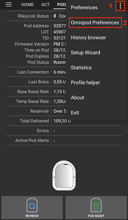

```{admonition} Older screenshot
:class: note
צילום המסך למעלה הוא מגרסה קודמת של **AAPS**. ב-**AAPS** 4 פותחים את ההגדרות עם **הגדרות** בכרטיס **Omnipod Eros** או עם סמל גלגל השיניים במסך המשאבה Omnipod, במקום גלגל השיניים ב**הגדרות תצורה** או תפריט שלוש הנקודות.
```

ההגדרות מקובצות כפי שמפורט להלן. יש להקיש על קבוצה כדי לפתוח אותה. רוב הפריטים הם מתגים שאפשר להפעיל או לכבות:


*NOTE: An asterisk (\*) denotes the default for a setting is enabled.*

### RileyLink

הגדרות של התקן התקשורת עם הפוד. את ההתקן עצמו מצמדים עם הלחצן **צימוד RileyLink** במסך המשאבה (ראו [הגדרת RileyLink](#OmnipodEros-rileylink-setup)).

- **שימוש בסריקה:** סורק לפני ההתחברות ל-OrangeLink. זה יכול לשפר את החיבורים. אפשר להשתמש בזה גם עם תחליפים אחרים של RileyLink, אם צריך.

- **הצגת רמת הסוללה המדווחת על ידי OrangeLink/EmaLink/DiaLink:** מדווח על רמת הסוללה בפועל של OrangeLink/EmaLink/DiaLink. It is **strongly recommended** that all OrangeLink/EmaLink/DiaLink users enable this setting.

- DOES NOT work with the original RileyLink.
- May not work with RileyLink alternatives.
- Enabled - Reports the current battery level for supported pod communication devices.
- Disabled - Reports a value of n/a.

- **רישום החלפת סוללה בפעולות:** זמין רק כאשר הגדרת דיווח הסוללה שלמעלה מופעלת. חלק מהתקני התקשורת עם הפוד עובדים עם סוללות רגילות שאפשר להחליף. כשההגדרה הזו מופעלת, אפשר לרשום [רשומת פורטל טיפולים](#aaps-screens-careportal) מסוג **החלפת סוללת משאבה** כדי לתעד את ההחלפה ולאפס את גיל הסוללה.

### צפצופי אימות

Provides confirmation beeps from the pod for bolus, basal, SMB, and TBR delivery and changes.

- **\*צפצופי בולוס מופעלים:** הפעלה או השבתה של צפצופי אישור בעת מתן בולוס.
- **צפצופי בזאלי מופעלים:** הפעלת או השבתת צפצופי אישור כאשר נקבע קצב בזאלי חדש, הקצב הבזאלי הפעיל מבוטל או הקצב הבזאלי הנוכחי משתנה.
- **\*צפצופי SMB מופעלים:** הפעלה או השבתה של צפצופי אישור בעת מתן SMB.
- **צפצופי בזאלי זמני מופעלים:** הפעלת או השבתת צפצופי אישור כאשר בזאלי זמני מופעל או מבוטל.

### Alerts

Provides AAPS alerts and Nightscout announcements for pod expiration, shutdown, low reservoir based on the defined threshold units.

*Note an AAPS notification will ALWAYS be issued for any alert after the initial communication with the pod since the alert was triggered. סגירת ההודעה לא משתיקה את ההתראה, אלא אם האפשרות **השתקה אוטומטית של התראות פוד** מופעלת. כדי להשתיק את ההתראה ידנית, יש לפתוח את מסך המשאבה Omnipod וללחוץ על **השתקת התראות**.*

- **\*תזכורת לתפוגה מופעלת:** כשההגדרה מופעלת, הפוד מצפצף כשמגיע הזמן שמוגדר למטה.
- **התראה שעות לפני כיבוי הפוד (80 שעות):** כמה שעות לפני כיבוי הפוד (80 שעות לאחר ההפעלה) תופעל תזכורת התפוגה (1 עד 8 שעות, ברירת מחדל 8).
- **\*התראת מכל נמוך מופעלת:** הפעלה או השבתה של התראה כאשר מספר היחידות שנותרו בפוד מגיע לסף המכל הנמוך, כפי שהוגדר בשדה מספר יחידות.
- **מספר יחידות:** מספר היחידות שבו תופעל התראת המכל הנמוך של הפוד (5 עד 50, ברירת מחדל 20).
- **השתקה אוטומטית של התראות פוד:** כשההגדרה מופעלת, עדיין מוצגת הודעה, אבל ההתראה מושתקת אוטומטית בתקשורת הבאה עם הפוד אחרי שההתראה התחילה.

### Notifications

Provides AAPS notifications and audible phone alerts when it is uncertain if TBR, SMB, or bolus events were successful.

*NOTE: These are notifications only, no audible beep alerts are made.*

- **\*התראת צליל של בזאלי זמני לא ודאי מאופשרת:** הפעילו או השביתו הגדרה זו כדי לקבל התראה קולית והודעה חזותית כאשר AAPS אינו בטוח שבזאלי זמני (TBR) הוגדר בהצלחה.
- **\*מאופשרת התראת צליל עבור SMB לא ודאי:** הפעילו או השביתו הגדרה זו כדי לקבל התראה קולית והודעה חזותית כאשר AAPS אינו בטוח ש-SMB ניתן בהצלחה.
- **\*התראת צליל של בולוס לא ודאי מאופשרת:** הפעילו או השביתו הגדרה זו כדי לקבל התראה קולית והודעה חזותית כאשר AAPS אינו בטוח שבולוס ניתן בהצלחה.

### אחר

Provides advanced settings to assist debugging.

- **Show Suspend Delivery button in Omnipod tab:** Hide or display the **Suspend** button in the Omnipod tab.
- **הצגת לחצן "יומן פעימות" בתפריט ניהול פוד:** ההגדרה עדיין מופיעה ברשימה, אבל בגרסה הנוכחית של מסך המשאבה אין לחצן **יומן פעימות**.

- **הצגת לחצן "סטטיסטיקת ריילילינק" בתפריט ניהול פוד:** מסתיר או מציג את הלחצן **סטטיסטיקת ריילילינק** במסך המשאבה Omnipod.
- **\*זיהוי אזור זמן ושעון קיץ מופעל:** מאפשר לזהות אוטומטית שינויים באזור הזמן, אם משתמשים בטלפון באזור שבו נהוג שעון קיץ.

### Switching or Removing an Active Pod Communication Device (RileyLink)

יש הרבה דגמים חלופיים ל-RileyLink המקורי (כמו OrangeLink או EmaLink), ולפעמים צריך כמה התקני תקשורת עם הפוד מאותו סוג או התקן גיבוי, ולכן ייתכן שתצטרכו לעבור להתקן אחר.

כדי לעבור, יש לפתוח את מסך המשאבה Omnipod (**ניהול** > **משאבה**), ללחוץ על **צימוד RileyLink** ולבחור את ההתקן החדש, כפי שמתואר ב[הגדרת RileyLink](#OmnipodEros-rileylink-setup). ההתקן החדש מחליף את ההתקן שצומד קודם.

 


 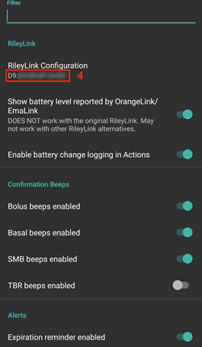

```{admonition} Older screenshot
:class: note
צילומי המסך למעלה הם מגרסה קודמת של **AAPS**. ב-**AAPS** 4 מוסיפים התקן עם **צימוד RileyLink** במסך המשאבה Omnipod, במקום **RileyLink Configuration** בהגדרות Omnipod, והסריקה מתחילה אוטומטית.
```

אין לחצן נפרד להסרת התקן מצומד. אם מפסיקים להשתמש ב-RileyLink, פשוט מצמדים את החדש כשצריך אותו.


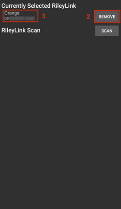

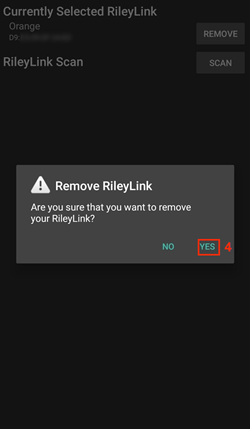

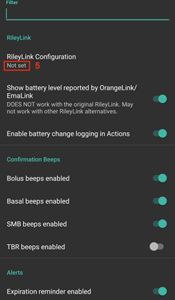

```{admonition} Older screenshot
:class: note
צילומי המסך למעלה הם מגרסה קודמת של **AAPS**. ב-**AAPS** 4 אין לחצן **Remove**: צימוד של RileyLink חדש מחליף את הקודם.
```

## שורת המצב ופורטל הטיפולים

יש כמה פריטים שנובעים מההבדל בין פוד Omnipod לבין משאבות עם צינורית, במיוחד אחרי הדבקת פוד חדש.

הגילים של **האינסולין** ושל **הצינורית** ב[שורת המצב](#screens-sensor-level-battery) של המסך הראשי **מתאפסים** ל-0 ימים ו-0 שעות **אחרי כל החלפת פוד**. זה נעשה בגלל האופן שבו משאבת Omnipod בנויה ופועלת. **סוללת המשאבה** ו**מכל האינסולין** נמצאים בתוך כל פוד. מכיוון שהפוד מחדיר את הצינורית ישירות לעור באתר הדבקתו, אין שימוש בצינור מסורתי במשאבות Omnipod. *לכן לאחר החלפת פוד, הגיל של כל אחד מהערכים הללו מתאפס אוטומטית.* **גיל סוללת המשאבה** אינו מדווח, כי הסוללה בפוד תמיד מחזיקה יותר זמן מחיי הפוד (80 שעות לכל היותר).


### Levels

**Insulin Level**

Reporting of the amount of insulin in the Omnipod Eros Pod is not exact. הסיבה היא שלא ידוע בדיוק כמה אינסולין הוכנס לפוד, אלא רק שכאשר נשמעים 2 הצפצופים במהלך מילוי הפוד, הוכנסו לפחות 80 יחידות. A Pod can hold a maximum of 200 units. גם התיחול יכול ליצור סטייה, כי הוא אינו תהליך מדויק. With both of these factors, the Omnipod driver has been written to give the best approximation of insulin remaining in the reservoir.

> - **Above 50 Units** - Reports a value of 50+U when more than 50 units are currently in the reservoir.
> - **Below 50 Units** - Reports an approximate calculated value of insulin remaining in the reservoir.
> - **SMS** - מחזירה ערך או 50+U בתגובות של SMS
> - **Nightscout** - מעלה ל-Nightscout את הערך 50 כאשר יש יותר מ-50 יחידות (גרסה 14.07 ומטה).  גרסאות חדשות יותר ידווחו על ערך של 50+ כאשר מעל 50 יחידות.

**Battery Level**

Battery level reporting is a setting that can be enabled to return the current battery level of pod communication devices, such as the OrangeLink, EmaLink or DiaLink.  The RileyLink hardware is not capable of reporting its battery level.  The battery level is reported after each communication with the pod, so when charging a linear increase may not be observed.  A manual refresh will update the current battery level.  When a supported Pod communication device is disconnected a value of 0% will be reported.

> - **RileyLink hardware is NOT capable of reporting battery level**
> - **חובה להפעיל את ההגדרה "הצגת רמת הסוללה המדווחת על ידי OrangeLink/EmaLink/DiaLink" בהגדרות Omnipod כדי לדווח על ערכי רמת הסוללה**
> - **Battery level reporting ONLY works for OrangeLink, EmaLink and DiaLink Devices**
> - **Battery Level reporting MAY work for other devices (excluding RileyLink)**
> - **SMS** - Returns current battery level as a response when an actual level exists, a value of n/a will not be returned
> - **Nightscout** - Battery level is reported when an actual level exists, a value of n/a will not be reported

(OmnipodEros-troubleshooting)=

## פתרון תקלות

### Pod Failures

Pods fail occasionally due to a variety of issues, including hardware issues with the Pod itself. It is best practice not to call these into Insulet, since AAPS is not an approved use case. A list of fault codes can be found [here](https://github.com/openaps/openomni/wiki/Fault-event-codes) to help determine the cause.

### Preventing error 49 pod failures

This failure is related to an incorrect pod state for a command or an error during an insulin delivery command. מומלץ להגדיר את הסנכרון עם Nightscout ל*העלאה בלבד*: יש להשאיר כבויות את כל האפשרויות "Receive ... from NS" בהגדרות הסנכרון של לקוח Nightscout (ראו [Nightscout](../SettingUpAaps/Nightscout.md)), כדי למנוע תקלות אפשריות.

### Pump Unreachable Alerts

מומלץ להגדיר את ההתראות על משאבה לא זמינה ל-**120 דקות**. יש ללחוץ על סמל **הגדרות** (גלגל שיניים) בפינה העליונה של המסך הראשי, לבחור **התראות מקומיות** > **סף למשאבה לא זמינה** ולהגדיר אותו ל-**120**.

(OmnipodEros-import-settings-from-previous-aaps)=
### Import Settings from previous AAPS

```{admonition} Importing settings can end your active Pod
:class: warning
בטלפון שכבר מפעיל את הפוד, יש להשאיר את **גם החלף את הגדרות המשאבה** לא מסומן: הפוד הפעיל נשמר, ורק שאר ההגדרות מיובאות. יש לסמן זאת רק עם קובץ שיוצא במהלך הפוד שמודבק עליכם עכשיו. ראו [משאבות ללא צינורית](#ExportImportSettings-tubeless-pumps).
```

הדרך הבטוחה ביותר להתקין מחדש את **AAPS** היא בין שני פודים:

1. Deactivate your pod session. Verify that you do not have an active pod session.
2. ייצאו את ההגדרות ושמרו עותק במקום בטוח.
3. Uninstall the previous version of AAPS and restart your phone.
4. Install the new version of AAPS and verify that you do not have an active pod session.
5. Import your settings and activate your new pod.

### Omnipod driver alerts

שימו לב שמנהל ההתקן של Omnipod מציג מגוון התראות ייחודיות ב**מסך הראשי**. רובן לידיעה בלבד ואפשר לסגור אותן, וחלקן מציינות פעולה שיש לבצע כדי לפתור את הסיבה להתראה. A summary of the main alerts that you may encounter is listed below:

#### No active Pod

No active Pod session detected. ניתן לדחות התראה זו זמנית בלחיצה על **נודניק**, אך היא תמשיך לחזור כל עוד לא הופעל פוד חדש. Once activated this alert is automatically silenced.

#### Pod suspended

Informational alert that Pod has been suspended.

#### Setting basal profile failed. Delivery might be suspended! יש לרענן ידנית את סטטוס הפוד במסך המשאבה ולחדש את מתן האינסולין במידת הצורך.

התראה לידיעה בלבד על כך שהגדרת הפרופיל הבזאלי בפוד נכשלה. יש לפתוח את מסך המשאבה Omnipod וללחוץ על **רענן**, ואז על **חידוש הזרקה** במידת הצורך.

#### לא ניתן לאמת אם בולוס SMB הצליח. אם אתם בטוחים שהבולוס לא הצליח, עליכם למחוק את ערך SMB באופן ידני מטיפולים.

התראה על כך שלא ניתן היה לאמת שבולוס ה-SMB הצליח. יש לבדוק את השדה **בולוס אחרון** במסך המשאבה Omnipod כדי לראות אם ה-SMB הצליח. אם לא, יש למחוק את הרשומה מהטיפולים.

#### לא בטוח אם "בולוס/בזאלי זמני/SMB" הושלם, אנא ודאו ידנית אם הוא הצליח.

Due to the way that the RileyLink and Omnipod communicate, situations can occur where it is *uncertain* if a command was successfully processed. The need to inform the user of this uncertainty was necessary.

Below are a few examples of when an uncertain notification can occur.

- **Boluses** - Uncertain boluses cannot be automatically verified. The notification will remain until the next bolus but a manual pod refresh will clear the message. *By default alerts beeps are enabled for this notification type as the user will manually need to verify them.*
- **TBRs, Pod Statuses, Profile Switches, Time Changes** - a manual pod refresh will clear the message.
- **סטיית השעה בפוד -** כאשר השעה בפוד והשעה בטלפון שונות מדי, קשה ללולאה של AAPS לפעול ולתת תחזיות והמלצות מינון מדויקות. אם הפרש השעות בין הפוד לטלפון גדול מ-5 דקות, מופיע הלחצן **הגדרת שעה** במסך המשאבה Omnipod. יש ללחוץ על **הגדרת שעה** כדי לסנכרן את השעה בפוד עם השעה בטלפון. אם אחר כך השדה **סטטוס הפוד** מציג **מושהה**, יש ללחוץ על **חידוש הזרקה** כדי להמשיך את הפעולה הרגילה של הפוד.

## Best Practices

(OmnipodEros-optimal-omnipod-and-rileylink-positioning)=

### Optimal Omnipod and RileyLink Positioning

The antenna used on the RileyLink to communicate with an Omnipod pod is a 433 MHz helical spiral antenna. Due to its construction properties it radiates an omni directional signal like a three dimensional doughnut with the z-axis representing the vertical standing antenna. This means that there are optimal positions for the RileyLink to be placed, especially during pod activation and deactivation routines.


> *(Fig 1. Graphical plot of helical spiral antenna in an omnidirectional pattern*)

Because of both safety and security concerns, pod *activation* has to be done at a range *closer (~30 cm away or less)* than other operations such as giving a bolus, setting a TBR or simply refreshing the pod status. Due to the nature of the signal transmission from the RileyLink antenna it is NOT recommended to place the pod directly on top of or right next to the RileyLink.

The image below shows the optimal way to position the RileyLink during pod activation and deactivation procedures. The pod may activate in other positions but you will have the most success using the position in the image below.

*Note: If after optimally positioning the pod and RileyLink communication fails, this may be due to a low battery which decreases the transmission range of the RileyLink antenna. To avoid this issue make sure the RileyLink is properly charged or connected directly to a charging cable during this process.*


## Where to get help

All of the development work for the Omnipod driver is done by the community on a volunteer basis; we ask that you please be considerate and use the following guidelines when requesting assistance:

- **רמה 0:** קראו את הסעיף הרלוונטי בתיעוד זה כדי להבין כיצד אמור לפעול הדבר שבו אתם מתקשים.
- **רמה 1:** אם אתם עדיין נתקלים בבעיות שאתם לא מצליחים לפתור באמצעות מסמך זה, אנא עברו לערוץ *#androidaps* ב-**Discord** באמצעות [קישור ההזמנה](https://discord.gg/4fQUWHZ4Mw).
- **Level 2:** Search existing issues to see if your issue has already been reported; if not, please create a new [issue](https://github.com/nightscout/AndroidAPS/issues) and attach your [log files](../GettingHelp/AccessingLogFiles.md).
- **היו סבלניים - רוב חברי הקהילה שלנו מורכבים ממתנדבים בעלי אופי טוב, ופתרון בעיות דורש לעתים קרובות זמן וסבלנות מצד המשתמשים והמפתחים כאחד.**
