# מסכי AAPS

```{contents}
:backlinks: entry
:depth: 2
```

(the-homescreen)= (AapsScreens-the-homescreen)=

## המסך הראשי


This is the first screen you will come across when you open **AAPS**, and it contains most of the information that you will need day to day.

### חלק A - הסרגל העליון

* **התפריט** (☰) בתחילת הסרגל העליון פותח את מגירת הניווט עם **היסטוריית טיפולים**, **דפדפן היסטוריה**, **סטטיסטיקה**, **עוזר הפרופילים**, **תחזוקה**, **אשף ההתקנה**, **הגדרות תצורה** ועוד.
* **שורת החיפוש** מוצאת הגדרות, חלונות ותיעוד - פשוט מתחילים להקליד (ראו [חיפוש כללי](../DailyLifeWithAaps/GlobalSearch.md)).
* סמל **הגדרות** (גלגל שיניים) בסוף הסרגל העליון פותח את כל [ההגדרות](../SettingUpAaps/Preferences.md).

(aaps-screens-profile--target)=

### חלק B - אזור המצב

#### Current blood glucose

ערך הסוכר האחרון מה-CGM מוצג בעיגול הגדול, יחד עם ההפרש מהערך הקודם (דלתא) והזמן שעבר מאז הקריאה.

The color of the BG value reflects the status to the defined [range](#Preferences-range-for-visualization).

* ירוק = בטווח
* אדום = מתחת לטווח
* צהוב = מעל הטווח

  

(loop-status)= (AapsScreens-loop-status)=

#### Loop status


ליד עיגול הסוכר, סמל מציג את מצב ההפעלה של הלולאה (מלמעלה למטה בתמונה):

1. Green circle = [closed loop](#KeyAapsFeatures-ClosedLoop), loop running
2. עיגול סגול עם קו מנוקד = [השהיה עקב ערך סוכר נמוך (LGS)](#KeyAapsFeatures-LGS)
3. Blue circle with dotted line = [open loop](#KeyAapsFeatures-OpenLoop)
4. עיגול אדום עם איקס = הלולאה מושבתת (לא פועלת באופן קבוע)
5. סמל השהיה אדום = הלולאה מושהית (עצירה זמנית, אבל אינסולין בזאלי ממשיך להינתן) - הזמן שנותר מוצג ליד הסמל
6. עיגול אפור עם תקע = המשאבה מנותקת (באופן זמני אין מתן אינסולין בכלל) - הזמן שנותר מוצג ליד הסמל

לחיצה על הסמל פותחת את חלון הלולאה. תוכן החלון תלוי במצב הנוכחי:

* כאשר הלולאה **פועלת** (סגורה, פתוחה או LGS), אפשר להחליף את מצב ההפעלה (לולאה סגורה, השהיה עקב ערך סוכר נמוך, לולאה פתוחה או השבתת לולאה), **להשהות** את הלולאה או **לנתק** את המשאבה למשך זמן לבחירה.
* כאשר הלולאה **מושבתת**, אפשר להפעיל אותה מחדש על ידי בחירת מצב הפעלה, או לנתק את המשאבה.
* כאשר הלולאה **מושהית**, אפשר **לחדש** אותה, לנתק את המשאבה, או לבחור משך זמן חדש תחת **השהיית הלולאה** כדי להאריך את ההשהיה.
* כאשר המשאבה **מנותקת**, אפשר **לחבר מחדש** את המשאבה, או לבחור משך זמן חדש תחת **ניתוק המשאבה** כדי להאריך את הניתוק.

כאשר מאריכים השהיה או ניתוק, משך הזמן החדש **מתחיל מעכשיו**: הוא מחליף את הזמן שנותר, ולא מתווסף אליו. אין צורך לחדש או לחבר מחדש קודם.

החלון כאשר הלולאה פועלת כלולאה סגורה:


החלון כאשר הלולאה מושהית, עם **חידוש** ועם משכי הזמן להארכת ההשהיה:

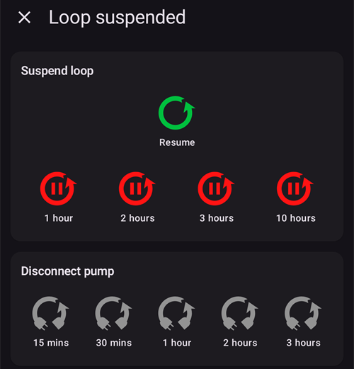

החלון כאשר המשאבה מנותקת, עם **חיבור משאבה מחדש** ועם משכי הזמן להארכת הניתוק:

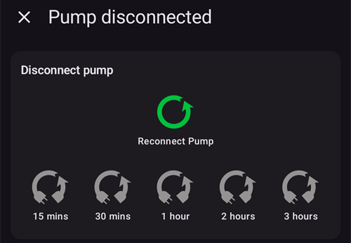

בהשהיה עקב ערך סוכר נמוך, בלולאה פתוחה וכאשר הלולאה מושבתת, החלון שונה רק במצבי ההפעלה שהוא מציע:


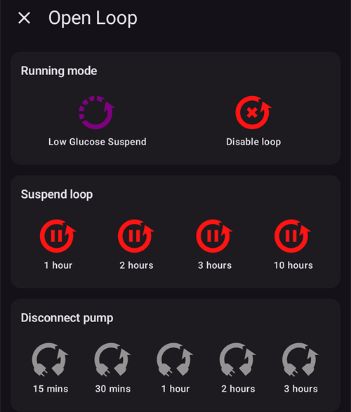


כך נראה המסך הראשי בכל מצב. פס הצבע בחלק העליון של הגרף משתנה ברגע ההחלפה.

השהיה עקב ערך סוכר נמוך:


לולאה פתוחה:

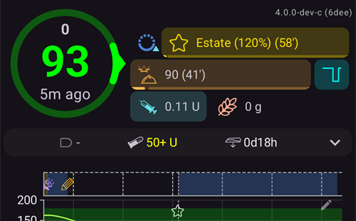

לולאה מושבתת:


הלולאה מושהית - הזמן שנותר מוצג ליד הסמל:


המשאבה מנותקת - הזמן שנותר מוצג ליד הסמל. לחצני הטיפול נשארים בסרגל ההפעלה המהירה (QuickLaunch), כך שעדיין אפשר לרשום אינסולין שניתן בעט או פחמימות:


נדרש אישור אחרי כל בחירה.

```{admonition} התראה: המשאבה לא קיבלה את הבזאלי הזמני בערך אפס :class: warning כאשר המשאבה מנותקת, **AAPS** שומר במשאבה בזאלי זמני בערך אפס, ומגדיר אותו שוב אם הוא חסר. אם זה עדיין נכשל אחרי 10 דקות, **AAPS** מפעיל התראה דחופה: *"המשאבה לא קיבלה את הבזאלי הזמני בערך אפס. ייתכן שהיא עדיין מספקת אינסולין בזאלי. נא לבדוק את המשאבה."* ההתראה חוזרת כל 15 דקות, עד שהבזאלי הזמני בערך אפס מוגדר או עד שהניתוק מסתיים. אם ההתראה מופיעה, יש לבדוק את המשאבה: ייתכן שהיא מספקת אינסולין בזאלי, למרות ש-**AAPS** מציג אותה כמנותקת.

    <br />הערה: המצבים המוצעים תלויים בהתקדמות ב[משימות](../SettingUpAaps/CompletingTheObjectives.md) - לולאה סגורה ו-LGS הופכים לזמינים רק לאחר השלמת המשימות המתאימות.
    
    (aaps-screens-bg-warning-sign)=
    #### סימן אזהרה של ערכי הסוכר
    
    אם **AAPS** מזהה בעיה בערכי הסוכר שהוא מקבל, מופיע בסרגל התחתון של המסך הראשי קיצור דרך למקור ערכי הסוכר (בשם המקור, למשל **נתוני סוכר מ-xDrip+**), עם תג אזהרה אדום. הקשה עליו פותחת את [מסך מקור ערכי הסוכר](#aaps-screens-bg-source).
    
    ##### ערכי סוכר כפולים
    
    סימן האזהרה האדום מסמן שיש לפעול מיד: מתקבלים **ערכי סוכר כפולים**, ובגללם הלולאה לא יכולה לעבוד כראוי. **AAPS** לא יכול לחשב את מגמת הסוכר באופן אמין מקריאות כפולות, ולכן הוא מפסיק לבצע תיקונים.
    
    אם הלולאה הייתה סגורה, **AAPS** מעביר אותה למצב [השהיה עקב ערך סוכר נמוך (LGS)](#KeyAapsFeatures-LGS): סמל הלולאה הופך לסגול.
    
      
    
    לחיצה על סמל הלולאה: כרטיס **מגבלות** בחלק העליון מסביר את הסיבה: "BgQualityCheck: מצב LGS עקב ערכים כפולים במקור נתוני הסוכר".
    
      
    
    ```{admonition} הלולאה פועלת במצב השהיה עקב ערך סוכר נמוך
    :class: note
    הלולאה ממשיכה לפעול, אבל רק כדי להגן מפני ערכים נמוכים: **AAPS** עדיין יכול להפחית או להשהות את הבזאלי, אבל לא ייתן שום אינסולין לתיקון עד שהבעיה תיפתר!
    

עליכם לברר מדוע יש כפילות:

* Is Dexcom bridge enabled on your Nightscout site? Disable the bridge by going to the administration panel of your Nightscout instance, edit the "enable" variable and remove the "bridge" part there. (עבור Heroku [אפשר למצוא פרטים כאן](https://nightscout.github.io/troubleshoot/troubleshoot/#heroku).)
* Do multiple sources upload your BG to Nightscout? אם משתמשים באפליקציית BYODA, יש להפעיל את ההעלאה ב-**AAPS**, אבל לא להפעיל אותה ב-xDrip (אם משתמשים בו).
* Do you have any followers that might receive your BG but do also upload it again to your Nightscout site?
* פתרון אחרון: ב[הגדרות NSClient](#Preferences-nsclient), לבחור את הגדרות הסנכרון ולכבות את האפשרות "קבלת נתוני CGM מ־Nightscout".

כדי להסיר את האזהרה מיד ולאפשר ללולאה לתקן שוב, יש למחוק את הרשומות הכפולות ממסך מקור ערכי הסוכר: להקיש על קיצור הדרך בסרגל התחתון. הקריאה הכפולה מסומנת באדום. לחיצה ארוכה על קריאה מתחילה את הבחירה. יש לסמן את הקריאות הכפולות ולהקיש על סמל הפח בחלק העליון של המסך.


אולם, כשיש הרבה כפילויות, אולי יהיה קל יותר:

* [לגבות את ההגדרות](../Maintenance/ExportImportSettings.md),
* לאפס את מסד הנתונים בתפריט התחזוקה ואז
* [לייבא שוב את ההגדרות](../Maintenance/ExportImportSettings.md)

    {admonition} יש לחזור ללולאה סגורה באופן ידני
    :class: important
    **AAPS** לא חוזר ל**לולאה סגורה** בעצמו אחרי שהקריאות הכפולות נמחקו. יש ללחוץ על סמל הלולאה במסך הראשי ולבחור שוב **לולאה סגורה**.

##### ערכי סוכר שטוחים

עם חלק ממקורות ערכי הסוכר (Libre 1, AiDEX, Glutec, Medtronic ומקורות שלא מדווחים על סוג החיישן), **AAPS** בודק גם קריאות שלא משתנות: אם ערך הסוכר השתנה בפחות מ-2 mg/dL (0.1 mmol/L) במשך 45 דקות, הנתונים נחשבים שגויים. אז קיצור הדרך למקור ערכי הסוכר מציג תג אדום של מגמה שטוחה, והלולאה מפסיקה כל בזאלי זמני גבוה ולא נותנת אינסולין לתיקון, עד שהקריאות משתנות שוב. יש לבדוק את החיישן ואת האפליקציה ששולחת את הקריאות.

##### ערכי סוכר לא סדירים

כאשר קריאות מגיעות במרווחים לא סדירים או שחלק מהן חסרות, **AAPS** מחשב מחדש ערכים כל 5 דקות מהקריאות שיש לו. זה קורה למשל אחרי החלפת חיישן, או עם חיישני Libre, שהתזמון שלהם זז בדקה או שתיים כל כמה שעות. הלולאה ממשיכה לפעול, ואין צורך לעשות דבר. **AAPS** 4 כבר לא מציג סימן אזהרה צהוב במקרה זה.

#### Current Profile

הפרופיל הנוכחי מוצג ליד סמל הכוכב.

הקשה על שם הפרופיל פותחת את [מסך הפרופיל](#aaps-screens-profile), שבו אפשר לראות את פרטי הפרופיל ול[החליף בין פרופילים שונים](../DailyLifeWithAaps/ProfileSwitch-ProfilePercentage.md).

כדי **לשנות את אחוז הפרופיל** (ואת משך הזמן שלו), יש להקיש על שם הפרופיל, ואז להקיש על הלחצן העגול **▶** (הפעלה) בפינה התחתונה של מסך הפרופיל. ב-**AAPS** 3.x המסך הזה נפתח בלחיצה ארוכה על שם הפרופיל; ב-**AAPS** 4 לחיצה ארוכה לא עושה דבר. שלב אחר שלב: [שינוי אחוז הפרופיל](#ProfileSwitch-change-percentage).


1. Regular display with a standard profile activation.
2. החלפת פרופיל עם אחוז של 90% וזמן שנותר של 9 דקות - שם הפרופיל הופך לצהוב כל עוד החלפת פרופיל זמנית פועלת.
3. החלפת פרופיל עם היסט זמן של שעה אחת וזמן שנותר של 9 דקות.

#### יעד


יעד רמת הסוכר הנוכחי מוצג מתחת לשם הפרופיל.

לחיצה קצרה על היעד פותחת את מסך **[יעד זמני](../DailyLifeWithAaps/TempTargets.md)**.

1. תצוגה רגילה: טווח היעד שהוגדר בפרופיל.
2. אם מוגדר יעד זמני, היעד הופך לצהוב/כתום עם הסמל של התבנית שנבחרה, והזמן שנותר בדקות מוצג בסוגריים.

(AapsScreens-visualization-of-dynamic-target-adjustment)=

#### הצגת התאמה דינמית של היעד

בעת שימוש ב[אלגוריתם SMB](#Config-Builder-aps) ובתכונת [Autosens](#Open-APS-features-autosens), **AAPS** יכול להתאים את היעד באופן דינמי לפי הרגישות.

יש להפעיל אחת מהאפשרויות הבאות או את שתיהן ב[הגדרות OpenAPS SMB](#Preferences-openaps-smb-settings):

* "רגישות מעלה את ערך המטרה" ו/או
* "עמידות מורידה את ערך המטרה"

אם **AAPS** מזהה עמידות או רגישות, היעד ישתנה מהערך שהוגדר בפרופיל, וצבע היעד המוצג משתנה כדי להראות את ההתאמה.

(aaps-screens-iob-cob-basal-sens)=

#### IOB, COB, בזאלי ורגישות


1. **מזרק**: אינסולין פעיל (IOB) - כמות האינסולין הפעיל בגוף  
    ערך האינסולין הפעיל יהיה אפס אם רק הבזאלי הרגיל פעל ולא נשאר אינסולין מבולוסים קודמים. 
    * האינסולין הפעיל עשוי להיות שלילי אם היו לאחרונה תקופות של ירידה בקצב הבזאלי.
    * לחיצה על השבב מציגה את החלוקה בין אינסולין מבולוס לאינסולין בזאלי (החלון הראשון בתמונה - כאן עם IOB שלילי אחרי תקופה של בזאלי מופחת)
2. **גרגר**: [פחמימות פעילות (COB)](../DailyLifeWithAaps/CobCalculation.md) - פחמימות שנאכלו ועדיין לא נספגו
3. הלחצן בצבע טורקיז מראה את **מתן הבזאלי הנוכחי**: קו ישר כאשר הבזאלי של הפרופיל פועל, וסמל אחר כאשר בזאלי זמני פעיל
4. **שורת האחוזים** מציגה את הרגישות הנוכחית ([Autosens](#Open-APS-features-autosens) / [DynamicISF](../DailyLifeWithAaps/DynamicISF.md)). כאשר הלולאה משנה את ה-ISF, השורה מציגה גם את ה-ISF של הפרופיל, חץ ואת ה-ISF שהלולאה משתמשת בו עכשיו, למשל "80% 2.0 ↗ 2.5". לחיצה עליה מציגה את ערך Autosens ואת ה-ISF בפועל (החלון השני בתמונה). אם הלולאה עובדת עם ערך שונה מתוצאת Autosens האחרונה (למשל כי יעד זמני משנה את הרגישות), החלון מציג את הערך הזה גם בתור **ערך Autosens באלגוריתם**. כאשר Autosens כבוי, הלולאה שומרת על ה-ISF של הפרופיל, ולא מוצג ISF בפועל.

חלון ה-IOB, שנפתח בלחיצה על שבב ה-IOB:


לחיצה על הלחצן בצבע טורקיז מציגה את הבזאלי הזמני שפועל, מתי הוא התחיל וכמה זמן הוא כבר פועל:


(aaps-screens-carbs-required)=

#### דרושות פחמימות


בקשות לפחמימות ניתנות כאשר המערכת מזהה שנדרשות פחמימות.

This is when the oref algorithm thinks it can't rescue you by zero-temping, and you will need carbs to fix.

הבקשות לפחמימות מתוחכמות בהרבה מאלה שמופיעות במחשבון הבולוס. ייתכן שתופיע הצעה לפחמימות גם כאשר מחשבון הבולוס לא מציג פחמימות חסרות.

הודעות של דרישה לפחמימות יכולות להישלח ל-Nightscout אם תרצו, ובמקרה זה תוצג ותשודר הודעה.

### חלק C - שורת המצב


שורת המצב נותנת אזהרה חזותית עבור

* גיל הצינורית
* גיל האינסולין (מספר הימים שהמכל בשימוש) ורמת המכל (יחידות)
* גיל חיישן
* גיל סוללת המשאבה ורמתה (%)

אם חורגים מסף האזהרה, הערכים יוצגו בצהוב.

אם חורגים מסף האזהרה הקריטי, הערכים יוצגו באדום.

הגיל מוצג תמיד בצורה המקוצרת, בכל גודל מסך: *4h* ביום הראשון, *3d4h* אחר כך.

אפשר לשנות את הספים בעזרת הסמל הקטן **הגדרות** שמופיע כאשר שורת המצב **מורחבת** (החץ בקצה השורה) - ראו [אורות חיווי](#Preferences-status-lights).

ללוח המצב המורחב יש גם לחצן בסוף חלק מהשורות לרישום החלפה, שמאפס את הגיל המתאים: **הוספה** בשורת **חיישן** רושם הכנסת חיישן. אם המשאבה תומכת בכך, **תיחול/מילוי** מופיע בשורות **צינורית** (או **משאבה ללא צינורית**) ו**אינסולין**, ו**הוספה** מופיע בשורת **סוללת המשאבה**.


Depending on the pump you use, you may not have all of these icons.

(screens-sensor-level-battery)=

#### רמת טעינת סוללת החיישן

Works for CGM with an additional transmitter such as MiaoMiao 2. (מבחינה טכנית, החיישן צריך לשלוח את מידע רמת הסוללה ל-xDrip.)

אפשר להגדיר את הספים ב[אורות חיווי](#Preferences-status-lights).

(aaps-screens-main-graph)=

### חלק D - הגרף הראשי


The graph shows your blood glucose (BG) as read from your glucose monitor (CGM).

אפשר לגלול ולצבוט לזום בגרף כדי לשנות את טווח הזמן המוצג.

האזור הירוק משקף את טווח היעד.

This information is also shown on this graph :

* בולוסים ידניים: משולש כחול ממש מעל עקומת הסוכר, שמצביע למטה אל הקריאה של אותו רגע, עם כמות האינסולין
* רשומות פחמימות: משולש כתום ממש מתחת לעקומת הסוכר, שמצביע למעלה אל הקריאה, עם כמות הפחמימות. ארוחה שהוזנה יחד עם הבולוס שלה נראית כמו סימון אחד, שהקריאה מחלקת לשניים.
* למשולשים יש שלושה גדלים (קטן, בינוני, גדול), לפי הכמות ביחס לכמות הגדולה ביותר של היום. אם אין קריאת סוכר באותו זמן (פער בנתוני החיישן), המשולש מצויר בתחתית הגרף.
* בדיקות סוכר וכיולים: מצוירים בערך שנמדד, כך שאפשר להשוות אותם לעקומת החיישן
* היעד כפי שהוגדר בפרופיל או כפי ששונה על ידי יעד זמני: קו ירוק
* החלפות פרופיל: סמלי כוכב בחלק העליון של הגרף
* מצב הלולאה: פס צבע בחלק העליון של הגרף כאשר [מצב ההפעלה](#AapsScreens-loop-status) הוא לא לולאה סגורה: כחול = לולאה פתוחה, סגול = LGS, אדום = הלולאה מושבתת, צהוב = הלולאה מושהית, אפור = המשאבה מנותקת, כתום = סופר בולוס (בצילום המסך: סגול, ואחר כך צהוב). ההיסטוריה של השינויים האלה מופיעה ב[מצב הפעלה](#AapsScreens-running-mode)
* [SMB](#Open-APS-features-super-micro-bolus-smb) לא מצוירים בגרף הסוכר (היה אחד כל כמה דקות): הם מוצגים ב[גרף ה-IOB](#aaps-screens-iob).

הקשה על **בדיקת רמת סוכר בדם** בגרף מציגה את הערך שלה, ואת ההערה שלה אם נכתבה.

(aaps-screens-graph-press-and-hold)=

#### הצגת הערכים בזמן מסוים

**לחיצה ארוכה** על גרף הסוכר לרגע מציגה את הערכים של קריאה אחת. נקודה מסמנת את הקריאה הקרובה ביותר, קו מקווקו מצויר באותו זמן בכל הגרפים, וחלון קופץ בחלק העליון של הגרף מציג:

* את השעה ואת ערך הסוכר
* IOB, COB (רק כשהוא מעל 0 גר') ואת הקצב הבזאלי באותו זמן - סמל הבזאלי מראה אם פעל בזאלי זמני, כמו במסך הראשי
* כל בולוס, SMB או פחמימות באותו זמן, עם אותם משולשים כמו בגרפים

יש להשאיר את האצבע על המסך ולהזיז אותה ימינה או שמאלה כדי לעבור מקריאה לקריאה. בכל קריאה מורגש רטט קל, והגרף לא נגלל בזמן הזה. החלון הקופץ נשאר 2 שניות אחרי הרמת האצבע.

זה עובד באותה צורה ב[גרפים הנוספים](#aaps-screens-additional-graphs) שמתחת לגרף הסוכר (IOB, COB...): לחיצה ארוכה על כל אחד מהם.


(aaps-screens-graph-clock-change)=

#### שינויי שעון

כאשר השעון של הטלפון קפץ, במעבר לשעון קיץ או לשעון חורף או באזור זמן חדש, קו אנכי מקווקו מסמן את הרגע הזה בגרף הסוכר, עם סמל שעון קטן בתחתיתו. אותו קו מקווקו עובר גם דרך [הגרפים הנוספים](#aaps-screens-additional-graphs) שמתחת.


(AapsScreens-activate-optional-information)=

#### הפעלת מידע אופציונלי

לחיצה על סמל **העיפרון** בפינה העליונה של הגרף פותחת את הגדרות הגרף:


* **גובה הגרף** קובע את גובה הגרף.
* **פעילות** (ACT) מוסיף את עקומת פעילות האינסולין: קו מלא בצבע צהוב-ירוק <span style="background:#141218;color:#D3F166;padding:0 0.3em;border:1px solid #141218;border-radius:4px">━━━━</span> (לא לבלבל עם תחזית ה-UAM הצהובה המנוקדת)
* **חיזוי** (PRED) מוסיף את [קווי התחזית](#aaps-screens-prediction-lines) (ראו בהמשך)

(aaps-screens-prediction-lines)=

#### קווי תחזית

כאשר **חיזוי** מופעל, AAPS מצייר את התחזיות שלו כ**קווים מנוקדים** אחרי קו ה"עכשיו" (בזמן העתידי). לכל תחזית יש צבע משלה. ערכת הנושא הכהה משתמשת בגוונים בהירים יותר של אותם צבעים, וקו שנמצא בתוך טווח היעד הירוק יכול להיראות קצת יותר ירוק.

| קו                    | ערכת נושא בהירה                                                                                                                   | ערכת נושא כהה                                                                                                                      | מה הוא חוזה                     |
| --------------------- | --------------------------------------------------------------------------------------------------------------------------------- | ---------------------------------------------------------------------------------------------------------------------------------- | ------------------------------- |
| **IOB** (כחול)        | <span style="background:#FFFFFF;color:#1E88E5;padding:0 0.3em;border:1px solid #CCCCCC;border-radius:4px">●●●●</span>             | <span style="background:#141218;color:#64B5F6;padding:0 0.3em;border:1px solid #141218;border-radius:4px">●●●●</span>              | אינסולין בלבד                   |
| **COB** (כתום)        | <span style="background:#FFFFFF;color:#FB8C00;padding:0 0.3em;border:1px solid #CCCCCC;border-radius:4px">●●●●</span>             | <span style="background:#141218;color:#FFB74D;padding:0 0.3em;border:1px solid #141218;border-radius:4px">●●●●</span>              | פחמימות פעילות                  |
| **UAM** (צהוב)        | <span style="background:#FFFFFF;color:#C9BD60;padding:0 0.3em;border:1px solid #CCCCCC;border-radius:4px">●●●●</span>             | <span style="background:#141218;color:#E6D39A;padding:0 0.3em;border:1px solid #141218;border-radius:4px">●●●●</span>              | ארוחה לא מוכרזת                 |
| **ZT** (טורקיז)       | <span style="background:#FFFFFF;color:#00D2D2;padding:0 0.3em;border:1px solid #CCCCCC;border-radius:4px">●●●●</span>             | <span style="background:#141218;color:#4DD4D4;padding:0 0.3em;border:1px solid #141218;border-radius:4px">●●●●</span>              | בזאלי זמני אפס (האינסולין נעצר) |
| **aCOB** (כתום חיוור) | <span style="background:#FFFFFF;color:rgba(251,140,0,0.5);padding:0 0.3em;border:1px solid #CCCCCC;border-radius:4px">●●●●</span> | <span style="background:#141218;color:rgba(255,183,77,0.5);padding:0 0.3em;border:1px solid #141218;border-radius:4px">●●●●</span> | רק באלגוריתם AMA הישן           |

כאשר שתי תחזיות נותנות אותם ערכים, הנקודות שלהן חופפות ורואים רק אחד מהצבעים (למשל UAM מעל IOB כאשר הסוכר יציב).

* קו **COB** (כתום): [פחמימות פעילות](CobCalculation.md) (הצבע הכתום משמש בכל AAPS עבור COB ופחמימות)
    
    This prediction line shows where your BG (not where COB itself!) will go based on the current **Profile** settings, assuming that the deviations due to carb absorption remain constant. עקום זה מופיע רק אם יש פחמימות פעילות ידועות.

* קו **IOB** (כחול): אינסולין פעיל (הצבע הכחול משמש בכל AAPS עבור IOB ואינסולין)
    
    This prediction line shows what would happen under the influence of insulin only. For example if you dialed in some insulin and then didn’t eat any carbs.

* קו **ZT** (טורקיז): בזאלי זמני אפס (ערך הסוכר החזוי אם יוגדר בזאלי זמני של 0%)
    
    This prediction line shows how the BG trajectory line would change if the pump stopped all insulin delivery (0% TBR). הקו נעצר כשהוא עולה מעל היעד.
    
    *This line appears only when the [SMB](#Config-Builder-aps) algorithm is used.*

* קו **UAM** (צהוב): [ארוחות לא מוכרזות](#SensitivityDetectionAndCob-sensitivity-oref1)
    
    ארוחות לא מוכרזות מראש - זיהוי של עלייה משמעותית ברמות הסוכר עקב ארוחות, אדרנלין או השפעות אחרות. Prediction line is similar to the **orange COB line**, but it assumes that the deviations will taper down at a constant rate (by extending the current rate of reduction).
    
    *קו זה מופיע רק כאשר משתמשים באלגוריתם [SMB](#Config-Builder-aps), האפשרות **הפעלת UAM** מופעלת בהגדרות OpenAPS SMB, והסוכר עולה יותר ממה שהאינסולין לבדו מסביר.*

* קו **aCOB** (כתום חיוור ושקוף): ספיגת פחמימות מואצת
    
    דומה ל-COB, אבל מניח קצב ספיגת פחמימות קבוע של 10 mg/dL/5m (0.555 mmol/L/5m). מיושן ובעל תועלת מוגבלת.
    
    *This line appears only when the older [AMA](#Config-Builder-aps) algorithm is used.*

בדרך כלל עקומת הסוכר האמיתית נמצאת באמצע בין העקומים הללו, או קרובה לזו שמניחה הנחות שהכי דומות למצבכם הנוכחי.

(aaps-screens-how-predictions-become-a-dosing-decision)=

#### איך AAPS הופך את התחזיות להחלטת מינון

AAPS לא נותן אינסולין לפי ערך הסוכר הנוכחי בלבד - בכל מחזור של הלולאה (בערך כל 5 דקות) הוא בוחן את כל קווי התחזית שלמעלה יחד, ומחשב את דרך הפעולה הבטוחה ביותר.

הכלל הבסיסי הוא **בטיחות קודם כול**: אם *קו תחזית כלשהו*, בכל טווח זמן, יורד מתחת לסף הבטיחות הנמוך, AAPS מגדיר בזאלי זמני אפס (בזאלי זמני של 0%) ולא נותן עוד אינסולין, גם אם ערך הסוכר הנוכחי גבוה. רק כאשר כל קווי התחזית נשארים מעל הסף הזה, AAPS ישקול לתת עוד אינסולין.

כאשר בטוח לתת עוד אינסולין, AAPS בוחן לאן צפוי להגיע הסוכר בסוף (**ערך הסוכר הסופי**, eventual BG) לפי שילוב התחזיות, ומחשב כמה תיקון נדרש כדי להחזיר את הערך הסופי הזה ליעד - התיקון ניתן כבזאלי זמני מוגבר, או (אם אלגוריתם oref1/[SMB](#Open-APS-features-super-micro-bolus-smb) מופעל) כבולוס קטן מיידי. אם הסוכר גבוה עכשיו אבל כבר יורד מספיק בעצמו, AAPS ימתין, ואולי אפילו יפחית את הקצב הבזאלי, במקום להוסיף אינסולין שרק יגרום לערך נמוך מאוחר יותר להיות נמוך עוד יותר.

לדוגמאות מפורטות של לוגיקת ההחלטה הזו עם צילומי מסך אמיתיים, ראו את [תרחישי המינון במדריך לצוות הרפואי](#clinicianguide-dosing-scenarios) - הם נכתבו עבור צוות רפואי, אבל מתאימים לכל משתמש AAPS.

*להסבר הטכני המלא על אופן החישוב של התחזיות ושל החלטת המינון, ראו את [התיעוד של OpenAPS על determine-basal](https://openaps.readthedocs.io/en/latest/docs/While%20You%20Wait%20For%20Gear/Understand-determine-basal.html).*

#### בזאלי

הקו ה**כחול המקווקו** הוא הקצב הבזאלי אם לא היה בזאלי זמני (TBR).

הקו ה**כחול המקווקו** הוא הקצב הבזאלי אם לא היה בזאלי זמני (TBR).

כאשר ניתן הקצב הבזאלי הרגיל, השטח שמתחת לעקומה מוצג בכחול כהה. כאשר הקצב הבזאלי מותאם זמנית (מוגדל או מוקטן), השטח שמתחת לעקומה מוצג בכחול בהיר.

#### פעילות

העקום ה**צהוב הדק** מציג את פעילות האינסולין.

הוא מבוסס על הירידה הצפויה בסוכר בגלל אינסולין פעיל אם לא קיימים גורמים אחרים (כמו פחמימות).

(AapsScreens-section-g-additional-graphs)= (aaps-screens-additional-graphs)=

### חלק E - גרפים נוספים

אפשר להפעיל גרפים נוספים מתחת לגרף הראשי. ב[מצב פשוט](#preferences-simple-mode), הגרפים הנוספים מוגדרים מראש ואי אפשר לשנות אותם. יש לכבות את **מצב פשוט** כדי להגדיר תצורה משלכם לגרפים הנוספים.

הגרפים הנוספים עוקבים אחרי הגרף הראשי: כאשר גוללים או עושים זום בגרף הסוכר, הם זזים יחד איתו. גרירה הצידה על גרף נוסף גוללת גם את כל הגרפים. אין להם תוויות זמן משלהם - את השעה קוראים בגרף הסוכר.

כדי להגדיר גרף נוסף, יש ללחוץ על סמל **העיפרון** בפינה העליונה שלו:


יש לבחור את השבבים של הנתונים שרוצים לראות בגרף הזה; הלחצן **הסרה** מוחק את הגרף.

כדי ליצור גרף נוסף, יש ללחוץ על **הוספת גרף** מתחת לגרף האחרון ולבחור את השבבים שלו באותה דרך:


הגרף החדש נוסף מתחת לאחרים - כאן גרף נוסף שני עם **רגישות%** (SENS%) ו**סטייה** (DEV):


Most users find the following configuration of additional graphs to be adequate :

* Graph 1 with IOB, BAS
* Graph 2 with COB, Sensitivity change
* Graph 3 with Deviations and BGI.

#### אינסולין מוחלט (ABS)

אינסולין פעיל כולל בולוסים **ואינסולין בזאלי**.

(aaps-screens-iob)=

#### אינסולין פעיל (IOB)

מראה את האינסולין הפעיל. הוא כולל אינסולין מבולוס ובזאלי זמני (**אך אינו כולל קצבים בזאליים שנקבעו בפרופיל**).

If there were no [SMBs](#Open-APS-features-super-micro-bolus-smb), no boluses and no TBR during DIA time this would be zero.

SMB מוצגים בגרף הזה כמשולשים כחולים, בשלושה גדלים לפי הכמות ביחס ל-SMB הגדול ביותר של היום.

אינסולין פעיל יכול להיות שלילי אם אין בולוס או בזאלי זמני אפס/נמוך למשך זמן רב יותר.

הדעיכה תלויה ב[הגדרות DIA וסוג האינסולין](#Config-Builder-insulin-dia).

#### פחמימות פעילות (COB)

מראה את הפחמימות הפעילות (= פחמימות שכבר נאכלו ועדיין לא נספגו בגוף).

Decaying depends on the [deviations the algorithm detects](../DailyLifeWithAaps/CobCalculation.md).

אם הוא מזהה ספיגת פחמימות גבוהה מהצפוי, ינתן אינסולין וזה יגדיל את IOB (פחות או יותר, תלוי בהגדרות הבטיחות שלכם).

#### שינוי ברגישות (SENS%)

Shows the sensitivity that [Autosens](#Open-APS-features-autosens) has detected.

חישוב רגישות לאינסולין כתוצאה מפעילות גופנית, תגובות הורמונליות וכו'.

Note, you need to be in [Objective 8](#objectives-objective8) in order to let Sensitivity Detection/[Autosens](#Open-APS-features-autosens) automatically adjust the amount of insulin delivered. Before reaching that objective, the line in your graph is displayed for information only.

### רגישות משתנה (VSENS)

Shows the sensitivity as calculated by [DynamicISF](../DailyLifeWithAaps/DynamicISF.md). Only populated if you use this feature.

(screen-heart-rate-steps)=

#### דופק (HR) & צעדים

This data may be available when using a [Wear smartwatch](../WearOS/WearOsSmartwatch.md). הפעילו אותם באפליקציית Wear של **AAPS** ותנו הרשאה לנתוני בריאות.

הצעדים מוצגים כעמודות, והדופק כקו מעוגל שנקטע במקומות שבהם השעון לא שלח נתונים.

#### סטיות (DEV)

* **Grey** bars show a deviation due to carbs.
* **Green** bars show that BG is higher than the algorithm expected it to be. Green bars are used to increase resistance in [Autosens](#Open-APS-features-autosens).
* **Red** bars show that BG is lower than the algorithm expected. Red bars are used to increase sensitivity in [Autosens](#Open-APS-features-autosens).
* **Yellow** bars show a deviation due to UAM.
* **Black** bars show small deviations not taken into account for sensitivity

#### השפעת רמת הסוכר בדם (-BGI)

This line shows the degree to which BG ‘should’ rise or fall based on insulin activity alone.


It is a good combination to display this line along with the Deviation bars. הם חולקים אותו קנה מידה, אך הוא שונה מזה של הנתונים הנוספים האחרים, ולכן כדאי להציג אותם בגרף נפרד, כפי שמוצג לעיל. Comparing the BGI line and the Deviation bars is another way to understand how **BG** fluctuates. כאן, בזמן שמסומן **1**, עמודות הסטייה גבוהות בהרבה מקו ה-BGI: הסוכר עולה יותר ממה שפעילות האינסולין לבדה מסבירה (למשל אחרי פחמימות). בזמן שמסומן **2**, עמודות הסטייה מתחת לאפס (אדומות): הסוכר נמוך ממה שהאלגוריתם ציפה.

### חלק F - סרגל ההפעלה המהירה


הסרגל הצף בתחתית המסך מכיל את פעולות **[הפעלה מהירה](../DailyLifeWithAaps/QuickLaunch.md)** שלכם. **גלגל השיניים** הקטן פותח את הגדרות ההפעלה המהירה, שבהן בוחרים אילו לחצנים יוצגו (טיפולים, רשומות פורטל טיפולים, פעולות CGM, המסכים של חלון **ניהול**, לחצני [אשף מהיר](../DailyLifeWithAaps/QuickWizards.md), [תרחישים](../DailyLifeWithAaps/Scenes.md) ועוד).

תצורה טיפוסית מוצגת למעלה: **אינסולין**, **פחמימות** ו**אשף בולוס**.

כאשר המשאבה **מנותקת**, לחצני הטיפול נשארים בסרגל, למשל כדי לרשום אינסולין שניתן בעט (ראו [אינסולין](#aaps-screens-buttons-insulin) בהמשך). אותן פעולות זמינות גם ב[חלון הטיפולים](#aaps-screens-treatments-sheet) של סרגל הניווט התחתון.

(aaps-screens-buttons-insulin)=

#### אינסולין


To give a certain amount of insulin without using the [bolus calculator](#aaps-screens-bolus-wizard).

הפעלת **התחלת יעד זמני לאכילה בקרוב** מתחילה באופן אוטומטי את [היעד הזמני לאכילה בקרוב](#TempTargets-eating-soon-temp-target).

כדי לא לתת בולוס דרך המשאבה אלא רק לרשום כמות אינסולין (למשל אינסולין שניתן בעט), יש להפעיל את "**בולוס רשום בלבד (לא מוזרק על ידי המשאבה)**". שורת **זמן** נוספת, שמוגדרת ל**עכשיו**, מאפשרת לרשום הזרקת אינסולין שנעשתה בעבר: אפשר לשנות אותה עם **-** / **+**, או להקיש על החץ כדי להקליד את הדקות או לבחור תאריך ושעה.

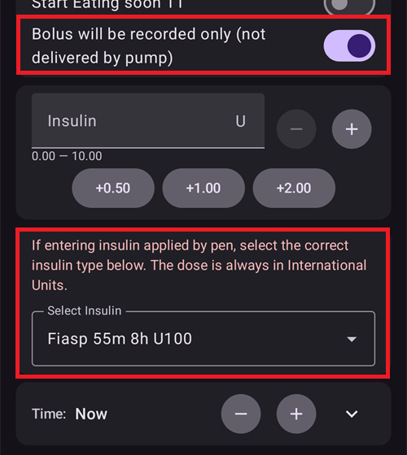 

אפשר להשתמש בלחצנים **+0.5 / +1.0 / +2.0** כדי להגדיל במהירות את כמות האינסולין. אפשר לשנות את ערכי ההגדלה ב[הגדרות אשף הבולוס](#Preferences-deliver-this-part-of-bolus-wizard-result).

אפשר להשתמש בחלון האינסולין גם כאשר המשאבה מושהית או מנותקת, למשל כדי לרשום אינסולין שהוזרק בעט. במקרה זה, "**בולוס רשום בלבד (לא מוזרק על ידי המשאבה)**" מופעל בכוח (מוצג באדום), ומופיעים שדות נוספים לבחירת סוג האינסולין ולהיסט **זמן** עבור הזרקה שנעשתה בעבר:


#### פחמימות


נועד לרישום פחמימות ללא בולוס.

אפשר להתחיל חלק מה[יעדים הזמניים המוגדרים מראש](#TempTargets-hypo-temp-target) (היפוגליקמיה, אכילה בקרוב, פעילות) ישירות בעזרת המתגים בחלק העליון.

**זמן הפחמימות**: מתי אוכלים או אכלו את הפחמימות.

**משך**: משמש עבור ["פחמימות ממושכות"](ExtendedCarbs.md). השורה הזו מקופלת, כדי שלא יקלידו בה בטעות את כמות הגרמים: אפשר לשנות אותה עם **-** / **+**, או להקיש על החץ כדי לפתוח אותה ולהקליד ערך.

אפשר להשתמש בלחצנים **+5 / +10 / +20** כדי להגדיל במהירות את כמות הפחמימות.

#### אשף מהיר

הזנה קלה של כמות הפחמימות והגדרת בסיס החישוב בלחיצה על לחצן אחד שהוגדר מראש.

את הפרטים מגדירים ב[אשף מהיר](../DailyLifeWithAaps/QuickWizards.md).

(aaps-screens-treatments-sheet)=

### חלק G - סרגל הניווט התחתון

סרגל הניווט התחתון נותן גישה אל:

* **טיפולים** - חלון פעולות מהירות עם פעולות הטיפול שלכם:
    
    

* **תרחישים** - מוצג רק כאשר יש לפחות [תרחיש](../DailyLifeWithAaps/Scenes.md) אחד, או כלל **אוטומציה** שמסומן כ**פעולות משתמש**. הוא פותח חלון שממנו אפשר להתחיל אותם; תג מציג כמה מהם אפשר להתחיל עכשיו. **העיפרון** בחלק העליון של החלון פותח את **ניהול ← תרחישים**.

* **ניהול** - המרכז לכל מה שמנהלים ב-**AAPS**: פרופיל, הגדרות אינסולין, יעד זמני, אשף מהיר, תרחישים, אוטומציה, מזון, סבב אתרי עירוי, משאבה ולקוחות מורשים. מתחתם נמצאות פעולות של מכשירים ושל בזאלי, כמו הכנסת חיישן ובזאלי זמני. חלק מהפריטים מופיעים רק כאשר הם מתאימים למערכת שלכם - למשל תיחול/מילוי והחלפת סוללה תלויים במשאבה, ובזאלי זמני, בולוס ממושך ורשומות פורטל הטיפולים מוסתרים ב[מצב פשוט](#preferences-simple-mode):
    
    

* **משימות** - ההתקדמות שלכם ב[משימות](../SettingUpAaps/CompletingTheObjectives.md); תג מציג כמה משימות הושלמו. הפריט הזה נעלם אחרי שכל המשימות הושלמו, והוא לא קיים ב-**AAPSClient**.

(aaps-screens-notifications)=

#### Notifications

**בועת הודעות** יכולה להופיע מעל הסרגל התחתון, בצד. היא אוספת את ההודעות הפעילות של **AAPS**; המספר הקטן מראה כמה הודעות יש. הצבע שלה נקבע לפי ההודעה החשובה ביותר: אדום להודעה דחופה, ירוק למידע פשוט.

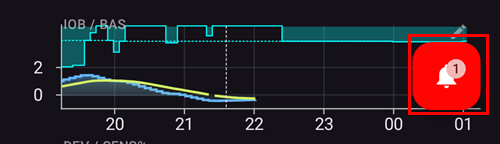

הקשה על הבועה פותחת את לוח ההודעות (**הודעה**). בכל הודעה מוצגת השעה שבה היא הופיעה. לחיצה על **סגירה** מתחת להודעה מסירה אותה; בחלק מההודעות יש במקומו לחצן אחר, שמוביל להגדרה שדורשת טיפול.


(bolus-wizard)= (aaps-screens-bolus-wizard)=

## אשף הבולוס


When you want to make a meal bolus, this is where you will normally make it from.

### חלק I

הכותרת **תחשיב** מציגה את הבולוס המחושב. אם כמות האינסולין הפעיל עולה על הבולוס המחושב, תוצג רק כמות הפחמימות הנדרשת.

אפשר להשתמש במחשבון הבולוס בכל ערך **סוכר** נוכחי, גם כאשר הוא גבוה מדי או נמוך מדי. אם ערך **הסוכר** מעל היעד, מתווסף תיקון לבולוס הארוחה. אם ערך **הסוכר** מתחת ליעד, הבולוס מופחת, ואם האינסולין הפעיל כבר גדול ממה שנדרש, המחשבון מציג כמה פחמימות עדיין נדרשות במקום להציע אינסולין.

שורת הסמלים מתחת לכותרת מראה אילו נתונים נכנסים לחישוב (סוכר, מגמה, IOB, יעד זמני, COB). לחיצה על סמל מוסיפה או מסירה את הנתון הזה מהחישוב; הסמל **(i)** מציג את המספרים המפורטים של החישוב.

#### שילובים של COB ו-IOB ומשמעותם

* מסיבות בטיחות, אי אפשר לכבות את נתון ה-IOB כאשר COB מופעל, כי אז יש סיכון לקבל יותר מדי אינסולין, מאחר ש-**AAPS** לא מתחשב במה שכבר ניתן.
* אם מפעילים COB ו-IOB, החישוב יתחשב בפחמימות שלא נספגו ושעדיין לא כוסו באינסולין + בכל האינסולין שניתן כבזאלי זמני (TBR) או כ-SMB.
* אם מפעילים IOB בלי COB, **AAPS** מתחשב באינסולין שכבר ניתן, אבל לא מקזז אותו מול פחמימות שעדיין צריכות להיספג. מצב זה מוביל להודעת "פחמימות חסרות".
* אם נותנים בולוס עבור **אוכל נוסף** זמן קצר אחרי בולוס לארוחה (למשל קינוח נוסף), כדאי **לכבות את כל הנתונים**. כך רק הפחמימות החדשות מתווספות מכיוון שהארוחה העיקרית לא בהכרח תיספג ולכן IOB לא יתאים ל-COB במדויק זמן קצר לאחר בולוס הארוחה.
* מסיבות בטיחות, **יעד זמני** נכלל בחישוב רק אם מפעילים את הנתון שלו באופן ידני.

(AapsScreens-section-j)=

### חלק J - שדות הקלט

בשדה **פחמימות** מזינים את ההערכה של כמות הפחמימות, **בגרמים**, שעבורה רוצים לתת בולוס; לחצני ה-**+** שמתחתיו מוסיפים פחמימות במהירות. **AAPS** עובד רק עם גרמים: אם סופרים ביחידות לחם או בתחליפים (*למשל* תחליפי "CHO" של DAFNE), יש להמיר אותם לגרמים לפני ההזנה. ראו את [ההערה על יחידות לחם](#your-aaps-profile-insulin-to-carbs-ratio) בדף הפרופיל.

#### סוג הפחמימות: לחם, עוגה או פיצה

מתחת לשדה **פחמימות**, הלחצנים **לחם**, **עוגה** ו**פיצה** אומרים ל-**AAPS** כמה מהר הארוחה נספגת. עם **עוגה** ו**פיצה**, הבולוס מכסה עכשיו רק חלק מהפחמימות, ושאר הפחמימות מתווספות מאוחר יותר כפחמימות ממושכות. ראו [סוג הפחמימות: לחם, עוגה או פיצה](#AapsScreens-carbs-type) בדף פחמימות ממושכות, לאחוזים ולתזמון.

השורה **תיקון** מיועדת למקרה שרוצים לשנות את המינון הסופי מסיבה כלשהי.

רק השדה **פחמימות** פתוח תמיד. השורות האחרות (**תיקון**, **זמן הפחמימות**, **BG** ו**שימוש באחוזים**) מקופלות: הן מציגות את הערך שלהן עם לחצני **-** / **+**, כך שאפשר לשנות אותו בצעדים קטנים. הקשה על החץ פותחת שורה כדי להקליד ערך, והקשה נוספת סוגרת את השורה. כך נמנעת הקלדה של גרמים בטעות בשדה **תיקון**.


הקשה במקום כלשהו בשורה **פרופיל** פותחת את רשימת הפרופילים, ואז אפשר להקיש על שם כדי להשתמש בפרופיל הזה בחישוב הזה.


השדה **זמן הפחמימות** מיועד למתן בולוס מראש: כך אפשר ליידע את המערכת שיהיה עיכוב עד שהפחמימות יגיעו. ניתן לכתוב מספר שלילי בשדה זה כאשר נותנים בולוס עבור פחמימות שנאכלו בעבר.

**הגדרת התראה** (תזכורת לאכילה): כאשר מוזן זמן פחמימות בעתיד, מופיע מתג "**הגדרת התראה**", כדי לקבל תזכורת בזמן שנקבע לאכול את הפחמימות שהוזנו ב-**AAPS**:


התזכורת מתחילה כאשר הבולוס הוזרק. בזמן שהיא פועלת, פס **זמן לאכול** במסך הראשי סופר לאחור, עם **עצירה** ו-**+5 דק׳**. **+5 דק׳** מזיז את סוף ההמתנה בחמש דקות קדימה, והפס מציג את זמן ההמתנה הכולל. כשהזמן מגיע, התזכורת מצלצלת בצליל משלה, טיימר מטבח רך. מלבד **השתקת ההתראה** (המסך נשאר פתוח) ו**השתקה וסגירה**, מסך ההתראה מציע גם **+5 דק׳**, שמתחיל המתנה חדשה של חמש דקות. אחרי הצלצול, בפס כתוב *הזמן הגיע*, עם **+5 דק׳** ו**סגירה**; גם **השתקה וסגירה** מסירה את הפס. הפס וההתראה מוצגים גם ב-**AAPSClient**, וגם ב[שעון](#WearOsSmartwatch-wizard-carb-time). התזכורת לא יוצרת טיימר באפליקציית השעון של הטלפון. אם Android לא מאפשר ל-**AAPS** להגדיר התראות, האשף מבקש לאפשר *שעונים מעוררים ותזכורות* עבור **AAPS** בהגדרות Android. הפעמון לא מוצע כאשר זמן הפחמימות הוא בעבר.

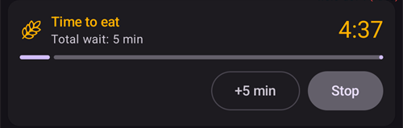

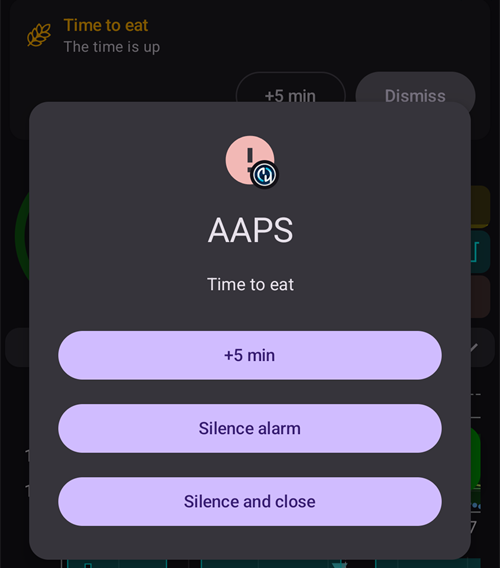

השדה **BG** בדרך כלל כבר מלא בקריאה האחרונה מה-CGM. אם אין לכם חיישן פעיל הוא יהיה ריק. כאשר הקריאה עדכנית, השורה **BG** נשארת מקופלת. השדה מתעדכן לפי ערכים חדשים כל עוד האשף פתוח, עד שמשנים אותו בעצמכם.

לחצן התוצאה בתחתית מציג את הבולוס המוצע; לחיצה עליו מבקשת אישור לפני שניתן אינסולין כלשהו. בזמן שהאישור ממתין, הלולאה לא נותנת SMB, כך שהבולוס שמאשרים עדיין נכון. אם SMB מוזרק באותו רגע, **אישור** ממתין עד שהוא מסתיים.

טוב לדעת:

* אם הבולוס המחושב גבוה מה**[בולוס מרבי](#Preferences-maximum-bolus)**, הוא מופחת לבולוס המרבי, והאישור מציג את האזהרה "הוחלה מגבלת בולוס". [אשף מהיר](../DailyLifeWithAaps/QuickWizards.md) נדחה במקרה כזה.
* כאשר הבולוס רק נרשם (למשל כאשר המשאבה מנותקת), האזהרה "**בולוס רשום בלבד (לא מוזרק על ידי המשאבה)**" נשארת בחלק העליון של החלון, גם בזמן גלילה.
* לבולוס שנותנים באופן ידני יש עדיפות על פני [SMB](#Open-APS-features-super-micro-bolus-smb) שממתין למתן: ה-SMB מבוטל והלולאה מחשבת מחדש. אם SMB ניתן ממש עכשיו, הבולוס נדחה עם ההודעה "SMB מוזרק כעת. נא לנסות שוב לאחר סיום ההזרקה." שום אינסולין לא ניתן, והפחמימות שהוזנו עם הבולוס הזה לא נשמרות: יש לחכות רגע ולהזין אותן שוב.

(AapsScreens-wrong-cob-detection)=

#### זיהוי שגוי של פחמימות פעילות


If you see the warning above after using bolus wizard, **AAPS** has detected that the calculated COB value may be wrong. So, if you want to bolus again after a previous meal with COB, you should be aware of overdosing!

לפרטים, ראו את ההנחיות בדף [חישוב פחמימות פעילות (COB)](#CobCalculation-detection-of-wrong-cob-values).

מחפשים את הלשונית **Actions** (פעולות) של **AAPS** 3.x? הפונקציות שלה עברו למסך הראשי, לחלון **ניהול** ולסרגל ההפעלה המהירה: ראו [לאן נעלמה הלשונית Actions?](#screens-action-tab).

(aaps-screens-careportal)=

## רשומות פורטל טיפולים

הגילים והרמות שמוצגים ב[שורת המצב](#screens-sensor-level-battery) (חיישן, אינסולין, צינורית, סוללת המשאבה) מבוססים על רשומות פורטל טיפולים: **תיחול/מילוי** (רושם החלפה של אתר המשאבה ושל מחסנית האינסולין), **הכנסת חיישן** ו**החלפת סוללת משאבה**.

אפשר לרשום אותן מלוח המצב המורחב במסך הראשי, מחלון **ניהול**, או בעזרת לחצני [הפעלה מהירה](../DailyLifeWithAaps/QuickLaunch.md).

**תיחול/מילוי** רושם החלפה של אתר המשאבה ו/או החלפה של מחסנית האינסולין, ויכול לתת כמות תיחול:


**הכנסת חיישן** ו**החלפת סוללת משאבה** מבקשים רק את זמן האירוע:

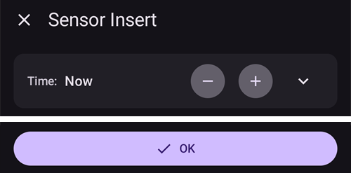

 רשומות של פעילות גופנית, הכרזה, שאלה והערה מקבילות לפורטל הטיפולים של Nightscout, והן סוגים מיוחדים של הערות.

בחלון **ניהול**, יש לגלול למטה וללחוץ על **פורטל טיפולים** כדי להציג את הרשומות האלה: **בדיקת רמת סוכר בדם**, **הערה**, **פעילות גופנית**, **שאלה** ו**הכרזה**.


**בדיקת רמת סוכר בדם**, **שאלה** ו**הכרזה** מאפשרים להזין ערך סוכר (ממד סוכר, מהחיישן או ממקור אחר), הערה ואת זמן האירוע. ב**שאלה** וב**הכרזה**, שורת ערך הסוכר מקופלת ומציגה את סוג המדידה ליד הערך: אם משנים את הערך, הסוג משתנה מ**חיישן** ל**מד סוכר**.


**הערה** ו**פעילות גופנית** מאפשרים להזין משך זמן (שורה מקופלת: אפשר להשתמש ב-**-** / **+**, או להקיש על החץ כדי להקליד), הערה ואת זמן האירוע:

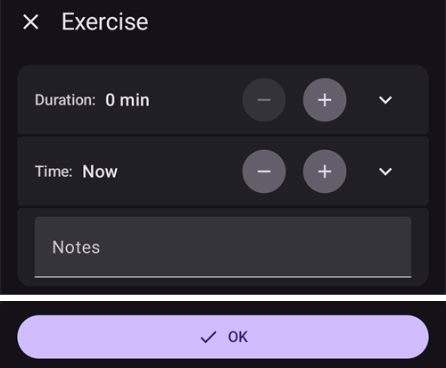

בכל החלונות האלה (**תיחול/מילוי**, **הכנסת חיישן**, **החלפת סוללת משאבה** ורשומות פורטל הטיפולים), זמן האירוע משתמש באותה שורת **זמן** כמו [חלון האינסולין](#aaps-screens-buttons-insulin) ואשף הבולוס: אפשר להשתמש ב-**-** / **+** כדי להזיז את הזמן בצעדים של 5 דקות (עד שבוע אחד אחורה ועד 12 שעות קדימה), או להקיש על החץ כדי לבחור כל תאריך ושעה.

## סבב אתרי עירוי

**ניהול ← סבב אתרי עירוי** רושם על מפת גוף איפה הוכנסו כל צינורית וכל חיישן, כדי שאפשר יהיה להחליף אתרים: ראו [סבב אתרי עירוי](#Aapsscreens-site-rotation) בדף המשאבות והצינוריות.

**TDD** (המינון היומי הכולל) וכלל האצבע של היחס בין בזאלי לבולוס מוסברים ב[לשונית האינסולין בסטטיסטיקה](#reviewing-tdd).

(AapsScreens-insulin-profile)=

## אינסולין

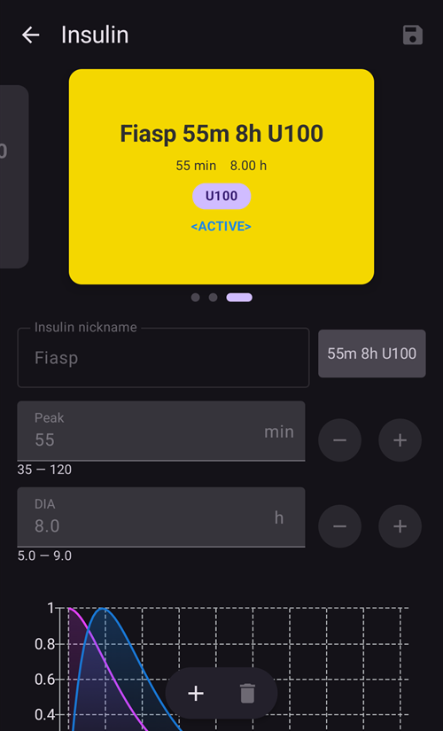

**ניהול ← הגדרות אינסולין** מציג ומנהל את תצורות האינסולין שלכם. כל תצורה מוצגת בכרטיס עם **זמן השיא** ו-**[DIA](#Config-Builder-insulin-dia)** שלה; התצורה שבשימוש מסומנת **פעיל**. מתחת לכרטיס מוצגת עקומת הפעילות. אפשר לערוך את הכינוי, השיא וה-DIA של כל תצורה חוץ מהפעילה: כדי לשנות את האינסולין שבשימוש, יש [להוסיף תצורה חדשה ולהפעיל אותה](#Config-Builder-insulin-change-active).

ראו [משך פעולת האינסולין](#Config-Builder-insulin-dia) כדי ללמוד מה זה ואיך להגדיר אותו.

## סטטוס המשאבה


**ניהול ← משאבה** (או **הגדרות תצורה ← משאבה ← פתיחת תוסף**) מציג את מצב המשאבה: חיבור אחרון, קצב בזאלי בסיסי, סוללה, מכל...

* המידע המוצג תלוי בדגם המשאבה.
* See [pumps page](../Getting-Started/CompatiblePumps.md) for details.

## לולאה, AMA / SMB

**הגדרות תצורה ← לולאה ← פתיחת תוסף** (וגם **הגדרות תצורה ← APS ← פתיחת תוסף**) מציגים פרטים על החישובים של האלגוריתם ועל הסיבה ש-**AAPS** פועל כפי שהוא פועל: ההפעלה האחרונה, הבקשה שנוצרה, והמגבלות. המסך **לולאה** מציג רק את המגבלות שבאמת הגבילו את הבזאלי הזמני או את ה-SMB שניתנו (ואת הסיבה שלולאה סגורה אסורה, אם זה המצב); המסך **APS** מציג את כל המגבלות שנכנסו לחישוב.

Calculations are run each time the system gets a fresh reading from the CGM.

לפרטים נוספים ראו את [החלק על APS בדף הגדרות התצורה](#Config-Builder-aps).

(aaps-screens-profile)=

## Profile

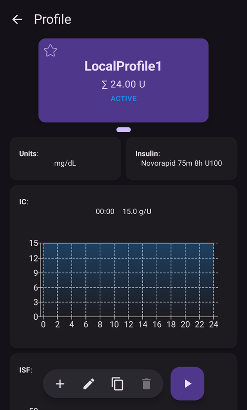

**ניהול ← פרופיל** (או הקשה על שם הפרופיל במסך הראשי) פותח את מסך הפרופיל: הפרופילים שלכם כקרוסלה של כרטיסים שאפשר להחליק ביניהם, עם לחצנים להוספה, עריכה, שכפול, מחיקה ו**הפעלה** של פרופיל.

Profile contains information on your individual diabetes settings, see the detailed **[Profile](../SettingUpAaps/YourAapsProfile.md)** page for more information.

## אוטומציה


**ניהול ← אוטומציה** מציג את כללי האוטומציה שלכם. See the dedicated page [here](../DailyLifeWithAaps/Automations.md).

## NSClient


**הגדרות תצורה ← תקשורת ← NSClientV3 ← פתיחת תוסף** מציג את מצב החיבור לאתר Nightscout שלכם: כתובת URL, מצב websocket, תור ויומן של פעולות הסנכרון.

אפשר לשנות את ההגדרות ב[הגדרות NSClient](#Preferences-nsclient).

לפתרון תקלות, ראו [דף](../GettingHelp/TroubleshootingNsClient.md) זה.

(aaps-screens-bg-source)=

## מקור ערכי הסוכר - xDrip, BYODA...


**הגדרות תצורה ← מקור ערכי הסוכר ← פתיחת תוסף** מציג את היסטוריית קריאות ה-CGM ומאפשר להסיר קריאות במקרה של תקלה (למשל compression low - ערך נמוך שגוי בגלל לחץ על החיישן) או קריאות כפולות.

## היסטוריית טיפולים

יש לפתוח את **התפריט** (☰) ולבחור **היסטוריית טיפולים** כדי לראות, לבדוק ולתקן את כל מה ש-**AAPS** רשם: פחמימות ובולוסים, בזאלים זמניים, יעדים זמניים, החלפות פרופיל, רשומות פורטל טיפולים, שינויי מצב הלולאה ופעולות משתמש. ראו [היסטוריית טיפולים](#aaps-screens-treatments) בדף סקירת הנתונים.

## דפדפן היסטוריה


יש לפתוח את **התפריט** (☰) ולבחור **דפדפן היסטוריה**.

Allows you to ride back in **AAPS** history. See the dedicated page [Reviewing your data > History Browser](../Maintenance/Reviewing.md).

(aaps-screens-statistics)=

## Statistics


יש לפתוח את **התפריט** (☰) ולבחור **סטטיסטיקה**.

מציג סטטיסטיקה על המינון היומי הכולל (TDD), הזמן בטווח, פרופיל הגלוקוז לאורך היום (AGP) ודפוס מחזור האינסולין, בארבע לשוניות. See the dedicated page [Reviewing your data > Statistics](#reviewing-statistics).

(aaps-screens-profile-helper)=

## Profile Helper

יש לפתוח את **התפריט** (☰) ולבחור **עוזר הפרופילים**.


עוזר הפרופילים מאפשר להשוות בין פרופילים וליצור פרופילי התחלה לילדים. ראו [פרופיל AAPS שלכם](../SettingUpAaps/YourAapsProfile.md) - החלקים [בניית פרופיל מאפס לילד](#your-aaps-profile-profile-from-scratch-for-a-kid) ו[השוואה בין שני פרופילים](#your-aaps-profile-compare-profiles).

(aaps-screens-widgets)=

## ווידג'טים למסך הבית

**AAPS** מציע חמישה ווידג'טים שאפשר להוסיף למסך הבית של הטלפון, כדי לראות את הנתונים בלי לפתוח את האפליקציה. ראו את הדף הייעודי [ווידג'טים למסך הבית](../DailyLifeWithAaps/Widgets.md).

