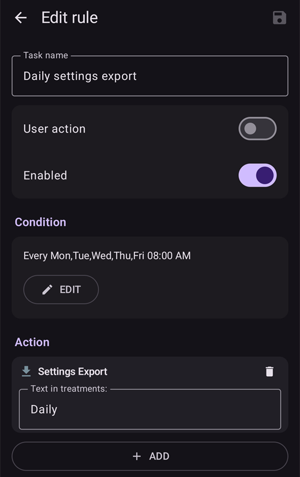
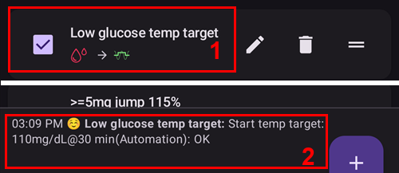

# אוטומציה

```{contents} In this page
:backlinks: entry
:depth: 2
```

## What is an Automation?

"**אוטומציה**" היא תכונה שיכולה לבצע משימות באופן אוטומטי ב-AAPS.

האוטומציה מבצעת פעולות מסוימות בהתאם לתנאי אחד או יותר, או לטריגרים. טריגרים יכולים לכלול אירועים לא סדירים, כמו רמות סוכר נמוכות או גבוהות בדם (BG), או כמות מוגדרת של אינסולין פעיל (IOB) שלילי. אוטומציות יכולות לטפל גם באירועים חוזרים, כמו ארוחות או פעילות גופנית בשעות מסוימות ביום, או כאשר המשתמש נמצא במרחק מסוים ממיקום GPS או באזור של רשת Wi-Fi (SSID). Automation can execute AAPS settings backups based on a schedule or on every Pod change.

כללי אוטומציה נוצרים ונערכים במסך **אוטומציה** (**ניהול ← אוטומציה**). Each rule is defined by two properties:

- תנאי אחד או יותר, או ‘טריגרים’, שמפעילים פעולה.

    Think of a certain time schedule, an event or properties value in AAPS

- One or more actions to perform.

    כגון התראה, הגדרת אחוז פרופיל או ייצוא הגדרות AAPS בעת החלפת פוד.


There are a wide range of Automation options, and users are encouraged to study these within the AAPS app, in the Automation section. You can also search the AAPS user groups on [**Facebook**](https://www.facebook.com/groups/AndroidAPSUsers) and [**Discord**](https://discord.gg/4fQUWHZ4Mw) for Automation examples from other users.

## How Automation can help

1. **ביצוע אוטומטי של משימות חוזרות:** פעולות מתוכנתות מתבצעות אוטומטית, בלי התערבות של המשתמש.

1. **Decreasing decision fatigue:** The primary benefit of **Automations** is to relieve the user from the burden of having to make manual interventions in **AAPS**. [Research](https://www.ncbi.nlm.nih.gov/pmc/articles/PMC6286423/#ref4) estimates that an average of 180 additional daily decisions have to be made by those living with Type 1 diabetes. **Automations** can lessen the mental load, freeing up the user’s mental energy for other aspects of life.

1. **אפשרות לשיפור איזון הסוכר:** למשל, **אוטומציות** יכולות לעזור להבטיח ש**יעדים זמניים** יוגדרו תמיד כשצריך, גם בתקופות עמוסות או בתקופות של שכחה. למשל, אם לילד עם סוכרת יש שיעור ספורט בבית הספר בימי שלישי בשעה 10:00 ובימי חמישי בשעה 14:00, והוא זקוק ליעד זמני גבוה ('TT') שיופעל 30 דקות לפני הפעילות, ניתן להפעיל את **היעד הזמני** באמצעות **אוטומציה**.

1. **התאמה אישית רבה של AAPS**, כך שיהיה אגרסיבי יותר או פחות במצבים מסוימים, לפי העדפת המשתמש. For example, triggering a temporary reduced **Profile** % for a set period of time if negative **IOB** develops in the middle of the night, indicating that the existing **Profile** may be too strong.

The example below illustrates how an **Automation** can enable steps to be eliminated.

משתמש מתאמן בכל בוקר בשעה 6:00: עליו לזכור להגדיר ידנית ב-AAPS "יעד זמני - פעילות" בשעה 5:00, לפני האימון.


המשתמש הגדיר **אוטומציה** שתפעיל בשעה 5:00 ‘יעד זמני - פעילות’, כדי שה-**BG** וה-**IOB** יהיו מיטביים לקראת האימון בשעה 6:00:


## Key considerations before starting with Automations

1. Before setting up certain Automations, you should have reasonable **BG** control with **AAPS**. Automations should not be used to compensate for sub-optimal basal, **ISF** or **CR** settings (discussed further below). Avoid setting an automated **Profile switch** to compensate for **BG** rises due to _e.g._ food, these are better dealt with via other strategies (SMBs etc).

1. As with any technology, **CGMs**, **Pumps** and phones can malfunction: Technical issues or sensor errors can disrupt the **Automation** actions, and manual intervention may be needed.

1. **הדרישות מאוטומציות צפויות להשתנות כאשר שגרת היום משתנה**. When changing between work/school/holiday periods, set a reminder in your calendar to review which **Automations** are currently active (they are easy to activate and de-activate). למשל, אם יוצאים לחופשה ואין עוד צורך באוטומציה לשיעורי ספורט בבית הספר או לאימון יומי, או אם צריך לשנות את השעות.

1. **Automations** may conflict with each other, and it is good to review any new **Automation(s)** setting carefully in a safe environment, and understand why an **Automation** may or may not have triggered in the way you expect.

1. אם אתם משתמשים ב-Autosens, נסו להשתמש ב**יעדים זמניים** במקום ב**החלפות פרופיל**. **יעדים זמניים** אינם מאפסים את Autosens בחזרה ל-0. **Profile Switches** reset Autosens.

1. Most **Automations** should only be set for a **limited time duration**, after which **AAPS** can re-evaluate and repeat the **Automation**, if necessary, and if the condition is still met. למשל, "הפעלת יעד זמני של 7.0 mmol/L למשך 30 דקות" או "הפעלת **פרופיל** 110% למשך 10 דקות" _וגם_ "הפעלת יעד זמני של 5.0 mmol/L למשך 10 דקות". Using **Automations** to create permanent changes (e.g. to stronger %profile) risks hypoglycemia.

## When can I start using Automation?

**Automations** can be started in **objective 10**.

## Where are Automations located in AAPS?

יש לפתוח את **ניהול** בסרגל הניווט התחתון של המסך הראשי ולבחור **אוטומציה**.

## How can I set up an Automation?

כדי להגדיר **אוטומציה**, יש ללחוץ על הלחצן **+** במסך האוטומציה וליצור ‘כלל’:


* לתת ל‘כלל’ כותרת (שם משימה);
* ללחוץ על "**עריכה**" תחת **תנאי**. במסך **תנאי**, לבחור כיצד הטריגרים משולבים (**וגם**, **או**, **או בררני (XOR)**) וללחוץ על "**הוספת טריגר**":


* להוסיף לפחות טריגר אחד:


* ללחוץ על "**הוספה**" תחת **פעולה** ולבחור פעולה אחת:


* לשמור את הכלל באמצעות הלחצן **שמירה**, ולוודא שתיבת הסימון שליד שם הכלל ‘מסומנת’ כדי להפעיל את ה**אוטומציה**:


להשבתת כלל **אוטומציה**, יש לבטל את סימון התיבה שליד שם ה**אוטומציה**. הדוגמה הבאה מציגה **אוטומציה** מופעלת (‘מסומנת’) או מושבתת (‘לא מסומנת’):


בעת הגדרת **אוטומציה**, ניתן לבדוק אותה תחילה באמצעות בחירת האפשרות ‘הודעה’ תחת "פעולות". כך **AAPS** מציג תחילה הודעה, במקום לבצע את הפעולה בפועל. כאשר אתם בטוחים שההודעה מופיעה בזמן ובתנאים הנכונים, ניתן לעדכן את כלל ה**אוטומציה** ולהחליף את ה‘הודעה’ ב‘פעולה’ אמיתית.


```{admonition} Important note
:class: note

**Automations** are still active when the Loop is disabled!
```


## מתי הכללים נבדקים

**AAPS** בודק את כל כללי ה**אוטומציה** בכל פעם שמתקבל ומעובד ערך סוכר חדש, כך שהכללים נבדקים בקצב של ה-CGM שלכם, גם כשמסך הטלפון כבוי. הכללים נבדקים גם כשהטלפון מתחיל להיטען, כשהרשת או המיקום משתנים, וכשמתחבר מכשיר Bluetooth. רק בדיקה אחת רצה בכל פעם, ולכן כלל שהפעולות שלו לוקחות זמן (למשל פקודה למשאבה) לא יכול להתבצע פעמיים.

## Safety limits

There are safety limits set for **Automations**:

* **יעד זמני** שמוגדר על ידי **אוטומציה** חייב להיות בין 72 ל-180 mg/dL (או בין 4 ל-10 mmol/L).
* **אחוז הפרופיל** חייב להיות בין 50% ל-130%.
* קיימת מגבלת זמן של 5 דקות בין ביצועי **אוטומציה** (וגם לפני הביצוע הראשון).

## Correct use of negative values

```{admonition} Warning
:class: warning

Please be careful when selecting a negative value in **Automation**
```

יש להיזהר בבחירת ‘ערך שלילי’ בתוך ‘תנאי’, כגון "פחות מ-", ב**אוטומציות**. For example:


**דוגמה 1:** יצירת תנאי **"פחות מ-"** "-0.1mmol/L" (או "-2mg/dL") פירושה:

Trigger an **Automation** for any number which is **strictly less than** -0.1 (-2). This includes numbers like -0.2, -0.3, -0.4 (-4, -6, -8) and so on. יש לזכור שהערך -0.1 (-2) עצמו **אינו** נכלל בתנאי זה. (התנאי "שווה או פחות מ- -0.1mmol/L (-2 mg/dL)" _כן_ יכלול את -0.1 mmol/L או -2 mg/dL).

**דוגמה 2:** יצירת תנאי "גדול מ-" -0.1mmol/L (-2mg/dL) פירושה:

הפעלת **אוטומציה** עבור כל מספר ש**גדול מ-** -0.1mmol/L (-2mg/dL). הדבר כולל מספרים כגון 0, 0.2, 0.4mmol/L, (0, 4, 8mg/dL) וכל מספר חיובי אחר.

It is important to carefully consider the exact intention of your **Automation** when choosing these conditions and values.

(automations-automation-triggers)=
## טריגרים של אוטומציה


יש לגלול למטה כדי לראות את שאר הרשימה:


המשתמש יכול לבחור ‘טריגרים’ שונים. טריגרים הם התנאים שחייבים להתקיים כדי שהאוטומציה תתבצע. The list below is non-exhaustive:

**טריגר:** חיבור תנאים

**Options:**

Several conditions can be linked with
* “And”
* “או”
* “או בררני (XOR)” (כלומר, אם תנאי אחד בלבד מתקיים, הפעולה או הפעולות יבוצעו)

**טריגר:** זמן לעומת זמן חוזרני

**Options:**

* time = single time event
* זמן חוזרני = משהו שקורה באופן קבוע (למשל פעם בשבוע, בכל יום עבודה וכדומה)

**טריגר:** מיקום

**Options:**

* ב[הגדרות > אוטומציה](#preferences-maintenance-settings), המשתמש יכול לבחור את שירות המיקום הרצוי.

**טריגר:** שירות מיקום

**Options:**

* Use passive location: **AAPS** only takes locations when other apps are requesting it.
* שימוש במיקום מבוסס רשת: מיקום ה-Wi-Fi שלכם.
* Use GPS location (Attention! This can cause excessive battery drain!)

**טריגרים**: נתוני משאבה וחיישן

* טריגר גיל הצינורית: זמין לכל המשאבות
* טריגר גיל האינסולין: זמין למשאבות נתמכות
* טריגר גיל סוללת המשאבה: זמין למשאבות נתמכות
* טריגר גיל החיישן: זמין תמיד
* טריגר הפעלת הפוד: זמין למשאבות פאץ'

שימו לב: בכל הטריגרים הקשורים לגיל, לא סביר שהשוואת שוויון תפעיל את הכלל, ולכן במקרה זה נדרשים שני טריגרים כדי ליצור טווח.

* טריגר רמת המכל: זמין לכל המשאבות. ההשוואה "NOT\_AVAILABLE" אינה פועלת עבור טריגר זה, כי הערך תמיד מלא ב-**AAPS**.
* טריגר רמת סוללת המשאבה: זמין למשאבות נתמכות. ההשוואה "NOT\_AVAILABLE" אינה פועלת עבור טריגר זה, כי הערך תמיד מלא ב-**AAPS**.

(automations-automation-action)=
## פעולות


יש לגלול למטה כדי לראות את שאר הרשימה:


**פעולות:** הפעלת **יעד זמני**

**Options:**

* ערך ה-**BG** חייב להיות בין 72 mg/dL ל-180 mg/dL (בין 4 mmol/L ל-10 mmol/L)
* **TT** פועל רק אם אין יעד זמני קודם. **AAPS** מוסיף זאת לכלל אוטומטית כשורה "**תנאים מוקדמים: יעד זמני לא קיים**"

**פעולות:** הפסקת **יעד זמני**

**Options:**

none

**פעולות:** **אחוז הפרופיל**

**Options:**

* **פרופיל** חייב להיות בין 50% ל-130%
* works only if the previous Percentage is 100%

**פעולות:** **שינוי החלקה** (בקבוצה **לולאה & אינסולין**)

**Options:**

* לבחור את [שיטת ההחלקה](../CompatibleCgms/SmoothingBloodGlucoseData.md) שאליה רוצים לעבור. הרשימה זהה לרשימה תחת **הגדרות תצורה** > **החלקה**, והפעולה עושה בדיוק מה ששינוי שם עושה: השיטה החדשה נשמרת, מסונכרנת למכשירי הלקוח המצומדים, ונתוני הסוכר מוחלקים מחדש מיד.
* פועל רק אם שיטת ההחלקה הזו עדיין לא פעילה. **AAPS** מוסיף זאת לכלל אוטומטית כשורה "**תנאים מוקדמים: החלקה … אינה פעילה**". כשההחלקה שנבחרה כבר פעילה, הכלל לא מתבצע, בלי הודעה.
* דוגמה: חיישן חדש הוא לעיתים קרובות רועש ביום הראשון שלו. שני כללים עם הטריגר **גיל החיישן** נותנים סינון חזק יותר בזמן שהחיישן מתייצב, ואחר כך החלקה ללא השהיה:
  * **גיל החיישן** פחות מ-24 שעות: **שינוי החלקה** ל**מסנן קלמן Unscented (UKF)**
  * **גיל החיישן** יותר מ-24 שעות: **שינוי החלקה** ל**החלקת ממוצע**

**פעולות:** **הערה** (בקבוצה **התראות** ברשימה)

**Options:**

* לבחור את האירוע לתיעוד: **הערה**, **פעילות גופנית**, **שאלה**, **הכרזה** או **החלפת צינורית משאבה**, ואפשר להוסיף הערה. שם הפעולה משתנה לפי האירוע שנבחר.
* **משך**: משמש עבור **הערה**, **פעילות גופנית** ו**החלפת צינורית משאבה**. ל**שאלה** ול**הכרזה** אין משך: במקום זאת הן מתעדות את ערך הסוכר הנוכחי.
* **החלפת צינורית משאבה** מאפסת את גיל הצינורית, כאילו תיעדתם החלפת אתר עירוי באופן ידני. דוגמה: חלק מהמשאבות (כמו Combo) מתעדות בעצמן החלפת מכל, אבל לא את החלפת אתר העירוי. אם תמיד מחליפים את שניהם יחד, כלל עם **גיל האינסולין** פחות משעה ו**גיל הצינורית** יותר מ-24 שעות יכול לתעד עבורכם את החלפת אתר העירוי.

 

**פעולות:** **שליחת מסרונים לכל המספרים** (בקבוצה **התראות**)

**Options:**

* להזין את טקסט ההודעה. היא נשלחת לכל מספרי הטלפון המורשים בהגדרות [תקשורת SMS](../RemoteFeatures/SMSCommands.md). התוסף ‘תקשורת SMS’ חייב להיות מופעל.

**פעולות:** **החלפת פרופיל ל-** (בקבוצה **פרופיל**)

**Options:**

* לבחור את ה**פרופיל** שיופעל. הוא מופעל ב-100%, ללא הזזת זמן (timeshift). אם פרופיל זה כבר פעיל, הפעולה לא עושה דבר.

**פעולות:** **הפעלה/השבתה של SMB** (בקבוצה **לולאה & אינסולין**)

**Options:**

* לבחור **מופעל** או **כבוי**. פעולה זו משנה את ההגדרה **הפעלת SMB** של OpenAPS SMB, בדיוק כאילו שיניתם אותה ב**הגדרות**, והשינוי נשאר עד שאתם או כלל אחר משנים אותה בחזרה.

**פעולות:** **הפעלת כוונון אוטומטי** (בקבוצה **לולאה & אינסולין**)

**Options:**

* לבחור את הפרופיל לכוונון ואת מספר הימים: ראו [הרצת Autotune באמצעות כלל אוטומציה](#autotune-run-autotune-with-an-automation-rule).

**פעולות:** **הפסקת עיבוד** (בקבוצה **לולאה & אינסולין**)

**Options:**

* ללא. כל עוד התנאים של כלל עם פעולה זו מתקיימים, **AAPS** לא בודק את הכללים שמתחתיו ברשימה. ברגע שהתנאים שלו כבר לא מתקיימים, הכללים שמתחתיו נבדקים כרגיל. יש להוסיף אותה לכלל שצריך לקבל עדיפות על פני הכללים שמתחתיו (ראו [סדר האוטומציות](#Automations-the-order-of-the-automations-in-the-list-matters)).

**פעולות:** **הרצת תרחיש**, **הפעלת תרחיש**, **השבתת תרחיש** (בקבוצה **תרחישים**)

**Options:**

* לבחור את ה[תרחיש](Scenes.md) להרצה, להפעלה או להשבתה.

Once the ‘Action’ is added,  the default values must be changed to the desired number by clicking and adjusting the default values.


(Automations-the-order-of-the-automations-in-the-list-matters)=
## The order of the **Automations** in the list matters
 **AAPS** will automate the rules created in the order of preference, starting from the top of the **Automation** list. למשל, אם ה**אוטומציה** ‘Low’ היא ה**אוטומציה** החשובה ביותר, מעל כל הכללים האחרים, אז **אוטומציה** זו צריכה להופיע בראש רשימת ה**אוטומציות** של המשתמש, כפי שמודגם להלן:


כדי לשנות את סדר העדיפויות של כללי ה**אוטומציה**, יש לגעת ולהחזיק את הידית **=** שבקצה השורה של הכלל. שנו את סדר ה**אוטומציות** באמצעות הזזת הכללים למעלה או למטה.


## How to delete Automation rules

To delete an **Automation** rule click on the trash icon.


## Examples of Automations

Below are examples of **Automations**. דיונים נוספים על **אוטומציות** ועל האופן שבו משתמשים התאימו אישית את ה**אוטומציה** שלהם ניתן למצוא בקבוצות דיון ב-Facebook או ב-Discord. The examples below should not be replicated without the user having a good understanding of how the **Automation** will work.

(automations-low-glucose-temp-target)=
### יעד זמני בתגובה לרמת סוכר נמוכה

**אוטומציה** זו מפעילה **יעד זמני** אוטומטי כאשר ה-**BG** יורד מתחת לסף מסוים. כאן, כשהגלוקוז פחות מ-70 mg/dL, מופעל יעד של 110 mg/dL למשך 30 דקות:


### יעד זמני לארוחת הצהריים (עם ‘מיקום’)


This **Automation** has been created for a user who eats their lunch at work around the same time every weekday but triggered only if the user is situated within a set ‘location’.  לכן, אם המשתמש לא נמצא בעבודה ביום מסוים, **אוטומציה** זו לא תופעל.

**אוטומציה** זו תגדיר **יעד זמני** נמוך (אכילה בקרוב) בשעה 13:00, כדי להוריד את ה-BG ל-90 mg/dL (או 5 mmol/L) לקראת ארוחת הצהריים.

לטריגר ‘מיקום’ יש שם, נקודה על המפה (יש להקיש על **בחירה מהמפה**, או להשתמש במיקום הנוכחי) ורדיוס במטרים. הוא מופעל כשנמצאים בתוך האזור (או מחוצה לו):


בגלל החיבור ‘וגם’, ה**אוטומציה** מתבצעת רק ב‘זמן שנבחר’ ורק אם המשתמש נמצא במיקום שנבחר.

ה**אוטומציה** לא תופעל בשום זמן אחר במיקום זה, וגם לא בזמן זה מחוץ לרדיוס של 50 מטר סביב הנקודה שנבחרה.

### אוטומציה לפי מיקום Wi-Fi SSID

שימוש ב-Wi-Fi SSID הוא אפשרות טובה להפעלת **אוטומציה** כשנמצאים בטווח של רשת Wi-Fi מסוימת (בהשוואה ל-GPS): הוא די מדויק, צורך פחות סוללה ופועל במקומות סגורים, שבהם GPS ושירותי מיקום אחרים עשויים לא להיות זמינים.

להלן דוגמה נוספת להגדרת **יעד זמני** לפני ארוחת הבוקר בימי עבודה בלבד (1).


ה**אוטומציה** תופעל בשעה 05:30 רק בימים שני עד שישי (2)  
וכל עוד יש חיבור לרשת ה-Wi-Fi של הבית (3).


לאחר מכן היא תגדיר **יעד זמני** של 75 mg/dL למשך 30 דקות (4). אחד היתרונות של הוספת המיקום הוא שהאוטומציה לא תופעל, למשל, כשהמשתמש בחופשה.


יש לגלול למטה כדי לראות את הפעולה: **יעד זמני** של 75 mg/dL למשך 30 דקות (4).


להלן צילום המסך המפרט את הטריגרים של ה**אוטומציה**:

1) תחת ה-“וגם” הראשי (שני התנאים חייבים להתקיים כדי להפעיל) 1) זמן חוזרני = ימים שני עד שישי (M,T,W,T,F) בשעה 5:30  
1) WiFi SSID = My_Home_WiFi_Name


(automating-preference-settings-export)=

## Automating Preference Settings Export

### ייצוא ללא השגחה: מתוזמן (יומי)

צילומי מסך המפרטים את הטריגרים של האוטומציה:

1) תנאי: זמן חוזרני = ימים שני עד שישי (M,T,W,T,F) בשעה 8:00 1) פעולה: יצוא הגדרות (בשדה "טקסט בטיפול" יש להזין "יומי")



הערה: ביצוע הייצוא יתועד בפורטל הטיפולים (Careportal)

### ייצוא ללא השגחה: הפעלת הפוד (משאבת פאץ' בלבד)

צילומי מסך המפרטים את הטריגרים של האוטומציה:

1) תנאי: הפעלת הפוד 1) פעולה: יצוא הגדרות (בשדה "טקסט בטיפול" יש להזין "הפעלת פוד: ייצוא הגדרות")


הערה: ביצוע הייצוא יתועד בפורטל הטיפולים (Careportal). Note : Automation will not trigger **at all** if you have not done a manual settings export before. ראו [הגדרות ← תחזוקה](#preferences-maintenance-settings) להפעלה נכונה של ייצוא הגדרות ללא השגחה.


## Automation Logs

**AAPS** מציג יומן של אירועי ה**אוטומציה** האחרונים בתחתית מסך ה**אוטומציה**, מתחת לכללים. ניתן להשתמש בו כדי לוודא שהכללים הופעלו כפי שציפיתם.

בדוגמה הבאה, הכלל **Low glucose temp target** (1) (ראו [יעד זמני בתגובה לרמת סוכר נמוכה](#automations-low-glucose-temp-target) לעיל) מופעל. היומן (2) מראה שבשעה 15:09 הגלוקוז ירד מתחת ל-70 mg/dL והכלל הופעל:
* הפעולה הייתה "הפעלת יעד זמני: 110mg/dL@30 min": **יעד זמני** של 110 mg/dL למשך 30 דקות;
* **אישור** בסוף השורה מציין שהפעולה בוצעה בהצלחה.



(automations-troubleshooting)=

## פתרון תקלות

* Problem: __My automations are not being triggered by AAPS?__

יש לוודא שהתיבה שליד שם ה**אוטומציה** ‘מסומנת’, כדי שהכלל יהיה מופעל:


* Problem: __My automations are being triggered in the wrong order.__

יש לבדוק את סדר העדיפויות של הכללים, כפי שהוסבר לעיל.

* בעיה: __תנאי מציג "טריגר לא ידוע … - אינו מתקיים לעולם".__

הכלל מכיל טריגר שגרסה זו של **AAPS** לא יכולה לקרוא, למשל לאחר חזרה לגרסה ישנה יותר או לאחר ייבוא הגדרות מגרסה חדשה יותר. טריגר כזה אף פעם לא מתקיים, ולכן הכלל לא מתבצע. הוא נשמר ללא שינוי, כך שגרסה חדשה יותר עדיין יכולה להשתמש בו. יש לערוך את הכלל ולהחליף את הטריגר, או לעדכן את **AAPS**.

## Alternatives to Automations

For advanced users, there are other possibilities to automate tasks using IFTTT or a third party Android app called Automate. 
