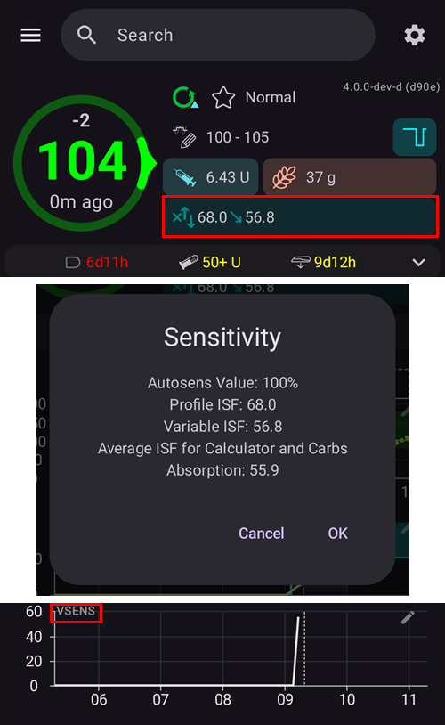

(Open-APS-features-DynamicISF)=
# Dynamic ISF (DynISF)

Up until now, with **AMA** and **SMB**, **ISF** was defined in the **Profile** and was static for each defined period in the day. אבל במציאות, ה-**ISF** של אדם אינו קבוע כל כך, והוא משתנה בהתאם לרמת ה**סוכר בדם (BG)**: כאשר רמת הסוכר גבוהה, המשתמש צריך יותר אינסולין כדי להוריד את ה**סוכר בדם (BG)** ב-50 mg/dL / 3 mmol/L מאשר כאשר ה**סוכר בדם (BG)** נמוך יותר. [Autosens](#Open-APS-features-autosens) was the first algorithm to try and address this issue, by adjusting **ISF** outside of mealtimes.

**Dynamic ISF** (also called **DynISF**) serves the same purpose but is more advanced as it can be used at all times. It is recommended only for advanced users that have a good handle on their **AAPS**’ controls and monitoring. Read the [Things to consider when activating Dynamic ISF](#dyn-isf-things-to-consider-when-activating-dynamicisf) below before trying it out.

```{admonition} CAUTION - Automations or Profile Percentage change
:class: warning

**Automations** should always be used with care. This is particularly so with **Dynamic ISF**.

When using **Dynamic ISF**, disable any temporary **Profile** change as an **Automation** rule, because it would cause **Dynamic ISF** to be overly aggressive in correction bolusing and result in hypoglycemia. This is the exact purpose of **Dynamic ISF** and so there is no need for **AAPS** to be told to provide additional insulin by way of Automation in the event of high **BGs**.

```

To use **Dynamic ISF**, **AAPS'** database requires a minimum of 7 days of the user's **AAPS** data.

## מה עושה Dynamic ISF?

**Dynamic ISF** adapts the insulin sensitivity factor (**ISF**) dynamically based on the user's:

- Total Daily Dose of insulin (**TDD**); and
- current and predicted blood glucose values.

בשימוש ב-**Dynamic ISF**, אין עוד שימוש כלל בערכי **ISF** שהוזנו ב**פרופיל**, למעט כחלופה כאשר אין מספיק נתוני TDD במסד הנתונים של **AAPS** (*למשל*, לאחר התקנה מחדש של האפליקציה).

**SMB/AMA** - an example of a user's **Profile** with static **ISF** as set by the user and utilised by **SMB** and **AMA**.


**Dynamic ISF** - an example of a user's **ISF** subject to change as determined by **Dynamic ISF**.



The section circled in red shows: `profile ISF` -> `ISF as calculated by DynISF`. <br/> הקשה על אזור זה מציגה חלון עם מידע נוסף, כמו ה-**ISF** המשמש במחשבון ובספיגת הפחמימות (ראו [שימושים נוספים ב-ISF](#dynisf-other-usages-of-isf) להלן).

ניתן להציג את ערך **DynISF** גם בגרף: יש להקיש על **הוספת גרף** מתחת לגרפים במסך הראשי ולבחור **רג' משתנה** (רגישות משתנה). הוא מוצג כקו לבן (בחלק התחתון של התמונה למעלה).

## כיצד מחושב Dynamic ISF?

**Dynamic ISF** uses Chris Wilson’s model to determine **ISF** instead of the user's static **ISF** value as set within the **Profile**. A detailed explanation can be found here: [Chris Wilson on Insulin Sensitivity (Correction Factor) with Loop and Learn, 2/6/2022](https://www.youtube.com/watch?v=oL49FhOts3c).

The **Dynamic ISF** equation implemented is: `ISF = 1800 / ((TDD * DynISF Adjust Factor) * Ln (( current BG / insulin divisor) + 1 ))`

The variables used in this equation are detailed below.<br/> Note : `Ln` stands for natural logarithm, a mathematical function.

The implementation uses the above equation to calculate current **ISF** and in the oref1 [predictions for **IOB**, **ZT** (zero-temping) and **UAM**](#aaps-screens-prediction-lines). It is also used for **COB** and in the bolus wizard (see [Other usages of ISF](#dynisf-other-usages-of-isf) below).

### TDD (Total Daily Dose)
TDD will use a combination of the following values:
1.  7 day's average **TDD**;
2.  the previous day’s **TDD**; and
3.  a weighted average of the last eight (8) hours of insulin use extrapolated out for 24 hours.

The **TDD** used in the above equation is weighted one third of each of the above values.

### Dynamic ISF Adjustment Factor

ערך זה מוגדר ב**הגדרות** של המשתמש ומשמש כדי להפוך את **Dynamic ISF** לאגרסיבי יותר או פחות. ראו את הסעיף [העדפות](#dyn-isf-preferences) להלן.

### Insulin Divisor
The insulin divisor depends on the peak of the insulin used and is inversely proportional to the peak time. For Lyumjev this value is 75, for Fiasp, 65 and regular rapid insulin, 55.

### ISF based on predicted BG for dosing decisions

Dynamic sensitivity is computed with the **current BG** value, and displayed as your current ISF in **AAPS**. But when doing dosing calculations, the oref1 algorithm computes and uses **Future ISF** instead.

This is done to prevent dosing too much insulin when **BG** is low or predicted to go low.

**Future ISF** uses the same formula as described above, except that it may use **minimum predicted BG** instead of **current BG**. **ערך הסוכר החזוי המזערי**, [כפי שהוא מחושב ב-oref1](#aaps-screens-how-predictions-become-a-dosing-decision), הוא הערך הנמוך ביותר שרמת הסוכר צפויה להגיע אליו לאורך כל התחזיות.

* אם ה**סוכר בדם (BG)** הנוכחי מעל היעד<br/> **וגם** רמות ה**סוכר בדם (BG)** יציבות, בטווח +/- 3 mg/dL:<br/>ערך BG משמש בנוסחה כך: `average(minimum predicted BG, current BG)`.
* אם ה**סוכר בדם (BG)** בסוף התחזית מעל היעד ורמות הגלוקוז עולות,<br/> **או** ה**סוכר בדם (BG)** בסוף התחזית גבוה מה**סוכר בדם (BG)** הנוכחי:<br/>ערך BG משמש בנוסחה כך: `current BG`.
* Otherwise:<br/>BG is used in the formula as follows: `minimum predicted BG`.

For a simplified explanation, refer to the screenshot below, which illustrates the above situation. Orange dots use **predicted BG**, purple dots use **average(predicted BG, current BG)**, and blue dots use **current BG**.


(dynisf-other-usages-of-isf)=
## Other usages of ISF

### ISF and COB absorption

כמתואר בדף [חישוב פחמימות פעילות (COB)](../DailyLifeWithAaps/CobCalculation.md), בדרך כלל ספיגת הפחמימות הפעילות מחושבת באמצעות הנוסחה הבאה:   
`absorbed_carbs = deviation * ic / isf`  
בשימוש ב-**Dynamic ISF**, ה-**ISF** המשמש כאן הוא הממוצע של ערכי Dynamic ISF ב-24 השעות האחרונות.

### ISF in Bolus Wizard

בעת שימוש ב[אשף הבולוס](#aaps-screens-bolus-wizard), **ISF** משמש להוספת תיקון אם ה**סוכר בדם (BG)** מעל היעד.

בשימוש ב-**Dynamic ISF**, ה-**ISF** המשמש כאן הוא הממוצע של ערכי Dynamic ISF ב-24 השעות האחרונות.

(dyn-isf-preferences)=
## הגדרות

כדי להפעיל, יש לסמן את **שימוש ברגישות דינמית** ב[הגדרות > OpenAPS SMB](#Preferences-openaps-smb-settings). New settings become available once selected.


(dyn-isf-adjustment-factor)=
### מקדם התאמה של DynamicISF
**Dynamic ISF** works based on a single rule which is supposed to apply to everyone, implying that people having the same **TDD** would have the same sensitivity. As each user has their own personal sensitivity, the **Adjustment Factor** allows the user to define whether they are more or less sensitive to insulin than the "standard" person.

The **Adjustment Factor** is a value between 1% and 300%. This acts as a multiplier on the **TDD** value.

* Increasing this value above 100 % makes **DynISF** more aggressive: the **ISF** values become *smaller* (_i.e._ more insulin required to decrease **BG** levels a small amount)
* Lowering this value under 100% makes **DynISF** less aggressive: the **ISF** values become larger (_i.e._ less insulin required to decrease **BG** levels a small amount).

The **Adjustment Factor** is also altered when activating a [**Profile Switch** with percentage](../DailyLifeWithAaps/ProfileSwitch-ProfilePercentage.md). ערך נמוך יותר של **אחוז הפרופיל** יקטין את **מקדם ההתאמה**, ולהפך עבור ערך גבוה יותר של **אחוז הפרופיל**.

למשל, אם **מקדם ההתאמה** שלכם הוא 80%, ומופעלת **החלפת פרופיל** ל-80%, **מקדם ההתאמה** שיתקבל יהיה `0.8*0.8=0.64`.

כלומר, בשימוש ב-**DynISF**, ניתן להשתמש ב**אחוז הפרופיל** כדי לכוונן ידנית את הרגישות שלכם באופן זמני. This can be useful for physical activity (lower percentage), illness (higher percentage), etc.

### סף השהיה עקב ערך סוכר נמוך

ערך **סוכר בדם (BG)** שמתחתיו מתן האינסולין מושהה (low glucose suspend). ערך ברירת המחדל משתמש במודל היעד הרגיל. ניתן להגדיר ערך זה בין 60 mg/dL (3.3 mmol/L) ל-100 mg/dL (5.5 mmol/L). Values below 65/3.6 result in use of the default model.

### התאמת רגישות באמצעות DynamicISF

הגדרה זו (*"התאמת חישובי הרגישות בעת שימוש ב־DynamicISF"*) מחליפה את Autosens, ומשתמשת ביחס בין **TDD** של 24 השעות האחרונות ל-**TDD** של 7 ימים כבסיס להגדלה ולהקטנה של הקצב הבזאלי, באותו אופן ש-Autosens הרגיל עושה זאת. ערך מחושב זה משמש גם להתאמת היעד, אם האפשרויות להתאמת היעד לפי הרגישות מופעלות. Unlike Autosens, this option does not adjust **ISF** values.

(dyn-isf-things-to-consider-when-activating-dynamicisf)=
## Things to consider when activating Dynamic ISF

* **Dynamic ISF** is recommended only for advanced users that have a good handle on their **AAPS'** controls and monitoring. Users should ideally have attained good control with **SMB** before moving onto **Dynamic ISF**.
* כפי שצוין לעיל, כבו את כל ה[**אוטומציות**](../DailyLifeWithAaps/Automations.md) המפעילות **אחוז הפרופיל** בהתאם ל**סוכר בדם (BG)**, מכיוון שהפעולה תהיה אגרסיבית מדי ועלולה לגרום למתן עודף אינסולין! This is already part of the **Dynamic ISF** algorithm.
* [Profile Percentage](../DailyLifeWithAaps/ProfileSwitch-ProfilePercentage.md) is taken into account for the Dynamic ISF calculation (see [Dynamic ISF Adjustment Factor](#dyn-isf-adjustment-factor) above). לא מומלץ להשתמש לאורך זמן בערך של **אחוז הפרופיל** שאינו 100%. If you determine that your **Profile** has changed, create a new **Profile** with your revised values in order to replicate the **Profile** with a specific percentage.
* **Dynamic ISF** may not work for everyone. Specifically, you may see unexpected results if one of these situations apply to you:
  * Variable lifestyle (inconsistent eating or physical activity patterns)
  * Inconsistent TDD or sensitivity from day to day.
* There is no precise guide to set the initial value of the **Adjustment Factor**. However, as a starting point: assuming your **Profile** values are correct, when you are in range and **BG** levels are flat, the **DynISF** value should be about the same as the one you had in your **Profile** before.<br/>If you see that **Dynamic ISF** is too aggressive, lower the **Adjustment Factor**, and vice-versa.
* Even though **DynISF** does not use **Profile ISF** at all, if you notice that your sensitivity is very different from what was previously stored in your **Profile**, you should consider keeping it up-to-date. הדבר עשוי להועיל אם נתוני **AAPS** שלכם אובדים (_למשל_ טלפון חדש, גרסה חדשה של **AAPS**…), כי ה-**ISF של הפרופיל** ישמש כחלופה ב-7 הימים הבאים.