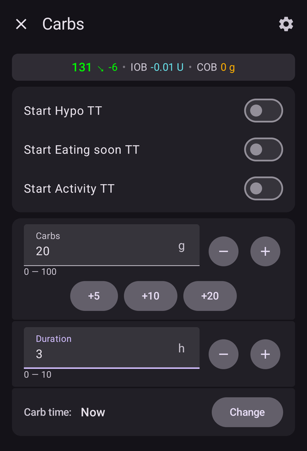
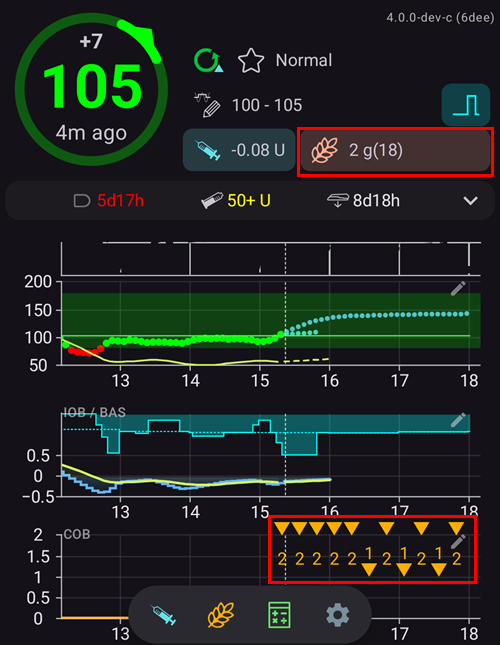

(Extended-Carbs-extended-carbs-ecarbs)=
# פחמימות ממושכות

## מהן פחמימות ממושכות ומתי משתמשים בהן?

בטיפול רגיל במשאבה, בולוסים ממושכים הם דרך טובה להתמודד עם ארוחות שומניות או ארוחות אחרות שנספגות לאט ומעלות את רמת הסוכר בדם זמן רב יותר מהשפעת האינסולין. עם זאת, בלולאה, בולוסים ממושכים אינם הגיוניים כל כך (ויוצרים קשיים טכניים), כי הם בעצם קצב בזאלי זמני גבוה וקבוע. זה נוגד את אופן הפעולה של הלולאה, שמתאימה את הקצב הבזאלי באופן דינמי. לפרטים, ראו [בולוס ממושך](#extended-bolus-and-why-they-wont-work-in-closed-loop-environment) בהמשך.

אף על פי כן, נותר הצורך להתמודד עם ארוחות כאלה. לכן AAPS תומך במה שנקרא פחמימות ממושכות (eCarbs).

פחמימות ממושכות הן פחמימות שמחולקות על פני כמה שעות. בארוחות רגילות עם יותר פחמימות מאשר שומן/חלבון, רישום הפחמימות מראש (והפחתת הבולוס הראשוני במידת הצורך) מספיק בדרך כלל כדי למנוע מתן אינסולין מוקדם מדי.  אבל בארוחות שנספגות לאט, כאשר רישום כל הפחמימות מראש גורם ליותר מדי אינסולין פעיל מ-SMB, ניתן להשתמש בפחמימות ממושכות כדי לדמות בצורה מדויקת יותר את ספיגת הפחמימות (וכל ערך מקביל לפחמימות שתזינו עבור רכיבי תזונה אחרים) ואת השפעתן על רמת הסוכר בדם. עם המידע הזה, הלולאה יכולה לתת בולוסי SMB בהדרגה כדי להתמודד עם הפחמימות האלה. אפשר לראות בזה בולוס ממושך דינמי (זה אמור לעבוד גם ללא SMB, אבל כנראה פחות ביעילות).

**הערה:** פחמימות ממושכות אינן רק לארוחות שומניות או עשירות בחלבון: אפשר להשתמש בהן גם בכל מצב שבו יש גורמים שמעלים את רמת הסוכר בדם, לדוגמה תרופות אחרות כמו קורטיקוסטרואידים.

## אופן השימוש בפחמימות ממושכות

כדי להזין פחמימות ממושכות, יש לפתוח את חלון **פחמימות** (**טיפולים** ← **פחמימות**), להזין את סך הפחמימות, להגדיר **משך**, ואם רוצים, להזיז את ההתחלה בעזרת **זמן הפחמימות** (*המספרים למטה הם רק דוגמה. יש לנסות ערכים משלכם כדי להגיע לתגובת סוכר טובה במצבים שלכם*):

הפחמימות הממושכות במסך הראשי: המספר בסוגריים בשדה **פחמ' פעילות** מראה את הפחמימות שעוד יגיעו, והגרף **פחמ' פעילות** מציג כל רישום עתידי של פחמימות ממושכות כסימן כתום. אם אין גרף **פחמ' פעילות**, ניתן להוסיף אותו בעזרת **הוספת גרף** מתחת לגרפים (ראו [מסכי AAPS](../DailyLifeWithAaps/AapsScreens.md)).

(AapsScreens-carbs-type)=
## סוג הפחמימות באשף הבולוס: לחם, עוגה או פיצה

ב[אשף הבולוס](#aaps-screens-bolus-wizard), שלושה לחצנים מתחת לשדה **פחמימות** מאפשרים לבחור כמה מהר הארוחה נספגת. יש לבחור אחד מהם לפני האישור. לפי הסוג, **AAPS** לוקח חלק מהפחמימות שהקלדתם כפחמימות רגילות, ומוסיף מאוחר יותר [פחמימות ממושכות ("eCarbs")](#Extended-Carbs-extended-carbs-ecarbs) לארוחות עשירות שנספגות לאט. לחיצה על הסמל **(i)** ליד הלחצנים מציגה מזונות אופייניים לסוג שנבחר ומה הסוג עושה לפחמימות.

| סוג                  | מזונות אופייניים (דוגמאות מהאפליקציה)                                                              | פחמימות עכשיו, משמשות לבולוס | פחמימות ממושכות שנוספות                                 |
| -------------------- | -------------------------------------------------------------------------------------------------- | ---------------------------- | ------------------------------------------------------- |
| **לחם** (ברירת מחדל) | לחם, מאפים מלוחים, יוגורט, פירות, תפוחי אדמה, אורז, שיבולת שועל, ירקות                             | 100 %                        | None                                                    |
| **עוגה**             | כיסונים, פסטה, מנות אסייתיות עשירות בפחמימות ושומן, מאפים מתוקים ומאפי שמרים, דגני בוקר, דבש, ריבה | 90 %                         | 20 %, מתחילות 60 דקות מאוחר יותר, מחולקות על פני 2 שעות |
| **פיצה**             | לזניה, פיצה, המבורגרים, צ׳יפס, תפוחי אדמה אפויים, חטיפים דמויי צ׳יפס                               | 80 %                         | 35 %, מתחילות 60 דקות מאוחר יותר, מחולקות על פני 3 שעות |

**דוגמה**: מקלידים 100 גר' ובוחרים **פיצה**. הבולוס מחושב עבור 80 גר', שנרשמים עכשיו. 35 גר' של פחמימות ממושכות מתחילות שעה אחת מאוחר יותר ומחולקות על פני 3 שעות.

טוב לדעת:
* זו לא חלוקה פשוטה: עם **עוגה** ו**פיצה**, סך הפחמימות שנרשמות **גדול ממה שהקלדתם** (110 % ו-115 %). התוספת נמצאת רק בפחמימות הממושכות.
* הבולוס מכסה רק את הפחמימות שנלקחות עכשיו. **AAPS** לא נותן בולוס מראש עבור הפחמימות הממושכות: הלולאה מתחשבת בהן כשהן מתחילות, כמו בכל [פחמימות ממושכות](#Extended-Carbs-extended-carbs-ecarbs) אחרות.
* אם מגדירים **זמן הפחמימות**, הפחמימות הממושכות מתחילות 60 דקות אחרי הזמן הזה.
* חלון האישור מציג את הפחמימות הממושכות בשורה נפרדת, _לדוגמה_ "פחמ' ממושכות 35 גר' / 3 שעות (+60 דקות)".
* הגרמים מעוגלים כלפי מטה למספרים שלמים.
* האחוזים, ההשהיות ומשכי הזמן קבועים; אי אפשר לשנות אותם בהגדרות.
* הבחירה לא נשמרת: האשף נפתח עם **לחם** בכל פעם.

______________________________________________________________________

דרך לטפל בשומן וחלבון בעזרת תכונה זו מתוארת כאן: [https://adriansloop.blogspot.com/2018/04/page-margin-0.html](https://adriansloop.blogspot.com/2018/04/page-margin-0.html)

______________________________________________________________________

## תצורה מומלצת, תרחיש לדוגמה והערות חשובות

התצורה המומלצת היא להשתמש בתוסף OpenAPS SMB, כאשר SMB מופעל וגם ההגדרה *הפעלת SMB עם פחמימות פעילות* מופעלת.

תרחיש לדוגמה לפיצה: לתת בולוס (חלקי) מראש בעזרת *אשף בולוס*, ואז להשתמש בחלון *פחמימות* כדי להזין את שאר הפחמימות למשך 4-6 שעות, שמתחילות אחרי שעה או שעתיים.

להתחלה מהירה יותר, *אשף בולוס* יכול להוסיף פחמימות ממושכות בשבילכם: יש לבחור את [סוג הפחמימות](#AapsScreens-carbs-type) **עוגה** או **פיצה** מתחת לשדה **פחמימות** (ראו למעלה). הכמויות והתזמון קבועים, לכן אם רוצים ערכים אחרים, יש להשתמש בחלון *פחמימות*.

**הערות חשובות:** חובה לבדוק בעצמכם ולגלות מהם הערכים המתאימים לכם. ניתן גם להתאים בזהירות את ההגדרה *מספר דקות בזאלי מרבי להגבלת SMB* כדי שהאלגוריתם יהיה אגרסיבי יותר או פחות. בארוחות דלות פחמימות ועתירות שומן/חלבון ייתכן שיספיק להשתמש רק בפחמימות ממושכות, ללא בולוסים ידניים (ראו את הפוסט בבלוג למעלה). כאשר נוצרות פחמימות ממושכות, נוצרת גם הערה ב-Careportal שמתעדת את כל הנתונים שהוזנו. כך קל יותר לנסות שוב ולשפר את הנתונים.

(extended-bolus-and-why-they-wont-work-in-closed-loop-environment)=
## בולוסים ממושכים: למה הם לא עובדים בלולאה סגורה

כפי שהוזכר למעלה, בולוסים ממושכים או רב שלביים לא באמת עובדים בלולאה סגורה. [ראו בהמשך](#why-extended-boluses-won-t-work-in-a-closed-loop-environment) לפרטים

(Extended-Carbs-extended-bolus-and-switch-to-open-loop-dana-and-insight-pump-only)=
### בולוס ממושך ומעבר ללולאה פתוחה - משאבות Dana ו-Insight בלבד

חלק מהמשתמשים ביקשו אפשרות להשתמש בבולוס ממושך ב-AAPS בכל זאת, כי רצו לטפל במזונות מיוחדים כפי שהיו רגילים.

לכן **AAPS** מציע בולוס ממושך למשתמשים במשאבות Dana ו-Insight: יש לפתוח את **ניהול** ולבחור **בולוס ממושך**.

**AAPS** מזהיר קודם שהלולאה הסגורה תיעצר כל עוד הבולוס הממושך פועל. יש ללחוץ על **אישור** כדי להמשיך:

יש להזין את כמות ה**אינסולין** ואת ה**משך**, ואז ללחוץ על לחצן האישור בתחתית המסך ועל **אישור**:

במשאבת Insight, הבולוס הממושך *אינו זמין* אם משתמשים ב[הדמיית בזאלי זמני](#Accu-Chek-Insight-Pump-settings-in-aaps) (TBR emulation).

כל עוד הבולוס הממושך פועל, הלולאה פועלת במצב **לולאה פתוחה** (סמל הלולאה במסך הראשי משתנה), והלולאה הסגורה חוזרת לפעול אוטומטית כשהבולוס הממושך מסתיים:

בתפריט **ניהול** מופיע לחצן **ביטול** עם המינון והזמן שעבר / הזמן הכולל (לדוגמה **ביטול 2.00 U/h 1/60'**). לחיצה עליו עוצרת את הבולוס הממושך לפני הזמן:

(why-extended-boluses-won-t-work-in-a-closed-loop-environment)=
### למה בולוסים ממושכים לא יעבדו בלולאה סגורה

1. הלולאה קובעת שעכשיו יש לתת 1.55U/h. לאלגוריתם לא משנה אם המינון הזה יינתן כבולוס ממושך או כבזאלי זמני (TBR). למעשה, חלק מהמשאבות משתמשות בבולוס ממושך. מה צריך לקרות? רוב מנהלי ההתקן של המשאבות מפסיקים אז את הבולוס הממושך -> לא היה צורך אפילו להתחיל אותו.

2. אם הבולוס הממושך הוזן כקלט, מה צריך לקרות במודל?

   1. האם יש להתייחס אליו כנייטרלי יחד עם הקצב הבזאלי (BR) ולהריץ עליו את הלולאה? ואז הלולאה אמורה להיות מסוגלת גם להפחית את הבולוס אם למשל יורדים מדי וכל האינסולין ה"נייטרלי" נלקח?
   2. האם פשוט להוסיף את הבולוס הממושך? אז פשוט לתת ללולאה להמשיך? אפילו בהיפו הכי חריף? זהו אינו פיתרון טוב, יש היפו צפוי אבל אסור למנוע אותו?

3. האינסולין הפעיל שהבולוס הממושך צובר מופיע אחרי 5 דקות, בהרצה הבאה. בהתאם לכך, הלולאה תיתן פחות בזאלי. כך שלא הרבה משתנה... חוץ מזה שהאפשרות למנוע היפו נלקחת.
