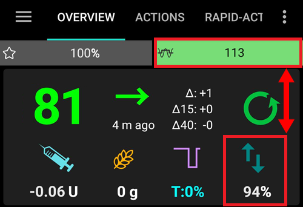

# Key AAPS features

## Loop mode

The loop status is shown on the main screen with one of the icons below.

**AAPS** מציע כמה מצבי לולאה, כמו לולאה סגורה (1), השהיה עקב ערך סוכר נמוך (LGS - 2) ולולאה פתוחה (3).

ראו [מסכי AAPS ← המסך הראשי ← מצב הלולאה](#AapsScreens-loop-status) למידע על בחירת מצב הלולאה ועל הסמלים האחרים בתמונה (4 עד 6).

(KeyAapsFeatures-OpenLoop)=

### Open Loop

**AAPS** מעריך ברציפות את כל הנתונים הזמינים (IOB, COB, BG...) ומציע טיפולים (קצבים בזאליים זמניים) להתאמת הטיפול שלכם במידת הצורך.

The suggestions will not be executed automatically (as in closed loop). The suggestions have to be enacted by the user manually into the pump (if using virtual pump) or by using a button if **AAPS** is connected to a real pump.

כאשר ל-**AAPS** יש הצעה, מופיע פריט **לולאה** עם תג בסרגל הניווט התחתון של המסך הראשי. יש ללחוץ עליו כדי לקרוא את ההצעה ("לאשר בזאלי זמני חדש:") עם המינון, משך הזמן והסיבה, ואז ללחוץ על **לבצע** כדי לבצע אותה:

הצעה תקפה רק לכמה דקות. אם היא ישנה מיותר מכ-9 דקות, או אם בינתיים הלולאה הושהתה או שהמשאבה נותקה, **AAPS** דוחה אותה ושום דבר לא נשלח למשאבה (*"הצעה זו ישנה מדי. לא נשלח דבר למשאבה. נא להמתין להצעה הבאה."*). יש להמתין להצעה הבאה.

This option is for getting to know how **AAPS** works or if you are using an unsupported pump. You will be in Open Loop, no matter what choice you make here, until the end of **[Objective 5](#objectives-objective5)**.

(KeyAapsFeatures-LGS)=

### השהיה עקב ערך סוכר נמוך (LGS)

In this mode, [maxIOB](#Open-APS-features-maximum-total-iob-openaps-cant-go-over) is set to zero.

This means that if blood glucose is dropping, **AAPS** can reduce the basal for you. But if blood glucose is rising, no automatic correction will be made. הקצבים הבזאליים שלכם יישארו כפי שהוגדרו ב-**פרופיל** הנוכחי שלכם. Only if IOB is negative (from a previous Low Glucose Suspend) additional insulin will be given to lower **BG**.

This mode is available starting at **[Objective 6](#objectives-objective6)**.

מלבד בחירה ידנית, **AAPS** יכול גם לעבור למצב הזה בעצמו: בזמן העבודה על **[משימה 6](#objectives-objective6)**, ובכל פעם שהוא מזהה ערכי סוכר כפולים (ראו [סימן אזהרת הסוכר](#aaps-screens-bg-warning-sign)).

(KeyAapsFeatures-ClosedLoop)=

### Closed Loop

**AAPS** מעריך ברציפות את כל הנתונים הזמינים (IOB, COB, BG...) ומתאים אוטומטית את הטיפול במידת הצורך (*כלומר*, ללא התערבות נוספת מצדכם), כדי להגיע ל[טווח היעד או ערך היעד](#profile-glucose-targets) שהוגדרו (מתן בולוס, קצב בזאלי זמני, הפסקת אינסולין למניעת היפוגליקמיה וכדומה).

The Closed Loop works within numerous safety limits, which can be set individually.

Closed Loop is only possible if you are in **[Objective 7](#objectives-objective7)** or higher and use a supported pump.

(autosens)= (Open-APS-features-autosens)=

## Autosens

- Autosens is an algorithm which looks at blood glucose deviations (positive/negative/neutral).
- Autosens ינסה להעריך את הרגישות/תנגודת על סמך סטיות אלו.
- אלגוריתם oref ב-**OpenAPS** פועל באמצעות התחשבות בנתונים מ-24 ו-8 השעות האחרונות. הוא יבחר בנתון בו הרגישות גדולה יותר מבין חלונות הזמן הללו.
- אם משתמשים הגיעו מ-oref1, הם כנראה ישימו לב שהמערכת עשויה להיות פחות דינמית לשינויים, בגלל המשתנה של 24 או 8 שעות של רגישות.
- החלפת צינורית או שינוי פרופיל יאפס את יחס ה-Autosens בחזרה ל-100% (החלפת פרופיל באחוזים עם משך זמן לא יאפס את Autosens).
- Autosens מתאים את הקצב הבזאלי ואת יחס התיקון-ISF (כלומר: מחקה את מה שעושה שינוי פרופיל).
- If continuously eating carbs over an extended period, Autosens will be less effective during that period as carbs are excluded from **BG** delta calculations.
- הסטיות מומרות ל**יחס רגישות** (אחוז): יחס מתחת ל-100% אומר ש-AAPS חושב שאתם רגישים לאינסולין יותר ממה שה**פרופיל** מניח (ולכן הוא מוריד את הבזאלי בפועל ומעלה את ערך ה-ISF), ויחס מעל 100% אומר שיש לכם תנגודת גבוהה יותר (ולכן הוא מעלה את הבזאלי ומוריד את ערך ה-ISF).
- כברירת מחדל היחס הזה נשמר בין 0.7 (70%, רגישות גבוהה יותר) ל-1.2 (120%, תנגודת גבוהה יותר), כך שרצף של נתונים חריגים לא יכול להרחיק את המינונים שלכם יותר מדי מה**פרופיל**. את הגבולות האלה אפשר לשנות בהגדרות המתקדמות של זיהוי הרגישות.
- Autosens ו-[Autotune](../AdvancedOptions/Autotune.md) מטפלים באותה בעיה בסיסית בטווחי זמן שונים: Autosens מתקן בעדינות את המינונים *בזמן אמת*, מדקה לדקה, על סמך 8-24 השעות האחרונות, ואילו Autotune משכתב לאט את ה*פרופיל* עצמו על סמך היסטוריה של שבועות. שימוש בשניהם יחד הוא רגיל וצפוי — הם משלימים זה את זה ולא עושים את אותה עבודה פעמיים.

*להסבר הטכני המלא של אלגוריתם autosens, ראו [תיעוד Autosens של OpenAPS](https://openaps.readthedocs.io/en/latest/docs/Customize-Iterate/autosens.html).*

(Open-APS-features-super-micro-bolus-smb)=

## Super Micro Bolus (SMB)

**SMB**, the shortform of **Super micro bolus**, is an OpenAPS feature introduced from 2018 onwards, within the Oref1 algorithm. בניגוד ל-**AMA**, **SMB** אינו משתמש בקצבים בזאליים זמניים לשליטה ברמות הגלוקוז, אלא בעיקר ב-**סופר מיקרו בולוסים קטנים**. במצבים שבהם **AMA** היה מוסיף 1.0 IU אינסולין באמצעות קצב בזאלי זמני, **SMB** נותן מספר סופר מיקרו בולוסים בצעדים קטנים ב-**מרווחים של 5 דקות**, למשל 0.4 IU, 0.3 IU, 0.2 IU ו-0.1 IU. במקביל (מטעמי בטיחות) הקצב הבזאלי מוגדר ל-0 יח'/שעה לתקופה מסוימת כדי למנוע מנת יתר (**'zero-temping'**). This allows the system to adjust the blood glucose faster than with the temporary basal rate increase in **AMA**.

Thanks to SMB, it may be sufficient for meals containing only "slow" carbs to inform the system of the planned amount of carbohydrate and leave the rest to **AAPS**. עם זאת, זה עלול להוביל לשיאים גבוהים יותר לאחר הארוחה מכיוון שלא ניתן בולוס מראש. Or you can give, if necessary with pre-bolusing, a **start bolus**, which **only partly** covers the carbohydrates (e.g. 2/3 of the estimated amount) and let **SMB** deliver the rest of the insulin.

SMB מוצגים ב[גרף ה-IOB](#aaps-screens-iob) כמשולשים כחולים. [לחיצה ארוכה](#aaps-screens-graph-press-and-hold) על הגרף במקום של משולש מראה כמה אינסולין ניתן; אפשר גם להשתמש ב[היסטוריית טיפולים](#aaps-screens-treatments).

**SMB's** features contain some safety mechanisms:

1. **Largest single SMB dose**  
  The largest single SMB dose can only be the smallest value of:
  
        * ערך שמתאים לקצב הבזאלי הנוכחי (כפי ש-autosens התאים אותו) למשך הזמן שהוגדר ב"מספר דקות בזאלי מרבי להגבלת SMB", למשל כמות הבזאלי ל-30 הדקות הבאות, או
        * מחצית מכמות האינסולין שנדרשת כרגע, או
        * החלק שנותר מערך ה-maxIOB שלכם בהגדרות.
      

2. **קצבים בזאליים זמניים נמוכים**  
  קצבים בזאליים זמניים נמוכים (המכונים 'low temps') או קצבים בזאליים זמניים של 0 U/h (המכונים 'zero-temps') מופעלים יותר ב-**SMB**. This is by design for safety reasons and has no negative effects if the **Profile** is set correctly. בגרף הראשי, עקומת האינסולין הפעיל (IOB, קו צהוב דק) משמעותית יותר ממהלך הקצבים הבזאליים הזמניים.

3. **Un-Announced Meals**  
  Additional calculations to predict the course of glucose, e.g. by **UAM** (un-announced meals). Even without manual carbohydrate input from the user, **UAM** can automatically detect a significant increase in glucose levels due to meals, adrenaline or other influences and try to adjust this with **SMB**. ליתר בטחון זה עובד גם הפוך ויכול לעצור את ה-SMB מוקדם יותר אם מתרחשת ירידה מהירה באופן בלתי צפוי בסוכר שבדם. זו הסיבה לכך שעל UAM להיות תמיד מופעל עם SMB.

SMB לא מחליט לבד שצריך אינסולין — הוא מסתמך על אותן תחזיות סוכר משולבות (eventual BG, zero-temp, COB, UAM) שמתוארות ב[איך AAPS הופך תחזיות להחלטה על מינון](#aaps-screens-how-predictions-become-a-dosing-decision). SMB ו-zero-temping הם פשוט שני הכלים ש-AAPS משתמש בהם כדי לפעול לפי ההחלטה הזו.

**You must have started [objective 9](#objectives-objective9) to use SMB.**

ראו גם [תיעוד oref1/SMB של OpenAPS](https://openaps.readthedocs.io/en/latest/docs/Customize-Iterate/oref1.html#understanding-super-micro-bolus-smb) להסבר הטכני המלא, או [המידע של Tim על SMB](https://www.diabettech.com/artificial-pancreas/understanding-smb-and-oref1/) לסקירה מהקהילה.

The settings for OpenAPS SMB are described below.

(Open-APS-features-max-u-h-a-temp-basal-can-be-set-to)=

### קצב בזאלי מרבי

הגדרת בטיחות זו קובעת את הקצב הבזאלי הזמני המרבי שמשאבת האינסולין יכולה לספק. It is also known as **max-basal**.

The value is measured in units per hour (U/h). מומלץ להגדיר ערך סביר. A good recommendation for setting this parameter is:

**MAX-BASAL = הקצב הבזאלי הגבוה ביותר x 4**

למשל, אם הקצב הבזאלי הגבוה ביותר בפרופיל שלכם היה 0.5 U/h, ניתן להכפיל אותו ב-4 ולקבל ערך של 2 U/h.

**AAPS** מגביל את הערך הזה ב'מגבלה קשיחה' לפי [הגדרות ← בטיחות ← גיל המטופל](#preferences-patient-type). The hard limits are as follows:

- ילד/ה: 2
- מתבגר/ת: 5
- מבוגר/ת: 10
- מבוגר/ת עם תנגודת אינסולין גבוהה: 12
- הריון: 25

*See also [overview of hard-coded limits](#Open-APS-features-overview-of-hard-coded-limits).*

(Open-APS-features-maximum-total-iob-openaps-cant-go-over)=

### IOB מרבי עבור SMB

This value determines the maximum **Insulin on Board** (basal and bolus IOB) that **AAPS** will remain under while running in closed loop mode. It is also known as **maxIOB**.

If the current IOB (e.g. after a meal bolus) is above the defined value, the loop stops dosing insulin until the IOB limit is below the given value.

A good start for setting this parameter is:

      maxIOB = בולוס ארוחה ממוצע + פי 3 מהמינון הבזאלי היומי המרבי
    

Be careful and patient when adjusting your **max-IOB**. It is different for everyone and can also depend on the average total daily dose (TDD).

**AAPS** מגביל את הערך הזה ב'מגבלה קשיחה' לפי [הגדרות ← בטיחות ← גיל המטופל](#preferences-patient-type). The hard limits are as follows:

- ילד/ה: 7
- מתבגר/ת: 13
- מבוגר/ת: 22
- מבוגר/ת עם תנגודת אינסולין גבוהה: 30
- הריון: 70

*See also [overview of hard-coded limits](#Open-APS-features-overview-of-hard-coded-limits).*

Note : When using **SMB**, the **max-IOB** is calculated differently than in AMA. In **AMA**, maxIOB is a safety-parameter for basal **IOB**, while in SMB-mode, it also includes bolus IOB.

### שימוש ברגישות דינמית

This is the [DynamicISF](../DailyLifeWithAaps/DynamicISF.md) feature. When enabled, new settings become available. Settings are explained on the [DynamicISF](#dyn-isf-preferences) page.

### שימוש ב-Autosens

This is the [Autosens](#Open-APS-features-autosens) feature. כשמשתמשים ב-DynamicISF אי אפשר להשתמש ב-Autosens, כי אלה שני אלגוריתמים שונים שמשנים את אותו משתנה (הרגישות).

Autosens looks at blood glucose deviations (positive/negative/neutral). הוא ינסה לקבוע את מידת הרגישות או התנגודת שלכם על סמך סטיות אלה, ולהתאים לפיהן את הקצב הבזאלי ואת ISF.

When enabled, new settings become available.

#### רגישות מעלה את היעד

אם אפשרות זו מופעלת, זיהוי הרגישות (autosens) יכול להעלות את היעד כאשר מזוהה רגישות (מתחת ל-100%). במקרה זה, היעד שלכם יועלה לפי אחוז הרגישות שזוהתה.

אם היעד משתנה בגלל זיהוי הרגישות, הוא מוצג עם רקע ירוק במסך הראשי.

ההגדרה הזו זמינה כאשר "שימוש ברגישות דינמית" או "שימוש ב-Autosens" מופעלת.

#### עמידות מורידה את היעד

אם אפשרות זו מופעלת, זיהוי הרגישות (autosens) יכול להוריד את היעד כאשר מזוהה תנגודת (מעל 100%). במקרה זה, היעד שלכם יורד לפי אחוז התנגודת שזוהתה.

ההגדרה הזו זמינה כאשר "שימוש ברגישות דינמית" או "שימוש ב-Autosens" מופעלת.

### Enable SMB

Enable this to use SMB functionality. If disabled, no **SMBs** will be given.

When enabled, new settings become available.

(Open-APS-features-enable-smb-with-high-temp-targets)=

#### הפעלת SMB עם יעד זמני גבוה

אם ההגדרה הזו מופעלת, **SMB** ימשיכו להינתן גם אם המשתמש בחר **יעד זמני** גבוה (כלומר 100 mg/dL או 5.6 mmol/L ומעלה, בלי קשר ליעד ב**פרופיל**). יש להיזהר בהפעלה: **SMB** עלולים להיות אגרסיביים מדי אם ההגדרות שלכם לא מכווננות היטב, או אם ה**פרופיל** שלכם משתנה לעתים קרובות (למשל אצל ילדים).

כשההגדרה הזו מושבתת, **יעד זמני** גבוה מכבה את ה-**SMB**. לדוגמה, אם האפשרות הזו מושבתת, אפשר להשבית **SMB** על ידי הגדרת **יעד זמני** של 100 mg/dL או 5.6 mmol/L ומעלה. האפשרות הזו גם משביתה **SMB** בלי קשר לתנאים אחרים שמנסים להפעיל SMB — חוץ מ**יעד זמני** נמוך כמו **אכילה בקרוב** (או כל **יעד זמני** של 98 mg/dL או 5.4 mmol/L ומטה), שעדיין יכול לתת **SMB** כדי להוביל את ה-**BG** אל היעד.

ההגדרה הזו לא מפעילה **SMB** בעצמה. עם יעד זמני גבוה, **SMB** ניתן רק אם גם אחת מההגדרות האחרות שבהמשך (למשל **הפעלת SMB תמיד** או **הפעלת SMB עם פחמימות פעילות (COB)**) מאפשרת זאת.

(Open-APS-features-enable-smb-always)=

#### Enable SMB always

אם ההגדרה הזו מופעלת, SMB מופעל תמיד (בלי תלות ב-COB, ביעדים זמניים או בבולוסים). If this setting is enabled, the rest of the enable settings below will have no effect. עם זאת, אם **הפעלת SMB עם יעד זמני גבוה** מושבתת ומוגדר יעד זמני גבוה, בולוסי SMB יושבתו.

This setting is only available if **AAPS** detects that you are using a [reliable BG source](#GettingStarted-TrustedBGSource), with advanced filtering. FreeStyle Libre 1 is not considered a reliable source due to the risk of infinitely repeating old BG data in case of sensor failure.

Noisy data could cause **AAPS** to believe BG is rising really fast, resulting in the administration of unnecessary SMBs. For more information about noise and data smoothing, see [here](../CompatibleCgms/SmoothingBloodGlucoseData.md).

#### הפעלת SMB עם פחמימות פעילות (COB)

If this setting is enabled, SMB is enabled when the COB is greater than 0.

הגדרה זו אינה מוצגת אם "הפעלת SMB תמיד" מופעלת.

#### הפעלת SMB עם יעד זמני נמוך

אם ההגדרה הזו מופעלת, SMB מופעל כאשר מוגדר יעד זמני (אכילה בקרוב, פעילות, היפוגליקמיה, מותאם אישית). אם ההגדרה הזו מופעלת אבל **הפעלת SMB עם יעד זמני גבוה** מושבתת, SMB יופעל כשמוגדר יעד זמני נמוך (98 mg/dL או 5.4 mmol/L ומטה), אבל יושבת כשמוגדר יעד זמני גבוה.

הגדרה זו אינה מוצגת אם "הפעלת SMB תמיד" מופעלת.

#### Enable SMB after carbs

אם ההגדרה מופעלת, SMB מופעל למשך 6 שעות אחרי רישום פחמימות, גם אם COB הגיע ל-0.

For safety reasons, this setting is only available if **AAPS** detects that you are using a reliable BG source. היא אינה מוצגת אם "הפעלת SMB תמיד" מופעלת.

This setting is only available if **AAPS** detects that you are using a [reliable BG source,](#GettingStarted-TrustedBGSource) with advanced filtering. FreeStyle Libre 1 is not considered a reliable source due to the risk of infinitely repeating old BG data in case of sensor failure.

Noisy data could cause **AAPS** to believe BG is rising really fast, resulting in the administration of unnecessary SMBs. למידע נוסף על רעש והחלקת נתונים, ראו [כאן](../CompatibleCgms/SmoothingBloodGlucoseData.md).  
הגדרה זו אינה מוצגת אם "הפעלת SMB תמיד" מופעלת.

#### מרווח SMB

This feature limits the frequency of SMBs. This value determines the minimum time between SMBs. Note that the loop runs every time a glucose value comes in (generally 5 minutes). הפחיתו 2 דקות כדי לתת ללולאה זמן נוסף להשלמת הפעולה. E.g. if you want SMB to be given every loop run, set this to 3 minutes.

Default value: 3 min.

(Open-APS-features-max-minutes-of-basal-to-limit-smb-to)=

#### מספר דקות בזאלי מרבי להגבלת SMB

This is an important safety setting. This value determines how much SMB can be given based on the amount of basal insulin in a given time, when it is covered by COBs.

Making this value larger allows the SMB to be more aggressive. You should start with the default value of 30 minutes. After some experience, increase the value in 15 minutes increments and observe the effects over multiple meals.

It is recommended not to set the value higher than 90 minutes, as this would lead to a point where the algorithm might not be able to accommodate a decreasing BG with 0 U/h basal ('zero-temp'). You should also set alarms, especially if you are still testing new settings, which will warn you well before a hypo.

Default value: 30 min.

#### מספר דקות בזאלי מרבי ב־UAM להגבלת SMB

ההגדרה הזו מאפשרת לכוונן את העוצמה של SMB בזמן UAM, כשאין יותר פחמימות.

ערך ברירת המחדל: זהה ל-**מספר דקות בזאלי מרבי להגבלת SMB**.

הגדרה זו מוצגת רק אם "הפעלת SMB" ו-"הפעלת UAM" מופעלות.

(enable-uam)=

### Enable UAM

With this option enabled, the SMB algorithm can recognize unannounced meals. This is helpful if you forget to tell **AAPS** about your carbs or estimate your carbs wrong and the amount of entered carbs is wrong or if a meal with lots of fat and protein has a longer duration than expected. Without any carb entry, UAM can recognize fast glucose increase caused by carbs, adrenaline, etc., and tries to adjust it with SMBs. This also works the opposite way: if there is a fast glucose decrease, it can stop SMBs earlier.

**Therefore, UAM should always be activated when using SMB.**

(key-aaps-features-minimal-carbs-required-for-suggestion)=

### סף דרישת פחמימות

Minimum grams of carbs to display a carbs suggestion alert. Eating of additional carbs will be suggested when the reference design detects that it requires carbs. In this case you will receive a notification which can be snoozed for 5, 15 or 30 minutes.

הודעות של דרישה לפחמימות יכולות להישלח ל-Nightscout אם תרצו, ובמקרה זה תוצג ותשודר הודעה.

בכל מקרה, הפחמימות הנדרשות יוצגו באזור ה-COB במסך הראשי.

### Advanced Settings

לתיעוד המלא של הפרמטרים (כולל הגדרות שלא מוסברות כאן), ראו [תיעוד ההעדפות והגדרות הבטיחות של OpenAPS](https://openaps.readthedocs.io/en/latest/docs/While%20You%20Wait%20For%20Gear/preferences-and-safety-settings.html).

**שימוש תמיד בדלתא ממוצעת קצרת טווח במקום בדלתא הפשוטה** אם תפעילו תכונה זו, **AAPS** ישתמש בממוצע הקצר של הדלתא/הסוכר בדם מ-15 הדקות האחרונות, שהוא בדרך כלל ממוצע שלושת הערכים האחרונים. כך **AAPS** יציב יותר עם מקורות נתונים רועשים כמו xDrip ו-Libre.

**מכפיל בטיחות יומי מרבי** זוהי מגבלת בטיחות חשובה. The default setting (which is unlikely to need adjusting) is 3. משמעות הדבר היא של-**AAPS** לעולם לא תותר הגדרת בזאלי זמני הגבוה מ-3x הקצב הבזאלי השעתי הגבוה ביותר שתוכנת במשאבה ו/או בפרופיל המשתמש. דוגמה: אם הקצב הבזאלי הגבוה ביותר שלכם הוא 1.0 U/h ומכפיל הבטיחות היומי המרבי הוא 3, **AAPS** יכול להגדיר בזאלי זמני מרבי של 3.0 U/h (= 3 x 1.0 U/h).

Default value: 3 (shouldn’t be changed unless you really need to and know what you are doing)

**מכפיל בטיחות לבזאלי הנוכחי** זוהי מגבלת בטיחות חשובה נוספת. The default setting (which is also unlikely to need adjusting) is 4. משמעות הדבר היא של-**AAPS** לעולם לא תותר הגדרת בזאלי זמני הגבוה מ-4x הקצב הבזאלי השעתי הנוכחי שתוכנת במשאבה ו/או בפרופיל המשתמש.

Default value: 4 (shouldn’t be changed unless you really need to and know what you are doing)

* * *

(Open-APS-features-auto-isf)=

## רגישות אוטומטית

**Auto ISF** הוא אלגוריתם **ניסיוני** למשתמשים מתקדמים. הוא מבוסס על OpenAPS SMB ומוסיף כללים שמחזקים או מחלישים את גורם הרגישות לאינסולין (ISF) לפי התנהגות הסוכר שלכם.

זו תכונת פיתוח: אפשר להפעיל אותה רק ב[גרסת פיתוח (dev)](../AdvancedOptions/DevBranch.md) כש**מצב הנדסה** מופעל. בגרסה רשמית רגילה היא תמיד כבויה, ולכן היא לא מוצגת ב**הגדרות תצורה ← APS**. השלמת ה[משימות](../SettingUpAaps/CompletingTheObjectives.md) לא פותחת אותה.

אחרי שבוחרים אותה, ה**הגדרות** שלה כוללות את הגדרות OpenAPS SMB ועוד קבוצת **הגדרות רגישות אוטומטית**:

- **הפעלת AutoISF**: מפעיל את התאמות ה-ISF. בלעדיה האלגוריתם מתנהג כמו OpenAPS SMB.
- **AutoISF מינימלי** ו-**AutoISF מרבי**: עד כמה ה-ISF יכול להיחלש ועד כמה הוא יכול להתחזק, באותו אופן כמו המגבלות של Autosens. בערך ברירת המחדל 1.0 ההשפעה כבויה.
- **משקלים**: כל אחד מהם מפעיל כלל אחד, וערך ברירת המחדל 0.0 מכבה את הכלל. 
  - כשהסוכר **מאיץ**, ה-ISF מתחזק (יותר אינסולין);
  - כשהסוכר **מאט**, ה-ISF נחלש (פחות אינסולין);
  - כשהסוכר **מתחת ליעד**, ה-ISF נחלש;
  - כשהסוכר **מעל היעד**, ה-ISF מתחזק;
  - משקל **אחרי ארוחה** ומשקל **משך** פועלים אחרי ארוחות וכשהסוכר נשאר גבוה זמן רב.
- **יחס מתן SMB** (עם מינימום, מקסימום וטווח סוכר): איזה חלק מהאינסולין הנדרש אפשר לתת כ-SMB.
- **הרחבת הטווח המרבי של SMB**: פי כמה מותר לחרוג ממגבלת הגודל הרגילה של SMB ([מספר דקות בזאלי מרבי](#Open-APS-features-max-minutes-of-basal-to-limit-smb-to), 30 דקות כברירת מחדל). ערך ברירת המחדל 1 לא משנה דבר; אפשר עד 5. יש להעלות את הערך הניסיוני הזה לאט ובזהירות.
- **אחוז סף IOB**: האחוז מ-max IOB שמעליו SMB מושבתים.

    {admonition} רק למשתמשים מנוסים
    :class: danger
    עם ערכי ברירת המחדל שלו, Auto ISF לא משנה דבר. כל ערך שמעלים הופך את **AAPS** לאגרסיבי יותר. יש לשנות ערך אחד בכל פעם, בצעדים קטנים, ולעקוב אחרי התוצאה במשך כמה ימים. יש להיזהר מאוד עם **AutoISF מרבי** מעל 2.5.

(Open-APS-features-advanced-meal-assist-ama)=

## Advanced Meal Assist (AMA)

AMA, the short form of "advanced meal assist" is an OpenAPS feature from 2017 (oref0). OpenAPS Advanced Meal Assist (AMA) allows the system to high-temp more quickly after a meal bolus if you enter carbs reliably.

You can find more information in the [OpenAPS documentation](https://newer-docs.readthedocs.io/en/latest/docs/walkthrough/phase-4/advanced-features.html#advanced-meal-assist-or-ama).

### קצב בזאלי מרבי ("max-basal" ב-OpenAPS)

הגדרת בטיחות זו עוזרת למנוע מ-**AAPS** לתת אי פעם קצב בזאלי גבוה באופן מסוכן, ומגבילה את הקצב הבזאלי הזמני ל-x U/h. מומלץ להגדיר ערך סביר. המלצה טובה היא לקחת את הקצב הבזאלי הגבוה ביותר בפרופיל שלכם ולהכפיל אותו ב-4, ולפחות ב-3. לדוגמה, אם הקצב הבזאלי הגבוה ביותר בפרופיל שלכם הוא 1.0 U/h, ניתן להכפיל אותו ב-4 כדי לקבל ערך של 4 U/h ולהגדיר 4 כפרמטר הבטיחות שלכם.

You cannot choose any value: For safety reason, there is a 'hard limit', which depends on the patient age. The 'hard limit' for maxIOB is lower in AMA than in SMB. For children, the value is the lowest while for insulin resistant adults, it is the biggest.

The hardcoded parameters in **AAPS** are:

- ילד/ה: 2
- מתבגר/ת: 5
- מבוגר/ת: 10
- מבוגר/ת עם תנגודת אינסולין גבוהה: 12
- הריון: 25

*See also [overview of hard-coded limits](#Open-APS-features-overview-of-hard-coded-limits).*

### IOB מרבי עבור AMA

פרמטר זה מגביל את הכמות המרבית של אינסולין בזאלי פעיל שבה **AAPS** עדיין פועל. If the IOB is higher, it stops giving additional basal insulin until the basal IOB is under the limit.

ערך ברירת המחדל הוא 2, אך כדאי להעלות פרמטר זה בהדרגה כדי לראות עד כמה הוא משפיע עליכם ואיזה ערך מתאים ביותר. הערך שונה אצל כל אחד ותלוי גם במינון היומי הכולל הממוצע (TDD). מטעמי בטיחות קיימת מגבלה התלויה בגיל המטופל. The 'hard limit' for maxIOB is lower in AMA than in SMB.

- ילד/ה: 3
- מתבגר/ת: 5
- מבוגר/ת: 7
- מבוגר/ת עם תנגודת אינסולין גבוהה: 12
- הריון: 25

*See also [overview of hard-coded limits](#Open-APS-features-overview-of-hard-coded-limits).*

### שימוש ב-Autosens (AMA)

Here, you can choose, if you want to use the [sensitivity detection](../DailyLifeWithAaps/SensitivityDetectionAndCob.md) autosens or not.

### Autosens מתאים את היעדים

אם אפשרות זו מופעלת, autosens יכול להתאים גם את היעדים (בנוסף לבזאלי ול-ISF). This lets **AAPS** work more 'aggressive' or not. כך ייתכן שהיעד יושג מהר יותר.

### Advanced Settings

- בדרך כלל אין צורך לשנות את ההגדרות בחלון הזה!
- אם בכל זאת רוצים לשנות אותן, יש לוודא שמבינים מה עושים — ראו את התיעוד המלא של הפרמטרים ב[תיעוד ההעדפות והגדרות הבטיחות של OpenAPS](https://openaps.readthedocs.io/en/latest/docs/While%20You%20Wait%20For%20Gear/preferences-and-safety-settings.html).

**שימוש תמיד בדלתא ממוצעת קצרת טווח במקום בדלתא הפשוטה** אם תפעילו תכונה זו, **AAPS** ישתמש בממוצע הקצר של הדלתא/הסוכר בדם מ-15 הדקות האחרונות, שהוא בדרך כלל ממוצע שלושת הערכים האחרונים. כך **AAPS** פועל ביציבות רבה יותר עם מקורות נתונים רועשים כמו xDrip ו-Libre.

**מכפיל בטיחות יומי מרבי** זוהי מגבלת בטיחות חשובה. The default setting (which is unlikely to need adjusting) is 3. משמעות הדבר היא של-**AAPS** לעולם לא יהיה מותר להגדיר קצב בזאלי זמני הגדול מ-3x הקצב הבזאלי השעתי הגבוה ביותר שתוכנת במשאבת המשתמש. דוגמה: אם הקצב הבזאלי הגבוה ביותר שלכם הוא 1.0 U/h ומכפיל הבטיחות היומי המרבי הוא 3, **AAPS** יכול להגדיר בזאלי זמני מרבי של 3.0 U/h (= 3 x 1.0 U/h).

Default value: 3 (shouldn’t be changed unless you really need to and know what you are doing)

**מכפיל בטיחות לבזאלי הנוכחי** זוהי מגבלת בטיחות חשובה נוספת. The default setting (which is also unlikely to need adjusting) is 4. משמעות הדבר היא של-**AAPS** לעולם לא יהיה מותר להגדיר קצב בזאלי זמני הגדול מ-4x הקצב הבזאלי השעתי הנוכחי שתוכנת במשאבת המשתמש.

Default value: 4 (shouldn’t be changed unless you really need to and know what you are doing)

**מחלק DIA למעכב בולוס** התכונה "מעכב בולוס" (bolus snooze) פועלת אחרי בולוס ארוחה. **AAPS** לא מגדיר קצבים בזאליים זמניים נמוכים אחרי ארוחה, במשך פרק זמן של DIA חלקי הפרמטר "מעכב בולוס". The default value is 2. כלומר, עם DIA של 5 שעות, "מעכב הבולוס" יימשך 5 שעות : 2 = 2.5 שעות.

Default value: 2

* * *

(Open-APS-features-overview-of-hard-coded-limits)=

## Overview of hard-coded limits

|                             | ילד/ה | מתבגר/ת | מבוגר/ת | מבוגר/ת עם תנגודת אינסולין גבוהה | הריון |
| --------------------------- | ----- | ------- | ------- | -------------------------------- | ----- |
| בולוס מקס'                  | 5     | 10      | 17      | 25                               | 60    |
| משך פעילות אינסולין מינימלי | 5     | 5       | 5       | 5                                | 5     |
| משך פעילות אינסולין מקסימלי | 9     | 9       | 9       | 9                                | 10    |
| יחס פחמ' מינימלי            | 2     | 2       | 2       | 2                                | 0.3   |
| יחס פחמ' מקסימלי            | 100   | 100     | 100     | 100                              | 100   |
| אינסולין פעיל מקסימלי-AMA   | 3     | 5       | 7       | 12                               | 25    |
| אינסולין פעיל מקסימלי-SMB   | 7     | 13      | 22      | 30                               | 70    |
| בזאלי מקסימלי               | 2     | 5       | 10      | 12                               | 25    |