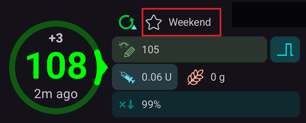
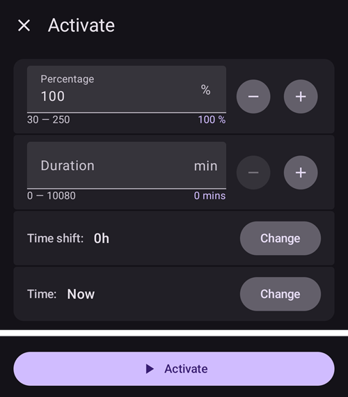

# החלפת פרופיל ואחוז הפרופיל

סעיף זה מסביר מהי **החלפת פרופיל** ומהו **אחוז הפרופיל**. איך יוצרים **פרופיל** אפשר ללמוד ב[פרופיל AAPS שלכם](#your-aaps-profile-create-and-edit-profiles).

When first embarking on your **AAPS** journey, you will need to create a **Profile**, understand how to action a **Profile Switch** and learn the impact of a **Profile Percentage** within **AAPS**. התכונות **החלפת פרופיל** ו**אחוז הפרופיל** יכולות להועיל במיוחד עבור:

- the Menstrual Cycle - a percentage adjustment within a **Profile** can be set up in **Automations** in order to allow **AAPS** to accommodate for different stages of the hormone cycle and with predicted insulin resistance.

- Exercise - a percentage adjustment within a **Profile** can be set up in **Automations** for exercise in order to reduce basal intake.

- Night or pattern shift workers - a time shift in **Profile** can be set up for pattern shift workers by altering the number of hours in the **Profile** to how much later/earlier the user will go to bed or wake up.

למה להשתמש ב**אחוז הפרופיל** ולא בהתאמה זמנית של הבזאלי? כדי לפעול ביעילות רבה יותר, **אחוז הפרופיל** מחיל הפחתה או הגדלה יחסית על הבזאלי, על ה-ISF ועל ה-I:C. This ensures a balanced approach is calculated by **AAPS** when administering the user’s insulin intake. Little benefit can be gained in a user’s **Profile** in **AAPS** by a basal reduction if the algorithm continues to deliver the same ratios for ISF and I:C.

(ProfileSwitch-change-percentage)=

## שינוי אחוז הפרופיל מהמסך הראשי

צריך לפחות **פרופיל** שמור אחד. **אחוז הפרופיל** מוחל תמיד באמצעות **החלפת פרופיל**: מפעילים שוב **פרופיל**, והפעם עם אחוז.

```{admonition} עוברים מ-AAPS 3? :class: note לחיצה ארוכה על שם הפרופיל כבר לא פותחת את חלון החלפת הפרופיל. יש **ללחוץ** על שם הפרופיל, ואז על הלחצן העגול **▶** בפינה התחתונה: הוא פותח את אותן הגדרות (אחוז, משך, יעד זמני לפעילות).

    <br />1. במסך הראשי, **יש ללחוץ על שם הפרופיל** (ליד סמל הכוכב). [מסך הפרופיל](#ProfileSwitch-manage-v4) נפתח על הכרטיס של ה**פרופיל** הפעיל, שמסומן **פעיל**.
    
       
    
    2. כדי להשאיר את אותו **פרופיל**, יש להשאיר את הכרטיס **פעיל** בחור. כדי להחליף **פרופיל** באותו זמן, יש להחליק לכרטיס אחר.
    3. יש ללחוץ על הלחצן העגול **▶** (**הפעלה**) בפינה התחתונה. נפתח המסך **הפעלה**.
    4. יש להגדיר את הערך בשדה **אחוזים** בעזרת **−** / **+** (בצעדים של 5 %), או להקליד אותו (30 עד 250 %). השדה תמיד מתחיל ב-**100 %**: הוא לא מציג את האחוז שפועל עכשיו. למשל, יש להזין **80** כדי לקבל 20 % פחות אינסולין, או **120** כדי לקבל 20 % יותר.
    5. יש להגדיר בשדה **משך** את הזמן בדקות:
       * **0** משאיר את האחוז החדש עד ל**החלפת פרופיל** הבאה;
       * כל ערך אחר מסיים את ההחלפה אחרי הזמן הזה, ו-**AAPS** חוזר ל**פרופיל** שפעל קודם.
    
       
    
    6. יש ללחוץ על **▶ הפעלה** בתחתית המסך. יש לבדוק את הסיכום בחלון **החלפת פרופיל** וללחוץ על **אישור**.
    
       
    
    בחזרה במסך הראשי, שם הפרופיל מציג את האחוז ואת הזמן שנותר, למשל *Normal (80%) (59')*, והוא נצבע בצהוב כל עוד פועלת החלפה עם משך זמן. כוכב מסמן את ההחלפה בגרף הסוכר. ראו [המסך הראשי](#aaps-screens-profile--target).
    
    
    
    כדי **לחזור ל-100 %** לפני הסוף, יש לחזור על השלבים ולהשאיר בשדה **אחוזים** את הערך 100 ובשדה **משך** את הערך 0.
    
    ```{admonition} אחוזים בלחיצה אחת
    :class: tip
    אם אתם משתמשים לעתים קרובות באותו אחוז (ספורט, מחלה), אפשר להוסיף [קיצור דרך לפרופיל](#profile-shortcuts) לסרגל ההפעלה המהירה, או ליצור [תרחיש](Scenes.md). שתי האפשרויות מפעילות פרופיל עם אחוז ומשך שהוגדרו מראש, בלחיצה אחת.
    

(ProfileSwitch-manage-v4)=

## ניהול והפעלה של פרופילים (ניהול ← פרופיל)

ב-**AAPS** v4 מנהלים ומפעילים פרופילים מהמסך **ניהול** (בסרגל הניווט התחתון) ← **פרופיל** (*"ניהול והפעלת פרופילים"*).

מסך הפרופיל מציג את הפרופילים שלכם כ**קרוסלת כרטיסים שאפשר להחליק**. הכרטיס של הפרופיל שפועל מסומן **פעיל** ומציג את סך הבזאלי היומי שלו (למשל *∑ 30.15 U*). מתחת לכרטיס שנבחר מוצגים פרטי הפרופיל — סוג ה**אינסולין**, ולוחות הזמנים של **IC**, **ISF**, **בזאלי** ו**יעד**, עם גרפים.

כאשר החלפה זמנית פועלת, הכרטיס **פעיל** מציג את האחוז ואת הזזת הזמן שלה, עם הזמן שנותר, למשל *110% +2 h · 2 h 40 min*, מעל פס התקדמות. שניהם מתעדכנים כל 30 שניות. הפרטים שמתחת מוצגים אז בשתי עמודות: ערכי הפרופיל בכחול, והערכים שבשימוש עם האחוז באדום.


הלחצנים בתחתית פועלים על הפרופיל **שנבחר**: **➕ הוספה**, **✏️ עריכה**, **⧉ שכפול** ו-**‘️ מחיקה**, והלחצן העגול **▶ הפעלה** בצד. איך ממלאים את ארבעת לוחות הזמנים בעורך (IC / ISF / בזאלי / יעד) - ראו [יצירה ועריכה של פרופילים](#your-aaps-profile-create-and-edit-profiles).

**⧉ שכפול** משתמש בסמל של שני ריבועים, שמשמש בדרך כלל ל*העתקה*, אבל אין מה להדביק: הוא יוצר את העותק בשלב אחד. יש לאשר את *לשכפל את הפרופיל "Normal"?*, ופרופיל חדש בשם *Normal (עותק)* נוסף בסוף הקרוסלה ונבחר, מוכן ל**✏️ עריכה** (שבה אפשר גם לשנות את השם שלו). זה לא אותו דבר כמו שכפול של **החלפת פרופיל** קודמת מהיסטוריית הטיפולים, שיוצר פרופיל חדש *עם האחוז והיסט הזמן שהוחלו*. ראו [שמירת החלפת פרופיל לשימוש מאוחר יותר](#ProfileSwitch-keep-for-later).

(ProfileSwitch-read-only-mode)= **רק הלחצן ▶ הפעלה?** ההגדרות שלכם מוגנות, ולכן המסך נפתח לקריאה בלבד. יש ללחוץ על **✏️ העיפרון** בסרגל העליון ולהזין את סיסמת ההגדרות. ראו [ההגנה על הגדרות נועלת עכשיו גם את מסכי הניהול](#v4changes-read-only-management).

### שינוי סדר הפרופילים

אם יש לכם יותר מפרופיל אחד, אפשר לבחור את הסדר שלהם בקרוסלה: יש ללחוץ על הסמל **שינוי סדר** (⇅, שני חצים למעלה ולמטה) בסרגל העליון. במקום מחוון הדפים מופיעים **לחצני הזזה ◀ / ▶** עם תצוגה של *מיקום / סך הכול* — יש להזיז את הכרטיס שבמרכז קדימה או אחורה, ואז לאשר עם **✓** (או לבטל עם **✕**). הסדר החדש נשמר פעם אחת, כשמאשרים.


### הפעלת פרופיל

יש לבחור פרופיל וללחוץ על **▶ הפעלה**. המסך **הפעלה** מאפשר להתאים את האופן שבו **החלפת הפרופיל** מוחלת:



- **אחוזים** (30–250 %, מתחיל ב-100 % בכל פעם) — שינוי קנה המידה של כל הפרופיל. 100 % משתמש בפרופיל כמו שהוא; למשל, 70 % מפחית ב-30 % את הבזאלי ואת מנת האינסולין המחושבת (גם בולוסים לארוחות וגם תיקונים). הוא לא משנה את יעדי הסוכר או את ספיגת הפחמימות. להשפעה המלאה ראו [אחוז הפרופיל](#ProfileSwitch-profile-percentage).
- **משך** (0–10080 דקות, כלומר עד 7 ימים) — כמה זמן ההחלפה נמשכת. **0 = ללא הגבלת זמן** (עד ההחלפה הבאה); ערך שאינו אפס מחזיר לפרופיל הקודם כשהזמן נגמר.
- **יעד זמני / פעילות** — מופיע רק כשמגדירים **משך** ו**אחוזים** מתחת ל-100 %. כשמפעילים אותו, מתחיל גם [יעד זמני לפעילות](#TempTargets-activity-temp-target) לאותו משך זמן, כמו שעושים לפני פעילות גופנית.
- **היסט זמן** — מציג *0h*; יש ללחוץ על **שינוי** כדי להזיז את לוח הזמנים קדימה או אחורה בעד 23 שעות (שימושי לעבודה במשמרות או לנסיעות). ראו [היסט זמן](#ProfileSwitch-ProfilePercentage-time-shift-of-the-circadian-percentage-profile).
- **שימוש מחדש** — מופיע כשלהחלפה שפועלת יש אחוז שונה מ-100 % או היסט זמן, למשל **שימוש מחדש 80% 0 שעות**. לחיצה עליו ממלאת את אותו אחוז ואת אותו היסט זמן, למשל כדי להאריך החלפה שעומדת להסתיים.
    
    

- **זמן** — *עכשיו* כברירת מחדל. אפשר לבחור זמן אחר, עד 24 שעות לפני עכשיו או אחרי עכשיו. החלפה שמוגדרת לעתיד מתחילה בזמן הזה; גם יעד זמני לפעילות שהוגדר יחד איתה מתחיל אז בזמן הזה.
    
    

- **הערות** — מוצג רק אם [הצגת הערות בתיבות דו־שיח](#Preferences-show-notes-field-in-treatments-dialogs) מופעל.

אם הקצבים הבזאליים באחוז שנבחר לא מתאימים למשאבה שלכם, מופיעה אזהרה בחלק העליון, והלחצן **▶ הפעלה** נשאר מושבת: יש לבחור אחוז אחר.

יש ללחוץ על **▶ הפעלה**, ואז על **אישור** בחלון האישור. אז הפרופיל שפועל נושא את התג **פעיל** על הכרטיס שלו.

```{admonition} ייתכן שהמשאבה תעגל את הקצבים הבזאליים :class: note כל משאבה יכולה לתת קצבים בזאליים רק בצעדים משלה (למשל 0.05 U/h), ולכן היא מעגלת את המינונים של ה**פרופיל** שלכם. **AAPS** משתמש אז בבזאלי שהמשאבה באמת נותנת, כך שה-IOB וה-TDD נשארים נכונים. אם המשאבה נותנת קצת יותר או קצת פחות אינסולין ביום מה**פרופיל** שלכם, ההודעה *"הפרופיל הבזאלי במשאבה עודכן"* מראה בכמה, למשל *"היא נותנת 10.00 U ליום במקום 10.12 U"*.

אם המשאבה מדווחת על בזאלי שרחוק מאוד מה**פרופיל** שלכם, **AAPS** שומר את הבזאלי של ה**פרופיל** ומבקש לבדוק את הקצבים הבזאליים במשאבה.

    <br />```{admonition} עם אחוזים והיסט זמן, פרופיל אחד מספיק להרבה מצבים
    :class: note
    במקום לבנות הרבה פרופילים דומים, אפשר לשמור פרופיל בסיס אחד ולהפעיל אותו ב**אחוז** אחר או עם **היסט זמן** אחר למצבים חוזרים (מחלה, פעילות גופנית, נסיעות). בדיוק את זה [תרחישים](Scenes.md) עושים באופן אוטומטי.
    

החלפת פרופיל לא מוגבלת למסך הזה. אפשר להפעיל את אותה החלפה גם מ**שעון Wear OS**, ממכשיר **לקוח** מצומד (ראו [שליטה בין מכשיר ראשי ↔ מכשיר לקוח](../RemoteFeatures/ClientMasterControl.md)), מ**[תרחיש](Scenes.md)**, או מכלל **אוטומציה**.

(ProfileSwitch-profile-percentage)=

## אחוז הפרופיל

חשוב שהמשתמש יבין את התכונות הבסיסיות של **אחוז הפרופיל**. By applying a percentage increase or decrease to a **Profile Switch** this will apply in the same percentage to either raise or lower the user’s settings parameters as set within the **Profile**.

For example: a **Profile Switch** to 130% (means the user is 30% more insulin resistant) will instruct **AAPS** to

- **להגדיל** את הקצב הבזאלי ב-30%; 
- **lower** the **ISF**: by dividing by 1.3;
- **lower** the **I:C** by dividing by 1.3.

Remember lowering the **ISF** or **I:C** means a stronger ratio and more insulin being administered. This fact can be easily overlooked by new users to **AAPS**.

לאחר הבחירה, **AAPS** מתאים מחדש את הקצב הבזאלי המוגדר כברירת מחדל, ו-**AAPS** (במצב פתוח או סגור) ימשיך לפעול על בסיס ה**פרופיל** באחוז שנבחר.

The effect of a **Profile** Percentage is summarized in the table below:

| Profile Switch  
Percentage |    Effect    |     I:C  
g/U     | דוגמה  
15 g |          ISF  
mmol/L/U  
mg/dL/U          | U להורדה של  
2mmol/L  
40mg/dL |
|:---------------------------:|:------------:|:-----------------:|:------------:|:------------------------------------------:|:-------------------------------:|
|             90%             |    Weaker    | 5/0.9  
=**5.55** |    2.7 U     | 2.2/0.9  
=**2.4**  
  
40/0.9  
=**44.4** |              0.8 U              |
|          **100%**           | **Standard** |       **5**       |   **3 U**    |                **2.2  
40**                |            **0.9** U            |
|            130%             |   Stronger   | 5/1.3  
=**3.85** |    3.9 U     | 2.2/1.3  
=**1.7**  
  
40/1.3  
=**30.8** |              1.2 U              |

(ProfileSwitch-ProfilePercentage-time-shift-of-the-circadian-percentage-profile)=

## Time shift of the Circadian Percentage Profile

A ‘time shift’ within a user’s **Profile** feature will move the user’s **Profile’s** settings around the day-to-day clock (‘circadian’) to the desired number of hours entered. This can be helpful for:

- **עובדי לילה או משמרות**: עבודה במשמרות לילה באמצעות שינוי מספר השעות ב**פרופיל** בהתאם לכמה מאוחר או מוקדם יותר המשתמש ילך לישון או יתעורר; 
- **users changing time zones during travelling**; or
- **users who are type 1 children**: and have a set bedtime routine and insulin resistance catered for within their **Profile**. If for whatever reason, there is a predicted later bedtime for the child, the caregiver can apply a ‘time shift’ to the child’s **Profile** to allow **AAPS** to react to insulin resistance at a desired time period as set by the user.

It is always a question of which hour’s **Profile’s** settings should replace the settings of the current time. יש להזיז זמן זה ב-X שעות. So please be mindful of the directions as described in the following example:

- השעה הנוכחית: 12:00
- **היסט זמן חיובי** : 
    - 2:00 **+10 שעות** -> 12:00
    - הגדרות מ-2:00 ישמשו במקום ההגדרות המשמשות בדרך כלל ב-12:00 בגלל שינוי הזמן החיובי.
- **היסט זמן שלילי** : 
    - 22:00 **-10 שעות** -> 12:00
    - הגדרות מ-22:00 ישמשו במקום ההגדרות המשמשות בדרך כלל ב-12:00 בגלל שינוי הזמן השלילי.


מנגנון זה של שמירת תמונות מצב של ה**פרופיל** מאפשר חישוב מדויק בהרבה של העבר ואפשרות לעקוב אחר שינויים ב**פרופיל**.

(ProfileSwitch-keep-for-later)=

## Keep a profile switch for later use

Once you have performed a profile switch with percentage and/or timeshift, you can make a copy of this temporary profile into a new profile.

לשם כך, יש לפתוח את התפריט (☰) ← **טיפולים** ולעבור ללשונית **החלפת פרופיל**, ראו [שכפול החלפת פרופיל לפרופיל חדש](#your-aaps-profile-clone-profile-switch).