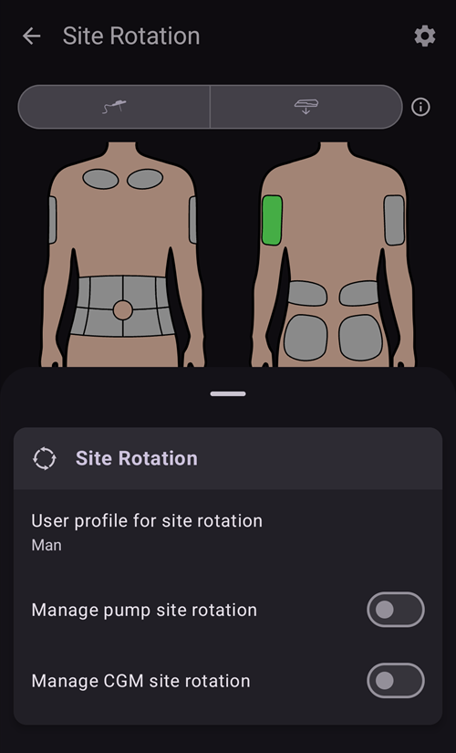

# משאבות וצינוריות

## Changing infusion sets: insulin reservoirs and cannulas

The procedure described below is for tubed pumps only and does not apply to patch pumps like Omnipod, Medtrum Nano, Accu-Chek Solo etc. לפעולה הזו קוראים לפעמים "החלפת סט" (set change): החלפת סט "מלאה" כוללת את מכל האינסולין ואת הצינורית, והחלפת סט "חלקית" היא החלפה של הצינורית בלבד.

משאבות פאץ' ממלאות ומתחלות את עצמן באשף ההפעלה שלהן, והצינורית שלהן כבר נמצאת בגוף. **AAPS** לא מציע עבורן תיחול: **תיחול/מילוי** לא מוצג בחלון **ניהול** ולא בהפעלה המהירה (QuickLaunch). את הדף של המשאבה שלכם אפשר למצוא ב-[משאבות תואמות](../Getting-Started/CompatiblePumps.md).

Physical cartridge/reservoir changes cannot be done via **AAPS** and have to be carried out via the pump directly. These need to be logged in **AAPS** manually, once completed.

(pumps-cannulas-changing-reservoir-and-cannula)=
### Guide for changing both the pump reservoir and cannula

1. ב-**AAPS** יש לנתק את המשאבה: ללחוץ על [סמל הלולאה](#AapsScreens-loop-status) במסך הראשי ולבחור **ניתוק המשאבה** למשך שעה אחת. הסמל משתנה לסמל תקע אפור, שמראה שהמשאבה מנותקת.

2. Physically change the insulin reservoir: physically disconnect your pump from the body, and change the reservoir/cartridge and cannula as per manufacturer's instructions.

3. Prime/fill the tubing and cannula: this can be done directly on the pump. Be sure to eliminate any bubbles in the tubing.

4. Attach the new cannula to the body. Once the cannula is inserted and the needle is removed, the attached cannula now has a small air gap which also needs to be primed. כדי לרשום זאת ב-**AAPS** ולתחל את האתר: יש לפתוח את **תיחול/מילוי** (בלוח המצב המורחב במסך הראשי, בחלון **ניהול**, או כלחצן [הפעלה מהירה](QuickLaunch.md)) ולסמן את **רישום החלפת אתר עירוי** ו/או **רישום החלפת מכל אינסולין**, לפי הצורך, כדי לרשום את ההחלפה. עכשיו יש ללחוץ על כמות התיחול של הצינורית שמוגדרת כברירת מחדל (בדרך כלל בערך 0.3 U, אבל יש לוודא שהערך הזה נכון לצינורית שלכם) ולבחור **אישור**. יש לקרוא את הודעת הסיכום ולאשר את ביצוע התיחול בלחיצה על **אישור**.

   


5. יש לחבר מחדש את המשאבה ב-**AAPS**: ללחוץ על סמל התקע האפור ולבחור **חיבור המשאבה מחדש** כדי להמשיך בלולאה.

### Useful information concerning insulin/cannula changes

* רישום של החלפת אתר עירוי במשאבה מאפס את Autosens ל-100%. הוא גם מאפס את אורות החיווי ואת הגיל של הצינורית/האינסולין במסך הראשי של **AAPS**.

* ניתן להגדיר/לשנות את כמויות התיחול שמוגדרות כברירת מחדל בהגדרות **תיחול/מילוי** — יש להקליד "prime" בשורת החיפוש במסך הראשי כדי לפתוח אותן (ראו [הגדרות](../SettingUpAaps/Preferences.md)). See your instruction booklet in your cannula box for how many units (depending on needle length and tubing length) should be primed for your cannula.

* **AAPS** לא מתחשב באינסולין שניתן בפונקציית התיחול כשהוא מחשב את האינסולין הפעיל בגוף (IOB), והאינסולין הזה מסומן ב[היסטוריית טיפולים](#aaps-screens-treatments) כ"תיחול" (Prime).

* גם אינסולין שניתן כבולוס ישירות מהמשאבה בזמן שהמשאבה מנותקת לא נלקח בחשבון על ידי **AAPS**. אם נתתם בולוס ישירות מהמשאבה בזמן ש-**AAPS** היה מנותק, אחרי חיבור המשאבה מחדש אפשר לרשום את האינסולין הזה (בלי לתת אותו שוב) בחלון **אינסולין** (ראו [רישום אינסולין שכבר ניתן, בלי לתת בולוס בפועל](#pumps-cannulas-announce-insulin) בהמשך).

### Cannula, infusion site, tubing and/or pump issues

אם אתם בטוחים שלא קיבלתם אינסולין במשך פרק זמן מסוים, למרות ש-**AAPS** רשם שקיבלתם, ואתם יודעים בדיוק מתי הבעיה התחילה (_למשל_ הסרתם את הצינורית וראיתם שהיא התקפלה בזמן ההחדרה), אפשר לתקן זאת ב-**AAPS**. עם זאת, יש לזכור שייתכן שהאינסולין כן ניתן, אבל הוא פועל לאט מסיבה כלשהי.

```{admonition} Caution - Risk of Hypoglycemia
:class: danger
Only delete insulin delivery from **AAPS** with EXTREME caution, in case insulin _has_ actually been delivered, and monitor BG closely for the next 24 h.
```

כדי להסיר בולוסים ו-SMB שאתם יודעים שלא ניתנו, יש לפתוח את **התפריט** (☰), לבחור [היסטוריית טיפולים](#aaps-screens-treatments), ובלשונית **פחמימות ובולוס** למחוק בזהירות את הבולוסים שנרשמו, החל מהרגע שבו האירוע קרה. כך מתוקן ערך "האינסולין הפעיל בגוף" (IOB), שהוא ערך מרכזי בחישובים של **AAPS**; אם תחזרו עכשיו למסך הראשי, תראו שה-IOB ירד. Be aware that you cannot delete basal insulin which **AAPS** calculates to have been delivered, so that will still be taken into account by **AAPS**.

במקרים פחות ברורים של בעיות במתן אינסולין, _למשל_ דליפות, חסימות או מנהור (tunneling), שבהם אתם לא בטוחים מתי הבעיה התחילה, או חושבים שחלק מהאינסולין כן ניתן, יש לנהוג בזהירות. אפשר לזהות בעיות כאלה לפי "ריח" של אינסולין, מדבקה רטובה, ערכי סוכר גבוהים או התראה. מכיוון שלעולם לא תדעו כמה אינסולין נכנס לעור (ואולי יתחיל לפעול אחרי זמן מה), יהיה קשה לקבוע כמה אינסולין בדיוק יש להפחית מערך "האינסולין הפעיל בגוף" (IOB) הנוכחי. One strategy is to pause looping for 5 hours (or your specific duration of insulin action) after you resolved the insulin delivery problem, and resume looping afterwards. This will ensure that IOB is correct once you restart looping.

(pumps-cannulas-disconnecting)=
## Disconnecting the pump for showering or activity

If you take your pump off for showering, bathing, swimming, contact sports or other activities you must let **AAPS** know that no insulin is being delivered, to keep the IOB correct. אפשר לנתק את המשאבה בעזרת [סמל הלולאה](#AapsScreens-loop-status) במסך הראשי: יש ללחוץ עליו ולבחור **ניתוק המשאבה** עם משך הזמן הדרוש. אם הפעילות נמשכת יותר מהמתוכנן, יש לפתוח שוב את אותו חלון ולבחור משך חדש תחת **ניתוק המשאבה**: הניתוק מוארך, והמשך החדש מתחיל מעכשיו. אין צורך לחבר מחדש קודם.

As you are not getting any insulin while the pump is disconnected, you should reconnect every two hours to catch up for the missing basal. You can do this by connecting, bolusing the missing basal amounts (_e.g._ of the last two hours) before disconnecting again. This should help to avoid a severe lack of insulin which could result in diabetic ketoacidosis (DKA). If it is inconvenient to reconnect the pump during activity (cannula site is covered by wearing a wetsuit _etc._), consider a pen injection instead. אפשר לרשום את ההזרקה הידנית הזו ב-**AAPS**, ואין צורך לרשום אותה ברגע ההזרקה (רק לרשום לעצמכם את שעת ההזרקה), כי כשמחברים מחדש את המשאבה אפשר לרשום את האינסולין ולהחזיר אחורה את השעה שבה הוא ניתן בפועל.

(pumps-cannulas-announce-insulin)=
## To announce delivered insulin without actually bolusing

כדי לרשום אינסולין שניתן מהמשאבה בזמן ש-**AAPS** היה מנותק, או אינסולין מהזרקות בעט: יש לפתוח את [חלון האינסולין](#aaps-screens-buttons-insulin) (**טיפולים** בסרגל הניווט התחתון, או לחצן בהפעלה המהירה), להזין את הכמות ביחידות ולהפעיל את **בולוס רשום בלבד (לא מוזרק על ידי המשאבה)**. לאחר מכן מופיעה שורת **זמן** (עם הערך **עכשיו**), שבה אפשר לרשום את השעה האמיתית של ההזרקה: אם ההזרקה ניתנה לפני זמן קצר, אפשר להתעלם ממנה. אם הבולוס ניתן לפני זמן מה, יש להשתמש ב-**-** כדי להחזיר את השעה אחורה (_למשל_ -30 דקות), או לפתוח את השורה בעזרת החץ ולבחור את התאריך והשעה המדויקים. **AAPS** will then take into account the duration of insulin action and calculate the remaining insulin still in the system accordingly.

אם אתם משתמשים ב-**AAPS** כמטפלים, אפשר לנתק (ולחבר מחדש) את המשאבה מרחוק בקלות רבה באמצעות [פקודת SMS](../RemoteFeatures/SMSCommands.md), עם פקודות כמו "pump disconnect 120" ו-"pump connect 120". The range of duration for remote disconnect is from 1 - 120 min, (in this example it is 120 minutes). This is very useful if the **AAPS** handset is inconvenient for you to access, buried in a pump belt on a kid who is running off towards the swimming complex, or being closely guarded (or in use) by a teenager.

## Reconnecting the pump after activity

After a long disconnection (1 - 2 hours) it is fairly common for **AAPS** to calculate that you now have negative IOB. When you reconnect the pump, depending on preference/current glucose level/planned food or subsequent activity, you can either:

a) Just reconnect the pump in **AAPS** (grey-to-green, for closed loop) and leave it up to **AAPS** to start to deliver insulin again

_or_

b) אם רוצים לפעול בצורה אגרסיבית יותר (למשל, הסוכר עולה לכיוון היפרגליקמיה), אפשר לפתוח את [אשף בולוס](#aaps-screens-bolus-wizard) ולתת בולוס לאפס פחמימות, כדי לתת מיד כבולוס את האינסולין החסר שחושב.

Which strategy you prefer is highly personal, and is best determined by trial and error.


(Aapsscreens-site-rotation)=
## סבב אתרי עירוי

**ניהול ← סבב אתרי עירוי** פותח את חלון סבב אתרי העירוי במצב תצוגה:

- בעזרת שני הלחצנים בחלק העליון (סמל צינורית וסמל חיישן) אפשר להציג רק אתרי צינורית, רק אתרי חיישן, או את שניהם
- כל אירועי החלפת הצינורית והחלפת החיישן מ-45 הימים האחרונים זמינים.
- יש ללחוץ על אזור באיור, או על רשומה ברשימה שמתחת, כדי לסנן את הרשימה ולהציג רק את הרשומות באזור שנבחר. האזור שנבחר מסומן בצבע ירוק בהיר.
- יש ללחוץ על סמל **העיפרון** ליד רשומה כדי לפתוח את מצב העריכה ולעדכן את מיקום האתר, את החץ או את ההערה שלה


- סמל **גלגל השיניים** (בפינה העליונה) פותח את ההגדרות: **פרופיל משתמש לסבב אתרים** פותח חלון שבו בוחרים **גבר**, **אישה** או **ילד**, והמתגים **ניהול סבב אתרי משאבה** ו-**ניהול סבב אתרי CGM** קובעים אילו אתרים מנהלים.




*הערה: ההגדרה הזו קובעת אם חלון סבב אתרי העירוי (מצב עריכה) ייפתח אוטומטית כשנוצרת רשומה חדשה עם הלחצן "תיחול/מילוי" או הלחצן "הכנסת חיישן".*

- להחלפת אתר שבוצעה ישירות במשאבה, יש לפתוח את מצב התצוגה ולערוך את הרשומה החדשה כדי לבחור מיקום וחץ

מצב עריכה מאפשר לבחור מיקום, חץ והערה עבור הרשומה שנבחרה:

- הרשומה שנערכת מוצגת מתחת לאיורי הגוף, עם סמל הסוג שלה (צינורית או חיישן)
- מבט מלפנים ומבט מאחור מוצגים זה לצד זה: יש ללחוץ על האזור שבו מיקמתם אותה
- לאחר בחירת אתר (מסומן בירוק), הרשימה שמתחת מציגה את כל הרשומות שנוצרו באתר הזה ב-45 הימים האחרונים.


- אפשר להוסיף חץ (לא חובה) בלחיצה על סמל החץ ליד הרשומה: החלון **בחירת חץ** מאפשר לציין מיקום משנה או את כיוון הפוד


- אפשר גם להוסיף **הערה** על האתר שנבחר
- יש ללחוץ על סמל **השמירה** (בפינה העליונה) כדי לשמור את האתר

אפשר לסנן באופן גרפי על האיור, או בלחיצה על אירוע טיפול ברשימה כדי לבטל את הסינון, פשוט ללחוץ על האיור מחוץ לכל האתרים


