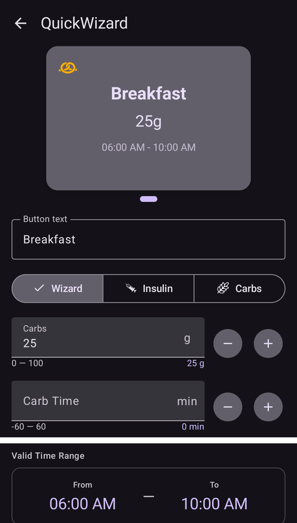
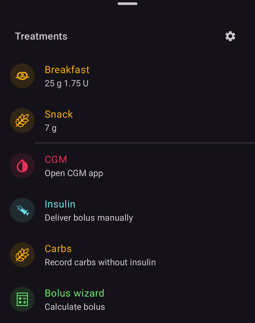

(quickwizards)=
# אשף מהיר (בולוס בלחיצה אחת)

**אשף מהיר** הוא לחצן שמור, שפועל בלחיצה אחת, עבור ארוחה או מצב שחוזרים על עצמם. הוא כולל כמות קבועה של **פחמימות** (ואת אופן המינון עבורן). כך ניתן לתת בולוס, או רק לרשום פחמימות, בלחיצה אחת ובאישור אחד, במקום לפתוח בכל פעם את מחשבון הבולוס המלא.

```{contents} Table of contents
:depth: 2
:local: true
```

---

## פתיחת האשף המהיר

יש לפתוח את מסך **ניהול** (בסרגל הניווט התחתון) ולבחור **אשף מהיר** (*"ניהול הגדרות מוכנות של האשף המהיר"*).

---

## ניהול האשפים המהירים

האשפים המהירים מוצגים כ**קרוסלת כרטיסים שאפשר להחליק ביניהם** (כל כרטיס מציג את טקסט הלחצן, הפחמימות וטווח הזמן התקף). העורך שמתחת מגדיר את האשף **שנבחר**. בסרגל הפעולות התחתון יש לחצני **➕ הוספה**, **⧉ שכפול**, **🗑️ מחיקה** ולחצן **▶** להפעלת האשף המהיר שנבחר.



השדות העיקריים בעורך הם:

- **טקסט הכפתור**: התווית שמוצגת על הלחצן.
- **פחמימות** ו**זמן הפחמימות**: כמות הפחמימות וההזזה שלה בזמן.
- **טווח זמן תקף**: ראו [תוקף](#quickwizard_validity).
- **אפשרויות מחשבון** ו**בחירת מכשיר**: ראו בהמשך.

---

## שלושת המצבים

הבורר בראש העורך, **אשף / אינסולין / פחמימות**, קובע **מה הלחצן עושה** בלחיצה:

- **אשף**: מפעיל את **מחשבון הבולוס** המלא עבור הפחמימות שהוגדרו, לפי **ערך הסוכר (BG), האינסולין הפעיל (IOB), הפחמימות הפעילות (COB) והמגמה** הנוכחיים (בהתאם ל*אפשרויות מחשבון* שבהמשך). הוא נותן את הבולוס *המחושב* ורושם את הפחמימות. זהו האשף המהיר הקלאסי.
- **אינסולין**: נותן **כמות אינסולין קבועה שהוגדרה מראש**, ללא חישוב.
- **פחמימות**: רושם **רק את הפחמימות** שהוגדרו, **ללא בולוס**.

---

## אפשרויות מחשבון (מצב אשף)

עבור לחצן במצב **אשף** בוחרים באילו נתונים החישוב משתמש:

- **שימוש ב־BG**, **שימוש ב־COB**, **שימוש ב־IOB** (עם *אינסולין פעיל חיובי בלבד*), **שימוש במגמה** (*הכול / חיובי בלבד / שלילי בלבד*), **שימוש ביעד זמני**, **שימוש בהתראה**.
- **אחוז הבולוס**: שינוי גודל הבולוס המחושב באחוזים.
- **הוספת פחמימות ממושכות**: תזמון גם של פחמימות ממושכות.


---

## תוקף: מתי הלחצן מופיע

(quickwizard_validity)= **טווח זמן תקף** (*מ־ / עד*) קובע **מתי** האשף המהיר מוצג וזמין לשימוש. לחצן שמוגדר, למשל, ל-**06:00–10:00** מופיע רק בבוקר. כך אשף מהיר של *ארוחת בוקר* לא מעמיס על המסך (ולא נלחץ בטעות) בארוחת הערב. מחוץ לטווח הזמן שלו הלחצן מוסתר מחלון **טיפולים** ומ[סרגל ההפעלה המהירה](QuickLaunch.md). לחצן בסרגל לא נמחק: הוא חוזר כאשר טווח הזמן מתחיל שוב.

כאשר טווח הזמן התקף קצר מ-4 שעות, הלחצן מוסתר גם למשך 30 דקות אחרי השימוש בו, כדי שאותה ארוחה לא תוזן פעמיים בטעות.

---

## נקודות הפעלה: איפה משתמשים בו

המתגים של **בחירת מכשיר** קובעים איפה כל אשף מהיר מופיע:

- **הצגה בטלפון**: האשף מופיע ב**חלון [טיפולים](../Maintenance/V4Changes.md)** (והמינון המחושב מוצג ישירות על הלחצן). אשף מהיר שמוצג בטלפון אפשר גם **להצמיד כלחצן פעולה מהירה במסך הסקירה**: יש לפתוח את *הגדרת הפעלה מהירה* (סמל ⚙ בסרגל [הפעלה מהירה](QuickLaunch.md)) ולהוסיף אותו מהקטגוריה **אשף מהיר**.
- **הצגה בשעון**: האשף מופיע ב**אריח האשף המהיר ב-Wear OS** (יש להחליק אליו בקרוסלת האריחים של השעון, ואז ללחוץ על לחצן כדי להפעיל אותו, בדיוק כמו ב[אריח התרחישים](#scenes-from-watch)).

```{admonition} Don't see Device Selection?
:class: note
החלק **בחירת מכשיר** מופיע בעורך רק כאשר התוסף **Wear** מופעל וההגדרה **שליטה באמצעות Wear** שלו מופעלת. בלי זה, כל אשף מהיר פשוט מוצג בטלפון.
```

בטלפון האשפים המהירים מופיעים בראש החלונית התחתונה **טיפולים**:



…וכלחצן פעולה מהירה במסך הסקירה:


גם **מכשיר לקוח** מצומד (**AAPSClient**) יכול להפעיל אשף מהיר. **המכשיר הראשי** מחשב את המינון ונותן אותו (ראו [שליטה בין מכשיר ראשי ↔ מכשיר לקוח](../RemoteFeatures/ClientMasterControl.md)).

לא משנה מאיפה הוא הופעל, לחיצה על אשף מהיר מציגה תמיד **אישור** לפני שמשהו ניתן (כשההפעלה היא ממכשיר לקוח או משעון, את האישור יוצר המכשיר הראשי).

אשף מהיר נדחה כאשר המינון שלו גבוה מהבולוס המרבי, או כאשר הפחמימות או הפחמימות הממושכות שלו גבוהות מכמות הפחמימות המרבית (למשל אחרי שהמגבלה הורדה). כאשר הפחמימות גבוהות מהמגבלה, הלחצן בחלון **טיפולים** מושבת. יש לערוך את האשף המהיר או את המגבלה.

---

## הוספה והסרה

- **➕ הוספה**: יצירת אשף מהיר חדש.
- **⧉ שכפול**: העתקת אשף קיים כנקודת התחלה.
- **🗑️ מחיקה**: הסרת אשף.

כאשר יש שני אשפים מהירים או יותר, אפשר גם לשנות את הסדר שלהם בקרוסלה: יש ללחוץ על הסמל **שינוי סדר** (⇅) בסרגל העליון, להזיז את הכרטיס שבמרכז בעזרת **לחצני ההזזה ◀ / ▶**, ואז לאשר עם **✓**. (הפקדים נראים כמו ב[שינוי סדר הפרופילים](ProfileSwitch-ProfilePercentage.md).)

האשפים המהירים הם חלק מההגדרות המסונכרנות, ולכן הם משותפים למכשיר הראשי ולמכשירי הלקוח המצומדים.

---


<!-- =====================================================================
     Screenshots captured from a real master device:
       - quickwizard_editor.png   (Manage → QuickWizard: carousel, mode, carbs, carb time, valid time range)
       - quickwizard_options.png  (Calculator Options, Bolus percentage, Device Selection)
       - quickwizard_overview.png (the QuickWizard quick-action button on the overview)
       - quickwizard_watch_tile.png (the Wear OS QuickWizard tile)
     No QuickWizard was actually run (no bolus delivered).
     Maintainers: relocate page + images and fix cross-links as needed.
     ===================================================================== -->
