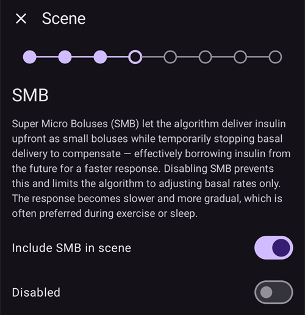
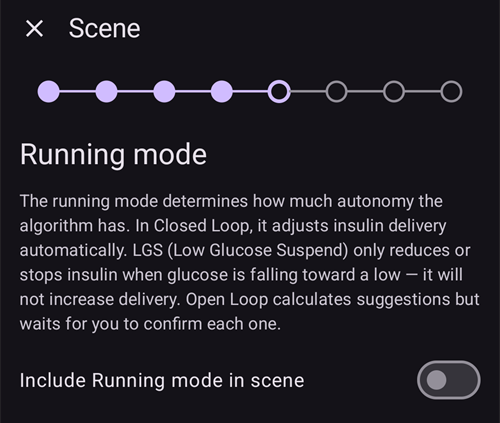
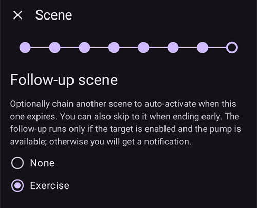

(scenes)=
# תרחישים (הגדרות מוכנות למצבים)

**תרחיש** הוא הגדרה מוכנה עם שם, שמבצעת **כמה פעולות בבת אחת**. למשל, הגדרה של *שינה*, *פעילות גופנית* או *יום מחלה* שמחליפה פרופיל, מגדירה יעד זמני, מפעילה או משביתה SMB ומוסיפה הערה בפורטל הטיפולים, בלחיצה אחת, ואם רוצים, למשך זמן מוגדר.

```{contents} Table of contents
:depth: 2
:local: true
```

---

## מהו תרחיש

במקום לשנות כמה דברים ידנית בכל פעם שמצב קבוע חוזר, מגדירים אותם פעם אחת כתרחיש ומפעילים אותו בלחיצה אחת. תרחיש יכול לכלול כל אחת מהפעולות האלה:

- **החלפת פרופיל**: החלפת הפרופיל ו/או שינוי שלו באחוזים (למשל 70 %).
- **יעד זמני**: הגדרת יעד זמני (למשל *פעילות*, *אכילה בקרוב* או ערך מותאם אישית).
- **SMB מופעל/כבוי**: הפעלה או השבתה של מיקרו-בולוסים (SMB) כל עוד התרחיש פעיל.
- **מצב הלולאה**: שינוי מצב ההפעלה (למשל למצב שמרני יותר).
- **הערה בפורטל הטיפולים**: רישום אירוע (למשל *פעילות גופנית*, *מחלה*) כדי שיופיע בגרף וב-Nightscout.

לתרחיש יש גם **משך**: זמן קבוע (דקות/שעות/ימים) או *ללא הגבלת זמן (סיום ידני)*. יש לו גם **פעולת סיום** שמתבצעת כשהוא מסתיים: **הודעה**, או **מעבר** לתרחיש אחר (למשל *יום מחלה ← פעילות גופנית*).

---

## ניהול תרחישים

יש לפתוח את **ניהול ← תרחישים** כדי לראות, ליצור, לערוך, להפעיל/להשבית ולשנות את הסדר של התרחישים.


כל כרטיס תרחיש מציג:

- **תיבת סימון** להפעלה/השבתה של התרחיש,
- **סמל** ו**שם**,
- סיכום, *"N פעולות, משך"*, ואת **→ התרחיש העוקב** אם התרחיש עובר לתרחיש אחר,
- ושלושה לחצנים: **▶ הפעלה**, **✏️ עריכה**, **🗑️ מחיקה**.

יש ללחוץ על הלחצן **+** כדי ליצור תרחיש חדש.

---

## יצירה או עריכה של תרחיש

### התחלה מתבנית

כדי **ליצור** תרחיש, יש ללחוץ על הלחצן **+** במסך התרחישים. השלב הראשון הוא **התחלה מתבנית**: בחירת תרחיש מוכן למצב נפוץ — *פעילות גופנית*, *יום מחלה*, *יום מחלה — הקאות*, *שינה*, *לילה לאחר פעילות גופנית*, *לפני ארוחה*, *אלכוהול*, *נהיגה*, *רחצה*, *השלב הלוטאלי*, *מזג אוויר חם*, *הליך רפואי* — או התחלה מתרחיש *ריק*. כל תבנית **ממלאת מראש את הפעולות המומלצות**, ואפשר לשנות הכול בשלבים הבאים.


אחרי בחירת תבנית מוצג ההסבר שלה, *מתי* ו*למה* להשתמש בה, לפני שממשיכים:


### מעבר על הפעולות שלב אחר שלב

שאר העורך הוא אשף קצר **שלב אחר שלב**. כל שלב הוא סוג פעולה אחד עם מתג *"הכללת … בתרחיש"*. יש להפעיל אותו רק עבור הפעולות שהתרחיש צריך לבצע, ולהשאיר את השאר כבויים.


עוברים בין השלבים עם **הבא**/**חזרה**: *החלפת פרופיל*, *יעד זמני*, *SMB*, *מצב הלולאה*, *הערה בפורטל הטיפולים*, אחר כך **משך** התרחיש, **פעולת הסיום** (הודעה או מעבר לתרחיש אחר), ולבסוף **השם והסמל** של התרחיש. בסיום יש לשמור. (כדי **לערוך** תרחיש קיים, יש ללחוץ על הלחצן **✏️** שלו. כך נכנסים ישירות לשלבים האלה.)

כל שלב מתחיל בהסבר קצר על מה שהפעולה עושה. כך נראים השלבים, כאן עם התבנית *פעילות גופנית*:

**יעד זמני**: בחירה של אחד מהיעדים הזמניים המוגדרים מראש:


**SMB**: הפעלה או השבתה של SMB כל עוד התרחיש פעיל:



**מצב הפעלה**: אם רוצים, שינוי מצב הלולאה:



**פורטל טיפולים**: סוג האירוע וההערה שיירשמו:


**משך**: כמה זמן התרחיש נשאר פעיל; 0 פירושו עד שמסיימים אותו ידנית:


**התרחיש העוקב**: אם רוצים, התרחיש שמתחיל כשהתרחיש הזה מסתיים:



**תרחיש**: השם והסמל. יש ללחוץ על **סיום** כדי לשמור:


---

## הפעלת תרחיש

אפשר להפעיל תרחיש מרשימת **תרחישים** (הלחצן **▶**) או מהפריט **תרחישים** בסרגל הניווט התחתון. בחלון **תרחישים** של סרגל הניווט התחתון, כל תרחיש מציג את אותו סיכום כמו ברשימת התרחישים. **העיפרון** בראש החלון פותח את **ניהול ← תרחישים** כדי ליצור או לערוך תרחישים.


אם [הגנת בולוס](#Preferences-protection) פעילה, **AAPS** מבקש אותה לפני שתרחיש מתחיל או מסתיים. לשינוי תרחיש נדרשת במקום זאת [ההגנה על הגדרות](#Preferences-settings-protection).

לפני שמשהו מתבצע מוצג **אישור** שמפרט בדיוק מה התרחיש יעשה, כדי שאפשר יהיה לבדוק אותו:


אם התרחיש עובר לתרחיש אחר, האישור מסתיים ב-**→** ובשם של התרחיש העוקב, כמו שהוא מוצג ברשימת התרחישים.

כאשר מפעילים את התרחיש מהפריט **תרחישים** בסרגל הניווט התחתון, האישור הוא חלון פשוט יותר עם אותה רשימת פעולות. יש ללחוץ על **אישור** כדי להפעיל:


אחרי האישור הפעולות מתבצעות, ו**התרחיש הפעיל** מוצג בראש מסך הסקירה עם לחצן **סיום תרחיש**. אם התרחיש עובר לתרחיש אחר, הבאנר מציג גם את שם התרחיש העוקב:


הפעולות של התרחיש נשארות בתוקף עד ש:

- **משך** הזמן שלו מסתיים (**פעולת הסיום** מתבצעת: הודעה, או מעבר לתרחיש הבא), או
- לוחצים על **סיום תרחיש** כדי לסיים אותו ידנית. אם התרחיש עובר לתרחיש אחר, יש שתי אפשרויות: **דילוג אל** התרחיש העוקב (התרחיש הפעיל מסתיים והתרחיש העוקב מתחיל עכשיו), או **סיום תרחיש** (התרחיש הפעיל מסתיים והתרחיש העוקב לא מתחיל).

בתרחיש ללא תרחיש עוקב יש רק לאשר:


סיום של תרחיש **מבטל** את השינויים שהוא עשה (למשל את החלפת הפרופיל ואת היעד הזמני שהוא הפעיל).

כל עוד תרחיש פעיל, ליד הפרופיל והיעד במסך הראשי מוצג סמל תרחיש קטן, אם התרחיש הגדיר אותם. החלון **תרחישים** של סרגל הניווט התחתון נשאר זמין כדי להפעיל תרחיש אחר:


כאשר משך הזמן מסתיים מעצמו, השינויים מבוטלים מיד והבאנר משתנה ל-**התרחיש הסתיים** עם לחצן **סגירה**. סגירה רק מסירה את הבאנר מהמסך. התרחיש עצמו כבר הסתיים, ולכן כללי אוטומציה ותרחיש עוקב ממשיכים בלי לחכות לה.

---

## הפעלת תרחישים מאוטומציה

לא חייבים להפעיל תרחיש ידנית: **אוטומציה** יכולה להריץ אותו. כאשר מוסיפים פעולה לכלל אוטומציה (**ניהול ← אוטומציה**), בבחירת הפעולה יש קטגוריה **תרחישים**:

- **הרצת תרחיש**: הפעלת תרחיש כשהטריגרים של הכלל מתקיימים (למשל בשעה מוגדרת, בהגעה למקום מסוים, או כשרמת הסוכר עוברת סף).
- **הפעלת תרחיש** / **השבתת תרחיש**: הפיכת תרחיש לזמין (או ללא זמין) בלי להריץ אותו.


האוטומציה יכולה גם **להגיב** לתרחיש: ברשימת הטריגרים יש טריגר **תרחיש**, כך שכלל יכול לפעול רק כאשר תרחיש מסוים פעיל. יחד עם **פעולת הסיום** של התרחיש (ביטול השינויים, הודעה או מעבר לתרחיש אחר), כך תרחישים יכולים להתחיל, להמשיך זה מזה ולהסתיים באופן אוטומטי.

---

## תרחישים עם מכשיר ראשי/מכשיר לקוח ועם שעון

**התרחיש הפעיל מסונכרן** בין כל המכשירים המצומדים: אם מפעילים אותו בטלפון אחד, גם האחרים מציגים אותו.

גם **מכשיר לקוח** מצומד (**AAPSClient**) יכול להפעיל או לסיים תרחיש: הבקשה נשלחת אל **המכשיר הראשי**, שיוצר את האישור ומפעיל את התרחיש על המצב שלו. ראו [שליטה בין מכשיר ראשי ↔ מכשיר לקוח](../RemoteFeatures/ClientMasterControl.md) כדי להבין איך זה עובד.

(scenes-from-watch)=
### משעון Wear OS

תרחישים זמינים ב**שעון Wear OS** בתור **אריח תרחיש**. יש להחליק אל האריח **תרחיש** בקרוסלת האריחים של השעון (אם הוא עדיין לא שם, יש להוסיף אותו קודם מרשימת האריחים של הקרוסלה) וללחוץ על התרחיש שרוצים להפעיל:


באריח יש ארבע משבצות. כברירת מחדל כל משבצת מתמלאת **אוטומטית** בתרחיש המופעל הבא, לפי הסדר שלהם בטלפון. כדי לבחור בעצמכם, יש **ללחוץ לחיצה ארוכה על האריח** ולפתוח את ההגדרות שלו: לכל אחת מארבע המשבצות אפשר להשאיר **אוטומטי**, להצמיד **תרחיש מסוים**, או לבחור **ללא** כדי להשאיר את המשבצת ריקה. משבצת שהוצמדה לתרחיש שנמחק או הושבת מאז מציגה **לא זמין**. יש לבחור לה תרחיש אחר.

אחר כך השעון מציג אישור: יש ללחוץ על **✓** כדי להפעיל, או להחליק אחורה כדי לבטל:


בדיוק כמו במכשיר לקוח, **המכשיר הראשי יוצר את האישור ומריץ את התרחיש**. השעון רק מעביר את הבקשה (דרך טלפון הלקוח, אם השעון מצומד למכשיר לקוח).

כל עוד תרחיש פועל, או שהבאנר **התרחיש הסתיים** עדיין מוצג בטלפון, האריח מציג לחצן **סיום** ומתחתיו את שם התרחיש. לחיצה עליו מסיימת את התרחיש הפעיל, או מסירה את הבאנר שנשאר, ישירות מהשעון.

אם התרחיש שפועל עובר לתרחיש אחר, האריח מציג גם לחצן **דילוג** ומתחתיו את שם התרחיש העוקב. אלה אותן שתי אפשרויות כמו בטלפון:

- **סיום**: התרחיש הפעיל מסתיים. האישור מציין שהתרחיש העוקב לא יתחיל.
- **דילוג**: התרחיש הפעיל מסתיים והתרחיש העוקב מתחיל עכשיו. האישור מציג את שמות שני התרחישים.

[מסך סטטוס הלולאה](#WearOsSmartwatch-loop-status) בשעון מציג גם את התרחיש הפעיל, את הזמן שנשאר לו ואת התרחיש העוקב.

---


<!-- =====================================================================
     Screenshots captured from a real master device:
       - scenes_list.png        (Manage → Scenes management list)
       - templates_picker.png   (create: "Start from template" picker)
       - template_explanation.png (create: chosen template's explanation)
       - scene_editor.png       (scene editor, Profile switch step)
       - scene_confirmation.png (scene activation confirmation — also used on the Client/Master page)
       - scene_active_banner.png (overview active-scene banner with the End Scene button)
       - automation_scene_action.png (Automation action picker — Scenes category)
       - scene_watch_tile.png    (Wear OS Scene tile)
       - scene_watch_confirm.png (Wear OS scene confirmation)
     Maintainers: relocate page + images and fix cross-links as needed.
     ===================================================================== -->
