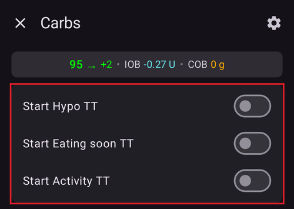

# יעדים זמניים

## מהם יעדים זמניים, והיכן מגדירים אותם?

**יעד זמני** (או בקיצור **TT**) הוא תכונה של **AAPS** שמאפשרת לשנות את [טווח היעד של **הסוכר בדם**](#profile-glucose-targets) עבור פעילויות מתוכננות. This is achieved by **AAPS** manipulating the user’s insulin usage.

יעד גלוקוז, במיוחד אם הוא לטווח קצר בלבד (משך של פחות מ-4 שעות), אינו חייב להיות *הערך בפועל* שאליו אתם מצפים או רוצים שרמת הגלוקוז תגיע. זו דרך טובה להורות ל-**AAPS** לפעול באופן אגרסיבי יותר או פחות, תוך שמירה על רמות הגלוקוז בטווח.

ניתן להגדיר יעדים זמניים בגבולות האלה:

|         | יעד זמני               |
| ------- | ---------------------- |
| Minimum | 4 mmol/L או 72 mg/dL   |
| Maximum | 10 mmol/L or 180 mg/dL |

**AAPS** מציע שלוש הגדרות מוכנות מובנות של **יעד זמני**, שמתאימות לפעילות גופנית (**פעילות**), לארוחות (**אכילה בקרוב**) ולהיפוגליקמיה צפויה (**היפוגליקמיה**). הן נמצאות במסך **יעד זמני** (**ניהול** ← **יעד זמני**), שאפשר לפתוח גם בלחיצה פשוטה על **שבב היעד** במסך הראשי.

יש לשמור על ציפיות מציאותיות לגבי התוצאות שאפשר להשיג בבחירת **יעד זמני** ב-**AAPS**. ההצלחה בהשגת יעד **הסוכר בדם** הרצוי תשתנה בהתאם לגורמים רבים, ובהם אמינות הגדרות **AAPS** של המשתמש, איזון **הסוכר בדם** הכללי, **אינסולין פעיל**, רגישות לאינסולין, תנגודת לאינסולין, רמת המאמץ בפעילות הגופנית וכן הלאה.

לאחר הגדרת **יעד זמני**, ייתכן שיידרשו כ-30 דקות או יותר כדי להגיע ליעד **הסוכר בדם** הרצוי. **AAPS** אינו יכול להגיע ליעד **הסוכר בדם** באופן מיידי, ויש לזכור זאת בעת בחירת **יעד זמני**.

החלקים הבאים מסכמים את התכונות של **יעד זמני - פעילות**, **יעד זמני - אכילה בקרוב** ו**יעד זמני - היפוגליקמיה**. הערכים שמוצגים הם ערכי ברירת המחדל: אפשר [לשנות כל הגדרה מוכנה](#TempTargets-change-preset-defaults) לפי הצרכים שלכם.

### TT - Activity


**יעד סוכר (הגדרה מוכנה כברירת מחדל, ניתנת לשינוי)**

AAPS ינסה להגיע ל-140 mg/dL או 7.8 mmol/L למשך שעה ו-30 דקות

**Other considerations users may wish to factor in when selecting**:

בהתאם לרמת **הסוכר בדם**, **AAPS** "יפחית" את מתן האינסולין כדי להגיע ליעד **הסוכר בדם**. אם יעד **הסוכר בדם** אינו בטווח (כלומר מעל יעד **הסוכר בדם** שנבחר ב**פרופיל** של המשתמש), **AAPS** עשוי להשאיר את הבזאלי פעיל.

In closed loop mode, **SMB**:

- *may be* deactivated (discussed further below); and/or
- basal may be activated if **AAPS** is in negative **IOB** or <0.

Users may also wish to consider:

- *selecting* this **TT** 1-2 hours before the planned exercise to ensure reduced IOB (the correct timing for this TT will vary person to person); and
- *selecting* a temporary Profile (decrease) for the duration of the planned activity to ensure reduced **IOB**;
- *הקפדה* על כך שה-**TT** *יסתיים* זמן קצר לפני הפעילות, כי **האינסולין הפעיל** כבר מופחת, וחלק מהמשתמשים חווים עלייה מהירה ב**סוכר בדם** אחרי הפעילות.

### TT - Eating soon


**יעד סוכר (הגדרה מוכנה כברירת מחדל, ניתנת לשינוי)**

AAPS ינסה להגיע ל-90 mg/dL או 5.0 mmol/L למשך 45 דקות

**Other considerations users may wish to factor in when selecting**:

In closed loop mode, **SMB**:

- will remain activated; and/or
- basal may be also activated depending on the user's **Profile's** settings.

בהתאם לרמת **הסוכר בדם**, **AAPS** "יגדיל" את מתן האינסולין במסגרת פרמטרי ההגדרות של **AAPS** של המשתמש, כדי להגיע ליעד **הסוכר בדם** הרצוי.

### TT - Hypo


**יעד סוכר (הגדרה מוכנה כברירת מחדל, ניתנת לשינוי)**

AAPS ינסה להגיע ל-160 mg/dL או 8.9 mmol/L למשך שעה אחת

**Other considerations users may wish to factor in when selecting**:

In closed loop mode, **SMB**:

- *may be* deactivated (discussed further below); and/or
- basal may be activated if **AAPS** is in negative **IOB** or <0.

(TempTargets-manage-v4)=

## הגדרה וניהול של יעדים זמניים (ניהול ← יעד זמני)

ב-**AAPS** v4 מנהלים את **ההגדרות המוכנות** של TT ומפעילים יעד זמני ממסך **ניהול** (בסרגל הניווט התחתון) ← **יעד זמני** (*"ניהול והגדרת יעדים זמניים"*).


במסך יש שלושה חלקים:

1. **קרוסלת ההגדרות המוכנות** (למעלה): החלקה בין ההגדרות המוכנות של TT. כל כרטיס מציג את **השם**, **היעד** ו**משך הזמן** של ההגדרה המוכנה; ה-TT שפועל כרגע מודגש.
2. **העורך** (באמצע): **יעד זמני** ו**משך** שיופעלו בפועל, וגם תאריך/שעת **הפעלה**.
3. **סרגל הפעולות** (למטה): **➕ הוספה**, **‘️ מחיקה** והלחצן **▶ הפעלה**.

בחירה בכרטיס של הגדרה מוכנה טוענת לעורך את **היעד** ואת **משך הזמן** שלה.

```{admonition} הגדרות מוכנות מובנות לעומת הגדרות מותאמות אישית :class: note ההגדרות המוכנות המובנות, **אכילה בקרוב**, **פעילות** ו**היפוגליקמיה**, קיימות תמיד ו**אי אפשר למחוק אותן** (אבל אפשר לשנות את הערכים שלהן ולשמור). הגדרות מוכנות שיוצרים בעצמכם הן **מותאמות אישית**, ואפשר לערוך או למחוק אותן בחופשיות.

    <br />### הפעלת יעד זמני
    
    יש להחליק אל ההגדרה המוכנה הרצויה (הערכים שלה נטענים לעורך), אם רוצים לשנות את **היעד**/**משך הזמן** בעורך, ואז ללחוץ על **▶ הפעלה**. מוצג אישור עם היעד, משך הזמן והסיבה המדויקים לפני שמשהו מתחיל:
    
    
    
    אחרי האישור היעד הזמני מתחיל מיד (או בזמן **הפעלה** שנבחר) ופועל לאורך **משך** הזמן שהוגדר.
    
    ```{admonition} שינוי המספרים הוא חד-פעמי: הוא לא משנה את ההגדרה המוכנה
    :class: important
    ערכי **היעד** ו**משך הזמן** בעורך הם הערכים שהלחצן **הפעלה** ישתמש בהם *עכשיו*. אם משנים אותם, השינוי הוא **זמני**: הוא חל רק על ההפעלה הזאת ו**לא משנה את ההגדרה המוכנה השמורה**. כך אפשר "לשנות ולהפעיל" TT חד-פעמי (למשל להפעיל היום *פעילות* עם יעד מעט שונה) בלי לשנות את ההגדרה המוכנה לצמיתות.
    

### שמירת שינויים בהגדרה מוכנה

אם *כן* רוצים לשמור ערך ששונה, יש **לשמור** אותו: כאשר העורך שונה מההגדרה המוכנה שנבחרה, מופיע הסמל **שמירה** בסרגל הכלים העליון. לחיצה עליו שומרת את **היעד** ואת **משך הזמן** הנוכחיים (ואת השם, בהגדרות מותאמות אישית) בהגדרה המוכנה שנבחרה. בהגדרות המוכנות המובנות מופיע בסרגל הפעולות גם הלחצן **חזרה לברירות המחדל** (↺): הוא מחזיר את ערכי ברירת המחדל של ההגדרה המוכנה.


לכן הכלל הפשוט הוא:

- **הפעלה** ← שימוש במספרים **פעם אחת** (ההגדרה המוכנה לא משתנה).
- **שמירה** ← המספרים הופכים ל**ברירות המחדל החדשות** של ההגדרה המוכנה.

כדי להחזיר הגדרה מוכנה מובנית למצב המקורי שלה, יש לבחור אותה וללחוץ על הלחצן **↺ חזרה לברירות המחדל**. הוא מופיע בסרגל הפעולות רק עבור הגדרה מוכנה **מובנית** שהערכים שלה שונים כרגע מערכי היצרן, והוא משחזר את **היעד** ואת **משך הזמן** המקוריים של ההגדרה.

### הוספה והסרה של הגדרות מוכנות

- **➕ הוספה**: יצירת **הגדרה מוכנה מותאמת אישית חדשה** מהערכים הנוכחיים בעורך. הכרטיס החדש מופיע בקרוסלה.
- **‘️ מחיקה**: הסרת ההגדרה המוכנה **המותאמת אישית** שנבחרה. אי אפשר למחוק הגדרות מוכנות מובנות (*אכילה בקרוב*, *פעילות*, *היפוגליקמיה*).

כאשר יש לפחות שתי הגדרות מוכנות **מותאמות אישית**, אפשר גם לשנות את הסדר שלהן בקרוסלה: יש ללחוץ על הסמל **שינוי סדר** (⇅) בסרגל העליון, להזיז את הכרטיס שבמרכז בעזרת **לחצני ההזזה ◀ / ▶**, ואז לאשר עם **✓**. ההגדרות המוכנות המובנות נשארות במקומן: אפשר להזיז רק הגדרות מותאמות אישית. (הפקדים נראים כמו ב[שינוי סדר הפרופילים](ProfileSwitch-ProfilePercentage.md).)

ההגדרות המוכנות הן חלק מההגדרות המסונכרנות, ולכן הן משותפות למכשיר הראשי ולמכשירי הלקוח המצומדים.

### דרכים נוספות להגדיר יעד זמני

אפשר להגדיר יעד זמני גם בלי לפתוח את המסך הזה:

- עם **מתגי ה-TT בחלון פחמימות**: ראו [בהמשך](#TempTargets-carbs-dialog),
- עם **לחצן הגדרה מוכנה ב[סרגל ההפעלה המהירה](QuickLaunch.md)**: הקטגוריה *יעדים זמניים מוגדרים מראש* ב*הגדרת הפעלה מהירה* מציעה לחצן בלחיצה אחת לכל אחת מההגדרות המוכנות,
- מ**שעון Wear OS** (פריט התפריט / האריח **יעד זמני**),
- ממכשיר **לקוח** מצומד: ראו [שליטה בין מכשיר ראשי ↔ מכשיר לקוח](../RemoteFeatures/ClientMasterControl.md),
- כחלק מ**[תרחיש](Scenes.md)** (הפעולה *יעד זמני*), או
- מכלל **אוטומציה** (*הפעלת יעד זמני* / *הפסקת יעד זמני*).

* * *

(TempTargets-where-can-i-select-a-temp-target)=

## היכן ניתן לבחור יעד זמני?

הדרך המהירה ביותר היא ללחוץ על **שבב היעד** במסך הראשי (הוא מציג את טווח היעד הנוכחי):


כך נפתח מסך **יעד זמני** שתואר למעלה: יש להחליק אל הגדרה מוכנה וללחוץ על **▶ הפעלה**. אפשר להגיע לאותו מסך גם דרך **ניהול** ← **יעד זמני**.

(TempTargets-carbs-dialog)= בזמן הזנת פחמימות אין צורך לפתוח את מסך **יעד זמני** בכלל: ב**חלון פחמימות** (**טיפולים** ← **פחמימות**) יש בחלק העליון את המתגים **התחלת יעד זמני להיפו**, **התחלת יעד זמני לאכילה בקרוב** ו**התחלת יעד זמני לפעילות**. כאשר מפעילים אחד מהם, ההגדרה המוכנה המתאימה מופעלת יחד עם רישום הפחמימות:



    {admonition} יעד זמני אוטומטי להיפוגליקמיה
    :class: note
    אם פותחים את **חלון פחמימות** כאשר רמת הסוכר מתחת ל-72 mg/dL (4 mmol/L), **AAPS** בוחר מראש את המתג **התחלת יעד זמני להיפו** (אלא אם כבר פועל יעד זמני גבוה יותר עם זמן נותר ארוך יותר).

(TempTargets-change-preset-defaults)=

## היכן ניתן לשנות את היעד הזמני המוגדר כברירת מחדל ולהחליף אותו בהגדרות משלי?

**היעד** ו**משך הזמן** של כל הגדרה מוכנה נערכים ישירות במסך **יעד זמני**; אין יותר פריט נפרד בהעדפות עבור זה:

1. יש לפתוח את מסך **יעד זמני** (לחיצה על שבב היעד, או **ניהול** ← **יעד זמני**).
2. להחליק אל ההגדרה המוכנה שרוצים לשנות.
3. לשנות את **יעד זמני** ו/או את **משך** בעורך.
4. ללחוץ על הסמל **שמירה** שמופיע בסרגל הכלים העליון.


כל עוד העורך שונה מערכי היצרן של הגדרה מוכנה מובנית, מופיע בסרגל הפעולות גם הלחצן **↺ חזרה לברירות המחדל**. לחיצה עליו משחזרת את היעד ואת משך הזמן המקוריים של ההגדרה.

## כיצד מבטלים יעד זמני?

כל עוד יעד זמני פועל, שבב היעד במסך הראשי מציג את היעד ואת הזמן שנותר לו. יש ללחוץ עליו: במסך **יעד זמני** ההגדרה המוכנה שפועלת מסומנת כ**פעיל**, ולחצן אדום **✗ ביטול** מופיע בסוף סרגל הכלים התחתון, ממש ליד הלחצן **▶ הפעלה**. יש ללחוץ עליו ולאשר:


אפשר לעצור יעד זמני פעיל גם מ**שעון Wear OS**, ממכשיר **לקוח** מצומד, או באמצעות כלל **אוטומציה** (*הפסקת יעד זמני*).

(TempTargets-hypo-temp-target)=

## יעד זמני להיפוגליקמיה

**יעד זמני להיפוגליקמיה** מאפשר ל-**AAPS** למנוע סוכר נמוך באמצעות הפחתת מתן האינסולין. אם צפוי ש**הסוכר בדם** ירד: בדרך כלל **AAPS** אמור לטפל בכך, אבל הרבה תלוי ביציבות ההגדרות של **AAPS**. **יעד זמני להיפוגליקמיה** מאפשר להקדים את הירידה הצפויה ולעדכן את **AAPS** להפחית אינסולין.

Sometimes when hypo-treated carbs are eaten, the user's **BG** can rapidly rise, and **AAPS** will correct against the fast rising **BG** by enabling **SMBs**.

חלק מהמשתמשים רוצים להימנע ממתן **SMBs** בזמן **יעד זמני להיפוגליקמיה**. עושים זאת על ידי השבתה של *'הפעלת SMB עם יעד זמני גבוה'* ב**הגדרות** ← **OpenAPS SMB** (ראו בהמשך):

- מתקדם, משימה 9: אפשר להפעיל את *"יעד זמני גבוה מעלה את הרגישות"* עבור **יעדים זמניים** של 100 mg/dL (5.6 mmol/L) ומעלה ב-OpenAPS SMB, ואז **AAPS** יהיה רגיש יותר.

- מתקדם, משימה 9: אפשר להשבית את *"הפעלת SMB עם יעד זמני גבוה"*, כך שגם אם ל-**AAPS** יש COB > 0, "הפעלת SMB עם יעד זמני נמוך" או "הפעלת SMB תמיד" מופעלות ו-OpenAPS SMB פעיל, **AAPS** לא ייתן SMB כל עוד יעדים זמניים גבוהים פעילים.

הערה: אם פותחים את **חלון פחמימות** כאשר רמת הסוכר בדם נמוכה מ-72 mg/dL או 4 mmol/L, **AAPS** בוחר מראש את המתג **התחלת יעד זמני להיפו** באופן אוטומטי.

(TempTargets-activity-temp-target)=

## יעד זמני לפעילות

לפני פעילות גופנית ובמהלכה, ייתכן שיהיה צורך ביעד גבוה יותר כדי למנוע היפוגליקמיה בזמן הפעילות.

כדי לפשט את השימוש ב**יעד זמני לפעילות**, ניתן להגדיר **יעד זמני - פעילות** כברירת מחדל, להעלאת רמות **הסוכר בדם** באמצעות הפחתת מתן האינסולין, כדי להאט את ירידת **הסוכר בדם** ולהימנע מהיפוגליקמיה.

משתמשים חדשים ב-**AAPS** עשויים להזדקק לניסויים ולהתאמה אישית של הגדרות ברירת המחדל של **יעד זמני לפעילות**, כדי שהתכונה תעבוד בצורה הטובה ביותר עבורם. Everyone is different when it comes to attaining stable BG control during exercise. See also the [sports section in FAQ](#FAQ-sports).

חלק מהמשתמשים מעדיפים גם להפעיל **החלפת פרופיל** (הפחתת פרופיל < 100% כדי להפחית את מתן האינסולין על ידי **AAPS**) לפני ובמהלך **יעד זמני לפעילות**. אפשר להפעיל את שניהם בשלב אחד: יש ללחוץ על שם הפרופיל במסך הראשי, ללחוץ על הלחצן העגול **▶**, להגדיר **אחוזים** מתחת ל-100 % ו**משך**, ואז להפעיל את **יעד זמני / פעילות**. ראו [שינוי אחוז הפרופיל](#ProfileSwitch-change-percentage).

מתקדם, משימה 9: אפשר להפעיל את *'יעד זמני גבוה מעלה את הרגישות'* עבור **יעדים זמניים** של 100 mg/dL (5.6 mmol/L) ומעלה ב-OpenAPS **SMB**. יעד של 99 mg/dL (5.5 mmol/L) הוא יעד רגיל, לא גבוה ולא נמוך. Then **AAPS** is more sensitive.

בנוסף, אם *'הפעלת SMB עם יעד זמני גבוה'* מושבת, **AAPS** לא ייתן **SMB**, גם עם COB > 0, כאשר *'הפעלת SMB עם יעד זמני נמוך'* או *'הפעלת SMB תמיד'* מופעלות ו-OpenAPS **SMB** פעיל.

(TempTargets-eating-soon-temp-target)=

## יעד זמני לאכילה בקרוב

**יעד זמני - אכילה בקרוב** יכול לעזור להוריד את **הסוכר בדם** בעדינות ולהבטיח שיש מספיק **אינסולין פעיל** לפני האכילה.

זה יכול להיות כלי חשוב למשתמשים שלא נותנים בולוס מראש, אבל היעילות של **יעד זמני - אכילה בקרוב** תלויה בכמה גורמים, ובהם: ההגדרות של המשתמש, האם התזונה דלת פחמימות, והאם משתמשים באינסולין מהיר (כמו Fiasp או Lyumjev) כדי לבטל את הצורך בבולוס מראש. בדרך כלל, עד שצוברים ניסיון ב-**AAPS**, יש לצפות לתת בולוס מראש בעת שימוש ב**יעד זמני - אכילה בקרוב**, במיוחד בתזונה עשירה בפחמימות.

You can read more about the “Eating soon mode” in the article ['How to do “eating soon” mode'](https://diyps.org/2015/03/26/how-to-do-eating-soon-mode-diyps-lessons-learned/) or [here](https://diyps.org/tag/eating-soon-mode/).

מתקדם, [משימה 9](#objectives-objective9): אם משתמשים ב-OpenAPS SMB ומפעילים את *'יעד זמני נמוך מפחית רגישות'*, **AAPS** פועל באופן מעט אגרסיבי יותר. לאפשרות הזאת נדרש ש**היעד הזמני** יהיה 98 mg/dL (5.4 mmol/L) או פחות.

## כיצד להשבית SMB בזמן יעדים זמניים?

לשם כך יש לפתוח את **הגדרות** ← **OpenAPS SMB** ולהשבית את *'הפעלת SMB עם יעד זמני גבוה'*.


כך **AAPS** לא ייתן **SMB**, גם עם COB > 0, כאשר *'הפעלת SMB עם יעד זמני נמוך'* או *'הפעלת SMB תמיד'* מופעלות ו-OpenAPS SMB פעיל.