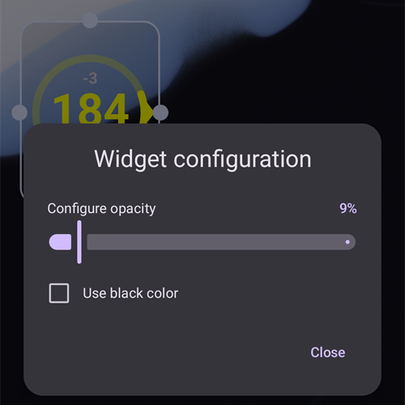

(widgets)=
# ווידג'טים למסך הבית

**AAPS** מספק ווידג'טים שאפשר להוסיף למסך הבית של הטלפון. ווידג'ט מציג את הנתונים העדכניים בלי לפתוח את האפליקציה. הקשה על ווידג'ט פותחת את **AAPS**.

```{contents} Table of contents
:depth: 2
:local: true
```

---

## ווידג'טים זמינים

יש חמישה ווידג'טים. הם מופיעים תחת **AAPS** בבוחר הווידג'טים של Android:


| ווידג'ט                               | גודל ברירת מחדל | מה מוצג                                                                                                                                                                                                |
| ------------------------------------- | --------------- | ------------------------------------------------------------------------------------------------------------------------------------------------------------------------------------------------------ |
| **ווידג'ט AAPS**                      | 5 × 2           | אזור המצב של המסך הראשי: ערך הסוכר (BG) עם מגמה ודלתא, מצב הלולאה כסמל ליד שם הפרופיל, יעד, רגישות (מוצגת כמו במסך הראשי), IOB ו-COB. הטקסטים מוקטנים כדי להתאים לגודל שנותנים לווידג'ט, במקום להיחתך. |
| **מעגל סוכר AAPS**                    | 2 × 2           | מעגל הסוכר של המסך הראשי: טבעת בצבע של ערך הסוכר, קשת המגמה, הדלתא, ערך הסוכר והזמן מאז הקריאה האחרונה.                                                                                                |
| **AAPS קטן**                          | 2 × 2           | שם הפרופיל, ערך הסוכר עם חץ מגמה, הזמן מאז הקריאה האחרונה, דלתא, IOB ו-COB.                                                                                                                            |
| **AAPS גלוקוז + IOB + COB (קומפקטי)** | 4 × 1           | שורה אחת עם ערך הסוכר וחץ המגמה, IOB ו-COB.                                                                                                                                                            |
| **גרף סוכר AAPS**                     | 3 × 1           | ערך הסוכר עם גרף קטן של הקריאות האחרונות.                                                                                                                                                              |

**ווידג'ט AAPS**, **מעגל סוכר** והווידג'ט **קטן** במסך הבית:


הווידג'ט **קומפקטי** והווידג'ט **גרף סוכר**:


ערכי הסוכר מוצגים באותם צבעים כמו ב-**AAPS**: ירוק בטווח, צהוב מעל הטווח, אדום מתחת לטווח.

---

## הוספת ווידג'ט

השלבים המדויקים תלויים בטלפון ובמסך הבית (launcher) שלו. ברוב הטלפונים:

1. יש ללחוץ לחיצה ארוכה על אזור ריק במסך הבית ולבחור **Widgets** (ווידג'טים).

   

2. יש לפתוח את **AAPS** ברשימה ולהקיש על הווידג'ט הרצוי.
3. יש ללחוץ על **Add** (הוספה), או לגרור את הווידג'ט למקום הרצוי.

   

הווידג'ט ממוקם במסך הבית. מיד לאחר ההוספה הווידג'ט מוצג עם ידיות: יש לגרור ידית כדי **לשנות את הגודל** של הווידג'ט, או לגרור את הווידג'ט כדי להזיז אותו. את מעגל הסוכר אפשר להגדיל או להקטין לכל גודל.


אם עמוד מסך הבית מלא, הטלפון מציב את הווידג'ט בעמוד חדש.

---

## תצורת ווידג'ט

יש להקיש על לחצן **העיפרון** שמוצג על הווידג'ט מיד לאחר הוספתו. בהמשך, לחיצה ארוכה על הווידג'ט מחזירה את הידיות ואת העיפרון.

בחלון **תצורת ווידג'ט** יש שתי הגדרות:

- **הגדרת אטימות** — מידת האטימות של רקע הווידג'ט. ערך נמוך מאפשר לראות את הטפט דרך הרקע.
- **שימוש בצבע שחור** — שימוש ברקע שחור במקום ברקע ברירת המחדל.



לכל ווידג'ט יש תצורה משלו.

---

## טוב לדעת

- ווידג'ט רק **מציג** נתונים. לא ניתן לתת בולוס או לשנות דבר מתוך ווידג'ט.
- **AAPS** מרענן את הווידג'ט. אם **AAPS** אינו פועל, או אם Android מגביל אותו ברקע, הווידג'ט עלול להציג נתונים ישנים. יש לבדוק את הזמן מאז הקריאה האחרונה ולוודא ש-**AAPS** מוחרג מ[אופטימיזציית סוללה](#SetupWizard-StoragePermission).
- עם **AAPSClient**, **AAPSClient2** ו-**AAPSClient3**, רקע הווידג'ט צהוב, כחול או ירוק, כדי שאפשר יהיה להבדיל בין האפליקציות. אם קשה לראות את הצבע, אפשר להגביר את האטימות בתצורת הווידג'ט. ראו [על AAPSClient, AAPSClient2 ו-AAPSClient3](#remotecontrol-aapsclient-versions).
