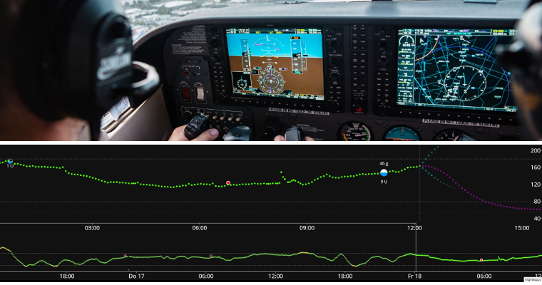
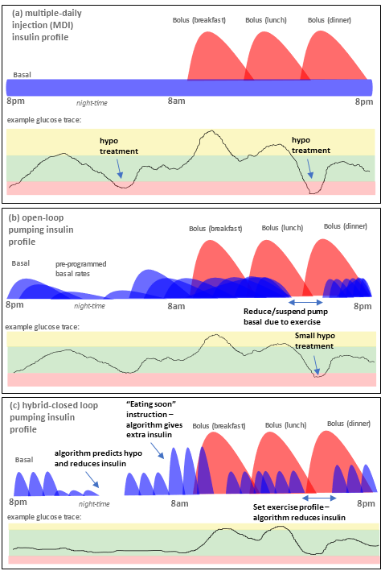

# Introduction to APS and AAPS

```{contents} In this page
:backlinks: entry
:depth: 2
```

## What is an “Artificial Pancreas System”?

A human pancreas does a lot of things besides regulating blood sugar. However, the term **“Artificial Pancreas System” (APS)** usually refers to a system which works to automatically keep blood sugar levels within healthy limits.

The most basic way to do this is by detecting **glucose levels**, using these values to do **calculations**, and then delivering the (predicted) right amount of **insulin** to the body. It repeats the calculation, every few minutes, 24/7. It uses **alarms** and **alerts** to inform the user if intervention or attention is needed. מערכת כזו בנויה בדרך כלל מ**חיישן סוכר**, מ**משאבת אינסולין** ומ**בקר** שמבצע את החישובים. ב-**AAPS** ובמערכות קוד פתוח אחרות, הבקר הוא אפליקציה בטלפון. ברוב המערכות המסחריות זו תוכנה שמובנית במשאבה עצמה, ואפליקציה בטלפון משמשת בעיקר לתצוגה ולשליטה.

לרקע על האופן שבו התפתחו מערכות לולאה סגורה ועל האופן שבו הן פועלות, מאמר הסקירה הזה משנת 2022 הוא נקודת התחלה טובה. חשוב לזכור שהוא נכתב לפני רוב המערכות שזמינות היום, ולכן הוא אינו מדריך למה שנמצא כעת בשוק:

 [Closed-Loop Insulin Delivery Systems: Past, Present, and Future Directions](https://www.frontiersin.org/journals/endocrinology/articles/10.3389/fendo.2022.919942/full) (Templer, _Frontiers in Endocrinology_, 2022).

מערכות שנקראות "דו-הורמונליות" מזריקות גלוקגון בנוסף לאינסולין, כדי למנוע היפוגליקמיות קשות ולאפשר איזון סוכר הדוק עוד יותר. מערכת ראשונה מסוג זה אושרה באירופה, אבל היא מסופקת רק במסגרת מחקרים ופרויקטים, ומערכות אחרות עדיין בפיתוח. אף אחת מהן עדיין לא נמכרת לציבור הרחב.

An artificial pancreas can be thought of as an [“autopilot for your diabetes”](https://www.artificialpancreasbook.com/). What does that mean?

In an aircraft, an autopilot does not do the complete job of the human pilot, the pilot cannot sleep through the entire flight. The autopilot aids the work of the pilot. הוא משחרר את הטייס מהנטל של ניהול המטוס כל הזמן, וכך הטייס יכול להתרכז בפיקוח רחב יותר. הטייס האוטומטי מקבל אותות מחיישנים שונים, מחשב מעריך את הנתונים יחד עם ההגדרות של הטייס, ואז מבצע את ההתאמות הנדרשות ומתריע לטייס על כל בעיה. הטייס כבר לא צריך לדאוג לקבל החלטות כל הזמן, ואפשר להחיל את ההשוואה הזו גם על **AAPS**.



(Introduction-what-does-hybrid-closed-loop-mean)=
## What does hybrid closed loop mean?

The best solution for type 1 diabetes would be a “functional cure” (probably an implant of pancreatic cells which are protected from the immune system). בזמן שקהילת סוכרת סוג 1 (T1D) מחכה לכך, לבלב מלאכותי עם "לולאה סגורה מלאה" הוא כנראה הדבר הטוב הבא. This is a tech system that doesn’t need any user input (like bolusing insulin for meals, or announcing exercise), with good regulation of blood glucose levels. כמעט כל מערכת שנמצאת בשימוש יומיומי היא לולאה סגורה "היברידית", כי היא משלבת טכנולוגיה אוטומטית עם קלט מהמשתמשים. מערכות הלולאה הסגורה המלאה הראשונות אושרו באירופה בשנת 2026, אבל אף אחת מהן עדיין אינה זמינה באופן נרחב.

## How and why did looping start?

The development of commercial technology for people with type 1 diabetes (T1D) is very slow. In 2013 the T1D community founded the #WeAreNotWaiting movement. They developed systems themselves using existing approved technology (insulin pumps and sensors) to improve blood glucose control, safety, and quality of life. הן נקראות מערכות OS-AID (Open-Source Automated Insulin Delivery, מתן אינסולין אוטומטי בקוד פתוח), ובעבר נקראו מערכות DIY, כי הן לא אושרו באופן רשמי על ידי גופי בריאות (FDA, NHS וכו'). יש ארבע מערכות OS-AID עיקריות: [OpenAPS](https://openaps.org/what-is-openaps/),‏ **AAPS**,‏ [Loop](https://loopkit.github.io/loopdocs/#what-is-loop) ו-[Trio](https://triodocs.org).

דרך מצוינת להבין את יסודות הלולאה ב-OS-AID היא לקרוא את הספר של Dana Lewis‏ “Automated Insulin Delivery”. You can access it [here](https://www.artificialpancreasbook.com/) for free (or buy a hardcopy of the book). אם ברצונכם להבין יותר על [OpenAPS](https://openaps.org/what-is-openaps/), שממנה התפתח **AAPS**,‏ [אתר OpenAPS](https://openaps.org/what-is-openaps/) הוא מקור מידע מצוין.

הושקו גם כמה מערכות מסחריות של לולאה סגורה היברידית. הן שונות מאוד ממערכות OS-AID, בעיקר כי רבות מהן כוללות "אלגוריתם לומד" שמתאים את כמות האינסולין שניתנת לפי צורכי האינסולין שלכם בימים הקודמים. אנשים רבים בקהילת OS-AID כבר ניסו מערכות מסחריות והשוו אותן למערכת ה-OS-AID שלהם. אפשר לברר עוד על ההשוואה בין המערכות השונות בשאלה בקבוצות ה-Facebook של המערכות האלה, ב[קבוצת ה-Facebook של AAPS](https://www.facebook.com/groups/AndroidAPSUsers/) או ב-[Discord](https://discord.com/invite/4fQUWHZ4Mw).

## מהו Android APS (AAPS)?


**Figure 1**. Basic outline of the Android APS (Artificial Pancreas System), AAPS.

Android APS (**AAPS**) הוא מערכת לולאה סגורה היברידית, או מערכת לבלב מלאכותי (APS). הוא מחשב את מינוני האינסולין בעזרת אלגוריתמים מוכרים של [OpenAPS](https://openaps.org/) (אוסף של כללים), שפותחו על ידי קהילת T1D של #WeAreNotWaiting.

מכיוון ש-OpenAPS תואמת רק לכמה משאבות אינסולין ישנות, **AAPS** (שאפשר להשתמש בו עם מגוון רחב יותר של משאבות אינסולין) פותח לראשונה בשנת 2016 עבור בן משפחה עם סוכרת סוג 1. מאז ראשית דרכו, **AAPS** מפותח ומשופר ללא הפסקה בידי צוות של מפתחי תוכנה מתנדבים וחובבים נוספים הקשורים לעולם של סוכרת סוג 1. היום **AAPS** נמצא בשימוש של אלפים רבים של אנשים ברחבי העולם. It is a highly customisable and versatile system, and because it is open-source, it is also readily compatible with many other open-source diabetes software and platforms. The fundamental components of the current **AAPS** system are outlined in **Figure 1** above.


## What are the basic components of AAPS?

The “brain” of AAPS is an **app** which you build yourself. There are detailed step-by-step instructions for this. You then install the **AAPS  app** on a [compatible](../Getting-Started/Phones.md) **Android smartphone** (**1**). A number of users prefer their loop on a separate phone to their main phone. So, you don’t necessarily have to be using an Android phone for everything else in your life, just for running your AAPS loop.

The **Android smartphone** will also need to have another app installed on it as well as **AAPS**. [אפליקציה נוספת](../Getting-Started/CompatiblesCgms.md) זו מקבלת נתוני סוכר מחיישן (**2**) דרך Bluetooth, ואז שולחת את הנתונים בתוך הטלפון אל **אפליקציית AAPS**.

The **AAPS app** uses a decision making process (**algorithm**) from OpenAPS. מתחילים משתמשים תחילה באלגוריתם הבסיסי **oref0**, אך ניתן לעבור לאלגוריתם החדש יותר **oref1** ככל שמתקדמים עם AAPS. Which algorithm you use (oref0 or oref1), depends on which suits your specific situation best.  In both cases, the algorithm takes into account multiple factors, and performs rapid calculations every time a new reading comes in from the sensor. לאחר מכן האלגוריתם שולח למשאבת האינסולין (**3**) הוראות דרך Bluetooth: כמה אינסולין לתת. אפשר לשלוח את כל המידע לאינטרנט (**4**) דרך נתונים סלולריים או Wi-Fi. This data can also be shared with followers if desired, and/or collected for analysis. אפשר גם לצמד [שעון חכם](../Getting-Started/Watches.md) (**5**) לטלפון, כדי לראות את הנתונים במבט אחד, ובחלק מהשעונים גם לשלוח פקודות בסיסיות ל-**AAPS**.

## What are the advantages of the AAPS system?

אלגוריתם OpenAPS שבו משתמש **AAPS** מווסת את רמות הסוכר גם ללא קלט מהמשתמשים, לפי הפרמטרים שהגדירו (העיקריים הם קצבים בזאליים, גורמי רגישות לאינסולין, יחסי אינסולין-פחמימות, משך פעילות האינסולין וכדומה), ומגיב כל 5 דקות לנתוני החיישן החדשים.

חלק מהיתרונות של **AAPS** שמשתמשים מדווחים עליהם הם אפשרויות כוונון רבות, **אוטומציות** ושקיפות רבה יותר של המערכת עבור המטופלים והמטפלים. התוצאה יכולה להיות איזון טוב יותר של הסוכרת שלכם (או של מי שאתם מטפלים בו), וזה יכול לשפר את איכות החיים ולהביא יותר שקט נפשי.

אם תשקיעו מזמנכם, **AAPS** עשוי להוביל ל:

- alleviating the stress and burden of managing type 1 diabetes;

- reducing the multitude of mundane decisions that arise from type 1 diabetes;

- the provision of personalised and dynamic insulin dosing based on real-time data which can cut down the need for hypo treatments and reduce hyperglycemia episodes;

- an increased knowledge of insulin management and confidence to better fine tune your settings;

- the ability to create automatic settings (**automations**) that are tailored to fit in with your lifestyle;

- improved sleep quality and overall reduction in the frequency of nighttime interventions;

- remote monitoring and administration of insulin delivery for caregivers of type 1 diabetics; and

- streamlining of all your portable diabetic equipment (continuous glucose monitor receiver and insulin controlling devices) by using an Android phone controlled by **AAPS**.


בסופו של דבר, **AAPS** יכול לעזור לאנשים לנהל טוב יותר את הסוכרת שלהם, ולהביא לרמות סוכר יציבות ולשיפור בתוצאות הבריאות לטווח ארוך.

### Specific advantages include:

#### 1) Safety built-in
To read about the safety features of the algorithms, known as oref0 and oref1, [click here](https://openaps.org/reference-design/). The user is in control of their own safety constraints.

#### 2) גמישות בחומרה

**AAPS** עובד עם מגוון רחב של משאבות אינסולין וחיישנים, ומאפשר גמישות כשהחיים משתנים. So for example, if you develop an allergy to Dexcom sensor patch glue, you could switch to using a Libre sensor instead. אין צורך לבנות או להתקין מחדש את אפליקציית **AAPS**: כדי להחליף חומרה, פשוט בוחרים משאבה או מקור ערכי סוכר אחר ב**הגדרות תצורה**. **AAPS** אינו תלוי במנהלי התקן של משאבות מסוימות, והוא כולל גם "משאבה וירטואלית", כדי שהמשתמשים יוכלו להתנסות בבטחה לפני שהם משתמשים בו על עצמם.

#### 3) התאמה אישית רחבה, עם טווחי הגדרות רחבים

Users can easily add or remove modules or functionality, and **AAPS** can be used in both open and closed loop mode. Here are some examples of the possibilities with the **AAPS** system:

 a) אפשרות להגדיר יעד **BG** נמוך יותר 30 דקות לפני האוכל; אפשר להגדיר את היעד אפילו ל-72 mg/dL (4.0 mmol/L).

 b) אם יש לכם עמידות לאינסולין שגורמת לרמות סוכר גבוהות, **AAPS** מאפשר להגדיר כלל **אוטומציה** שיופעל כאשר BG עולה מעל 8 mmol/L (144 mg/dL), ויעבור, למשל, לפרופיל של 120% (כלומר עלייה של 20% בבזאלי וחיזוק גם של גורמים נוספים, בהשוואה להגדרת ה**פרופיל** הרגילה שלכם). The automation will last according to the scheduled time you set. Such an automation could be set to only be active on certain days of the week, at certain times of day, and even at certain locations.

 c) אם ילדכם קופץ בטרמפולינה בלי הודעה מראש, **AAPS** מאפשר להשהות את האינסולין למשך פרק זמן מוגדר, ישירות דרך הטלפון.

 d) לאחר חיבור מחדש של משאבה עם צינורית שנותקה לצורך שחייה, **AAPS** יחשב את האינסולין הבזאלי שהחמצתם בזמן הניתוק וייתן אותו בזהירות, בהתאם לערך הסוכר הנוכחי שלכם. Any insulin not required can be overridden by just “cancelling” the missed basal.

 e) **AAPS** מאפשר להגדיר פרופילים שונים למצבים שונים ולעבור ביניהם בקלות. לדוגמה, אם אתם חוששים מהיפוגליקמיה בלילה, אפשר להגדיר שתכונות שעוזרות לאלגוריתם להוריד מהר יותר ערכי סוכר גבוהים (כגון בולוסים זעירים במיוחד, ״**SMB**״, וארוחות לא מוכרזות, ״**UAM**״) יפעלו רק בשעות היום.

These are all examples, the full range of features gives huge flexibility for daily life including sport, illness, hormone cycles _etc_. Ultimately, it is for the user to decide how to use this flexibility, and there is no one-size-fits-all automation for this.

#### 4) ניטור מרחוק
יש כמה ערוצי ניטור אפשריים (Sugarmate,‏ Dexcom Follow,‏ xDrip,‏ Android Auto _וכו'_), ששימושיים להורים ולמטפלים, ולמבוגרים במצבים מסוימים (שינה, נהיגה) שצריכים התראות מותאמות אישית. בחלק מהאפליקציות (xDrip) אפשר גם לכבות את ההתראות לגמרי. זה שימושי כשיש חיישן חדש שעדיין "מושרה" או מתייצב, ועוד לא רוצים להפעיל איתו את הלולאה.

#### 5) שליטה מרחוק
יתרון משמעותי של **AAPS** על פני מערכות מסחריות הוא שהעוקבים יכולים לשלוח מגוון רחב של פקודות חזרה למערכת **AAPS**, בעזרת פקודות SMS מאומתות או אפליקציית **AAPSClient** מצומדת. הורים לילדים עם סוכרת סוג 1 שמשתמשים ב-**AAPS** משתמשים בתכונה הזו הרבה.

תכונות השליטה מרחוק יכולות להיות שימושיות מאוד: למשל, בגן השעשועים, כשרוצים לתת בולוס מקדים לחטיף מהטלפון שלכם, והילד עסוק במשחק. אפשר גם לנטר את המערכת משעון חכם (_למשל_ Garmin) או לשלוח ממנו פקודות בסיסיות (_למשל_ שעון Wear OS כמו Samsung Galaxy Watch).

#### 6) אין מגבלות מסחריות, בזכות ממשקי תוכנה פתוחים
Beyond the use of an open-source approach, which allows the source code of **AAPS** to be viewed at any time, the general principle of providing open programming interfaces gives other developers the opportunity to contribute new ideas too. **AAPS** משולב באופן הדוק עם Nightscout. This accelerates development and allows users to add on features to make life with diabetes even more convenient. דוגמאות טובות לשילובים כאלה הן [Nightscout](https://nightscout.github.io/),‏ [Nightscout Reporter](https://nightscout-reporter.zreptil.de/),‏ xDrip,‏ [M5 stack](https://github.com/mlukasek/M5_NightscoutMon/wiki) וכו'. There is ongoing dialogue between open-source developers and those developing commercial systems. הרבה מהחידושים של OS-AID מאומצים בהדרגה על ידי מערכות מסחריות. שם הפיתוח איטי יותר, וזה מובן, בין השאר כי צריך לנהל משא ומתן זהיר ולתת רישיונות לממשקים בין מערכות של חברות שונות (משאבות, אפליקציות, חיישנים _וכו'_). This can also slow innovations which are convenient for the patient (or a small sub-population of patients, who have a very specific requirement) but do not generate any sizable profit.

#### 7) ממשק אפליקציה מפורט
With **AAPS** it is easy to keep track of things like: pump insulin levels, cannula age, sensor age, pump battery age, insulin-on-board _etc_. אפשר לבצע הרבה פעולות דרך אפליקציית **AAPS** (תיחול המשאבה, ניתוק המשאבה _וכו'_.) במקום במשאבה עצמה. כך המשאבה יכולה להישאר בכיס או על החגורה (שלכם או של מי שאתם מטפלים בו).

#### 8) נגישות ועלות סבירה
**AAPS** נותן לאנשים שכרגע לא יכולים לממן מערכת בעצמם, או שאין להם מימון או ביטוח, גישה למערכת לולאה סגורה היברידית שמבחינת הפיתוח מקדימה בשנים את המערכות המסחריות. כרגע צריך שרת דיווח (Nightscout או Tidepool) כדי להגדיר את **AAPS**, אבל הוא לא נדרש להפעלה היומיומית של לולאת **AAPS**. אנשים רבים ממשיכים להשתמש ב-Nightscout לאיסוף הנתונים שלהם ולניטור מרחוק. אף ש-**AAPS** עצמו חינמי, הקמת Nightscout באחת הפלטפורמות השונות עשויה להיות כרוכה בתשלום (€0 - €12), בהתאם לרמת התמיכה שתרצו (ראו טבלת השוואה) ולשאלה אם ברצונכם להמשיך להשתמש ב-Nightscout לאחר ההגדרה. **AAPS** עובד עם מגוון רחב של [טלפוני Android](https://docs.google.com/spreadsheets/u/1/d/e/2PACX-1vScCNaIguEZVTVFAgpv1kXHdsHl3fs6xT6RB2Z1CeVJ561AvvqGwxMhlmSHk4J056gMCAQE02sAWJvT/pubhtml?gid=683363241&single=true) במחירים נגישים (החל מכ-€150). Different versions are available for specific locations and languages, and AAPS can also be used by people who are [blind](#accessibility-for-users-aaps-who-are-partially-or-completely-blind).

#### 9) תמיכה
No automated insulin delivery system is perfect. Commercial and open-source systems share many common glitches in both communications and temporary hardware failure. תמיכה זמינה מקהילת משתמשי AAPS ברחבי העולם ב-Facebook, ב-Discord וב-GitHub, שתכננו ופיתחו את **AAPS** ומשתמשים בו כיום. There are also Facebook support groups and help from clinic/commercial companies for the commercial APS systems -  it is worth speaking to the users, or former users of these systems to get feedback on the common glitches, the quality of the education programme and the level of ongoing support provided.

#### 10) צפיות, שקיפות ובטיחות
**AAPS** שקוף, הגיוני וצפוי. כך אולי קל יותר לדעת מתי הגדרה שגויה, ולתקן אותה בהתאם. You can see exactly what the system is doing, why it is doing it, and set its operational limits, which puts the control (and responsibility) in your hands. This can provide the user with confidence, and a sounder sleep.

#### 11) גישה לתכונות מתקדמות דרך גרסאות פיתוח (dev), כולל לולאה סגורה מלאה
This **AAPS** documentation focuses on the mainstream **“master”** branch of **AAPS**. However, research and development is going on all the time. More experienced users may wish to explore the experimental features in the **development** branch. The development innovations focus on strategies for full closed looping (not having to bolus for meals _etc._), and generally trying to make life with type 1 diabetes as convenient as possible.

#### 12) אפשרות לתרום בעצמכם לשיפורים נוספים
Type 1 diabetes can be highly frustrating and isolating. Having control over your own diabetes tech, with the possibility to “pay it forward” as soon as you are making progress by helping others on their journey can be really rewarding. You can educate yourself, discover the roadblocks and look for, and even contribute, to new developments and the documentation. There will be others in the community with the same quest that you can bounce ideas off and work with. This is the essence of #WeAreNotWaiting.

## How does AAPS compare to MDI and open looping?

Multiple daily injections (MDI, (a) in **Figure 2** below) usually involve giving an injection of a long-lasting insulin (_e.g._ Tresiba) once a day, with injections of faster-acting insulin (_e.g._ Novorapid, Fiasp) at mealtimes, or for corrections. שימוש במשאבה בלולאה פתוחה (b) כולל מתן אינסולין מהיר-פעולה בקצבים בזאליים שתוכנתו מראש, ולאחר מכן מתן בולוסים דרך המשאבה בזמן הארוחות או לצורך תיקונים. The basics of a looping system are that the looping app uses the sensor glucose data to instruct the pump to stop insulin delivery when it predicts you are heading for a low, and to give you extra insulin if your glucose levels are rising and predicted to go too high (c). Although this figure is oversimplified compared to real-life, it aims to demonstrate the key differences of the approaches. It is possible to achieve exceptionally good glucose control with any of these three approaches.




**Figure 2**. Basic overview of (a) MDI, (b) open-loop pumping and (c) hybrid closed loop pumping.

## How does AAPS compare to other looping systems?

As of June 25 2023, there are four major open source closed loop systems available: [OpenAPS](https://openaps.readthedocs.io/), **AAPS**, [Loop](https://loopkit.github.io/loopdocs/#what-is-loop) and [Trio](https://triodocs.org), (formerly FreeAPS X). The features of the different systems are shown in the table below:


| סוג ההתקן | Name                                                                   | [AAPS](https://wiki.aaps.app)             | [לולאה](https://loopkit.github.io/loopdocs/) | [Open APS](https://openaps.readthedocs.io/en/latest/) | [Trio](https://triodocs.org)              |
| --------- | ---------------------------------------------------------------------- | ----------------------------------------- | -------------------------------------------- | ----------------------------------------------------- | ----------------------------------------- |
| Phone     | Android                                                                |      |     |              |  |
| Phone     | iPhone                                                                 |  |         |              |      |
| Rig       | tiny computer (1)                                                      |  |     |                  |  |
| PUMP      | [Dana I](../CompatiblePumps/DanaRS-Insulin-Pump.md)                    |      |         |              |      |
| PUMP      | [Dana RS](../CompatiblePumps/DanaRS-Insulin-Pump.md)                   |      |         |              |      |
| PUMP      | [Dana R](../CompatiblePumps/DanaR-Insulin-Pump.md)                     |      |     |              |  |
| PUMP      | [Omnipod (Dash)](../CompatiblePumps/OmnipodDASH.md)                    |      |         |              |      |
| PUMP      | [Omnipod (Eros)](../CompatiblePumps/OmnipodEros.md)                    |      |         |              |      |
| PUMP      | [Diaconn G8](../CompatiblePumps/DiaconnG8.md)                          |      |     |              |  |
| PUMP      | [EOPatch 2](../CompatiblePumps/EOPatch2.md)                            |      |     |              |  |
| PUMP      | [Medtrum TouchCare Nano 200U](../CompatiblePumps/MedtrumNano.md)       |      |         |              |      |
| PUMP      | [Medtrum TouchCare 300U](../CompatiblePumps/MedtrumNano.md)            |      |         |              |      |
| PUMP      | [Roche Combo](../CompatiblePumps/Accu-Chek-Combo-Pump-v2.md)           |      |     |              |  |
| PUMP      | [Roche Insight](../CompatiblePumps/Accu-Chek-Insight-Pump.md)          |      |     |              |  |
| PUMP      | [Older Medtronic](../CompatiblePumps/MedtronicPump.md)                 |      |         |                  |      |
| PUMP      | [Equil 5.3](../CompatiblePumps/Equil5.3.md)                            |      |     |              |  |
| PUMP      | [CareLevo](../CompatiblePumps/CareLevo.md)                             |      |     |              |  |
| CGM       | [Dexcom G7/One+/Stelo](../CompatibleCgms/DexcomG7.md)                  |      |         |              |      |
| CGM       | [Dexcom One](../CompatibleCgms/DexcomG6.md)                            |      |         |              |      |
| CGM       | [Dexcom G6](../CompatibleCgms/DexcomG6.md)                             |      |         |                  |      |
| CGM       | [Libre 3/3+](../CompatibleCgms/Libre3.md)                              |      |         |              |      |
| CGM       | [Libre 2/2+](../CompatibleCgms/Libre2.md)                              |      |         |              |      |
| CGM       | [Libre 1](../CompatibleCgms/Libre1.md)                                 |      |         |              |      |
| CGM       | [Eversense](../CompatibleCgms/Eversense.md)                            |      |         |              |      |
| CGM       | [MM640g/MM630g](../CompatibleCgms/MM640g.md)                           |      |     |              |  |
| CGM       | [PocTech](../CompatibleCgms/PocTech.md)                                |      |     |              |  |
| CGM       | [Ottai](../CompatibleCgms/OttaiM8.md)                                  |      |     |              |  |
| CGM       | [Syai Tag](../CompatibleCgms/SyaiTagX1.md)                             |      |     |              |  |
| CGM       | [Nightscout כמקור ערכי סוכר](../CompatibleCgms/CgmNightscoutUpload.md) |      |         |                  |      |

_Table notes:_
1. **rig** הוא מחשב קטן ללא מסך, שנושאים איתו לכל מקום. One supported device type is Intel Edison + Explorer Board and the other Raspberry Pi + Explorer HAT or Adafruit RFM69HCW Bonnet. מערכות ה-APS הראשונות התבססו על מבנה כזה, כי טלפונים ניידים לא יכלו להריץ את האלגוריתמים הנדרשים. Use of these systems has declined, as the setup on mobile phones has become easier, and phones have a display included. Intel has also stopped selling the Intel Edison. The excellent OpenAPS algorithms **oref0** and **oref1** are now incorporated in AAPS and Trio.


An international peer-reviewed consensus statement containing practical guidance on open source looping was written by and for health-care professionals, and published in a leading medical journal in 2022: [_Lancet Diabetes Endocrinol_, 2022; 10: 58–74](https://www.ncbi.nlm.nih.gov/pmc/articles/PMC8720075/)(_1_). כדאי מאוד לקרוא אותו (גם עבור מרפאת הסוכרת שלכם). הוא מסכם את ההבדלים הטכניים העיקריים בין מערכות הלולאה הסגורה ההיברידית השונות בקוד פתוח.

It is hard to get a “feel” for any system without using it, or talking to others who are using it, so do reach out to others on Facebook/Discord and ask. רוב האנשים מגלים ש-**AAPS** מתוחכם מאוד בהשוואה למערכות לולאה סגורה היברידית אחרות (במיוחד המערכות המסחריות), עם מספר עצום של הגדרות ותכונות שאפשר להתאים, כפי שתואר למעלה. יש מי שזה מרגיש להם קצת מבלבל בהתחלה, אבל אין צורך למהר ולבדוק את כל האפשרויות בבת אחת. אפשר להתקדם לאט או מהר, כמו שרוצים, ויש עזרה בכל שלב בדרך.


## האם AAPS משתמש בבינה מלאכותית או באלגוריתם לומד?

בגרסה הנוכחית של **AAPS** (4.0) אין אלגוריתמים של למידת מכונה, מודלים של תגובת אינסולין עם פרמטרים מרובים, או בינה מלאכותית. לכן אופן הפעולה של המערכת פתוח ושקוף, ולא רק מומחים יכולים להבין אותו, אלא גם אנשי צוות רפואי ומטופלים. זה גם אומר שאם יש לכם לוח זמנים שמשתנה מאוד (למשל מעבר משבוע לחוץ בעבודה לחופשה רגועה), וסביר שתצטרכו כמות אינסולין שונה מאוד, אפשר מיד להעביר את **AAPS** לפרופיל מותאם חלש או חזק יותר. A ‘learning system’ will do this adjustment for you automatically, but is likely to take longer to adjust the insulin delivery.

(which-system-is-right-for-me-or-my-dependent)=
## איזו מערכת מתאימה לי או למי שאני מטפל/ת בו?

Practically, your choice of system is often restricted by which pump you already have, or can obtain from your medical provider, and your choice of phone (Apple or Android). If you don’t yet have a pump you have the biggest choice of systems. Technology is continually evolving, pumps are being discontinued and new pumps and sensors are being released. Most open-source systems work with the main sensors (Libre and Dexcom) or are quickly adapted to work with new sensors a year or so after they are released (with a bit of time delay for safety and stability testing).

רוב משתמשי **AAPS** מדווחים על זמן רב יותר בטווח, ירידה ב-HbA1c ושיפור באיכות החיים בזכות מערכת שמסוגלת להתאים אוטומטית קצבים בזאליים במהלך השינה בלילה, והדבר נכון לרוב מערכות הלולאה הסגורה ההיברידית. יש אנשים שמעדיפים מערכת פשוטה מאוד, שאי אפשר להתאים אותה הרבה (ואז אולי תעדיפו מערכת מסחרית), ויש אחרים שחוסר השליטה הזה מתסכל אותם מאוד (ואז אולי תעדיפו מערכת בקוד פתוח). במקרה של אבחנה חדשה (שלכם או של מי שאתם מטפלים בו), דרך נפוצה היא להתרגל קודם ל-MDI עם חיישן סוכר, אחר כך לעבור למשאבה שמתאימה ללולאה, ואז לעבור ל-**AAPS**. אבל יש אנשים (במיוחד ילדים קטנים) שעוברים ישר למשאבה.

It is important to note that the **AAPS** user needs to be proactive to troubleshoot and fix problems themselves, with help from the community. This is a very different mindset to that when using a commercial system. With **AAPS** a user has more control, but also the responsibility, and needs to be comfortable with that.

## Is it safe to use open-source systems like AAPS?

### Safety of the AAPS system
A more accurate question is probably “is it safe **compared** with my current insulin delivery system?” since no method of insulin delivery is without risk. There are many checks and balances in place with **AAPS**. [מאמר](https://www.liebertpub.com/doi/epub/10.1089/dia.2019.0375) שפורסם לאחרונה בדק את השימוש ב-**AAPS** בסביבה מדומה במחשב. זו הייתה דרך יעילה לבדוק באופן אובייקטיבי עד כמה המערכת בטוחה ויעילה. באופן כללי יותר, אלפים רבים של אנשים ברחבי העולם משתמשים במערכות מתן אינסולין אוטומטי בקוד פתוח, ומספרם ממשיך לגדול בכל העולם.

Any device that uses radio communications could be hacked, and this is true for a non-looping insulin pump as well. Currently, we are not aware of anyone attempting to harm individuals by hacking their diabetes-related medical equipment. However, there are multiple ways to protect against such risks:

1.  In the pump settings, limit both the max bolus allowed and max temporary basal settings to amounts that you believe are safest. These are hard limits that we do not believe any malicious hacker could circumvent.

2.  Set your CGM alarms enabled for both highs and lows.

3.  Monitor your insulin delivery online. Nightscout users can set additional alarms to alert for a wide variety of conditions, including conditions that are much more likely to occur than a malicious attack. In addition to highs and lows, Nightscout can display diagnostic data useful for verifying that the pump is operating as desired, including current IOB, pump temporary basal history, pump bolus history. It can also be configured to proactively alert users to undesirable conditions, such as predicted highs and lows, low insulin reservoir, and low pump battery.

If a malicious attack was made on your insulin pump, these strategies would significantly mitigate the risk. כל המשתמשים הפוטנציאליים ב-**AAPS** צריכים לשקול את הסיכונים שבשימוש ב-**AAPS** מול הסיכונים שבשימוש במערכת אחרת.

#### Safety considerations around improving blood glucose control too fast

A rapid reduction in HbA1c and improved blood glucose control sounds appealing. However, reducing average blood glucose levels _too fast_ by starting any closed loop system can cause permanent damage, including to the eyes, and painful neuropathy that never goes away. This damage can be avoided simply by reducing levels more slowly. If you currently have an elevated HbA1c and are moving to AAPS (or any other closed loop system), please discuss this potential risk with your clinical team before starting, and agree a time plan with them. More general information on how to reduce your glucose levels safely, including links to medical literature is given in the safety section [here](#preparing-safety-first).

#### Medical safety around devices, consumable supplies and other medications

Use a tested, fully functioning FDA or CE approved insulin pump and CGM for an artificial pancreas loop. שינויים בחומרה או בתוכנה ברכיבים אלה עלולים לגרום למינון בלתי צפוי של אינסולין, ולגרום לסיכון משמעותי למשתמש. If you find or get offered broken, modified or self-made insulin pumps or CGM receivers, do not use these for creating an AAPS system.

Use original supplies such as inserters, cannulas and insulin containers approved by the manufacturer of your pump and CGM. Using untested or modified supplies can cause CGM inaccuracy and insulin dosing errors. Insulin is highly dangerous when misdosed - please do not play with your life by hacking your supplies.

Do not take SGLT-2 inhibitors (gliflozins) when using **AAPS** as they incalculably lower blood sugar levels. שילוב השפעה זו עם מערכת שמפחיתה קצבים בזאליים כדי להעלות את BG הוא מסוכן. פרטים נוספים מופיעים ב[סעיף הבטיחות](#preparing-safety-first) הראשי.

(introduction-how-can-i-approach-discussing-aaps-with-my-clinical-team)=
## How can I approach discussing AAPS with my clinical team?

Users are encouraged to speak with their clinicians about their intention to use **AAPS**. אל תחששו לנהל שיחה כנה עם צוות הסוכרת שלכם אם אתם מתכוונים להשתמש ב-**AAPS** (או בכל לולאת OS-AID אחרת). Transparency and trust between patient and doctor is paramount.

### Suggested approach:
Start a conversation with your clinician to determine their familiarity and attitude towards diabetic technology such as CGMs,  pumps, hybrid loops and commercial looping. Your clinician/endocrinologist should be aware of the basic technology and be willing to discuss with you recent advancements with commercial loop products available within their regions.

#### Local precedent

ביררו מה דעתם של אנשי הצוות הרפואי או האנדוקרינולוגים שלכם על לולאת OS-AID _לעומת_ לולאה מסחרית, ובדקו כמה ידע יש להם בתחום. האם הם מכירים את **AAPS**, ויכולים לשתף אתכם בניסיון מועיל מעבודה עם מטופלים שמשתמשים בלולאת OS-AID?

שאלו אם יש לצוות שלכם מטופלים שכבר משתמשים בלולאת OS-AID. Due to patient confidentiality, doctors cannot pass other patient’s details to you without obtaining the individual’s consent. אבל אם תרצו, **אפשר** לבקש מהם להעביר את פרטי הקשר **שלכם** למטופל שכבר משתמש בלולאת OS-AID, אם הצוות חושב שתהיה ביניכם "התאמה", ולומר שתשמחו שהמטופל ייצור איתכם קשר כדי לדבר על לולאת OS-AID. Clinicians are not obliged to do this, but some are happy to, since they realise the importance of peer-to-peer support in type 1 diabetes management. אולי יעזור לכם גם להיפגש עם משתמשי OS-AID ידידותיים באזור שלכם. This is of course up to you, and not entirely necessary.

#### National and International Precedent

If you feel unsupported by your team to loop with **AAPS**, the following discussion points may help:

a) The **AAPS** system has been designed BY patients and their caregivers. It has been designed ultimately for safety, but also drawing on in-depth patient experience. יש אלפים רבים של משתמשי **AAPS** ברחבי העולם. לכן סביר שיש במרפאה שלכם מטופלים נוספים שמשתמשים בלולאת OS-AID (בין אם הצוות יודע על כך ובין אם לא).

b) הנחיות שעברו ביקורת עמיתים ופורסמו לאחרונה בכתב העת הרפואי המוביל בעולם [The Lancet](https://www.ncbi.nlm.nih.gov/pmc/articles/PMC8720075/pdf/nihms-1765784.pdf)(_1_) אישרו שלולאות OS-AID הן **בטוחות** ו**יעילות בשיפור איזון הסוכרת**, כולל הזמן בטווח. בכתבי עת מובילים כמו [Nature](https://doi.org/10.1038/d41586-023-02648-9)(_3_) מתפרסמים באופן קבוע מאמרים שמדגישים את ההתקדמות של קהילת לולאות OS-AID.

c) התחלת השימוש ב-**AAPS** כוללת מעבר _הדרגתי_ ממשאבה בלולאה ״פתוחה״, דרך השהיה עקב ערך סוכר נמוך, ועד ללולאה ״סגורה״ היברידית, באמצעות השלמת מספר משימות. There is therefore a structured programme, requiring the user to demonstrate a level of competence at each stage and fine-tuning their basic settings (basal, ISF and ICR) before they can close the loop.

d) תמיכה טכנית זמינה לכם מקהילת OS-AID דרך GitHub,‏ Discord וקבוצות Facebook סגורות.

e) You will be able to provide **both CGM and insulin looping/pumping information** as combined reports at clinic meetings (through Nightscout or Tidepool), either printed out or on-screen (if you bring a laptop/tablet). The streamlining of both CGM and insulin data will allow more effective use of your clinician’s time to review your reports and aid their discussions in assessing your progress.

f) אם הצוות עדיין מתנגד מאוד, מסרו לאיש הצוות הרפואי עותקים מודפסים של מאמרי המקור המקושרים כאן בטקסט, ואת הקישור לסעיף המיועד לצוות רפואי ב-**AAPS**: [לצוותים רפואיים – מבוא כללי ומדריך ל־**AAPS**](../UsefulLinks/ClinicianGuideToAaps.md)

#### תמיכה של אנשי צוות רפואי אחרים בלולאת OS-AID

המאמר שפורסם ב-[Lancet Diabetes Endocrinology](https://www.ncbi.nlm.nih.gov/pmc/articles/PMC8720075/)(_1_) (בהובלה משותפת של King’s ושל Guy’s and St Thomas’ NHS Foundation Trust, ובהובלה משותפת של Dr Sufyan Hussain, רופא סוכרת בכיר ומרצה בכיר של כבוד ב-King’s בלונדון) מספק:

a) **ביטחון** לאנשי המקצוע שמערכות לבלב מלאכותי OS-AID בקוד פתוח הן אפשרות "טיפול בטוחה ויעילה" לסוכרת סוג 1, וכן הנחיות לגבי המלצות, שיחות, תמיכה ותיעוד;

b) **Recognition** that open-source automated insulin delivery (“AID”) systems can increase time in range (TIR) while reducing variability in blood glucose concentrations and the amount of hypo and hyperglycaemic episodes in various age groups, genders and communities;

c) **Recommendation** that healthcare workers should **support** type 1 patients or their caregivers who choose to manage their diabetes with an open source AID system;

d) Recommendation that healthcare workers should attempt to learn about all treatment options that might benefit patients including available open-source AID systems.  If health care professionals do not have resources to educate themselves, or have legal or regulatory concerns, they should consider **cooperating, or teaming up with other healthcare professionals** who do;

e) Emphasis that all users of CGMs should have real-time and open-access to **their own health data** at all times

f) Emphasis that these open source systems have not undergone the same regulatory evaluations as commercially available medical technologies, and there is no commercial technical support. However, **extensive community support is available**; and

g) A recommendation that **regulation and legal frameworks** should be updated to ensure clarity on permitting ethical and effective treatment of such open source systems.

Another paper in [Medical Law International, 2021](http://pure-oai.bham.ac.uk/ws/files/120241375/0968533221997510.pdf)(_4_) also highlights the UK General Medical Council’s ‘consent guidance’ places a strong emphasis on doctor and patients making decisions together. על הרופא להסביר את התועלות, הסיכונים, הנטל ותופעות הלוואי האפשריים של מערכת OS-AID APS, והוא יכול להמליץ על אפשרות מסוימת בלי ללחוץ על המטופל.

Ultimately it is up to the patient to weigh up these factors, along with any non-clinical issues relevant to them and decide which treatment option, if any, to accept.

אם רופא מגלה במרפאה שמטופל שלו משתמש בלולאת OS-AID, הוא לא פטור מהחובה לעקוב אחרי המטופל רק כי הוא לא רשם את הטכנולוגיה שהמטופל משתמש בה; אנשי הצוות הרפואי חייבים להמשיך לעקוב אחרי המטופלים.

Doctors (at least in the UK) are not prohibited from prescribing unlicensed medicines and can use their clinical discretion. לכן עליהם להפעיל שיקול דעת רפואי כדי להחליט אם מערכת OS-AID APS מתאימה למטופל מסוים, ולדון עם המטופל במה שהם רואים כיתרונות וכחסרונות.

#### The articles referenced above, and other useful links and position statements are listed below:

1. Open-source automated insulin delivery: international consensus statement and practical guidance for health-care professionals [_Lancet Diabetes Endocrinol_, (2022) _10_, 58–74](https://www.ncbi.nlm.nih.gov/pmc/articles/PMC8720075/)
2. [In Silico Trials of an Open-Source Android-Based Artificial Pancreas: A New Paradigm to Test Safety and Efficacy of Do-It-Yourself Systems, 2020](https://www.liebertpub.com/doi/epub/10.1089/dia.2019.0375)
3. A DIY ‘bionic pancreas’ is changing diabetes care — what's next? [_Nature_ (2023), _620_, 940-941](https://doi.org/10.1038/d41586-023-02648-9)
4. Prescribing unapproved medical devices? The case of DIY artificial pancreas systems [_Medical law international_, (2021), _21_, 42-68](http://pure-oai.bham.ac.uk/ws/files/120241375/0968533221997510.pdf)
5. [Berlin Institute of Health position statement, 2022](https://www.bihealth.org/en/notices/do-it-yourself-solutions-for-people-with-diabetes-are-safe-and-recommended)
6. Do-It-Yourself Automated Insulin Delivery: A Health-care Practitioner User’s Guide (Diabetes Canada position and guide) [_Canadian Journal of Diabetes_ (2023), _47_, E8, 389-397](https://www.canadianjournalofdiabetes.com/article/S1499-2671(23)00138-7/fulltext)
7.  הולנד (EN/NL) - לאנשי צוות רפואי - [how to help people on open source automated insulin delivery systems](https://www.diabetotech.com/blog/how-to-help-people-on-open-source-automated-insulin-delivery-systems)
8. First Use of Open-Source Automated Insulin Delivery AndroidAPS in Full Closed-Loop Scenario: Pancreas4ALL Randomized Pilot Study [_Diabetes Technol. Ther._, 25, _5_, 2023](https://www.liebertpub.com/doi/pdf/10.1089/dia.2022.0562?casa_token=D13eFx5vCwwAAAAA:MYvO8hChbViXVJFgov1T11RXBPx2N_wOMThLHwl3TVUxbCuANegPrIFRC5R5VXx_S71FoQYW-qg)
9. Pre-school and school-aged children benefit from the switch from a sensor-augmented pump to an AndroidAPS hybrid closed loop: A retrospective analysis [_Pediatr. Diabetes_ 2021, _22_, 594-604. 2021](https://onlinelibrary.wiley.com/doi/epdf/10.1111/pedi.13190)
10. Outcomes of the OPEN project, an EU-funded project into the Outcomes of Patient’s Evidence with Novel, Do-it-Yourself Artificial Pancreas Technology (https://www.open-diabetes.eu/publications)


## מדוע אי אפשר פשוט להוריד את AAPS ולהשתמש בו מיד?

The **AAPS** app is not provided in Google Play - you have to build it from source code by yourself for legal reasons. **AAPS** אינו מורשה, כלומר אין לו אישור של גוף רגולטורי כלשהו בשום מדינה. **AAPS** is deemed to be carrying out a medical experiment on yourself, and is carried out at the user’s own risk.

Setting up the system requires patience, determination and the gradual development of technical knowledge. All the information and support can be found in these documents, elsewhere online, or from others who have already done it. אלפים רבים של אנשים ברחבי העולם בנו בהצלחה את **AAPS** ומשתמשים בו כיום.

The developers of **AAPS** take safety incredibly seriously, and want others to have a good experience of using **AAPS**. לכן חיוני שכל המשתמשים (או המטפלים, אם המשתמש הוא ילד):

- יבנו בעצמם את מערכת AAPS וישלימו את ה**משימות**, כך שעד ״סגירת הלולאה״ יהיו להם הגדרות אישיות טובות במידה סבירה והבנה בסיסית של אופן הפעולה של **AAPS**;

- יגבו את המערכת שלהם בייצוא ושמירה של קבצים חשובים (כמו ה-keystore וקובץ ההגדרות .json) במקום בטוח, כדי שאפשר יהיה להגדיר הכול מחדש במהירות אם צריך;

- יעדכנו לגרסאות master חדשות כאשר הן זמינות; וכן

- יתחזקו את המערכת ויעקבו אחריה, כדי לוודא שהיא פועלת כראוי.

## What is the connectivity of the AAPS system?

**איור 3 (למטה)** מציג דוגמה אחת למערכת **AAPS** עבור משתמש שלא צריך עוקבים שמתקשרים עם המערכת. Additional open-source software and platforms which are not shown can also be integrated.


**איור 4 (למטה)** מציג את כל האפשרויות של מערכת **AAPS** עבור משתמש שיש לו עוקבים, ושצריך לנטר ולכוונן את המערכת מרחוק (למשל ילד עם סוכרת סוג 1). Additional open-source software and platforms which are not shown can also be integrated.


## כיצד AAPS ממשיך להתפתח ולהשתפר?

Most **AAPS** users use the fully tested **master** version of AAPS, which has been tested for bugs and problems, before being released to the community. Behind the scenes, the developers try out new improvements, and test these out in “developer” (**dev**) versions of **AAPS** with a user community who are happy to do bug updates at short notice. If the improvements work well, they are then released as a new “master” version of **AAPS**. Any new master release is announced on the Facebook group, so that the mainstream **AAPS** users can read about and update to the new master version.

Some experienced and confident **AAPS** users conduct experiments with emerging technologies and with dev versions of the **AAPS** app, which can be interesting for the less adventurous users to read about, without having to do it themselves! People tend to share these experiments on the Facebook group too.

You can read more about some of these experiments and discussion on emerging tech here:

Tim Street [https://www.diabettech.com/](https://www.diabettech.com/)

David Burren [https://bionicwookie.com/](https://bionicwookie.com/)

## Who can benefit from AAPS?

| User Type                                     |
| --------------------------------------------- |
| ✔️ type 1 diabetic                            |
| ✔️ מטפלים או הורים של אדם עם סוכרת סוג 1      |
| ✔️ blind users type 1 diabetic                |
| ✔️ *אנשי צוות רפואי ואנשי מקצוע בתחום הבריאות |

הטבלה למעלה מניחה שלמשתמש יש גם מערכת לניטור סוכר רציף (CGM) וגם משאבת אינסולין.

*All data from **AAPS** can be made available to healthcare professionals via data sharing platforms, including Nightscout that provides logging and real time monitoring of CGM data, insulin delivery, carbohydrate entries, predictions and settings. Nightscout records include daily and weekly reports which can aid healthcare professionals' discussions with type 1 patients with more accurate data on glycemic control and any behavioral considerations.

(accessibility-for-users-aaps-who-are-partially-or-completely-blind)=

### נגישות למשתמשי AAPS עיוורים או בעלי לקות ראייה

#### Day to day AAPS use:
AAPS can be used by blind people. On Android devices, the operating system has a program called TalkBack. This allows screen orientation via voice output as part of the operating system. By using TalkBack you can operate both your smartphone and AAPS without needing to be able to see.

#### Building the AAPS app:
As a user you will build the AAPS app in Android Studio. Many people use Microsoft Windows for this purpose, where there is the screen reader analogous to TalkBack. Since Android Studio is a Java application, the “Java Access Bridge” component must be enabled in the Control Panel. Otherwise, the screen reader of the PC will not speak in Android Studio.

How you do this depends on your operating system, two methods are outlined below:

1) In the Windows Start menu, enter “Control Panel” in the search field, open with Enter. It opens: “All Control Panel Items”.

Open the "Ease of Access Centre".

Then open “Use computer without a display” with Enter.

תחת **Hear text read aloud**, יש לבחור **turn on narrator** ו-**turn on audio display**, ואז ללחוץ על **apply**.

or:

2) Press Windows key and enter “Control Panel” in the search field, open with Enter. It opens: “All Control Panel Items”.

לחצו על האות E כדי להגיע ל-״Ease of Access Centre״, ופתחו באמצעות Enter.

Then open “Use computer without a display” with Enter.

There, at the bottom, you will find the checkbox “Enable Java Access Bridge”, select it.

Done, just close the window! The screen reader should work now.


Interested in how to get started with setting up AAPS? Take a look at the [preparing](../Getting-Started/PreparingForAaps.md) section.
