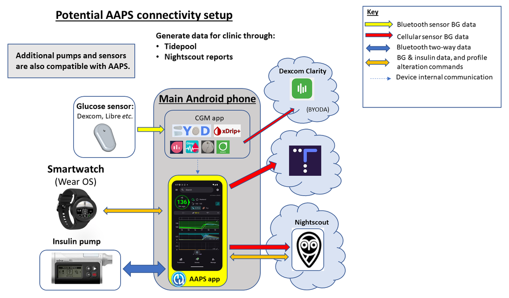
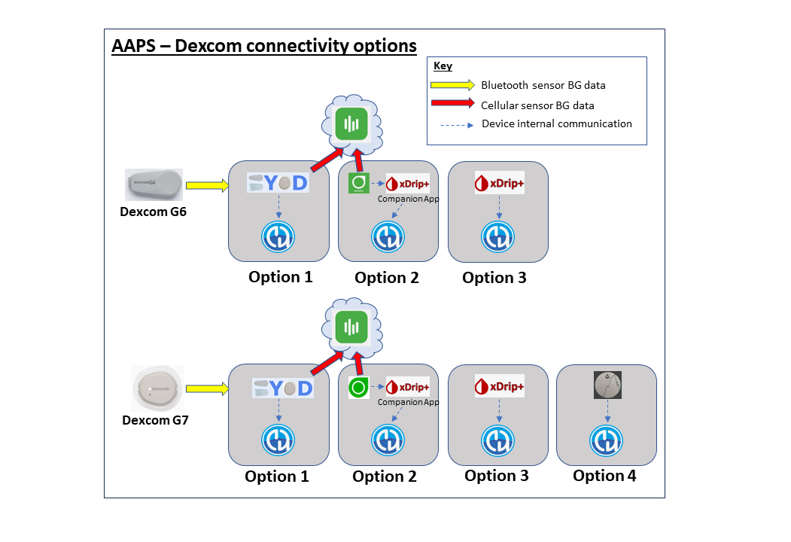
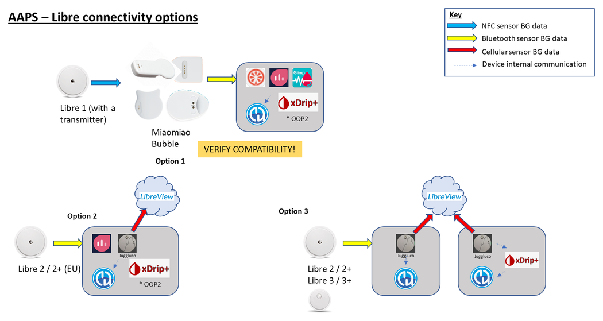
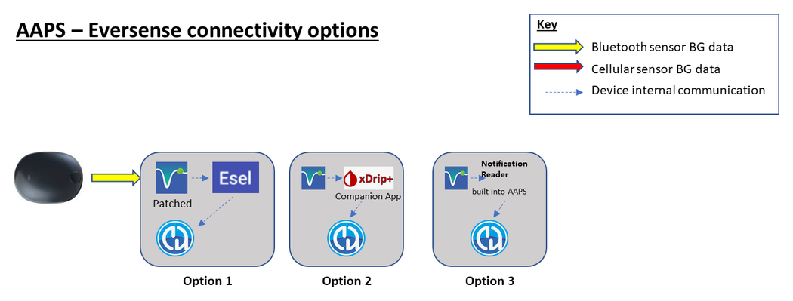

# מתכוננים להתחיל עם AAPS

Welcome. תיעוד זה נועד להדריך משתמשים שמתכוננים להגדיר את מערכת הלבלב המלאכותי ל-Android (**AAPS**) ולהתחיל להשתמש בה.

## Finding your way around the documentation

ניתן למצוא **תוכן עניינים** והסבר על מבנה התיעוד [כאן](../index.md). ניתן להגיע אליו גם בלחיצה על סמל **AAPS** בחלק העליון של התיעוד. There you will find an overview of the purpose of the different documentation sections. ניתן להשתמש גם בכותרות שבצד הדף כדי לנווט בתיעוד. Finally, there is a handy search function, directly below the **AAPS** symbol.

We aim to make it easy to determine both the capabilities and limitations of **AAPS**. עלול להיות מאכזב לגלות, לאחר השקעת זמן בקריאת התיעוד, שאולי אין לכם משאבת אינסולין או CGM תואמים, או ש-**AAPS** מציע יכולות שונות מאלה שקיוויתם להן.

Many experience-related details in the **AAPS** documentation make more sense when you are actually using **AAPS** in real-time. Just as it is difficult to learn a sport only by reading the rules, it takes a combination of learning the foundations of the rules for safely operating **AAPS** and then learning how best to apply those rules as you start to use **AAPS**.

(preparing-safety-first)=

## Safety First
“With great power comes great responsibility…”

### בטיחות טכנית
**AAPS** has an extensive set of safety features. These impose constraints which are gradually removed through staged completion of a series of [Objectives](../SettingUpAaps/CompletingTheObjectives.md) which involve testing specific parameters and answering multiple choice questions. **AAPS** features are unlocked as the Objectives are successfully completed. This process allows the user to migrate safely in stages from Open Loop to Closed Loop, while learning about the different features of **AAPS**.

The [Objectives](../SettingUpAaps/CompletingTheObjectives.md) have been designed to achieve the best possible introduction to **AAPS**, taking into consideration the typical errors and general trends **AAPS** developers have observed with new users. Mistakes can happen because the beginner is inexperienced and too eager to get started with **AAPS**, or has overlooked key points. ה[משימות](../SettingUpAaps/CompletingTheObjectives.md) נועדו לצמצם את הבעיות האלה.

### Medical safety
```{admonition} Avoid permanent and painful damage to your eyes and nerves
:class: danger
Caution is advised concerning rapid improvements in blood glucose control and lowering of HbA1c 
```

An important safety consideration is that a **rapid reduction in HbA1c and improved blood glucose control in those who have had elevated glucose levels for some time can cause permanent damage**. אנשים רבים עם סוכרת אינם מודעים לכך, ולא כל אנשי הצוות הרפואי מיידעים את המטופלים שלהם על הבעיה הזו.

This damage can include **sight loss, and permanent neuropathy (pain)**. It is possible to avoid this damage occurring, by reducing average glucose levels more slowly. אם ה-HbA1c שלכם גבוה כעת ואתם עוברים ל-**AAPS** (או למערכת לולאה סגורה אחרת), _אנא_ שוחחו על הסיכון האפשרי הזה עם הצוות הרפואי לפני ההתחלה, והסכימו איתו על לוח זמנים שבו יעדי הגלוקוז הבטוחים יורדים בהדרגה. בהתחלה ניתן בקלות להגדיר ב-**AAPS** יעדי גלוקוז גבוהים יותר (כרגע היעד הגבוה ביותר שניתן לבחור הוא 11.1 mmol/L, אבל אם צריך, ניתן גם להשתמש בכוונה בפרופיל חלש), ואז להוריד את היעד ככל שעוברים החודשים.

#### How quickly can I reduce my HbA1c without risking permanent damage?

[מחקר](https://pubmed.ncbi.nlm.nih.gov/1464975/) רטרוספקטיבי אחד שכלל 76 מטופלים דיווח שהסיכון להחמרת רטינופתיה עלה פי 1.6, פי 2.4 ופי 3.8 כאשר ה-HbA1c ירד ב-1%, 2% או 3% בהתאמה במשך 6 חודשים. They suggested that the **"decrease in HbA1c value during any 6-month period should be limited to less than 2% in order to prevent the progression of retinopathy....Too rapid a decrease at the initiation of glycemic control could cause severe or transient exacerbation of the progression of retinopathy."**

N.B. אם אתם משתמשים ביחידות HbA1c אחרות (mmol/mol במקום %), לחצו [כאן](https://www.diabetes.co.uk/hba1c-units-converter.html) כדי להגיע למחשבון HbA1c.

In another retrospective [evaluation](https://academic.oup.com/brain/article/138/1/43/337923) of 954 patients, researchers noted that:

**"With a decrease in HbA1c of 2–3% points over 3 months there was a 20% absolute risk of developing treatment-induced neuropathy in diabetes, with a decrease in HbA1c of >4% points over 3 months the absolute risk of developing treatment-induced neuropathy in diabetes exceeded 80%."**

A [commentary](https://academic.oup.com/brain/article/138/1/2/340563) on this work agreed that to avoid complications **the goal should be to reduce A1c by <2% over 3 months.** You can read other reviews on the topic [here](https://www.ncbi.nlm.nih.gov/pmc/articles/PMC6587545/pdf/DOM-21-454.pdf) and [here](https://www.mdpi.com/1999-4923/15/7/1791).

מקובל לחשוב שאנשים עם סוכרת מסוג 1 שאובחנו _לאחרונה_ (שלעיתים קרובות יש להם HbA1c גבוה מאוד בזמן האבחון, לפני תחילת הטיפול באינסולין) יכולים להוריד את ה-HbA1c במהירות מיד לאחר האבחון בלי להיתקל בסיכונים האלה באותה מידה, כי רמות הסוכר בדם שלהם לא היו גבוהות במשך תקופה ארוכה כל כך. However, it is still a consideration which you should discuss with your clinician.

(PreparingForAaps-no-sglt-2-inhibitors)=
### אסור להשתמש במעכבי SGLT-2

```{admonition} NO SGLT-2 inhibitors
:class: danger
SGLT-2 inhibitors, also called gliflozins, inhibit reabsorption of glucose in the kidney. Gliflozins incalculably lower blood sugar levels, and so you MUST NOT take them while using a closed loop system like AAPS! There would be a significant risk of ketoacidosis and/or hypoglycemia! השילוב של תרופה זו עם מערכת שמפחיתה קצבים בזאליים כדי להעלות את רמת הסוכר בדם מסוכן במיוחד. 

בקצרה:
- **דוגמה 1: סיכון להיפוגליקמיה**
>בארוחת הצהריים משתמשים ב-**AAPS** כדי לתת בולוס עבור 45 גרם פחמימות. הבעיה היא שהמעכבים גורמים לגוף להוציא חלק מהפחמימות, ו-AAPS לא יודע על כך. כך נשאר בגוף יותר מדי אינסולין ביחס לפחמימות שנספגו, והתוצאה היא היפוגליקמיה.

- **דוגמה 2: סיכון לחמצת קטוטית**
>המעכבים מוציאים חלק מהפחמימות ברקע, וזה גורם לירידה ברמת הסוכר בדם. **AAPS** יורה למשאבה באופן אוטומטי להפחית את מתן האינסולין, כולל הבזאלי. עם הזמן, רמת הסוכר בדם עלולה להישאר מתחת ליעד, עד שבגוף אין מספיק אינסולין רקע כדי לספוג פחמימות. התוצאה היא חמצת קטוטית. בדרך כלל חמצת קטוטית מתפתחת אצל אנשים עם סוכרת מסוג 1 כשהמשאבה שלהם מפסיקה לעבוד. מצב כזה מפעיל התראות בטלפון, וקל להבחין בו בגלל ערך סוכר גבוה. אבל הסכנה בגליפלוזינים היא שלא יהיו התראות מ-AAPS, כי המשאבה ממשיכה לפעול ורמת הסוכר עשויה להישאר בתוך היעד.

Common brand names of SGLT-2 inhibitors include: Invokana, Farxiga, Jardiance, Glyxambi, Synjardy, Steglatro, and Xigduo XR, others.
```


### Key principles of looping with AAPS

The key principles and concepts of looping must be understood before using **AAPS**. This is achieved by investing your personal time into reading the **AAPS** documentation, and completing the Objectives which aim to provide you with a solid platform for safe and effective use of **AAPS**. The volume of **AAPS** documentation may seem overwhelming at first but be patient and trust the process - with the proper approach, you'll get there!

The speed of progression will depend upon the individual, but be aware that completion of all the objectives typically takes 6 - 9 weeks. אנשים רבים מתחילים לבנות, להתקין ולהגדיר את **AAPS** זמן רב לפני שהם מתחילים להשתמש בו. כדי לסייע בכך, למערכת יש ״משאבה וירטואלית״ שניתן להשתמש בה בעת השלמת המשימות הראשונות, כך שתוכלו להכיר את **AAPS** בלי להשתמש בו בפועל למתן אינסולין. פירוט מלא של לוח הזמנים מופיע בהמשך. שימו לב שבמשימה 7 של **AAPS** כבר משתמשים בלולאה סגורה. המשימות הבאות מוסיפות תכונות כמו **SMB** ו**אוטומציות**, שמועילות לחלק מהמשתמשים אבל אינן חיוניות לתפקוד הבסיסי של **AAPS**.

הצלחה עם **AAPS** דורשת גישה יוזמת, נכונות לבחון את נתוני הסוכר בדם וגמישות לביצוע ההתאמות הנדרשות ב-**AAPS** כדי לשפר את התוצאות שלכם. Just as it is nearly impossible to learn to play a sport by reading about the rules alone, the same can be said of **AAPS**.

#### Plan for delays and minor issues in getting everything set up and running

In the preliminary stages of getting started with **AAPS**, you may experience difficulties getting all the components of the loop communicating effectively with each other (and potential followers), and when fine-tuning your settings. Some glitches cannot be resolved until **AAPS** is used in everyday life, but plenty of help is available on the Facebook group and Discord. Please plan accordingly and choose "good" times, like a quiet morning of a weekend (i.e. not late at night or when you are tired, or before a big meeting or travel) to troubleshoot and resolve issues.

#### Technology compatibility

**AAPS** תואם רק לסוגים מסוימים של משאבות אינסולין, CGM וטלפונים, וחלק מהטכנולוגיות עשויות שלא להיות זמינות לשימוש במדינות שונות. In order to avoid any disappointment or frustrations, please read the [CGM](../Getting-Started/CompatiblesCgms.md), [pump](../Getting-Started/CompatiblePumps.md) and [phone](../Getting-Started/Phones.md) sections.

#### App build time and progressing to full looping

משך בניית אפליקציית **AAPS** תלוי ברמת המומחיות וביכולת הטכנית שלכם. Typically for inexperienced users, it can take up to half a day or a full day (with help from the community) in order to build **AAPS**. The process will significantly speed up for newer **AAPS** versions, as you become more experienced.

כמה חלקים בתיעוד הזה נועדו לעזור לכם בתהליך הבנייה:

- הדף [בניית AAPS](../SettingUpAaps/BuildingAaps.md) מדריך אתכם שלב אחר שלב בבניית האפליקציה ובהתקנתה בטלפון;

- הדף [שאלות נפוצות (FAQ)](../UsefulLinks/FAQ.md) עונה על שאלות שחוזרות על עצמן ומסביר את השגיאות השכיחות ביותר; וגם

- מרכז [פתרון תקלות](../GettingHelp/GeneralTroubleshooting.md) אוסף פתרונות לבעיות הנפוצות ביותר, לפי נושא.

משך הזמן עד לשימוש בלולאה סגורה תלוי באדם. לוח זמנים משוער להגעה ללולאה מלאה עם **AAPS** מופיע [בהמשך](#preparing-how-long-will-it-take).


#### Keystore וקובץ ייצוא הגדרות התצורה

A “keystore” (.jks file) is a password encrypted file unique to your own copy of **AAPS**. Your Android phone uses it to ensure that nobody else can upgrade your own copy without the keystore. In short, as part of the **AAPS** build, you should:

1.  לשמור את קובץ ה-keystore (קובץ ה-.jks שמשמש לחתימה על האפליקציה) במקום בטוח;

2.  Keep a note of your password for your keystore file.

אופן שמירת ה-keystore תלוי בשיטת הבנייה:

- **בנייה ב-Android Studio (במחשב)**: ה-keystore נוצר במהלך הבנייה. ראו [Generate signed APK](#Building-APK-generate-signed-apk) כדי לדעת היכן לשמור אותו.
- **AAPS Builder**: יש לשמור את קובץ הגיבוי `aaps-keystore.jks` שדף ההגדרה הציע כשיצרתם את המפתח, יחד עם הסיסמה וה-alias שלו. אם העליתם keystore משלכם, יש לשמור את הקובץ הזה.
- **בנייה בדפדפן עם fork**: יש להשתמש ב-workflow הייעודי [Export keystore](#ci-keystore-export) כדי להוריד עותק ל-Google Drive שלכם.

This will ensure that you can use that exact same keystore file each time an updated version of **AAPS** is created. On average, there will be 2 **AAPS** updates required each year.

בנוסף, **AAPS** מאפשר [לייצא את כל הגדרות התצורה שלכם](../Maintenance/ExportImportSettings.md). This ensures that you can safely recover your system while changing phones, upgrading/reinstalling the application with minimum disruption. 

#### פתרון תקלות

Please feel free to reach out to the AAPS community if there is anything you feel unsure about - there is no such thing as a silly question! All users with various levels of experience are encouraged to ask questions. Response times to questions are usually quick due to the number of **AAPS** users.

##### [ask on the AAPS Facebook group](https://www.facebook.com/groups/AndroidAPSUsers/)

##### [ask on the AAPS Discord channel](https://discord.gg/4fQUWHZ4Mw)


#### [איפה אפשר לקבל עזרה](../GettingHelp/WhereCanIGetHelp.md)?

This section is aimed to provide new users with links on resources in order to get help including accessing community support made up of both new and experienced users who can clarify questions, and resolve the usual pitfalls that come with AAPS.

#### [Section For Clinicians](../UsefulLinks/ClinicianGuideToAaps.md)

This is a [section specifically for clinicians](../UsefulLinks/ClinicianGuideToAaps.md) who want to know more about AAPS and open source artificial pancreas technology. There is also guidance on [how to talk to your clinical team](#introduction-how-can-i-approach-discussing-aaps-with-my-clinical-team) in the Introduction.

## What are we going to build and install?

This diagram provides an overview of the key components (both hardware and software) of the **AAPS** system:




In addition to the three basic hardware components (phone, pump, glucose sensor), we also need: 1) The **AAPS** app 2) A reporting server and 3) A continuous glucose monitor (CGM) app

### 1) An Android Phone Application: **AAPS**

**AAPS** הוא אפליקציה שפועלת בטלפונים חכמים ובמכשירים עם Android. You are going to build the **AAPS** app (an apk file) yourself, using a step-by-step guide, by downloading the **AAPS** source code from GitHub, installing the necessary programs (Android Studio, GitHub desktop) on your computer and building your own copy of **AAPS** app. You will then transfer the **AAPS** app across to your smartphone (by email, USB cable _etc._) and install it.

### 2) שרת דיווח: Nightscout (Tidepool*)

כדי לנצל את **AAPS** באופן מלא, יש להקים שרת Nightscout. You can [do this yourself](https://nightscout.github.io/nightscout/new_user/#free-diy) or alternatively, pay a small fee for a [managed Nightscout service](https://nightscout.github.io/#nightscout-as-a-service) to be set up for you. Nightscout is used to collect data from **AAPS** over time and can generate detailed reports correlating CGM and insulin patterns. It is also possible for caregivers to use Nightscout to remotely communicate with the **AAPS** application, to oversee their child’s diabetic management. Such remote communication features include real-time monitoring of glucose and insulin levels, remote bolusing of insulin (by texting) and meal announcements. ניסיון לנתח את איזון הסוכרת על ידי בחינת נתוני ה-CGM בנפרד מנתוני המשאבה דומה לנהיגה ברכב שבה הנהג עיוור והנוסע מתאר לו את הדרך. Tidepool זמין גם כחלופה ל-Nightscout.

### 3) CGM sensor app

Depending on your glucose sensor/CGM, you will need a compatible app for receiving glucose readings and sending them to **AAPS**. The different options are shown below and more information is given in the [compatible CGMs section](../Getting-Started/CompatiblesCgms.md):

  

### Maintenance of the **AAPS** system

Both **Nightscout** and **AAPS** must be updated approximately once a year, as improved versions are released. In some cases, the update can be delayed, in others it is strongly recommended or considered essential for safety. Notification of these updates will be given on the Facebook groups and Discord servers. The release notes will make it clear what the scenario is. There are likely to be many people asking similar questions to you at update time, and you will have support for performing the updates.

(preparing-how-long-will-it-take)=
## How long will it take to set everything up?

As mentioned earlier, using **AAPS** is more of a “journey” that requires investment of your personal time. It is not a one-time setup. Current estimates for building **AAPS**, installing and configuring **AAPS** and **CGM** software and getting from open loop to hybrid closed looping with **AAPS** are about 4 to 6 months overall. It is therefore suggested that you prioritize building the **AAPS** app and working through the early objectives as soon as possible, even if you are still using a different insulin delivery system (you can use a virtual pump up to objective 5).

Some of the objectives require a given amount of days to pass to make sure you understand the new functionality. לא ניתן לדלג על זמן ההמתנה הזה. זמני ההמתנה המינימליים נקבעו למען הבטיחות שלכם.

Here is an approximate timeframe:

| Tasks                                                    |           Approx time            |
| -------------------------------------------------------- |:--------------------------------:|
| Initial reading of the documentation                     |             1-2 days             |
| הגדרת GitHub לבנייה בדפדפן                               |             1-4 שעות             |
| Setting up a reporting server                            |              1 hour              |
| התקנת אפליקציית CGM (xDrip, BYODA, …)                    |              1 hour              |
| הגדרה ראשונית של CGM → xDrip → AAPS                      |              1 hour              |
| Configuring AAPS → pump initially                        |              1 hour              |
| Configuring AAPS → Nightscout/Tidepool (reporting only)  |              1 hour              |
| לא חובה: הגדרת Nightscout ↔ **AAPS** ו-NSFollowers       |              1 hour              |
| Objective 1: Setting up visualization and monitoring     |              1 hour              |
| משימה 2: ללמוד כיצד לשלוט ב-AAPS                         |              שעתיים              |
| משימה 3: הוכיחו את הידע שלכם                             |          Up to 14 days           |
| משימה 4: התחלה עם לולאה פתוחה                            |        Minimum of 7 days         |
| Objective 5: Understanding your open loop                |              7 days              |
| משימה 6: תחילת סגירת הלולאה (השהיה עקב רמת גלוקוז נמוכה) |   Minimum of 5, up to 14 days    |
| Objective 7: Tuning the closed loop                      |  Minimum of 1 day, up to 7 days  |
| Objective 8: Adjust basals and ratios, enable Autosens   | Minimum of 7 days, up to 14 days |
| Objective 9: Enabling Super Micro Bolus (SMB)            |        Minimum of 28 days        |
| משימה 10: אוטומציות                                      |        Minimum of 28 days        |

Once you are fully operational on **AAPS**, you will still need to regularly fine tune your settings in order to improve your overall diabetic management.

## Requirements

### Medical considerations

In addition to the medical warnings in the [safety section](#preparing-safety-first) there are also different parameters, depending on which insulin you are using in the pump.

#### Insulin choice

**AAPS** calculations are based on insulin concentrations of 100U/ml (same as pump’s standard). את האינסולין מגדירים ב-**ניהול ← הגדרות אינסולין**: יש להגדיר את ה-**שיא** ואת ה-**DIA** שלו, או להשתמש ב-**טעינת שיא מתוך** כדי למלא את זמן השיא הרגיל של אחת מההגדרות המוכנות:

- **נובוראפיד** (גם עבור Humalog ו-NovoLog)
- **פיאספ**
- **ליומג'ב**

משתמשים מתקדמים יכולים להזין ישירות כל זמן שיא (35 עד 120 דקות), למשל עבור תערובת של סוגי אינסולין. ראו [הגדרות אינסולין](#Config-Builder-insulin).


### Technical

This documentation aims to reduce the technical expertise required to an absolute minimum. יש כמה אפשרויות לבניית אפליקציית **AAPS**. סקירה שלהן מופיעה בדף [בניית AAPS](../SettingUpAaps/BuildingAaps.md):

- **בנייה בדפדפן** (מומלץ): בונים את האפליקציה ישירות מהטלפון החכם באמצעות GitHub Actions, בלי צורך במחשב או ב-Android Studio. עם [AAPS Builder](../SettingUpAaps/BrowserBuildAapsBuilder.md) צריך רק חשבון GitHub: מורידים את האפליקציה ישירות מ-GitHub. שיטת ה-fork דורשת גם חשבון Google כדי לשמור את האפליקציה ב-Google Drive.
- **בנייה ב-Android Studio**: בונים את האפליקציה במחשב באמצעות Android Studio. בשיטה זו משתמשים בעיקר מפתחים שמתכוונים לשנות את הקוד.
- **בנייה משורת הפקודה**: למשתמשים שמעדיפים לבנות במחשב שלהם בלי להתקין את Android Studio.

מעבר לבניית האפליקציה, יש גם להקים שרת דיווח, להגדיר כמה אפליקציות בטלפון ה-Android ולפתח מומחיות בניהול סוכרת. אפשר להשיג זאת בהתקדמות שלב אחר שלב, בסבלנות ובעזרת קהילת **AAPS**. אם אתם כבר יודעים לגלוש באינטרנט ולנהל את הדוא״ל שלכם ב-Gmail, תוכלו גם לבנות את **AAPS**. Just take your time.

### Smartphones

#### AAPS and Android Versions

הגרסה הנוכחית של **AAPS** (4.0) דורשת טלפון חכם עם Google **Android 12.0 ומעלה**. If you are considering buying a new phone, (as of January 2026), Android 16 is preferred.<br/> Users are strongly encouraged to keep their build of **AAPS** up to date for safety reasons. However, for users unable to use a device with Android 12.0 or newer, earlier versions of **AAPS** compatible for older Android versions, remain available, see: [Release notes](#maintenance-android-version-aaps-version).

#### Smartphone model choice
The exact model you buy depends on the desired function(s). You can find on the [Phones page](../Getting-Started/Phones.md) recommendations and user feedback about working setups.

מומלץ למשתמשים לשמור על גרסת Android בטלפון מעודכנת, כולל עדכוני האבטחה. However, if you are new with **AAPS** or are not a technical expert you might want to delay updating your phone until others have done so and confirmed it is safe to do so, on our various forums.

```{admonition} Delaying Samsung phone updates
:class: warning
ל-Samsung יש היסטוריה מצערת של כפיית עדכונים על הטלפונים שלה, ועדכונים כאלה עלולים לגרום לבעיות בחיבור ה-Bluetooth. כדי להשבית את העדכונים הכפויים האלה, יש להעביר את הטלפון ל"מצב מפתח" (developer mode):

1. יש להיכנס ל-**Settings** (הגדרות) > **About phone** (מידע על הטלפון) > **Software information** (מידע על התוכנה), ואז להקיש על **Build number** (מספר Build) עד שמופיעה הודעה שמצב המפתח נפתח.
2. יש לחזור לתפריט הראשי של **Settings** (הגדרות). שם אמור להופיע פריט חדש בתפריט: **Developer options** (אפשרויות מפתח).
3. יש לפתוח את **Developer options** (אפשרויות מפתח), לגלול עד **Auto system update** (עדכון מערכת אוטומטי) ולכבות אותו.
```

```{admonition} Google Play Protect potential issue
:class: warning
There have been several reports of **AAPS** being shut down arbitrarily by Google Play Protect every morning. אם זה קורה, יש להיכנס להגדרות Google Play ולהשבית את **Google Play Protect**. לא כל דגמי הטלפונים ולא כל גרסאות Android מושפעים מכך.
```

```{admonition} Android developer verification
:class: note
החל מספטמבר 2026, Google מכניסה בהדרגה את [אימות מפתחים ב-Android](#android-developer-verification), שמשנה את אופן ההתקנה בטלפון של אפליקציה שבניתם בעצמכם. בניית **AAPS** אינה מושפעת, ושיטות התקנה חינמיות עדיין זמינות. פרטים בדף המקושר.
```

