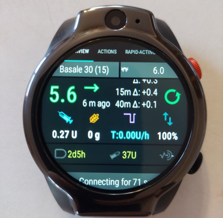
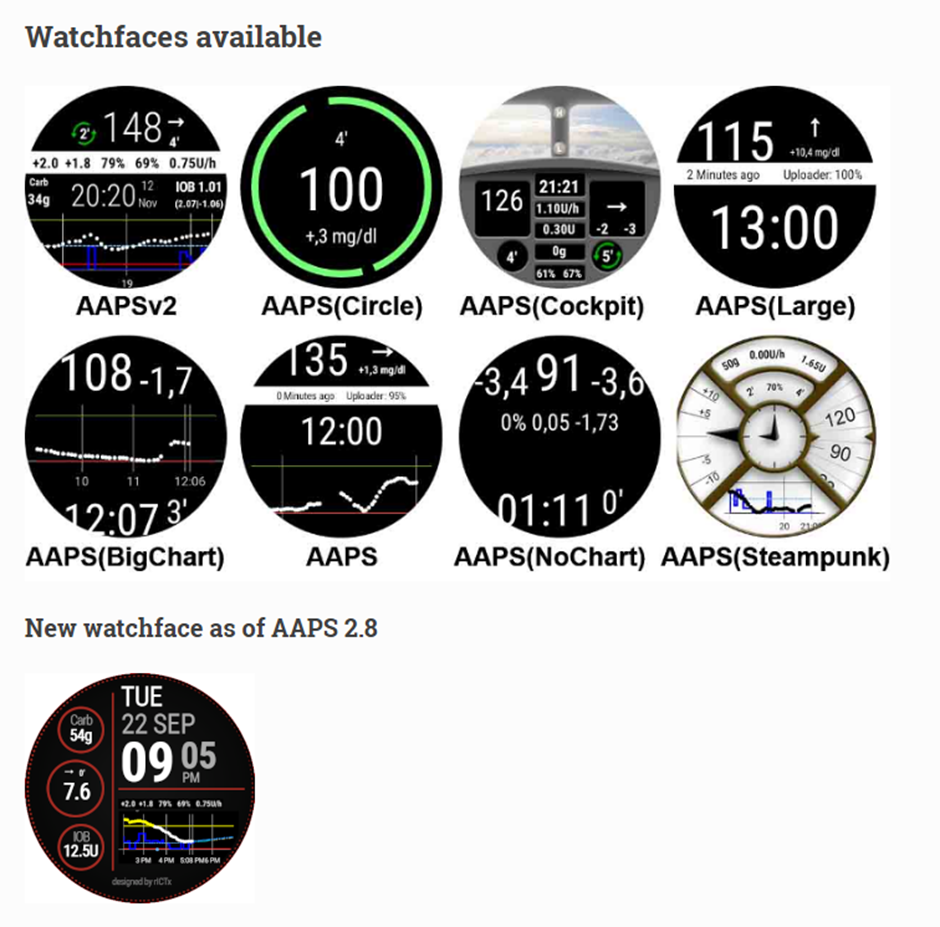
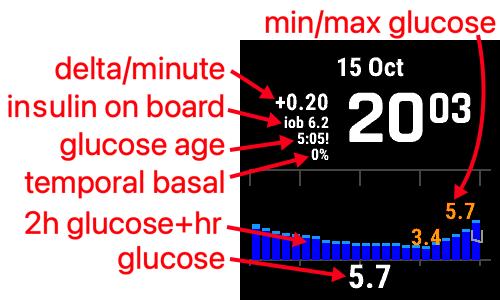
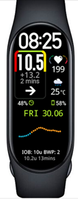
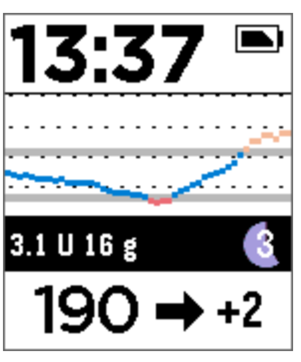
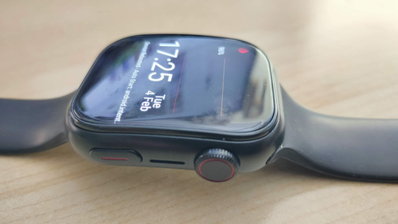

# Smartwatches and AAPS

Various smartwatches can be used to display some of the information available in **AAPS** or perform remote actions.

Having a smartwatch directly control **AAPS** (pump and sensor) is achieved using full Android watches (that are considered like small [smartphones](./Phones.md)).

Some smartwatches can allow you to enter treatments, or more, but with the phone itself still managing **AAPS**.

Smartwatches are becoming increasingly used with **AAPS** _both_ for adults with diabetes and carers/parents of children with diabetes.

## General advantages of using smartwatches with **AAPS**


Smartwatches - depending on the model - can be used in many different ways with **AAPS**. They can be used to fully or partly control **AAPS**, or simply to remotely check glucose levels, insulin-on-board, and other parameters.

Integrating a smartwatch with **AAPS** can be useful in many situations, including driving a car or (motor) bike and during exercise. יש אנשים שמרגישים שמבט בשעון (בפגישה, במסיבה, ליד שולחן האוכל וכו') הוא דיסקרטי יותר ממבט בטלפון. מבחינת אבטחה, שעון חכם יכול להועיל גם בדרכים: אפשר להשאיר את טלפון ה-**AAPS** מוסתר (למשל בתוך תיק), ועדיין להשתמש בשעון החכם לשליטה מרחוק.

## Specific advantages for parents/carers using **AAPS**

עבור ילד, אם טלפון ה-**AAPS**  שלו נמצא בקרבת מקום, המטפל יכול להשתמש בשעון חכם למעקב או לביצוע שינויים בלי להשתמש בטלפון ה-**AAPS**. This can be useful, for example, if the **AAPS** phone is hidden away in a pump belt.

A smartwatch can be used either _in addition_ to, or as an _alternative_ to the PHONE-based options for remote control or [following only](../RemoteFeatures/FollowingOnly.md).

Additionally, unlike parent/caregiver follower phones (which rely on the mobile network or Wi-Fi connection), Bluetooth connected smartwatches can be useful in remote locations, like a cave, in a boat, or half-way up a mountain. אם שני המכשירים (טלפון ה-**AAPS** והשעון החכם) מחוברים לאותה רשת Wi-Fi, הם יכולים להשתמש גם ב-Wi-Fi.

## Different types of Smartwatch-AAPS interactions

There are currently five main ways in which smartwatches are used in conjunction with **AAPS**. These are shown in the table below: 

| Watch Setup         | Features                                       | Requirements                                                                                                                                                                                                                                                                                                     |
| ------------------- | ---------------------------------------------- | ---------------------------------------------------------------------------------------------------------------------------------------------------------------------------------------------------------------------------------------------------------------------------------------------------------------- |
| Standalone          | AAPS without a phone                           | שעון חכם עם Android מלא (בדקו את גרסת Android המינימלית)</br> שמריץ את **app-fullRelease**                                                                                                                                                                                                                       |
| Full remote control | Most AAPS functions                            | שעון Android עם **Wear OS** (בדקו Android/API)</br>שמריץ את **wear-fullRelease**                                                                                                                                                                                                                                 |
| Remote control      | AAPSClient functions                           | שעון Android עם **Wear OS** (בדקו Android/API)</br>שמריץ את **[wear-aapsclientRelease](https://github.com/nightscout/AndroidAPS/releases)**                                                                                                                                                                      |
| Remote control      | Some AAPSClient functions                      | שעוני Garmin</br>(רק מערכות ישנות של Samsung Tizen ו-Fitbit, לא מומלץ)</br>ראו בהמשך.                                                                                                                                                                                                                            |
| Display             | גלוקוז, מגמה, IOB, COB, מצב הלולאה ומצב המשאבה | שעונים חכמים רבים, דרך אפליקציה נלווית בטלפון ה-**AAPS** שמקבלת נתונים מהשידור של [אפליקציות נלוות חיצוניות](#watches-external-companion-apps): [WatchDrip+](https://bigdigital.home.blog/) (Xiaomi, Amazfit), [GlucoDataHandler](https://github.com/pachi81/GlucoDataHandler) (Wear OS), G-Watch</br>ראו בהמשך. |

## Before you buy a smartwatch…

The exact model of smartwatch you buy depends on the desired function(s). מידע שימושי אפשר למצוא ב[דף הטלפונים](#Phones-list-of-tested-phones), כולל רשימה של טלפונים שנבדקו, שמכילה גם כמה שעונים חכמים.

מותגי שעונים נפוצים הם Samsung Galaxy, Garmin, Fossil ו-Mi band. The different options summarized in the Table above are explained in more detail below, to help you decide which smartwatch is right for your situation.

If you are integrating a smartwatch with **AAPS** on a phone with the intention to remotely interact with **AAPS**, you also need to consider if the two devices are compatible with each other, particularly if you have an older, or an unusual phone.

In general, if you only want to follow glucose numbers and not interact with **AAPS**, there are a wider range of affordable and simpler watches you can use.

The best way to choose a smartwatch is to search for "watch" posts on either Discord or Facebook **AAPS** groups. כדאי לקרוא על הניסיון של אחרים, ולפרסם שאלות ספציפיות אם הפרסומים הקודמים לא עונים על השאלה שלכם.

## Full Android

It sounds like an attractive option, right? עם זאת, כרגע רק כמה חובבים מתנסים ב־**AAPS**  על שעון עצמאי. יש מספר מוגבל של שעונים חכמים עם ממשק סביר, שגם עובדים היטב בשימוש עצמאי ב-**AAPS** ובאפליקציית ה-CGM שלכם. דגמים נפוצים הם LEMFO LEM 15 Pro ו-16. You will need to load the watch with the **AAPS** "full" apk (the apk which is usually installed on a smartphone) rather than the **AAPS** "wear" apk.

While there is no clear specification which helps you to know if a watch will work well for standalone **AAPS** use, the following parameters will help:

1)  Android 12 או חדש יותר. 2)  אפשרות להוציא את פני השעון ממצב “square” (ריבוע) כדי להגדיל את הטקסט ולהקל על הקריאה. 3)  חיי סוללה טובים מאוד. 4)  טווח Bluetooth טוב.

רוב הקשיים בשעונים עצמאיים עם **AAPS** נובעים מהשימוש במסך זעיר, ומכך שהממשק הנוכחי של אפליקציית AAPS המלאה לא תוכנן לשעון. ייתכן שתעדיפו להשתמש בעט מגע כדי לערוך את הגדרות **AAPS**  בשעון, בגלל גודל המסך המוגבל, וחלק מהלחצנים של AAPS עשויים לא להופיע במסך השעון.

Additional challenges are that it is hard to get sufficient battery life, and watches with sufficient battery are often bulky and thick. Users report fighting with the OS and power-saving settings, difficulty in starting sensors on the watch, poor Bluetooth range (for maintaining connection with both the sensor and pump) and questionable water resistance. Examples are shown in the photos below.



אם אתם מעוניינים להגדיר שעון עצמאי, קראו את הפרסומים והתגובות בקבוצת **AAPS**  ב־Facebook (מונחי חיפוש טובים הם “standalone” ו־“Lemfo”) וב־Discord למידע נוסף.

## Wear OS

הקוד של **AAPS** כולל הרחבת אפליקציה שאפשר להתקין על [שעונים חכמים עם **Wear OS**](https://wearos.google.com/#oem-carousel).


Verify your smartwatch satisfies **AAPS** [prerequisites](#maintenance-android-version-aaps-version).

### What _is_ Wear OS?

The first three smartwatch options require the smartwatch to have **Wear OS** installed.

**Wear OS** is the operating system which runs on some modern Android smartwatches. If the description of the smartwatch indicates only _compatibility_ with Android and iOS - it does not mean it is running Wear OS. It may be some other sort of Vendor specific operating system which is not compatible with **AAPS**. כדי לתמוך בהתקנה ובשימוש בכל גרסה של **AAPS** או של **AAPSClient**, השעון החכם חייב להריץ **Wear OS 3.0, 3.2 או 3.5** (Android 11, רמת API 30) **או חדשה יותר**. כל גרסה של Wear OS מבוססת על גרסת Android מסוימת: **Wear OS 3** היא Android 11 (רמת API 30), **Wear OS 4** היא Android 13 (רמת API 33), **Wear OS 5** היא Android 14 (רמת API 34) ו-**Wear OS 6** היא Android 16 (רמת API 36). שעונים עם Wear OS 2 לא יכולים להריץ את **AAPS**.

If you install **AAPS** wear.apk on a **Wear OS** watch, there are a range of different custom **AAPS** watchfaces which can be selected. Alternatively, you can use a standard smartphone watchface, with your **AAPS** information included in small tiles known as “complications” on the face. A complication is any feature that is displayed on a watchface in addition to the time.

```{note}
שינויים אחרונים ב-**Wear OS** פוגעים בהדרגה בפני השעון המותאמים של **AAPS** (ככל שגרסת Wear OS גבוהה יותר, הפגיעה חמורה יותר), אבל רכיבי ה-**complications** ממשיכים לעבוד. לפני קנייה או עדכון של שעון, יש לקרוא את [שינויים בפני השעון ב-Wear OS](#wearos-watchface-changes).
```


### What could my smartwatch look like?

After [installing **AAPS** onto your watch](../WearOS/WearOsSmartwatch.md), you will automatically be able to select your preferred watchface from these **AAPS**-dedicated watchfaces. On most watches, you simply long-press on the home screen until the screen shrinks and swipe right to select an alternative screen:



These are the basic screens embedded in **AAPS**, there are [more watchfaces](#WearOS_changing-to-AAPS-watchface) and you can also use [complications](#Watchfaces-complications).

### How would I operate a Wear OS watch from day-to-day?

Further details about the watchfaces, and day-to-day use, including how to make (and share) your own customized watchface, can be found in the section [Operation of Wear AAPS on a Smartwatch](../WearOS/WearOsSmartwatch.md).

(Watchfaces-tizen)= (watches-external-companion-apps)=

## אפליקציות נלוות חיצוניות

**AAPS** יכול לשדר את המצב שלו לאפליקציות אחרות שמותקנות באותו טלפון: גלוקוז ומגמה, IOB, COB, בזאלי ובזאלי זמני, שם הפרופיל, מצב הלולאה, הסוללה של הטלפון ושל המשאבה, רמת המכל והתקדמות הבולוס. כמה אפליקציות נלוות לשעונים קוראות את השידור הזה ומציגות את הנתונים בשעונים ש-**AAPS** לא תומך בהם ישירות. כדי לשלוח את הנתונים, יש להפעיל את **אפליקציות נלוות חיצוניות** ב-**הגדרות תצורה** > **תקשורת** (ראו [אפליקציות נלוות חיצוניות](#external-companion-apps) בדף הגדרות התצורה). השידור נשלח עם כל קריאה חדשה, ואי אפשר לבקש אותו: לחצן רענון באפליקציה הנלווית לא משפיע על **AAPS**.


אפליקציות נלוות שידוע שמשתמשות בשידור הזה:

- [WatchDrip+](https://bigdigital.home.blog/) לשעוני Xiaomi ו-Amazfit, ראו [שעוני Xiaomi ו-Amazfit](#watches-xiaomi-amazfit) בהמשך.
- [GlucoDataHandler](https://github.com/pachi81/GlucoDataHandler) לשעוני Wear OS, כ-complication או כווידג'ט. זו חלופה שימושית בגרסאות Wear OS שבהן פני השעון של **AAPS** לא אמינים, ראו [הגדרת AAPS בשעון Wear OS](../WearOS/WearOsSmartwatch.md). האפליקציה הנלווית שלה, GlucoDataAuto, מציגה את אותם נתונים ברכב עם Android Auto.
- [אפליקציית G-Watch](https://play.google.com/store/apps/details?id=sk.trupici.g_watch) לשעוני Samsung Tizen, והגרסה המאוחרת שלה ל-Wear OS. בגרסאות קודמות של **AAPS**, שם התוסף היה **Samsung Tizen**, על שם האפליקציה הזו.

```{warning}
ל-**G-Watch app** ולגרסת ה-**Wear OS** שלה כבר אין תחזוקה, ו-Samsung העבירה את השעונים החכמים שלה מ-Tizen ל-Wear OS. G-Watch רלוונטית רק למערכות קיימות וישנות, ולא מומלצת להתקנה חדשה. את החדשות האחרונות אפשר למצוא ב[קבוצת Facebook](https://www.facebook.com/groups/gwatchapp) הייעודית.
```

(Watchfaces-garmin)=

## Garmin

יש כמה פני שעון ל-Garmin שמשתלבים עם [AAPS](https://apps.garmin.com/search?keywords=androidaps), בחנות Garmin ConnectIQ.


[AAPS Glucose Watch](https://apps.garmin.com/apps/3d163641-8b13-456e-84c3-470ecd781fb1) integrates directly with **AAPS**. It shows loop status data (insulin on board, temporary basal) in addition to glucose readings and sends heart rate readings to **AAPS**. הם זמינים בחנות ConnectIQ; יש להפעיל את התוסף **Garmin** ב-**הגדרות תצורה ← תקשורת**. 

1. ערכי הגלוקוז הגבוה ביותר והנמוך ביותר בגרף
2. שינוי בגלוקוז לדקה
3. אינסולין פעיל (IOB)
4. הזמן מאז קריאת הגלוקוז האחרונה (דקות:שניות)
5. קצב בזאלי זמני, באחוזים מהקצב הבזאלי של הפרופיל
6. גרף גלוקוז של השעתיים האחרונות
7. Current glucose value


## Fitbit

```{warning}
Google מעבירה את Fitbit אל Google Health, ומסירה אפליקציות ופני שעון של צד שלישי משעוני Fitbit באיחוד האירופי. לכן פני שעון של Fitbit הם **כבר לא אפשרות מומלצת**, ולא מומלץ לקנות Fitbit לשימוש עם **AAPS**.
```

עבור שעוני Fitbit קיימים, [דפי האינטרנט של Nightscout](https://nightscout.github.io/nightscout/wearable/#fitbit) מציגים כמה אפשרויות למעקב בלבד, כמו [Glance](https://glancewatchface.com/). גם אלה פני שעון של צד שלישי, ולכן אותה מגבלה באיחוד האירופי חלה גם עליהם.

## Following only

שעונים חכמים אלה יציגו חלק מהמידע של **AAPS**; חלקם ידרשו אפליקציות נוספות.

There are a wide range of affordable smartwatches which can provide display only. If you are using Nightscout, then a good overview of all the options is [here](https://nightscout.github.io/nightscout/wearable/#)

Here below some of the follow-only watch options popular with **AAPS** users:

(watches-xiaomi-amazfit)=
### Xiaomi and Amazfit watches

**WatchDrip+** היא אפליקציה נלווית שפותחה על ידי הקהילה, שמציגה נתוני גלוקוז ולולאה בדגמים שונים של שעונים חכמים, בעיקר של המותגים Xiaomi (_למשל_ Mi Band) ו-Amazfit:



החל מגרסה 0.5, **WatchDrip+** קוראת את הנתונים שלה ישירות מ-**AAPS**, בלי xDrip+ כמתווך. בטלפון ה-**AAPS**:

1. יש להפעיל את **אפליקציות נלוות חיצוניות** ב-**הגדרות תצורה** > **תקשורת**, ראו [למעלה](#watches-external-companion-apps). זה מספק את ערך הגלוקוז הנוכחי, הדלתא, חץ המגמה, IOB ומצב המשאבה.
2. יש להפעיל את התוסף **xDrip** ב-**הגדרות תצורה** > **תקשורת** ולהפעיל את **שליחת מצב ל־xDrip+** בהגדרות שלו. זה מספק את שורת המצב IOB/COB, וגרף הגלוקוז בשעון מתמלא אחרי כמה קריאות.
3. אם xDrip+ מותקן בטלפון, יש להשבית בו את **Broadcast Service API** (xDrip+ > Settings > Inter-app settings) כדי שהשעון לא יקבל את הנתונים פעמיים. אם xDrip+ רק העביר נתונים לשעון, אפשר להסיר אותו.

לחצן הרענון של WatchDrip+ לא משפיע כאשר משתמשים ב-**AAPS**: הנתונים מגיעים עם כל קריאה חדשה.


אפשר לקרוא עליהם עוד, כולל איך להגדיר אותם, ב[אתר של WatchDrip+](https://bigdigital.home.blog/). The advantage of these watches is that they are small and relatively affordable. They are a popular option especially for kids and those with smaller wrists to wear.

### Pebble watch





Pebble watches ([now discontinued](https://en.wikipedia.org/wiki/Pebble_(watch))) were on general sale from 2013 to 2016, and may still be available second-hand. Fitbit took over Pebble’s assets. Pebble users can use the Urchin watchface to view Nightscout data. אפשרויות הנתונים המוצגים כוללות אינסולין פעיל (IOB), קצב בזאלי זמני הפעיל כעת ותחזיות. בלולאה פתוחה אפשר להשתמש ב־IFTTT כדי ליצור applet שאומר: אם התקבלה הודעה מ־**AAPS**  אז לשלוח SMS או הודעת pushover.

### [Bluejay watches](https://bluejay.website/)





These are unique pieces of technology which can receive glucose data **directly** from the Dexcom transmitter. לא ידוע לרבים שמשדרי Dexcom G6/G7 משדרים בפועל את נתוני הגלוקוז הנוכחיים _בשני_ ערוצים נפרדים: ערוץ טלפון וערוץ רפואי. אפשר להגדיר את שעוני Bluejay לקבל נתוני גלוקוז מכל אחד מהערוצים, כך שאם **AAPS** משתמש בערוץ הטלפון, שעוני Bluejay יכולים להשתמש בערוץ הרפואי.

היתרון העיקרי הוא שהשעון לא תלוי בטלפון וגם לא במערכת הלולאה. So, for example, if you disconnect the pump and the **AAPS** phone at the beach or theme park, and are out of range of the **AAPS** phone, you can still get readings from your Dexcom directly to the Bluejay watch.

**Bluejay GTS** המקורי הופסק, והוא לא יכול לקרוא את Dexcom G7. הדגמים המאוחרים יותר (U1, ואחריו **U3** הנוכחי, שנמכר בגישה מוקדמת בזמן הכתיבה) הם שעוני Android מלאים שמריצים xDrip, ומקבלים נתונים ישירות מ-Dexcom G6 ו-G7. היצרן מתאר את השעון ככלי מחקר, לא לשימוש רפואי. החסרונות המדווחים הם שהשעון לא תמיד קולט קריאה כל 5 דקות, ושצריך לטעון את הסוללה לעיתים קרובות. את הדגם הנוכחי ואת הזמינות אפשר לבדוק ב[אתר של Bluejay](https://bluejay.website/).

### Apple watch

Check [Nightscout on your watch](https://nightscout.github.io/nightscout/wearable/#).

The Apple watch now supports G7 direct connection and can be used simultaneously with **AAPS**.

