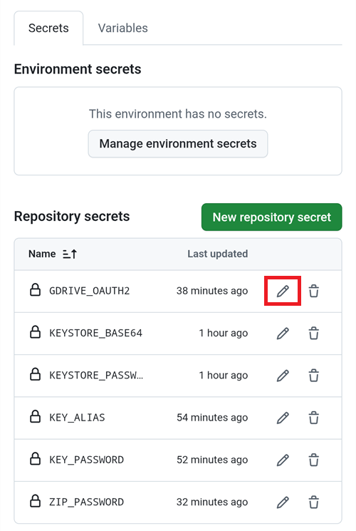

(aaps-ci-troubleshooting)=

# בנייה בדפדפן: פתרון תקלות

```{note}
This page collects troubleshooting tips for the [Browser build](../SettingUpAaps/BrowserBuild.md).
```

(aaps-builder-troubleshooting)=

## AAPS Builder

### Step 1: the repository

(aaps-builder-ts-repo-exists)=

#### "my-aaps already exists in this account"


You already have this repository, for example from an earlier attempt. Close the GitHub tab, keep that name in step 1 of the setup page and go on. If you already did steps 2 and 3 for it, your key is still in it: continue with [step 4](#aaps-builder-step4). If it was made with an earlier version of the setup page, update its workflow once as explained in [Updating AAPS](#aaps-builder-updates). You prefer a fresh start? Type another name, for example `my-aaps-2`, and use the same keystore in step 2.

(aaps-builder-ts-user-not-found)=

#### "No GitHub user with this name"


- **"No GitHub user with this name"** בשלב 1: יש להקליד את שם המשתמש שלכם ב-GitHub, כמו שהוא מופיע בפרופיל GitHub שלכם, לא את כתובת הדוא"ל.
- **אין כפתור "Build AAPS" או "Run workflow", או שהמאגר ריק**: המאגר לא נוצר מהתבנית. יש למחוק אותו (**Settings** ← בתחתית הדף ← **Delete this repository**) ולבצע שוב את [שלב 1](#aaps-builder-step1) עם הכפתור **Create my private repository**.

### Step 3: the secret

(aaps-builder-ts-404)=

#### "Page not found" (404)


- **"Page not found" (404) כשדף ההגדרה פותח את GitHub**: יש להתחבר ל-github.com באותו דפדפן (GitHub מציג 404 למאגרים פרטיים כשלא מחוברים). אם אתם מחוברים, שם המשתמש או שם המאגר בשלב 1 של דף ההגדרה לא תואמים למאגר שלכם. יש להקליד את השמות המדויקים.

### Step 4: the build

(aaps-builder-ts-workflow-not-found)=

#### "This workflow does not exist"


Right after the repository is created, GitHub may not have read its workflow file yet: **Build AAPS** is missing from the **Actions** tab, and there is no **Run workflow** button. Any small change to the file makes GitHub read it:

1. In your repository, open **Code**, then the folder `.github`, then `workflows`, then the file `build.yml`.
2. Tap the **⋯** menu at the top right of the file, then **Edit file… In place** (on a computer, click the pencil).

   

3. Tap at the very end of the text and add an empty line (Enter). Tap **Commit changes…** at the top.

   

4. Tap **Commit changes** again.

   

5. Open the **Actions** tab again: **Build AAPS** is now in the list of workflows (on a phone, the list opens with the icon at the left of **All workflows**). Tap it, then **Run workflow**.

   

(aaps-builder-ts-build-failed)=

#### The build failed (red cross)

1. On the setup page, tap **Open my builds** and tap the build with the red cross.

   

2. The page of the build shows **Failure**, and which part failed: **AAPS / Check** (the repository, the secret, the version or the variant: nothing was built) or **AAPS / Build AAPS**.

   

3. Scroll down to **Annotations**, with your finger on the text, not on the diagram. The red lines explain the problem: tap **Show more** to read the whole message, then find it below.

   

- **"Secret KEYSTORE_SET is missing"**: יש לבצע את שלב 3 של דף ההגדרה.
- **הבנייה נעצרת עם "This repository is PUBLIC"**: במאגר שלכם יש לפתוח **Settings** ← **General** ← **Danger Zone** ← **Change visibility** ← **Private**, ואז לבנות שוב.
- **"Version … does not exist"**: only released versions of **AAPS** can be built, the ones on the [tags page](https://github.com/nightscout/AndroidAPS/tags) of nightscout/AndroidAPS, such as `3.3.2.0`. A branch name such as `dev` doesn't work. Use `latest`, or type a tag exactly as listed.
- **"Variant … is not supported"**: קובץ ה-workflow שלכם הוא גרסה ישנה. יש להחליף אותו כמו שמוסבר ב[עדכון AAPS](#aaps-builder-updates).
- **"The secret is too short"**, **"The secret is not a valid code"** או **"The secret does not contain a keystore"**: הודבק ב-secret טקסט שגוי, לרוב המילה `KEYSTORE_SET` עצמה, או רק חלק מהקוד. במאגר שלכם, יש לפתוח **Settings** ← **Secrets and variables** ← **Actions**, לערוך את `KEYSTORE_SET` ולהדביק שוב את הקוד הארוך מ-**Copy secret** (אם סגרתם את דף ההגדרה, קודם יש לבצע שוב את שלב 2 שלו).
- **"Keystore, password or alias is wrong"**: יש לבדוק את הסיסמה ואת ה-alias של ה-keystore, ואז לבצע שוב את שלבים 2 ו-3 של דף ההגדרה.
- **"Google Drive access has expired or was revoked"**: יש לבצע שוב את [שלב 6](#aaps-builder-google-drive) ולעדכן את ה-secret `GDRIVE_OAUTH2`.
- **Another error**: [read the build log](#aaps-ci-read-the-logs), then [run the build again](#aaps-ci-rerun). If it fails again the same way, ask for help with the name of the failed step and the error lines. אף פעם אין לשתף את התוכן של ה-secrets שלכם.

### Step 5: the app

- **אין קישור Download, או שנפתחה אפליקציית GitHub**: אפליקציית GitHub לא יכולה להוריד בניות. יש לפתוח את הבנייה ב-Chrome כמו שמוסבר ב[שלב 5](#aaps-builder-step5). כדי שקישורים של GitHub לא ייפתחו באפליקציה: ב-Android **Settings** (הגדרות) ← **Apps** (אפליקציות) ← **GitHub** ← **Open by default** (פתיחה כברירת מחדל) ← לכבות את **Open supported links** (פתיחת קישורים נתמכים).

## פתרון תקלות ב-AAPS-CI

(aaps-ci-read-the-logs)=
### קודם כול: לברר מה השתבש

כאשר בנייה נכשלת, GitHub שומר יומן של כל שלב. היומן מראה איזה שלב נכשל ולמה. יש לקרוא אותו לפני שמנסים כל דבר אחר: הודעת השגיאה היא מה שמחפשים בדף זה, ומה שהעוזרים יבקשו.

1. בעותק של AndroidAPS שלכם ב-GitHub, יש לפתוח את **Actions**. לבנייה שנכשלה יש איקס אדום. יש ללחוץ על השם שלה.

   

2. סיכום ההרצה מציג **Failure** (כישלון), ומתחת לזה את ה-job שנכשל (**Build AAPS**, עם איקס אדום).

   

3. יש לגלול למטה אל **Annotations** (הערות) וללחוץ על השורה האדומה **Build AAPS**.

   

4. ה-job נפתח. שלבים עם וי אפור הצליחו. השלב עם האיקס האדום הוא השלב שנכשל: GitHub פותח אותו עבורכם. השלבים שאחריו דולגו (עיגול אפור).

   

5. יש לקרוא את השורות שממש מעל `Error: Process completed with exit code 1.`: הן מסבירות את הבעיה. בדוגמה זו, השלב **Retrieving Google Drive access token** נכשל עם `invalid_grant` ו-`Token has been expired or revoked.`, ראו [פג תוקפו של אסימון הרענון של Google](#aaps-ci-google-token-expired).

   

```{tip}
מבקשים עזרה? יש לשתף את שם השלב שנכשל ואת שורות השגיאה (צילום מסך כמו זה שלמעלה מספיק). אף פעם אין לשתף את התוכן של ה-secrets שלכם.
```

(aaps-ci-update-secret)=
#### עדכון secret

תיקונים רבים פירושם החלפת הערך של secret. בעותק של AndroidAPS שלכם ב-GitHub, יש לעבור אל **Settings** ← **Secrets and variables** ← **Actions** וללחוץ על העיפרון ליד ה-secret.



יש להזין או להדביק את הערך החדש וללחוץ על **Update secret**. GitHub אף פעם לא מציג את הערך הישן: השדה תמיד ריק.


(aaps-ci-rerun)=
#### הרצת הבנייה שוב אחרי תיקון

אחרי שתיקנתם את הסיבה, אין צורך להתחיל מההתחלה: יש לפתוח את ההרצה שנכשלה, ללחוץ על **...** (בחלק העליון של המסך), ואז על **Re-run failed jobs**.


יש ללחוץ על **Re-run jobs**. אפשר גם להתחיל בנייה חדשה מ-**Run workflow** כרגיל.


(aaps-ci-preparation-web)=
### דף האינטרנט aaps-ci-preparation
  - דף ההכנה מוצג על ידי שרת מקומי זמני (למשל Simple Web Server במחשב), שמקבל גם את אסימון הרענון של Google.
  - אם מופיע המסך שבהמשך, השרת המקומי הפסיק לפעול או שאין אליו גישה.
  - יש לסגור את דף ההכנה, לבדוק שהשרת המקומי פועל, ואז לפתוח שוב את aaps-ci-preparation.html באותה דרך כמו בשלב 2 ולהשלים את השלבים שנותרו. זה נדרש במיוחד כאשר יוצרים את החיבור הראשון ל-Google במהלך ההגדרה.

  

(aaps-ci-google-token-expired)=
### פג תוקפו של אסימון הרענון (refresh token) של Google
  - תוקפם של אסימוני רענון (refresh tokens) של Google OAuth2 פג אם לא משתמשים בהם במשך 6 חודשים. הם עלולים להפוך ללא תקפים גם במצבים אחרים (למשל, אם שיניתם את הסיסמה של חשבון Google, או ביטלתם את הגישה באופן ידני). לפרטים נוספים, ראו את [התיעוד של Google OAuth2](https://developers.google.com/identity/protocols/oauth2).
  - ב[יומן הבנייה](#aaps-ci-read-the-logs), השלב **Retrieving Google Drive access token** נכשל עם `invalid_grant` ו-`Token has been expired or revoked.`:

  

  - אם הבנייה נכשלת בגלל אסימון רענון של Google שפג תוקפו או שבוטל, יש לבצע שוב את השלבים של [אישור Google Drive](#aaps-ci-google-drive-auth) כדי לקבל אסימון `GDRIVE_OAUTH2` חדש, [לעדכן את ה-secret](#aaps-ci-update-secret) במאגר GitHub שלכם, ואז [להריץ שוב את הבנייה](#aaps-ci-rerun).
  - אם האישור נכשל שוב, או ש-Google כבר לא מבקשת את הסכמתכם, יש קודם להסיר את הגישה הקיימת של AAPS מחשבון Google שלכם, ראו [בהמשך](#aaps-ci-google-remove-access).

(aaps-ci-google-remove-access)=
### הסרת הגישה של AAPS מחשבון Google והתחלת האישור מחדש
  - אם האישור ל-Google Drive ממשיך להיכשל, או שאתם רוצים להתחיל מחדש ממצב נקי, יש קודם להסיר את הגישה שנתתם בעבר ל-AAPS, ואז לבצע שוב את האישור.
  - בטלפון, יש לפתוח את [https://myaccount.google.com](https://myaccount.google.com), ללחוץ על **Security** (אבטחה), לגלול למטה אל **Your connections to third-party apps & services** (החיבורים שלך לאפליקציות ולשירותים של צד שלישי) ולפתוח את רשימת האפליקציות המקושרות. אפשר גם לעבור ישירות אל [https://myaccount.google.com/connections](https://myaccount.google.com/connections).
  - יש ללחוץ על **AAPS** ברשימה.

  

  - הדף מציג את הגישה שנתתם ל-AAPS (קובצי Google Drive שמשמשים את האפליקציה). יש ללחוץ על **Delete all** (מחיקת הכול) כדי להסיר את החיבור, או על **See details** (הצגת פרטים) כדי לבדוק אותו קודם.

  

  - בדף הפרטים, יש ללחוץ על **Remove all access** (הסרת כל הגישה).

  

  - יש ללחוץ על **Confirm** (אישור).

  

  - Google מאשרת של-AAPS כבר אין גישה. AAPS כבר לא מופיע ברשימת האפליקציות המקושרות.

  

  - עכשיו יש להתחיל את האישור מחדש ממצב נקי: לסגור את **שניהם**, גם את דף ההכנה וגם את אפליקציית מנהל הקבצים, לפתוח שוב את aaps-ci-preparation.html ממנהל הקבצים ולבצע שוב את השלבים של [אישור Google Drive](#aaps-ci-google-drive-auth). Google תבקש שוב לתת גישה, והדף ייתן אסימון `GDRIVE_OAUTH2` חדש.
  - יש [לעדכן את ה-secret `GDRIVE_OAUTH2`](#aaps-ci-update-secret) במאגר GitHub שלכם עם האסימון החדש, ואז [להריץ שוב את הבנייה](#aaps-ci-rerun).

(aaps-ci-disable-software)=
### השבתת תוכנות שעלולות להפריע לאימות OAuth
  - יש להשבית כל VPN או אפליקציית אבטחה (חומת אש, אנטי-וירוס,...) בטלפון לפני שמנסים לקבל את מפתח ה-OAuth.

(aaps-ci-actions-permission)=
### בדיקת הגדרות ההרשאות של GitHub Actions
  - יש לוודא שהמדיניות של GitHub Actions מוגדרת ל-“Allow all actions and reusable workflows” (לאפשר את כל ה-actions וה-workflows לשימוש חוזר) (Settings ← Actions ← General). אם משנים אותה, יש ללחוץ על **Save** (שמירה) מתחת לאפשרויות.

  

`actions/checkout@v4` and `actions/setup-java@v4` are not allowed to be used in `xxxxx/AndroidAPS`. Actions in this workflow must be: within a repository owned by `xxxxx`

(aaps-ci-workflow-permissions)=
### בדיקת הגדרות ההרשאות של GitHub Workflow
  - אם הבנייה נכשלת מיד עם שגיאת "Invalid workflow file" (קובץ workflow לא תקין) כמו זו שבהמשך, הרשאות ברירת המחדל של ה-workflow במאגר שלכם מגבילות מדי:

```
Invalid workflow file
The workflow is not valid. .github/workflows/aaps-ci.yml (Line: 361, Col: 3):
Error calling workflow 'xxxxx/AndroidAPS/.github/workflows/cleanup-workflow-runs.yml@...'.
The nested job 'cleanup' is requesting 'actions: write', but is only allowed 'actions: none'.
```

  - יש לוודא ש-Workflow permissions מוגדרות ל-“Read and write permissions” (הרשאות קריאה וכתיבה) (Settings ← Actions ← General ← Workflow permissions), ואז לשמור ולהריץ שוב את ה-workflow של הבנייה.

  

(aaps-ci-password-special-characters)=
### הבנייה נכשלת בבדיקת הסיסמה של ה-keystore
  - ב[יומן הבנייה](#aaps-ci-read-the-logs), השלב **Validating keystore, alias and password** נכשל עם `Either KEYSTORE_BASE64, KEYSTORE_PASSWORD, KEY_PASSWORD, or KEY_ALIAS is incorrect`, ואחריו `Keystore was tampered with, or password was incorrect`. הבנייה נעצרת שם: ה-keystore והסיסמאות נבדקים לפני ש-AAPS נבנה.

  

  - ה-workflow של הבנייה שומר כל תו בסיסמאות שלכם בלי שינוי. יש להזין את `KEYSTORE_PASSWORD` ואת `KEY_PASSWORD` בדיוק כפי שהן, בלי להוסיף לוכסן הפוך (backslash) או כל תו מילוט (escape) אחר. אם הוספתם לוכסנים הפוכים, יש [לעדכן את ה-secrets](#aaps-ci-update-secret) עם הסיסמה בדיוק כפי שהיא. הדוגמה שבהמשך שגויה: הסיסמה היא `Example2026`, והלוכסן ההפוך נוסף.

  

  - אם הבנייה עדיין נכשלת בחתימת ה-APK למרות שהסיסמה נכונה, והסיסמה מכילה `$`, גרש הפוך (backtick), `"` או `\`, קובץ ה-workflow ב-fork שלכם הוא מלפני ספטמבר 2026 ועדיין מפרש את התווים האלה. יש [לסנכרן את ה-fork שלכם](#Update-to-new-version-update-your-repo) עם ה-dev העדכני, ואז להריץ שוב את ה-workflow של הבנייה.
  - הקו האנכי `|` הוא מקרה מיוחד. דף ההכנה של [אפשרות 1](#aaps-ci-option1) מחבר את ה-keystore, הסיסמאות וה-alias ל-secret אחד בשם `KEYSTORE_SET`, מופרדים בתו `|`, וה-workflow מפצל אותו לפי התו הזה. הסיסמה שדף ההכנה יוצר מכילה רק אותיות וספרות, ולכן זה לא יכול לקרות עם אפשרות 1. זה יכול לקרות רק אם הרכבתם בעצמכם secret בשם `KEYSTORE_SET` מסיסמה שמכילה `|`. במקרה כזה, יש למחוק את `KEYSTORE_SET` ולהזין במקומו את ה-secrets הנפרדים של [אפשרות 2](#aaps-ci-option2).
