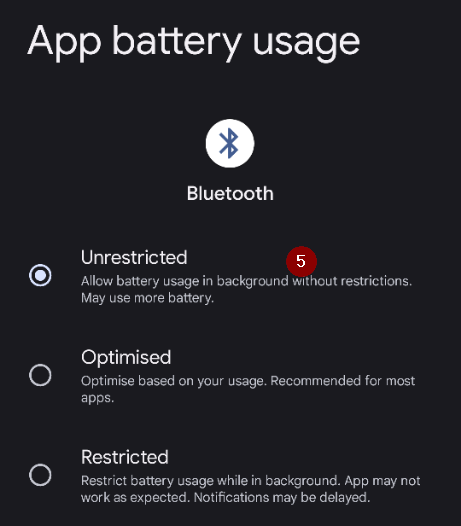

(generaltroubleshooting)=

# פתרון תקלות

**כאן מתחילים כשמשהו לא עובד.** מידע על פתרון תקלות נמצא בדפים רבים בתיעוד. הדף הזה מרכז אותו: זהו אוסף אחד של קישורים, מסודר לפי נושאים, שיעזור לפתור את הבעיות הנפוצות ביותר.

אם לא מצאתם כאן תשובה, כדאי לבדוק גם:

* את [שאלות נפוצות (FAQ)](../UsefulLinks/FAQ.md) לתשובות על שאלות שחוזרות הרבה, וגם
* את [המדריך לכוונון הפרופיל](ProfileTuning.md) אם הלולאה פועלת אבל איזון הסוכר צריך שיפור.

```{admonition} Still stuck?
:class: tip
אם אף אחד מהקישורים לא פותר את הבעיה, ראו [איפה אפשר לקבל עזרה](WhereCanIGetHelp.md) כדי לשאול את הקהילה (Facebook, Discord), או שלחו את [קובצי היומן](AccessingLogFiles.md) למפתחים.
```

---

(generaltroubleshooting-aaps-app)=

## אפליקציית AAPS

### בנייה ועדכון

* אם הבנייה נכשלת, ראו [אם הבנייה נכשלת](#building-aaps-troubleshooting): שם מופיע החלק של פתרון התקלות לכל שיטת בנייה:
  * [AAPS Builder](#aaps-builder-troubleshooting)
  * [Browser build](#aaps-ci-troubleshooting)
  * [Android Studio](TroubleshootingAndroidStudio.md)
* ה-keystore אבד, או keystore חדש: [התקנה מחדש של AAPS](#reinstall-aaps)
* עדכון **AAPS**: [עם AAPS Builder](#aaps-builder-updates), [עם בנייה בדפדפן (fork)](#update-browser-build-troubleshooting), [עם Android Studio](#update-computer-build-troubleshooting)

### Installing

* [אזהרה של Google Play Protect](#transferring-installing-play-protect-warning): האפליקציה מסומנת כלא בטוחה.
* ההתקנה **נחסמת** עם הודעה על מפתח לא מאומת: ראו [אימות מפתחים ב-Android](#android-developer-verification) לשיטות ההתקנה החינמיות.

### הגדרות

* [פרופיל: "הקצב הבזאלי אינו תואם למשאבה הנוכחית"](#your-aaps-profile-basal-not-compatible)
* [משאבה: "הנתונים מגיעים ממשאבה אחרת"](#config-builder-wrong-pump-data)
* [Nightscout Client](TroubleshootingNsClient.md)
* **"לא ניתן לקרוא את הגדרות AAPS"** בהפעלה: ההגדרות מוצפנות במפתח ש-Android שומר עבור **AAPS**, והמפתח הזה כבר לא פותח אותן, למשל אחרי שמאגר המפתחות של הטלפון אופס. כל עוד המסך הזה מוצג, **AAPS** לא פועל ולא שולט במשאבה. יש ללחוץ על **ניסיון חוזר**: הוא סוגר ומפעיל מחדש את **AAPS**. אם זה לא עוזר, יש להפעיל מחדש את הטלפון. יש להשתמש ב**התחלה מחדש** רק כשדבר אחר לא עוזר: הוא מעביר הצידה את קובץ ההגדרות שלא ניתן לקרוא (שמו משתנה והוא נשמר), ומפעיל את **AAPS** עם הגדרות ריקות. אחר כך יש לייבא את [ייצוא ההגדרות](../Maintenance/ExportImportSettings.md) האחרון שלכם.

### שימוש

* [ערכי פחמימות שגויים (ספיגה איטית של פחמימות)](#CobCalculation-detection-of-wrong-cob-values)
* [אוטומציות](#automations-troubleshooting)
* [לולאה סגורה מלאה](#full-closed-loop-troubleshooting)

---

(generaltroubleshooting-bluetooth-related-issues)=


## Bluetooth related issues

לבעיות מוכרות בחיבורי Bluetooth, לניתוקים של משאבות/פודים או לבעיות בהפעלה ובחיבור, ראו [פתרון תקלות Bluetooth](../GettingHelp/BluetoothTroubleshooting.md)

---

(generaltroubleshooting-android-related-issues)=

## בעיות הקשורות ל-Android

### אופטימיזציית סוללה

**AAPS** יכול לעזור למצוא את ההגדרות הנכונות לטלפון: פתחו את **התפריט** (☰) > **אודות** והקישו על **איך לא להשבית את האפליקציה שלי?**. כך נפתחות ההוראות ליצרן הטלפון שלכם באתר [Don't kill my app](https://dontkillmyapp.com/). גם [אשף ההתקנה](#setup-wizard-bluetooth-battery-optimisation) מבקש לכבות את אופטימיזציית הסוללה עבור **AAPS** ועבור Bluetooth.

Android has implemented battery saving setting that are enabled by default. הגדרות אלה משהות אוטומטית אפליקציות שאינן נדרשות לפעולת המערכת, כדי לחסוך באנרגיית הסוללה שצורכות אפליקציות שאינן חייבות לפעול כל הזמן.

כאשר אופטימיזציית הסוללה מופעלת, סביר מאוד שהיא תגרום לבעיות ב-**AAPS** ובאפליקציות תומכות אחרות כמו **xDrip**.

חשוב לוודא שהשבתתם את אופטימיזציית הסוללה, כדי ש-**AAPS** ואפליקציות תומכות אחרות יישארו פעילים כל הזמן.

Depending on your phone model and make there may be more than one location and setting which needs to have this disabled.

***הערה:** אם אפשרות זו קיימת בטלפון, פעלו לפי השלבים הבאים כדי להשבית את אופטימיזציית הסוללה עבור שירות ה-Bluetooth. אפשר להשתמש באותם שלבים גם עבור **AAPS** ואפליקציות אחרות, אבל צילומי המסך מראים רק את שירות ה-Bluetooth.*

#### Pixel phones (stock Android)

* Go to the Android settings, select "Apps".

  

* Select "See all apps"

  

* בתפריט שבחלק העליון של המסך, בחרו "Show system" (הצגת אפליקציות מערכת).

  

* כעת חפשו ובחרו את האפליקציה "Bluetooth".

  

* לחצו על "App battery usage" (שימוש בסוללה של האפליקציה) ובחרו "Unrestricted" (ללא הגבלה). בגרסאות Android ישנות יותר האפשרות נקראת "Not optimized".

  


#### Samsung phones

* עברו להגדרות Android ובחרו "Apps"

* On the icon that supposedly changes the sorting algorithm (1), select "Show system apps" (2).

  

  

* כעת חפשו את אפליקציית Bluetooth ובחרו בה כדי לראות את ההגדרות שלה.

  

* Select "battery".

  

* הגדירו אותה ל-"Unrestricted" (ללא הגבלה). בגרסאות Android ישנות יותר האפשרות נקראת "Not optimized".

  

#### Huawei phones

ראו את המדריך [Bluetooth ואופטימיזציית סוללה בטלפוני Huawei](../CompatiblePhones/Huawei.md)

---

(generaltroubleshooting-cgm)=

## חיישן סוכר רציף (CGM)

Useful links to known issues and steps to resolve for CGMs.

* [General](#general-cgm-troubleshooting)
* [Dexcom G6](#DexcomG6-troubleshooting-g6)
* [Libre 2 עם Minimal Looper](#minimallooper-troubleshooting)
* [Libre 3](#libre3-experiences-and-troubleshooting)
* [xDrip - no CGM data](#xdrip-identify-receiver)
* [xDrip - פתרון תקלות ב-Dexcom](#xdrip-troubleshooting-dexcom-g5-g6-and-xdrip)

---

(generaltroubleshooting-pumps)=

## משאבות

Useful links to known issues and steps to resolve for Pumps

* [Accu-Chek Combo](#combov2-tips-for-basic-usage)
* [Accu-Chek Insight](#Accu-Chek-Insight-Pump-insight-specific-errors)
* [CareLevo](#carelevo-alarms-and-notifications)
* [DanaRS](#DanaRS-Insulin-Pump-dana-rs-specific-errors)
* [Diaconn G8](#diaconn-g8-bluetooth-troubleshooting)
* [EOPatch2](#eopatch2-alarms-and-warnings)
* [Medtronic + RileyLink](#MedtronicPump-what-to-do-if-i-loose-connection-to-rileylink-and-or-pump)
* [Medtrum Nano](#medtrum-nano-troubleshooting)
* [Omnipod DASH](#omnipod-dash-troubleshooting)
* [Omnipod Eros](#OmnipodEros-troubleshooting)

---

(generaltroubleshooting-phones)=

## טלפונים

Useful links to known issues and steps to resolve for Phones

* [List of tested phone and device setups](https://docs.google.com/spreadsheets/u/1/d/e/2PACX-1vScCNaIguEZVTVFAgpv1kXHdsHl3fs6xT6RB2Z1CeVJ561AvvqGwxMhlmSHk4J056gMCAQE02sAWJvT/pubhtml?gid=683363241&single=true)
* [Jelly](../CompatiblePhones/Jelly.md)
* [Bluetooth ואופטימיזציית סוללה בטלפוני Huawei](../CompatiblePhones/Huawei.md)

---

(generaltroubleshooting-remote-control)=

## Remote control

* [AAPSClient ושליטה מרחוק (צימוד, פקודות שלא מתקבלות)](#client-master-control-troubleshooting)
* [בעיות עם אסימון הגישה ל-Nightscout ('Nightscout access token')](#remotecontrol-nightscout-access-token)
* [SMS commands](#SMSCommands-troubleshooting)
* [Android Auto](#android-auto-troubleshooting)

---

(generaltroubleshooting-smartwatches)=

## שעונים חכמים

Useful links to known issues and steps to resolve for Smartwatches

* [פתרון תקלות באפליקציית Wear](#Watchfaces-troubleshooting-the-wear-app)
* [השעון והטלפון לא מתקשרים זה עם זה](#wear-os-watch-phone-communication)
* [Wear OS 5](#wear-os-5-troubleshooting)
* [בניית אפליקציית Wear](#building-aaps-wear-os-troubleshooting)
