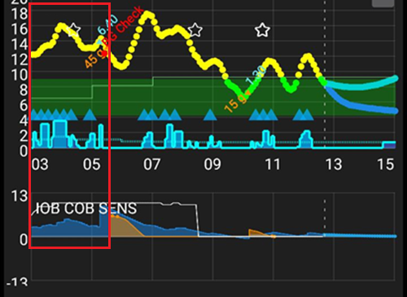

# כוונון הפרופיל של AAPS

```{admonition} This is NOT a medical advice
:class: warning
Please work with your care team for support and advice on your diabetes management.</br>
Use this guide only once you have [set up your **Profile** correctly](https://androidaps.readthedocs.io/en/latest/SettingUpAaps/YourAapsProfile.md), following all **AAPS** objectives.
```

המדריך הזה מסביר את ההיגיון של התוצאות של אלגוריתם OpenAPS עם __פרופיל__ מסוים, ומפרט אילו ערכים ב-**AAPS** אפשר לשנות כשרואים מצבים או דפוסים מסוימים. ההמלצות על בדיקת הבזאלי שבהמשך עשויות להיות שונות ממה שהצוות המטפל שלכם ממליץ.

שימוש ב**לולאה סגורה** יכול להקל על בדיקת הבזאלי, ויכול להפחית מאוד את הסיכון להיפוגליקמיה אם הבזאלי ב__פרופיל__ חזק מדי.

## איך לשנות את הגדרות הפרופיל

1. Ensure you have read and understand __AAPS’__ recommended settings and advice below. אם לא תפעלו לפי ההמלצות האלה, תהליך ההתאמה עלול להיות קשה יותר, והסיכוי לקבל __פרופיל__ מכוונן היטב יהיה קטן יותר
2. Carefully observe and compare, **over several days**, what is happening with your __BG__ and __IOB__.
3. שימו לב לדפוסים ב-**AAPS** שחוזרים בערך באותה שעה (כמעט) בכל יום.
4. It's important to do this over several days. Poor results tend to be yielded from using data observed on a single day to make __Profile’s__ adjustment decisions.
5. רק לאחר שזיהיתם דפוס חוזר, למשל קפיצה ב__סוכר בדם (BG)__ או ערך __אינסולין פעיל (IOB)__ שלילי בשעה 13:00, התחילו לבצע שינויים קטנים ב__פרופיל__ שלכם.
6. It's important to limit the changes you make to one thing at a time. לדוגמה: להגדיל את הקצב הבזאלי ב-10% בסביבות השעה 13:00.
7. After every change, it's important to monitor the impact on your __BG__ and __IOB__ for the next few days.
8. Repeat this pattern, observe, decide, tweak again if needed

Don't rush, go slow!

## הגדרות והמלצות מומלצות בזמן כוונון הבזאלי

- Do all testing with [closed loop enabled](#AapsScreens-loop-status).
- **Turn <u>OFF</u> all [automations](../DailyLifeWithAaps/Automations.md)**
- **<u>כבו</u> את [DynISF](#Open-APS-features-DynamicISF), [AutoISF](#Open-APS-features-auto-isf), [AutoSens](#Open-APS-features-autosens)** כדי שלא ינסו להתאים את הפרופיל שלכם.
- אל תבצעו פעולות משתמש ידניות (בולוס ידני, יעדים זמניים וכו'…) במהלך הבדיקה: תנו למערכת להשתמש רק בהגדרות ה**פרופיל**.
- For the [additional graphs](#AapsScreens-section-g-additional-graphs): on graph 1, use Insulin On Board and Basal. On graph 2, use Carbs On Board (and Sensitivity change). On graph 3, use Deviations and Blood Glucose Impact. When asking for advice, always include those on your screenshots.
- COB=0[*](#profiletuning-cob-zero)

דברים נוספים שעדיף להימנע מהם, כי הם משפיעים על הנתונים ועלולים להוביל למסקנות שגויות:
- No physical activities.
- No stress.
- No illness.
- No extreme weather like high or low temperatures.
- ללא תקלות בסשן של המשאבה או של ה-CGM.
- ללא פחמימות שלא הוכרזו.

שימו לב גם:
- אם [פרופיל הקצב הבזאלי](#your-aaps-profile-basal-rates) שלכם נכון, כשאתם ביעד עם COB=0[*](#profiletuning-cob-zero) ו-IOB=0, תישארו ביעד כל הזמן, בלי קשר ל-**ISF** (ה-**ISF** משמש רק כשאתם מעל יעד ה-**BG**).
- יש לבדוק את ה-**IOB** הנוכחי, וגם את גרף ה-**IOB**, כדי לראות איך ה-**IOB** השתנה בשעות האחרונות.

(profiletuning-cob-zero)=

***COB = 0**

Meaning that the meal is digested, and there are no more carbs in your body.

**AAPS** עשוי להציג [COB=0 גם כשעדיין יש פחמימות פעילות](../DailyLifeWithAaps/CobCalculation.md).

## [Profile](../SettingUpAaps/YourAapsProfile.md) definitions

A too **strong Profile** indicates some combination of the following:

- ערך ה-[ISF](#your-aaps-profile-insulin-sensitivity-factor) קטן מדי.
- ערך ה[בזאלי](#your-aaps-profile-basal-rates) גדול מדי.
- ערך ה-[I:C](#your-aaps-profile-insulin-to-carbs-ratio) קטן מדי.

## IOB Observations

*Note: you can also use Loopalyzer IOB graph in Nightscout reports to view IOB on several days.*

אם אחרי כמה ימים אתם רואים את הדפוסים הבאים, כדאי לשקול את השינויים הבאים:

### IOB positive

- ייתכן שהקצב הבזאלי ב**פרופיל** אינו חזק מספיק (הדבר עשוי לנבוע גם ממזון שלא הוכרז, ממחלה, מספיגה לקויה באתר העירוי וכו')


### IOB negative

- הבזאלי הבסיסי חזק מדי.
- ייתכן שזו השפעה של פעילות גופנית קודמת.


- Previous meal: too much bolus (which resulted in a very long zero temp basal)


## תצפיות על יעד הסוכר בדם

### Stuck High

- ערך ה-__ISF__ גבוה ואינו חזק מספיק (האינסולין המחושב חלש מדי)



- ייתכן שהבזאלי ב__פרופיל__ אינו חזק מספיק (ל-**SMB** אין מספיק "מלאי בזאלי" לשימוש)
- A security ([MaxIOB](#Open-APS-features-maximum-total-iob-openaps-cant-go-over)?) might have kicked in and is limiting insulin injection. בדקו במסך התוסף **APS** (**הגדרות תצורה ← APS ← פתיחת תוסף**); ראו [SMB](#Open-APS-features-super-micro-bolus-smb).
- Technical issue: site absorption, infusion set, ...

### Stuck Low

- __ISF__ too strong and the number needs to be raised higher
- הקצב הבזאלי ב__פרופיל__ חזק מדי (אם גם האינסולין הפעיל (IOB) שלילי)

### Rollercoaster (ups and downs)

- **ISF** too strong? See your [AAPS Profile](#your-aaps-profile-insulin-sensitivity-factor)


## BG After Meals Observations

### Fast rise and BG going high

- המזון מכיל פחמימות מהירות (כמו מיץ פירות).
- כדאי לשקול בולוס מקדים, או בולוס מקדים מעט מוקדם יותר.
- הבולוס (IC או % שמוזרק) אינו חזק מספיק.


### Fast rise and then BG going low

- כדאי לשקול בולוס מקדים. ייתכן שה**פרופיל** שלכם אגרסיבי מדי (תיקון יתר של העלייה)
- הבולוס חזק מדי.


## [כיצד לחשב את יחס הפחמימות (I:C) שלכם](#your-aaps-profile-insulin-to-carbs-ratio)

1. קודם כול, הגדרות הבזאלי הבסיסי ב**פרופיל** שלכם צריכות להיות נכונות.
2. התחילו כשאתם ביעד, ועדיף בלי אינסולין פעיל (IOB) שלילי.
3. רשמו את סך האינסולין שניתן, לפי **ניהול ← משאבה** (או היסטוריית המשאבה), וקראו לו "אינסולין בהתחלה". Very accurately measure a known portion of carbs, and record the start time and Start IOB. אחר כך הזינו את הפחמימות ואת הבולוס ב-**AAPS** בעזרת האשף (עם ה-I:C שמוגדר כרגע). Don't forget to eat the carbs ;)
4. לאחר כמה שעות, כאשר COB=0[*](#profiletuning-cob-zero) וחזרתם ליעד, רשמו את שעת הסיום ואת האינסולין הפעיל (IOB) בסיום. בדקו את סך האינסולין שניתן, כמו קודם, וקראו לו "אינסולין בסיום". *NOTE: The time frame is NOT important, as long as it is longer than your digestion*
5. להפרש בין כמות האינסולין בהתחלה לכמות האינסולין בסיום, הוסיפו או הפחיתו את ההפרש: IOB בסיום פחות IOB בהתחלה. אחר כך הפחיתו את האינסולין הבזאלי שחושב לפי הגדרות ה**פרופיל** שלכם.
6. אם __הסוכר בדם (BG)__ ביעד, תקבלו את סך האינסולין ששימש ל"עיכול" הפחמימות. Calculate your **I:C**.

### Explanations for the I:C calculations

- עם **פרופיל** שבו הבזאלי הבסיסי נכון, בכל פרק זמן אתם אמורים להישאר ביעד, עם אינסולין פעיל (IOB) קרוב ל-0. אתם מקבלים רק את הקצב הבזאלי של ה**פרופיל**.
- You add carbs and bolus to this mix. המתינו עד שהגוף יעכל את כל הפחמימות ותחזרו ליעד ה**סוכר בדם (BG)**. Your insulin usage will be the sum of your basal + the insulin needed for the carbs. You calculate the insulin used for your basal (by using your **Profile**) and the surplus will be the insulin used to digest the carbs.
- If the time frame is too short, there will be carbs undigested, thus your "insulin needed for the carbs" will be wrong.
- If the time frame is too long, nothing bad will happen. You'll use all your carbs and you'll get more basal. At the end, you'll subtract the basal from the total insulin used, the extended time frame (with more basal use) will not affect the result.

נכתב במקור על ידי @Robby (Discord) כטיפים ועצות לכוונון **פרופיל AAPS** שלכם, ונבדק ונערך על ידי הקהילה (תודה!).
