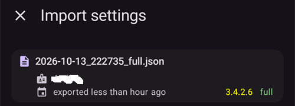

(reinstall-aaps)=
# התקנה מחדש של AAPS עם keystore חדש

כל קובץ apk של **AAPS** חתום באמצעות **keystore**. עדכון מותקן מעל ה-**AAPS** הנוכחי רק אם הוא חתום באמצעות **אותו keystore**: אז כל ההגדרות והנתונים נשמרים. לכן מומלץ לשמור את ה-keystore ואת הסיסמה שלו במקום בטוח.

אם תנסו להתקין apk שחתום באמצעות keystore אחר מזה שהיה קודם, תקבלו הודעת שגיאה שאומרת שההתקנה נכשלה!

(reinstall-aaps-when)=
## מתי צריך להתקין מחדש?

צריך להסיר את **AAPS** ולהתקין אותו מחדש כאשר ה-apk החדש חתום באמצעות keystore אחר, למשל:

- אינכם מוצאים את ה-keystore הישן או את הסיסמה שלו.
- יצרתם keystore חדש, למשל באמצעות [אפשרות 1 של הבנייה בדפדפן](../SettingUpAaps/BrowserBuildKeystore.md) או באמצעות **Create a new key** ב-[AAPS Builder](../SettingUpAaps/BrowserBuildAapsBuilder.md).
- אתם בונים במחשב חדש ולא העתקתם אליו את ה-keystore.

אם ה-keystore עדיין אצלכם, אין צורך בדף הזה: השתמשו בו שוב ו[עדכנו את **AAPS**](../Maintenance/UpdateToNewVersion.md) במקום.

(reinstall-aaps-before)=
## לפני שמתחילים

- הסרת **AAPS** מוחקת את כל ההגדרות שלו, את [המשימות](../SettingUpAaps/CompletingTheObjectives.md) שלכם ואת החיבור הנוכחי למשאבה. מקבלים אותם בחזרה על ידי ייבוא **קובץ ההגדרות**, לכן ודאו שיש לכם קובץ עדכני.
- קובץ ההגדרות אינו כולל את היסטוריית הטיפולים ואת היסטוריית ערכי הסוכר. אם אתם מעלים נתונים ל-[Nightscout](../SettingUpAaps/SettingUpTheReportingServer.md), אפשר לטעון אותם בחזרה אחרי ההתקנה מחדש (שלב 8).
- You need your [**master password**](#Preferences-master-password): the settings file is encrypted with it. Resetting a forgotten master password does not help here: a settings file can only be imported with the password it was exported with (see [How to reset the master password?](#FAQ-reset-master-password)).
- **משתמשי Omnipod ו-Medtrum:** קראו קודם את [משאבות ללא צינורית](#ExportImportSettings-tubeless-pumps). קובץ ההגדרות חייב להיות מיוצא בזמן הפוד או הפאץ' שמחובר אליכם עכשיו.
- אם צריך, [הגדירו את המקלט של ה-CGM / מקור ערכי הסוכר](../Getting-Started/CompatiblesCgms.md) לפני שמתחילים.

(reinstall-aaps-steps)=
## שלבים

התמונות מראות מעבר מ-**AAPS** 3.4 (שלבים 1 עד 3) ל-**AAPS** 4 (שלבים 6 עד 8). בגרסאות אחרות המסכים נראים מעט שונה.

(reinstall-aaps-export)=
### 1. Export your settings

ייצאו את ההגדרות באמצעות ה-**AAPS** שמותקן כרגע בטלפון. לפרטים, ראו [ייצוא הגדרות](#ExportImportSettings-Settings-Export).

ב-**AAPS** 3.4: פתחו את **תחזוקה** והקישו על **Export options** (אפשרויות ייצוא). תחת **User Settings** (הגדרות משתמש), סמנו **Local Storage** (אחסון מקומי) והקישו על **אישור**.

*הערה: אפשר להשתמש גם ב[אחסון בענן](#preferences-maintenance-cloud) כדי לשמור עותק גיבוי נוסף: זה רעיון טוב, אבל השאירו את האחסון המקומי כדי לשחזר הגדרות במהירות.*

עכשיו כתוב על הלחצן **Export settings (local)** (ייצוא הגדרות, מקומי). יש ללחוץ עליו.

**AAPS** מציג את שם הקובץ שהוא ייצור. הקישו על **אישור**, הקלידו את הסיסמה הראשית והקישו על **אישור**.

ב-**AAPS** 4: פתחו את **תחזוקה**, בחרו את השבב **מקומי** ליד **ייצוא הגדרות** והקישו על **ייצוא הגדרות**.

(reinstall-aaps-copy)=
### 2. העתקת קובץ ההגדרות מהטלפון

הקובץ נמצא בתיקייה **preferences** בתוך [תיקיית **AAPS**](#SetupWizard-StoragePermission) שלכם, ושמו דומה ל-`2026-10-13_222735_full.json`. העתיקו או העלו אותו למקום חיצוני (למשל המחשב שלכם, שירות אחסון בענן...). בדרך כלל הקובץ נשאר בטלפון גם אחרי הסרת ההתקנה, אבל ליתר ביטחון שמרו עותק במקום אחר.

(reinstall-aaps-nightscout-before)=
### 3. סנכרון עם Nightscout

השלב הזה אינו חובה, אבל הוא מומלץ אם אתם משתמשים ב-[DynISF](#Open-APS-features-DynamicISF): כך תוכלו להמשיך מיד עם ההגדרות הנוכחיות, במקום לחכות 5 ימים עד שיצטברו הנתונים שהתוסף צריך. NSClient V3 צריך להיות [מופעל ומוגדר](../SettingUpAaps/SettingUpTheReportingServer.md).

ודאו של-Nightscout יש את כל הנתונים שלכם לפני הסרת ההתקנה.

פתחו את **NSClient**, הקישו על הלחצן **סנכרון מלא** בתחתית המסך, ואחר כך על **אישור**.

*הערה: משך הזמן תלוי בשירות האחסון של Nightscout שלכם.*

אחר כך **AAPS** מציע לנקות את מסד הנתונים שלו. **אישור** מוחק מהטלפון נתונים שישנים מ-3 חודשים, וכך הסנכרון מהיר הרבה יותר. **ביטול** מסנכרן בלי ניקוי. מסד הנתונים בטלפון נמחק בכל מקרה בזמן הסרת ההתקנה, לכן שתי האפשרויות בסדר.

השאירו את **AAPS** פועל עד שהסנכרון מסתיים.

(reinstall-aaps-build)=
### 4. בניית ה-apk החדש

[בנו](../SettingUpAaps/BuildingAaps.md) apk חתום חדש עם ה-keystore החדש והעבירו אותו לטלפון.

(reinstall-aaps-uninstall)=
### 5. הסרת ההתקנה של AAPS

בטלפון, ב-**Settings** (הגדרות) > **Apps** (אפליקציות) > **AAPS**, הקישו על **Uninstall** (הסרת התקנה) ואשרו עם **OK**.

(reinstall-aaps-install)=
### 6. התקנה והפעלה של AAPS החדש

[התקינו](../SettingUpAaps/TransferringAndInstallingAaps.md) את ה-apk החדש והפעילו את **AAPS**. [אשף ההתקנה](../SettingUpAaps/SetupWizard.md) מבקש את ההרשאות ש-**AAPS** צריך: הקישו על **מתן הרשאה** עבור כל אחת מהן. כך גם [אופטימיזציית הסוללה](#setup-wizard-bluetooth-battery-optimisation) נכבתה שוב.

עבור **תיקיית AAPS**, בחרו את אותה תיקיית **AAPS** כמו קודם (זו שיש בתוכה את התיקייה **preferences**), הקישו על **Use this folder** (שימוש בתיקייה זו) ועל **Allow** (אישור).

כאשר **AAPS** מוצא את ההגדרות שייצאתם, אשף ההתקנה מציג את המסך [נמצאו הגדרות שמורות](#setup-wizard-import-settings), שבו אפשר לייבא אותן. אפשר גם לסגור את האשף ולייבא מתוך **תחזוקה**, כמו שמתואר בהמשך.

(reinstall-aaps-import)=
### 7. ייבוא ההגדרות

אם קובץ ההגדרות כבר לא נמצא בטלפון, העתיקו אותו בחזרה לתיקייה **preferences** בתוך תיקיית **AAPS** שלכם.

פתחו את התפריט (☰) > **תחזוקה**, בחרו את השבב **מקומי** ליד **ייבוא הגדרות** והקישו על **ייבוא הגדרות**.

הרשימה מציגה כל קובץ עם גרסת ה-**AAPS** שלו ועם הגיל שלו. בחרו את הקובץ שייצאתם בשלב 1.

אין צורך להגדיר קודם סיסמה ראשית ב-**AAPS** החדש. הקלידו את הסיסמה הראשית שבה השתמשתם בייצוא בשדה **סיסמת פענוח** והקישו על **פענח**. ההודעה **הקובץ הוצפן באמצעות סיסמה אחרת** צפויה: ה-**AAPS** החדש עדיין לא מכיר את הסיסמה שלכם. הייבוא משחזר אותה יחד עם שאר ההגדרות.

סמנו **גם החלף את הגדרות המשאבה**: בלי הסימון הזה, המשאבה וההגדרות שלה לא משוחזרות. משתמשי Omnipod ו-Medtrum: סמנו את האפשרות רק אם הקובץ יוצא בזמן הפוד או הפאץ' הנוכחי (ראו [משאבות ללא צינורית](#ExportImportSettings-tubeless-pumps)).

הקישו על **ייבוא**, אחר כך על **אישור** כדי להחיל את ההגדרות, ושוב על **אישור** במסך **ההגדרות הוחלו**.

(reinstall-aaps-nightscout-after)=
### 8. החזרת ההיסטוריה מ-Nightscout

פתחו את התפריט (☰) > [**הגדרות תצורה**](../SettingUpAaps/ChangeAapsConfiguration.md) > **תקשורת** והקישו על **פתיחת תוסף** תחת **NSClientV3**. בדקו שהסטטוס מציג **מחובר**. אם לא, ראו [פתרון תקלות ב-NSClient](TroubleshootingNsClient.md).

הקישו על הלחצן **סנכרון מלא** בתחתית המסך ועל **אישור**. מסד הנתונים חדש, לכן אפשר לענות על שאלת הניקוי בכל אחת מהדרכים.

**AAPS** טוען את הנתונים שלכם מ-Nightscout. ביומן מופיע **Full sync finished** כשהטעינה מסתיימת.

(reinstall-aaps-check)=
### 9. בדיקה והמשך עבודה עם הלולאה

בדקו שהמשאבה מחוברת ושערכי ה-CGM מגיעים, ואז המשיכו בלולאה.

(reinstall-aaps-afterwards)=
## אחר כך

מעכשיו תמיד השתמשו ב-keystore החדש, ושמרו אותו עם הסיסמה שלו במקום בטוח, מחוץ לטלפון. ראו [יצירת גיבויים](../Maintenance/ExportImportSettings.md).
