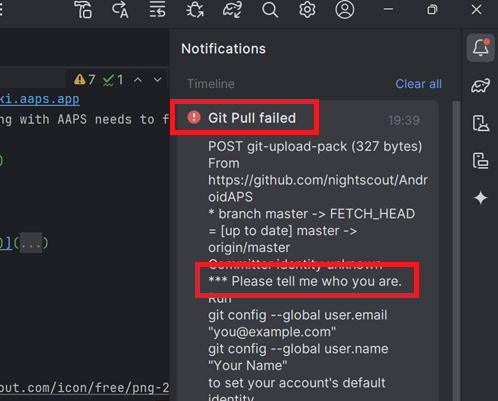
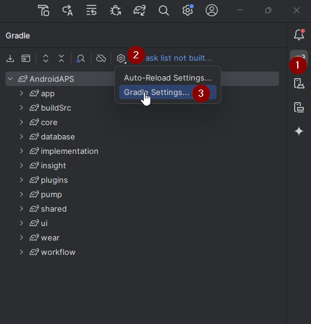
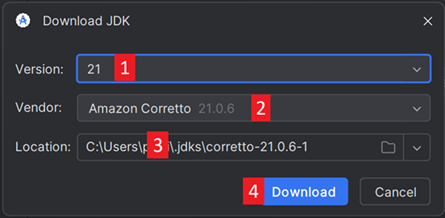

(troubleshooting_androidstudio-troubleshooting-android-studio)=

# פתרון תקלות ב-Android Studio

```{contents} List of common issues
:depth: 2
:local: true
```

(troubleshooting_androidstudio-lost-keystore)=
## אבד ה-keystore
אם איבדתם את ה-keystore או את הסיסמה שלו, apk שחתום באמצעות keystore חדש לא יכול לעדכן את ה-**AAPS** הנוכחי: צריך להסיר את ההתקנה ולהתקין אותו מחדש. ראו [התקנה מחדש של AAPS עם keystore חדש](#reinstall-aaps).

## Gradle Sync failed
Gradle Sync can fail for various reasons. When you receive a message saying that 'gradle sync failed', open the "Build" tab (1) at the bottom of Android Studio and check what error message (2) is displayed.


```{contents} Likely reasons for gradle sync failures are:
:depth: 1
:local: true
```

*Important*: After you have followed the instructions for your specific problem, you need to trigger the [gradle sync](#gradle-resync) again.

(troubleshooting_androidstudio-uncommitted-changes)=
### שינויים שלא נכללו בקומיט (Uncommitted changes)

If you receive a failure message like this one:


```
Build file 'C:\Data\50-Android\AndroidAPS\app\build.gradle.kts' line: 243

There are uncommitted changes.
Clone sources again as described in wiki and do not allow gradle update
```

#### שלב 1 - בדקו את התקנת git
  * פתחו את הלשונית Terminal (1) בתחתית Android Studio, העתיקו את הטקסט הבא והדביקו או הקלידו אותו ב-terminal (2).
    ```
    git --version
    ```

    

    Note: There is a space and two hyphens between Git and version!

  * You must receive a message saying what Git version is installed, as you can see in the screenshot above. In this case, go to [Step 2](#troubleshooting-android-studio-check-for-uncommitted-changes).

  * למקרה שתקבלו את ההודעה
    ```
    Git: command not found
    ```
    התקנת Git שלכם בעייתית.

  * [בדקו את התקנת git](#BuildingAaps-steps-for-installing-git)

  * אם אתם עובדים ב-Windows ו-Git הותקן זה עתה, הפעילו מחדש את המחשב כדי ש-Git יהיה זמין בכל המערכת אחרי ההתקנה

  * אם Git מותקן, הפעלתם מחדש את המחשב (ב-Windows), ועדיין Git לא נמצא:

  * חפשו במחשבכם את הקובץ "git.exe".

    Note for yourself, which directory it is saved in.

  * עברו אל Environment variables (משתני הסביבה) ב-Windows, בחרו את המשתנה "PATH" ולחצו על Edit. Add the directory where you have found your Git installation.

  * שמרו וסגרו.

  * הפעילו מחדש את Android Studio.

(troubleshooting-android-studio-check-for-uncommitted-changes)=
#### שלב 2: בדקו אם יש שינויים שלא נכללו בקומיט (uncommitted changes).

  * In Android Studio, open the 'Commit' tab (1) on the left-hand side. 
  * יופיע "Changes" (בגרסאות ישנות של Android Studio: "Default changeset") (2) או "Unversioned Files" (3):

    * אם מופיע "Changes", כנראה עדכנתם את 'Gradle' או שיניתם בטעות תוכן של קבצים מסוימים.

    * לחצו לחיצה ימנית על "Changes" ובחרו "Rollback…" (1)

      

    * הקבצים נשלפים שוב משרת ה-Git. If there are no other changes in the commit tab, go to [Step 3](#gradle-resync).

  * If you can see "Unversioned Files", you might have stored files in your source code directory by mistake. Maybe they are important files: like your keystore file, that should be moved elsewhere. If you don't know what those files are and you have not created them yourself, you can delete them.

    * Use your regular file explorer on your computer to move or cut and paste that file to a safe place.

    * Go back to Android Studio and click the Refresh button (4) within the Commit tab to make sure the file is not stored in the **AAPS** directory anymore.

      If there are no other changes in the Commit tab, go to [Step 3](#gradle-resync).


#### שלב 3: סנכרון מחדש של Gradle (שוב)

Follow the instructions at [Gradle Resync](#gradle-resync).

### Git Pull Failed - Please tell me who you are

If you see this message, Git needs you to identify yourself.



Open the terminal and type the following two commands, one after the other.

```
git config --global user.name "Your name here"
git config --global user.email your.email@here.com
```

Your name needs to be written between quotation marks.


(troubleshooting_androidstudio-android-gradle-plugin-requires-java-11-to-run)=

(incompatible-gradle-jvm)=
### Incompatible Gradle JVM


```
Your build is currently configured to use incompatible Java 21.0.3 and Gradle 8.2.
Cannot sync the project.

We recommend upgrading to Gradle version 8.9.

The minimum compatible Gradle version is 8.5.

The maximum compatible Gradle JVM version is 19.
```

Or:

```
Cause: error: invalid source release: 21
```

אם מתקבלת הודעת השגיאה לעיל, עליכם להוריד גרסת JVM מתאימה לפני שתוכלו לנסות לבנות שוב:

1.  Check in the [requirement table](#Building-APK-recommended-specification-of-computer-for-building-apk-file) which JVM version you need for the **AAPS** version you are building, and make a note of it.

2. Open the Gradle view by clicking on the elephant (1) on the right side of Android Studio and open the settings (2) and select **Gradle Settings** (3):



3.  In **Gradle JDK** field, check if the appropriate version is selected (1) If not, click on the field, and see if it is already available in the list. The example below shows JVM 21 is labeled as “jbr-21”. If you find it, just select it, and you are done. אם היא לא זמינה, בחרו **Download JDK** (2).


4. In Version (1), select the JDK required for your **AAPS** version (the one you made a note of when you checked the requirement table). In Vendor (2) select any Vendor. Location (3): do not change. לחצו על **Download** (4).



5.  Close the **Settings** dialog with **OK**.
6. You now need to restart the Gradle Sync. Follow the instructions at [Gradle Resync](#gradle-resync).

(incompatible-version-of-android-gradle-plugin)=
### Incompatible version of Android Gradle plugin

  If you experience the following error message

`The project is using an incompatible version (AGP x.x.x) of the Android Gradle plugin. Latest supported version is AGP x.x.x`

  

  You are using an outdated version of Android Studio. In the menu, go to Help > Check for updates and install any updates of Android Studio and its plugins that are found.

(troubleshooting_androidstudio-could-not-resolve-no-cached-version)=
### Could not resolve/No cached version

  You might get this error message:


  * בצד ימין, פתחו את הלשונית Gradle (1).

    ודאו שהלחצן המוצג ב-(2) *לא נבחר*.

    

  * Now you need to trigger a [Gradle Resync](#gradle-resync)

(troubleshooting_androidstudio-unable-to-start-daemon-process)=
### לא ניתן להפעיל את תהליך daemon

  If you see an error message like the one below you probably use a Windows 10 32-bit system. This is not supported by Android Studio 3.5.1 and above and unfortunately there is nothing that the **AAPS** developers can do about this!

  There is information on the internet about how to determine whether you have a 32-bit or 64-bit OS - i.e. [this one](https://support.microsoft.com/en-us/windows/32-bit-and-64-bit-windows-frequently-asked-questions-c6ca9541-8dce-4d48-0415-94a3faa2e13d).

  

(gradle-resync)=
### Gradle Resync

  אם עדיין מופיעה ההודעה שסנכרון Gradle נכשל, בחרו עכשיו בקישור **Try again** (1). 


  If you don't see the message anymore, you can still trigger this manually:

  * פתחו את הלשונית Gradle (1) בגבול הימני של Android Studio.

    

  * Right-click on AAPS (2)

  * לחצו על "Reload Gradle Project" (3)

## Generate Signed APK generated successfully with 0 build variants

כשאתם יוצרים את ה-apk החתום, ייתכן שתקבלו הודעה שהיצירה הצליחה אבל נוצרו '0 build variants':


This is a false warning. Check the directory for your selected "Destination folder" for generation (step [Generate Signed APK](#Building-APK-generate-signed-apk)) and you will find the generated apk there!


## האפליקציה נוצרה עם אזהרות compiler/kotlin

If your build completed successfully but you get compiler or kotlin warnings (indicated by a yellow or blue exclamation mark) then you can just ignore these warnings.

 

Your apk was built successfully and can be transferred to your phone!


## No CGM data is received by AAPS

* אם אתם משתמשים באפליקציית Dexcom G6 מתוקנת: האפליקציה הזו מיושנת. השתמשו באפליקציה [BYODA](#DexcomG6-if-using-g6-with-build-your-own-dexcom-app) במקום זאת.

* אם אתם משתמשים ב-xDrip: הגדירו זיהוי מקלט (identify receiver) כמו שמתואר ב[דף הגדרות xDrip](#xdrip-identify-receiver).


## ה-apk לא הותקן


* ודאו שהעברתם את הקובץ "app-full-release.apk" לטלפון שלכם.
* השגיאה הזו בדרך כלל אומרת שה-apk החדש חתום באמצעות keystore אחר מזה של ה-**AAPS** המותקן. אם ה-keystore הקודם עדיין אצלכם, בחרו בו ובנו שוב. אחרת, ראו [התקנה מחדש של AAPS עם keystore חדש](#reinstall-aaps).
* אם הטלפון מציג את ההודעה "App not installed" (האפליקציה לא הותקנה), בצעו את השלבים הבאים:

1. [Export settings](../Maintenance/ExportImportSettings.md) (in AAPS version already installed on your phone)
2. Uninstall **AAPS** on your phone.
3. הפעילו מצב טיסה וכבו את ה-Bluetooth.
4. התקינו גרסה חדשה ("app-full-release.apk")
5. [ייבוא הגדרות](../Maintenance/ExportImportSettings.md)
6. הפעילו שוב את ה-Bluetooth וכבו את מצב הטיסה

## ה-apk הותקן, אבל זו גרסה ישנה

אם בניתם את האפליקציה בהצלחה, העברתם אותה לטלפון והתקנתם אותה בהצלחה, אבל מספר הגרסה נשאר אותו דבר, ייתכן ששכחתם [לעדכן את העותק המקומי](#Update-to-new-version-update-your-local-copy)

## אף אחת מהאפשרויות לא עזרה

If none of the above tips helped you might consider building the apk from scratch:

1. [Export settings](../Maintenance/ExportImportSettings.md) (in AAPS version already installed on your phone)

2. Have your key password and key store password ready.

    או פשוט להשתמש ב-keystore חדש.

3. Build the apk from scratch as described [here](#Building-APK-download-AAPS-code).

4. When you have built the apk successfully delete the existing apk on your phone, transfer the new apk to your phone and install.
5. [Import settings](../Maintenance/ExportImportSettings.md) again to restore your objectives and settings.
6. בדקו את הגדרות אופטימיזציית הסוללה והשביתו אותן שוב.

## במקרה הגרוע ביותר

If the above does not solve your build issue you may wish to try to uninstall Android Studio completely and rebuild from scratch.  Some users find that this can resolve their build problem.  When deleting Android Studio, do not delete Android user settings and **Make sure to uninstall all files associated with Android Studio.** If you do not completely remove Android Studio with all hidden files, uninstalling may cause new problems instead of solving your existing one(s). Manuals for complete uninstall can be found online i.e.

[https://stackoverflow.com/questions/39953495/how-to-completely-uninstall-android-studio-from-windowsv10](https://stackoverflow.com/questions/39953495/how-to-completely-uninstall-android-studio-from-windowsv10).

Install Android Studio from scratch as described [here](#Building-APK-install-android-studio).
