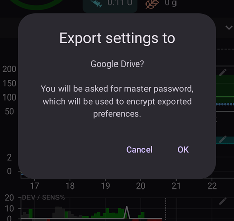
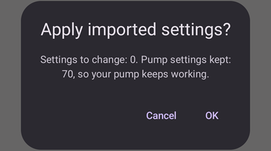

# יצירה ושחזור של גיבויים

When installing AAPS on your phone it becomes a "medical device" you rely on daily. It is highly recommended to have an emergency backup plan for when your phone gets defective, stolen or lost. לכן חשוב להתכונן ולשאול את עצמכם: "מה אם?"

To restore your AAPS setup to an existing or new phone, it's important to keep following items in a secure location (read: not on your phone). Best practice is to keep at least two separate backups: on a local hard drive, USB stick and (preferred) on Cloud storage like Google Drive or Microsoft 365 OneDrive. By storing your backups in the cloud you'll always have everything needed accessible from your phone to restore your setup anywhere and anytime.

Consider acquiring a secondary backup phone and practicing restoring AAPS to ensure the backup phone works as expected. This step will give you confidence that your emergency plan is effective and that you can seamlessly continue using AAPS if your primary phone becomes unavailable.

```{admonition} Android backups and phone-transfer tools do not carry your AAPS settings
:class: warning
מאז **AAPS** 4.0 ההגדרות נשמרות באחסון מוצפן בטלפון, והן לא נכללות בגיבוי של Google ובהעברה מטלפון לטלפון חדש. ייצוא הגדרות, כפי שמתואר בדף זה, הוא הדרך היחידה להעביר אותן.
```

To be able to restore, having the following items at hand is important:

- Your **Android Studio keystore file** and associated **password**: Needed for (re)building the AAPS .APK installer file.
- A recent copy of the **AAPS installer .APK**
- A recent **settings export** file: For restoring important settings (which includes your objectives!).
- Your **AAPS master password**
- גיבויים של כלים נוספים: למשל BYODA ו/או xDrip.
- Personal notes on your setup.

Below are the items that are recommended for keeping back-ups.

## Creating back-ups

### Keystore file from the computer you used to build the APK
When building your .APK installer file from Android Studio, it uses the **keystore file and password to sign the .APK installer file**. To update your current AAPS installation, it is required to sign the update .APK installer file with the same keystore used for the initial installation. When updating, all settings and the AAPS database will be kept. שימו לב: בלי זה, יש קודם להסיר את האפליקציה הנוכחית, ואז [להתקין מחדש](#reinstall-aaps) ולהגדיר מחדש את AAPS.

שמירת ה-keystore והסיסמה שלו תפשט מאוד את עדכון ה-APK בעתיד, במיוחד אם תצטרכו לבנות את האפליקציה במחשב חדש. See the [Updating AAPS](../Maintenance/UpdateToNewVersion.md) section for details on using the keystore when building a new APK.

**When to back-up:** The keystore should be backed up after you first build the **AAPS** .APK installer file.

**How to back-up:** Locate your keystore path. If you don’t remember it you can find it in Android Studio by selecting **Build > APK > Next**. The path will be listed in “Key store path”. Using your file explorer, navigate to this path and make a copy of your keystore file (ending in file extension `.jks`). Save it to a safe cloud location should your computer become unavailable. Make sure to also record your key store password, key alias and key password.

### Copies of the most recent APK
In case your main **AAPS** phone is lost or damaged, having a copy of the APK available will allow you to quickly resume using **AAPS** with a new phone. Note: you will also need your preferences backed up as noted below.

**When to back-up:** You should maintain a back-up of the most recent APK that you installed on your main **AAPS** phone. You may want to also maintain one earlier version in case you need to roll back to that for any reason.

**How to back-up:** Maintain a copy on the computer used to build the APK with Android Studio. Additionally, it is recommended to use a cloud platform to store a copy of the installer APK. Make sure you know how to locate both backups when needed. Consider setting up dedicated folders to store these backups.

### AAPS settings file (also referred to as 'Preferences')

```{admonition} Where are preferences stored on my phone?
:class: tip
את ההגדרות שלכם תמצאו ב**תיקיית AAPS** שבחרתם במהלך [הגדרת AAPS](#SetupWizard-StoragePermission).</br>
ניתן גם לשנות את **תיקיית AAPS** במסך **תחזוקה** (**תפריט** (☰) > **תחזוקה**), ראו [הגדרת תיקיית AAPS המקומית](#preferences-maintenance-logdirectory).
```

With a copy of the APK installer file (see above) and your **Settings** file, you can quickly get up and running on an existing or new phone.

קובץ **ההגדרות** משמש להתאמת אפליקציית AAPS לתצורה המסוימת שלכם. הם כוללים פרטים כמו ההגדרות ב**הגדרות תצורה**, מצב המשימות, הגדרות תקשורת עם שירותים חיצוניים (למשל Nightscout, Tidepool), אוטומציות ופרופילים.

Exporting the AAPS settings to file enables you to restore its configuration to a specific point in time. As mentioned, in addition to all configuration settings, the export file also contains the status of your objectives, which you need to restore when **(re)installing** AAPS. Without this you will be required to redo all objectives from start to enable closed loop. Settings files also enable you to restore "last known good" settings for undoing any configuration changes.

**When to back-up AAPS settings:**
* Each time you complete an objective to prevent losing your progress. _Without a copy of your **Settings** you will have to complete all objectives again in the event you need to re-install AAPS or replace your phone._

* Any time you plan to make significant changes to your configuration (change SMB settings, change insulin types, change pump, make changes to automations) you should back up your **Settings** before and after making the changes. This way you have your most recent settings as well as a copy of what they were before the changes in case you need to revert back to them.

* למשתמשי משאבות ללא צינורית (כגון Omnipod ו-Medtrum) בלבד: קובץ **ההגדרות** מכיל את פרטי החיבור לפוד הנוכחי, וניתן להשתמש בו כדי לשחזר את החיבור לפוד זה בטלפון חדש. If you do not have a copy of your preferences exported after you started your current pod you will need to start a new pod in the event you need to replace your current phone.

**How to back-up manually:**

1. אם זו הפעם הראשונה שאתם מייבאים או מייצאים **הגדרות**, יש להגדיר סיסמה ראשית ב[הגדרות > הגנה בסיסמאות](#Preferences-master-password). Set a password and record this in a safe place. _You will be unable to access your **Settings** back-ups without this password._

2. במסך הראשי של **AAPS**, יש לפתוח את **התפריט** (☰) > **תחזוקה**. יש לבחור היכן לשמור את הקובץ בעזרת השבבים **מקומי** ו-**ענן** ליד **ייצוא הגדרות** (ראו **ייצוא או ייבוא הגדרות** בהמשך), ואז ללחוץ על **ייצוא הגדרות**. **AAPS** מציג לאן הקובץ יישמר: את שם הקובץ עבור **מקומי**, ואת **Google Drive** עבור **ענן**. יש ללחוץ על **אישור**.

   

   

   יש להקליד את הסיסמה הראשית שהוגדרה למעלה וללחוץ על **אישור**.

   

   ההודעה **הגדרות יוצאו** (מקומי) או **הייצוא לענן הצליח** (ענן) מאשרת את הייצוא.

   

   

3. Using the file explorer on your phone (commonly called “Files” or “My Files”) navigate to Internal Storage > AAPS > preferences. Here you will see a copy of all exported preferences files. The file name should be `YYYY-MM-DD_Time_appname.json`. Upload this file to the cloud platform of your choice. Then from the cloud platform, also download a copy to your local computer.

(ExportImportSettings-Settings-Export)=

## Settings Export

```{admonition} Where are preferences stored on my phone?
:class: tip
את ההגדרות שלכם תמצאו ב**תיקיית AAPS** שבחרתם במהלך [הגדרת AAPS](#SetupWizard-StoragePermission).</br>
ניתן גם לשנות את **תיקיית AAPS** במסך **תחזוקה** (**תפריט** (☰) > **תחזוקה**), ראו [הגדרת תיקיית AAPS המקומית](#preferences-maintenance-logdirectory).
```

It is recommended to do regular settings exports, especially before and after making configuration changes. You can choose to do exports **manually or (preferred) through automation**. Make sure to take a note of your AAPS master password and to backup your settings files by copying them off your phone to for instance a cloud storage location.

**Note**: _The exported settings will be encrypted with your AAPS master password: without the master password used for exporting you will be unable to import the settings file!_

If you forgot your master password, you can [reset it](#FAQ-reset-master-password), but settings files exported with the old password still need the old one.

### Exporting or Importing Settings
כדי לייצא או לייבא הגדרות, יש לפתוח את **התפריט** (☰) ולבחור **תחזוקה**. בחלק **ניהול קבצים**, השבבים **מקומי** ו-**ענן** ליד **ייצוא הגדרות** ו-**ייבוא הגדרות** קובעים לאן קובץ ההגדרות נשמר או מאיפה הוא נקרא: **מקומי** פירושו תיקיית AAPS בטלפון, ו-**ענן** זמין אחרי שמגדירים [תיקיית ענן](#preferences-maintenance-cloud). לחיצה על שבב מפעילה או מכבה אותו; תמיד נשאר לפחות שבב אחד מסומן, ושתי השורות משתמשות באותה בחירה. אחר כך יש ללחוץ על **ייצוא הגדרות** או על **ייבוא הגדרות** עצמם כדי להתחיל.


(ExportImportSettings-Automating-Settings-Export)=
### ייצוא הגדרות אוטומטי

כדי לייצא הגדרות באופן אוטומטי [(**ראו אוטומציה**)](../DailyLifeWithAaps/Automations.md#automating-preference-settings-export), יש לפתוח את [**הגדרות** > **תחזוקה**](#preferences-maintenance-settings), לפתוח את **ייצוא הגדרות ללא השגחה** ולהפעיל את **הפעלת ייצוא אוטומטי של הגדרות**.

You can now configure [Automation](../DailyLifeWithAaps/Automations.md#automating-preference-settings-export) to export settings, either on a regular basis (_i.e._ each week), or after a pod change.

_**הערה:** בייבוא הגדרות תמיד צריך להזין את הסיסמה הראשית של AAPS!_


(ExportImportSettings-restoring-from-your-backups-on-a-new-phone-or-fresh-installation-of-aaps)=
## Restoring from your backups on a new phone or fresh installation of AAPS

```{admonition} Where are preferences stored on my phone?
:class: tip
את ההגדרות שלכם תמצאו ב**תיקיית AAPS** שבחרתם במהלך [הגדרת AAPS](#SetupWizard-StoragePermission).</br>
ניתן גם לשנות את **תיקיית AAPS** במסך **תחזוקה** (**תפריט** (☰) > **תחזוקה**), ראו [הגדרת תיקיית AAPS המקומית](#preferences-maintenance-logdirectory).</br>
אם **AAPS** מאבד את הגישה לתיקייה הזו (זה יכול לקרות אחרי התקנה מחדש או אחרי מחיקת האחסון של האפליקציה), הוא מציג את ההודעה **הגישה לתיקיית AAPS אבדה** ומפסיק לשמור הגדרות בטלפון עד ש[בוחרים שוב את התיקייה](#preferences-maintenance-logdirectory).
```

יש להשתמש בהוראות אלה אם יש לכם גיבוי של ה-APK ושל **ההגדרות** שאתם רוצים לטעון בטלפון חדש, או אם הייתם צריכים מסיבה כלשהי למחוק את ה-APK ולהתקין אותו מחדש בטלפון הקיים.

_If you are updating **AAPS** using an APK built with the same keystore you should not need to follow this process. However, it is still advised to create a back-up before you apply the update._

If you are updating **AAPS** after you lost or replaced your original keystore (i.e. using a new build computer without transferring the keystore), ensure that you back up all settings per the above and then uninstall the existing version of **AAPS** on your phone. ראו [התקנה מחדש של AAPS עם keystore חדש](#reinstall-aaps) לתהליך המלא.

If needed, [set up your CGM/BG source receiver](../Getting-Started/CompatiblesCgms.md) prior to the steps listed below

(ExportImportSettings-tubeless-pumps)=
```{admonition} Tubeless pumps (Omnipod and Medtrum) users
:class: warning
קובץ **ההעדפות** מכיל את נתוני הפוד או הפאץ' שהיה פעיל בזמן הייצוא.
- **יש לייצא מיד אחרי כל הפעלה של פוד או פאץ'** ולהעתיק את הקובץ אל מחוץ לטלפון.
- **אותו טלפון, הפוד עדיין פועל:** יש להשאיר את **גם החלף את הגדרות המשאבה** לא מסומן. הפוד הנוכחי נשמר, ורק שאר ההגדרות מיובאות.
- **טלפון חדש שמקבל את הפוד:** יש לסמן את **גם החלף את הגדרות המשאבה**, ולהשתמש רק בקובץ שיוצא בזמן הפוד שאתם עונדים עכשיו. קובץ מפוד קודם מחליף את נתוני הפוד הנוכחי, ואז תצטרכו להפעיל פוד חדש.
- **נתוני פוד ישן יובאו בטעות:** **AAPS** ממשיך לנסות להתחבר לפוד ההוא, ולא ניתן להפעיל פוד חדש. יש להשבית אותו; אם זה נכשל, יש להשליך אותו (ראו למשל [השלכת פוד](#omnipod-dash-discard-pod) עבור Omnipod DASH).
```

```{admonition} Pump settings are kept unless you say otherwise
:class: note
כברירת מחדל, ייבוא לא משנה את הגדרות המשאבה: המשאבה שנבחרה ב**הגדרות תצורה**, הצימוד שלה וכל שאר ההגדרות שלה נשארים כמו שהם בטלפון הזה. יש לסמן את **גם החלף את הגדרות המשאבה** במסך הייבוא רק כשמשחזרים לטלפון חדש שצריך לקבל את אותה משאבה. ייבוא אף פעם לא מוחק הגדרות שאינן נמצאות בקובץ.
```

1. Using the back-up copy of your APK from above, follow the instructions for a [new installation](../SettingUpAaps/TransferringAndInstallingAaps.md)

2. Launch **AAPS** and allow any requested permissions

3. צאו מאשף ההתקנה. נייבא את כל ההגדרות הנחוצות מעותק הגיבוי של **ההגדרות**

4. במסך הראשי של **AAPS**, יש ללחוץ על **מתן הרשאה** ולאשר את כל ההרשאות שמופיעות בחלונית **נדרשות הרשאות** בחלק העליון

5. במסך הראשי של **AAPS**, יש להגדיר את הסיסמה הראשית ב[הגדרות > הגנה בסיסמאות](#Preferences-master-password) לאותה סיסמה שבה השתמשתם בגיבויים.

6. אם עדיין לא עשיתם זאת, [יש להגדיר את **תיקיית AAPS**](#preferences-maintenance-logdirectory): במסך הראשי של **AAPS**, יש לפתוח את **התפריט** (☰) > **תחזוקה** > **תיקיית AAPS**.

7. במסך הראשי של **AAPS**, יש לפתוח את **התפריט** (☰) > **תחזוקה** > **ייצוא הגדרות** > להקליד את הסיסמה הראשית שהוגדרה למעלה > **אישור**. This will create the preferences folder if it does not already exist on your phone.

8. Download the back-up of your **Preferences** file from your cloud platform.

9. השתמשו בסייר הקבצים (נקרא בדרך כלל “Files” או “My Files”) כדי להעביר את הקובץ מתיקיית ההורדות אל `/internal storage/AAPS/preferences`, אם **תיקיית AAPS** הוגדרה ל-`/internal storage/AAPS`

10. במסך הראשי של **AAPS**, יש לפתוח את **התפריט** (☰) > **תחזוקה** וללחוץ על **ייבוא הגדרות**. יש לבחור את קובץ ההעדפות שממנו רוצים לשחזר (החדש ביותר מופיע למעלה). הקפידו לבחור את קובץ ההעדפות הנכון: יוצגו כל קובצי ה-.json מתיקיית ההעדפות (או מתיקיית הענן, עם **ענן**).

    

    **AAPS** מציג את פרטי הקובץ. יש להקליד את הסיסמה הראשית שהוגדרה למעלה וללחוץ על **פענוח & בדיקה**.

11. אחרי שהקובץ פוענח, יש להחליט מה לעשות עם הגדרות המשאבה. בטלפון חדש שמקבל את אותה משאבה, יש לסמן את **גם החלף את הגדרות המשאבה**, כדי שהצימוד והגדרות המשאבה יגיעו מהקובץ. כדי להשאיר את המשאבה שהטלפון הזה כבר מצומד אליה, יש להשאיר את התיבה לא מסומנת. אחר כך יש ללחוץ על **ייבוא**.

    

12. **AAPS** שואל **להחיל הגדרות מיובאות?** ומציג כמה הגדרות ישתנו, ואם השארתם את התיבה לא מסומנת, גם כמה הגדרות משאבה יישמרו. עדיין לא נכתב דבר, לכן **ביטול** משאיר את הטלפון בדיוק כמו שהיה. יש ללחוץ על **אישור** כדי להחיל.

    

13. **AAPS** מחיל את ההגדרות המיובאות מיד, בלי הפעלה מחדש. רק התוספים שההגדרות שלהם השתנו מופעלים מחדש. בזמן הזה **AAPS** מציג **מחיל הגדרות…**; אם המשאבה עסוקה, הוא מציג **ממתין למשאבה…** ומחיל את ההגדרות כשהמשאבה פנויה. אם המשאבה עדיין עסוקה אחרי דקה אחת, **AAPS** מציע לנסות שוב. ההודעה **ההגדרות הוחלו** מאשרת שההגדרות המיובאות בשימוש. כל טיפול שהיה בתור בזמן הייבוא מבוטל, ו-**AAPS** מודיע לכם שהוא בוטל, כך ששום דבר לא נשלח למשאבה פעמיים.

    

אם הקובץ בחר משאבה שאין בגרסה הזו של **AAPS**, **AAPS** עובר ל**משאבה וירטואלית** ומודיע לכם על כך. יש לבחור שוב את המשאבה ב**הגדרות תצורה** ולבדוק את ההגדרות שלה.

14. למשתמשי משאבות ללא צינורית (Omnipod ו-Medtrum) בלבד: אם סימנתם את **גם החלף את הגדרות המשאבה** ו**ההעדפות** לא גובו מאותו פוד שבו אתם משתמשים עכשיו, תצטרכו להפעיל פוד חדש כדי להתחיל את מתן האינסולין.

**פתרון תקלות:** אם לא מצליחים להגדיר פרופיל פעיל, במסך הראשי של **AAPS** יש לפתוח את **התפריט** (☰) בפינה העליונה > **הגדרות תצורה** > **משאבה** > לעבור ל**משאבה וירטואלית** > ואז לחזור לסוג המשאבה שלכם

### הערה למשתמשי Dana RS

- אם סימנתם את **גם החלף את הגדרות המשאבה**, גם הגדרות החיבור למשאבה מיובאות: **AAPS** בטלפון החדש כבר "מכיר" את המשאבה, ולכן לא יתחיל סריקת Bluetooth.
- יש לצמד טלפון חדש עם המשאבה באופן ידני.