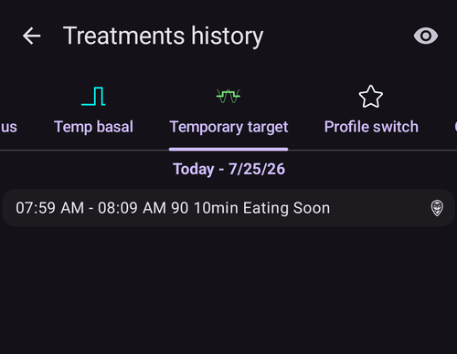

# סקירת הנתונים שלכם

## דפדפן ההיסטוריה של AAPS

**AAPS** שומר את כל ההיסטוריה שלכם (**BG**, טיפולים, בזאלי, יעדים, **החלפת פרופיל**, …) במסד נתונים מקומי בטלפון. מסד הנתונים הזה אינו חלק מ[ייצוא ההגדרות](../Maintenance/ExportImportSettings.md). ניתן לסקור אותו ב-**AAPS** עצמו בעזרת **דפדפן היסטוריה** ומסך **סטטיסטיקה** שמתוארים בהמשך. לסקירות ולדוחות לטווח ארוך, יש להעלות את הנתונים ל-[Nightscout](../SettingUpAaps/Nightscout.md) או ל-[Tidepool](../SettingUpAaps/Tidepool.md).

ניתן לסקור את ההיסטוריה של **AAPS** ב**דפדפן היסטוריה**: יש לפתוח את **התפריט** (☰) ולבחור **דפדפן היסטוריה**.

- יש להקיש על **כרטיס התאריך** כדי לבחור את היום שרוצים לסקור.
- הגרפים נפתחים בתצוגה מוקטנת שמציגה את **כל היום שנבחר**. ניתן לצבוט כדי להגדיל חלק ממנו.
- יש להשתמש בחצים **<** ו-**>** כדי לעבור יום אחד אחורה או קדימה, וב-**עכשיו** כדי לחזור ליום הנוכחי.
- הגרפים מציגים את אותם נתונים כמו הגרפים במסך הראשי (BG, טיפולים, בזאלי, IOB, COB, פעילות, סטיות...).

(reviewing-statistics)=
## AAPS Statistics

**AAPS** provides basic monitoring statistics.

Most values are referenced by ADA 2023 [recommendations](https://diabetesjournals.org/care/article/46/Supplement_1/S97/148053/6-Glycemic-Targets-Standards-of-Care-in-Diabetes).

כדי לפתוח אותה, יש לפתוח את **התפריט** (☰) ולבחור **סטטיסטיקה**.

במסך **סטטיסטיקה** יש ארבע לשוניות: **אינסולין**, **זמן בטווח**, **גלוקוז** ו**מחזור**. יש להקיש על לשונית, או להחליק ימינה או שמאלה כדי לעבור ביניהן.

(reviewing-tdd)=
### לשונית אינסולין: מינון יומי כולל

הכרטיס **מינון יומי כולל** מציג שורה אחת לכל יום מהימים הקודמים (עד שבוע אחד) שיש עבורם ל-**AAPS** נתוני אינסולין, אחר כך את ה**ממוצע** שלהם, ואחר כך את **היום** עד עכשיו. מיד לאחר התקנת **AAPS**, מוצג רק **היום**. העמודות הן:

- **בזאלי**: בזאלי בלבד.
- **בולוס**: סכום טיפולי הבולוס וה-SMB.
- **מינון יומי מצטבר כולל**: המינון היומי הכולל של אינסולין (**TDD**), סכום אינסולין הבולוס והבזאלי שניתן במהלך היום.
- **פחמימות**: טיפולי פחמימות ופחמימות ממושכות שהוזנו.

החלק **TDD** מחושב כשפותחים את הדף, והחישוב לוקח כמה שניות. יש להקיש על **חשב מחדש** כדי לחשב אותו שוב.

ה-**TDD** הוא אינסולין הבולוס ועוד האינסולין הבזאלי שלכם ליום. יש רופאים שמשתמשים - בעיקר אצל מתחילים עם משאבה - ביחס בזאלי-בולוס של 50:50: סך הבזאלי הבסיסי (**TBB**, סכום הקצבים הבזאליים שלכם במשך 24 שעות) צריך אז להיות בערך מחצית מה-TDD. אחרים מעדיפים TBB של 32 % עד 37 % מה-TDD.

כמו רוב כללי האצבע, גם לכלל הזה יש תוקף מעשי מוגבל. הסוכרת שלכם עשויה להיות שונה!

### לשונית זמן בטווח

זמן בטווח (**TIR**): 70-180 mg/dL או 3.9-10 mmol/L.

**TIR** information is available for 7 and 30 days, depending on the amount of data available within the **AAPS** database.

סטטיסטיקה של זמן בטווח צר (TITR) 70-140 mg/dL או 3.9-7.8 mmol/L זמינה למטה (המסך מציג את הטווח הזה כ-70-141).

**יש לדון ביעדים עם האנדוקרינולוג שלכם**

Your diabetes may vary. יש לדון בכל יעד מוצע עם האנדוקרינולוג או עם הצוות הרפואי המטפל שלכם. בשימוש נכון, הסטטיסטיקה של AAPS יכולה להיות כלי יעיל למעקב אחר מגמות __רמת הסוכר בדם__ ולניטור ההתקדמות.

למטה, הכרטיס **זמן בטווח דקסקום** מציג סטטיסטיקה מפורטת של **TIR** ל-14 ימים.

**SD**: Standard Deviation, an [indicator](https://www.ncbi.nlm.nih.gov/pmc/articles/PMC3125941/) of BG variability (the highest = the worst).

HbA1c: the estimate of the resulting glycated hemoglobin, based on the average of CGM measurements. This is an indicative value that might not match blood HbA1c tests.

(reviewing-statistics-agp)=
### לשונית גלוקוז: פרופיל גלוקוז אמבולטורי (AGP)

**פרופיל גלוקוז אמבולטורי** (**AGP**) מראה איך רמת הגלוקוז שלכם נעה בדרך כלל במהלך היום. יש לבחור את התקופה בעזרת הלחצנים בחלק העליון: **היום**, **24 ש׳**, **7 ימים**, **30 ימים** או **90 ימים**.

- **התרשים**: יום אחד מחצות עד חצות. הקו הוא ה**חציון** (חצי מהקריאות שלכם באותה שעה היו נמוכות ממנו, וחצי היו גבוהות ממנו). סביבו, רצועה אחת מכילה את החצי האמצעי של הקריאות שלכם (**25–75%**) ורצועה רחבה יותר מכילה את רובן (**10–90%**). רצועה צרה פירושה שרמת הגלוקוז שלכם דומה מיום ליום באותה שעה. קווים מקווקווים מסמנים את ה**סימון נמוך**, את 140 mg/dL (7.8 mmol/L) ואת ה**סימון גבוה** שלכם.
- **סקירה גליקמית**: הזמן שעבר בטווח שלכם, בטווח הצר (70–140 mg/dL או 3.9–7.8 mmol/L), מעל הטווח שלכם ומתחתיו, ואחר כך ה**ממוצע** וה**חציון** של הגלוקוז שלכם. הטווח שלכם הוא ה**סימון נמוך** וה**סימון גבוה** שהוגדרו ב[טווח להצגה](#Preferences-range-for-visualization).
- **eA1c** ו-**GMI**: שני אומדנים של HbA1c שמחושבים מקריאות ה-CGM שלכם. כמו ה-HbA1c שלמעלה, ייתכן שהם לא יתאימו לבדיקות HbA1c בדם שלכם.
- **SD** (סטיית תקן) ו-**CV** (מקדם השונות): כמה רמת הגלוקוז שלכם משתנה. ערך נמוך יותר פירושו גלוקוז יציב יותר.
- **ימים**: כמה ימים של נתוני CGM שימשו לחישוב.

 

מתחת ל-AGP, הכרטיס **מחומש גלוקוז (CGP)** משרטט חמישה מדדים של הגלוקוז שלכם ב-14 הימים האחרונים בצורת מחומש. מחומש קטן יותר פירושו איזון טוב יותר של הגלוקוז.

### לשונית מחזור: דפוס מחזורי TDD

**דפוס מחזורי TDD** מציג זה על גבי זה את סכומי האינסולין היומיים שלכם במחזורים של 28 ימים, כדי לעזור לזהות דפוסים שחוזרים על עצמם. כל מחזור משורטט כקו (**מחזורים נפרדים**), יחד עם הממוצע שלהם.

- **TDD גולמי** / **TDD מתוקן**: בחירה בין המינון היומי הכולל כפי שניתן, לבין ה-TDD פחות האינסולין שניתן לפחמימות.
- **היסט מחזור**: מזיז את תחילת המחזור (0 עד 27 ימים).

נדרשים לפחות 56 ימים של נתונים (2 מחזורים). כשיש פחות נתונים, הכרטיס מציג **אין מספיק נתונים (נדרשים לפחות 56 ימים עבור 2 מחזורים)**. הדפוס מחושב רק כשפותחים את הלשונית **מחזור**, כי הוא קורא 168 ימים של נתונים.

(aaps-screens-treatments)=
## היסטוריית טיפולים

יש לפתוח את **התפריט** (☰) בפינה העליונה של המסך הראשי ולבחור **היסטוריית טיפולים**. בתצוגה זו ניתן לראות ולשנות את ההיסטוריה של הטיפולים הבאים, כל אחד בלשונית משלו (יש להחליק את שורת הלשוניות כדי לראות את כולן):

* פחמ' ובולוס
* [בולוס ממושך](#Extended-Carbs-extended-bolus-and-switch-to-open-loop-dana-and-insight-pump-only)
* בזאלי זמני
* [יעד זמני](../DailyLifeWithAaps/TempTargets.md)
* [החלפת פרופיל](../DailyLifeWithAaps/ProfileSwitch-ProfilePercentage.md)
* פורטל טיפולים: הערות ורשומות של פורטל הטיפולים
* מצב הפעלה: היסטוריית מצב הלולאה
* קלט המשתמש: הערות אחרות שלא נשלחות ל-Nightscout

בסוף כל שורה, סמלים קטנים מראים מאיפה הנתונים הגיעו או לאן הם נשלחו:
* סמל **Nightscout** (הלוגו של Nightscout): הנתונים הגיעו מ-Nightscout או נרשמו ב-Nightscout
* סמל **משאבה**: הנתונים הגיעו מהיסטוריית המשאבה (המשאבה עיבדה אותם)
* סמל **פח אשפה**: הרשומה נמחקה (הוא מוצג רק כשמציגים רשומות שנמחקו בעזרת סמל ה**עין** בחלק העליון של המסך)

(screens-bolus-carbs)=
### פחמ' ובולוס

בלשונית זו ניתן לראות את יומן הבולוסים והפחמימות. כל בולוס (שורה **1**) מציג ליד כמות האינסולין את ה-IOB שעוד נשאר ממנו. מקור הבולוס יכול להיות:
* ארוחה (הוזן ידנית דרך הלחצנים אינסולין, אשף מהיר או אשף בולוס)
* SMB, כשמשתמשים בתכונת ה-SMB

רשומות הפחמימות (שורה **2**) מוצגות עם הכמות שלהן בגרמים.

אם השתמשתם ב[אשף הבולוס](#aaps-screens-bolus-wizard) כדי לחשב את מינון האינסולין, ניתן ללחוץ על הטקסט “Calc” בשורת הבולוס כדי לראות את פרטי החישוב של הבולוס.

בהתאם למשאבה, אינסולין ופחמימות יכולים להופיע בשורה אחת, או בכמה שורות: אחת לפרטי החישוב, אחת לפחמימות ואחת לבולוס עצמו.

ניתן להשתמש בהיסטוריית הטיפולים כדי לתקן רשומות פחמימות שגויות (_כלומר_ הערכתם את הפחמימות ביותר או בפחות מדי). שימו לב שלא ניתן לערוך רשומה קיימת, יש לפעול לפי התהליך הבא:

1. יש לבדוק ולזכור את ה-COB וה-IOB הנוכחיים במסך הראשי.
2. בהתאם למשאבה, הפחמימות יכולות להופיע יחד עם האינסולין בשורה אחת או כרשומה נפרדת (למשל עם Dana RS).
3. יש להסיר את הרשומה עם כמות הפחמימות השגויה: ללחוץ על סמל פח האשפה, לבחור את השורות להסרה, ואז ללחוץ שוב על סמל פח האשפה כדי לסיים.
4. יש לוודא שהפחמימות הוסרו בהצלחה על ידי בדיקה חוזרת של ה-COB במסך הראשי.
5. יש לעשות אותו דבר עבור ה-IOB אם יש רק שורה אחת שכוללת פחמימות ואינסולין.

   → אם הפחמימות לא הוסרו כמתוכנן, ומוסיפים פחמימות נוספות כפי שמוסבר כאן (6.), ה-COB יהיה גבוה מדי וזה עלול לגרום למתן אינסולין גבוה מדי.

6. יש להזין שוב את כמות הפחמימות הנכונה (**טיפולים ← פחמימות** בסרגל הניווט התחתון, או לחצן **פחמימות** של [הפעלה מהירה](#quicklaunch)) ולוודא שמוגדרת שעת האירוע הנכונה.
7. אם יש רק שורה אחת שכוללת פחמימות ואינסולין, יש להוסיף גם את כמות האינסולין. יש לוודא שמוגדרת שעת האירוע הנכונה ולבדוק את ה-IOB במסך הראשי לאחר אישור הרשומה החדשה.

### בזאלי זמני

כאן מוצגים ה**קצבים הבזאליים הזמניים** שהלולאה הפעילה. כשלרשומה עדיין יש השפעה על ה-IOB, המידע מוצג ליד המינון (שורה **1**). הוא יכול להיות:
* IOB חיובי אם הבזאלי הזמני היה גבוה מזה שמוגדר בפרופיל
* IOB שלילי עבור בזאלי זמני אפס (כמו בשורה **1**) או אם הבזאלי הזמני היה נמוך מזה שמוגדר בפרופיל

מחיקת הרשומות משפיעה רק על הדוחות שלכם ב-Nightscout, וכנראה תעוות את ה-IOB האמיתי שלכם - לא מומלץ לעשות זאת.

בצד השורה, S אדומה פירושה “Suspend” (השהיה): זה קורה כשהבזאלי לא ניתן כרגע. זה מצב רגיל, למשל בזמן החלפת פוד.

### יעד זמני

כאן ניתן לראות את היסטוריית היעדים הזמניים.

### החלפת פרופיל

כאן ניתן לראות את היסטוריית החלפות הפרופיל. ייתכן שתראו כמה רשומות בכל פעם שמחליפים פרופיל: שורה **1**, שנשמרת גם ב-NS וגם בהיסטוריית המשאבה, מתאימה להחלפה עצמה. שורה **2**, שנשמרת ב-Nightscout אבל לא בהיסטוריית המשאבה, מתאימה לבקשה להחלפת פרופיל שהמשתמש ביצע.

מחיקת הרשומות משפיעה רק על הדוחות שלכם ב-Nightscout, ולעולם לא תשנה בפועל את הפרופיל הנוכחי.

ניתן להשתמש בלחצן **שכפול** שמוצג בשורה **2** כדי ליצור עותק של **החלפת פרופיל**. למידע נוסף, ראו [פרופיל AAPS שלכם > ניהול הפרופילים שלכם](#your-aaps-profile-clone-profile-switch).

### פורטל הטיפולים

לשונית זו מציגה את כל ההערות ורשומות פורטל הטיפולים שנרשמו ב-Nightscout.

(AapsScreens-running-mode)= (aaps-screens-running-mode)=
### מצב הפעלה

לשונית זו מציגה את ההיסטוריה של שינויי [מצב הלולאה](#AapsScreens-loop-status): פתוחה, סגורה, LGS, השהיה, ניתוק.

### קלט המשתמש

לשונית זו מפרטת את הפעולות שבוצעו ב-**AAPS** על ידי המשתמש או על ידי **אוטומציה** (שינויי מצב הלולאה, החלפות פרופיל, טיפולים, ייצוא הגדרות...). הרשומות האלה לא נשלחות ל-Nightscout.

------

## What is the difference between Nightscout vs Tidepool?

Nightscout can facilitate the user’s storage of **AAPS’** data and offers a wide range of [reporting tools](https://nightscout.github.io/nightscout/reports/).

Whereas, Tidepool allows the user to [review their data](https://www.tidepool.org/viewing-your-data) and provides [simple sharing with your endo team](https://www.tidepool.org/providers/how-it-works#tidepool-data-platform).