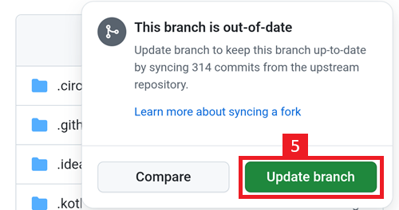
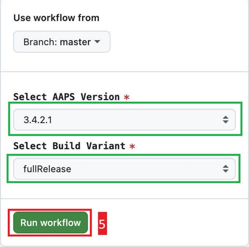

# עדכון בדפדפן (fork)

```{tip}
בניתם את AAPS עם **AAPS Builder**? אין צורך בדף הזה: ראו [עדכון AAPS עם AAPS Builder](#aaps-builder-updates).
```

## בנייה עצמית במקום הורדה

**AAPS** is not available to download, due to regulations concerning medical devices. בנייה עצמית של האפליקציה לשימוש אישי הינה חוקית אך אסור לתת את האפליקציה לאחרים! See [FAQ page](../UsefulLinks/FAQ.md) for details.

```{note}
אם ברצונכם לשדרג את **AAPS** באמצעות דפדפן בפעם הראשונה: העתיקו את קובץ הגיבוי של ה-keystore שלכם ל-Google Drive. Then follow the [Browser Build **AAPS** procedure](../SettingUpAaps/BrowserBuild.md) instead of this guide. במקום ליצור keystore חדש, יש לבחור את ה-keystore שהעתקתם מהמחשב שלכם.
This operation will be mandatory only the first time, then for successive upgrades you will be able to follow this guide.
```

```{tip}
**עוברים ל-AAPS Builder?** [AAPS Builder](../SettingUpAaps/BrowserBuildAapsBuilder.md) היא דרך הבנייה הפשוטה יותר בדפדפן: אין fork לסנכרן, ואת האפליקציה מורידים ישירות מ-GitHub. אין חובה לעבור: המדריך הזה ממשיך לעבוד. אם עוברים, יש קודם לקבל עותק של ה-keystore מה-fork שלכם, כפי שמוסבר ב[מעבר מהבנייה הקודמת בדפדפן](#aaps-builder-from-fork). אחרת הבנייה החדשה לא תוכל לעדכן את AAPS שבטלפון שלכם.
```

## Overview for updating to a new version of AAPS with a browser

```{contents} Steps for updating to a new version of AAPS
:depth: 1
:local: true
```

אם נתקלים בבעיות, ראו את הדף הנפרד [בנייה בדפדפן: פתרון תקלות](../GettingHelp/BrowserBuildTroubleshooting.md).

### Export your settings

Export your settings from the existing **AAPS** version on your phone. You might not need it, but better be safe than sorry.

See the [Export & import settings](ExportImportSettings.md) page if you don't remember how to do this.

(Update-to-new-version-update-your-repo)=
### Update your GitHub repository

[Log into GitHub](https://github.com/login).

1. Select Repositories.
2. Scroll down and select your own AndroidAPS repository.


3. Verify you are using your own copy of AndroidAPS (Forked from nightscout/AndroidAPS)
4. לחצו על Sync Fork כדי לעדכן אותו (מספר הקומיטים שבהם הוא מפגר עשוי להיות שונה מהתמונה)


5. Tap Update Branch



Note: if you have modified your copy of AndroidAPS by mistake, you will see this screen. השליכו את כל השינויים (הקומיטים) כדי לחזור לגרסה שפורסמה.


כעת סנכרנתם (עדכנתם) את העותק שלכם עם הגרסה האחרונה שפורסמה של **AAPS**. Good job.


### הרצת ה-workflow לבניית APK חתום

1. In your GitHub copy of AndroidAPS, select Actions.
2. Expand All Workflows.
3. Select AAPS-CI


4. Scroll down and tap Run Workflow.


5. השאירו את הענף מוגדר ל-master. ב-**Select AAPS Version**, בדקו שנבחרה **4.0.0**, הגרסה החדשה ביותר בראש הרשימה. אם ה-fork שלכם לא מעודכן, הגרסה שנבחרה מראש היא גרסה ישנה יותר: אם מריצים את תהליך העבודה עם הטופס כפי שהוא נפתח, בונים מחדש את הגרסה הישנה, והאפליקציה לא מתעדכנת. בחרו את ה-[וריאנט](#browserbuild-variant) (fullRelease) ולאחר מכן לחצו על Run workflow.

   ```{note}
   רשימת הגרסאות היא חלק מתהליך העבודה ב-fork שלכם. אם **4.0.0** חסרה, ה-fork שלכם עדיין לא מסונכרן: חזרו אל [עדכון מאגר GitHub שלכם](#Update-to-new-version-update-your-repo).
   ```




6. You will see the message Workflow run was successfully requested. Refresh your browser page and you will be able to monitor the build progress. When the action completes, the AAPS CI action will show a green tick mark. בניתם בהצלחה את הגרסה המעודכנת של **AAPS**. This means that the Master and Wear apk is now directly saved into your Google Drive (as per below). AAPSClient apk can be downloaded from Github > nightscout > AndroidAPS [here](https://github.com/nightscout/AndroidAPS/releases)


### Install the AAPS APK

1. Open your Google Drive
2. Browse into AAPS, select the new version folder and you will find both the phone and Android Wear versions.


```{note}
מספטמבר 2026, [אימות מפתחים ב-Android](#android-developer-verification) של Google עלול לחסום התקנה של ה-APK בהקשה על הקובץ, תלוי במדינה שלכם. פתרונות עקיפה בחינם מוסברים בדף ההוא.
```

Continue [here](#Update-to-new-version-check-aaps-version-on-phone)

(update-browser-build-troubleshooting)=

## פתרון תקלות

If anything goes wrong, don't panic.

Take a breath!

לאחר מכן יש לבדוק אם הבעיה שלכם כבר מתועדת: ראו [פתרון תקלות ב-AAPS Builder](#aaps-builder-troubleshooting) אם אתם בונים עם **AAPS Builder**, או [בנייה בדפדפן: פתרון תקלות](#aaps-ci-troubleshooting) אחרת.

If you need further help, please reach out to other **AAPS** users on [Facebook](https://www.facebook.com/groups/AndroidAPSUsers) or [Discord](https://discord.gg/4fQUWHZ4Mw).
