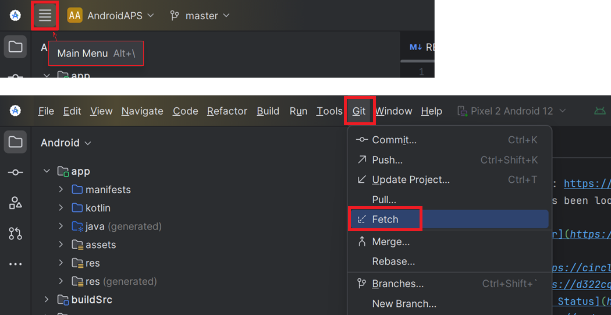
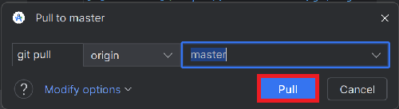
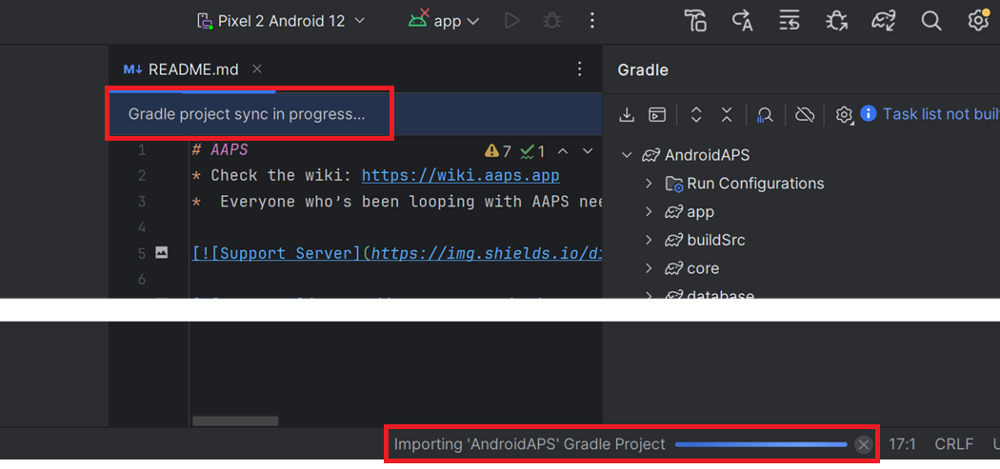

# Update with Android Studio

## בנייה עצמית במקום הורדה

**AAPS** is not available to download, due to regulations concerning medical devices. בנייה עצמית של האפליקציה לשימוש אישי הינה חוקית אך אסור לתת את האפליקציה לאחרים! See [FAQ page](../UsefulLinks/FAQ.md) for details.

```{note}
אם ברצונכם לבנות את **AAPS** במחשב חדש: העתיקו את קובץ הגיבוי של ה-keystore שלכם למחשב החדש. Then follow the [Initial build **AAPS** procedure](../SettingUpAaps/BuildingAaps.md) instead of this guide. ההבדל היחיד הוא שבמקום ליצור keystore חדש, ניתן לבחור את ה-keystore שהעתקתם למחשב החדש.
```

## Overview for updating to a new version of AAPS with Android Studio

```{contents} Steps for updating to a new version of AAPS
:depth: 1
:local: true
```

אם נתקלים בבעיות, ראו את הדף הנפרד [פתרון תקלות ב-Android Studio](../GettingHelp/TroubleshootingAndroidStudio.md).

### Export your settings

Export your settings from the existing **AAPS** version on your phone. You might not need it, but better be safe than sorry.

See the [Export & import settings](ExportImportSettings.md) page if you don't remember how to do this.

### Check your Android Studio version

הגרסה המינימלית הדרושה מתוארת ב[הוראות הבנייה](#Building-APK-recommended-specification-of-computer-for-building-apk-file). If your version is older, please [update Android Studio first](#Building-APK-install-android-studio)!

(Update-to-new-version-update-your-local-copy)=
### Update your local copy

* Open your existing AAPS project with Android Studio. You might need to select your project. (Double) click on the AAPS project.

  

* In the menu bar of Android Studio, select Git -> Fetch

   

* You will see a message in the lower right corner that Fetch was successful.

   

* In the menu bar, now select Git -> Pull

   

* Leave all options as they are (origin/master) and select Pull

   

* Wait while download is in progress, you will see this as info in the bottom bar. When it's done, you will see a success message.

  ```{note}
  The files that were updated may vary! זה לא מעיד על בעיה.
  ```

   

* Gradle Sync will be running to download some dependencies. Wait until it is finished.

  

### Check JVM version

This check is particularly indicated if you have already built a previous version of **AAPS** on the same computer.

Check in the [Building Instructions](#Building-APK-recommended-specification-of-computer-for-building-apk-file) the required version for JVM, matching the **AAPS** version you are now building. Then follow the steps described at [Incompatible Gradle JVM](#incompatible-gradle-jvm) to make sure you currently use the correct version.

(Update-to-new-version-build-the-signed-apk)=
### Build the Signed APK

Your sourcecode is now the current released version, and all prerequisites have been checked. It's time to build the signed apk as described in the [build signed apk section](#Building-APK-generate-signed-apk).

(Update-to-new-version-transfer-and-install)=

### Transfer and install the apk
You need to transfer the apk to your phone so you can install it.

```{note}
אם השלמתם את הבנייה עם אותו keystore קיים ב-Android Studio, אין צורך להסיר את האפליקציה הקיימת בטלפון שלכם. When you install the apk, follow the prompts to install updates.
במקרים אחרים, כגון יצירת keystore חדש ב-Android Studio עבור ה-apk החתום שלכם, תצטרכו למחוק את האפליקציה הישנה לפני התקנת ה-apk. **Make sure to export your settings!**
```

ראו את ההוראות ל[העברה והתקנה של AAPS](../SettingUpAaps/TransferringAndInstallingAaps.md). במקומות שבהם [אימות מפתחים ב-Android](#android-developer-verification) של Google נאכף (החל מספטמבר 2026, בהתאם למדינה שלכם), יש להתקין באמצעות [ADB](#android-developer-verification-adb) במקום להקיש על קובץ ה-APK.

Continue [here](#Update-to-new-version-check-aaps-version-on-phone).

(update-computer-build-troubleshooting)=

## פתרון תקלות

If anything goes wrong, don't panic.

Take a breath!

לאחר מכן בדקו בדף הנפרד [פתרון תקלות ב-Android Studio](../GettingHelp/TroubleshootingAndroidStudio.md) אם הבעיה שלכם כבר מתועדת.

If you need further help, please reach out to other **AAPS** users on [Facebook](https://www.facebook.com/groups/AndroidAPSUsers) or [Discord](https://discord.gg/4fQUWHZ4Mw).