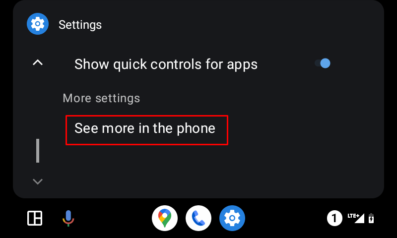
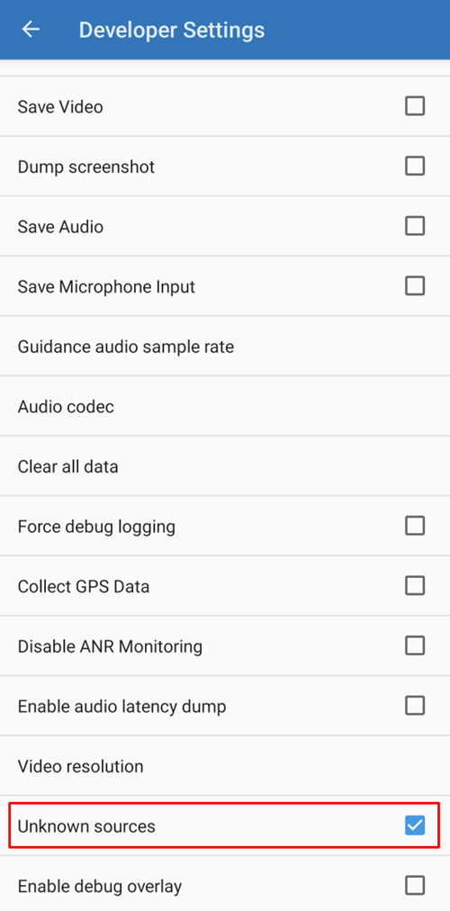

# Android Auto

**AAPS** is capable of sending you information about your current status as a message, directly into Android Auto in your car.

## Requirements

**AAPS** משתמש בתכונה של Android Auto המאפשרת להעביר הודעות מאפליקציות בטלפון לתצוגה של מערכת השמע במכונית.

That means that:

* מערכת Android צריכה לאפשר ל-**AAPS** להציג התראות, וגם
* מכיוון ש-**AAPS** הוא אפליקציה לא רשמית, אפשרו שימוש ב-"unknown sources" (מקורות לא ידועים) ב-Android Auto.

(androidauto-check-that-aaps-can-show-notifications)=

## בדיקה ש-AAPS יכול להציג התראות

**AAPS** מציג תמיד התראת מצב עם רמת הסוכר הנוכחית, IOB ו-COB. זו ההתראה ש-Android Auto מציג במכונית. אין צורך להפעיל דבר ב-**AAPS**, אבל מערכת Android צריכה לאפשר ל-**AAPS** להציג התראות.

בטלפון, יש לפתוח **Settings** (הגדרות) > **Apps** (אפליקציות) > **AAPS** > **Notifications** (התראות) ולוודא ש-**All AAPS notifications** (כל ההתראות של AAPS) מופעל.

יש לגלול למטה ולוודא ש-**מצב שוטף** מופעל: זה הערוץ של התראת המצב.

יש לבדוק עכשיו שהתראת המצב של **AAPS** מופיעה בטלפון, לפני שהולכים למכונית!

(androidauto-allow-the-use-of-unknown-sources-with-android-auto)=

## אפשרו שימוש ב-"unknown sources" (מקורות לא ידועים) ב-Android Auto.

מכיוון ש-**AAPS** אינו אפליקציה רשמית של Android Auto, יש להפעיל התראות עבור "unknown sources" (מקורות לא ידועים) ב-Android Auto. הדבר נעשה באמצעות מצב מפתח (developer mode), כפי שנראה כאן.

גשו למכונית וחברו את הטלפון למערכת השמע שלה.

You should now see a screen similar to this screen.

לחצו על סמל **ההגדרות** כדי להתחיל בהגדרה.

גללו לסוף הדף ובחרו **see more in the phone** (הצגת עוד בטלפון).

כעת נפעיל את מצב המפתח בטלפון.

The first screen looks like this. Scroll down to the end of the page.

There you see the version of Android Auto listed. Tap 10 times (in word ten) on the version of Android Auto. באמצעות רצף נסתר זה הפעלתם כעת את מצב המפתח.

אשרו שברצונכם להפעיל את מצב המפתח בתיבת הדו-שיח "Allow development settings?" (לאפשר הגדרות פיתוח?).

ב-**developer settings** (הגדרות מפתח) הפעילו את "Unknown sources" (מקורות לא ידועים).

כעת ניתן לצאת ממצב המפתח אם רוצים. לשם כך, לחצו על תפריט שלוש הנקודות בחלק העליון של המסך.

## Show notifications in car

לחצו על **סמל המספר** בחלק התחתון של מסך Android Auto במכונית.

Your CGM data will be shown as follows:

(android-auto-troubleshooting)=

## פתרון תקלות:

* אם ההתראה לא מופיעה, יש לבדוק אם [אפשרתם ל-AAPS להציג התראות](#androidauto-check-that-aaps-can-show-notifications) ב-Android, ואם [ל-Android Auto יש הרשאת גישה להתראות](#androidauto-allow-the-use-of-unknown-sources-with-android-auto).