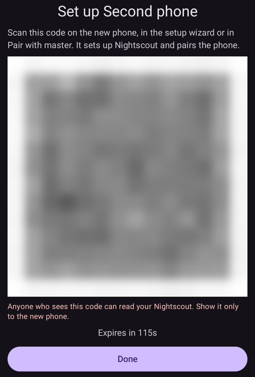

(client-master-control)=
# שליטה בין מכשיר ראשי ↔ מכשיר לקוח (שליטה מרחוק חתומה)

מגרסה 4 של **AAPS**, טלפון עוקב שמריץ את **AAPSClient** יכול לעשות הרבה יותר מאשר *להכריז* על טיפולים דרך Nightscout: אחרי שהוא **צומד** לטלפון הראשי, הוא יכול לשלוח **פקודות חתומות** שהטלפון הראשי (**המכשיר הראשי**) בודק, מאשר ומבצע — כולל מתן **בולוס אינסולין** במשאבה של המכשיר הראשי.

דף זה מסביר איך זה עובד, ואיך להגדיר את זה ולהשתמש בזה.

```{contents} Table of contents
:depth: 2
:local: true
```

```{admonition} Wording used on this page
:class: note
- **המכשיר הראשי** (Master) = הטלפון הראשי של **AAPS**, שמחובר למשאבה ומריץ את הלולאה (האפליקציה `full`).
- **מכשיר לקוח** (Client) = טלפון עם **AAPSClient** בלי משאבה, שעוקב אחרי המכשיר הראשי ועכשיו גם *שולט* בו.
- שני הטלפונים חייבים להיות מחוברים **לאותו אתר Nightscout**. כל התקשורת עדיין עוברת דרך Nightscout — אין צורך בחיבור ישיר בין הטלפונים.
```

---

## איך זה עובד

```{admonition} Coming from AAPS v3?
:class: note
ב-**AAPS** v3, **AAPSClient** יכול היה רק לכתוב ל-Nightscout טיפולים לא חתומים של פורטל הטיפולים, ולא יכול היה לתת בולוס. שליטה מרחוק דורשת עכשיו [צימוד](#client_master_master_setup) חד-פעמי. ראו גם [מה השתנה ב-AAPS v4](#v4changes-remote-control).
```

**AAPS** v4 משתמש בערוץ ייעודי בשם **Client-Control**. הערוץ עדיין עובר דרך אתר ה-Nightscout שלכם (באוסף `settings`), אבל כל הודעה **חתומה בחתימה קריפטוגרפית** עם סוד ששני הטלפונים בלבד יודעים. הסוד נמסר פעם אחת, בזמן **הצימוד**, ומיד אחר כך מוחלף בסוד חדש, כך שהוא אף פעם לא עובר כטקסט גלוי.

העיקרון המנחה הוא **המכשיר הראשי הוא שמחליט**:

1. מכשיר הלקוח שולח *כוונה* (“בולוס 2 U”, “הפעלת התרחיש פעילות גופנית”, “הגדרת היעד הזמני הזה”…).
2. **המכשיר הראשי** מחשב מחדש את הפעולה ו**מגביל** אותה לפי הנתונים העדכניים **שלו** (פרופיל, IOB, COB, היעד הזמני הנוכחי, משאבה), ו**כותב את נוסח האישור המדויק** שהמשתמש יראה.
3. מכשיר הלקוח (או השעון) מציג את נוסח האישור של **המכשיר הראשי** — הוא אף פעם לא יוצר נוסח משלו.
4. לאחר האישור, המכשיר הראשי **מבצע את הפעולה פעם אחת** ומדווח את התוצאה בחזרה למכשיר הלקוח.

מה זה אומר עבורכם:

- **פקודות חתומות**: רק מכשירי הלקוח שצימדתם יכולים לשלוח פקודות (סוד צימוד וחתימה נפרדים לכל מכשיר לקוח). פקודות ישנות או פקודות שנשלחות שוב נדחות.
- **תפקיד לכל מכשיר לקוח**: אתם מחליטים מה כל מכשיר לקוח רשאי לעשות, מ*קריאה בלבד* ועד *ניהול* — ראו [תפקידי לקוח](#client-master-control-roles).
- **בולוס אינסולין ממכשיר לקוח**: המכשיר הראשי נותן אותו במשאבה שלו, ומכשיר הלקוח מציג את התקדמות ההזרקה.
- **המכשיר הראשי מחליט**: הוא מגביל כל פעולה לפי המגבלות שלו וכותב את נוסח האישור שמוצג במכשיר הלקוח.
- **רק מכשירי לקוח מצומדים משנים את הטיפול**: כל עוד השליטה ממכשירי לקוח מופעלת, המכשיר הראשי כבר לא מקבל טיפולים או שינויים שהוקלדו ישירות ב-Nightscout — ראו [מצב מוקשח](#client-master-control-hardened-mode).
- **כל מכשיר לקוח מקבל אסימון Nightscout משלו**, רק עם ההרשאות שמכשיר לקוח צריך — ראו [אסימון ה-Nightscout הנפרד של מכשיר הלקוח](#client-master-control-own-token).
- **המכשיר הראשי לא מקוון**: הפעולות נחסמות עם הודעה ברורה.
- **ביטול הרשאה של מכשיר לקוח** דורש לחיצה אחת (לכל מכשיר לקוח), או שאפשר להשתמש במתג במכשיר הראשי כדי לעצור את כל מכשירי הלקוח.

פעולות שאפשר להפעיל ממכשיר לקוח: **בולוס**, **פחמימות / פחמימות ממושכות**, **יעד זמני** (הגדרה וביטול), **החלפת פרופיל**, שינוי **לולאה / מצב הפעלה**, **בזאלי זמני** (הגדרה וביטול), **בולוס ממושך** (הגדרה וביטול), **בחירת אינסולין**, ו**[תרחישים](../DailyLifeWithAaps/Scenes.md)**. חלק מה**העדפות** הן דו-כיווניות, והן נשמרות מסונכרנות בין המכשיר הראשי למכשירי הלקוח.

---

## תפקידים ודרישות מוקדמות

```{admonition} Before you start
:class: important
- **המכשיר הראשי** מריץ את בניית ה-`full` הרגילה של **AAPS** ומחובר למשאבה שלכם.
- **המכשיר הראשי** משתמש ב-**NSClientV3** עם ה-Nightscout שלכם ומציג *מחובר*. יש לתת לו **אסימון מנהל (admin)** של ה-Nightscout שלכם: בעזרתו המכשיר הראשי יכול ליצור אסימון נפרד לכל מכשיר לקוח ולהציג אותו למכשיר הלקוח כקוד QR.
- **מכשיר הלקוח** מריץ את **[AAPSClient](AapsClient.md)** (או **AAPSClient2** / **AAPSClient3** למטופלים נוספים — ראו [על AAPSClient, AAPSClient2 ו-AAPSClient3](#remotecontrol-aapsclient-versions)). הוא חייב להשתמש **באותו** Nightscout. אם מגדירים אותו עם קוד ה-QR של המכשיר הראשי, מכשיר הלקוח מקבל את כתובת ה-Nightscout ואת האסימון מהמכשיר הראשי; אחרת יש להגדיר בו קודם את **NSClientV3** בעצמכם.
- נדרשים **websockets** בשני הטלפונים: פקודות מגיעות למכשיר הראשי רק דרך חיבור ה-websocket. כל עוד השליטה ממכשירי לקוח מופעלת, **AAPS** משאיר את ה-websockets מופעלים, במכשיר הראשי ובמכשירי הלקוח המצומדים.
```

צימוד וסנכרון הם שני דברים שונים:

- **סנכרון** (נתונים: ערכי סוכר, טיפולים, פרופיל) מוגדר כמו קודם — ראו [סנכרון](#RemoteControl_aapsclient). קוד ה-QR של המכשיר הראשי יכול לעשות זאת בשבילכם במכשיר הלקוח.
- **צימוד** (שליטה: ערוץ הפקודות החתומות שמתואר כאן) הוא השלב החדש שמופיע בהמשך.

---

## הגדרה

(client_master_master_setup)=
### 1. במכשיר הראשי — הפעלת השליטה והוספת מכשיר לקוח

במכשיר הראשי, יש לפתוח את מסך **ניהול** ולבחור **לקוחות מורשים**.

יש להפעיל את **מתן אפשרות לשליטה ממכשיר לקוח** (כברירת מחדל היא **כבויה**). זה המתג הראשי להשבתה: כשהוא כבוי, אף מכשיר לקוח לא יכול לשלוח פקודות, אבל מכשירי הלקוח המצומדים נשמרים, כך שאפשר להפעיל אותו שוב מאוחר יותר. ההפעלה שלו מפעילה גם את [מצב מוקשח](#client-master-control-hardened-mode), שמוצג כ-"*מצב מוקשח מופעל*" עם **(i)** שמסביר אותו. ב[מצב פשוט](#preferences-simple-mode) השליטה ממכשירי לקוח תמיד מופעלת, ולכן המתג לא מוצג.


יש ללחוץ על לחצן **+** (בפינה התחתונה של המסך) כדי להוסיף מכשיר לקוח. בחלון **מכשיר לקוח חדש**:

1. יש להזין **שם מכשיר**, כדי שתוכלו לזהות אותו ברשימה.
2. יש לבחור **איך הטלפון מוגדר** (ראו את הטבלה בהמשך).
3. יש לבחור את ה**[תפקיד](#client-master-control-roles)** שלו. שום דבר לא נבחר מראש: התפקיד הנכון תלוי במי שמשתמש בטלפון.


| דרך                           | מה הטלפון החדש מקבל                                                  | מתי להשתמש בה                                                                                     |
| ----------------------------- | -------------------------------------------------------------------- | ------------------------------------------------------------------------------------------------- |
| **קוד QR: Nightscout וצימוד** | את כתובת ה-Nightscout, אסימון Nightscout משלו ואת הצימוד, בסריקה אחת | לטלפון החדש יש מצלמה: הדרך המהירה ביותר, אין צורך להקליד דבר                                      |
| **קוד QR: רק Nightscout**     | את כתובת ה-Nightscout ואסימון Nightscout משלו, בלי צימוד             | הטלפון צריך רק **להציג** נתונים ואף פעם לא לשלוח פקודות                                           |
| **PIN**                       | רק את הצימוד; הוא שומר את הגדרות ה-Nightscout שכבר יש לו             | לטלפון אין מצלמה (או שהמכשיר הראשי לא יכול ליצור אסימונים); הוא חייב להיות כבר מחובר ל-Nightscout |

שתי הדרכים עם קוד QR דורשות **אסימון מנהל (admin)** בהגדרות **NSClientV3** של המכשיר הראשי, כי המכשיר הראשי יוצר ב-Nightscout את האסימון של מכשיר הלקוח. בלי אסימון כזה, האפשרויות של קוד QR מוצגות אבל אי אפשר לבחור בהן, והחלון מסביר למה; **PIN** עובד תמיד.

#### עם קוד QR

יש ללחוץ על **אישור**: המכשיר הראשי יוצר את אסימון ה-Nightscout של מכשיר הלקוח ומציג **קוד QR**. קוד שגם מצמד עובד בערך **שתי דקות**; המסך מציג ספירה לאחור ונסגר מעצמו כשמכשיר הלקוח סיים את הצימוד. יש לסרוק אותו בטלפון החדש כפי שמתואר בסעיף [במכשיר הלקוח](#client_master_client_setup).

```{admonition} The QR code is a secret
:class: warning
כל מי שרואה את קוד ה-QR יכול לקרוא את ה-Nightscout שלכם, וקוד שמצמד מכיל גם את הצימוד. יש להציג אותו רק לטלפון החדש. **AAPS** חוסם צילומי מסך כל עוד הקוד מוצג על המסך.
```



#### עם PIN

יש ללחוץ על **אישור**: המכשיר הראשי מציג **PIN לצימוד** בן 8 ספרות, בשתי קבוצות של ארבע ספרות (למשל `1234 5678`). ה-PIN הזה הוא **חד-פעמי** ו**תוקפו פג אחרי כשתי דקות**. כמו עם קוד ה-QR, המכשיר הראשי דוחה שם של מכשיר לקוח שכבר נמצא ברשימה שלו: כל מכשיר לקוח מקבל אסימון (token) משלו ב-Nightscout תחת השם שלו.


```{admonition} The pairing PIN is a secret
:class: warning
ה-PIN מגן על סוד הצימוד שמועבר דרך Nightscout. יש לשתף אותו רק עם המכשיר שמצמדים, לא לפרסם אותו בפומבי, ולתת לתוקף שלו לפוג אם לא משתמשים בו. תמיד אפשר ליצור PIN חדש בלחיצה נוספת על **+**.
```

(client_master_client_setup)=
### 2. במכשיר הלקוח — צימוד למכשיר הראשי

#### סריקת קוד ה-QR

אפשר לסרוק את קוד ה-QR של המכשיר הראשי בשני מקומות:

- ב**אשף ההתקנה** של מכשיר הלקוח, בשלב "**הגדרה מהמכשיר הראשי**", שמופיע לפני שלב ה-Nightscout. סריקה אחת מגדירה אז את Nightscout, ועם קוד שמצמד גם את הצימוד, כך שההתקנה מסתיימת: האשף נסגר ומסך הבית נפתח;
- בכל זמן מאוחר יותר דרך **ניהול ← צימוד למכשיר ראשי ← סריקת קוד QR**.

בפעם הראשונה, **AAPSClient** מבקש הרשאה ל**מצלמה**. אם מסרבים, המסך אומר שהמצלמה נדרשת, ואפשר לאשר אותה עם **ניסיון חוזר** או לבצע צימוד עם PIN במקום זאת.

יש לכוון את המצלמה אל הקוד. מכשיר הלקוח מציג מה הקוד עושה — את כתובת ה-Nightscout, ובקוד שמצמד גם את המכשיר הראשי שאליו הוא מצמד — ושואל "**להשתמש בקוד הזה?**". יש ללחוץ על **שימוש**: מכשיר הלקוח מפעיל את **NSClientV3**, מחליף את כתובת ה-Nightscout ואת האסימון שלו בנתונים מהקוד ומפעיל websockets. קוד שמצמד גם מצמד את הטלפון; הטלפון שולח הודעת Hello למכשיר הראשי מיד כשהוא מתחבר ל-Nightscout.


```{admonition} Scanning is available on Android
:class: note
A computer without camera: use the PIN there.
```

#### הזנת ה-PIN

במכשיר הלקוח, יש לפתוח **ניהול ← צימוד למכשיר ראשי** (או את שלב האשף **צימוד למכשיר ראשי**, אחרי שלב ה-Nightscout), **להזין את ה-PIN בן 8 הספרות** שמוצג במכשיר הראשי וללחוץ על **צימוד**. מכשיר הלקוח משתמש ב-PIN כדי לקבל בצורה מאובטחת את הצעת הצימוד דרך Nightscout, ואז שואל "**לצמד למכשיר ראשי זה?**" ומציג את המזהה של המכשיר הראשי. יש ללחוץ על **צימוד** כדי לאשר (צילום מסך נמצא ב[צימוד למכשיר הראשי](#aapsclient-pairing-with-the-master)).


#### אחרי הצימוד

אחרי שמכשיר לקוח צומד, הוא שולח הודעת **Hello** למכשיר הראשי ומופיע ברשימת **לקוחות מורשים** של המכשיר הראשי כ**פעיל**, עם זמן *“נראה לאחרונה”*. מכשיר הלקוח יודע את ה[תפקיד](#client-master-control-roles) שלו מהצימוד, ולכן הוא מציג מיד את הלחצנים הנכונים. צימוד שנעשה באשף ההתקנה מסיים את האשף. באותו שלב שני הטלפונים מחליפים את סוד הצימוד בסוד חדש שאף פעם לא עבר ברשת (ראו [הערות אבטחה](#client-master-control-security)), ומכשיר לקוח שהוגדר עם PIN מקבל אסימון Nightscout משלו (ראו [אסימון ה-Nightscout הנפרד של מכשיר הלקוח](#client-master-control-own-token)). אפשר לצמד מכשיר לקוח רק למכשיר ראשי **אחד** בכל פעם; כדי לצמד למכשיר ראשי אחר, יש לבצע קודם **ביטול צימוד**.


### 3. ניהול מכשירי הלקוח

במסך **לקוחות מורשים** של המכשיר הראשי אפשר בכל זמן:

- **לשנות את התפקיד** של מכשיר לקוח בעזרת שורת ארבעת הלחצנים מתחת לשם שלו. התפקיד החדש חל מיד, בלי צימוד מחדש.
- **לראות עם איזה אסימון Nightscout** מכשיר הלקוח כותב: "*אסימון Nightscout משלו*" הוא מה שאתם רוצים. שורה אדומה "*משתמש באסימון ה-Nightscout …, שיש לו יותר הרשאות ממה שמכשיר לקוח צריך*" אומרת שמכשיר הלקוח עדיין משתמש באסימון עם יותר הרשאות, בדרך כלל אסימון המנהל שלכם — ראו [אסימון ה-Nightscout הנפרד של מכשיר הלקוח](#client-master-control-own-token).
- **לבטל הרשאה** של מכשיר לקוח אחד — ללחוץ על סמל **פח האשפה** שלידו. מכשיר הלקוח כבר לא יכול לשלוח פקודות עד שהוא מצומד שוב. גם אסימון ה-Nightscout הנפרד שלו נמחק, כך שהוא גם כבר לא יכול לקרוא את ה-Nightscout שלכם.
- **לעצור את כל השליטה** בלי לאבד את הצימודים — לכבות את **מתן אפשרות לשליטה ממכשיר לקוח**.

טלפונים שהוגדרו עם **קוד QR: רק Nightscout** מופיעים מתחת למכשירי הלקוח, תחת "**קריאת Nightscout בלבד**". לכל אחד מהם אפשר להציג שוב את קוד ה-QR (כדי להגדיר שוב את אותו טלפון) או למחוק את האסימון שלו, וכך לסיים את הגישה שלו ל-Nightscout שלכם.


---

(client-master-control-roles)=
## תפקידי לקוח

לכל מכשיר לקוח מצומד יש **תפקיד**. המכשיר הראשי בודק אותו בכל פקודה, ומכשיר הלקוח מציג רק את מה שהתפקיד שלו מאפשר. תפקיד חדש חל מיד, בלי צימוד מחדש. התפקידים בנויים זה על זה: כל תפקיד יכול לעשות כל מה שהתפקיד שלפניו יכול.

| תפקיד          | מכשיר הלקוח רשאי                                                                                                                                                                                                 |
| -------------- | ---------------------------------------------------------------------------------------------------------------------------------------------------------------------------------------------------------------- |
| **קריאה בלבד** | רק להציג נתונים. הוא נשאר מצומד, כך שהוא מוכן כשתתנו לו תפקיד גבוה יותר.                                                                                                                                         |
| **ארוחות**     | לתת בולוס, להשתמש באשף הבולוס ובאשף המהיר, להזין פחמימות ולעצור בולוס שרץ. פחמימות שמוזנות כאן יכולות לגרום ללולאה לתת יותר אינסולין.                                                                            |
| **טיפול**      | לעשות כל מה שמשתמש עושה ב-**AAPS**: יעדים זמניים, החלפות פרופיל ואינסולין, מצב הלולאה, בזאלי זמני, בולוס ממושך, תרחישים, אירועי פורטל הטיפולים, כיולים ומחיקת רשומות. הוא לא יכול לשנות הגדרות או הגדרות מוכנות. |
| **ניהול**      | לעשות הכול, כולל הגדרות והגדרות מוכנות (אשף מהיר, יעדים זמניים מוגדרים מראש, תרחישים, פרופילים, אוטומציה, אינסולין).                                                                                             |

ה-**(i)** בחלק העליון של מסך **לקוחות מורשים** מציג את אותו הסבר. במכשיר הלקוח, **ניהול ← צימוד למכשיר ראשי** מציג את התפקיד של הטלפון עצמו.

---

(client-master-control-hardened-mode)=
## מצב מוקשח

כאשר **מתן אפשרות לשליטה ממכשיר לקוח** מופעל, המכשיר הראשי נמצא ב**מצב מוקשח**: הוא מקבל שינויים רק ממכשירי לקוח מצומדים. הוא **לא** מקבל טיפולים, יעדים זמניים, שינויי פרופיל, שינויים במצב ההפעלה או מחיקות שנעשים ישירות ב-Nightscout, למשל באתר Nightscout או באפליקציות אחרות.

- ההגדרות לקבלת נתונים מ-Nightscout (**NSClientV3 ← סנכרון**) מוסתרות כל עוד המצב המוקשח מופעל; **AAPS** מתייחס אליהן כאילו הן כבויות.
- המכשיר הראשי עדיין **מעלה** את כל הנתונים שלו ל-Nightscout, כולל ערכי הסוכר, ומשאיר את ה-**websockets** מופעלים.
- אם המכשיר הראשי מקבל את **ערכי הסוכר מ-Nightscout**, הוא ממשיך לקבל אותם משם.
- כדי לטעון את ההיסטוריה במכשיר ראשי **חדש**, יש להשתמש ב**סנכרון מלא** ב-**NSClientV3**: הוא לוקח את כל מה שיש ב-Nightscout, כולל פרופילים.
- [פקודות SMS](SMSCommands.md) לא מושפעות.

מכשיר לקוח מצומד פועל לפי המצב המוקשח של המכשיר הראשי: הוא משאיר את ה-websockets מופעלים, ואותן הגדרות Nightscout מוסתרות גם בו. מכשיר לקוח לא מצומד שומר על ההגדרות שלו.

[מצב פשוט](#preferences-simple-mode) תמיד מפעיל את המצב המוקשח. כדי לכבות אותו, יש לצאת ממצב פשוט ולכבות את **מתן אפשרות לשליטה ממכשיר לקוח** במכשיר הראשי.

```{admonition} Why hardened mode
:class: note
כל מה שמכשיר לקוח מצומד שולח חתום, נבדק ומאושר על ידי המכשיר הראשי. טיפול שהוקלד באתר Nightscout אינו כזה: כל מי שיש לו הרשאת כתיבה ל-Nightscout שלכם יכול להוסיף אותו. במצב מוקשח רק פקודות חתומות יכולות לשנות את מה שהמכשיר הראשי עושה.
```

---

(client-master-control-own-token)=
## אסימון ה-Nightscout הנפרד של מכשיר הלקוח

מכשיר לקוח לא צריך אסימון מנהל. הוא רק קורא את ה-Nightscout שלכם ושולח דרכו את הפקודות שלו למכשיר הראשי; הוא עצמו לא מעלה שום דבר. לכן המכשיר הראשי נותן לכל מכשיר לקוח אסימון Nightscout משלו, רק עם ההרשאות האלה:

- לקרוא הכול,
- לכתוב לאוסף `settings`, הערוץ אל המכשיר הראשי,
- להשתיק התראות של Nightscout.

האסימון שייך לתפקיד Nightscout בשם **`aaps-client`**, שהמכשיר הראשי יוצר בפעם הראשונה שהוא צריך אותו. אפשר לראות את התפקיד ואת האסימונים (בשם `aaps-` ושם מכשיר הלקוח) ב-**Admin tools** (כלי ניהול) של אתר ה-Nightscout שלכם. אם משנים את התפקיד שם, המכשיר הראשי מחזיר אותו למצבו הקודם בפעם הבאה שהוא יוצר אסימון או כשפותחים את **לקוחות מורשים**.

איך מכשיר לקוח מקבל את האסימון שלו:

- **הוגדר עם קוד QR**: האסימון נמצא בקוד.
- **צומד עם PIN** (או צומד לפני שהאפשרות הזאת הייתה קיימת): אחרי הצימוד, המכשיר הראשי שולח למכשיר הלקוח את האסימון שלו דרך הערוץ המצומד, מוצפן. מכשיר הלקוח בודק קודם שכניסה עם האסימון עובדת, ואז משתמש בו במקום האסימון שהיה לו. לשם כך נדרש אסימון מנהל במכשיר הראשי; בלעדיו, מכשיר הלקוח שומר את האסימון שלו, והכרטיס שלו במכשיר הראשי מציג את השורה האדומה.

**מכשיר לקוח נשאר עם האסימון שלו.** אחרי שהמכשיר הראשי ראה מכשיר לקוח כותב עם האסימון הנפרד שלו, הוא מקבל את הפקודות של אותו מכשיר לקוח רק עם האסימון הזה. פקודה שנכתבה עם אסימון אחר (למשל אסימון מנהל שהוקלד מאוחר יותר במכשיר הלקוח, או אסימון של מכשיר לקוח אחר) נדחית, גם אם מכשיר הלקוח מצומד, ומכשיר הלקוח מציג "*המכשיר הראשי דחה את הפקודה: טלפון זה כותב ל-Nightscout עם אסימון אחר ולא עם האסימון שלו*". גם הכרטיס שלו במכשיר הראשי מציין זאת באדום. מכשיר הלקוח עדיין מוצג כמקוון, כדי שתוכלו לראות מה לא תקין. כדי לתקן, יש להסיר את מכשיר הלקוח במכשיר הראשי ולהוסיף אותו שוב.

המכשיר הראשי אף פעם לא מוחק או משנה אסימון Nightscout שהוא לא יצר (אסימון עם תפקידים אחרים מלבד `aaps-client`): אלה האסימונים שלכם. הוא מוחק את האסימון הנפרד של מכשיר לקוח כשמסירים את מכשיר הלקוח.

---

## שימוש בשליטה מרחוק

### הפעלת פעולה ממכשיר הלקוח

יש להשתמש במכשיר הלקוח בדיוק כמו בטלפון הראשי עצמו: לפתוח **פחמימות**, **אינסולין**, **יעד זמני**, **פרופיל**, **תרחישים**, את חלון **ניהול** וכו', ולמלא את הערכים.

כשמאשרים, מכשיר הלקוח מציג לרגע **“מתחבר למכשיר הראשי…”**, **המכשיר הראשי** מחשב ומגביל את הפעולה, ואז מכשיר הלקוח מציג את **נוסח האישור של המכשיר הראשי עצמו** — בדיוק אותן שורות, ערכים וצבעים שהמכשיר הראשי היה מציג על המסך שלו. יש לבדוק אותם וללחוץ על **אישור** כדי להמשיך.


אותו דבר חל גם על הזנה פשוטה של פחמימות — הכמות שמוצגת לאישור היא הכמות שהמכשיר הראשי חישב:


אחרי שמאשרים, המכשיר הראשי מבצע את הפעולה פעם אחת והתוצאה מוצגת בחזרה במכשיר הלקוח.

### בולוס אינסולין ממכשיר לקוח

זו היכולת החדשה העיקרית בגרסה 4. בולוס שהתחיל במכשיר לקוח **ניתן על ידי המכשיר הראשי במשאבה שלו**; המכשיר הראשי מגביל אותו לפי המגבלות שלו, ומכשיר הלקוח מציג **את התקדמות ההזרקה בזמן אמת** בזמן שהבולוס רץ (והתראה אם המשאבה מדווחת על כשל).

```{admonition} Boluses are always confirmed and capped on the master
:class: note
מכשיר לקוח אף פעם לא מחליט בעצמו על הכמות שתינתן. המכשיר הראשי מחשב אותה מחדש ומגביל אותה, אתם מאשרים את הכמות שהמכשיר הראשי כתב, ורק אז היא ניתנת.
```

(clientmastercontrol-when-the-master-is-offline)=
### כשהמכשיר הראשי לא מקוון

אם אין גישה למכשיר הראשי (הטלפון שלו כבוי או במצב שינה, לא מחובר ל-Nightscout, או שה-websockets לא פועלים), פעולות השליטה במכשיר הלקוח **נחסמות לפני שנשלח משהו**, ומקבלים הודעה ברורה. שום דבר לא מבוצע באופן חלקי.


מכשיר הלקוח בודק שוב באופן אוטומטי אם יש גישה למכשיר הראשי, ומפעיל מחדש את השליטה כשהמכשיר הראשי חוזר להיות מקוון.

(clientmastercontrol-wear-os-on-a-client)=

### Wear OS (שעון) במכשיר לקוח

שעון שמצומד לטלפון **לקוח** מעביר את הפעולות שלו דרך מכשיר הלקוח למכשיר הראשי (שעון → מכשיר לקוח → מכשיר ראשי). השעון מציג את שורות האישור של **המכשיר הראשי** ואת התוצאה האמיתית, בדיוק כמו הטלפון. הגדרת השעון לא השתנתה — ראו [Wear OS](../WearOS/WearOsSmartwatch.md).


<!-- 📷 SCREENSHOT NEEDED (optional): watch confirmation screen relayed from the master,
     and/or the "Contacting master" state on the watch. Requires a paired Wear OS device. -->

---

(client-master-config-prefs)=
## שינוי התצורה וההעדפות

הצימוד עושה יותר מהעברה של פעולות בודדות — הוא גם שומר על **התצורה** ועל **העדפות** רבות זהות בין המכשיר הראשי למכשירי הלקוח שלו.

### תצורה (אילו תוספים פעילים)

**התוספים** הפעילים (אלגוריתם APS, רגישות, החלקה, …) נבחרים ב**מכשיר הראשי** ו**משתקפים** בכל מכשיר לקוח מצומד. במכשיר לקוח, הבחירות האלה מסומנות ב**סמל טלפון נייד** קטן במסך [הגדרות תצורה](#configuration_sync_icon) — משנים אותן במכשיר הראשי ומכשירי הלקוח מתעדכנים אוטומטית, וגם להפך.

במכשיר לקוח, סמל הטלפון הנייד מופיע ליד *החלקה*, *כיול*, *זיהוי רגישות* ו-*APS* (מסונכרנים מהמכשיר הראשי), אבל לא ליד *תקשורת*:


פרטי חיבור שייחודיים לכל מכשיר — ובעיקר **כתובת ה-Nightscout / אסימון הגישה של NSClient** — *לא* מסונכרנים. לכל טלפון יש פרטים משלו; במכשיר לקוח הם מגיעים מקוד ה-QR של המכשיר הראשי, או שאתם מגדירים אותם בעצמכם.

### פרופילים

גם **רשימת הפרופילים** שלכם נשמרת מסונכרנת בין המכשיר הראשי למכשירי הלקוח המצומדים שלו. במכשיר לקוח מצומד, **ניהול ← פרופיל** מציג את אותם פרופילים כמו במכשיר הראשי; אפשר **לערוך** פרופיל או **להפעיל** פרופיל, וכמו בכל פקודה אחרת — השינוי נשלח ל**מכשיר הראשי**, מבוצע שם, ומסונכרן בחזרה.

בפעם הראשונה שמפעילים פרופיל במכשיר לקוח שהותקן מחדש, מכשיר הלקוח עשוי להציג "*עדיין אין אינסולין פעיל*" ולבקש **לבחור את האינסולין**. יש לבחור את האינסולין שפעיל במכשיר הראשי (**ניהול ← הגדרות אינסולין** במכשיר הראשי מציג אותו).

במכשיר לקוח **לא מצומד**, מסך הפרופיל עדיין זמין אבל **לצפייה בלבד**: מכשיר הלקוח מציג את הפרופילים שהוא מקבל דרך Nightscout (הוא צריך אותם לחישובים שלו), אבל אין לחצן עריכה או הפעלה — אין מכשיר ראשי שאליו אפשר לשלוח את השינוי.

### העדפות

חלק מה**העדפות** הן **דו-כיווניות**: אפשר לשנות אותן **במכשיר הראשי או במכשיר לקוח מצומד**, והשינוי מסונכרן לצד השני. כשמשנים העדפה כזו במכשיר לקוח, היא נשלחת למכשיר הראשי דרך הערוץ החתום, מוחלת שם, והערך הקובע נשלח בחזרה — כך שמה שרואים במכשיר הלקוח הוא תמיד מה שהמכשיר הראשי שמר. אם אותה העדפה משתנה בשני מכשירים כמעט באותו זמן, **השינוי האחרון קובע**. בהגדרה עם מחוון, הערך החדש נשלח כשמרימים את האצבע.

בתוך ההגדרות, אותו **סמל טלפון נייד** קטן מסמן את ההעדפות הבודדות שמסונכרנות. בדוגמה שלהלן *סף הפסקת חישוב ספיגה* מסונכרן (סמל טלפון נייד), ואילו הגדרות בלי הסמל הן מקומיות במכשיר:


```{admonition} The master must be online to change synced settings from a client
:class: note
מכיוון שהמכשיר הראשי הוא שקובע את הערך השמור, עריכה של פריט תצורה שנשלט על ידי המכשיר הראשי או של העדפה דו-כיוונית ממכשיר לקוח דורשת שתהיה **גישה** למכשיר הראשי. כשהמכשיר הראשי לא מקוון, הפקדים האלה מושבתים במכשיר הלקוח (ראו [כשהמכשיר הראשי לא מקוון](#clientmastercontrol-when-the-master-is-offline)).
```

---

(client-master-control-security)=
## הערות אבטחה

```{admonition} How the channel is protected
:class: tip
- **סוד הצימוד**: המכשיר הראשי מוסר אותו למכשיר הלקוח פעם אחת — מוגן על ידי ה-PIN במסמך ב-Nightscout, או בתוך קוד ה-QR — ושניהם שומרים אותו מוצפן.
- **סוד חדש מיד אחרי הצימוד**: ההודעה הראשונה של מכשיר הלקוח אחרי הצימוד מתחילה החלפת מפתחות, ומאז שני הטלפונים משתמשים בסוד שאף פעם לא עבר ברשת. סוד שמישהו אולי ראה (קוד QR שצולם, הצעת PIN שנקראה מ-Nightscout) כבר לא שימושי אחר כך. טלפונים שצומדו לפני שהאפשרות הזאת הייתה קיימת עושים את אותו הדבר פעם אחת אחרי העדכון.
- **כל פקודה חתומה** (HMAC). המכשיר הראשי דוחה כל דבר שהחתימה שלו לא תואמת למכשיר לקוח מצומד.
- **שליחה חוזרת של פקודות נמנעת** בעזרת מונה עולה נפרד לכל מכשיר לקוח, ו**פג תוקפה** של כל פקודה אחרי זמן חיים קצר.
- **מינימום הרשאות ב-Nightscout**: לכל מכשיר לקוח יש [אסימון Nightscout משלו](#client-master-control-own-token), שיכול רק לקרוא ולכתוב לערוץ השליטה של מכשירי הלקוח. אחרי שמכשיר הלקוח השתמש בו, המכשיר הראשי מקבל את הפקודות שלו רק עם האסימון הזה. הסרת מכשיר הלקוח מוחקת אותו.
- **רק שינויים חתומים**: ב[מצב מוקשח](#client-master-control-hardened-mode) המכשיר הראשי מתעלם משינויי טיפול שהוקלדו ישירות ב-Nightscout.
- **המכשיר הראשי חותם על מה שהוא משתף**: ההגדרות, רשימת מכשירי הלקוח וסימן "המכשיר הראשי פעיל" שהמכשיר הראשי שם ב-Nightscout עבור מכשירי הלקוח שלו נושאים את החתימה של המכשיר הראשי. מכשיר לקוח מקבל אותם רק כשהחתימה היא של המכשיר הראשי, כך שאסימון של מכשיר לקוח אחר לא יכול לשנות אותם. מכשיר הלקוח לומד את המפתח של המכשיר הראשי בזמן הצימוד, או מקוד ה-QR בטלפון שרק קורא את Nightscout. מסמך שנדחה מופיע ביומן NSClient כ-"*✕ SETTINGS … refused*".
- **השליטה נשארת בידיים שלכם**: אפשר לתת לכל מכשיר לקוח את ה[תפקיד](#client-master-control-roles) שהוא צריך, לבטל הרשאה של מכשיר לקוח בלחיצה אחת, או להשבית הכול עם **מתן אפשרות לשליטה ממכשיר לקוח**.
```

```{admonition} After restoring a backup
:class: warning
אם משחזרים מכשיר לקוח מגיבוי שמחזיר את מונה הפקודות שלו לאחור, המכשיר הראשי ידחה את הפקודות הבאות שלו כשליחה חוזרת. כדי לתקן, פשוט יש **לבטל את הצימוד ולצמד מחדש**.
```

---

(client-master-control-troubleshooting)=

## פתרון תקלות

| תסמין                                                                                                        | מה לבדוק                                                                                                                                                                                                                                                                                         |
| ------------------------------------------------------------------------------------------------------------ | ------------------------------------------------------------------------------------------------------------------------------------------------------------------------------------------------------------------------------------------------------------------------------------------------ |
| מכשיר הלקוח אומר ש**המכשיר הראשי לא מקוון**                                                                  | הטלפון הראשי ער ומריץ את **AAPS**; שני הטלפונים מחוברים ב-**NSClientV3**; **websockets** מופעלים בשניהם; אותו אתר Nightscout.                                                                                                                                                                    |
| מכשיר הלקוח אומר שהוא **לא מצומד**                                                                           | יש לצמד שוב דרך **ניהול ← צימוד למכשיר ראשי**. יש לוודא שמכשיר הלקוח מופיע כ**פעיל** ברשימת **לקוחות מורשים** של המכשיר הראשי.                                                                                                                                                                   |
| הפקודה **נדחתה** על ידי המכשיר הראשי                                                                         | המכשיר הראשי בודק את הפקודה מחדש לפי המצב הנוכחי שלו — למשל, הפרופיל שנבחר כבר לא קיים, או שסוג המשאבה לא תואם. יש לבדוק שוב במכשיר הראשי.                                                                                                                                                       |
| הפקודות עובדות אבל **איטיות**                                                                                | יש להפעיל **websockets** בשני הטלפונים (אחרת האפליקציות עוברות לבדיקה תקופתית איטית יותר).                                                                                                                                                                                                       |
| הצימוד מבוטל עם ההודעה *"לא ניתן היה לשמור את הסוד לצימוד"*                                                  | שום דבר לא שונה. יש להתחיל את הצימוד שוב; אם זה ממשיך להיכשל, יש להפעיל מחדש את **AAPSClient** ולנסות פעם נוספת.                                                                                                                                                                                 |
| שום דבר לא קורה אחרי הצימוד                                                                                  | יש לוודא ש**מתן אפשרות לשליטה ממכשיר לקוח** מופעל במכשיר הראשי, ושהמכשיר הראשי מחובר ל-Nightscout.                                                                                                                                                                                               |
| אי אפשר לבחור את האפשרויות של קוד QR בחלון **מכשיר לקוח חדש**                                                | החלון מסביר למה. *האסימון אינו אסימון מנהל (admin)*: יש לתת למכשיר הראשי אסימון מנהל של ה-Nightscout שלכם, או להוסיף את מכשיר הלקוח עם **PIN**. *לא מחובר*: יש לחכות עד שהמכשיר הראשי מציג *מחובר* ב-**NSClientV3**.                                                                             |
| *"ב-Nightscout יש אסימון בשם הזה עם הרשאות אחרות"*                                                           | לאחד מאסימוני ה-Nightscout שלכם קוראים `aaps-` ואחריו השם הזה. יש לבחור שם אחר למכשיר הלקוח.                                                                                                                                                                                                     |
| *"מכשיר לקוח בשם הזה כבר נמצא ברשימה"*                                                                       | יש לבחור שם אחר, או להסיר קודם את מכשיר הלקוח ההוא.                                                                                                                                                                                                                                              |
| מכשיר הלקוח אומר *"הקוד הזה הוא מגרסה אחרת של AAPS"*                                                         | במכשיר הראשי ובמכשיר הלקוח חייבת לפעול **אותה** גרסה של **AAPS**. יש לעדכן את המכשיר עם הגרסה הישנה יותר.                                                                                                                                                                                        |
| מכשיר הלקוח אומר *"תוקף הקוד הזה פג"*                                                                        | קוד שמצמד עובד בערך שתי דקות. יש להוסיף שוב את מכשיר הלקוח במכשיר הראשי כדי לקבל קוד חדש.                                                                                                                                                                                                        |
| מכשיר הלקוח אומר *"טלפון זה כבר מצומד"*                                                                      | יש לבטל קודם את הצימוד (**ניהול ← צימוד למכשיר ראשי ← ביטול צימוד**), ואז לסרוק שוב. קוד **רק Nightscout** עובד גם בטלפון מצומד.                                                                                                                                                                 |
| מכשיר הלקוח אומר *"המכשיר הראשי דחה את הפקודה: טלפון זה כותב ל-Nightscout עם אסימון אחר ולא עם האסימון שלו"* | מכשיר הלקוח השתמש קודם באסימון ה-Nightscout הנפרד שלו ועכשיו כותב עם אסימון אחר, למשל אחרי שהוקלד אסימון בהגדרות ה-Nightscout שלו. יש להסיר את מכשיר הלקוח במכשיר הראשי ולהוסיף אותו שוב (ראו [אסימון ה-Nightscout הנפרד של מכשיר הלקוח](#client-master-control-own-token)).                     |
| יומן NSClient במכשיר הלקוח מציג *"✕ SETTINGS … refused"* וההגדרות שלו כבר לא עוקבות אחרי המכשיר הראשי        | מישהו אחר כתב את מסמך ההגדרות של המכשיר הראשי, או שלמכשיר הראשי יש מפתח חדש (למשל אחרי שהנתונים שלו נמחקו). מכשיר לקוח מצומד מקבל מפתח חדש בעצמו בפעם הבאה שהוא מתחבר ל-Nightscout. טלפון שרק קורא את Nightscout צריך שוב את קוד ה-QR של המכשיר הראשי (**קריאת Nightscout בלבד ← הצגת קוד QR**). |
| הכרטיס של מכשיר הלקוח מציג *"משתמש באסימון ה-Nightscout …"* באדום                                            | מכשיר הלקוח עדיין כותב עם אסימון שיש לו יותר הרשאות ממה שהוא צריך. המכשיר הראשי שולח לו אסימון משלו אחרי הצימוד, אבל רק אם למכשיר הראשי יש אסימון מנהל. יש לבדוק את האסימון של המכשיר הראשי, או להגדיר שוב את מכשיר הלקוח עם קוד QR.                                                             |
| מכשיר לקוח כבר לא יכול לקרוא את Nightscout                                                                   | האסימון שלו נמחק, למשל כי מכשיר הלקוח הוסר במכשיר הראשי. יש להוסיף אותו שוב.                                                                                                                                                                                                                     |
| טיפולים שהוזנו באתר Nightscout לא מוחלים                                                                     | זה צפוי ב[מצב מוקשח](#client-master-control-hardened-mode): יש להזין אותם במכשיר לקוח מצומד במקום זאת.                                                                                                                                                                                           |

לבעיות Nightscout / סנכרון יש לעיין קודם ב[פתרון תקלות ב-NSClient](../GettingHelp/TroubleshootingNsClient.md).

---


<!-- =====================================================================
     SCREENSHOTS STILL TO ADD:
       1. (optional) Wear OS confirmation relayed from the master
     Already included:
       - authorized_clients_master.png       (master: Allow client control, hardened mode, client card, + button)
       - authorized_clients_roles.png        (master: client card with roles, Read Nightscout only section)
       - new_client_master.png               (master: New client dialog, three ways and role row)
       - qr_code_master.png                  (master: pairing QR code with countdown, code blurred; console screenshot)
       - aapsclient_wizard_from_master.png   (client: Set up from the master wizard step)
       - pair_with_master_unpaired.png       (client: pairing screen, unpaired PIN entry)
       - pairing_pin_master.png              (master: one-time pairing PIN — expired demo PIN)
       - pair_with_master_client.png         (client: pairing screen, paired state)
       - confirmation_master_authored.png    (client: master-authored scene confirmation)
       - carbs_confirmation_client.png       (client: master-authored carbs confirmation)
       - master_offline_error.png            (client: master-offline message)
     Maintainers: relocate page + images and fix cross-links as needed.
     ===================================================================== -->
