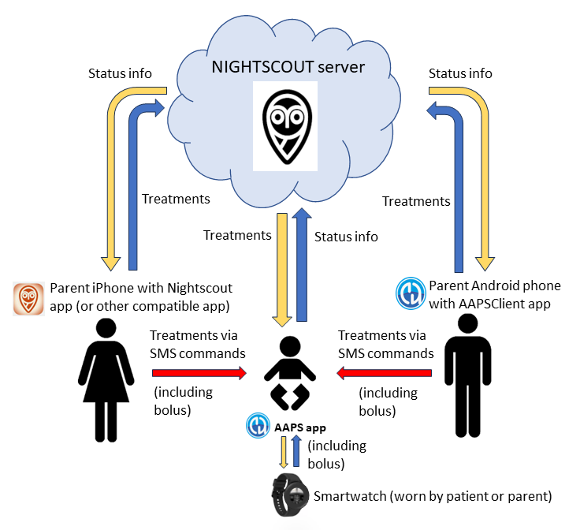
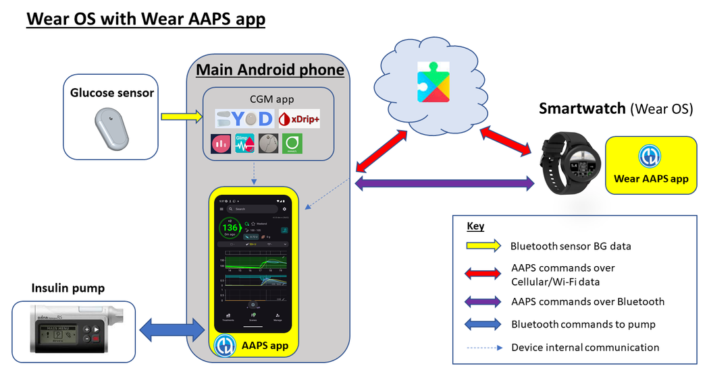
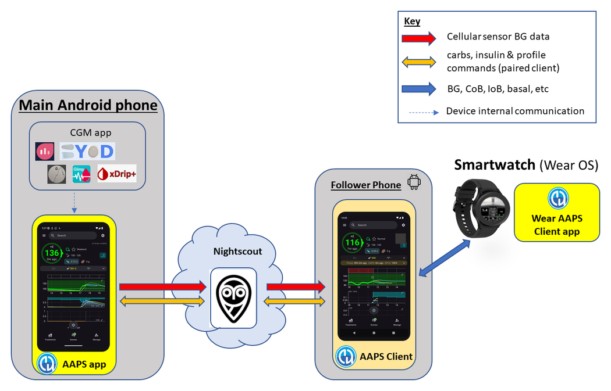
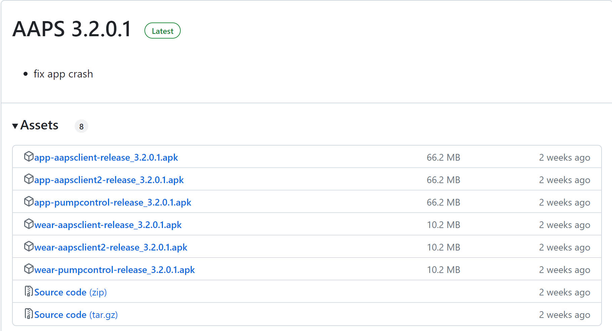

# Remote control of AAPS

```{contents} In this page
:backlinks: entry
:depth: 2
```

There are four highly effective tools for remotely managing **AAPS**:

1) [SMS commands](#RemoteControl_SMS-Commands) (follower phone can be either Android or iOS), 2) [AAPSClient](#RemoteControl_aapsclient) (follower device is an Android phone or tablet, or a Windows, Mac or Linux computer; on an iPhone you [build the app yourself](#aapsclient-iphone)) 3) [Nightscout](#RemoteControl_nightscout) (Android, iOS or other computer/device), mainly for following: see the note on [client control](#client-master-control) in that section.  
4) [Smartwatches](#RemoteControl_smartwatches) (Android)

The first three are mostly appropriate for caregivers/parents, but smartwatches are very useful for caregivers/parents **and** for adults with diabetes themselves.



(RemoteControl_SMS-Commands)=

## 1) SMS Commands

See the dedicated [SMS Commands](../RemoteFeatures/SMSCommands.md) page.

(RemoteControl_aapsclient)=
## 2) AAPSClient

**AAPSClient** נראה דומה מאוד ל-**AAPS** עצמו, ומציע למטפלים את אותם מסכים ולחצנים כדי לשלוח פקודות מרחוק ל-**AAPS**:


(remotecontrol-aapsclient-versions)=
### על AAPSClient, AAPSClient2 ו-AAPSClient3

יש 3 גרסאות של אפליקציית הלקוח: **AAPSClient**, **AAPSClient2** ו-**AAPSClient3**. הן פועלות באותו אופן. ההבדל היחיד הוא שניתן להתקין אותן זו לצד זו באותו טלפון עוקב.

מי שעוקב אחרי אדם אחד צריך רק את **AAPSClient**. כדי לעקוב אחרי אדם שני ולשלוט מרחוק במערכת שלו (עם אתר **Nightscout** משלו וטלפון **AAPS** משלו), יש להתקין גם את **AAPSClient2**, ואת **AAPSClient3** עבור אדם שלישי. כל אפליקציה מוגדרת ו[מצומדת](#aapsclient-pairing-with-the-master) בנפרד, עם אתר ה-**Nightscout** וטלפון ה-**AAPS** של האדם שהיא עוקבת אחריו.

כדי להבדיל בין האפליקציות, לחלק מהרכיבים יש צבע שונה: צהוב עבור **AAPSClient**, כחול עבור **AAPSClient2** וירוק עבור **AAPSClient3**. רכיבים אלה הם סמל האפליקציה, הרקע של הווידג'ט ואזור המצב של **AAPS** במסך הבית של האפליקציה. <br/> הערה: את האטימות של רקע הווידג'ט ניתן להגדיר בתצורת הווידג'ט. באטימות נמוכה קשה לראות את הצבע.


### Download and installation

**AAPSClient** can be installed on a single phone or multiple follower phones (i.e. parent 1’s follower phone and parent 2’s follower phone) in order for both caregivers to be granted access and remote control a patient's **AAPS** phone.

להורדת **AAPSClient**, עברו ל-[מאגר GitHub](https://github.com/nightscout/AndroidAPS/releases/) ולחצו על הקובץ **“app-AAPSClient-release_x.x.x.x”** (ייתכן שזו גרסה חדשה יותר מזו המוצגת בצילום המסך להלן):


Then go to  _downloads_ on your computer. ב-Windows, _downloads_ יוצג ברצועה בצד ימין:


Once downloaded, click _show in folder_ to locate the file.

The **AAPSClient** apk can now be either:

Transferred by a USB cable onto the follower phone; or Dragged into Google drive folder, and then added onto the follower phone by clicking on the "app-AAPSClient-release" file.

אם אתם זקוקים ל-**AAPS** לעצמכם ול-**AAPSClient** למעקב אחר אדם אחר, תצטרכו לבנות **AAPSClient** בעצמכם במקום להוריד אותו ממאגר GitHub כמתואר לעיל. The reason is that you can't install both **AAPS** and **AAPSClient** on the same phone, signed by a different key. <br/> To build **AAPSClient** yourself, follow the same process as [regular AAPS build](../SettingUpAaps/BuildingAaps.md). On the **Generate signed App Bundle or APK** page, select **aapsclientRelease** instead of **fullRelease**.

אותו כלל חל כשמתקינים כמה אפליקציות לקוח (**AAPSClient**, **AAPSClient2**, **AAPSClient3**) בטלפון עוקב אחד: כולן חייבות להיות חתומות ב**אותו מפתח**. אחרת Android מסרב להתקין את השנייה (שגיאה `INSTALL_FAILED_DUPLICATE_PERMISSION`).

### סנכרון: הגדרת AAPSClient ו-AAPS

לאחר שה-apk של __AAPSClient__ מותקן בטלפון העוקב, יש לוודא ש-**NSClientV3** מוגדר באותו אופן בשני הטלפונים עבור Nightscout 15 (ראו את [הערות העדכון](../Maintenance/UpdateToNewVersion.md)). הדוגמה שלהלן מציגה את הגדרת הסנכרון עם NSClientV3 ו-Nightscout 15; ב-__AAPS__ זמינים גם מקורות נתונים אחרים (למשל xDrip).

ב**הגדרות תצורה** > **תקשורת**, הנתונים מסונכרנים עם Nightscout באמצעות __NSClientV3__ (בעזרת ה-API v3), עם אותה הגדרה גם ב-__AAPS__ וגם בטלפון העוקב.


יש לוודא ש__שני__ הטלפונים, AAPS ו-AAPS Client, מסונכרנים ביניהם, על ידי הגדרת NSClientV3 בכל אחד מהם. בטלפון העוקב ניתן במקום זאת לסרוק קוד QR שמוצג ב-**AAPS**, ראו [צימוד AAPSClient עם AAPS](#remotecontrol-pairing) בהמשך:

- יש להזין את **כתובת Nightscout** ב**הגדרות** של NSClientV3

- יש להזין את **אסימון גישה של Nightscout** באותן הגדרות. נא לפעול לפי ההנחיות [כאן](https://nightscout.github.io/nightscout/security/#create-a-token). בטלפון **AAPS** יש להשתמש ב**אסימון מנהל (admin)**: בעזרתו **AAPS** יוצר אסימון נפרד לכל טלפון עוקב.

- Enable **Use websockets** on **both** phones. Websockets are **mandatory** for remote control from **AAPSClient**, on both phones. Without them, **AAPSClient** can follow **AAPS** but cannot control it. בשני הטלפונים הם גם מאיצים את הסנכרון, במחיר של צריכת סוללה מעט גבוהה יותר.

  Your Nightscout host must support websockets. If the websocket connection keeps dropping, remote control does not work. See [Troubleshooting NSClient](../GettingHelp/TroubleshootingNsClient.md).


יש לוודא שגם __AAPSClient__ וגם __AAPS__ מציגים ‘מחובר’ במסך **NSClientV3** בכל טלפון. בשלב זה **AAPSClient** עוקב אחר **AAPS** (ערכי סוכר, טיפולים, פרופיל), אבל עדיין לא יכול לשלוט בו: יש לצמד את שני הטלפונים כמתואר בהמשך.

(remotecontrol-pairing)=
### צימוד AAPSClient עם AAPS (שליטה מרחוק)

החל מגרסה 4 של **AAPS**, **AAPSClient** שולט ב-**AAPS** דרך חיבור מאובטח ו**מצומד**. סנכרון לבד אינו מספיק: עד שהטלפונים מצומדים, **AAPSClient** מציג רק את **ניהול** עם **פרופיל** לצפייה בלבד ואת **צימוד למכשיר ראשי**.

1. בטלפון **AAPS**, יש לפתוח את **ניהול ← לקוחות מורשים** ולהפעיל את **מתן אפשרות לשליטה ממכשיר לקוח** (כבוי כברירת מחדל, ותמיד מופעל במצב פשוט).
2. יש ללחוץ על **+**, להזין שם לטלפון העוקב, לבחור את אופן ההגדרה שלו ולבחור את ה**תפקיד** שלו:
   - **קוד QR: Nightscout וצימוד** — **AAPS** מציג קוד QR שמגדיר את Nightscout בטלפון העוקב ומצמד אותו, בסריקה אחת. לשם כך נדרש אסימון מנהל (admin) בהגדרות NSClientV3 של טלפון ה-**AAPS**.
   - **PIN** — לטלפון עוקב בלי מצלמה, שכבר מחובר ל-Nightscout: יש לרשום את קוד ה-**PIN** החד-פעמי (תקף כשתי דקות).
3. בטלפון **AAPSClient**, יש לסרוק את הקוד (באשף ההתקנה, או ב-**ניהול ← צימוד למכשיר ראשי ← סריקת קוד QR**), או לפתוח את **ניהול ← צימוד למכשיר ראשי** ולהזין את ה-PIN. אישור.

לאחר מכן הטלפון העוקב מופיע כ**פעיל** ברשימת **לקוחות מורשים**, ו-**AAPSClient** מציג את **טיפולים**, **תרחישים** ו-**ניהול**. הטלפון העוקב מקבל אסימון Nightscout משלו, רק עם ההרשאות שהוא צריך. התהליך המלא, עם צילומי מסך ופתרון תקלות, נמצא ב-[שליטה בין מכשיר ראשי ↔ מכשיר לקוח](#client_master_master_setup).

כדי לבדוק שההגדרה עובדת: יש להזין פחמימות ב-**AAPSClient**, לאשר את הכמות המוצגת ולבדוק שהרשומה מופיעה ב**טיפולים** בשני הטלפונים.

(remotecontrol-nightscout-access-token)=

### פתרון תקלות בהגדרת 'אסימון גישה של Nightscout'

ההגדרה המדויקת של 'אסימון גישה של Nightscout' עשויה להיות שונה, בהתאם לשאלה אם ספק ה-Nightscout שלכם הוא אתר אירוח בתשלום או לא.

אם **AAPS** לא מקבל את 'אסימון גישה של Nightscout' ואתם משתמשים באתר Nightscout באירוח בתשלום, כדאי לפנות קודם לספק ה-Nightscout שלכם כדי לפתור את הבעיות ב'אסימון גישה של Nightscout'. Otherwise, please reach out to the **AAPS** group but please double check that you have correctly followed the notes before doing so [here](https://nightscout.github.io/nightscout/security/#create-a-token).

### מה AAPSClient מציע

לאחר הצימוד, **AAPSClient** מציע למטפלים כמעט את אותם מסכים כמו **AAPS** עצמו:

- **טיפולים**: בולוס אינסולין, פחמימות ואשף הבולוס.
- **תרחישים**: הפעלה ועצירה של [תרחישים](../DailyLifeWithAaps/Scenes.md).
- **ניהול**: פרופילים, הגדרות אינסולין, יעדים זמניים, אשף מהיר, אוטומציה, מזון, סבב אתרי עירוי, צימוד והבזאלי הזמני הפעיל.
- **תפריט ראשי**: היסטוריית טיפולים, דפדפן היסטוריה, סטטיסטיקה, תחזוקה, הגדרות תצורה.

ב-**AAPSClient** אין משאבה ואין משימות. ראו [האפליקציה AAPSClient](AapsClient.md) לתיאור מפורט.

**AAPSClient** מאפשר למטפלים לבצע מרחוק את רוב השינויים שמותרים ישירות ב-**AAPS**, **כולל בולוסים של אינסולין**, דרך הרשת הסלולרית או האינטרנט. כל פקודה נחתמת ונשלחת דרך Nightscout לטלפון ה-**AAPS**, שבודק אותה מול הנתונים שלו, מגביל אותה, מציג לכם אישור משלו, ורק אז מבצע אותה. **AAPSClient** _יכול_ להיות מהיר הרבה יותר מ[פקודות SMS](../RemoteFeatures/SMSCommands.md), במיוחד בפקודות שדורשות אימות.

טיפולים שהוזנו ב-Nightscout בדרכים אחרות (למשל באתר Nightscout) לא מוחלים כל עוד השליטה ממכשיר לקוח מופעלת: **AAPS** נמצא אז ב[מצב מוקשח](#client-master-control-hardened-mode) ומקבל שינויים רק ממכשירי לקוח מצומדים. כשהשליטה ממכשיר לקוח כבויה, הם מוחלים רק אם אפשרויות **קבלת … מ־Nightscout** המתאימות מופעלות ב[חלק הסנכרון בהעדפות NSClient](#Preferences-nsclient-synchronization).

שליטה מרחוק דרך **AAPSClient** מומלצת רק אם הסנכרון שלכם עובד היטב (_כלומר_ אינכם רואים שינויים לא רצויים בנתונים, כמו שינוי עצמי של TT, ‏TBR וכו').

### AAPSClient with smartwatch options

A smartwatch can be a very useful tool for helping to manage **AAPS** with kids. A couple of different configurations are possible. If **AAPSClient** is installed on the caregiver's phone, the [**AAPSClient WearOS** app](https://github.com/nightscout/AndroidAPS/releases/) can be downloaded and installed on a compatible smartwatch which is connected to the parent's phone. כך יוצגו ערך הסוכר הנוכחי ומצב הלולאה. לאחר ש-**AAPSClient** מצומד עם **AAPS**, הפעולות מהשעון (כולל בולוסים, פחמימות, יעדים זמניים והחלפות פרופיל) מועברות דרך **AAPSClient** אל **AAPS**, שמאשר ומבצע אותן: ראו [Wear OS במכשיר לקוח](#clientmastercontrol-wear-os-on-a-client). ניתן לקרוא עוד על שעונים חכמים [כאן](#remotecontrol-smartwatches).

(RemoteControl_nightscout)=
## 3) Nightscout

As well as Nightscout being a server in “the Cloud”, there is also a dedicated **Nightscout** app which can be downloaded directly from the App Store on your iPhone. אם טלפון העוקב שלכם הוא Android, אין אפליקציית Nightscout ייעודית ועדיף להשתמש ב-[**AAPSClient**](#RemoteControl_aapsclient). אם ברצונכם רק לעקוב ולא לשלוח טיפולים, ניתן להוריד ולהתקין את אפליקציית [Nightwatch](https://play.google.com/store/apps/details?id=se.cornixit.nightwatch) מ-Playstore.

Once you have installed the **Nightscout** app on your iPhone, open the app and follow the set-up prompts, entering your Nightscout address (see below, left). The form of this may vary depending on how your Nightscout is hosted. (_e.g._ http://youraddresshere.herokuapp.com). Then enter your Nightscout API secret (see below, right). If not prompted for your API password, then you need to enter this by clicking on the padlock at the top of the app:


More info on setup is available directly from [Nightscout](https://nightscout.github.io/nightscout/discover/)

When you first log in, you will have a very simple display. Customize the display options, by selecting the “hamburger” in the top right and scrolling down:


Scroll down through to “Settings”. You may wish to change the “scale” to “linear” as the default for the BG display is logarithmic, and under “render basal” select “default” so that the pump basal shows up.


Select your desired options. Uncheck alarms if you use an alternative app for alarms.


Continue to scroll down until you get to “show plugins”.

You need to make sure “careportal” is checked, and can also select various other metrics (most useful are: IOB, care portal, pump, cannula age, insulin age, basal profile and OpenAPS).

Importantly, you now need to click “save” at the bottom for these changes to take effect.


After pressing “save” the app will return to your main Nightscout screen which will look a little like this:

1. Current glucose value
2. Information on AAPS system status - touch the individual tabs on the screen to display more detail. Add or remove these display options using hamburger menu.
3. Recent glucose trace with treatments (carbs, boluses) displayed
4. Longer-term glucose trace
5. "Hamburger" menu for setting display options, generating reports, editing profiles and Nightscout admin tools
6. תפריט "**+**" להזנת טיפולים (ראו [בהמשך](#RemoteControl_nightscout-treatments) מתי **AAPS** מחיל אותם).
7. Select different time period to display
8. Basal insulin profile
9. Green line = historical glucose Blue lines = predicted glucose


Looking in more detail at the top left menu of the Nightscout app:

1. Careportal retrospective edit
2. Turn on/off alarms
3. Hamburger - for setting preferences
4. Careportal - רישום טיפול (ראו [בהמשך](#RemoteControl_nightscout-treatments) מתי **AAPS** מחיל אותם)


There is a huge amount of information on the status of the **AAPS** system in the grey tabs (and even more information is revealed if you tap the tab) on this screen:

1. מגמת גלוקוז של 5 דקות
2. Bolus wizard preview
3. Press on Basal to see your current profile and basal information
4. Time since latest CGM reading in AAPS
5. **Pump**: insulin, battery % and when AAPS last connected to it
6. Last time AAPS refreshed - if this is longer than 5 mins it can indicate a connection issue between AAPS phone and pump/CGM
7. Press on IOB to see split of basal and bolus insulin
8. Insulin age in reservoir
9. גיל הצינורית
10. Battery status of AAPS phone
11. Size of your database. If it gets too full (DIY Nightscout only - hosted services just ignore) you may start having connectivity issues. You can delete data to reduce the size of the number in the Admin tools menu (via hamburger).


Press "refresh" at the bottom of the page to close the popup.

(RemoteControl_nightscout-treatments)=
### Sending treatments through the Nightscout app to AAPS

ב-**AAPS** 4, הדרך הנתמכת לשלוט ב-**AAPS** מרחוק היא **AAPSClient מצומד**, ראו [שליטה בין מכשיר ראשי ↔ מכשיר לקוח](#client-master-control): לכל לקוח יש [תפקיד](#client-master-control-roles) שמגביל מה מותר לו לעשות, וכל פקודה נחתמת על ידי מכשיר הלקוח, ואז נבדקת ומאושרת בטלפון ה-**AAPS**. כל עוד השליטה ממכשיר לקוח מופעלת, טלפון ה-**AAPS** נמצא ב[מצב מוקשח](#client-master-control-hardened-mode): טיפולים, יעדים זמניים והחלפות פרופיל שהוזנו באתר Nightscout או באפליקציית Nightscout **לא** מוחלים. אפליקציית Nightscout משמשת אז רק למעקב.

```{admonition} Only when client control is off
:class: warning
אם **מתן אפשרות לשליטה ממכשיר לקוח** כבוי ב-**ניהול ← לקוחות מורשים** (ומצב פשוט כבוי), **AAPS** מחיל רשומות של פורטל הטיפולים (careportal) מ-Nightscout רק עבור סוגי הנתונים שהפעלתם באפשרויות **קבלת … מ־Nightscout** ב[חלק הסנכרון בהגדרות NSClientV3](#Preferences-nsclient-synchronization): פחמימות, יעדים זמניים, החלפות פרופיל ושאר רשומות פורטל הטיפולים. אינסולין לעולם לא ניתן בדרך זו: "Correction bolus" שהוזן ב-Nightscout רק *נרשם*, ו-**AAPS** מחשב אותו כאינסולין פעיל בלי לתת אותו. הגדרה זו אינה מומלצת לשליטה מרחוק; במקום זאת יש להשתמש ב-**AAPSClient** מצומד.
```

Read more about **Nightscout** options [here](https://nightscout.github.io/)

### Tips for getting the most out of the Nightscout app

1). If you get “stuck” on a page and want to be able to see the main screen again, just click “refresh” (bottom middle) and this will take you back to the **Nightscout** homepage with the BG graph.

To see the current profile which is running on the phone, press the various icons on the screen above the graph. ניתן לראות מידע נוסף (יחס הפחמימות הנוכחי, רגישות, אזור זמן וכדומה) בלחיצה על “basal”. “OpenAPS” מספק מידע על הפרופיל, היעד הנוכחי וכדומה. Both the phone battery% and the pump battery % can also be monitored. BWP gives information on what the algorithm thinks will happen in the future, given the IOB and COB.

#### Other icons in the menu: what does the pencil (edit) mean?

ניתן (מבחינה טכנית) להשתמש בעיפרון העריכה כדי להזיז או למחוק טיפולי בולוס או תיקון מ-48 השעות האחרונות.

More about this [here](https://nightscout.github.io/nightscout/discover/#edit-mode-edit)

אף שהדבר עשוי להיות שימושי למחיקת פחמימות שהוזנו (אך לא ניתן עבורן בולוס), בפועל הוא אינו עובד היטב כרגע עם **AAPS**, ומומלץ לבצע שינויים כאלה ישירות באפליקציית **AAPS**.

(RemoteControl_smartwatches)= (remotecontrol-smartwatches)=

## 4) Smartwatches

### Option 1) Controlling AAPS from a Wear OS Watch



Once you have [setup **AAPS** on your watch](../WearOS/BuildingAapsWearOS.md), extensive details about the smartwatch faces and their functions can be found in [Operation of Wear AAPS on a Smartwatch](../WearOS/WearOsSmartwatch.md).

As a brief overview, the following functions can be triggered from the smartwatch:

* הגדרת יעד זמני

* use the bolus calculator (calculation variables can be defined in settings on the phone)

* administer eCarbs

* administer a bolus (insulin + carbs)

* watch settings

* status

* check pump status

* check loop status

* check and change profile, CPP (Circadian Percentage Profile = time shift + percentage)

* show TDD (Total daily dose = bolus + basal per day)

* Remote bolus where the caregiver and T1D child are in different locations (this is possible for the **AAPS** watch and **AAPS** phone providing both devices are connected to the network)

#### Communication from caregivers to the watch using other apps (like WhatsApp)

It is possible to add additional apps to the watch, like WhatsApp, for messaging (for example) between caregivers and kids. It is important only to have ONE Google account associated with the phone, or the watch will not bring this data across. You need to be 13 or older to have a Samsung account, and this needs to be set up in the same email address which is used on the Android phone.

A video explaining getting WhatsApp setup for messaging on the Galaxy 4 watch (you can’t get full functionality of WhatsApp) is shown [here](https://gorilla-fitnesswatches.com/how-to-get-whatsapp-on-galaxy-watch-4/)

Making adjustments in both the **Galaxy wearable** app on the **AAPS** phone and the watch makes it possible for WhatsApp messages to announce with a slight vibration, and also for the WhatsApp message to display over the existing watchface.

### Option 2) **AAPS** on watch, for remote control of **AAPS** on a phone

בדומה לשימוש בטלפון עוקב עם **AAPSClient** או בפקודות SMS (ראו החלקים הקודמים), ניתן להשתמש בשעון חכם כדי לשלוט מרחוק ב-**AAPS** ולקבל נתוני פרופיל מלאים. הבדל מרכזי לעומת טלפון עוקב הוא שהקישור בין השעון החכם לטלפון ה-**AAPS** הוא דרך Bluetooth, ולא צריך Nightscout או קוד אימות. הערת אגב: אם השעון החכם וטלפון ה-**AAPS** המקושרים ב-Bluetooth נמצאים גם ברשת Wi-Fi או ברשת נתונים סלולרית, השעון יתקשר עם טלפון ה-**AAPS** גם דרכה, וטווח התקשורת יהיה ארוך יותר. זה כולל מתן בולוס מרחוק כשהמטפל עם שעון ה-**AAPS** והילד עם T1D (עם טלפון ה-**AAPS**) נמצאים במקומות שונים. זה שימושי למשל כשהילד עם T1D בבית הספר.

A remote control smartwatch is therefore often useful in any situation where:

a) **AAPSClient** או פקודות **SMS** לא יכולים לעבוד; או

b) רוצים להימנע מהקלדת קוד אימות (כנדרש בפקודות SMS).

כדי לשלוט ב-**AAPS**, השעון החכם צריך **Wear OS 3 או חדשה יותר**. יש לבדוק את המפרט הטכני של השעון ולעיין ב[דף השעונים החכמים](../Getting-Started/Watches.md). אם אינכם בטוחים, חפשו או שאלו בקבוצות **AAPS** ב-Facebook/Discord.

להלן מדריכים מפורטים להגדרת **AAPS** בשעון הפופולרי Samsung Galaxy Watch 4 (40mm). The [Garmin](https://apps.garmin.com/en-US/apps/a2eebcac-d18a-4227-a143-cd333cf89b55?fbclid=IwAR0k3w3oes-OHgFdPO-cGCuTSIpqFJejHG-klBTm_rmyEJo6gdArw8Nl4Zc#0) watch is also a popular choice. If you have experience of setting up a different smartwatch which you think would be useful to others, please add it into these pages [edit the documentation](../SupportingAaps/HowToEditTheDocs.md) to share your findings with the wider **AAPS** community.

### Option 3) AAPSClient on a watch for remote control of **AAPS** on a phone



ניתן להוריד את תוכנת השעון, ה-apk של **AAPSClient** Wear, ישירות מ-[GitHub](https://github.com/nightscout/AndroidAPS/releases/).

להורדת התוכנה, יש ללחוץ על אפליקציית השעון שמתאימה לאפליקציית הלקוח בטלפון: **wear-aapsclient-release_**_version_ מתאימה ל-**AAPSClient**, ו-**wear-aapsclient2-release_**_version_ מתאימה ל-**AAPSClient2** (ראו [על AAPSClient, AAPSClient2 ו-AAPSClient3](#remotecontrol-aapsclient-versions)):




Then "save as" and save the file to a convenient location on your computer:


The **AAPSClient** wear apk can be transferred to your phone and side-loaded onto the watch in the same way as the **AAPS** Wear app, as detailed in [Transferring the Wear app onto your AAPS phone](#remote-control-transferring-the-aaps-wear-app-onto-your-aaps-phone)  


