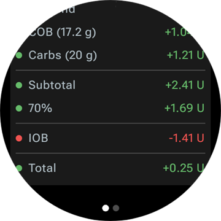
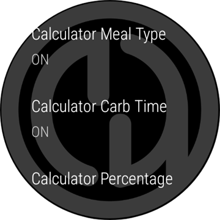
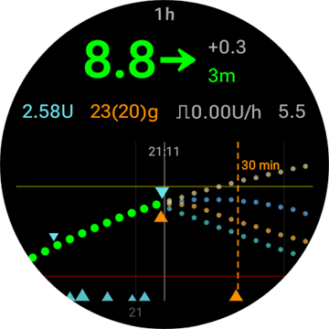
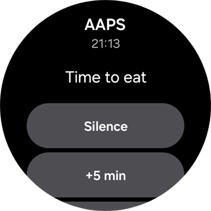
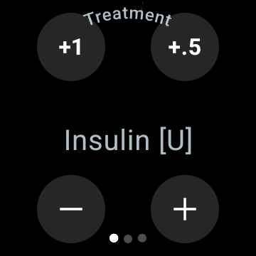
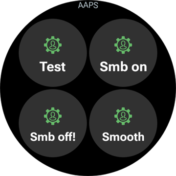

# תפעול AAPS בעזרת שעון Wear OS

(Watchfaces-aaps-watchfaces)=

## AAPS Watchfaces

```{warning}
פני השעון הקלאסיים של **AAPS** פועלים רק ב-Wear OS 5 ומטה, וכבר Wear OS 5 מגבילה אותם. ב-**Wear OS 6 ומעלה** אפליקציית השעון מתקינה במקומם רק עיצוב אחד של פני שעון, בפורמט Watch Face Format של Google: פני השעון המותאמים אישית שלכם כתמונה, או **פני שעון עם רכיבים (Complications)**. ראו [שינויים בפני השעון ב-Wear OS](#wearos-watchface-changes) כדי לדעת מה מפסיק לעבוד בכל גרסה של Wear OS, ואת [פני השעון ש-AAPS מתקין](#wearos-aaps-v4-watchface) עבור Wear OS 6.
```

ב-Wear OS 5 ומטה, כמה פני שעון קלאסיים מובנים באפליקציית השעון של **AAPS**. הם מציגים את ערך הסוכר עם הדלתא, IOB, הקצב הבזאלי הפעיל וגרף של הקריאות. יש בהם שתי פעולות הקשה:

* הקשה כפולה על ערך הסוכר פותחת את התפריט הראשי של **AAPS**
* הקשה כפולה על הגרף משנה את טווח הזמן שלו

בכל הגרסאות של Wear OS, [רכיבי ה-complications](#Watchfaces-complications) ו[האריחים](#WearOsSmartwatch-wear-os-tiles) המתוארים בדף זה עובדים עם כל פני שעון שיש בהם מקום עבורם.

## Configuration

יש להפעיל את **Wear** ב[**הגדרות תצורה** > **תקשורת**](#Config-Builder-wear).

כדי לתת בולוס או לבצע פעולות אחרות מהשעון, יש להפעיל את **שליטה באמצעות Wear**. גם האפשרויות של אשף הבולוס עבור השעון מוגדרות באותו מקום: ראו [הגדרות > Wear](#preferences-wear). כאשר **שליטה באמצעות Wear** כבויה, הטלפון דוחה כל טיפול או שינוי מצב שנשלח מהשעון, והשעון מציג *"השליטה מהשעון כבויה בהגדרות Wear בטלפון."*

בעזרת **פתיחת תוסף** בכרטיס **Wear** נפתח מסך Wear:


השורה העליונה מציגה את שם השעון המחובר, או **(השעון מנותק)**. ממסך זה ניתן

* Resend all data. Might be helpful if watch was not connected for some time, and you want to push the information to the watch.
* Open settings on your watch directly from your phone.
* לבחור אילו פני שעון **AAPS** מתקין בשעון (**פני השעון שמותקנים בשעון**: פני השעון המותאמים אישית שלכם, או פני השעון עם הרכיבים). כרטיס זה מוצג רק כאשר מחובר שעון עם **Wear OS 6** ומעלה. ראו [פני השעון ש-AAPS מתקין](#wearos-aaps-v4-watchface).
* לנהל את **פני שעון מותאמים אישית** (הכרטיס מוצג כאשר שעון מחובר): **טעינת פני שעון** שולח פני שעון מותאמים אישית לשעון, **מידע על פני השעון** מציג את הפרטים של פני השעון שנטענו ואת השדות שהם מכילים, **עוד פני שעון** פותח את [אתר השיתוף](../ExchangeSiteCustomWatchfaces/index.md) בדפדפן, ו**ייצוא תבנית** שומר תבנית שאפשר לערוך. תצוגה מקדימה של פני השעון שנטענו מוצגת מתחת ללחצנים. ראו [מעבר לפני שעון של AAPS](#WearOS_changing-to-AAPS-watchface).

Ensure notifications from AAPS are not blocked on the watch. אישור של פעולה (למשל בולוס או יעד זמני) מגיע כהודעה, שיש להחליק ולסמן.

## Accessing main menu of AAPS


כדי לפתוח את התפריט הראשי של **AAPS**, ניתן להשתמש באחת מהדרכים הבאות:

* לפתוח את **AAPS** מרשימת האפליקציות בשעון
* להקיש על רכיב complication של **AAPS** שפותח את התפריט, ראו [הגדרות הקשורות ל-complications](#WearOsSmartwatch-complication-settings)
* להקיש על האריח **גרף סוכר** כאשר **פעולת הקשה** שלו מוגדרת ל**תפריט ראשי**, ראו [הגדרות אריחים](#WearOsSmartwatch-wear-os-tiles)
* בפני שעון קלאסיים של **AAPS**, להקיש הקשה כפולה על ערך הסוכר

(WearOsSmartwatch-loop-status)=

## מסך סטטוס הלולאה

המסך **סטטוס הלולאה** מציג סיכום של מה שהלולאה עושה, בלי להוציא את הטלפון. ניתן לפתוח אותו מהתפריט הראשי של AAPS (**מצב הלולאה**, או **סטטוס ← לולאה**), או בהקשה על רכיב ה-complication **ערכי סוכר**. בתפריט **סטטוס** יש גם דף **משאבה** ודף **סה"כ מינון אינסולין יומי TDD** עם המינונים היומיים הכוללים.


המסך הוא רשימה של כרטיסים. יש לגלול למטה כדי לראות את כולם:

* **מצב הפעלה** — המצב הנוכחי (לולאה סגורה, לולאה פתוחה, LGS, מושהה, מנותק…) ועבור מצב זמני, כמה זמן הוא עוד יימשך.
* **תוצאת הלולאה** — מתי הלולאה רצה לאחרונה, והבזאלי הזמני או ה-SMB שהיא ביקשה.
* **תרחיש** — רק כאשר [תרחיש](#scenes-from-watch) פעיל: השם שלו, הזמן שנותר (או **עד לסיום** לתרחיש ללא שעת סיום) ותרחיש ה**המשך** שמתחיל כשהוא מסתיים.
* **יעדים** — היעד שלכם, והיעד הזמני אם יש יעד זמני פעיל.
* **פרופיל** — השם של הפרופיל הפעיל, עם **אחוז** ו**היסט זמן** כאשר הם לא בערכי ברירת המחדל. החלפת פרופיל זמנית מודגשת, ומוצגים בה הזמן שנותר לה והפרופיל שאליו היא חוזרת (**חזרה אל**) כשהיא מסתיימת.
* **רגישות** — אותן שורות כמו בשבב הרגישות במסך הראשי של הטלפון: ערך ה-autosens, וה-ISF של הפרופיל, ה-ISF המשתנה וה-ISF האפקטיבי.

סמל תרחיש קטן ליד מצב הפעלה, יעד זמני או החלפת פרופיל מציין שהפריט **הוגדר על ידי התרחיש הפעיל**. אותו סמל מוצג גם בבוחר **מצב הפעלה**.


(WearOsSmartwatch-bolus-calculator)=

## מחשבון הבולוס בשעון

יש לפתוח את **מחשבון** מהתפריט הראשי של **AAPS**, מ[אריח הפעולות](#WearOsSmartwatch-wear-os-tiles) או מרכיב complication שמוגדר לפתוח את האשף. המחשבון עובר דרך כמה דפים; יש להחליק את המסך הצידה כדי להמשיך לדף הבא:

| פחמימות                                                          | בקשה                                                            | תוצאה                                                           | חישוב                                                                     | אישור                                                            |
| ---------------------------------------------------------------- | --------------------------------------------------------------- | --------------------------------------------------------------- | ------------------------------------------------------------------------- | ---------------------------------------------------------------- |
|  |  |  |  |  |

1. **פחמימות**: הזנת הפחמימות בעזרת הלחצנים **+10**, **+5**, **−** ו-**+**.
2. **בקשה**: הדף האחרון לפני שהטלפון ממשיך את התהליך. הוא מציג את מה שהזנתם: הפחמימות, וגם את סוג הארוחה, זמן הפחמימות והאחוז אם אתם משתמשים בהם, ראו [דפים אופציונליים](#WearOsSmartwatch-calculator-optional-pages). יש להקיש על סימן הווי כדי לשלוח את הבקשה לטלפון, שמבצע את החישוב.
3. **תוצאה**: הבולוס ש-**AAPS** מציע, ומתחתיו הפחמימות: הפחמימות עכשיו והפחמימות הממושכות מאוחר יותר, זמן הפחמימות והפעמון של תזכורת האכילה. ניתן לשנות את המינון בעזרת **−** ו-**+**, ראו בהמשך. יש לגלול למטה אל הכרטיס **חישוב**: הקשה עליו מציגה כל שורה של החישוב, כמו בטלפון.
4. **אישור**: יש להחליק לדף השני ולהקיש על סימן הווי. הטלפון נותן את הבולוס ורושם את הפחמימות.

(WearOsSmartwatch-calculator-optional-pages)=

### דפים אופציונליים

כל אחת משלוש הגדרות בשעון מוסיפה דף אחרי **פחמימות**. כברירת מחדל הן כבויות. יש לפתוח את התפריט הראשי של **AAPS**, ואז **הגדרות** > **ממשק**, ולהפעיל את ההגדרות הרצויות; כאשר יותר מאחת מופעלת, הדפים מופיעים בסדר הזה: **סוג הארוחה**, **זמן הפחמימות**, **אחוזים**. הנקודות בתחתית המחשבון מראות כמה דפים יש בו.

| הגדרות                                                                       | סוג הארוחה                                                             | זמן הפחמימות                                                             | אחוזים                                                               |
| ---------------------------------------------------------------------------- | ---------------------------------------------------------------------- | ------------------------------------------------------------------------ | -------------------------------------------------------------------- |
|  |  |  |  |

* **סוג הארוחה במחשבון**: **לחם**, **עוגה** או **פיצה**, שמחלק את הפחמימות של ארוחה איטית לפחמימות עכשיו ולפחמימות ממושכות מאוחר יותר, ראו [בחירת סוג הארוחה](#WearOsSmartwatch-wizard-meal-type).
* **זמן הפחמימות במחשבון**: מספר הדקות עד שתאכלו, עם פעמון **הגדרת התראה** עבור תזכורת האכילה, ראו [זמן הפחמימות ותזכורת האכילה](#WearOsSmartwatch-wizard-carb-time).
* **אחוז במחשבון**: אחוז מהבולוס המחושב, למשל 70 % כאשר רוצים מינון קטן יותר. הערך ההתחלתי הוא **אחוז הבולוס** שב[הגדרות אשף הבולוס](#Preferences-deliver-this-part-of-bolus-wizard-result) של הטלפון, 100 % אלא אם שיניתם אותו. ראו גם את ההערה תחת [התאמת הבולוס בדף התוצאה](#WearOsSmartwatch-wizard-result).

(WearOsSmartwatch-wizard-result)=

### התאמת הבולוס בדף התוצאה

דף התוצאה מציג את הבולוס ש-**AAPS** מציע, יחד עם לחצן **−** ולחצן **+**. בעזרתם ניתן לשנות את המינון לפני שמאשרים אותו, בלי לחזור לטלפון.

| מוצע                                                                        | יותר                                                                           | פחות                                                                             |
| --------------------------------------------------------------------------- | ------------------------------------------------------------------------------ | -------------------------------------------------------------------------------- |
|  |  |  |

* כל לחיצה משנה את הבולוס ב**צעד אחד של המשאבה שלכם**, כך שהכמויות המוצעות תמיד מתאימות למה שהמשאבה יכולה לתת בפועל.
* **לחיצה ארוכה** על לחצן ממשיכה לשנות את הערך. ככל שמחזיקים זמן רב יותר, השינוי מהיר יותר.
* לא ניתן לרדת מתחת ל-**0 U**, וגם לא לעלות מעל הגדרת **הבולוס המרבי** שלכם.

הסכום המעודכן מוצג בדף התוצאה, כך שתמיד רואים את הכמות שעומדים לאשר. השינוי מוצג אחרי הפחמימות, למשל *(+0.20 U)*, והלחצן שבו השתמשתם הופך לירוק להגדלה או לאדום להקטנה.

אם **AAPS** נאלץ להגביל את המינון, למשל כי הבולוס המחושב גבוה מהגדרת **הבולוס המרבי** שלכם, שורת אזהרה בצבע ענבר מתחת לסכום מציינת זאת (למשל *"הוחלה מגבלת בולוס"*). אותו דבר חל על כמות פחמימות מוגבלת.

```{admonition} זה לא אותו דבר כמו אחוז במחשבון :class: note ההגדרה **אחוז במחשבון** מאפשרת להזין *אחוז* מהבולוס המחושב **לפני** שדף התוצאה מופיע. הלחצנים **−** ו-**+** משנים את *הכמות הסופית* **בתוך** דף התוצאה. אפשר להשתמש בשניהם.

    <br />(WearOsSmartwatch-wizard-meal-type)=
    
    ### בחירת סוג הארוחה
    
    מחשבון השעון יכול לחלק את הפחמימות של ארוחה איטית לפחמימות עכשיו ולפחמימות ממושכות מאוחר יותר, כמו [סוג הפחמימות](#AapsScreens-carbs-type) באשף של הטלפון. יש להפעיל את **סוג הארוחה במחשבון** בשעון, ב-**הגדרות** > **ממשק**. ההגדרה כבויה כברירת מחדל, ואז הדף **סוג הארוחה** מדולג.
    
    * אחרי הזנת הפחמימות, הדף **סוג הארוחה** מציג שלושה סמלים: **לחם**, **עוגה** ו-**פיצה**. יש להקיש על סמל: השם שלו והפחמימות שהוא נותן מוצגים מתחת לסמלים, למשל *65 גר׳* ללחם, או *52+22 גר׳* לפיצה (52 גר׳ עכשיו ו-22 גר׳ של פחמימות ממושכות מאוחר יותר). **לחם** הוא ברירת המחדל ומשאיר את כל הפחמימות עכשיו.
    * דפי הבקשה והאישור מציגים את הפחמימות באותו אופן (*52+22 גר׳*). דף התוצאה מציג גם מתי הפחמימות הממושכות מתחילות וכמה זמן הן נמשכות.
    * הבולוס מחושב רק עבור הפחמימות שנאכלות עכשיו. החלוקה משתמשת באותם מספרים כמו האשף בטלפון.
    
    (WearOsSmartwatch-wizard-carb-time)=
    
    ### זמן הפחמימות ותזכורת האכילה
    
    כאשר **זמן הפחמימות במחשבון** מופעל בשעון, ב-**הגדרות** > **ממשק**, דף **זמן הפחמימות** מופיע אחרי הפחמימות: מספר הדקות עד שתאכלו, כמו [זמן הפחמימות](#aaps-screens-bolus-wizard) באשף של הטלפון. **עכשיו** הוא ברירת המחדל. **−** ו-**+** מזיזים אותו בצעדים של 5 דקות, עד שעה לפני או אחרי עכשיו. זמן בעבר מיועד לפחמימות שכבר אכלתם.
    
    עם זמן בעתיד, מופיע פעמון **הגדרת התראה** מתחת לערך. הוא מופעל כברירת מחדל; הקשה עליו מכבה אותו. דפי הבקשה והתוצאה מציגים את זמן הפחמימות, למשל *+30 דק׳*, ואת הפעמון. הטלפון רושם את הפחמימות בזמן הזה, מזיז איתו את הפחמימות הממושכות של סוג הארוחה, ומפעיל את תזכורת **זמן לאכול** שלו.
    
    | תוצאה | גרף סוכר | פעילה | זמן לאכול |
    | --- | --- | --- | --- |
    |  |  |  |  |
    
    התזכורת נמצאת גם בשעון, כך שהיא מצלצלת גם כשהטלפון רחוק:
    
    * המסך **גרף סוכר**, האריח **גרף סוכר** והגרף של **פני שעון עם רכיבים (Complications)** מציגים קו כתום מקווקו במקום שבו התזכורת תצלצל, ולידו מספר הדקות שנותרו.
    * בזמן שהתזכורת פעילה, הודעה שקטה **זמן לאכול** עם **עצירה** ו-**+5 דק׳** נמצאת ברשימת ההודעות. היא חוזרת כשמחליקים אותה הצידה, עד שהתזכורת מסתיימת.
    * כשמגיע הזמן, השעון רוטט, ושוב כל חצי דקה במשך חמש דקות, עד שעונים לו. ההודעה מציעה **השתקה** ו-**+5 דק׳**, וגם החלקה שלה הצידה משתיקה אותה.
    
    **עצירה**, **השתקה** ו-**+5 דק׳** פועלים באותו אופן בשעון, בטלפון וב-**AAPSClient**, וכולם מציגים את אותה תזכורת.
    
    (Watchfaces-complications)=
    
    ## רכיבי complications
    
    _Complication_ הוא מונח מעולם השענות המסורתית, שבו הוא מתאר תוספת לפני השעון הראשיים - כמו חלון קטן נוסף או חוגה משנית (עם תאריך, יום בשבוע, מופע הירח וכו'). Wear OS 2.0 מביאה את הרעיון הזה כדי לאפשר הוספה של ספקי נתונים מותאמים אישית, כמו מזג אוויר, הודעות, מוני כושר ועוד, לכל פני שעון שתומכים ב-complications.
    
    אפליקציית AAPS ל-Wear OS תומכת ב-complications מאז build `2.6`, ומאפשרת להגדיר כל פני שעון של צד שלישי שתומכים ב-complications כך שיציגו נתונים של AAPS (רמת סוכר עם המגמה, IOB, COB וכו').
    
    רכיבי complications משמשים גם כ**קיצור דרך** לפונקציות של AAPS. בהקשה עליהם ניתן לפתוח תפריטים וחלונות של AAPS (בהתאם לסוג ה-complication ולהגדרות שלו).
    
    
    
    ### סוגי complications
    
    אפליקציית AAPS ל-Wear OS מספקת רק נתונים גולמיים, לפי תבניות מוגדרות מראש. פני השעון של צד שלישי קובעים היכן וכיצד להציג את רכיבי ה-complications, כולל הפריסה, המסגרת, הצבע והגופן. מבין סוגי ה-complications הרבים שיש ב-Wear OS, AAPS משתמש בסוגים הבאים:
    
    * `SHORT TEXT` - מכיל שתי שורות טקסט, 7 תווים בכל אחת, שלפעמים נקראות ערך ותווית. Usually rendered inside a circle or small pill - one below another, or side by side. זהו complication עם מקום מוגבל מאוד. AAPS tries to remove unnecessary characters to fit-in: by rounding values, removing leading and trailing zeroes from values, etc.
    * `LONG TEXT` - מכיל שתי שורות טקסט, כ-20 תווים בכל אחת. Usually rendered inside a rectangle or long pill - one below another. It is used for more details and textual status.
    * `RANGED VALUE` - משמש לערכים מטווח מוגדר מראש, כמו אחוזים. It contains icon, label and is usually rendered as circle progress dial.
    * `LARGE IMAGE` - תמונת רקע מותאמת אישית שאפשר להשתמש בה כרקע (כאשר פני השעון תומכים בכך).
    * `SMALL IMAGE` / `MONOCHROMATIC IMAGE` - סמל קטן. במשבצת `SMALL IMAGE`, AAPS מצייר אותו בצבע שלו; במשבצת `MONOCHROMATIC IMAGE`, פני השעון צובעים אותו.
    
    ### הגדרת complications
    
    כדי להוסיף complication לפני השעון, יש להגדיר אותו בלחיצה ארוכה ובהקשה על סמל גלגל השיניים שמתחת. בהתאם לאופן שבו פני השעון מגדירים אותם, יש להקיש על מצייני המיקום או להיכנס לתפריט ההגדרה של ה-complications בפני השעון. רכיבי ה-complications של AAPS מקובצים תחת הפריט AAPS בתפריט.
    
    בעת הגדרת complications בפני השעון, Wear OS תציג ותסנן את רשימת ה-complications שמתאימים למקום שנבחר בפני השעון. אם complication מסוים לא מופיע ברשימה, כנראה שהסוג שלו לא מתאים למקום הזה.
    
    ### רכיבי complications ש-AAPS מספק
    
    AAPS מספק את רכיבי ה-complications הבאים. "פותח" מציין מה הקשה עושה כאשר **פעולת הקשה על רכיב** נשארת על **ברירת מחדל**, ראו [הגדרות הקשורות ל-complications](#WearOsSmartwatch-complication-settings).
    
    **סוכר**
    
    * **ערכי סוכר** (`SHORT TEXT`, פותח _סטטוס הלולאה_): ערך הסוכר עם חץ המגמה בשורה הראשונה, הגיל של הקריאה והדלתא בשורה השנייה.
    * **ערכי סוכר (גדול)** (`SHORT TEXT`, פותח _גרף סוכר_): ערך הסוכר לבדו בשורה הראשונה, כך שפני השעון יכולים להציג אותו בגדול. הגיל וחץ המגמה נמצאים בשורה השנייה.
    * **גרף סוכר** (`SMALL IMAGE` / `LARGE IMAGE`, פותח _גרף סוכר_): גרף הסוכר כתמונה, עבור פני שעון עם משבצת תמונה. זה הגרף שב**פני שעון עם רכיבים (Complications)**.
    * **סטטוס מלא** (`LONG TEXT`, פותח _תפריט_): רוב הנתונים בשורה אחת: ערך הסוכר עם חץ המגמה, הדלתא והגיל של הקריאה, ואחר כך פחמימות פעילות, אינסולין פעיל והקצב הבזאלי.
    * **סטטוס מלא (הפוך)** (`LONG TEXT`, פותח _תפריט_): אותו דבר, כשהשורות מוחלפות, עבור פני שעון שמציגים רק אחת משתי השורות של משבצת `LONG TEXT`.
    
    **אינסולין ופחמימות**
    
    * **סמל אינסולין פעיל (IOB)** (`SHORT TEXT`, פותח _בולוס_): אינסולין פעיל עם סמל של מזרק.
    * **IoB מפורט** (`SHORT TEXT`, פותח _בולוס_): סך האינסולין הפעיל בשורה הראשונה, החלק של הבולוס והחלק של הבזאלי בשורה השנייה.
    * **סמל CoB** (`SHORT TEXT`, פותח _מחשבון_): פחמימות פעילות עם סמל פחמימות.
    * **CoB מפורט** (`SHORT TEXT`, פותח _מחשבון_): הפחמימות הפעילות עכשיו בשורה הראשונה, הפחמימות שעוד יגיעו (פחמימות ממושכות) בשורה השנייה.
    * **CoB & IoB** (`SHORT TEXT`, פותח _מחשבון_): אינסולין פעיל בשורה הראשונה, פחמימות פעילות בשורה השנייה.
    
    **בזאלי ויעד**
    
    * **קצב בזאלי** (`SHORT TEXT`, פותח _תפריט_): הקצב הבזאלי הנוכחי.
    * **BR & IoB** (`SHORT TEXT`, פותח _תפריט_): אינסולין פעיל בשורה הראשונה, הקצב הבזאלי בשורה השנייה.
    * **BR & יעד** (`SHORT TEXT`, פותח _יעד זמני_): היעד בשורה הראשונה, עם הזמן שנותר כאשר יעד זמני פעיל, והקצב הבזאלי בשורה השנייה.
    * **יעד** (`SHORT TEXT`, פותח _יעד זמני_): היעד בשורה הראשונה, וכאשר יעד זמני פעיל, הזמן שנותר לו בשורה השנייה.
    * **BR, CoB & IoB** (`SHORT TEXT`, פותח _תפריט_): הקצב הבזאלי בשורה הראשונה, פחמימות פעילות ואינסולין פעיל בשורה השנייה.
    
    **לולאה וטלפון**
    
    * **מצב הפעלה** (`SMALL IMAGE` / `ICON`, פותח _בוחר מצב ההפעלה_): מצב הלולאה הנוכחי כסמל: לולאה סגורה, לולאה פתוחה, השהיה עקב ערך סוכר נמוך, מושהית, מנותקת או מושבתת. הקשה פותחת בוחר עם שינויי המצב שמותרים כרגע, למשל **השהיית הלולאה**, **ניתוק המשאבה**, **חידוש הלולאה** או **חיבור המשאבה מחדש**. אותו בוחר נמצא בתפריט הראשי של **AAPS** תחת **מצב הפעלה**.
    * **סוללת המעלה/הטלפון** (`RANGED VALUE` / `SHORT TEXT` / `ICON`, פותח _סטטוס_): הסוללה של הטלפון שמריץ את **AAPS**, כמד עם סמל סוללה, כמספר, או כסמל בלבד. הוא מתעדכן יחד עם שאר הנתונים של **AAPS**, בדרך כלל כל 5 דקות עם קריאה חדשה.
    
    הבוחר **מצב הפעלה**, כפי שהוא נפתח מרכיב ה-complication, מהתפריט הראשי או מאריח מצב ההפעלה:
    
    
    
    (WearOsSmartwatch-complication-settings)=
    
    ### הגדרות הקשורות ל-complications
    
    בתפריט הראשי של **AAPS** בשעון, יש לפתוח את **הגדרות** > **רכיבים**:
    
    
    
    * **פעולת הקשה על רכיב** (ברירת מחדל `ברירת מחדל`): מה נפתח בהקשה על רכיב complication של **AAPS**, לכל רכיבי ה-complications יחד:
      * _ברירת מחדל_: מה שרכיב ה-complication עצמו פותח, ראו את הרשימה למעלה
      * _תפריט_: התפריט הראשי של **AAPS**
      * _מחשבון_: מחשבון הבולוס
      * _טיפול_: חלון הטיפול, אינסולין ופחמימות
      * _פחמימות ממושכות_: חלון הפחמימות הממושכות
      * _סטטוס_: תפריט הסטטוס
      * _מצב הפעלה_: הבוחר של מצב ההפעלה. דורש ש-**שליטה באמצעות Wear** תהיה מופעלת בהגדרות Wear בטלפון, אחרת נפתח התפריט הראשי במקום.
      * _ללא_: הקשה לא עושה דבר
    * **טווח זמנים של גרף הסוכר** (ברירת מחדל `3 שעות`): כמה שעות מציג רכיב ה-complication **גרף סוכר**: 1, 3 או 6. לאריח גרף הסוכר יש הגדרה משלו.
    * **יוניקוד ברכיבים** (ברירת מחדל `מופעל`): רכיבי ה-complications משתמשים בסמלי Unicode כמו `Δ` לדלתא, `⁞` כמפריד ו-`⎍` לקצב הבזאלי. המראה שלהם תלוי בגופן של פני השעון. יש להגדיר את זה ל-`כבוי` כאשר פני השעון מציגים אותם כריבועים או כרווחים ריקים.
    
    (WearOsSmartwatch-wear-os-tiles)=
    
    ## אריחי Wear OS
    
    אריחים הם הדפים שמגיעים אליהם בהחלקה מפני השעון. **AAPS** מביא שבעה אריחים, כל אחד עם עד ארבעה לחצנים. הקשה על לחצן פותחת את החלון המתאים בשעון, או מבקשת מכם לאשר, ואז הטלפון מבצע את העבודה. אריח הוא קיצור דרך, לא תצוגת מצב: הוא לא מחזיק את המצב של אפליקציית הטלפון.
    
    לפני השימוש באריחים, יש להפעיל את **שליטה באמצעות Wear** ב[הגדרות > Wear](#preferences-wear).
    
    ### הוספת אריח
    
    יש שתי דרכים, בהתאם לשעון ולטלפון שלכם:
    
    1. בשעון: יש להחליק מפני השעון אל מעבר לאריח האחרון, עד **Add tile** (הוספת אריח), ולבחור אריח של **AAPS**. ברוב השעונים, לחיצה ארוכה על אריח פותחת גם את תצוגת ההוספה וההסרה.
    2. בטלפון, באפליקציה הנלווית של השעון (**Galaxy Wearable** ל-Samsung, **Wear OS** למותגים אחרים): יש לפתוח את **Tiles** (אריחים), להקיש על **Add** (הוספה) ולבחור את אריחי **AAPS** הרצויים. ניתן לשנות את סדר האריחים בגרירה.
    
    
    
    ### הגדרות אריחים
    
    לאריחים **פעולות**, **יעד זמני**, **גרף סוכר** ו-**תרחיש** יש הגדרות בשעון. יש לפתוח את התפריט הראשי של **AAPS**, ואז **הגדרות** > **אריחים**, ולבחור את האריח. לחיצה ארוכה על האריח פותחת גם את ההגדרות שלו, חוץ משעוני Pixel. בשלושת האריחים האחרים התוכן מגיע מהטלפון, ואין בהם מה להגדיר בשעון.
    
    | תפריט ראשי | הגדרות | אריחים |
    | --- | --- | --- |
    |  |  |  |
    
    ההגדרות של אריח הן רשימה של ארבע המשבצות שלו. יש להקיש על משבצת כדי לבחור מה היא מציגה, או **ללא** כדי להשאיר אותה ריקה.
    
    | לחיצה ארוכה על האריח | הגדרות האריח יעד זמני |
    | --- | --- |
    |  |  |
    
    לכל אריח יש ארבע משבצות. אריח עם יותר פריטים מזה מציג את ארבעת הראשונים.
    
    ### אריח פעולות
    
    
    
    קיצורי דרך לחלונות של אפליקציית השעון של **AAPS**. ניתן לבחור עד ארבעה מהם בהגדרות האריח:
    
    * **מחשבון**: מחשבון הבולוס, עם הזנת פחמימות, אחוז אופציונלי [1] וסוג ארוחה אופציונלי [2]
    * **טיפול**: אינסולין ופחמימות בפעם אחת
    * **אינסולין**: בולוס, מוזן ביחידות
    * **פחמימות**: פחמימות, גם פחמימות ממושכות. כמות **שלילית** מתקבלת, עד לערך ה-COB הנוכחי שלכם, כדי לתקן פחמימות שהזנתם קודם. הסרות של פחמימות מוצגות בגרף הסוכר של השעון.
    * **פחמימות ממושכות**: פחמימות ממושכות
    * **יעד זמני**: יעד זמני עם יעד ומשך לבחירתכם
    * **החלפת פרופיל**: החלפת פרופיל עם אחוז, היסט זמן ומשך
    
    
    
    החלונות שהלחצנים פותחים. יש להחליק את המסך הצידה כדי להגיע לדף הבא של חלון, ולהקיש על סימן הווי בדף האחרון כדי לשלוח את הבקשה לטלפון:
    
    | טיפול | אינסולין | פחמימות | פחמימות ממושכות | יעד זמני | החלפת פרופיל |
    | --- | --- | --- | --- | --- | --- |
    |  |  |  |  |  |  |
    
    [1] בשעון, ב-**הגדרות** > **ממשק**, יש להפעיל את **אחוז במחשבון** כדי להציג את הזנת האחוז במחשבון הבולוס. אחוז ברירת המחדל מגיע מההגדרה ["אחוז הבולוס"](#Preferences-deliver-this-part-of-bolus-wizard-result) בטלפון. שאר ההגדרות של המחשבון הן אלה של הטלפון, תחת **הגדרות** > **הגדרות אשף הבולוס**.
    
    [2] בשעון, ב-**הגדרות** > **ממשק**, יש להפעיל את **סוג הארוחה במחשבון** כדי להציג את הדף **סוג הארוחה**, שבו בוחרים **לחם**, **עוגה** או **פיצה** כדי לחלק את הפחמימות של ארוחה איטית לפחמימות עכשיו ולפחמימות ממושכות מאוחר יותר. ראו [בחירת סוג הארוחה](#WearOsSmartwatch-wizard-meal-type).
    
    ### אריח יעד זמני
    
    
    
    יעדים זמניים מההגדרות המוכנות של הטלפון. את המשך והיעד של כל הגדרה מוכנה מגדירים בטלפון תחת **הגדרות** > [יעדים זמניים כברירת מחדל](#Preferences-default-temp-targets). ניתן לבחור עד ארבעה מהם בהגדרות האריח:
    
    * **פעילות גופנית**: לספורט
    * **אוכל בקרוב**: אכילה בקרוב, יעד נמוך יותר כדי שיהיה יותר אינסולין פעיל בזמן הארוחה
    * **היפו**: יעד גבוה יותר בזמן טיפול בהיפו
    * **ידני**: יעד ומשך לבחירתכם
    * **ביטול**: מפסיק את היעד הזמני הפעיל. הלחצן מוצג רק כאשר יעד זמני פעיל.
    
    ### אריח אשף מהיר
    
    
    
    הפריטים של [האשף המהיר](#quickwizards) בטלפון שבהם **הצגה בשעון** מופעלת, בתוך שעות התוקף שלהם. פריט פחמימות מציג את הפחמימות שלו בגרם, ופריט אינסולין את המינון הקבוע שלו ב-U. הקשה מפעילה את הפריט אחרי אישור בשעון. אין מה להגדיר בשעון: יש לערוך את הפריטים בטלפון, ולהפעיל את **הצגה בשעון** תחת **בחירת מכשיר** בכל פריט שרוצים באריח. מחוץ לשעות התוקף של כל הפריטים שלכם, האריח מציג **אין הגדרה**.
    
    
    
    ### אריח תרחיש
    
    
    
    [התרחישים](#scenes-from-watch) של הטלפון. כל אחת מארבע המשבצות מוגדרת בהגדרות האריח ל-**אוטומטי**, ל-**ללא** או לתרחיש אחד. משבצת **אוטומטי** לוקחת את התרחיש הבא מהרשימה של הטלפון שאף משבצת אחרת לא תפסה. משבצת שמוגדרת לתרחיש שכבר לא קיים בטלפון מציגה **לא זמין**.
    
    
    
    ### אריח מצב הפעלה
    
    
    
    [מצבי ההפעלה](#aaps-screens-running-mode) שאליהם ניתן לעבור מהמצב הנוכחי, עם אותם סמלים כמו בטלפון: לולאה סגורה, השהיה עקב ערך סוכר נמוך, לולאה פתוחה, השבתת לולאה, השהיית הלולאה וניתוק המשאבה, או חידוש וחיבור מחדש כאשר אחד מהם פעיל. **השהיית הלולאה** ו-**ניתוק המשאבה** מבקשים קודם משך זמן. הטלפון מחליט אילו מצבים מוצעים; השעון מציג את ארבעת הראשונים ומשמיט את **השבתת לולאה** כאשר **השהיית הלולאה** נמצאת ברשימה.
    
    ### אריח פעולת משתמש
    
    
    
    לחצן אחד לכל [אוטומציה](#automations-automation-triggers) בטלפון שהטריגר שלה הוא **פעולות משתמש**. הקשה מבקשת מכם לאשר, ואז הטלפון מבצע את הפעולות של האוטומציה. הלחצנים נקראים על שם האוטומציות, לכן כדאי לתת להן שמות קצרים. אין מה להגדיר בשעון.
    
    ### אריח גרף סוכר
    
    
    
    ערך הסוכר עם חץ, דלתא וגיל, מתחתיו IOB, COB, קצב בזאלי ויעד, וגרף הסוכר עם תחזיות, בולוסים, פחמימות ו-SMB. שתי הגדרות בשעון: **טווח זמן** (1, 3 או 6 שעות) ו-**פעולת הקשה**, שפותחת את **גרף סוכר** המלא, את **תפריט ראשי** או את המסך **סטטוס הלולאה**.
    
    
    
    
    
    ## תצוגה פעילה תמיד
    
    החלק הזה והחלק הבא חלים על פני השעון הקלאסיים של **AAPS** ב-Wear OS 5 ומטה. ב-Wear OS 6, ל**פני שעון עם רכיבים (Complications)** יש תצוגה פעילה תמיד משלה, ראו [פני השעון ש-AAPS מתקין](#wearos-aaps-v4-watchface).
    
    Long battery life for Android Wear OS smartwatches is a challenge. Some smartwatches get as much as 30 hours before recharging. The display should be switched off for optimal power saving when not in use. Most watches support the “Always on” display.
    
    החל מגרסה 3 של AAPS, ניתן להשתמש ב"פישוט הממשק" (Simplify UI) במצב תצוגה פעילה תמיד. This UI only contains the blood glucose, direction, and time. This UI is power-optimized with less frequent updates, showing less information and lighting up fewer pixels to save power on OLED displays.
    
    מצב הממשק המפושט זמין בפני השעון AAPS (דיגיטלי) ו-AAPS (בהתאמה אישית). הממשק המפושט הוא אופציונלי ומוגדר דרך ההגדרות של פני השעון (לחיצה ארוכה על פני השעון ולחיצה על "edit" (עריכה) או על סמל גלגל השיניים). יש לבחור בהגדרה "פישוט הממשק" ולהגדיר אותה ל-"מצב דלוק תמיד" או ל-"דלוק תמיד וטוען".
    
    ### מצב לילה
    
    בזמן טעינה, יהיה שימושי אם התצוגה תוכל להישאר "פעילה תמיד" ולהציג את רמת הסוכר שלכם במהלך הלילה. However, the standard watch-faces are too bright and have too much information, and the details are hard to read with sleepy eyes. Therefore, we added an option for the watch-face to simplify the UI only during charging when set in the configuration.
    
    מצב הממשק המפושט זמין בפני השעון AAPS (דיגיטלי) ו-AAPS (בהתאמה אישית). הממשק המפושט הוא אופציונלי ומוגדר דרך ההגדרות של פני השעון (לחיצה ארוכה על פני השעון ולחיצה על "edit" (עריכה) או על סמל גלגל השיניים). יש לבחור בהגדרה "פישוט הממשק" ולהגדיר אותה ל-"בזמן טעינה" או ל-"דלוק תמיד וטוען".
    
    The Android developer options enable your watch to stay awake during charging. כדי להפעיל את אפשרויות המפתחים, ראו את [התיעוד הרשמי](https://developer.android.com/training/wearables/get-started/debugging). הגדירו "Stay awake when charging" ל-"on" באפשרויות המפתחים.
    
    Note: not all displays can handle always-on very well. It can cause screen burn-in, especially on the older OLED displays. The watches will generally dim the display to prevent burn-in; please check your owner’s manual, the manufacturing, or the internet for advice.
    
    
    
    
    
    (WearOsSmartwatch-phone-alarms)=
    
    ## התראות הטלפון בשעון
    
    
    
    השעון מציג את ההתראות של הטלפון, כך שאתם רואים למה הטלפון משמיע צליל ויכולים להגיב מפרק היד. השעון רוטט, ושוב כל חצי דקה במשך חמש דקות, עד שעונים לו. הודעה מציגה את הכותרת ואת הטקסט של ההתראה, עם אותן תשובות כמו בתזכורת [זמן לאכול](#WearOsSmartwatch-wizard-carb-time):
    
    * **השתקה**, או החלקה הצידה: ההתראה נעצרת, ומסך ההתראה בטלפון נסגר.
    * **השתקה למשך 5 דקות**: ההתראה נעצרת ומצלצלת שוב אחרי חמש דקות, בטלפון ובשעון.
    
    שני סוגים של התראות מגיעים לשעון:
    
    * מסך ההתראה של הטלפון (שגיאות משאבה, התראות של אוטומציה, התראות סוכר): **השתקה** ו-**השתקה למשך 5 דקות**.
    * הודעות דחופות עם צליל, כמו *המשאבה אינה זמינה* או התראה של Nightscout: **השתקה** בלבד. בטלפון יש עבורן רק **סגירה**, והן חוזרות מעצמן כל עוד הסיבה שלהן נמשכת.
    
    התזכורת *זמן לאכול* לא נשלחת בדרך הזו: השעון מצלצל אותה בעצמו.
    
    ## קיצור דרך להשתקת התראה (Snooze Alert)
    
    השעון [מציג את ההתראה](#WearOsSmartwatch-phone-alarms) בעצמו; קיצור הדרך הוא דרך נוספת להשתיק אותה, בלחיצה אחת. ניתן ליצור קיצור דרך להשתקה זמנית (נודניק) של ההתראות/האזעקות של AAPS. Muting the sound via your watch is convenient and faster without reaching for your phone. הערה: עדיין עליכם לבדוק את הודעת ההתראה בטלפון ולטפל בה בהתאם, אך ניתן לבדוק אותה מאוחר יותר. כאשר לשעון יש שני לחצנים, ניתן להקצות לחצן לתוכנית `AAPS Snooze Alert`.
    
    כדי לקשר את הלחצן ב-Samsung Watch 4, יש לעבור אל `Settings > Advanced Features > Customize Buttons > Double press > AAPS Snooze Alert`
    
    בפני שעון עם complications, רכיב complication מסוג **App shortcut** (קיצור דרך לאפליקציה) שמוגדר ל-**השתקת התראה של AAPS (נודניק)** עושה את אותו הדבר בהקשה. [ההגדרה החלופית של פני שעון עם רכיבים (Complications)](#wearos-complications-watchface-setup) משתמשת לכך במשבצת העליונה הימנית שלהם.
    
    ### השתקת xDrip
    
    אם אתם משתמשים ב-xDrip ו-xDrip מותקן גם בשעון, קיצור הדרך 'AAPS Snooze Alert' ישתיק גם כל התראה של xDrip. 
    
    
    ## טיפים לביצועים ולזמן הסוללה
    
    שעוני Wear OS הם מכשירים עם הגבלות חשמל גדולות מאוד. The size of the watch case limits the capacity of the included battery. Even with recent advancements both on hardware and software side, Wear OS watches still require daily charging.
    
    אם זמן הסוללה בפועל קצר מיום אחד (מהבוקר עד הערב), הנה כמה טיפים לפתרון הבעיה.
    
    התחומים העיקריים שצורכים סוללה הם:
    
    * תצוגה פעילה עם תאורה אחורית דולקת (ב-LED) או במצב עוצמה מלאה (ב-OLED)
    * ציור על המסך
    * תקשורת רדיו דרך Bluetooth
    
    מכיוון שאי אפשר להתפשר על התקשורת (אנחנו צריכים נתונים עדכניים) ואנחנו רוצים שהנתונים העדכניים ביותר יוצגו, את רוב האופטימיזציות אפשר לעשות בתחום _זמן התצוגה_:
    
    * פני שעון מקוריים בדרך כלל מותאמים טוב יותר מפני שעון מותאמים אישית שהורדו מהחנות.
    * עדיף להשתמש בפני שעון שמגבילים את כמות הנתונים המוצגים במצב לא פעיל / מעומעם.
    * יש להיזהר כאשר משלבים complications אחרים, כמו ווידג'טים של מזג אוויר מצד שלישי, או אחרים שמשתמשים בנתונים ממקורות חיצוניים.
    * כדאי להתחיל עם פני שעון פשוטים יותר. יש להוסיף complication אחד בכל פעם ולבדוק איך הוא משפיע על זמן הסוללה.
    * כדאי להשתמש בערכת נושא כהה בפני השעון. במסכי OLED, פחות פיקסלים מוארים פירושם פחות צריכת חשמל ופחות צריבת מסך.
    * כדאי לבדוק מה עובד טוב יותר בשעון שלכם: פני השעון המקוריים של AAPS או פני שעון אחרים עם complications של AAPS.
    * כדאי לעקוב במשך כמה ימים, עם פרופילי פעילות שונים. Most watches activate the display on glancing, movement and other usage-related triggers.
    * כדאי לבדוק את הגדרות המערכת הכלליות שמשפיעות על הביצועים: הודעות, זמן קצוב לתאורה האחורית / לתצוגה הפעילה, ומתי ה-GPS מופעל.
    * כדאי לבדוק את [רשימת הטלפונים והשעונים שנבדקו](#Phones-list-of-tested-phones) ו[לשאול את הקהילה](../GettingHelp/WhereCanIGetHelp.md) על החוויות של משתמשים אחרים ועל זמני הסוללה שהם דיווחו עליהם.
    * **איננו יכולים להבטיח שהנתונים המוצגים בפני השעון או ברכיב complication עדכניים**. In the end, it is up to Wear OS to decide when to update a watchface or a complication. Even when the AAPS app requests update, the System may decide to postpone or ignore updates to conserve battery. When in doubt and low on battery on watch - always double-check with main AAPS app on phone.
    
    (Watchfaces-troubleshooting-the-wear-app)=
    
    ## פתרון תקלות באפליקציית השעון
    
    אם השעון לא מציג נתונים או מציג נתונים ישנים, יש לבדוק קודם את החיבור בין השעון לטלפון, ראו [פתרון תקלות בתקשורת בין שעון AAPS לטלפון AAPS](#wear-os-watch-phone-communication). לשעון עם Wear OS 5, ראו גם את [ההמלצות הכלליות לפתרון תקלות ב-Wear OS 5](#wear-os-5-troubleshooting). לרכיב complication שלא מתעדכן יש אותן סיבות כמו לאריח או לפני שעון שלא מתעדכנים, לכן כדאי לבדוק אותם קודם.
    
    ## יש גם פני שעון מותאמים אישית נוספים ל-AAPS
    
    [כאן](../ExchangeSiteCustomWatchfaces/index.md) ניתן להוריד קובצי Zip עם פני שעון מותאמים אישית שנוצרו על ידי משתמשים אחרים.
    
    ## בניית פני שעון משלכם
    
    אם אתם רוצים לבנות פני שעון משלכם, עקבו אחר [המדריך כאן](../ExchangeSiteCustomWatchfaces/CustomWatchfaceReference.md).
    
    אחרי שבניתם פני שעון מותאמים אישית, תוכלו לשתף אותם עם אחרים: ניתן להעלות את קובץ ה-zip של פני השעון המותאמים אישית של **AAPS** לתיקייה "ExchangeSiteCustomWatchfaces" דרך Pull Request ב-GitHub. During merge of the pull request, the documentation team will extract the CustomWatchface.png file and prefix it with the filename of the Zip-file.
    
    (WearOsSmartwatch-complications-watchface-download)=
    
    ## יצירת גרסה משלכם של פני השעון עם הרכיבים
    
    **פני שעון עם רכיבים (Complications)** ש-**AAPS** מתקין ב-Wear OS 6 (ראו [פני השעון ש-AAPS מתקין](#wearos-aaps-v4-watchface)) נוצרו בעזרת **Watch Face Studio** של Samsung. קובץ הפרויקט שלהם זמין להורדה בחינם, כך שאפשר לשנות אותם לפי הטעם שלכם, או להשתמש בהם בשעון עם Wear OS 5 ומטה, שבו **AAPS** לא מתקין אותם:
    
    [פני שעון עם רכיבים (Complications) (AAPS V4), zip](https://github.com/openaps/AndroidAPSdocs/raw/refs/heads/master/docs/_static/wearos/Complications_watchface_AAPS_V4.zip)
    
    קובץ ה-zip מכיל ארבעה קבצים:
    
    * `AAPS V4_0_2.wfs`: הפרויקט. יש לפתוח אותו ב-[Watch Face Studio](https://developer.samsung.com/watch-face-studio/download.html), לשנות את מה שרוצים, ולהתקין אותו בשעון משם.
    * `com.watchfacestudio.aapsv4.apk`: פני השעון כמו שהם, מוכנים להתקנה עם [adb](https://developer.android.com/tools/releases/platform-tools): `adb install com.watchfacestudio.aapsv4.apk` כאשר השעון מחובר דרך ניפוי באגים של ADB.
    * `README.txt`: שתי הגדרות ה-complications המומלצות, כמו ב[דף Wear OS](#wearos-complications-watchface-setup).
    * `AAPS V4.png`: תצוגה מקדימה.
    
    ```{admonition} זה לא פני שעון מותאמים אישית
    :class: note
    קובץ ה-zip אינו פני שעון מותאמים אישית עבור **טעינת פני שעון** בתוסף **Wear**, והטלפון לא יכול להתקין אותו. יש לחלץ אותו ולהתקין אותו בשעון בעזרת Watch Face Studio או adb, כמו שמתואר למעלה.